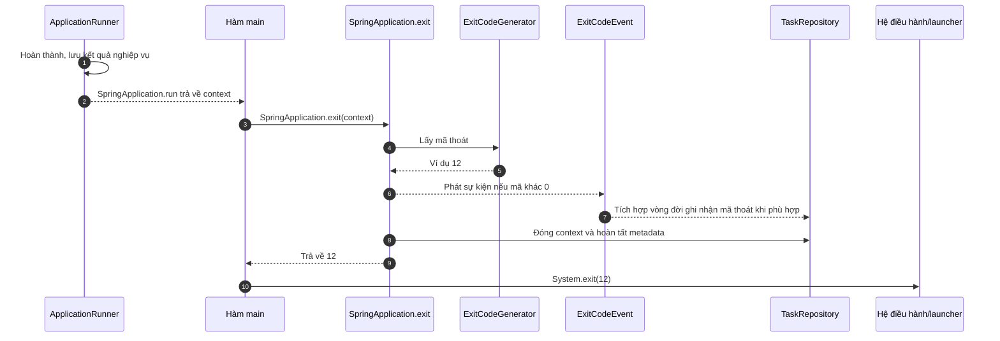

# Vai trò của `ExitCodeEvent` và `SpringApplication.exit`

Một ứng dụng **Spring Cloud Task** được thiết kế để chạy trong thời gian hữu hạn: nhận tham số, thực hiện công việc, ghi kết quả thực thi vào cơ sở dữ liệu rồi kết thúc. Nếu tác vụ tạo báo cáo thất bại nhưng tiến trình vẫn trả **mã thoát `0`**, cron, Kubernetes Job hoặc bộ điều phối có thể hiểu nhầm rằng công việc đã hoàn tất. Ngược lại, nếu ứng dụng kết thúc với mã lỗi nhưng bản ghi **`TaskExecution`** chưa được cập nhật, người vận hành có thể nhìn thấy hai kết quả không nhất quán.

Trong chương **Kết quả và mã thoát**, hai thành phần liên quan cần được hiểu rõ:

- **`ExitCodeEvent`** là sự kiện do **Spring Boot** phát ra khi xác định được mã thoát khác `0` trong quá trình kết thúc ứng dụng hoặc xử lý lỗi tương ứng. Nó giúp các thành phần lắng nghe, bao gồm tích hợp vòng đời tác vụ, biết về mã thoát.
- **`SpringApplication.exit(...)`** là API của **Spring Boot** dùng để đóng `ApplicationContext` và lấy mã thoát do `ExitCodeGenerator` cung cấp. Phương thức này **trả về một số nguyên**, nhưng **không tự gọi `System.exit(...)`** để kết thúc JVM với số đó.

Spring Cloud Task bổ sung việc ghi nhận **`TaskExecution`** qua **`TaskRepository`**. Để vận hành đáng tin cậy, cần phân biệt rõ dữ liệu trong repository với trạng thái thực tế mà hệ điều hành và launcher nhìn thấy.

Sau bài này, bạn có thể giải thích quan hệ giữa `ExitCodeGenerator`, `ExitCodeEvent`, `SpringApplication.exit` và `TaskExecution.exitCode`; viết một task có mã thoát nghiệp vụ; xác minh mã thoát trên terminal và trong database; đồng thời tránh những lỗi phổ biến khi tích hợp Spring Batch, lịch chạy và cơ chế retry.

## 1. Có ít nhất hai nơi cần kiểm tra mã thoát

Một lần thực thi thường có hai cách quan sát kết quả:

| Nơi quan sát | Giá trị | Thành phần sử dụng |
| --- | --- | --- |
| **Hệ điều hành** | Mã thoát của tiến trình Java, thường `0` là thành công và khác `0` là thất bại | Shell, cron, CI/CD, container runtime, Kubernetes Job, launcher |
| **Spring Cloud Task metadata** | `TaskExecution.exitCode` được lưu trong `TaskRepository` | `TaskExplorer`, dashboard vận hành, dịch vụ giám sát và bộ điều phối |

Ví dụ: một tác vụ `dailyReport` có thể trả mã hệ điều hành `12` để báo “tham số đầu vào không hợp lệ”. Nếu kết nối và cơ chế ghi metadata còn hoạt động, hệ thống cũng cần có thông tin kết thúc phù hợp trong `TaskExecution` để tra cứu lịch sử.

Tuy nhiên, **không được mặc định hai giá trị lúc nào cũng giống nhau**:

- Có thể mã OS khác `0` do JVM bị kill, hết bộ nhớ hoặc container bị dừng trước khi metadata kịp ghi.
- Có thể một đoạn mã thiết lập trạng thái trong bộ nhớ nhưng không gọi `System.exit(...)`, khiến tiến trình trả mã không như mong đợi.
- Có thể lỗi kết nối cơ sở dữ liệu metadata ngăn việc tạo hoặc cập nhật `TaskExecution`.
- Có thể custom runner bắt lỗi rồi trả về bình thường; Spring Boot không biết nghiệp vụ đã thất bại để đưa ra kết quả lỗi.

Đây là lý do **mã thoát tiến trình, bản ghi TaskExecution, log và kết quả nghiệp vụ** đều cần được quan sát khi điều phối tác vụ theo lịch hoặc theo yêu cầu.

## 2. Vai trò của `ExitCodeEvent`

`ExitCodeEvent` thuộc Spring Boot (thường dùng import `org.springframework.boot.ExitCodeEvent`). Khi Spring Boot có một mã thoát **khác `0`** trong luồng thoát được framework hỗ trợ, nó có thể phát sự kiện này đến các listener còn hoạt động trong `ApplicationContext`.

Trong hệ sinh thái Spring Cloud Task, cơ chế lắng nghe sự kiện thoát giúp việc ghi nhận kết quả thực thi trong `TaskRepository` phản ánh mã thoát được cung cấp qua Spring Boot. Tùy phiên bản và đường đi của lỗi, metadata thực thi có thể được ghi cập nhật trong callback vòng đời tương ứng.

**Cần hiểu chính xác ba giới hạn:**

1. `ExitCodeEvent` mang thông tin **mã thoát**, không phải yêu cầu khởi chạy lại tác vụ hay tín hiệu để tự retry.
2. Sự kiện này **không tự thay đổi mã thoát của JVM**. Mã thoát mà shell nhìn thấy vẫn phụ thuộc vào cách ứng dụng kết thúc, ví dụ `System.exit(exitCode)`.
3. `ExitCodeEvent` **không nhất thiết được phát ra khi thành công**; đừng dùng nó làm callback “mọi tác vụ đã kết thúc”. Để quan sát vòng đời đầy đủ của Spring Cloud Task, dùng metadata `TaskExecution`, `TaskExplorer` hoặc `TaskExecutionListener` theo nhu cầu.

### Lắng nghe sự kiện để ghi log

Một bean có thể lắng nghe sự kiện thoát để bổ sung log phục vụ chẩn đoán:

```java
package com.example.reporttask;

import org.springframework.boot.ExitCodeEvent;
import org.springframework.context.event.EventListener;
import org.springframework.stereotype.Component;

@Component
public class ExitCodeAuditListener {

    @EventListener
    public void onExitCode(ExitCodeEvent event) {
        System.err.println(
            "Spring Boot xac dinh ma thoat: " + event.getExitCode()
        );
    }
}
```

Listener này chỉ **quan sát**; nó không gọi `System.exit(...)` và không phải nơi thích hợp để lưu toàn bộ dữ liệu nghiệp vụ. Trong một số lỗi khởi động hoặc trường hợp tiến trình chết đột ngột, bean có thể chưa được tạo hoặc sự kiện có thể không được phát.

> **Không tùy tiện tự phát `ExitCodeEvent` như cách “đặt mã thoát”.** Việc publish một sự kiện không bảo đảm hệ điều hành nhận đúng mã. Luồng thông thường là cho Spring Boot **tính mã thoát** bằng `ExitCodeGenerator` / cơ chế ánh xạ ngoại lệ, sau đó để framework công bố sự kiện và trả mã khi ứng dụng kết thúc.

## 3. `SpringApplication.exit(...)` làm những gì?

API:

```java
int exitCode = SpringApplication.exit(applicationContext);
```

Thường thực hiện hai nhiệm vụ liên quan:

- Thu thập mã thoát từ các `ExitCodeGenerator` trong context và các generator truyền trực tiếp khi gọi (nếu có), rồi xác định mã thoát ứng dụng theo quy tắc của phiên bản Spring Boot.
- Đóng `ApplicationContext` theo vòng đời Spring; khi có mã thoát khác `0`, Spring Boot có thể phát `ExitCodeEvent` trước khi hoàn thành quá trình đóng.

Phương thức **trả về số nguyên**. Để chuyển số đó thành mã thoát **tiến trình** khi chạy CLI độc lập:

```java
ConfigurableApplicationContext context =
    SpringApplication.run(ReportTaskApplication.class, args);
int exitCode = SpringApplication.exit(context);
System.exit(exitCode);
```

**`SpringApplication.exit` không tương đương `System.exit`.** Có thể chỉ gọi `SpringApplication.exit(context)` để đóng context nhưng nếu không truyền kết quả cho quá trình kết thúc JVM, shell có thể nhận `0` khi phương thức `main` kết thúc bình thường. Ngược lại, gọi `System.exit(9)` trực tiếp có thể chấm dứt JVM quá nhanh, làm các callback đóng context và ghi metadata không được thực thi như kỳ vọng.

Sơ đồ mô tả luồng khi tác vụ kết thúc có chủ đích:



Thứ tự chi tiết của callback phụ thuộc phiên bản và trạng thái context; sơ đồ chủ yếu thể hiện **đường truyền kết quả** từ nghiệp vụ, qua Spring Boot, đến kho thực thi và hệ điều hành.

### Phân biệt một lỗi quan trọng trong `main`

Nếu một `ApplicationRunner` ném ngoại lệ trong quá trình `SpringApplication.run(...)`, lệnh `run` có thể **không trả về context** cho dòng tiếp theo trong `main`. Khi đó, đoạn:

```java
var context = SpringApplication.run(App.class, args);
System.exit(SpringApplication.exit(context));
```

không đảm bảo thực thi dòng thứ hai. Spring Boot có đường xử lý lỗi khởi động và ngoại lệ riêng. Vì vậy, **đừng dựa vào đoạn sau `run` để bắt mọi thất bại của runner**. Hãy cho lỗi lan truyền đúng, sử dụng `ExitCodeExceptionMapper` hoặc `ExitCodeGenerator` phù hợp khi cần ánh xạ mã lỗi, và kiểm chứng hành vi ở phiên bản đang dùng.

## 4. `ExitCodeGenerator`: nguồn cung cấp mã thoát nghiệp vụ

`ExitCodeGenerator` là giao diện Spring Boot rất nhỏ:

```java
public interface ExitCodeGenerator {
    int getExitCode();
}
```

Ứng dụng có thể đăng ký bean triển khai giao diện này. Khi `SpringApplication.exit(...)` được gọi, Spring Boot lấy các generator phù hợp để xác định mã thoát. Một quy ước minh họa:

| Mã | Ý nghĩa của ứng dụng báo cáo | Hướng xử lý gợi ý |
| ---: | --- | --- |
| `0` | Xử lý thành công | Không retry. |
| `10` | Không có dữ liệu cho kỳ yêu cầu | Tùy quy ước: chấp nhận “không có dữ liệu” hoặc báo trạng thái cần theo dõi. |
| `12` | Tham số đầu vào không hợp lệ | Sửa tham số, không retry tự động với cùng đầu vào. |
| `20` | Phụ thuộc tạm thời không khả dụng | Có thể retry với giới hạn/backoff. |
| `30` | Vi phạm quy tắc nghiệp vụ | Cần kiểm tra nghiệp vụ trước khi chạy lại. |

Các mã này **là quy ước ví dụ**, không phải danh sách mã cố định của Spring Cloud Task. Đa số công cụ điều phối mặc định chỉ hiểu **`0` là thành công, khác `0` là thất bại**. Nếu muốn mã `10` vẫn được xem là kết quả chấp nhận được, cần cấu hình chính sách của orchestrator tương ứng.

### Ví dụ: task xuất báo cáo với mã “không có dữ liệu”

Ví dụ dưới đây dùng Spring Boot, Spring Cloud Task, `ApplicationRunner` và một bean `ExitCodeGenerator`:

```java
package com.example.reporttask;

import org.springframework.boot.ApplicationArguments;
import org.springframework.boot.ApplicationRunner;
import org.springframework.boot.ExitCodeGenerator;
import org.springframework.boot.SpringApplication;
import org.springframework.boot.autoconfigure.SpringBootApplication;
import org.springframework.cloud.task.configuration.EnableTask;
import org.springframework.context.ConfigurableApplicationContext;
import org.springframework.context.annotation.Bean;

@SpringBootApplication
@EnableTask
public class ReportTaskApplication {

    public static void main(String[] args) {
        ConfigurableApplicationContext context =
            SpringApplication.run(ReportTaskApplication.class, args);

        int exitCode = SpringApplication.exit(context);
        System.exit(exitCode);
    }

    @Bean
    RunOutcome runOutcome() {
        return new RunOutcome();
    }

    @Bean
    ExitCodeGenerator taskExitCode(RunOutcome outcome) {
        return outcome::getExitCode;
    }

    @Bean
    ApplicationRunner generateReport(RunOutcome outcome) {
        return args -> {
            if (args.containsOption("no-data")) {
                System.out.println("Khong co du lieu de lap bao cao");
                outcome.setExitCode(10);
                return;
            }

            if (args.containsOption("simulate-error")) {
                // Ngoai le nghiep vu that bai trong khi runner dang chay.
                throw new IllegalStateException("Khong the tao bao cao");
            }

            // Thay bang xu ly tao bao cao thuc te.
            System.out.println("Bao cao da duoc tao");
        };
    }

    static final class RunOutcome {
        private volatile int exitCode = 0;

        int getExitCode() {
            return exitCode;
        }

        void setExitCode(int exitCode) {
            this.exitCode = exitCode;
        }
    }
}
```

Giải thích:

1. `ApplicationRunner` thực hiện công việc hữu hạn sau khi context khởi động.
2. `RunOutcome` giữ kết quả của công việc. Ví dụ dùng mã `10` khi không có dữ liệu; mã `0` khi tạo được báo cáo.
3. `ExitCodeGenerator` đọc kết quả đã được runner đặt, để `SpringApplication.exit(context)` có thể lấy mã.
4. `System.exit(exitCode)` báo kết quả cho hệ điều hành/launcher sau khi context được đóng.
5. Nếu `simulate-error` khiến runner ném ngoại lệ, `SpringApplication.run` có thể thất bại **trước khi** tới `SpringApplication.exit` trong `main`. Khi muốn cấp mã cụ thể cho đường lỗi đó, cần cơ chế ánh xạ ngoại lệ được mô tả ở phần tiếp theo.

Trong ứng dụng CLI chạy riêng, gọi `System.exit` ở `main` là một lựa chọn có chủ đích để truyền mã OS. Tránh gọi nó sâu trong service/runner vì dễ bỏ qua quá trình đóng context, listener và ghi trạng thái cuối cùng. Với môi trường nhúng hoặc kiểm thử tích hợp, thường không gọi `System.exit` trực tiếp.

### Cấu hình `TaskRepository` bền vững cho ví dụ

Nếu cần quan sát `TaskExecution` qua nhiều lần chạy, thêm dependency `spring-cloud-starter-task`, `spring-boot-starter-jdbc` và driver của database, đồng thời dùng Spring Boot / Spring Cloud release train **tương thích**.

Ví dụ `application.yml` với H2 **dạng file** cho máy học thử:

```yaml
spring:
  main:
    web-application-type: none
  application:
    name: report-task
  datasource:
    url: jdbc:h2:file:./report-task-metadata
    driver-class-name: org.h2.Driver
    username: sa
    password: ""
  cloud:
    task:
      name: dailyReport
      initialize-enabled: true
```

H2 file giúp lịch sử còn lại sau khi tiến trình dừng nếu luôn chạy từ **cùng thư mục làm việc**. Việc khởi tạo schema tự động phù hợp môi trường thực hành; sản xuất nên dùng migration theo phiên bản và CSDL có độ tin cậy phù hợp. Bảng metadata thuộc về **TaskRepository**, không phải nơi lưu file báo cáo hay toàn bộ dữ liệu nghiệp vụ.

## 5. Khi ném ngoại lệ: `ExitCodeExceptionMapper` và mã lỗi

Có hai dạng kết quả cần phân biệt:

- **Kết quả nghiệp vụ đã được xử lý có chủ đích:** runner chạy xong và ghi nhận rằng “không có dữ liệu”. `ExitCodeGenerator` là lựa chọn đơn giản để trả một mã có ý nghĩa.
- **Lỗi khiến runner/startup thất bại:** một ngoại lệ thoát ra. Spring Boot có cơ chế xử lý lỗi, trong đó **`ExitCodeExceptionMapper`** có thể ánh xạ loại ngoại lệ thành mã thoát khi được đăng ký và áp dụng đúng đường xử lý.

Ví dụ mapper minh họa:

```java
import org.springframework.boot.ExitCodeExceptionMapper;
import org.springframework.context.annotation.Bean;

@Bean
ExitCodeExceptionMapper exitCodeExceptionMapper() {
    return exception -> {
        Throwable current = exception;
        while (current != null) {
            if (current instanceof IllegalArgumentException) {
                return 12;
            }
            current = current.getCause();
        }
        return 1;
    };
}
```

Đoạn này cần đặt trong class cấu hình Spring, hoặc trong lớp `@SpringBootApplication` có `@Bean`. Việc duyệt `getCause()` giúp xử lý một số ngoại lệ bị framework bọc lại. Các ứng dụng thật nên dùng **exception type cụ thể** cho lỗi đầu vào, lỗi nghiệp vụ và lỗi tạm thời, tránh ánh xạ quá rộng theo những ngoại lệ nền tảng tình cờ xảy ra.

**Lưu ý về vòng đời:** Nếu lỗi xảy ra trước khi các bean được đăng ký, mapper có thể không sẵn có. Cách Spring Boot lấy mã từ exception và publish `ExitCodeEvent` cũng phụ thuộc đường đi của lỗi. Phải thử các tình huống thực tế trong phiên bản đã chọn và **không hứa hẹn mọi ngoại lệ đều được chuyển thành mã tùy chỉnh**.

Không nên **nuốt ngoại lệ** rồi cho runner kết thúc bình thường:

```java
// Sai nếu nghiệp vụ đã thất bại nhưng vẫn cần báo lỗi:
try {
    exportReport();
} catch (Exception ex) {
    log.error("Xuat bao cao that bai", ex);
    // Khong nem lai va cung khong dat exit code -> de bao thanh cong sai.
}

// Khi loi phai lam task that bai:
try {
    exportReport();
} catch (Exception ex) {
    log.error("Xuat bao cao that bai", ex);
    throw ex;
}
```

Đây là đoạn **minh họa xử lý lỗi**, giả định `exportReport()` và `log` đã được định nghĩa trong service. Với những kết quả đã biết trước mà không muốn ném ngoại lệ, cần đặt mã thoát tường minh qua `ExitCodeGenerator` và xác nhận có luồng gọi `SpringApplication.exit`.

## 6. Chạy, kiểm tra mã OS và đọc metadata

Giả sử đã đóng gói thành `target/report-task-0.0.1-SNAPSHOT.jar`. Chạy ba trường hợp từ thư mục gốc dự án:

**Thành công:**

```bash
java -jar target/report-task-0.0.1-SNAPSHOT.jar
echo $?
```

**Không có dữ liệu, mã nghiệp vụ `10`:**

```bash
java -jar target/report-task-0.0.1-SNAPSHOT.jar --no-data
echo $?
```

**Ném ngoại lệ:**

```bash
java -jar target/report-task-0.0.1-SNAPSHOT.jar --simulate-error
echo $?
```

Trong Bash, `$?` là mã thoát của lệnh ngay trước đó: cần gọi `echo $?` **ngay sau `java -jar`**. Trong PowerShell:

```powershell
java -jar .\target\report-task-0.0.1-SNAPSHOT.jar --no-data
$LASTEXITCODE
```

Với ví dụ đã cấu hình đúng, kỳ vọng đường chạy thành công trả `0`; đường `--no-data` trả `10` sau khi `SpringApplication.exit` lấy mã từ generator và `System.exit` chuyển nó cho OS. Đường `--simulate-error` sẽ báo thất bại, nhưng **mã cụ thể** phụ thuộc xử lý ngoại lệ và các bean mapper/generator có hiệu lực tại thời điểm lỗi.

Trong kho metadata, truy vấn:

```sql
SELECT
    TASK_EXECUTION_ID,
    TASK_NAME,
    START_TIME,
    END_TIME,
    EXIT_CODE,
    EXIT_MESSAGE
FROM TASK_EXECUTION
ORDER BY TASK_EXECUTION_ID DESC;
```

Tên cột và schema cần phù hợp phiên bản Spring Cloud Task bạn sử dụng. Chú ý một số điểm:

- Một lệnh `java -jar` tạo một **lần thực thi `TaskExecution`** nếu ứng dụng khởi động đủ xa để ghi metadata.
- Chạy lại cùng tên task tạo một `TASK_EXECUTION_ID` khác, không ghi đè bản ghi trước.
- `EXIT_CODE` thể hiện trạng thái mà **Spring Cloud Task kịp lưu**, không phải bằng chứng tuyệt đối về mã OS khi container chết đột ngột.
- `EXIT_MESSAGE` hoặc log hỗ trợ chẩn đoán; không nên đặt toàn bộ dữ liệu nhạy cảm hay stack trace chứa secret vào trường này.

Khi khảo sát sự kiện `ExitCodeEvent`, có thể đối chiếu ba nơi: log của `ExitCodeAuditListener`, mã thoát shell và hàng `TASK_EXECUTION`. Nếu chúng khác nhau, cần xác định **sự kiện có được phát không, context có đóng đúng không, database còn kết nối không và `System.exit` có nhận đúng mã không**.

## 7. Những trường hợp dễ nhầm lẫn

| Tình huống | Điều thực sự xảy ra | Cách xử lý |
| --- | --- | --- |
| Chỉ gọi `SpringApplication.exit(context)` rồi kết thúc `main` bình thường | Context đóng, API trả mã nhưng OS có thể nhận `0` | Với CLI cần truyền mã OS, dùng `System.exit(SpringApplication.exit(context))` ở `main`. |
| Chỉ gọi `System.exit(12)` từ giữa runner | JVM có thể dừng trước khi framework cập nhật metadata | Đưa mã qua generator, để runner hoàn thành/lan truyền lỗi rồi đóng context đúng vòng đời. |
| Runner ném exception trước khi `run` trả context | Mã ở dòng sau `SpringApplication.run` không được thực hiện | Dùng exception mapping phù hợp; kiểm tra mã OS và `TaskExecution` trên đường lỗi. |
| Bean `ExitCodeGenerator` luôn trả `0` | Lệnh thoát không biết đã có lỗi nghiệp vụ bị bắt và bỏ qua | Cho lỗi lan truyền hoặc đặt mã lỗi tường minh. |
| Có `ExitCodeEvent` khác `0` | Sự kiện thông báo mã khác `0`, không tự khởi chạy lại | Orchestrator quyết định retry và xử lý cảnh báo. |
| `TaskExecution` không có `END_TIME` | Tiến trình có thể crash, mất kết nối DB hoặc chưa cập nhật được | Kiểm tra container/OS, log, timeout và kết nối metadata. |
| `TaskExecution` ghi lỗi nhưng bước nghiệp vụ đã commit | Metadata và dữ liệu nghiệp vụ có ranh giới giao dịch khác nhau | Thiết kế idempotency, đối chiếu kết quả trước khi retry. |
| Cron/Kubernetes coi mọi mã khác `0` là thất bại | Các mã nghiệp vụ như `10` vẫn được hạ tầng hiểu là lỗi | Tài liệu hóa chính sách mã thoát và cấu hình orchestrator tương ứng. |

### Không nhầm mã “không có dữ liệu” với “lỗi kỹ thuật”

Nếu nghiệp vụ coi “không có dữ liệu” là thành công, dùng `0` và ghi kết quả cụ thể trong log hoặc dữ liệu nghiệp vụ. Nếu muốn một trạng thái riêng để bộ điều phối nhận biết, có thể dùng `10` **nhưng phải hiểu hệ quả**: nhiều scheduler, CI pipeline và container platform sẽ coi nó là thất bại theo mặc định.

### Không dùng `ExitCodeEvent` để thay thế transaction

Sự kiện không tự đảm bảo thao tác update database đã commit. Nếu metadata DB mất kết nối trong lúc shutdown, Spring Cloud Task có thể không lưu được mã cuối cùng dù `SpringApplication.exit` đã trả mã. Ngược lại, dữ liệu kinh doanh có thể đã commit trong transaction riêng trước khi lỗi xuất hiện.

## 8. Khi phối hợp Spring Batch và bộ điều phối

Một Spring Cloud Task có thể chứa **Spring Batch Job**. Khi đó cần phân biệt:

| Cấp độ | Metadata/giá trị | Ý nghĩa |
| --- | --- | --- |
| **Spring Batch** | `BatchStatus`, `ExitStatus` của `JobExecution` / `StepExecution` | Kết quả công việc theo lô, step và restart/checkpoint. |
| **Spring Cloud Task** | `TaskExecution.exitCode` | Kết quả một **lần chạy ứng dụng hữu hạn** được ghi vào repository task. |
| **Hệ điều hành/launcher** | Process exit code | Kết quả mà shell, scheduler hoặc nền tảng container nhận được. |

Spring Batch có mã trạng thái/`ExitStatus` ở **cấp Job/Step**; những giá trị này **không mặc nhiên là mã thoát của JVM**. Tùy cơ chế tích hợp, kết quả Batch có thể được ánh xạ sang mã thoát ứng dụng, nhưng cần kiểm tra cấu hình cụ thể. Đừng dùng `JobExecution.id` để thay cho `TaskExecution.executionId` hoặc suy ra rằng `ExitStatus` đã tự được phát thành `ExitCodeEvent`.

Ví dụ: job đối soát thất bại tại bước thứ hai nhưng listener nghiệp vụ đã ghi “đã chạy xong” và runner không ném lỗi. Nếu không kiểm tra `JobExecution`/`ExitStatus` và không đặt mã thoát ứng dụng đúng, bộ điều phối có thể hiểu task thành công.

Khi chạy theo lịch hoặc yêu cầu:

- **Launcher** khởi động JVM/container và quan sát mã kết thúc của tiến trình.
- **Spring Cloud Task** lưu metadata và kết quả ở mức ứng dụng, nếu còn kết nối đến `TaskRepository`.
- **Orchestrator** quyết định theo mã và trạng thái: đánh dấu thành công, cảnh báo, dừng workflow hay chạy lại với giới hạn/backoff.
- **Nghiệp vụ** phải có khóa idempotency (ví dụ `businessDate` + mã yêu cầu) nếu cùng công việc có thể được retry.

Không nên retry tất cả các mã khác `0` theo cùng một cách. Mã báo lỗi đầu vào thường cần người sửa; mã lỗi hạ tầng tạm thời có thể retry; mã báo “không có dữ liệu” có thể được coi là trạng thái chấp nhận được nếu quy trình cho phép.

## 9. Nguyên tắc vận hành an toàn

**Quy ước mã thoát rõ ràng.** Ghi tài liệu mã nào là thành công, mã nào cần retry và mã nào cần can thiệp. Đừng phân loại chỉ bằng một chuỗi log như “hoàn tất”.

**Truyền kết quả từ đầu đến cuối.** Nếu dùng `ExitCodeGenerator`, hãy bảo đảm mã nghiệp vụ được lưu vào state đúng lúc và gọi `SpringApplication.exit` ở đường chạy đã định. Nếu cần OS biết mã, truyền kết quả vào `System.exit` từ `main` sau khi đóng context.

**Phân biệt đường thành công và lỗi lúc khởi động.** Ngoại lệ trong runner có thể làm `SpringApplication.run` thất bại trước khi trả context; kiểm thử riêng đường này với `ExitCodeExceptionMapper` hoặc chiến lược xử lý lỗi thích hợp.

**Chấp nhận metadata có thể thiếu trong crash.** Với SIGKILL, OOM, mất điện hoặc database ngừng hoạt động, không có bảo đảm tất cả callback sẽ chạy. Dùng thêm log tập trung, sự kiện nền tảng và timeout/heartbeat khi theo dõi.

**Retry an toàn.** Mỗi lần chạy lại tạo `TaskExecution` mới nếu metadata ghi thành công. Kiểm tra kết quả nghiệp vụ đã commit, sử dụng idempotency và tránh chạy hai tiến trình cho cùng một đơn vị dữ liệu ngoài ý muốn.

**Bảo vệ thông tin nhạy cảm.** Không đưa secret, token hoặc dữ liệu khách hàng vào mã thoát, thông báo sự kiện, tham số CLI hay metadata dùng để truy vết.

## 10. Bài thực hành và câu hỏi tự kiểm tra

1. Tạo JAR Spring Cloud Task từ ví dụ `ReportTaskApplication`, bật H2 file metadata và khởi chạy một lần bình thường. So sánh mã shell với `TASK_EXECUTION.EXIT_CODE`.
2. Chạy với `--no-data`. Giải thích vì sao `ExitCodeGenerator` trả `10`, `SpringApplication.exit` trả lại `10` và `System.exit(10)` giúp launcher nhận đúng kết quả.
3. Thêm `ExitCodeAuditListener` và quan sát sự kiện ở lần chạy mã `10`. Sự kiện này có xuất hiện ở lần chạy thành công mã `0` không? Không nên phụ thuộc vào sự kiện để ghi nhận mọi lần chạy.
4. Chạy với `--simulate-error`. Đối chiếu stack trace, mã shell và bản ghi task. Tại sao đoạn mã sau `SpringApplication.run` có thể không được thực thi?
5. Đăng ký `ExitCodeExceptionMapper` để ánh xạ một exception nghiệp vụ cụ thể sang mã `12`; kiểm tra kết quả trên đúng phiên bản Spring Boot/Spring Cloud Task.
6. Thử bỏ `System.exit(exitCode)` trong môi trường test, rồi so sánh mã trả từ `SpringApplication.exit` với mã shell. Cách nào khiến launcher nhận sai kết quả?
7. Giả lập trường hợp dữ liệu nghiệp vụ đã ghi xong nhưng metadata không cập nhật được kết thúc. Trước khi retry, cần xem thêm bằng chứng nào?
8. Với một Spring Batch Job trong ứng dụng Spring Cloud Task, trình bày ba cấp độ: `ExitStatus` của Batch, `TaskExecution.exitCode` và process exit code.

**Câu hỏi ôn tập:**

- `ExitCodeEvent` có tự chấm dứt JVM hoặc tự khởi chạy lại task không?
- `SpringApplication.exit(context)` khác gì với `System.exit(code)`?
- Vì sao không thể dùng riêng `TaskExecution.exitCode` để chứng minh tuyệt đối tiến trình đã kết thúc theo cùng mã đó?
- Khi runner ném ngoại lệ trước khi `SpringApplication.run` trả về, cần chú ý điều gì nếu muốn có mã lỗi nghiệp vụ tùy chỉnh?
- Bộ điều phối nên xử lý mã `12` (lỗi tham số) và mã `20` (phụ thuộc tạm thời không khả dụng) như nhau hay khác nhau?

**Ghi nhớ:** `ExitCodeEvent` truyền thông tin mã thoát trong vòng đời Spring Boot; `SpringApplication.exit` đóng context và **trả về** mã thoát; `System.exit` chuyển mã đó cho hệ điều hành khi cần. Spring Cloud Task ghi lịch sử qua `TaskRepository`, nhưng kết quả tin cậy để vận hành đòi hỏi đối chiếu **metadata, mã tiến trình, log và kết quả nghiệp vụ**.
