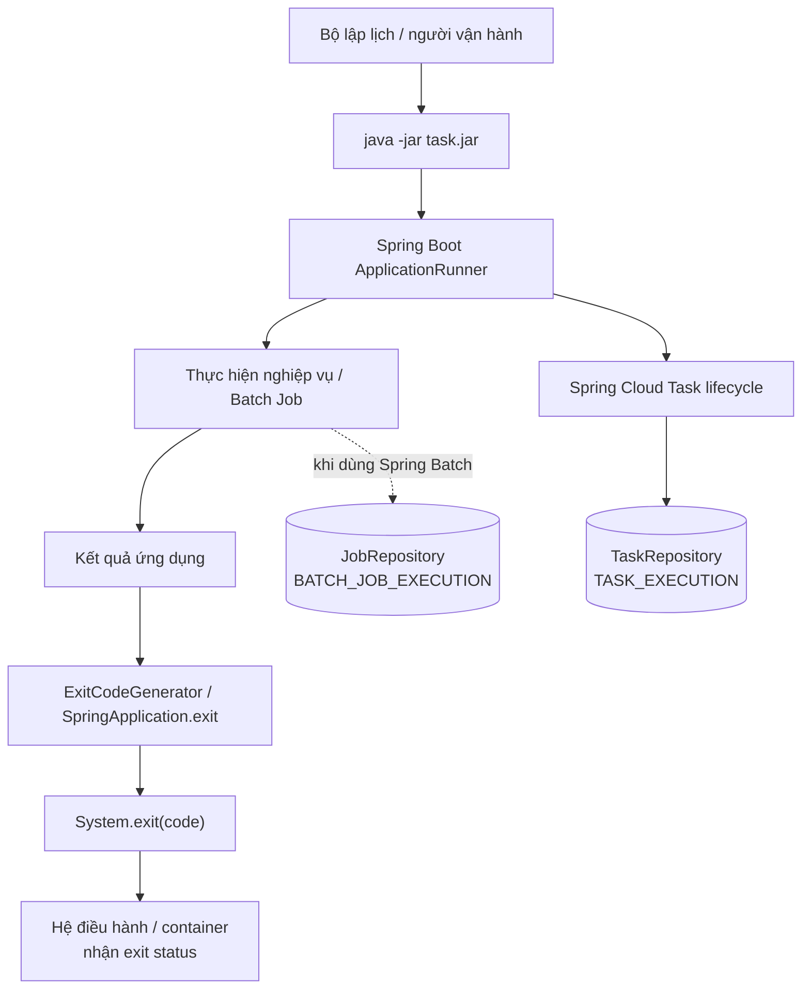
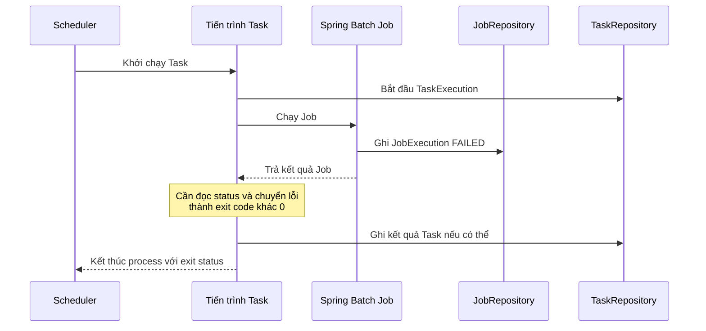

# Trả mã thoát từ hàm `main` ra hệ điều hành

## Mục tiêu học tập

Sau bài học, bạn có thể:

- Phân biệt **mã thoát của tiến trình hệ điều hành**, `TaskExecution.exitCode` trong Spring Cloud Task và trạng thái của Spring Batch Job.
- Giải thích vì sao `SpringApplication.exit(context)` và `System.exit(exitCode)` thường được dùng cùng nhau trong một ứng dụng Spring Boot chạy hữu hạn.
- Viết hàm `main` trả exit code rõ ràng, sử dụng `ExitCodeGenerator` khi kết quả nghiệp vụ có thể là thành công, không hợp lệ hoặc thất bại.
- Hiểu các đường lỗi khi `SpringApplication.run(...)` ném exception, khi runner bắt lỗi rồi trả về và khi tiến trình bị kết thúc đột ngột.
- Kiểm tra mã thoát từ Bash, PowerShell, Docker, Kubernetes Job/CronJob và đối chiếu với dữ liệu `TaskRepository`.
- Thiết kế quy ước exit code phục vụ retry, cảnh báo và vận hành an toàn khi Task chạy theo lịch hoặc theo yêu cầu.

> **Ngữ cảnh:** Bài thuộc chương **Kết quả và mã thoát** của module **SPRING_CLOUD_TASK**. Spring Cloud Task dành cho ứng dụng Spring Boot chạy trong thời gian hữu hạn, lưu các lần thực thi và kết quả vào cơ sở dữ liệu qua `TaskRepository`. Để hệ thống bên ngoài biết lượt chạy thành công hay thất bại, ngoài metadata trong database, tiến trình Java còn phải **kết thúc với mã thoát phù hợp**.

## 1. Vì sao mã thoát của tiến trình quan trọng?

Hãy hình dung một `daily-settlement-task` được Kubernetes CronJob kích hoạt mỗi đêm. Task làm ba việc:

1. Nhận tham số `--business-date=2026-11-24`.
2. Đọc dữ liệu, đối soát và lưu kết quả vào database nghiệp vụ.
3. Ghi thông tin lần chạy vào `TaskRepository` rồi kết thúc.

Nếu phát hiện dữ liệu đầu vào không hợp lệ, runner chỉ ghi log `ERROR` rồi trả về bình thường, tiến trình có thể kết thúc với mã `0`. Kubernetes Job hoặc shell script có thể coi lượt chạy là **thành công** dù nghiệp vụ không hoàn tất.

Ở cấp hệ điều hành, một tiến trình trả về **exit status** khi kết thúc. Theo quy ước phổ biến:

| Mã thoát | Diễn giải thường dùng | Hành động vận hành có thể áp dụng |
| ---: | --- | --- |
| `0` | Hoàn thành thành công. | Đánh dấu thành công, không retry. |
| `1` | Lỗi tổng quát chưa được phân loại. | Ghi cảnh báo, xem log. |
| `2` | Đầu vào không hợp lệ, ví dụ thiếu tham số. | Điều chỉnh lệnh gọi trước khi chạy lại. |
| `10` | Xử lý nghiệp vụ thất bại. | Retry có kiểm soát hoặc điều tra. |
| `20` | Phụ thuộc bên ngoài không sẵn sàng. | Kiểm tra database/API, cân nhắc retry. |

Các mã khác `0` trong bảng chỉ là **quy ước ví dụ của ứng dụng**, không phải các giá trị Spring Cloud Task bắt buộc. Shell, container runtime hoặc orchestrator thường quan tâm trước tiên đến **`0` so với khác `0`**; nếu cần quyết định retry theo loại lỗi, bạn phải tự xây dựng chính sách ở tầng điều phối.

**Điểm cốt lõi:** ghi được `EXIT_CODE=10` trong bảng Task và **trả mã `10` cho hệ điều hành** là hai kết quả cần được hiểu, cấu hình và kiểm chứng riêng.

## 2. Ba lớp kết quả dễ bị nhầm

Trong ứng dụng có Spring Cloud Task, và có thể kết hợp Spring Batch, cần phân biệt:

| Lớp | Nguồn dữ liệu | Trả lời câu hỏi |
| --- | --- | --- |
| **Kết quả tiến trình** | Exit status do JVM trả về hệ điều hành, shell, Docker hoặc Kubernetes. | Tiến trình có được nền tảng vận hành xem là thành công không? |
| **Kết quả Task** | `TaskExecution.exitCode`, `exitMessage`, `errorMessage` trong `TaskRepository`. | Lần chạy Task được framework ghi nhận với kết quả gì? |
| **Kết quả Spring Batch Job** | `JobExecution.status`, `ExitStatus` trong `JobRepository`. | Job/Step nào thành công, thất bại hoặc dừng? |

Không nên mặc định các tín hiệu này luôn đồng bộ.

Ví dụ, một Batch Job có `BatchStatus.FAILED` nhưng ứng dụng bao ngoài không lan truyền thất bại ra exit code của JVM. Ngược lại, một tiến trình bị hệ điều hành giết đột ngột có thể có exit status bất thường dù `TaskRepository` chưa kịp ghi `END_TIME` hoặc cập nhật `EXIT_CODE`.



Sơ đồ thể hiện **ba điểm quan sát**. Không có một phép ánh xạ tự động hoàn hảo từ kết quả nghiệp vụ đến cả ba nơi trong mọi tình huống; ứng dụng phải xử lý và kiểm thử đường lỗi.

## 3. `SpringApplication.run(...)` trả về gì?

Đoạn `main` thường gặp của Spring Boot:

```java
@SpringBootApplication
public class DailySettlementApplication {
    public static void main(String[] args) {
        SpringApplication.run(DailySettlementApplication.class, args);
    }
}
```

`SpringApplication.run(...)` trả về một `ConfigurableApplicationContext` sau khi Spring Boot khởi tạo context và hoàn tất luồng startup mà framework quản lý, bao gồm việc chạy các `ApplicationRunner`/`CommandLineRunner` đồng bộ. Nó **không trả về số nguyên exit code**.

Vì phương thức `main(String[] args)` trong Java có kiểu trả về `void`, bạn không thể viết:

```java
// KHÔNG hợp lệ trong Java:
public static void main(String[] args) {
    return 10; // main có kiểu trả về void
}
```

Nếu hàm `main` kết thúc bình thường mà không yêu cầu mã thoát khác, JVM thường kết thúc với exit status `0` khi không còn luồng đang hoạt động. Nếu startup ném exception không được xử lý, JVM thường kết thúc khác `0`; nhưng khi framework, wrapper hoặc mã ứng dụng tự bắt lỗi, kết quả thực tế cần được kiểm chứng.

Spring Boot có API để tính exit code, và Java có API để kết thúc tiến trình bằng một mã cụ thể. Kết hợp hai API này là cách rõ ràng để cho scheduler nhận đúng tín hiệu.

## 4. Mẫu `main` chuẩn cho một Task hữu hạn

Đối với Task không phục vụ HTTP, có thể cấu hình một ứng dụng Spring Boot như sau:

```java
package com.example.settlement;

import org.springframework.boot.SpringApplication;
import org.springframework.boot.autoconfigure.SpringBootApplication;
import org.springframework.cloud.task.configuration.EnableTask;
import org.springframework.context.ConfigurableApplicationContext;

@SpringBootApplication
@EnableTask
public class DailySettlementApplication {

    public static void main(String[] args) {
        ConfigurableApplicationContext context =
                SpringApplication.run(DailySettlementApplication.class, args);

        int exitCode = SpringApplication.exit(context);
        System.exit(exitCode);
    }
}
```

Ví dụ cấu hình `application.yml`:

```yaml
spring:
  application:
    name: daily-settlement-task
  main:
    web-application-type: none
  cloud:
    task:
      initialize-enabled: false
  datasource:
    url: jdbc:postgresql://localhost:5432/taskdb
    username: ${TASK_DB_USER}
    password: ${TASK_DB_PASSWORD}
```

Cấu hình giả định database PostgreSQL đã có **schema Spring Cloud Task đúng phiên bản** và credentials được cấp qua biến môi trường. Nếu schema chưa có, ứng dụng có thể lỗi trước khi hoàn tất startup.

### 4.1. Vai trò của từng lời gọi

**`SpringApplication.run(...)`** khởi tạo context và thực thi các runner đồng bộ của ứng dụng. Nếu tất cả trở về bình thường, nó trả về context để mã trong `main` có thể tiếp tục.

**`SpringApplication.exit(context)`** thu thập thông tin exit code mà Spring Boot hỗ trợ (trong đó có các bean triển khai `ExitCodeGenerator`), thực hiện đóng context theo vòng đời ứng dụng và trả về **một số nguyên**. Gọi phương thức này **không đồng nghĩa** JVM chắc chắn dừng ngay với mã đó.

**`System.exit(exitCode)`** yêu cầu JVM kết thúc với mã đã xác định. Hệ điều hành và nền tảng điều phối quan sát mã thoát sau khi tiến trình dừng.

Có thể viết gọn:

```java
public static void main(String[] args) {
    System.exit(
        SpringApplication.exit(
            SpringApplication.run(DailySettlementApplication.class, args)
        )
    );
}
```

Tuy nhiên, cách viết tách thành các biến `context` và `exitCode` thường dễ debug, gắn log và kiểm thử hơn.

### 4.2. Nếu không có logic tạo mã thoát đặc biệt?

Với luồng khởi chạy bình thường và không có `ExitCodeGenerator` báo lỗi, `SpringApplication.exit(context)` thường trả `0`. Khi nghiệp vụ cần trả mã `2` cho tham số sai hoặc `10` cho kết quả không đạt, ta cần cung cấp tín hiệu cho Spring Boot (ví dụ thông qua `ExitCodeGenerator`) **trước khi gọi `SpringApplication.exit`**.

Chỉ thêm `System.exit(0)` vào cuối `main` sẽ làm mọi lần chạy hoàn tất bình thường báo thành công, kể cả khi code đã phát hiện lỗi nhưng không lan truyền trạng thái. Vì vậy đừng hard-code `0` nếu kết quả nghiệp vụ có thể thất bại.

## 5. Dùng `ExitCodeGenerator` để phản ánh kết quả nghiệp vụ

`ExitCodeGenerator` là interface của Spring Boot, với phương thức:

```java
package org.springframework.boot;

@FunctionalInterface
public interface ExitCodeGenerator {
    int getExitCode();
}
```

Một bean triển khai interface này có thể đóng góp exit code cho `SpringApplication.exit(context)`. Trong một Task hữu hạn, ta có thể ghi nhận kết quả trong bean và để `main` lấy mã khi các runner đã kết thúc.

### 5.1. Tạo bộ ghi nhận trạng thái

```java
package com.example.settlement;

import org.springframework.boot.ExitCodeGenerator;
import org.springframework.stereotype.Component;

@Component
public class SettlementExitStatus implements ExitCodeGenerator {

    private volatile int code = 0;

    public void invalidInput() {
        this.code = 2;
    }

    public void businessFailure() {
        this.code = 10;
    }

    @Override
    public int getExitCode() {
        return code;
    }
}
```

Ở đây mã `0` biểu thị thành công theo mặc định, `2` dành cho đầu vào không hợp lệ và `10` dành cho thất bại nghiệp vụ. `volatile` làm giá trị có thể quan sát được giữa các thread; ví dụ vẫn giả định **runner chờ công việc hoàn tất** trước khi thoát. Nếu có nhiều thread cạnh tranh cập nhật trạng thái, nên định nghĩa chiến lược ưu tiên mã lỗi và cơ chế đồng bộ rõ ràng thay vì để thao tác gán cuối cùng quyết định kết quả.

### 5.2. Runner ghi nhận mã thoát

```java
package com.example.settlement;

import java.time.LocalDate;
import java.time.format.DateTimeParseException;
import java.util.List;

import org.slf4j.Logger;
import org.slf4j.LoggerFactory;
import org.springframework.boot.ApplicationArguments;
import org.springframework.boot.ApplicationRunner;
import org.springframework.stereotype.Component;

@Component
public class SettlementRunner implements ApplicationRunner {

    private static final Logger log =
            LoggerFactory.getLogger(SettlementRunner.class);

    private final SettlementExitStatus exitStatus;
    private final SettlementService service;

    public SettlementRunner(SettlementExitStatus exitStatus,
                            SettlementService service) {
        this.exitStatus = exitStatus;
        this.service = service;
    }

    @Override
    public void run(ApplicationArguments args) {
        List<String> dates = args.getOptionValues("business-date");
        if (dates == null || dates.size() != 1) {
            log.error("Cần đúng một --business-date=yyyy-MM-dd");
            exitStatus.invalidInput();
            return;
        }

        LocalDate businessDate;
        try {
            businessDate = LocalDate.parse(dates.get(0));
        } catch (DateTimeParseException ex) {
            log.error("Ngày nghiệp vụ không hợp lệ: {}", dates.get(0));
            exitStatus.invalidInput();
            return;
        }

        try {
            service.settle(businessDate);
            log.info("Đối soát thành công cho {}", businessDate);
        } catch (Exception ex) {
            log.error("Đối soát thất bại", ex);
            exitStatus.businessFailure();
        }
    }
}
```

Trong ví dụ này, `SettlementService` là service nghiệp vụ do ứng dụng cung cấp:

```java
package com.example.settlement;

import java.time.LocalDate;
import org.springframework.stereotype.Service;

@Service
public class SettlementService {

    public void settle(LocalDate businessDate) {
        // Ví dụ học tập: thay bằng logic đọc/ghi dữ liệu,
        // transaction, kiểm tra kết quả và idempotency thực tế.
        if (businessDate.isAfter(LocalDate.now())) {
            throw new IllegalStateException(
                    "Không đối soát ngày trong tương lai");
        }
    }
}
```

**Lưu ý cách xử lý lỗi trong ví dụ:** Runner cố ý **ghi nhận mã không bằng `0` rồi trả về**, để `SpringApplication.run(...)` trả context và `main` tiếp tục đến `SpringApplication.exit(...)`. Đây là một cách xử lý các kết quả nghiệp vụ đã dự kiến và muốn phân loại thành mã riêng. Nó không có nghĩa mọi exception đều nên bị bắt và nuốt. Với lỗi bất thường, có thể để exception thoát ra ngoài và dùng cơ chế xử lý startup failure của Spring Boot.

Đặc biệt, kết quả `TaskExecution.exitCode` trong database có thể phụ thuộc vào cách Spring Cloud Task tích hợp với `ExitCodeGenerator`, sự kiện đóng context và phiên bản đang dùng. **Hãy kiểm thử cả mã trong `TASK_EXECUTION` và mã thoát process**; không lấy kết quả từ một trong hai để tự suy ra kết quả còn lại.

### 5.3. Chạy và dự đoán mã thoát

```bash
# Đầu vào hợp lệ, service thành công:
java -jar daily-settlement-task.jar --business-date=2026-11-24

# Không có ngày, runner gán mã 2:
java -jar daily-settlement-task.jar

# Ngày không hợp lệ, runner gán mã 2:
java -jar daily-settlement-task.jar --business-date=abc

# Để thử mã 10, gây lỗi nghiệp vụ có kiểm soát trên môi trường test.
```

Trong ứng dụng ví dụ, mã `2`/`10` do `SettlementExitStatus` quyết định. Các mã khác `0` **không phải quy định có sẵn** của Spring Cloud Task; đội phát triển nên thống nhất bảng mã và tài liệu hóa hành động phù hợp với từng mã.

## 6. Nếu `SpringApplication.run(...)` thất bại trước khi trả context?

Xét một runner ném exception trực tiếp:

```java
@Component
class ValidateRunner implements ApplicationRunner {

    @Override
    public void run(ApplicationArguments args) {
        throw new IllegalStateException("Không kết nối được nguồn dữ liệu");
    }
}
```

Khi đó, `SpringApplication.run(...)` có thể **ném exception mà không trả `ConfigurableApplicationContext` về `main`**. Vì vậy hai dòng:

```java
int exitCode = SpringApplication.exit(context);
System.exit(exitCode);
```

sẽ **không được chạy** theo đường đi thành công. Spring Boot sẽ thực hiện cơ chế xử lý lỗi khởi chạy mà nó hỗ trợ; exception chưa được xử lý đi ra khỏi `main` thường làm tiến trình Java kết thúc với mã khác `0`.

Điều quan trọng không phải “mọi lỗi đều phải đi qua `SpringApplication.exit`”, mà là **đường lỗi phải làm hệ điều hành nhận được mã thất bại thực sự**.

### 6.1. Tránh nuốt exception rồi vô tình báo thành công

Đoạn sau có lỗi thiết kế:

```java
try {
    runBusiness();
} catch (Exception ex) {
    log.error("Có lỗi", ex);
    // Không throw và cũng không ghi nhận mã thất bại.
}
```

Runner kết thúc bình thường, `SpringApplication.run` có thể trả context, `ExitCodeGenerator` không có lỗi và `main` gọi `System.exit(0)`. Scheduler thấy Task thành công dù nghiệp vụ thất bại.

Có ba hướng xử lý hợp lệ tùy yêu cầu:

1. **Ném lại exception:** phù hợp với lỗi không thể phục hồi, để quá trình khởi chạy thất bại và nhận exit status khác `0`.
2. **Ghi mã lỗi có chủ đích:** như `SettlementExitStatus`, hữu ích khi muốn phân biệt đầu vào sai, lỗi nghiệp vụ, phụ thuộc tạm thời.
3. **Dùng `ExitCodeExceptionMapper` theo Spring Boot:** ánh xạ loại exception sang mã thoát khi luồng lỗi được framework xử lý. Kiểm tra API và cách báo mã thực tế của phiên bản Spring Boot đang triển khai.

Không đặt `System.exit(...)` rải rác trong các service nghiệp vụ; như vậy có thể bỏ qua luồng cleanup, transaction và callback vòng đời dự kiến. Nên tập trung quyết định kết thúc tiến trình tại `main` hoặc lớp entrypoint và cho logic nghiệp vụ trả kết quả/ném lỗi rõ ràng.

### 6.2. Lỗi khởi động quá sớm

Nếu database Task chưa có schema, thiếu secret kết nối hoặc lỗi tạo bean, `SpringApplication.run` có thể thất bại **trước khi Spring Cloud Task tạo `TaskExecution`**. Khi đó:

- Có thể không có bản ghi trong `TASK_EXECUTION`.
- Log bootstrap, stderr và sự kiện thất bại của nền tảng điều phối là nguồn chẩn đoán quan trọng.
- Không nên buộc hệ thống vận hành chỉ coi Task là thất bại khi query thấy `EXIT_CODE != 0`.

Exit code của process là tín hiệu thiết yếu vì nó vẫn có thể cho biết khởi chạy thất bại dù TaskRepository không ghi được bản ghi nào.

## 7. `SpringApplication.exit` đóng context; `System.exit` kết thúc JVM

Hai lời gọi có trách nhiệm khác nhau:

| Lời gọi | Điều gì xảy ra? | Điều gì không được bảo đảm? |
| --- | --- | --- |
| `SpringApplication.exit(context)` | Tính exit code theo cơ chế Spring Boot và đóng `ApplicationContext`, chạy các callback đóng context được hỗ trợ. | Bản thân phương thức không bắt buộc JVM thoát ngay. |
| `System.exit(code)` | Yêu cầu JVM dừng và trả mã `code` cho môi trường chạy. | Không tự kiểm tra nghiệp vụ; không tự suy ra code từ TaskRepository. |
| `return` khỏi `main` | Kết thúc phương thức `main`. | JVM chưa chắc thoát nếu còn non-daemon thread; không có cách trả số nguyên từ `main` kiểu `void`. |

Trong Task hữu hạn, khi runner và các thao tác cần thiết **đã hoàn tất đồng bộ**, gọi `SpringApplication.exit` trước `System.exit` giúp cho hạ tầng Spring có cơ hội đóng tài nguyên theo vòng đời quản lý.

Tuy vậy, `System.exit` cũng có thể dừng những thread hoặc công việc nền **chưa hoàn thành**. Nếu runner khởi tạo `CompletableFuture` rồi trả về ngay, `main` có thể đóng context và thoát khi Future còn chạy. Cần đợi kết quả với timeout, kiểm tra lỗi và đóng tài nguyên trước khi báo hoàn thành.

Ví dụ sai về ý nghĩa hoàn tất:

```java
@Override
public void run(ApplicationArguments args) {
    CompletableFuture.runAsync(this::processPayments);
    // Trả về ngay dù processPayments chưa xong.
}
```

Giải pháp là trả về sau khi công việc hoàn tất, ví dụ chờ `future.get(timeout, TimeUnit.SECONDS)` và để lỗi/timeout dẫn đến mã thất bại phù hợp. Thời hạn chạy và ngắt nên được thiết kế theo scheduler, không chỉ theo thời gian chờ trong code.

## 8. Đối chiếu mã thoát với metadata Spring Cloud Task

Trong repository JDBC, Spring Cloud Task thường ghi một hàng vào `TASK_EXECUTION` cho mỗi lần chạy và có các cột như:

- `TASK_EXECUTION_ID`: ID riêng của lần chạy.
- `TASK_NAME`: tên ứng dụng Task.
- `START_TIME` và `END_TIME`: thời gian được framework ghi nhận.
- `EXIT_CODE`, `EXIT_MESSAGE`, `ERROR_MESSAGE`: dữ liệu kết quả/lỗi đã được ghi nhận khi có thể.

Truy vấn ví dụ:

```sql
SELECT
    TASK_EXECUTION_ID,
    TASK_NAME,
    START_TIME,
    END_TIME,
    EXIT_CODE,
    EXIT_MESSAGE,
    ERROR_MESSAGE
FROM TASK_EXECUTION
WHERE TASK_NAME = 'daily-settlement-task'
ORDER BY START_TIME DESC, TASK_EXECUTION_ID DESC;
```

**Không đồng nhất `EXIT_CODE` ở đây với exit status JVM trong mọi tình huống.** Chúng thường cùng mục đích nhưng được ghi qua các cơ chế khác nhau. Tình huống cần kiểm tra:

| Trường hợp | Mã trong TaskRepository | Exit status tiến trình |
| --- | --- | --- |
| Runner hoàn tất bình thường | Thường `0` khi kết thúc ghi thành công. | Thường `0`. |
| Runner ghi nhận thất bại nghiệp vụ mà không ném exception | Phụ thuộc cơ chế gắn kết quả vào Task, cấu hình và release. | Có thể khác `0` nếu `ExitCodeGenerator`/`main` được cấu hình đúng. |
| Runner ném exception không được xử lý | Có thể được cập nhật thành thất bại nếu framework/repository còn hoạt động. | Thường khác `0`. |
| Task chết trước khi khởi tạo repository | Có thể không có hàng Task. | Có thể khác `0`. |
| Container bị kill đột ngột | Hàng Task có thể thiếu `END_TIME` hoặc kết quả cuối. | Container runtime ghi nhận trạng thái chấm dứt; mã phụ thuộc nguyên nhân. |

Với ứng dụng chạy thường xuyên, nên đưa `executionId` vào structured log hoặc log listener để kết nối mỗi lần chạy với đúng hàng metadata. Khi chạy nhiều môi trường, ghép cả cluster/environment vì ID chỉ có phạm vi duy nhất trong repository tương ứng.

## 9. Khi Task chứa Spring Batch Job

Một `Spring Batch Job` có thể ghi `BatchStatus.FAILED` nhưng quá trình khởi chạy Job hoàn tất ở tầng runner mà không ném lỗi ra Spring Boot. Khi đó JobRepository ghi thất bại, còn Task/process có thể tiếp tục coi là thành công.

Ví dụ mô hình:



Với tích hợp Spring Cloud Task–Batch, có thể cấu hình (nếu release đang dùng hỗ trợ):

```properties
spring.cloud.task.batch.fail-on-job-failure=true
```

Cấu hình này giúp phần tích hợp Task–Batch phản ánh trường hợp Batch Job thất bại theo cơ chế của framework. Tuy nhiên, đừng dùng thuộc tính như một bảo đảm tuyệt đối cho mọi cách khởi chạy Job tùy biến, chạy bất đồng bộ hoặc runner tự bắt lỗi.

Khi tự gọi `JobLauncher`, runner nên:

1. Chờ `JobExecution` kết thúc theo cách chạy đã chọn.
2. Kiểm tra `BatchStatus` và các `ExitStatus` cần thiết.
3. Ném lỗi hoặc ghi nhận mã thoát khác `0` khi điều kiện nghiệp vụ không đạt.
4. Đảm bảo `main` chuyển mã đó thành **exit status của JVM**.
5. Đối chiếu `BATCH_JOB_EXECUTION`, `TASK_EXECUTION` và trạng thái container trên môi trường test.

`TASK_EXECUTION_ID` và `JOB_EXECUTION_ID` là hai ID độc lập. Nếu integration `spring-cloud-task-batch` hoạt động, bảng `TASK_TASK_BATCH` giúp liên kết chúng, nhưng không tự truyền mọi loại lỗi nghiệp vụ qua từng tầng.

## 10. Quan sát exit code từ terminal

### 10.1. Bash hoặc shell POSIX

Chạy:

```bash
java -jar daily-settlement-task.jar --business-date=2026-11-24
echo $?
```

`$?` là trạng thái của **lệnh vừa chạy xong**. Hãy đọc ngay sau lệnh `java`; nếu thực hiện một lệnh khác trước đó, giá trị có thể đã thay đổi.

Nếu dùng script wrapper:

```bash
#!/usr/bin/env bash

java -jar daily-settlement-task.jar "$@"
status=$?
echo "Task finished with exit code: $status"
exit "$status"
```

Lệnh `exit "$status"` giữ nguyên mã từ Java cho hệ thống gọi script. Nếu script chỉ in log và tự kết thúc bình thường, có thể vô tình biến mã thất bại của ứng dụng thành thành công của wrapper.

### 10.2. Windows PowerShell

```powershell
java -jar daily-settlement-task.jar --business-date=2026-11-24
$LASTEXITCODE
```

`$LASTEXITCODE` là biến PowerShell lưu mã thoát của chương trình native vừa chạy. Không nhầm với `$?`, vì `$?` thường biểu thị trạng thái thành công/thất bại dạng Boolean của lệnh trước đó.

Nếu viết PowerShell script wrapper:

```powershell
java -jar daily-settlement-task.jar --business-date=2026-11-24
$taskExitCode = $LASTEXITCODE
Write-Host "Task exit code: $taskExitCode"
exit $taskExitCode
```

### 10.3. Chạy nhiều lệnh liên tiếp

Một pipeline gọi Java rồi gọi `echo`, `tee` hoặc công cụ phân tích log cần bảo đảm không làm mất exit status của Java. Với shell, đặc biệt chú ý pipeline và `pipefail`; với PowerShell, lưu `$LASTEXITCODE` ngay sau khi chương trình native kết thúc.

Nếu Task không trả mã khác `0` dù nghiệp vụ lỗi, kiểm tra **mã trong ứng dụng** trước khi sửa script. Script wrapper không thể đoán trạng thái nghiệp vụ chỉ từ thông điệp `ERROR` trên stdout.

## 11. Docker và Kubernetes Job/CronJob

### 11.1. Docker

Docker ghi nhận exit code của tiến trình chính trong container. Nếu Dockerfile chạy ứng dụng bằng shell wrapper nhưng wrapper không chuyển tiếp mã lỗi, thông tin kết quả có thể sai.

Ví dụ Dockerfile:

```dockerfile
FROM eclipse-temurin:21-jre

WORKDIR /app
COPY target/daily-settlement-task.jar app.jar

ENTRYPOINT ["java", "-jar", "/app/app.jar"]
```

`ENTRYPOINT` dạng exec giúp Java là tiến trình chính trong container. Kiểm tra sau khi container dừng:

```bash
docker inspect --format '{{.State.ExitCode}}' my-task-container
```

Ví dụ lệnh inspect yêu cầu container tên `my-task-container` đã được tạo và kết thúc. Nếu chạy `docker run --rm`, container có thể đã bị xóa nên không còn đối tượng để inspect. Khi chẩn đoán, giữ container hoặc đọc exit status lệnh `docker run` trực tiếp.

### 11.2. Kubernetes Job

Với Kubernetes Job, container thoát mã `0` thường được coi là hoàn thành thành công; mã khác `0` thể hiện container thất bại và Job controller có thể thực hiện retry theo cấu hình.

Manifest minh họa:

```yaml
apiVersion: batch/v1
kind: Job
metadata:
  name: daily-settlement-once
spec:
  backoffLimit: 2
  template:
    spec:
      restartPolicy: Never
      containers:
        - name: settlement
          image: example/daily-settlement-task:1.0
          args:
            - "--business-date=2026-11-24"
```

YAML trên giả định image đã có `ENTRYPOINT` chạy `java -jar`. `backoffLimit` là cấu hình retry của Kubernetes Job, không được suy ra là ứng dụng chắc chắn chỉ chạy đúng một lần; việc retry có thể tạo **một lần TaskExecution mới** và tái thực hiện dữ liệu nghiệp vụ.

Xem trạng thái:

```bash
kubectl get job daily-settlement-once
kubectl get pods -l job-name=daily-settlement-once
kubectl describe job daily-settlement-once
```

Với Pod đã kết thúc, có thể xem chi tiết trạng thái container:

```bash
kubectl get pod <pod-name> -o jsonpath='{.status.containerStatuses[*].state.terminated.exitCode}'
```

Chuỗi `<pod-name>` là placeholder cần thay bằng tên Pod thật. Khi Pod đã bị garbage collection hoặc container đang chờ/chạy, thông tin mã thoát có thể không còn hoặc chưa tồn tại ở thuộc tính đó. Kết hợp `kubectl describe` và logging tập trung để điều tra.

### 11.3. Kubernetes CronJob

CronJob tạo Job theo lịch. Nó **không chạy nghiệp vụ bên trong Spring Cloud Task**; nó chỉ kích hoạt một tiến trình mới. Mỗi lượt chạy thường có `TaskExecution.executionId` riêng nếu repository Task được ghi thành công.

Nên thiết kế:

- `concurrencyPolicy` phù hợp nếu công việc không được chạy chồng nhau.
- `backoffLimit`, `activeDeadlineSeconds` và giới hạn retry theo mức độ an toàn.
- Idempotency theo khóa nghiệp vụ như `businessDate`, không theo `executionId`.
- Kiểm tra mã thoát và kết quả dữ liệu sau khi chạy lại để tránh ghi hai lần.

Mã `10` không có ý nghĩa “retry” riêng đối với Kubernetes nếu bạn chưa xây dựng quy tắc điều phối. Cơ chế mặc định chủ yếu phân biệt thành công (`0`) và thất bại (khác `0`).

## 12. Lưu ý khi kiểm thử `System.exit`

Gọi trực tiếp `main` có `System.exit(...)` bên trong một bài kiểm thử JUnit chạy cùng JVM sẽ **kết thúc cả JVM của quá trình test**. Do đó nên chia kiểm thử làm hai tầng:

**Tầng logic:** kiểm tra runner và `ExitCodeGenerator` như các bean/lớp riêng, không chạy `System.exit`.

Ví dụ kiểm tra đơn vị đơn giản:

```java
import org.junit.jupiter.api.Test;
import static org.junit.jupiter.api.Assertions.assertEquals;

class SettlementExitStatusTest {

    @Test
    void shouldReturnBusinessFailureCode() {
        SettlementExitStatus status = new SettlementExitStatus();
        status.businessFailure();
        assertEquals(10, status.getExitCode());
    }
}
```

**Tầng tiến trình:** khởi chạy ứng dụng ở **process con** và kiểm tra mã thoát thực tế. Có thể dùng `ProcessBuilder` trong kiểm thử tích hợp nếu đã xây JAR và có database kiểm thử; hoặc dùng shell commands ở mục 10 trên môi trường cô lập.

Ví dụ ý tưởng với Java:

```java
Process process = new ProcessBuilder(
        "java",
        "-jar",
        "target/daily-settlement-task.jar",
        "--business-date=bad-date"
).inheritIO().start();

int actualExitCode = process.waitFor();
assertEquals(2, actualExitCode);
```

Đây là đoạn minh họa dùng bên trong test method có xử lý `InterruptedException`/`IOException` và có JAR ở đúng đường dẫn. Khi test tích hợp, cần xử lý timeout cho process con, chuẩn bị database/schema, tránh để lại tiến trình hoặc dữ liệu test và không phụ thuộc thứ tự các ca thử.

Kiểm thử chỉ gọi `ExitCodeGenerator.getExitCode()` **chưa chứng minh** Kubernetes hay shell thật sự nhận được mã tương ứng. Muốn xác nhận toàn tuyến, phải test từ hàm `main` đến exit status của process.

## 13. Những lỗi thường gặp

| Triệu chứng | Nguyên nhân cần xem xét | Cách xử lý |
| --- | --- | --- |
| Task ghi log `ERROR` nhưng shell báo `0` | Runner bắt exception rồi trả về, không ghi nhận exit code lỗi. | Ném lại exception hoặc cung cấp mã thất bại qua `ExitCodeGenerator`. |
| `SpringApplication.exit` trả số khác `0` nhưng Job được xem là thành công | Không gọi `System.exit(code)`, wrapper nuốt mã, hoặc Job kiểm tra sai process. | Đưa exit code từ `main` ra JVM, rồi đối chiếu wrapper/container. |
| Code sau `SpringApplication.run` không được thực thi | Lỗi startup hoặc runner làm `run` ném exception. | Kiểm tra stack trace; đảm bảo luồng lỗi có exit status khác `0` và log phù hợp. |
| `TaskExecution.exitCode` không giống mã của container | Cơ chế cập nhật metadata và mã process khác nhau; repository không ghi kịp; lỗi không được lan truyền. | So sánh log listener, DB, `ExitCodeGenerator` và mã thoát thực tế. |
| Batch Job `FAILED` nhưng Task/process báo `0` | Chỉ ghi `JobExecution` failure nhưng không chuyển thành lỗi tầng Task/process. | Kiểm tra `JobExecution`, runner, cơ chế Task–Batch và `fail-on-job-failure` nếu hỗ trợ. |
| Pod dừng nhưng `TASK_EXECUTION.END_TIME` là `NULL` | Bị kill/crash, hết thời gian hoặc DB lỗi khi cập nhật. | Điều tra theo log và trạng thái container; không suy ra “vẫn chạy” chỉ từ DB. |
| Retry tạo nhiều kết quả trùng nhau | Scheduler chạy lại cùng khóa nghiệp vụ nhưng code không idempotent. | Dùng khóa nghiệp vụ, transaction và cơ chế deduplication phù hợp. |
| Unit test chết khi gọi `main` | `System.exit` kết thúc JVM test. | Test logic riêng, kiểm thử process bằng subprocess. |
| Ứng dụng thoát khi xử lý nền còn dang dở | Runner trả về sớm rồi `System.exit` kết thúc JVM. | Chờ kết quả công việc, giới hạn thời gian và lan truyền lỗi. |
| Shell script luôn thành công dù Java thất bại | Wrapper ghi log rồi trả `0` hoặc đọc exit status sau lệnh khác. | Lưu mã ngay sau Java và `exit` cùng mã. |

## 14. Checklist trước khi vận hành

1. **Hàm `main`:** dùng `SpringApplication.run`, `SpringApplication.exit` và `System.exit` theo vòng đời ứng dụng hữu hạn đã thiết kế.
2. **Mã nghiệp vụ:** có quy ước `0` và những mã khác `0`; không bắt lỗi rồi trả về thành công ngoài ý muốn.
3. **Hoàn tất đồng bộ:** runner chờ xử lý xong, có timeout và lan truyền lỗi. Không để tiến trình thoát trong khi cập nhật dữ liệu còn dang dở.
4. **TaskRepository:** lưu metadata trong database bền vững, có schema đúng version; log `executionId` để truy vết.
5. **Spring Batch (nếu có):** kiểm tra `JobExecution.status`, kết quả Task và exit status process ở cả đường thành công lẫn thất bại.
6. **Shell/container:** không dùng wrapper làm mất mã của Java; kiểm tra mã tại chính điểm mà scheduler nhận.
7. **Retry và idempotency:** xem xét tác động của việc scheduler chạy lại một Task đã ghi dữ liệu một phần.
8. **An toàn:** không đưa secret vào command-line arguments hoặc metadata Task; giới hạn quyền truy cập log và bảng kết quả.
9. **Quan sát:** theo dõi log bootstrap, Task metadata, container termination và trạng thái nghiệp vụ vì một nguồn đơn lẻ có thể thiếu thông tin khi crash.

## 15. Bài tập thực hành

**Bài tập 1 — `0` và `2`:** Tạo một Spring Cloud Task với `ApplicationRunner` kiểm tra tham số `--business-date`. Dùng `ExitCodeGenerator` trả `2` khi thiếu hoặc sai định dạng ngày. Chạy bằng Bash hoặc PowerShell; chứng minh exit status `0` ở trường hợp hợp lệ và `2` ở trường hợp không hợp lệ.

**Bài tập 2 — Bỏ `System.exit`:** Tạm bỏ lời gọi `System.exit(exitCode)` trong ví dụ trên trên môi trường học tập. Quan sát tiến trình khi context đã đóng và mã shell nhận được. Giải thích vì sao số do `SpringApplication.exit` trả về **chưa tự động trở thành exit status của JVM**.

**Bài tập 3 — Lỗi runner:** Cho runner ném `IllegalStateException` để `SpringApplication.run` thất bại. Quan sát log, mã tiến trình và bản ghi `TASK_EXECUTION` nếu có. Giải thích vì sao code nằm sau `run` trong `main` không được thực thi trong đường này.

**Bài tập 4 — Kiểm chứng từ TaskRepository:** Chạy một lượt thành công, một lượt trả `2` và một lượt cố ý làm service ném lỗi. So sánh `EXIT_CODE` và `END_TIME` trong `TASK_EXECUTION` với mã nhận được ở shell. Nếu thấy khác nhau, mô tả cơ chế và vị trí cần điều tra.

**Bài tập 5 — Batch và Kubernetes Job:** Viết Task khởi chạy một Spring Batch Job có Step cố ý thất bại. Thử cấu hình truyền lỗi sang Task, xem `BATCH_JOB_EXECUTION`, `TASK_EXECUTION` và exit code của Pod. Giải thích một lượt retry có thể tạo `TaskExecution` mới như thế nào và cần idempotency ra sao.

## Ghi nhớ

- Hàm `main` Java có kiểu trả về `void`; muốn trả mã thoát cụ thể cho hệ điều hành, thường gọi **`System.exit(exitCode)`**.
- Trong ứng dụng Spring Boot, `SpringApplication.exit(context)` giúp tính mã kết quả và đóng context; **`System.exit`** mới đưa mã đó đến môi trường chạy.
- **`ExitCodeGenerator`** là một cách cung cấp mã không bằng `0` cho lỗi nghiệp vụ được xử lý có chủ đích.
- `TaskExecution.exitCode` trong database, `JobExecution.status` của Batch và exit status của JVM là **ba tín hiệu khác nhau**, cần được đối chiếu.
- Ném exception, crash đột ngột, retry hoặc xử lý bất đồng bộ có thể tạo kết quả khác mong đợi; vì thế phải kiểm thử toàn tuyến từ nghiệp vụ đến shell/container/scheduler.
- Một mã khác `0` giúp bộ điều phối biết Task thất bại, nhưng không tự giải quyết idempotency, retry, transaction hay tính chính xác của dữ liệu.

## Tài liệu tham khảo

- [Spring Boot — Application Exit](https://docs.spring.io/spring-boot/reference/features/spring-application.html#features.spring-application.application-exit)
- [Spring Boot — `ExitCodeGenerator` Javadoc](https://docs.spring.io/spring-boot/api/java/org/springframework/boot/ExitCodeGenerator.html)
- [Spring Boot — `SpringApplication` Javadoc](https://docs.spring.io/spring-boot/api/java/org/springframework/boot/SpringApplication.html)
- [Spring Cloud Task — Reference Documentation](https://docs.spring.io/spring-cloud-task/reference/)
- [Spring Cloud Task — Features](https://docs.spring.io/spring-cloud-task/reference/features.html)
- [Spring Cloud Task — Batch Integration](https://docs.spring.io/spring-cloud-task/reference/batch.html)
- [Kubernetes — Jobs](https://kubernetes.io/docs/concepts/workloads/controllers/job/)
- [Kubernetes — CronJobs](https://kubernetes.io/docs/concepts/workloads/controllers/cron-jobs/)
