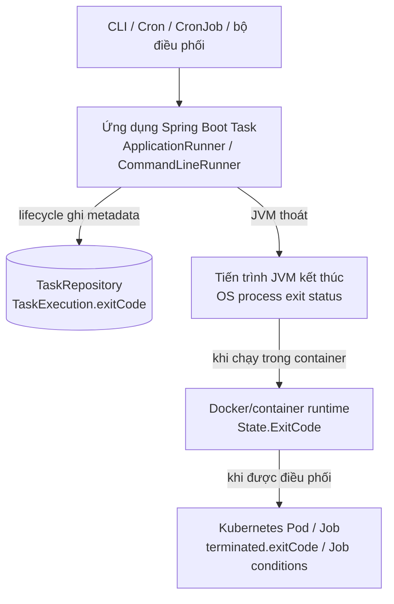

# Kiểm chứng mã thoát khi chạy JAR và container

## Mục tiêu bài học

Trong chương **Kết quả và mã thoát** của mô-đun **Spring Cloud Task**, bài này hướng dẫn kiểm chứng một ứng dụng Spring Boot chạy hữu hạn đã báo **thành công hay thất bại** đúng cách khi triển khai thành executable JAR, Docker container và Kubernetes Job. Đây là yêu cầu then chốt khi chạy tác vụ theo lịch hoặc theo yêu cầu: bộ điều phối phải nhận được kết quả đáng tin cậy để quyết định cảnh báo hay chạy lại.

Học xong, bạn có thể:

- Phân biệt ba nguồn kết quả: `TaskExecution.exitCode` trong `TaskRepository`, **mã thoát của tiến trình Java** và **mã thoát container/Job**.
- Xây dựng tác vụ có ba kịch bản kiểm thử: thành công, lỗi đầu vào và lỗi hạ tầng tạm thời; ánh xạ exception thành mã thoát.
- Đọc mã thoát ngay sau lệnh `java -jar` trên Bash, PowerShell và CMD, tránh mất kết quả do lệnh khác hoặc pipeline.
- Đóng gói bằng Dockerfile dạng exec-form, đọc mã thoát từ `docker run` và `docker inspect`.
- Kiểm chứng trạng thái Kubernetes Job và mã thoát container, hiểu retry, `OOMKilled`, tín hiệu dừng và các tình huống repository không kịp ghi kết quả.
- Thiết kế smoke test và đối chiếu log, metadata Task, exit status, Spring Batch Job và chính kết quả nghiệp vụ.

## 1. Vì sao phải kiểm chứng mã thoát?

Giả sử một tác vụ đối soát thanh toán chạy lúc 02:00. Nó nhận `--businessDate=2026-11-23`, đọc giao dịch, ghi kết quả và kết thúc. Hệ điều phối cần biết:

1. Task thực hiện hoàn tất và báo cáo hợp lệ chưa?
2. Nếu tham số sai, có phải lỗi cần sửa dữ liệu, **không nên retry y nguyên**?
3. Nếu không kết nối được đối tác, có nên retry sau một khoảng chờ?
4. Nếu pod hết bộ nhớ và bị hệ thống hủy, metadata Task có phản ánh đúng sự cố không?

Chỉ thấy dòng log `"Completed"` hoặc trạng thái `"container đã dừng"` là chưa đủ. Ứng dụng có thể nuốt exception rồi trả `0`, bộ điều phối khi đó xem đây là **thành công** dù phần nghiệp vụ thất bại. Ngược lại, tiến trình Java có thể chưa kịp khởi động Spring Cloud Task, khiến **không có bản ghi TaskExecution** dù Docker đã báo thất bại.

Trong phần lớn hệ điều hành và nền tảng container, quy ước cơ bản là:

- **Mã thoát `0`:** tiến trình tự báo **thành công về mặt thực thi**.
- **Mã thoát khác `0`:** tiến trình hoặc hệ thống chạy báo **lỗi**; ý nghĩa cụ thể do ứng dụng và nền tảng quy định.
- **Chưa có mã thoát:** tiến trình đang chạy hoặc thông tin kết thúc chưa được lưu/thu thập.

Quy ước này **không bảo đảm kết quả nghiệp vụ đúng**: nếu báo cáo có 10.000 dòng nhưng logic chỉ ghi được 9.000 dòng và vẫn trả `0`, mã thoát không thể tự phát hiện sai sót. Ứng dụng phải xác minh điều kiện thành công của chính mình.

## 2. Ba tầng mã thoát cần đối chiếu



| Tầng | Trường/giá trị kiểm tra | Bên chịu trách nhiệm | Có thể thiếu hoặc khác tầng khác? |
| --- | --- | --- | --- |
| **Spring Cloud Task** | `TASK_EXECUTION.EXIT_CODE`; `END_TIME`; `ERROR_MESSAGE` | `TaskLifecycleListener` và `TaskRepository` | Có: context chưa tạo, DB lỗi hoặc JVM bị kill đột ngột |
| **JVM/OS** | Trạng thái lệnh `java -jar` trả về cho shell | JVM và cơ chế exit code của Spring Boot/ứng dụng | Có: mã thoát được thay đổi sau khi metadata đã ghi hoặc process bị signal |
| **Docker** | `docker run` exit status hoặc `.State.ExitCode` | Docker/container runtime; thường theo tiến trình chính | Có: Docker lỗi trước khi khởi động hoặc entrypoint làm sai lệch mã Java |
| **Kubernetes Pod** | `.status.containerStatuses[].state.terminated.exitCode`; `reason` | Kubelet/container runtime | Có: image chưa pull được, Pod chưa chạy hoặc container bị OOM/kill |
| **Kubernetes Job** | `Complete` / `Failed`; `succeeded` / `failed` | Job controller, sau retry và chính sách Job | Có: nhiều Pod/lần thử, Job kết quả cuối khác một Pod riêng lẻ |

**Mục tiêu của kiểm chứng** là bảo đảm ba tầng chính tương thích trong luồng chạy bình thường, đồng thời **hiểu nguyên nhân** khi chúng không giống nhau.

### 2.1. Mã thoát ở `TaskExecution`

Spring Cloud Task lưu một `TaskExecution` cho mỗi lần chạy. Trường `exitCode` thường có ý nghĩa:

- `null` khi tác vụ **chưa được hoàn tất trong repository**.
- `0` khi Spring Cloud Task ghi nhận thực thi thành công.
- Giá trị khác `0` khi có lỗi được framework xử lý hoặc mã thoát tùy chỉnh được áp dụng.

Theo tài liệu Spring Cloud Task, mã được ánh xạ từ `ExitCodeExceptionMapper` có thể được ghi vào repository; nếu có `ApplicationFailedEvent` nhưng không có mã tùy chỉnh, giá trị thường là `1`. Khi chạy bình thường, giá trị thường là `0`.

Các trường cần đọc **cùng nhau**: `TASK_EXECUTION_ID`, `TASK_NAME`, `START_TIME`, `END_TIME`, `EXIT_CODE`, `EXIT_MESSAGE`, `ERROR_MESSAGE`. Một dòng có `EXIT_CODE = NULL` không chứng minh tiến trình còn sống; cũng có thể JVM đã bị dừng cưỡng bức trước lúc repository cập nhật.

### 2.2. Mã thoát của tiến trình Java

Với shell, `java -jar app.jar` là một tiến trình. Shell thu nhận trạng thái sau khi tiến trình kết thúc. Mã này được dùng bởi shell script, cron, pipeline CI/CD và, nếu Java là tiến trình chính, bởi container runtime.

Spring Boot hỗ trợ `ExitCodeGenerator`, `ExitCodeExceptionMapper` và `SpringApplication.exit(...)`. Để trả một mã cụ thể bằng `SpringApplication.exit`, tài liệu Spring Boot hướng dẫn truyền giá trị nhận được vào `System.exit(...)`. Tuy nhiên, việc gọi `System.exit(0)` **ngay trong runner** có thể cắt ngang listener hoặc làm repository không kịp ghi kết quả; hãy để framework quản lý vòng đời Task và thiết kế mã lỗi ở vị trí thích hợp.

### 2.3. Mã thoát container và trạng thái Job

Docker theo dõi **tiến trình chính** của container. Nếu Dockerfile dùng `ENTRYPOINT ["java", "-jar", "..."]`, tiến trình chính chính là Java. Nếu thay bằng shell script không `exec` Java hoặc script luôn chạy `echo "done"` cuối cùng, mã thoát của script có thể không còn là mã thoát Java.

Với Kubernetes, **container exit code** là trạng thái của lần chạy container, trong khi **Job status** được kết luận sau khi Job controller xét restart, retry, deadline và các lần thử. Vì vậy, một lần Pod thất bại có thể được retry rồi Job thành công, hoặc Job thất bại do deadline dù lỗi gốc là giới hạn thời gian.

## 3. Chuẩn bị ứng dụng thử nghiệm

Ta tạo một chương trình `exit-probe` có ba chế độ cố định để kiểm chứng:

| Tham số | Tình huống | Mã quy ước của ví dụ |
| --- | --- | --- |
| `--mode=ok` | Xử lý thành công | `0` |
| `--mode=invalid` | Lỗi dữ liệu đầu vào không thể giải quyết bằng retry | `12` |
| `--mode=temporary` | Lỗi kết nối phụ thuộc tạm thời | `23` |
| Thiếu/sai `--mode` | Cấu hình hoặc tham số không hợp lệ | `12` |

**`12` và `23` là quy ước do bài thực hành tự chọn**, không phải mã chuẩn bắt buộc của Spring Cloud Task, Docker hay Kubernetes. Với hệ thống thật, hãy thống nhất bảng mã giữa ứng dụng, scheduler, cảnh báo và chính sách retry.

### 3.1. Dependency

Trên [Spring Initializr](https://start.spring.io/), tạo ứng dụng Maven Spring Boot với Java 17 hoặc Java được nhánh Spring Boot hỗ trợ. Chọn **Task (Spring Cloud)** và **H2 Database**; để Spring Initializr chọn bộ Spring Boot/Spring Cloud release train tương thích.

Nếu dự án đã có Spring Boot parent và Spring Cloud BOM phù hợp, các dependencies có nội dung tương đương:

```xml
<dependencies>
    <dependency>
        <groupId>org.springframework.cloud</groupId>
        <artifactId>spring-cloud-starter-task</artifactId>
    </dependency>
    <dependency>
        <groupId>com.h2database</groupId>
        <artifactId>h2</artifactId>
        <scope>runtime</scope>
    </dependency>
</dependencies>
```

Đoạn trên không phải `pom.xml` đầy đủ; không tự ấn định version starter khác với release train của dự án.

### 3.2. Mã Java có lỗi xác định được

Tạo `src/main/java/com/example/task/ExitProbeApplication.java`:

```java
package com.example.task;

import java.util.List;

import org.springframework.boot.ApplicationArguments;
import org.springframework.boot.ApplicationRunner;
import org.springframework.boot.ExitCodeGenerator;
import org.springframework.boot.SpringApplication;
import org.springframework.boot.autoconfigure.SpringBootApplication;
import org.springframework.cloud.task.configuration.EnableTask;
import org.springframework.context.annotation.Bean;

@SpringBootApplication
@EnableTask
public class ExitProbeApplication {

    public static void main(String[] args) {
        SpringApplication.run(ExitProbeApplication.class, args);
    }

    @Bean
    ApplicationRunner probeRunner() {
        return (ApplicationArguments args) -> {
            List<String> modes = args.getOptionValues("mode");
            if (modes == null || modes.size() != 1) {
                throw new InvalidInputException(
                    "Can truyen dung mot --mode=ok|invalid|temporary");
            }

            String mode = modes.get(0);
            switch (mode) {
                case "ok":
                    System.out.println("RESULT=SUCCESS");
                    break;
                case "invalid":
                    throw new InvalidInputException(
                        "Du lieu dau vao khong hop le");
                case "temporary":
                    throw new TemporaryDependencyException(
                        "Dich vu phu thuoc tam thoi khong san sang");
                default:
                    throw new InvalidInputException(
                        "Mode khong duoc ho tro: " + mode);
            }
        };
    }

    static class InvalidInputException extends RuntimeException
            implements ExitCodeGenerator {
        InvalidInputException(String message) {
            super(message);
        }
        @Override
        public int getExitCode() {
            return 12;
        }
    }

    static class TemporaryDependencyException extends RuntimeException
            implements ExitCodeGenerator {
        TemporaryDependencyException(String message) {
            super(message);
        }
        @Override
        public int getExitCode() {
            return 23;
        }
    }
}
```

**Điểm chính của ví dụ:** ngoại lệ không được bắt rồi bỏ qua. Hai loại exception triển khai `ExitCodeGenerator` để Spring Boot có thể trả một mã có ý nghĩa thay vì mã `1` chung. Spring Cloud Task nhận thông tin lỗi do Spring Boot phát ra trong vòng đời ứng dụng và ghi metadata tương ứng khi có repository hoạt động.

Chúng ta **không gọi `System.exit(...)` trực tiếp trong runner**. Với đường lỗi thông thường, Spring Boot xử lý exception khởi động/runners và xuất mã lỗi. Khi nâng cấp phiên bản, nên kiểm tra lại mã thực tế ở **cả JVM và repository**, vì cơ chế exit của Spring Boot và thời điểm đóng context có thể thay đổi.

Nếu cần ánh xạ exception của một thư viện bên thứ ba mà không sửa được class, có thể khai báo bean `org.springframework.boot.ExitCodeExceptionMapper`:

```java
@Bean
org.springframework.boot.ExitCodeExceptionMapper thirdPartyErrorMapper() {
    return error -> {
        Throwable current = error;
        while (current != null) {
            if (current instanceof java.net.SocketTimeoutException) {
                return 23;
            }
            current = current.getCause();
        }
        return 0; // Khong xu ly loi nay: de co che khac quyet dinh.
    };
}
```

Đây là **ví dụ bổ sung tùy chọn** để đặt vào lớp cấu hình Spring, không phải lớp Java độc lập. Khi có nhiều cơ chế xác định exit code, Spring Boot xét thứ tự ưu tiên/`Ordered`; hãy thử nghiệm với đúng phiên bản, tránh mặc định mapper sẽ ghi đè mọi lỗi listener.

### 3.3. Cấu hình lưu Task metadata

Tạo `src/main/resources/application.yml`:

```yaml
spring:
  application:
    name: exit-probe
  main:
    web-application-type: none
  datasource:
    url: jdbc:h2:file:./task-exit-db
    driver-class-name: org.h2.Driver
    username: sa
    password: ""
  cloud:
    task:
      initialize-enabled: true
      closecontext-enabled: true
```

Ý nghĩa:

- `web-application-type: none` giúp chạy dạng CLI thay vì HTTP service.
- H2 **file** cho phép giữ metadata qua các lần JVM thoát ở **cùng thư mục và hệ thống tệp**; H2 `mem` sẽ mất dữ liệu khi JVM kết thúc.
- `initialize-enabled: true` dùng cơ chế khởi tạo schema Task của framework trong bài demo. Với production, **triển khai schema bằng migration có kiểm soát** rồi đặt `initialize-enabled: false` theo cấu hình/phiên bản.
- `closecontext-enabled: true` yêu cầu Spring Cloud Task đóng context sau khi các runner hoàn tất; nó giúp hạn chế ứng dụng không thoát do giữ context. Vẫn cần kiểm tra thread/background resource do ứng dụng tự tạo.

Ví dụ H2 file dành cho học trên một máy. Khi chạy container, filesystem trong container khác máy chủ và có thể bị hủy; nếu cần đối chiếu metadata giữa JAR và container, hãy cấu hình **cùng một cơ sở dữ liệu bên ngoài bền vững** với quyền/schema phù hợp. Không coi dữ liệu trong filesystem tạm của container là lịch sử tập trung.

### 3.4. Build executable JAR

Từ thư mục dự án Spring Boot:

```bash
./mvnw clean package
```

Giả sử Maven có `artifactId=exit-probe` và `version=0.0.1-SNAPSHOT`, tệp tạo ra là `target/exit-probe-0.0.1-SNAPSHOT.jar`. Nếu tên thực tế khác, dùng tên JAR do Maven vừa đóng gói; kiểm chứng rằng đó là **Spring Boot executable JAR**, chạy được bằng `java -jar`.

## 4. Kiểm chứng JAR trực tiếp

### 4.1. Bash: thu mã của lệnh ngay sau khi Java kết thúc

```bash
java -jar target/exit-probe-0.0.1-SNAPSHOT.jar --mode=ok
printf 'JVM exit=%s\n' "$?"

java -jar target/exit-probe-0.0.1-SNAPSHOT.jar --mode=invalid
printf 'JVM exit=%s\n' "$?"

java -jar target/exit-probe-0.0.1-SNAPSHOT.jar --mode=temporary
printf 'JVM exit=%s\n' "$?"
```

Với đường lỗi do `ExitCodeGenerator` định nghĩa và Spring Boot xử lý bình thường, kết quả **dự kiến cần đối chiếu** lần lượt là `0`, `12` và `23`. Nếu một giá trị khác xuất hiện, ưu tiên mã đo được, rồi kiểm tra logs và phiên bản framework. Đừng sửa báo cáo kết quả cho khớp kỳ vọng khi phép chạy thực tế khác đi.

**`$?` phải được đọc ngay sau `java`**. Nếu có một lệnh khác xen vào (ví dụ `echo` hoặc `grep`), `$?` lúc ấy là trạng thái của lệnh mới, không phải JVM.

Khi cần vừa ghi log vừa giữ mã của Java, dùng `pipefail` trong Bash:

```bash
set -o pipefail
java -jar target/exit-probe-0.0.1-SNAPSHOT.jar --mode=invalid \
    2>&1 | tee task-run.log
printf 'Pipeline exit=%s\n' "$?"
```

Không có `pipefail`, pipeline thường trả mã của `tee` ở cuối, có thể là `0` ngay cả khi Java lỗi. `set -o pipefail` là tùy chọn của Bash và một số shell tương thích; không mặc định có trong mọi `/bin/sh`.

### 4.2. PowerShell trên Windows

```powershell
java -jar target/exit-probe-0.0.1-SNAPSHOT.jar --mode=ok
$exitCode = $LASTEXITCODE
Write-Host "JVM exit=$exitCode"

java -jar target/exit-probe-0.0.1-SNAPSHOT.jar --mode=invalid
$exitCode = $LASTEXITCODE
Write-Host "JVM exit=$exitCode"
```

`$LASTEXITCODE` lưu trạng thái của **native executable gần nhất**, trong trường hợp này là `java.exe`. Chụp giá trị ngay sau `java` trước khi chạy native executable khác. `$?` trong PowerShell phản ánh thành công của **lệnh PowerShell gần nhất**, không phải cách thay thế đáng tin cậy cho giá trị exit code số nguyên của Java.

Với Windows Command Prompt (`cmd.exe`):

```bat
java -jar target\exit-probe-0.0.1-SNAPSHOT.jar --mode=invalid
echo JVM exit=%ERRORLEVEL%
```

Lệnh `echo` cần ở dòng kế tiếp; không chèn lệnh làm thay đổi `ERRORLEVEL` vào giữa.

### 4.3. Smoke test tự động

Kiểm tra bằng Bash một ca lỗi có mã **dự kiến `12`**:

```bash
set +e
java -jar target/exit-probe-0.0.1-SNAPSHOT.jar --mode=invalid
actual=$?
set -e

if [ "$actual" -ne 12 ]; then
  echo "FAIL: expected=12 actual=$actual"
  exit 1
fi
echo "PASS: invalid input returned 12"
```

Sử dụng `set +e` trước ca âm tính nếu script bên ngoài đang có `set -e`. Với các bài kiểm thử chạy tự động, nên có **ít nhất một ca thành công, một ca lỗi nghiệp vụ và một ca lỗi phụ thuộc tạm thời**. Ngoài exit code, cần xác nhận tiến trình thực sự kết thúc trong timeout cho phép.

### 4.4. Đối chiếu với `TaskRepository`

Trong ví dụ dùng H2 file, sau khi các tiến trình Java đã thoát, kết nối một **SQL client vào đúng file database** và chạy:

```sql
SELECT
    TASK_EXECUTION_ID,
    TASK_NAME,
    START_TIME,
    END_TIME,
    EXIT_CODE,
    EXIT_MESSAGE,
    ERROR_MESSAGE
FROM TASK_EXECUTION
WHERE TASK_NAME = 'exit-probe'
ORDER BY TASK_EXECUTION_ID DESC;
```

Mỗi lần chạy mới có một `TASK_EXECUTION_ID` khác nhau. Đối chiếu **thời điểm, tham số và kết quả** với từng lần chạy trên terminal. Nếu chỉ xem `EXIT_CODE` của bản ghi mới nhất mà có hai tiến trình đang chạy gần nhau, bạn có thể gán nhầm mã cho lần chạy không liên quan.

| Kịch bản | Shell JVM (dự kiến) | `TaskExecution.EXIT_CODE` (dự kiến) | `ERROR_MESSAGE` |
| --- | --- | --- | --- |
| `--mode=ok` | `0` | `0` | Thường rỗng |
| `--mode=invalid` | `12` | `12` khi cơ chế exit code được ghi nhận | Thường có stack trace của exception |
| `--mode=temporary` | `23` | `23` khi cơ chế exit code được ghi nhận | Thường có stack trace của exception |

**Nếu hai cột mã thoát không khớp, đó là dữ liệu chẩn đoán cần điều tra.** Các nguyên nhân gồm map exit code không được áp dụng đồng nhất, gọi `System.exit` quá sớm, exception trong listener, DB không cập nhật được hoặc JVM bị hủy bên ngoài. Không tự chạy `UPDATE TASK_EXECUTION SET EXIT_CODE=...` để “sửa đẹp” lịch sử.

## 5. Docker: giữ nguyên mã thoát của Java

### 5.1. Dockerfile

Tạo Dockerfile tại **dự án thực hành** sau khi đã build JAR:

```dockerfile
FROM eclipse-temurin:21-jre
WORKDIR /app
COPY target/exit-probe-0.0.1-SNAPSHOT.jar /app/app.jar
ENTRYPOINT ["java", "-jar", "/app/app.jar"]
```

Đây là ví dụ dùng **Java 21**; phải chọn image runtime tương thích với phiên bản Java dùng để build. Dockerfile dùng **exec-form `ENTRYPOINT`** nên tiến trình chính là Java. Các đối số nối sau tên image trong `docker run` được chuyển tiếp vào `main(String[] args)` của ứng dụng.

Tránh viết:

```dockerfile
# Khong nen dung neu muon giu exit code Java mot cach ro rang:
ENTRYPOINT ["sh", "-c", "java -jar /app/app.jar; echo done"]
```

Shell wrapper trên thực thi `echo` sau Java; nếu `echo` thành công, shell có thể trả `0` ngay cả khi Java lỗi. Nếu bắt buộc dùng shell script (ví dụ để chuẩn bị file), dùng `exec java -jar /app/app.jar "$@"` ở cuối với cách truyền arguments đã được kiểm tra.

### 5.2. Chạy container và xem exit status

```bash
docker build -t exit-probe:local .

docker run --rm exit-probe:local --mode=ok
printf 'Docker CLI exit=%s\n' "$?"

docker run --rm exit-probe:local --mode=invalid
printf 'Docker CLI exit=%s\n' "$?"
```

Với image được build đúng, kỳ vọng hai mã lần lượt là `0` và `12`. Mã từ `docker run` phản ánh container đã chạy **hoặc lỗi khởi chạy Docker**. Docker dành một số mã cho lỗi do chính Docker/entrypoint gây ra:

| Mã | Ý nghĩa theo tài liệu Docker | Cần làm |
| --- | --- | --- |
| `0` | Tiến trình chính báo thành công | Kiểm tra nghiệp vụ và repository |
| `12` / `23` | Ví dụ ứng dụng chủ động trả mã theo quy ước | Xem exception và áp chính sách retry |
| `125` | Docker daemon/CLI không chạy được container theo yêu cầu | Xem cấu hình `docker run` và lỗi Docker |
| `126` | Có lệnh được chỉ định nhưng không thể invoke | Kiểm tra quyền và entrypoint |
| `127` | Không tìm thấy lệnh được chỉ định | Kiểm tra image và đường dẫn lệnh |
| `137` | Thường liên quan tiến trình bị `SIGKILL` (9) | Kiểm tra OOM, kill thủ công, sự cố runtime |
| `143` | Thường là tiến trình bị `SIGTERM` (15) trên môi trường Linux | Xem lý do dừng và shutdown handling; không suy ra lỗi nghiệp vụ |

**`137` không mặc định chứng minh OOM**: nó cũng có thể do `docker kill` hoặc một cơ chế khác gửi `SIGKILL`. Cần xem `OOMKilled` và log. Tương tự, `143` phụ thuộc xử lý tín hiệu của runtime/script và không phải mọi trường hợp dừng bằng `SIGTERM` đều trả `143`.

### 5.3. Giữ container để inspect

Nếu chạy `--rm`, container bị xóa khi kết thúc nên **không còn object để inspect**. Để kiểm tra sau khi chạy, không dùng `--rm`:

```bash
docker run --name exit-probe-invalid exit-probe:local --mode=invalid
docker inspect --format '{{.State.ExitCode}}' exit-probe-invalid
docker inspect --format '{{.State.OOMKilled}}' exit-probe-invalid
docker logs exit-probe-invalid
docker rm exit-probe-invalid
```

Mã thoát của **lệnh `docker inspect`** thường là `0` khi truy vấn thành công, dù trường `.State.ExitCode` in ra `12`. Phải đọc **giá trị trường**, không được nhầm mã của công cụ truy vấn với mã của container. Với PowerShell, cũng có thể chạy `docker inspect --format '{{.State.ExitCode}}' ...`; dùng dấu nháy đơn theo cú pháp PowerShell.

### 5.4. Lưu `TaskRepository` khi chạy Docker

H2 file trong image là minh họa local, và một lệnh `docker run --rm` mới có filesystem container mới. Vì vậy, không nên mong dữ liệu của ba lần `docker run` tự nằm chung một `TASK_EXECUTION`.

Muốn kiểm chứng metadata giữa các lần chạy container:

- Dùng **cùng một PostgreSQL/MySQL/etc. bên ngoài** qua `spring.datasource.*` và quản lý schema Task bằng migration; hoặc
- Với bài thực hành cục bộ, mount một volume chứa H2 file nhưng **không chạy đồng thời nhiều JVM mở cùng file H2 theo cách không được H2 hỗ trợ**.

Đừng đưa mật khẩu database vào đối số `--password=...` khi chạy Task: Spring Cloud Task có thể ghi arguments vào metadata. Dùng secret management và biến môi trường có kiểm soát.

## 6. Kubernetes Job: đọc cả exit code lẫn kết luận của Job

Đây là phần mở rộng khi ứng dụng được chạy bởi Kubernetes. Để thử nghiệm, cần **push image lên registry mà cluster truy cập được** (hoặc nạp image vào cluster dev theo cách được nền tảng hỗ trợ). Tên `registry.example.com/exit-probe:1.0` dưới đây **chỉ là ví dụ**, phải thay bằng image thật.

Tạo `job-exit-probe.yml` ở dự án thực hành:

```yaml
apiVersion: batch/v1
kind: Job
metadata:
  name: exit-probe-invalid
spec:
  completions: 1
  parallelism: 1
  backoffLimit: 0
  activeDeadlineSeconds: 300
  template:
    spec:
      restartPolicy: Never
      containers:
        - name: task
          image: registry.example.com/exit-probe:1.0
          args: ["--mode=invalid"]
```

Chọn `backoffLimit: 0` và `restartPolicy: Never` để dễ kiểm chứng **một lần thử thất bại**, tránh tự retry làm khó đối chiếu trong bài thực hành. `activeDeadlineSeconds` giới hạn tổng thời gian Job; khi đạt ngưỡng, Job có thể thất bại do `DeadlineExceeded` ngay cả khi chưa hết số lần retry.

### 6.1. Chạy và đọc trạng thái

```bash
kubectl apply -f job-exit-probe.yml
kubectl get job exit-probe-invalid
kubectl describe job exit-probe-invalid
kubectl get pods -l batch.kubernetes.io/job-name=exit-probe-invalid
kubectl logs job/exit-probe-invalid
```

**`kubectl apply` trả `0` chỉ có nghĩa API nhận yêu cầu**, không khẳng định Job hoàn thành thành công. Kiểm tra trạng thái Job/POD sau khi workload kết thúc. Lấy tên Pod từ lệnh `kubectl get pods` rồi đọc container exit code:

```bash
kubectl get pod POD_NAME \
  -o jsonpath='{.status.containerStatuses[0].state.terminated.exitCode}'

kubectl get pod POD_NAME \
  -o jsonpath='{.status.containerStatuses[0].state.terminated.reason}'
```

Thay `POD_NAME` bằng tên thật; những lệnh trên dùng cú pháp Bash để xuống dòng. Với PowerShell, nhập một dòng thay vì `\`. Chỉ số `[0]` giả định pod có một container như manifest; nếu có nhiều container hoặc init container, cần chọn đúng container `task`.

Trong ví dụ `--mode=invalid`, khi image chạy thành công và exception được ánh xạ đúng, container có thể kết thúc `exitCode=12`, Pod ở trạng thái `Failed` và Job sẽ có điều kiện `Failed` sau khi controller cập nhật. Với `--mode=ok`, tạo một Job **tên mới** với `args: ["--mode=ok"]`, dự kiến container `exitCode=0`, Pod `Succeeded` và Job `Complete`.

### 6.2. Không đọc một Pod rồi kết luận toàn Job

Khi `backoffLimit` khác `0` hoặc `restartPolicy=OnFailure`, một Job có thể tạo **nhiều lần thực thi**. Một Pod `Failed` và exit code khác `0` có thể được thay bằng Pod `Succeeded`; Job cuối cùng vẫn `Complete`. Ngược lại, một Pod chưa hề chạy được do `ImagePullBackOff` không có `terminated.exitCode` của Java để đối chiếu.

Tài liệu Kubernetes lưu ý kể cả cấu hình `completions=1`, `parallelism=1` và `restartPolicy=Never` thì chương trình **vẫn có thể được khởi chạy lại** trong một số sự cố. Do đó, Spring Cloud Task có thể tạo nhiều `TaskExecution` cho cùng một khóa nghiệp vụ; tác vụ phải có idempotency, ví dụ ràng buộc duy nhất theo `(partnerId, businessDate)`.

### 6.3. Trường hợp `OOMKilled` hoặc tín hiệu dừng

Nếu Pod báo `reason=OOMKilled` với exit code thường thấy `137`, điều đó là dấu hiệu container bị hệ thống hủy do bộ nhớ. Mã của container có thể khác `TaskExecution.exitCode` vì JVM không kịp phát callback kết thúc hoặc commit repository.

Với `SIGTERM`, nhiều hệ thống cho phép thời gian shutdown, nhưng không thể mặc định framework sẽ ghi đầy đủ một bản ghi thành công: ứng dụng có thể đang giữa chừng, tài nguyên đã mất hoặc deadline đã hết. Để điều tra, kết hợp `kubectl describe pod`, reason, event, log, cấu hình tài nguyên và metadata ở DB ngoài container.

## 7. Cách đọc sự sai khác giữa các tầng

| Tình huống quan sát | Cách diễn giải hợp lý | Bước kiểm chứng tiếp theo |
| --- | --- | --- |
| Repository `0`, JVM/container `0`, nghiệp vụ hợp lệ | Lượt chạy bình thường | Ghi nhận số liệu nghiệp vụ và correlation ID |
| Repository `0`, JVM/container `0`, nghiệp vụ sai | Code không kiểm tra điều kiện thành công | Bổ sung validation và phát lỗi, chạy lại test |
| Repository `12`, JVM/container `12` | Lỗi đầu vào được ánh xạ thống nhất | Kiểm tra log và không retry nguyên tham số |
| Repository `23`, container `23` | Lỗi phụ thuộc có thể retry | Áp retry với giới hạn, backoff và idempotency |
| Repository `0`, container khác `0` | Java/entrypoint/OS có thể thay trạng thái sau khi Task lưu kết quả | Kiểm tra Dockerfile, shell wrapper, lệnh `System.exit`, signal |
| Không có `TaskExecution`, container `1` | Có thể startup lỗi trước khi tạo repository/context | Xem log JVM, DB và cấu hình Spring |
| Repository còn `END_TIME=NULL`, container `137` | Tiến trình có thể bị kill trước khi cập nhật metadata | Xem `OOMKilled`, Docker/Kubernetes events và log |
| `docker run` trả `125` | Lỗi Docker chứ chưa chắc mã của Java | Kiểm tra daemon, flags, image và network |
| Một Pod thất bại, Job cuối `Complete` | Job đã retry thành công | Kiểm tra toàn bộ Pods/lần thử và idempotency |
| `kubectl apply` trả `0`, Job cuối `Failed` | API nhận manifest nhưng workload thất bại | Kiểm tra `Job conditions`, Pod exit code và events |

### 7.1. Những cách kiểm tra sai thường gặp

**Sai 1 — Chỉ nhìn chữ “Completed” trong log.** Một runner có thể log thành công trước khi câu lệnh ghi DB cuối cùng thất bại. Cần chỉ ghi thành công sau khi điều kiện nghiệp vụ được xác nhận.

**Sai 2 — Bắt exception rồi return bình thường.** Nếu code như dưới đây, framework có thể coi runner hoàn tất:

```java
try {
    paymentService.reconcile();
} catch (Exception ex) {
    log.error("Reconcile failed", ex);
    // Sai: khong rethrow, khong bao loi den Spring Boot.
}
```

Hãy phát lỗi hoặc ánh xạ kết quả nghiệp vụ sang exit code phù hợp khi lỗi thật sự làm công việc thất bại.

**Sai 3 — Gọi `System.exit(0)` trong runner.** Điều này có thể ngắt luồng của Spring Cloud Task và gây mất cập nhật cuối. Để framework hoàn tất runner và listener; nếu cần mã thoát tùy biến, dùng API exit code của Spring Boot và kiểm chứng cả repository lẫn process.

**Sai 4 — Dùng shell wrapper làm mất exit code.** Ví dụ `java -jar app.jar; echo finished` khiến script trả kết quả của `echo`. Dùng exec-form entrypoint hoặc `exec java ...`.

**Sai 5 — Chỉ kiểm tra status của lệnh điều phối.** `docker inspect`, `kubectl apply`, `kubectl logs` có exit code riêng. Chúng không đại diện cho mã thoát của workload.

**Sai 6 — Cho rằng `137` luôn là OOM, `143` luôn là lỗi ứng dụng.** Cần kiểm tra signal, reason, `OOMKilled` và log; không gán lỗi nghiệp vụ chỉ dựa trên một số nguyên.

## 8. Spring Batch: một Job `FAILED` có thể khiến Task trả `0`

Khi Spring Cloud Task khởi chạy một **Spring Batch Job**, có thêm một tầng kết quả:

| Thành phần | Trạng thái cần đọc |
| --- | --- |
| Spring Batch `JobExecution` | `BatchStatus` như `COMPLETED` hoặc `FAILED`; `ExitStatus` của Job |
| Spring Cloud Task `TaskExecution` | `EXIT_CODE` của tiến trình Task được framework ghi nhận |
| JVM/container/Kubernetes | Exit code ở tiến trình/container, kết luận sau retry |

Tài liệu Spring Cloud Task nêu rằng với cấu hình Batch/Boot mặc định, một Batch Job `FAILED` **có thể không tự biến mã thoát Task thành khác `0`**. Khi dùng tích hợp `spring-cloud-task-batch`, có thể bật:

```yaml
spring:
  cloud:
    task:
      batch:
        fail-on-job-failure: true
```

Thuộc tính này cho phép Spring Cloud Task phản ánh một Batch Job `FAILED` thành lỗi Task theo cơ chế được tài liệu mô tả (thường `1` hoặc mã do `ExitCodeGenerator` quyết định). Cần kiểm tra phiên bản và cách gọi Job thực tế; nếu tự khởi chạy Batch theo cách khác, hãy chủ động chuyển trạng thái `FAILED` thành kết quả tiến trình thích hợp.

**Bài kiểm thử bắt buộc cho ứng dụng Batch:** tạo một Job thành công và một Job thất bại có chủ đích, sau đó đối chiếu **JobExecution status → TaskExecution exit code → JVM/container exit code → trạng thái Job của Kubernetes**. Không lấy một trong các tầng để thay cho tất cả.

## 9. Quy trình kiểm chứng đề xuất khi triển khai

Đối với một bản release ứng dụng Spring Cloud Task, hãy hoàn thành từng bước sau trong môi trường thử nghiệm:

1. **Định nghĩa bảng mã:** `0` thành công, các mã khác `0` theo nhóm lỗi nghiệp vụ, hạ tầng, retry và lỗi không thể retry; ghi rõ hợp đồng cho bộ điều phối.
2. **Chạy JAR local:** chạy ít nhất các ca `ok`, `invalid` và `temporary`; đọc `$?` hoặc `$LASTEXITCODE` ngay sau Java.
3. **Xác minh repository:** đối chiếu `TASK_EXECUTION_ID`, tham số, `EXIT_CODE`, `END_TIME` và `ERROR_MESSAGE` của mỗi lượt chạy trên DB bền vững.
4. **Build Docker bằng exec-form:** chạy lại ba ca; đọc trạng thái `docker run`, rồi `docker inspect .State.ExitCode` khi cần.
5. **Chạy Kubernetes Job:** dùng `backoffLimit: 0` để kiểm chứng một lần thử, sau đó thử cấu hình retry thật sự; xem cả Pod exit code lẫn Job conditions.
6. **Thử lỗi hạ tầng:** chủ động đưa datasource không truy cập được ở môi trường test để quan sát tình huống **không có TaskExecution**, phân biệt lỗi startup với lỗi runner.
7. **Thử dừng cưỡng bức trong môi trường cô lập:** xác nhận cảnh báo không phụ thuộc duy nhất vào `onTaskEnd` hoặc `END_TIME`.
8. **Đối chiếu kết quả nghiệp vụ:** kiểm tra số dòng, tổng kiểm tra, checksum hoặc dữ liệu đích; mã `0` chỉ chấp nhận được khi những điều kiện này đạt.
9. **Đặt giám sát và retention:** lưu logs, status của scheduler, correlation ID, metadata Task; cảnh báo lần chạy không xuất hiện, chạy quá hạn và sai lệch mã thoát.

### Tình huống tự đánh giá

**Câu 1.** `java -jar` trả `12` nhưng dòng cuối của log là `"Starting Spring..."`. Có thể kết luận lỗi đầu vào đã được xử lý đúng không?

> Chưa. Cần kiểm tra log lỗi, confirm runner có chạy, exception nào được ném và repository có bản ghi kết thúc hay không; mã `12` có thể do mapper hoặc lỗi ở giai đoạn khác.

**Câu 2.** `docker inspect` in `12` nhưng shell cho biết mã thoát của chính lệnh `docker inspect` là `0`. Có mâu thuẫn không?

> Không. `12` là giá trị `.State.ExitCode` của container; `0` là trạng thái công cụ Docker đã thực hiện truy vấn thành công.

**Câu 3.** Một Pod có exit code `23`, Job cuối cùng `Complete`. Vì sao?

> Job có thể đã retry và một Pod/lần thử sau đã thành công. Cần xem tất cả Pods của Job và thiết kế idempotency khi retry.

**Câu 4.** Trong repository có `EXIT_CODE = NULL` và container đã dừng với `137`. Có nên cập nhật trực tiếp `EXIT_CODE=0` không?

> Không. Phải điều tra lý do dừng, đánh giá dữ liệu nghiệp vụ và giữ lịch sử audit trung thực. Việc xử lý bản ghi treo cần chính sách vận hành riêng.

**Câu 5.** Vì sao một Spring Batch Job thất bại nhưng container vẫn báo `0`?

> Vì trạng thái Batch Job không mặc định đồng nhất với exit code của Spring Boot Task. Kiểm tra tích hợp Batch, `fail-on-job-failure` và cơ chế ánh xạ kết quả sang tiến trình.

## Ghi nhớ

- **Ba tầng cần đối chiếu:** `TaskExecution.EXIT_CODE`, mã thoát **JVM** và mã thoát **container/Job**.
- **`0` chỉ có nghĩa tiến trình báo thành công**; ứng dụng vẫn phải tự kiểm tra điều kiện nghiệp vụ.
- **Bash `$?`, PowerShell `$LASTEXITCODE`, Docker `.State.ExitCode`, Kubernetes `terminated.exitCode`** là những điểm quan sát trực tiếp, nhưng mỗi điểm mang phạm vi khác nhau.
- **ENTRYPOINT dạng exec** giúp Docker theo dõi đúng Java; shell wrapper hoặc `System.exit(0)` sai vị trí có thể làm lệch kết quả.
- **OOM, signal, startup failure và retry** có thể làm metadata Spring Cloud Task khác kết quả container; phải xem logs, trạng thái điều phối và repository cùng nhau.
- Với **Spring Batch**, cần kiểm tra ánh xạ `FAILED` thành mã Task thất bại, đặc biệt khi bộ điều phối dựa vào exit status.

## Tài liệu tham khảo

1. [Spring Cloud Task — Features: TaskExecution, mapping exit codes, vòng đời](https://docs.spring.io/spring-cloud-task/reference/features.html)
2. [Spring Cloud Task — Batch: Batch Job Exit Codes](https://docs.spring.io/spring-cloud-task/reference/batch.html)
3. [Spring Boot — SpringApplication: Application Exit, ExitCodeGenerator](https://docs.spring.io/spring-boot/reference/features/spring-application.html)
4. [Spring Boot API — ExitCodeExceptionMapper](https://docs.spring.io/spring-boot/api/java/org/springframework/boot/ExitCodeExceptionMapper.html)
5. [Docker — Running containers: Exit status 125/126/127](https://docs.docker.com/engine/containers/run/)
6. [Docker — docker container inspect](https://docs.docker.com/reference/cli/docker/container/inspect/)
7. [Docker — docker container ls: exited=137](https://docs.docker.com/reference/cli/docker/container/ls/)
8. [Kubernetes — Jobs: failure/retry/backoff/deadline](https://kubernetes.io/docs/concepts/workloads/controllers/job/)
9. [Kubernetes — Pod Lifecycle: container exit and restarts](https://kubernetes.io/docs/concepts/workloads/pods/pod-lifecycle/)
