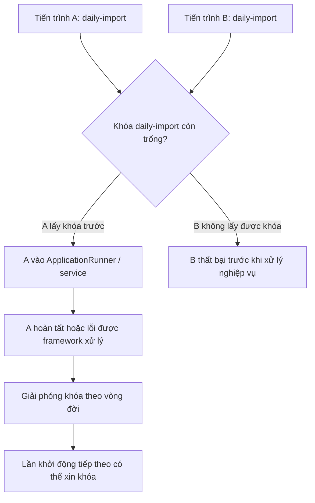

# Bật `spring.cloud.task.single-instance-enabled`

## 1. Bài toán: hai lần chạy cùng một tác vụ chồng lên nhau

**Spring Cloud Task** dùng để xây dựng ứng dụng Spring Boot có thời gian chạy hữu hạn: khởi động, nhận tham số, xử lý nghiệp vụ, lưu metadata bằng `TaskRepository` và kết thúc. Tác vụ có thể được gọi thủ công, từ scheduler, một yêu cầu bên ngoài hoặc hệ thống điều phối như Kubernetes CronJob.

Giả sử `daily-import` nhập đơn hàng lúc 02:00 mỗi ngày. Bình thường task hoàn thành trong 10 phút, nhưng hôm nay nguồn dữ liệu chậm khiến nó còn chạy lúc 02:30. Một người vận hành bấm chạy lại hoặc scheduler phát lại yêu cầu. Nếu hai tiến trình đồng thời cập nhật cùng tập dữ liệu, có thể phát sinh ghi trùng, xung đột giao dịch, tải CSDL tăng đột biến hoặc kết quả tổng hợp sai.

Spring Cloud Task có tùy chọn **`spring.cloud.task.single-instance-enabled=true`** để hạn chế **chỉ một instance đang chạy cho mỗi tên task** khi các instance tham gia cùng cơ chế khóa. Giá trị mặc định là **`false`**, nghĩa là framework không tự áp dụng hạn chế này. Khi một instance đang giữ khóa, một instance khác có cùng tên task và cũng bật tính năng sẽ không được chạy phần nghiệp vụ; theo tài liệu Spring Cloud Task, trường hợp bị từ chối trả mã thoát tiến trình `1`.

| Trường hợp | Kết quả mong muốn khi dùng cơ chế khóa chung |
| --- | --- |
| A và B đều tên `daily-import`, đều bật single instance, A đang chạy | B bị từ chối trong khi A giữ khóa |
| A chạy xong và giải phóng khóa, B được khởi động sau đó | B có thể chạy |
| A tên `daily-import`, B tên `daily-reconcile` | Có thể chạy song song vì tên khác nhau |
| A và B cùng tên nhưng chỉ A bật tính năng | Không thể tin rằng B sẽ tuân thủ khóa; B có thể chạy chồng |
| A và B cùng tên nhưng kết nối hai cơ sở dữ liệu khóa độc lập | Không có bảo đảm loại trừ lẫn nhau giữa hai kho |

**Phạm vi bảo vệ là tên task**, không phải tên file, ngày xử lý, `requestId`, `TaskExecution` ID hay Spring Batch job instance. Một tên task ổn định giúp hệ thống hiểu các lần chạy thuộc cùng loại công việc. Cơ chế này không tự lên lịch, không tự xếp hàng các lần chạy bị từ chối và không biến xử lý nghiệp vụ thành *exactly once*.

## 2. Cơ chế khóa diễn ra ở đâu?

Khi bật tính năng, Spring Cloud Task sử dụng cơ chế khóa dựa trên **Spring Integration**. Thành phần `SingleInstanceTaskListener` phối hợp với `TaskNameResolver` để xác định tên cần khóa, xin khóa trong quá trình khởi động task, rồi giải phóng ở các callback kết thúc/thất bại được framework quản lý. Nếu khóa của tên đó đã tồn tại và chưa thể được cấp, listener ném `TaskExecutionException` để ngăn instance mới thực thi công việc.



Sơ đồ thể hiện **ý nghĩa đồng thời**, không phải thứ tự tuyệt đối của mọi transaction nội bộ. Một lần chạy bị từ chối có thể vẫn tạo ra log hoặc metadata khởi động tùy phiên bản và điểm xảy ra lỗi; không suy luận rằng luôn có hoặc luôn không có bản ghi `TASK_EXECUTION` cho lần bị chặn. Hãy kiểm tra thực tế bằng log, trạng thái tiến trình và dữ liệu repository.

Trong schema Spring Cloud Task thường có bảng **`TASK_LOCK`** dành cho tính năng này, bên cạnh `TASK_EXECUTION`, `TASK_EXECUTION_PARAMS` và các đối tượng hỗ trợ khác. Các cột được mô tả trong tài liệu schema gồm `LOCK_KEY`, `REGION`, `CLIENT_ID`, `CREATED_DATE`. Đây là **bảng phục vụ quản lý khóa**, không phải lịch sử nghiệp vụ và không thể thay thế `TASK_EXECUTION`.

### Điều kiện để giới hạn có hiệu lực giữa nhiều JVM

1. **Cùng tên task**: xác định rõ `spring.cloud.task.name` hoặc dùng `TaskNameResolver` cho ra cùng tên logic khi công việc giống nhau.
2. **Bật tính năng ở mọi lần khởi động liên quan**: `spring.cloud.task.single-instance-enabled=true` phải có hiệu lực trên từng tiến trình muốn tham gia giới hạn.
3. **Cùng kho khóa dùng chung**: các tiến trình cần trỏ tới cùng RDBMS và schema/namespace khóa, được cấu hình qua `DataSource`/`LockRegistry` phù hợp.
4. **Có dependency và schema cần thiết**: bao gồm thư viện Spring Integration và các bảng/đối tượng Spring Cloud Task tương ứng phiên bản.
5. **Có chính sách cho tiến trình đột ngột biến mất**: timeout/TTL của khóa, giám sát và thủ tục xác minh trước khi cho chạy lại.

Nếu một ứng dụng cấu hình nhiều `DataSource`, phải xác định chính xác nguồn dữ liệu mà `TaskRepository` và phần khóa sẽ sử dụng. Việc hai ứng dụng cùng ghi một bảng nghiệp vụ **không có nghĩa** chúng đang dùng chung kho khóa của Spring Cloud Task.

## 3. Thêm dependency Spring Integration

Trong dự án Maven đã dùng BOM để bảo đảm **phiên bản Spring Boot và Spring Cloud tương thích**, dependency ví dụ gồm:

```xml
<dependencies>
    <dependency>
        <groupId>org.springframework.cloud</groupId>
        <artifactId>spring-cloud-starter-task</artifactId>
    </dependency>
    <dependency>
        <groupId>org.springframework.boot</groupId>
        <artifactId>spring-boot-starter-jdbc</artifactId>
    </dependency>
    <dependency>
        <groupId>org.springframework.integration</groupId>
        <artifactId>spring-integration-core</artifactId>
    </dependency>
    <dependency>
        <groupId>org.springframework.integration</groupId>
        <artifactId>spring-integration-jdbc</artifactId>
    </dependency>
    <dependency>
        <groupId>org.postgresql</groupId>
        <artifactId>postgresql</artifactId>
        <scope>runtime</scope>
    </dependency>
</dependencies>
```

Hai thư viện **`spring-integration-core` và `spring-integration-jdbc`** là dependency được tài liệu Spring Cloud Task chỉ rõ cho tính năng single instance. `spring-boot-starter-jdbc` cung cấp hạ tầng JDBC và quản lý `DataSource`; PostgreSQL driver phục vụ kết nối database máy chủ trong ví dụ. Không khóa version thủ công của từng dependency khi đã có BOM/quản lý dependency tương thích.

Chỉ đặt thuộc tính `single-instance-enabled=true` mà thiếu thư viện hoặc bảng khóa tương ứng có thể khiến task lỗi lúc khởi động. Đây không phải một công tắc đủ khả năng bảo vệ mọi ứng dụng nếu thiếu hạ tầng phía sau.

## 4. Bật tính năng trong application.yml

Ví dụ task nhập dữ liệu có cấu hình tại `src/main/resources/application.yml`:

```yaml
spring:
  application:
    name: daily-import-app
  main:
    web-application-type: none
  datasource:
    url: ${TASK_DB_URL}
    username: ${TASK_DB_USER}
    password: ${TASK_DB_PASSWORD}
  cloud:
    task:
      name: daily-import
      single-instance-enabled: true
      initialize-enabled: false
```

Trong ví dụ này:

- `spring.cloud.task.name: daily-import` gắn một **tên logic cố định** cho tất cả lần chạy thuộc cùng loại công việc. `spring.application.name` là tên ứng dụng Spring Boot và có thể khác tên task.
- `single-instance-enabled: true` bật hạn chế chạy trùng theo tên. Trong file `.properties` có thể viết `spring.cloud.task.single-instance-enabled=true`; với YAML chỉ cần `single-instance-enabled: true` dưới `spring.cloud.task`.
- `initialize-enabled: false` giả định **schema metadata đã được tạo trước**. Đừng sao chép cấu hình này vào database trống rồi kỳ vọng framework tự tạo bảng `TASK_EXECUTION` và `TASK_LOCK`.
- `TASK_DB_URL`, `TASK_DB_USER`, `TASK_DB_PASSWORD` cần được môi trường triển khai cung cấp; ví dụ URL PostgreSQL là `jdbc:postgresql://db-host:5432/taskdb`. Không ghi mật khẩu thật trong YAML hoặc đưa vào đối số CLI.

### Chuẩn bị schema trước khi thử đồng thời

Hãy dùng **script DDL hoặc migration chính thức đi cùng phiên bản Spring Cloud Task đang sử dụng** để tạo bảng metadata và khóa trong cùng một PostgreSQL database. Nếu dùng Spring Batch trong ứng dụng, chuẩn bị thêm schema `BATCH_*` theo đúng phiên bản Spring Batch. Kiểm tra quyền đọc/ghi cho tài khoản chạy task; quyền chỉ đọc sẽ không đủ để xin và nhả khóa.

Trong bài lab, có thể thử cơ chế tự khởi tạo schema phù hợp với phiên bản framework trên database mới **trước** khi bật nhiều tiến trình. Khi chạy đồng thời, nên hoàn tất migration rồi dùng `initialize-enabled: false` để tránh hai JVM cùng tranh chấp tạo bảng. Trong production, quản lý schema qua công cụ migration và quy trình triển khai có kiểm soát.

> **Không tự tạo một `TASK_LOCK` đơn giản từ cấu trúc tự đoán.** Spring Integration sử dụng ràng buộc khóa và các lệnh SQL phù hợp với implementation. Một bảng có đúng tên nhưng sai khóa/index/kiểu dữ liệu vẫn có thể làm cơ chế đồng thời hoạt động sai.

## 5. Viết task mẫu để quan sát hai tiến trình

Mã ví dụ dùng Java 17 trở lên và một `ApplicationRunner` chạy trong số giây chỉ định. Giữ thời gian có giới hạn để dễ tái hiện cạnh tranh khóa; `Thread.sleep` ở đây **chỉ phục vụ demo**, không phải công thức xử lý nghiệp vụ thực tế.

```java
package com.example.taskdemo;

import java.util.List;

import org.springframework.boot.ApplicationArguments;
import org.springframework.boot.ApplicationRunner;
import org.springframework.boot.SpringApplication;
import org.springframework.boot.autoconfigure.SpringBootApplication;
import org.springframework.context.annotation.Bean;

@SpringBootApplication
public class SingleInstanceDemoApplication {

    public static void main(String[] args) {
        SpringApplication.run(SingleInstanceDemoApplication.class, args);
    }

    @Bean
    ApplicationRunner runImport() {
        return args -> {
            long seconds = getDuration(args);
            System.out.printf("BUSINESS_START task=daily-import hold=%ds%n", seconds);

            // Mô phỏng business service đang thực thi.
            Thread.sleep(seconds * 1_000L);

            System.out.println("BUSINESS_DONE task=daily-import");
        };
    }

    private static long getDuration(ApplicationArguments args) {
        List<String> values = args.getOptionValues("hold.seconds");
        if (values == null || values.isEmpty()) {
            return 30L;
        }
        if (values.size() != 1 || values.get(0) == null) {
            throw new IllegalArgumentException("Cần đúng một --hold.seconds");
        }

        try {
            long seconds = Long.parseLong(values.get(0));
            if (seconds < 1 || seconds > 300) {
                throw new IllegalArgumentException("--hold.seconds phải từ 1 đến 300");
            }
            return seconds;
        } catch (NumberFormatException ex) {
            throw new IllegalArgumentException("--hold.seconds phải là số nguyên", ex);
        }
    }
}
```

Spring Cloud Task và cơ chế single instance được kích hoạt từ dependency cùng cấu hình; runner không cần tự gọi `lock()` hoặc thao tác `TASK_LOCK`. Nếu ứng dụng có business service, hãy chuyển nghiệp vụ vào một bean `@Service` riêng và để runner nhận tham số, gọi service, trả về hoặc ném exception khi lỗi.

### Chạy thử với hai terminal

Giả sử dự án đã build thành executable JAR `target/single-instance-demo.jar`, PostgreSQL đã có schema và cả hai cửa sổ terminal đã nhận **cùng ba biến môi trường** `TASK_DB_URL`, `TASK_DB_USER`, `TASK_DB_PASSWORD`.

**Terminal A**: khởi động một tiến trình giữ công việc trong 60 giây.

```bash
java -jar target/single-instance-demo.jar --hold.seconds=60
```

Ngay khi thấy log `BUSINESS_START` từ A, trong **terminal B** chạy:

```bash
java -jar target/single-instance-demo.jar --hold.seconds=5
```

Nếu cả hai có cùng tên `daily-import`, cùng kho khóa, bật tính năng và schema hợp lệ, B sẽ **thất bại vì A đang giữ khóa**. Theo hướng dẫn Spring Cloud Task, mã thoát tiến trình của lần bị chặn là `1`; thông báo thường có nghĩa tương tự `Task with name "daily-import" is already running.`. B không được in `BUSINESS_START` nếu bị từ chối trước runner. Đừng giả định mọi phiên bản phải xuất đúng từng chữ của thông báo này; hãy nhìn log và exit status.

Sau khi A in `BUSINESS_DONE` và tiến trình hoàn tất, chạy lại lệnh B:

```bash
java -jar target/single-instance-demo.jar --hold.seconds=5
```

Lần chạy sau có thể lấy khóa và xử lý thành công. Đây là phép thử cơ bản cho thấy cơ chế thực hiện **mutual exclusion trong lúc đang chạy**, không phải từ chối vĩnh viễn các lần chạy có cùng tên.

**Đối chứng:** Trên một môi trường thử nghiệm riêng, tạm đặt `single-instance-enabled: false` ở cả hai tiến trình và chạy đồng thời. Khi không có giới hạn này, cả hai có thể vào runner. Sau đó bật lại `true` và kiểm thử đúng kho khóa. Không thay đổi tính năng giữa chừng trên hệ thống đang xử lý dữ liệu thật.

### Nếu muốn thử hai tên khác nhau

Khi dùng resolver mặc định, có thể chạy một tiến trình khác với:

```bash
java -jar target/single-instance-demo.jar --spring.cloud.task.name=daily-reconcile --hold.seconds=10
```

Lần này có một **khóa theo tên khác**, nên về nguyên tắc có thể chạy đồng thời với `daily-import`. Nhưng mã runner demo vẫn làm cùng công việc `BUSINESS_START task=daily-import`, do tên metadata không tự thay đổi nghiệp vụ. Trong dự án thật, phải thiết kế logic phân tuyến service tương ứng; chỉ đổi tên để né khóa là sai nếu hai tiến trình vẫn cập nhật cùng dữ liệu không an toàn.

## 6. Kiểm tra TaskRepository và bảng khóa

Trong khi A đang chạy, mở kết nối PostgreSQL đọc metadata (tài khoản có quyền phù hợp). Có thể kiểm tra:

```sql
-- Metadata của các lần chạy task
SELECT TASK_EXECUTION_ID,
       TASK_NAME,
       START_TIME,
       END_TIME,
       EXIT_CODE,
       ERROR_MESSAGE
FROM TASK_EXECUTION
WHERE TASK_NAME = 'daily-import'
ORDER BY TASK_EXECUTION_ID DESC;

-- Metadata phục vụ cơ chế khóa; chỉ đọc, không cập nhật
SELECT LOCK_KEY, REGION, CLIENT_ID, CREATED_DATE
FROM TASK_LOCK
ORDER BY CREATED_DATE DESC;
```

`TASK_EXECUTION` giúp tra lịch sử chạy; `TASK_LOCK` phục vụ quản lý khóa. Cấu trúc và cách duy trì hàng trong bảng lock phụ thuộc cơ chế Spring Integration và phiên bản đang dùng: **không suy luận một task chắc chắn còn chạy chỉ vì thấy một hàng trong `TASK_LOCK`**, cũng không suy ra một khóa đã giải phóng chỉ vì một ảnh chụp truy vấn. Kết hợp log, trạng thái tiến trình, thông tin khóa và cơ chế TTL trước khi quyết định thao tác vận hành.

Sau khi cả hai tiến trình dừng, truy vấn `TASK_EXECUTION` lần nữa để đối chiếu `START_TIME`, `END_TIME`, `EXIT_CODE`. Một lần bị từ chối do không lấy được khóa có thể được ghi nhận khác nhau theo phiên bản và thời điểm lỗi; **exit status của JVM và log lỗi** vẫn là tín hiệu cần xem. Nếu tiến trình bị tắt cưỡng bức, `END_TIME` có thể trống vì framework không kịp cập nhật metadata kết thúc.

### Vì sao không dùng H2 in-memory để kiểm tra nhiều JVM?

Hai tiến trình dùng `jdbc:h2:mem:task_demo` sẽ có **hai database in-memory tách biệt**. Cùng chuỗi URL không biến H2 `mem:` thành kho khóa chia sẻ giữa hai JVM. H2 file-based giữ dữ liệu qua nhiều lần chạy nhưng có ràng buộc truy cập file khi nhiều tiến trình cùng mở database; lỗi khóa file không chứng minh single-instance của Spring Cloud Task hoạt động đúng.

Để kiểm tra **khóa giữa các tiến trình thực sự**, dùng database máy chủ như PostgreSQL hoặc một RDBMS được Spring Cloud Task hỗ trợ và cấu hình phù hợp.

## 7. TTL, kiểm tra khóa và tình huống mất tiến trình

Trường hợp bình thường, framework giải phóng khóa khi vòng đời task hoàn tất hoặc đi vào luồng lỗi được xử lý. Nhưng nếu JVM bị `kill -9`, pod bị hủy đột ngột hoặc máy chủ mất nguồn, callback giải phóng có thể **không được gọi**. Lúc này cần xem thời hạn khóa và cơ chế khôi phục thay vì mặc định rằng không còn tiến trình thì khóa chắc chắn đã biến mất.

Các thuộc tính liên quan được mô tả trong cấu hình Spring Cloud:

| Thuộc tính | Mục đích | Giá trị mặc định được tài liệu cấu hình nêu |
| --- | --- | --- |
| `spring.cloud.task.single-instance-enabled` | Bật/tắt cơ chế chỉ một instance mỗi tên | `false` |
| `spring.cloud.task.single-instance-lock-check-interval` | Khoảng chờ giữa những lần kiểm tra trạng thái khóa | `500` ms |
| `spring.cloud.task.single-instance-lock-ttl` | Thời gian tối đa một khóa được coi là hợp lệ | `Integer.MAX_VALUE` ms |

Các con số trên là thông tin từ tài liệu thuộc tính; hãy xác nhận trên **dòng phiên bản Spring Cloud Task đang triển khai**. Đặt TTL ngắn hơn thời gian xử lý thực tế có thể cho phép một tiến trình khác lấy khóa khi tiến trình cũ **vẫn chạy**, dẫn tới overlap. Đặt TTL quá dài có thể khiến một khóa bị bỏ lại sau sự cố tiếp tục cản trở lần chạy mới. TTL không thay thế cơ chế xác minh trạng thái công việc và khôi phục dữ liệu nghiệp vụ.

Nếu phải thay đổi TTL, cần dựa trên thời gian chạy dài nhất dự kiến, đặc điểm mạng/database, chính sách retry và thời gian phục hồi sau sự cố. Đừng đặt TTL một cách tùy ý cho mọi task. Khi task kéo dài rất lâu hoặc chịu rủi ro mất kết nối, nên kiểm tra chi tiết cách gia hạn/hết hạn khóa ở phiên bản Spring Integration được dùng.

### Quy trình xử lý khi nghi ngờ khóa bị bỏ lại

1. Kiểm tra scheduler/orchestrator và tất cả môi trường triển khai xem còn tiến trình/pod cùng tên đang chạy không.
2. Đối chiếu log, `TASK_EXECUTION`, thông tin `TASK_LOCK`, các lần khởi động gần nhất và TTL đang cấu hình.
3. Xác định nghiệp vụ đã ghi gì, có transaction đang mở hoặc công việc chưa hoàn tất không; lên kế hoạch chạy lại an toàn.
4. Chỉ can thiệp vào khóa theo **quy trình quản trị được hỗ trợ bởi implementation**, trong thời gian đã ngăn thêm tiến trình mới và sau khi xác nhận không còn chủ sở hữu hợp lệ.
5. Chạy lại có kiểm soát, kiểm tra khóa được giải phóng đúng lúc và cập nhật cảnh báo phát hiện sự cố tương tự.

**Không chạy `DELETE FROM TASK_LOCK` trên production chỉ vì một lần khởi động bị chặn.** Xóa nhầm khóa của tiến trình còn hoạt động có thể khiến hai instance cùng vào nghiệp vụ, làm mất chính mục tiêu bảo vệ của tính năng.

## 8. Giới hạn: single instance không bảo đảm exactly-once

Giới hạn chạy đồng thời theo tên là một lớp kiểm soát **thời gian thực thi**, còn an toàn dữ liệu nghiệp vụ là bài toán khác.

Giả sử tiến trình A nhập 8.000/10.000 đơn hàng rồi chết, khóa hết hạn và scheduler chạy lại B. B có thể khởi động hợp lệ sau đó, nhưng nếu xử lý từ đầu mà không kiểm tra dữ liệu cũ, 8.000 đơn đã nhập có nguy cơ bị nhân đôi. Tương tự, nếu một lần chạy đã gửi email hoặc gọi API ngoài rồi chết trước khi cập nhật trạng thái, task tiếp theo có thể lặp lại side effect.

Các biện pháp cần phối hợp:

- **Idempotency key/khóa nghiệp vụ** cho đơn, yêu cầu hoặc đợt nhập; dùng ràng buộc unique/upsert/kiểm tra trạng thái để chạy lại an toàn.
- **Transaction** phù hợp với phạm vi ghi dữ liệu và khả năng rollback. Với API/email ngoài DB, cân nhắc outbox, checkpoint, cơ chế bù trừ hoặc phát lại an toàn.
- **Chính sách retry** của scheduler: phân biệt bị từ chối vì đang chạy với lỗi nghiệp vụ thực sự; tránh retry dồn dập gây quá tải và spam log.
- **Mức khóa phù hợp nhu cầu**: nếu chỉ cần một task cho mỗi khách hàng thay vì một task cho toàn hệ thống, khóa theo tên task mặc định có thể quá rộng hoặc sai đơn vị; thiết kế khóa nghiệp vụ riêng được kiểm thử đồng thời.

Nếu nhiều tên task khác nhau truy cập **cùng bảng dữ liệu**, single-instance theo tên không thể ngăn xung đột giữa chúng. Cần kiểm soát ở lớp nghiệp vụ/CSDL hoặc ở điều phối theo tài nguyên thực tế.

## 9. Khi chạy theo lịch và phối hợp với Spring Batch

### Lịch chạy bên ngoài

Cron hoặc Kubernetes CronJob có thể khởi động một JVM mới vào mỗi lịch. `single-instance-enabled` chỉ kiểm tra **có cho JVM mới thực thi với tên đó hay không**; nó không quyết định mốc giờ chạy và không tự trì hoãn rồi chạy lại lần bị chặn. Scheduler phải xử lý mã thoát `1` theo chính sách phù hợp: cảnh báo, bỏ qua một lịch bị trùng, hoặc thử lại có giới hạn khi chạy cũ kết thúc.

Nếu dùng Kubernetes CronJob, `concurrencyPolicy: Forbid` là một lớp điều phối giúp giảm trùng lịch do **chính CronJob đó** tạo. Nó không thay thế khóa database khi có nhiều lịch, nhiều hệ thống hoặc người vận hành cùng có thể khởi động task. Đồng thời, các pod cần kết nối **cùng kho metadata/khóa**, không dùng H2 `mem:` riêng cho từng pod.

### Spring Batch và tính đồng thời ở nhiều cấp

Một Spring Cloud Task có thể chạy một hoặc nhiều Spring Batch job. `TaskExecution` là một lần chạy ứng dụng; `JobExecution` và `StepExecution` thuộc Spring Batch, có quy tắc restart và metadata `BATCH_*` riêng.

Giới hạn **một Spring Cloud Task instance theo tên** không tự bảo đảm rằng không có Batch job khác (được gọi từ tiến trình khác hoặc có tên task khác) đang xử lý cùng dữ liệu. Nếu cần kiểm soát cùng một Batch job instance, phải phối hợp `JobRepository`, job parameters và những quy tắc đồng thời của Spring Batch. Đừng dùng `TaskExecution` ID làm idempotency key của dữ liệu Batch vì retry có thể sinh ID task mới.

### Không trộn với Spring Boot task scheduling

`spring.cloud.task.*` cấu hình vòng đời của **Spring Cloud Task**. `spring.task.*` của Spring Boot dùng để cấu hình executor/scheduler của Spring Framework. Đặt `spring.task.scheduling.pool.size=1` không giới hạn nhiều JVM chạy cùng tên; tương tự, bật single-instance không tự hạn chế tất cả thread hoặc các job trong một JVM.

## 10. Chẩn đoán khi chức năng không hoạt động như mong đợi

| Triệu chứng | Nguyên nhân thường gặp | Cách kiểm tra |
| --- | --- | --- |
| Hai JVM vẫn vào nghiệp vụ cùng lúc | Một tiến trình chưa bật cờ; tên task khác nhau; khác kho khóa hoặc TTL hết sớm | Kiểm tra cấu hình cuối cùng, `TaskNameResolver`, JDBC URL/schema, TTL và log từ từng JVM |
| Task báo lỗi thiếu bean/classes Spring Integration | Chưa có `spring-integration-core` hoặc `spring-integration-jdbc`, dependency không tương thích | Xem dependency tree và BOM, thêm đúng module, build lại |
| Báo `TASK_LOCK` không tồn tại hoặc lỗi SQL | Chưa migration schema đúng phiên bản, sai schema/prefix hoặc tài khoản thiếu quyền | Kiểm tra `DataSource`, DDL chuẩn, quyền `SELECT/INSERT/UPDATE/DELETE` cần thiết |
| Lần thứ hai bị từ chối dù lần đầu tưởng đã xong | JVM cũ còn chạy, khóa còn hợp lệ, hoặc callback giải phóng không chạy sau sự cố | Kiểm tra tiến trình/pod, metadata, lock TTL và log; không xóa hàng khóa vội |
| Chạy đồng thời H2 file-based gặp lỗi database file locked | Tranh chấp khóa file của H2 thay vì cơ chế Task lock | Chuyển bài thử đồng thời sang PostgreSQL/RDBMS server |
| Mọi lần chạy có tên `application` | Chưa định nghĩa `spring.cloud.task.name`, resolver mặc định dùng tên/context ID không mong muốn | Đặt tên ổn định, đọc `TASK_EXECUTION.TASK_NAME` |
| Các lần bị chặn được scheduler retry liên tục | Scheduler không phân biệt xung đột đồng thời và lỗi xử lý | Thiết kế backoff, số lần retry tối đa, cảnh báo và lựa chọn bỏ qua lịch trùng |
| Bật cờ nhưng ứng dụng không kết thúc | Runner hoặc thread nền vẫn sống, lifecycle không đóng như kỳ vọng | Kiểm tra tiến trình, `web-application-type: none`, vòng đời executor và cấu hình đóng context phù hợp |
| Task mới chạy dù task cũ thực tế vẫn chạy | TTL quá ngắn, trạng thái khóa phân tách hoặc cấu hình sai | Điều tra thời gian chạy, TTL/registry, cùng database và cơ chế khoá phiên bản đang dùng |

Với lỗi cạnh tranh khóa, log từ **cả hai tiến trình** cần được thu thập cùng timestamp, tên task và ID lần chạy (nếu đã được cấp). Chỉ xem một stack trace đôi khi không đủ để biết ai giữ khóa trước.

## 11. Bài thực hành kiểm chứng

1. Giải thích tại sao `single-instance-enabled` mặc định là `false`, và nêu trường hợp công việc nào nên bật (ví dụ nhập cùng một đợt dữ liệu) hoặc có thể chủ động chạy song song (ví dụ tạo báo cáo độc lập).
2. Chuẩn bị PostgreSQL với metadata Spring Cloud Task đúng phiên bản, bao gồm `TASK_LOCK`; chạy hai terminal cùng tên `daily-import`, cùng database, cùng bật cờ. Quan sát `BUSINESS_START` của lần nào xuất hiện và mã thoát của lần bị từ chối.
3. Đợi tiến trình đầu hoàn tất, chạy lại lệnh đã bị từ chối. Giải thích sự khác biệt giữa **bị chặn khi đang chạy** và **chạy hợp lệ sau đó**.
4. Đổi tên của lần chạy thứ hai thành `daily-reconcile` và kiểm tra có thể chạy cùng lúc hay không. Phân tích vì sao đổi tên chỉ để tránh khóa có thể gây hỏng dữ liệu nếu hai runner vẫn làm cùng nghiệp vụ.
5. Thử tắt cờ ở một trong hai tiến trình **trong môi trường lab**. Vì sao sự thống nhất cờ trên mọi instance lại là điều kiện quan trọng?
6. Kiểm tra metadata `TASK_EXECUTION` và `TASK_LOCK` trong lúc chạy và sau khi hoàn tất. Nêu tại sao một hàng khóa không thể thay thế việc kiểm tra tiến trình còn sống và TTL.
7. Thiết kế tình huống task bị dừng cưỡng bức sau khi ghi một nửa dữ liệu. Đề xuất cách quyết định retry an toàn, giám sát khóa và áp dụng idempotency trong service.
8. Giả sử một Spring Batch job có thể chạy từ hai task tên khác nhau. Những ràng buộc bổ sung nào cần có ngoài single-instance theo task name?

Kết thúc bài học, bạn cần **bật và kiểm tra được** `spring.cloud.task.single-instance-enabled`, giải thích cơ chế khóa dựa trên tên task và database dùng chung, chuẩn bị đúng dependency/schema, phân tích tình huống lỗi và TTL, đồng thời hiểu vì sao khóa cấp task phải đi cùng idempotency, giám sát và kiểm soát đồng thời của nghiệp vụ hoặc Spring Batch.

## 12. Tài liệu tham khảo

- [Spring Cloud Task — Features: Restricting Spring Cloud Task Instances](https://docs.spring.io/spring-cloud-task/reference/features.html): thuộc tính, hành vi khi trùng tên và dependency Spring Integration bắt buộc.
- [Spring Cloud Task — Task Repository Schema](https://docs.spring.io/spring-cloud-task/reference/appendix-task-repository-schema.html): vai trò và các cột của bảng `TASK_LOCK`.
- [Spring Cloud Task — `SingleInstanceTaskListener` Javadoc](https://docs.spring.io/spring-cloud-task/docs/current/apidocs/org/springframework/cloud/task/configuration/SingleInstanceTaskListener.html): `lockTask`, `unlockTaskOnEnd` và `unlockTaskOnError`.
- [Spring Cloud — Configuration Properties](https://docs.spring.io/spring-cloud/docs/current/reference/html/configprops.html): `single-instance-enabled`, `single-instance-lock-ttl`, `single-instance-lock-check-interval` và mặc định tương ứng.

Khi triển khai hệ thống thật, xác nhận tài liệu **đúng phiên bản Spring Cloud Task, Spring Integration và cơ sở dữ liệu** đang sử dụng, đặc biệt trước khi thay đổi TTL, schema hoặc cơ chế giải phóng khóa sau sự cố.
