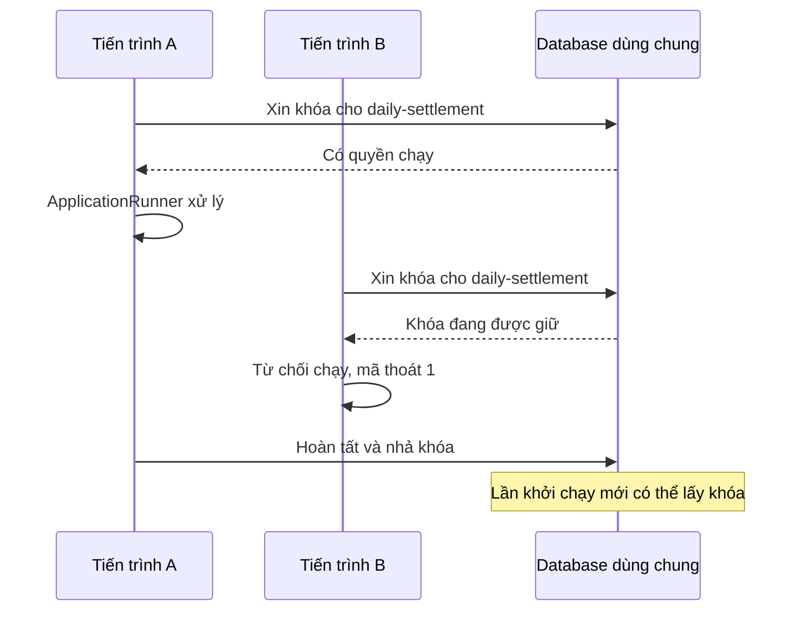

# Phụ thuộc Spring Integration và kho khóa JDBC

## 1. Bài toán: hai tiến trình cùng chạy một Spring Cloud Task

Một ứng dụng **Spring Cloud Task** thường thực hiện công việc hữu hạn: đồng bộ dữ liệu, nhập tệp, lập báo cáo hoặc gọi một quy trình Spring Batch rồi kết thúc. Spring Cloud Task dùng **`TaskRepository`** ghi lịch sử `TaskExecution` vào cơ sở dữ liệu, giúp theo dõi lần chạy, tham số, thời gian và mã thoát.

Giả sử job `daily-settlement` xử lý thanh toán hằng ngày. Bộ lập lịch khởi chạy lúc 01:00, nhưng lần chạy đầu mất 20 phút. Vì sự kiện retry hoặc yêu cầu thủ công, lần chạy thứ hai được tạo lúc 01:05. Nếu cả hai cùng ghi kết quả, hệ thống có thể gặp:

- Cùng một khoản thanh toán được hạch toán hai lần.
- Hai tiến trình cùng cập nhật một file hoặc vùng dữ liệu.
- Cả hai tải dữ liệu lớn, tăng tải lên database hoặc API ngoài.
- Một lần ghi đè kết quả trung gian của lần còn lại.

**`TaskRepository` ghi nhận các lần thực thi, nhưng chỉ có repository không tự ngăn hai lần chạy đồng thời.** Spring Cloud Task có tùy chọn `spring.cloud.task.single-instance-enabled=true` để yêu cầu chỉ một instance với cùng tên task được chạy tại một thời điểm. Tính năng này sử dụng các thành phần khóa của **Spring Integration**, bao gồm phụ thuộc JDBC và dữ liệu khóa trong cơ sở dữ liệu dùng chung.

Sau bài học, bạn có thể:

1. Thêm đúng dependency Spring Integration cho tính năng giới hạn một instance.
2. Phân biệt `TaskRepository` với kho khóa JDBC và bảng `TASK_LOCK`.
3. Cấu hình `single-instance-enabled`, tên task, thời hạn khóa và kết nối database dùng chung.
4. Chạy thử hai tiến trình để kiểm tra cơ chế chống chạy chồng.
5. Hiểu `JdbcLockRegistry`, `DefaultLockRepository`, bảng `INT_LOCK` và trường hợp tự dùng khóa trong nghiệp vụ.
6. Vận hành an toàn khi có timeout, JVM crash, mất kết nối DB, retry hoặc kết hợp Spring Batch.

## 2. Cơ chế một instance của Spring Cloud Task

Spring Cloud Task cung cấp cấu hình:

```yaml
spring:
  application:
    name: daily-settlement
  cloud:
    task:
      single-instance-enabled: true
```

Theo tài liệu Spring Cloud Task 3.2, mặc định `single-instance-enabled` là `false`. Khi bật thành `true` **ở tất cả các lần khởi chạy cần phối hợp**, một lần chạy có tên task trùng với tiến trình đang thực hiện sẽ bị từ chối. Trường hợp bị từ chối vì đã có instance cùng tên có **mã thoát 1**.



Đặc điểm quan trọng:

| Tình huống | Kết quả mong muốn |
| --- | --- |
| Hai lần chạy **cùng tên** và đều bật single instance | Chỉ một lần được xử lý nghiệp vụ tại thời điểm đó. |
| Hai lần chạy **khác tên** | Không bị chặn lẫn nhau chỉ vì dùng cùng database. |
| Một tiến trình không bật `single-instance-enabled` | Không thể coi cơ chế bảo vệ là đầy đủ cho tiến trình đó. |
| Hai tiến trình trỏ tới hai database khóa khác nhau | Không có sự phối hợp khóa giữa chúng. |
| Tiến trình trước đã hoàn tất, khóa được nhả | Lần chạy sau có thể thực thi. |

Tên task là **khóa logic để xét sự cạnh tranh**. Hãy khai báo tên rõ ràng, thống nhất trên tất cả các bản sao bằng `spring.cloud.task.name` hoặc cấu hình định danh phù hợp của phiên bản. Đổi tên trên một replica có thể làm hai lần chạy không còn tranh cùng khóa.

> Tính năng này giải quyết yêu cầu **không chạy hai bản sao cùng tên cùng lúc**. Nó không bảo đảm dữ liệu nghiệp vụ tự có tính *exactly once*. Nếu một bản sao ghi dữ liệu rồi crash, bộ điều phối vẫn có thể retry; các thao tác ghi cần idempotency, khóa nghiệp vụ hoặc transaction phù hợp.

## 3. Vì sao cần Spring Integration và JDBC?

Để đảm bảo một tiến trình ở máy A có thể phát hiện tiến trình ở máy B đang giữ khóa, cần cơ chế khóa **chia sẻ giữa các JVM**, không phải một biến `static` hoặc `synchronized` trong bộ nhớ.

Spring Integration cung cấp các abstraction:

| Thành phần | Vai trò |
| --- | --- |
| `LockRegistry` | Cấp một đối tượng `java.util.concurrent.locks.Lock` cho khóa logic. |
| `JdbcLockRegistry` | Triển khai registry khóa dựa trên một `LockRepository` và database JDBC. |
| `DefaultLockRepository` | Triển khai `LockRepository`, xử lý quyền sở hữu và bản ghi khóa trong bảng SQL. |
| `DataSource` và transaction manager | Kết nối, thực hiện giao dịch khi lấy/nhả/đổi trạng thái khóa. |
| Bảng khóa trong RDBMS | Lưu thông tin cho các tiến trình khác nhau cùng nhìn thấy. |

Spring Cloud Task dùng khả năng khóa JDBC của Spring Integration để triển khai giới hạn một instance. **Chỉ có `spring-cloud-starter-task` chưa đủ cho phần tùy chọn này** theo tài liệu Spring Cloud Task: cần thêm cả `spring-integration-core` và `spring-integration-jdbc`.

Dependency Maven:

```xml
<dependency>
    <groupId>org.springframework.integration</groupId>
    <artifactId>spring-integration-core</artifactId>
</dependency>
<dependency>
    <groupId>org.springframework.integration</groupId>
    <artifactId>spring-integration-jdbc</artifactId>
</dependency>
```

Trong ứng dụng Spring Cloud sử dụng BOM tương thích, để **BOM quản lý phiên bản** thay vì tự chọn hai phiên bản Spring Integration không đồng bộ với Spring Boot và Spring Cloud Task.

Nếu chỉ dùng Spring Cloud Task để theo dõi lịch sử thực thi và **không bật single instance**, không cần thêm hai dependency này chỉ vì `TaskRepository` có chữ “repository”. `TaskRepository` và `LockRepository` là hai mục đích khác nhau:

- `TaskRepository` lưu **lịch sử thực thi** (đã chạy lúc nào, kết quả gì).
- `LockRepository` lưu **quyền giữ khóa tạm thời** (instance nào được truy cập tài nguyên hoặc chạy trước).

## 4. Bảng `TASK_LOCK` và `INT_LOCK`: hai tên dễ nhầm

Đây là điểm kỹ thuật quan trọng của chủ đề.

Tài liệu schema **Spring Cloud Task 3.2** nêu bảng `TASK_LOCK` dành cho tính năng `single-instance-enabled`. Còn tài liệu **Spring Integration JDBC** mô tả `DefaultLockRepository` với tiền tố mặc định `INT_`, tức bảng khóa mặc định của một `JdbcLockRegistry` được cấu hình độc lập thường là `INT_LOCK`.

| Trường hợp sử dụng | Bảng khóa điển hình | Ai quản lý cấu hình |
| --- | --- | --- |
| Single instance của **Spring Cloud Task** | `TASK_LOCK` | Hạ tầng Spring Cloud Task, schema Task theo version. |
| `JdbcLockRegistry` do ứng dụng tự khai báo với tiền tố mặc định | `INT_LOCK` | Spring Integration `DefaultLockRepository`. |
| `JdbcLockRegistry` tùy biến tiền tố `APP_` | `APP_LOCK` | Ứng dụng tự đặt `prefix` và tự quản lý DDL tương ứng. |

**Không tự tạo `INT_LOCK` rồi mặc định Spring Cloud Task sẽ dùng bảng này**. Nếu dùng built-in `single-instance-enabled`, hãy xem schema của **đúng phiên bản Spring Cloud Task**, trong đó có bảng `TASK_LOCK` và các bảng repository khác. Nếu bạn tự tạo registry Spring Integration cho nhu cầu nghiệp vụ, hãy dùng script JDBC của đúng phiên bản Spring Integration và tiền tố đã cấu hình.

### 4.1. Các cột cơ bản của `TASK_LOCK`

Theo tài liệu schema của Spring Cloud Task 3.2:

| Cột | Ý nghĩa |
| --- | --- |
| `LOCK_KEY` | Định danh khóa, kiểu ký tự 36. |
| `REGION` | Phạm vi/nhóm khóa, kiểu chuỗi tối đa 100 ký tự. |
| `CLIENT_ID` | Định danh bên giữ khóa. |
| `CREATED_DATE` | Thời điểm ghi bản ghi khóa. |

Ví dụ **minh họa cấu trúc tương tự trên PostgreSQL**:

```sql
CREATE TABLE TASK_LOCK (
    LOCK_KEY CHAR(36) NOT NULL,
    REGION VARCHAR(100) NOT NULL,
    CLIENT_ID CHAR(36),
    CREATED_DATE TIMESTAMP NOT NULL,
    CONSTRAINT TASK_LOCK_PK PRIMARY KEY (LOCK_KEY, REGION)
);
```

Đây chỉ là mẫu giải thích tên cột và khóa chính, **không thay thế DDL chính thức khi triển khai**. Script cụ thể, độ chính xác timestamp, ràng buộc và các đối tượng khác phải lấy từ schema tương ứng phiên bản Spring Cloud Task và database mục tiêu. Ngoài `TASK_LOCK`, ứng dụng còn cần `TASK_EXECUTION`, `TASK_EXECUTION_PARAMS` và những đối tượng metadata liên quan.

### 4.2. Vì sao database phải được chia sẻ?

Muốn bảo vệ giữa máy A và máy B, **cả hai phải truy cập cùng một bảng khóa trong cùng database logic** và thống nhất tên khóa. Dùng H2 in-memory ở hai JVM tạo hai database khác nhau, do đó không thể làm thử nghiệm cross-process đáng tin cậy.

H2 file chỉ phù hợp quan sát schema một tiến trình; việc hai tiến trình mở cùng một file H2 embedded cũng có thể gây lỗi khóa file cơ sở dữ liệu thay vì kiểm chứng đúng hành vi của single instance.

**Với kiểm thử hai tiến trình hoặc triển khai đa node, nên dùng PostgreSQL/MySQL server** (hoặc hệ RDBMS được phiên bản Spring Cloud Task hỗ trợ) làm nguồn khóa chung.

## 5. Dự án Spring Boot mẫu với PostgreSQL

Ví dụ dùng **JDK 17**, **Spring Boot 3.4.5** và **Spring Cloud 2024.0.2** cùng bộ phụ thuộc tương thích. Database minh họa là PostgreSQL server, để hai tiến trình JAR khác nhau có thể kết nối đồng thời.

Cấu trúc:

```text
single-task-demo/
├── pom.xml
└── src/main/
    ├── java/com/example/singletask/
    │   ├── SingleTaskApplication.java
    │   └── SettlementRunner.java
    └── resources/
        └── application.yml
```

### 5.1. Maven `pom.xml`

```xml
<?xml version="1.0" encoding="UTF-8"?>
<project xmlns="http://maven.apache.org/POM/4.0.0"
         xmlns:xsi="http://www.w3.org/2001/XMLSchema-instance"
         xsi:schemaLocation="http://maven.apache.org/POM/4.0.0 https://maven.apache.org/xsd/maven-4.0.0.xsd">
    <modelVersion>4.0.0</modelVersion>

    <parent>
        <groupId>org.springframework.boot</groupId>
        <artifactId>spring-boot-starter-parent</artifactId>
        <version>3.4.5</version>
        <relativePath/>
    </parent>

    <groupId>com.example</groupId>
    <artifactId>single-task-demo</artifactId>
    <version>0.0.1-SNAPSHOT</version>

    <properties>
        <java.version>17</java.version>
    </properties>

    <dependencyManagement>
        <dependencies>
            <dependency>
                <groupId>org.springframework.cloud</groupId>
                <artifactId>spring-cloud-dependencies</artifactId>
                <version>2024.0.2</version>
                <type>pom</type>
                <scope>import</scope>
            </dependency>
        </dependencies>
    </dependencyManagement>

    <dependencies>
        <dependency>
            <groupId>org.springframework.cloud</groupId>
            <artifactId>spring-cloud-starter-task</artifactId>
        </dependency>
        <dependency>
            <groupId>org.springframework.boot</groupId>
            <artifactId>spring-boot-starter-jdbc</artifactId>
        </dependency>
        <dependency>
            <groupId>org.postgresql</groupId>
            <artifactId>postgresql</artifactId>
            <scope>runtime</scope>
        </dependency>
        <dependency>
            <groupId>org.springframework.integration</groupId>
            <artifactId>spring-integration-core</artifactId>
        </dependency>
        <dependency>
            <groupId>org.springframework.integration</groupId>
            <artifactId>spring-integration-jdbc</artifactId>
        </dependency>
    </dependencies>

    <build>
        <plugins>
            <plugin>
                <groupId>org.springframework.boot</groupId>
                <artifactId>spring-boot-maven-plugin</artifactId>
            </plugin>
        </plugins>
    </build>
</project>
```

Hai dependency Spring Integration là phần được bổ sung để bật cơ chế khóa một instance. JDBC driver PostgreSQL phải có trong classpath và đúng với hạ tầng database đã chọn.

### 5.2. Cấu hình `application.yml`

```yaml
spring:
  application:
    name: daily-settlement
  main:
    web-application-type: none
  datasource:
    url: jdbc:postgresql://localhost:5432/cloud_task_demo
    username: task_runtime
    password: ${DB_PASSWORD}
  cloud:
    task:
      name: daily-settlement
      single-instance-enabled: true
      initialize-enabled: false
      closecontext-enabled: true
```

Trong đó:

- `spring.cloud.task.name` cố định tên được dùng để nhận diện task; **các bản sao phải dùng cùng tên** nếu muốn khóa có tác dụng.
- `single-instance-enabled: true` yêu cầu chỉ một lần chạy cùng tên tại một thời điểm.
- `initialize-enabled: false` giả định database đã có schema chính thức, bao gồm `TASK_LOCK`. Đây là cấu hình phù hợp khi schema do migration quản lý.
- `web-application-type: none` phù hợp ứng dụng hữu hạn, còn `closecontext-enabled` giúp đóng Spring context khi kết thúc.
- `password` được lấy từ biến môi trường `DB_PASSWORD`. Trong production hãy dùng secret manager hoặc cách cấp secret được môi trường hỗ trợ.

**Chuẩn bị database trước khi chạy:** Tạo database `cloud_task_demo` và tài khoản phù hợp bằng quy trình hạ tầng. Áp dụng **script schema PostgreSQL đi kèm phiên bản Spring Cloud Task** (bao gồm bảng/sequence Task và bảng `TASK_LOCK`) thông qua Flyway, Liquibase hoặc DBA. Cấp quyền đọc/ghi cần thiết cho tài khoản `task_runtime`. Không tạo thủ công chỉ một bảng `TASK_LOCK` rồi mong toàn bộ `TaskRepository` hoạt động.

> Nếu chỉ thử nghiệm lần đầu trên database trống và riêng biệt, có thể bật `spring.cloud.task.initialize-enabled=true` có kiểm soát để thư viện khởi tạo schema; sau đó chuyển về `false`. Không để nhiều bản sao cùng khởi động rồi cùng thực thi DDL tạo schema.

### 5.3. Bật Spring Cloud Task

Tạo `SingleTaskApplication.java`:

```java
package com.example.singletask;

import org.springframework.boot.SpringApplication;
import org.springframework.boot.autoconfigure.SpringBootApplication;
import org.springframework.cloud.task.configuration.EnableTask;

@SpringBootApplication
@EnableTask
public class SingleTaskApplication {
    public static void main(String[] args) {
        SpringApplication.run(SingleTaskApplication.class, args);
    }
}
```

### 5.4. Tạo runner đủ lâu để thử cạnh tranh khóa

Tạo `SettlementRunner.java`:

```java
package com.example.singletask;

import java.util.List;

import org.springframework.boot.ApplicationArguments;
import org.springframework.boot.ApplicationRunner;
import org.springframework.stereotype.Component;

@Component
public class SettlementRunner implements ApplicationRunner {

    @Override
    public void run(ApplicationArguments args) throws Exception {
        List<String> values = args.getOptionValues("work-seconds");
        long seconds = (values == null || values.isEmpty())
                ? 30L : Long.parseLong(values.get(0));

        if (seconds < 0 || seconds > 120L) {
            throw new IllegalArgumentException(
                    "--work-seconds phải nằm trong khoảng 0..120");
        }

        System.out.println("Bắt đầu xử lý quyết toán, thời gian="
                + seconds + " giây");
        try {
            Thread.sleep(seconds * 1_000L);
        } catch (InterruptedException interrupted) {
            Thread.currentThread().interrupt();
            throw interrupted;
        }

        System.out.println("Đã xử lý quyết toán");
    }
}
```

`Thread.sleep()` mô phỏng một công việc dài. Trong ứng dụng thật, thay bằng xử lý dữ liệu có giới hạn, kiểm tra lỗi và ghi kết quả nghiệp vụ. Nếu có các worker bất đồng bộ bắt buộc, runner **phải chờ họ hoàn thành** trước khi trả về, vì khóa single instance của task cần bao trùm toàn bộ công việc bắt buộc.

## 6. Chạy thử hai tiến trình với cùng database

Đảm bảo hai terminal có cùng cấu hình datasource và `DB_PASSWORD`. Nếu dùng PowerShell, thiết lập mật khẩu trong từng terminal hoặc để hạ tầng cung cấp biến môi trường:

```powershell
$env:DB_PASSWORD = "<mat-khau-trong-moi-truong-thu-nghiem>"
```

Chuẩn bị schema trước, rồi đóng gói:

```bash
mvn clean package
```

### 6.1. Terminal A: khởi chạy instance đầu

```bash
java -jar target/single-task-demo-0.0.1-SNAPSHOT.jar --work-seconds=30
```

Phần log từ runner:

```text
Bắt đầu xử lý quyết toán, thời gian=30 giây
```

Tiến trình A tiếp tục chạy trong lúc `Thread.sleep()`. Spring Cloud Task đang giữ quyền thực thi cho tên `daily-settlement` trên kho khóa chung.

### 6.2. Terminal B: khởi chạy instance thứ hai khi A còn chạy

Trong khoảng 30 giây đó, ở terminal khác dùng **cùng database** và **cùng tên task**:

```bash
java -jar target/single-task-demo-0.0.1-SNAPSHOT.jar --work-seconds=2
```

Kỳ vọng: framework phát hiện task cùng tên đang chạy và **từ chối instance thứ hai**, thông báo một task với tên đó đã chạy; mã thoát theo tài liệu là `1`. Không xuất hiện dòng log `Bắt đầu xử lý quyết toán` của runner B nếu cơ chế chặn hoạt động đúng.

Trong PowerShell, kiểm tra mã thoát tiến trình Java vừa kết thúc bằng `$LASTEXITCODE`. Trong Bash, kiểm tra bằng `echo $?` ngay sau lệnh Java.

### 6.3. Sau khi A hoàn tất

Khi A in:

```text
Đã xử lý quyết toán
```

và tiến trình đóng bình thường, chạy lại B. Lần này `daily-settlement` không còn giữ khóa cũ nên runner có thể bắt đầu xử lý.

| Thời điểm | A | B | Kỳ vọng |
| --- | --- | --- | --- |
| T0 | Khởi chạy và lấy khóa | Chưa chạy | A bắt đầu công việc. |
| T0 + vài giây | Đang chạy | B khởi chạy | B bị từ chối, mã thoát 1. |
| Sau khi A kết thúc | Không chạy | B khởi chạy lại | B được phép chạy. |

Chú ý: Nếu B khởi chạy khi A **đã kết thúc**, cả hai có thể thành công theo thứ tự. Bài kiểm thử phải tạo **khoảng thời gian chồng nhau thật sự**.

## 7. Truy vấn `TASK_LOCK` và `TASK_EXECUTION`

Kết nối tới PostgreSQL database `cloud_task_demo` bằng SQL client hoặc `psql`.

### 7.1. Kiểm tra cấu trúc bảng khóa

```sql
SELECT table_name, column_name, data_type
FROM information_schema.columns
WHERE lower(table_name) = 'task_lock'
ORDER BY ordinal_position;
```

Truy vấn này giúp phát hiện schema thiếu cột, tên bảng khác hoặc truy cập nhầm database. Tùy cách triển khai, tên bảng có thể nằm dưới namespace không phải `public`; nếu cần, bổ sung điều kiện `table_schema`.

### 7.2. Quan sát bản ghi khóa

Trong lúc A đang chạy:

```sql
SELECT LOCK_KEY, REGION, CLIENT_ID, CREATED_DATE
FROM TASK_LOCK;
```

Thao tác đọc giúp quan sát metadata mà cơ chế khóa đang sử dụng. Không cần suy diễn `LOCK_KEY` là tên task ở dạng nguyên văn: Spring Integration có thể biểu diễn khóa bằng mã/giá trị nội bộ. Không sửa tay `LOCK_KEY` hoặc `CLIENT_ID` để “nhường” khóa khi chưa xác định được chủ sở hữu.

### 7.3. Đối chiếu lịch sử thực thi

```sql
SELECT TASK_EXECUTION_ID,
       TASK_NAME,
       START_TIME,
       END_TIME,
       EXIT_CODE,
       ERROR_MESSAGE
FROM TASK_EXECUTION
WHERE TASK_NAME = 'daily-settlement'
ORDER BY TASK_EXECUTION_ID DESC;
```

`TASK_EXECUTION` chứa lịch sử, còn `TASK_LOCK` giữ trạng thái khóa. Chúng phục vụ mục đích khác nhau, vì vậy **không dùng `END_TIME IS NULL` như một cơ chế khóa thay thế**; một tiến trình chết đột ngột có thể để lại `END_TIME` trống dù không còn giữ được quyền chạy.

Một lần khởi chạy bị từ chối **rất sớm** có thể không lưu đủ một bản ghi thực thi như các lần runner chạy bình thường. Khi xác minh chặn trùng, hãy kết hợp mã thoát, log, tình trạng bảng khóa và số lần runner thực sự thực thi.

## 8. Thời hạn khóa (TTL) và chu kỳ kiểm tra

Ngoài `single-instance-enabled`, một số phiên bản Spring Cloud Task cung cấp các thuộc tính:

```yaml
spring:
  cloud:
    task:
      single-instance-enabled: true
      single-instance-lock-check-interval: 500
      single-instance-lock-ttl: 3600000
```

Trong đó giá trị là **mili giây**:

- `single-instance-lock-check-interval` quy định khoảng thời gian giữa các lần kiểm tra khóa; tài liệu thuộc tính Spring Cloud ghi mặc định **500 ms**.
- `single-instance-lock-ttl` giới hạn thời gian tồn tại hiệu lực của khóa; ví dụ `3600000` tương đương **1 giờ**. Mặc định và cách xử lý chi tiết tùy phiên bản, cần kiểm tra tài liệu và cấu hình thực tế.

TTL hỗ trợ cơ chế thu hồi sau khi tiến trình không còn nhả khóa được do crash hoặc mất kết nối. Tuy nhiên nó tạo một đánh đổi:

| TTL | Rủi ro |
| --- | --- |
| Quá ngắn so với thời gian task | Khóa có thể hết hạn trong khi A còn làm việc, tạo khả năng B được phép chạy và gây chồng lặp. |
| Quá dài | Sau khi A crash, B có thể phải chờ hoặc bị từ chối lâu hơn mong muốn. |
| Không có chiến lược quản lý timeout | Khó xác định khi nào nên retry và khi nào phải báo sự cố cho người vận hành. |

Trong ứng dụng xử lý lâu, không nên chỉ “ước lượng TTL vừa đủ” mà cần đặt giới hạn chạy, giám sát thời gian thực tế, hiểu cơ chế gia hạn khóa mà phiên bản đang dùng hỗ trợ và bảo đảm xử lý nghiệp vụ có khả năng chạy lại an toàn. **Không mặc định mọi cấu hình Spring Cloud Task tự gia hạn lease mãi mãi.**

Thời hạn khóa **khác** với thời gian chờ I/O, timeout của câu SQL hay timeout của scheduler. Chỉ đổi TTL không giải quyết được một worker đang bị treo trong khi giữ tài nguyên nghiệp vụ.

## 9. Dùng `JdbcLockRegistry` trực tiếp khi khóa theo tài nguyên nghiệp vụ

`single-instance-enabled` bảo vệ theo **tên toàn ứng dụng task**. Đôi khi cần khóa ở mức chi tiết hơn:

- Hai task khác tên vẫn cùng cập nhật báo cáo `2026-11`.
- Nhiều job xử lý từng tenant song song, nhưng mỗi tenant chỉ cho phép một lần cập nhật.
- Chỉ một bước ghi cuối cần độc quyền; các bước đọc trước đó có thể song song.

Khi đó, ứng dụng có thể **tự cấu hình `JdbcLockRegistry`** và dùng một khóa logic như `tenant-42:settlement`. Đây là thiết kế riêng, không tự động thay đổi khóa single instance của Spring Cloud Task.

### 9.1. Khởi tạo một kho khóa Spring Integration riêng

Giả sử ứng dụng đã có một `DataSource`, và database đã có bảng `APP_LOCK` với schema tương ứng Spring Integration JDBC. Đăng ký bean:

```java
package com.example.singletask;

import javax.sql.DataSource;

import org.springframework.context.annotation.Bean;
import org.springframework.context.annotation.Configuration;
import org.springframework.integration.jdbc.lock.DefaultLockRepository;
import org.springframework.integration.jdbc.lock.JdbcLockRegistry;
import org.springframework.integration.support.locks.LockRegistry;

@Configuration
public class BusinessLockConfig {

    @Bean
    public DefaultLockRepository businessLockRepository(DataSource dataSource) {
        DefaultLockRepository repository = new DefaultLockRepository(dataSource);
        repository.setPrefix("APP_");
        return repository;
    }

    @Bean("businessLockRegistry")
    public LockRegistry businessLockRegistry(
            DefaultLockRepository businessLockRepository) {
        return new JdbcLockRegistry(businessLockRepository);
    }
}
```

`DefaultLockRepository` mặc định sử dụng tiền tố `INT_`, nhưng ví dụ đổi thành `APP_` để phân biệt khóa nghiệp vụ với bảng `TASK_LOCK` của Spring Cloud Task. Phải tạo bảng `APP_LOCK` trước bằng DDL tương ứng phiên bản Spring Integration (hoặc điều chỉnh script vendor sẵn có).

Đây là ví dụ **độc lập cho bài toán khóa nghiệp vụ**. Nếu ứng dụng chỉ cần `single-instance-enabled`, không cần tạo các bean này. Khi đăng ký nhiều bean kiểu `LockRegistry`, cần xác định rõ bean nào được inject để tránh nhầm kho khóa.

### 9.2. Xin khóa, thực thi và nhả khóa

```java
package com.example.singletask;

import java.util.concurrent.TimeUnit;
import java.util.concurrent.locks.Lock;

import org.springframework.beans.factory.annotation.Qualifier;
import org.springframework.integration.support.locks.LockRegistry;
import org.springframework.stereotype.Service;

@Service
public class TenantSettlementService {

    private final LockRegistry lockRegistry;

    public TenantSettlementService(
            @Qualifier("businessLockRegistry") LockRegistry lockRegistry) {
        this.lockRegistry = lockRegistry;
    }

    public void settle(String tenantId) throws InterruptedException {
        String key = "settlement:" + tenantId;
        Lock lock = lockRegistry.obtain(key);
        boolean acquired = lock.tryLock(5, TimeUnit.SECONDS);
        if (!acquired) {
            throw new IllegalStateException(
                    "Tài nguyên đang bận: " + tenantId);
        }

        try {
            // Xử lý thanh toán cho tenantId; ở đây thay bằng nghiệp vụ thật.
            System.out.println("Đang xử lý tenant " + tenantId);
        } finally {
            lock.unlock();
        }
    }
}
```

Việc dùng `try/finally` rất quan trọng: nếu logic nghiệp vụ ném ngoại lệ, ứng dụng vẫn cố gắng nhả khóa. Với `InterruptedException`, tầng gọi phù hợp nên khôi phục cờ interrupt khi chuyển ngoại lệ sang dạng khác, đồng thời dừng xử lý an toàn.

**Không đồng nhất hai khái niệm:** Khóa Spring Integration cho nghiệp vụ `settlement:tenant-42` khác khóa cùng tên task trong `TASK_LOCK`. Nếu hai chiến lược cùng tồn tại, hãy làm rõ phạm vi từng khóa và thứ tự lấy khóa, tránh deadlock do các tiến trình lấy nhiều khóa theo thứ tự khác nhau.

## 10. Các lỗi thường gặp

| Triệu chứng | Nguyên nhân thường gặp | Hướng xử lý |
| --- | --- | --- |
| Bật single instance nhưng báo thiếu class Spring Integration | Chưa thêm `spring-integration-core` hoặc `spring-integration-jdbc` | Thêm đủ dependency, dùng phiên bản do BOM quản lý. |
| `TASK_LOCK` không tồn tại | Schema Task chưa được khởi tạo hoặc migration thiếu | Dùng DDL Spring Cloud Task đúng phiên bản; kiểm tra database/schema. |
| `INT_LOCK` có nhưng built-in vẫn báo lỗi `TASK_LOCK` | Nhầm kho khóa Spring Integration mặc định với kho khóa Task | Chuẩn bị bảng `TASK_LOCK`; chỉ dùng `INT_LOCK` cho registry cấu hình riêng. |
| Hai bản sao đều chạy dù đã bật cấu hình | Tên task khác nhau, database khác nhau hoặc có instance tắt tùy chọn | Đối chiếu tên, cấu hình hiệu lực và JDBC URL của tất cả replica. |
| Không chạy được instance mới sau crash | Khóa chưa được nhả hoặc TTL còn hiệu lực | Kiểm tra tiến trình cũ, lease/TTL, log và chính sách khôi phục. |
| Chạy chồng khi task kéo dài | TTL hết hạn trước khi nghiệp vụ hoàn tất | Đánh giá lại TTL/timeout, khả năng gia hạn và idempotency. |
| Một process không kết nối được H2 file | H2 embedded file bị khóa bởi process khác | Kiểm thử đồng thời bằng PostgreSQL/MySQL server chung. |
| `Permission denied` trên bảng khóa | Tài khoản runtime thiếu quyền đọc/ghi | Kiểm tra quyền DML cho các bảng Task và bảng khóa. |
| Chỉ một số bản sao có lịch sử `TaskExecution` | Dữ liệu ghi ở các schema hoặc datasource khác nhau | Kiểm tra cấu hình `TaskRepository` và namespace DB. |
| Spring Batch job chạy đôi | Task lock không bao phủ đủ workflow, hoặc có job được khởi chạy từ nơi khác | Đợi job hoàn tất, dùng JobRepository/JobParameters và cơ chế retry phù hợp. |

### Quy trình chẩn đoán khi một instance bị từ chối

1. Xác nhận đó là **cạnh tranh khóa dự kiến** hay lỗi hạ tầng bằng cách xem log và mã thoát.
2. Kiểm tra `spring.cloud.task.name`, `single-instance-enabled` và profile hiệu lực của cả hai tiến trình.
3. Đối chiếu JDBC URL, schema và khả năng truy cập bảng `TASK_LOCK` từ từng instance.
4. Xem bảng `TASK_EXECUTION` và tình trạng tiến trình của instance đang chạy.
5. Nếu nghi ngờ khóa cũ, kiểm tra TTL, thời điểm tạo khóa, log dừng process và khả năng job cũ còn thực thi.
6. Chỉ áp dụng thao tác xử lý khóa tồn đọng sau khi **chắc chắn không còn chủ sở hữu đang chạy** và có quy trình vận hành được phê duyệt.

Không xóa tay bản ghi `TASK_LOCK` khi một process còn sống: làm vậy có thể cho phép process thứ hai vào cùng vùng nghiệp vụ. Khi database có sự cố, ưu tiên khôi phục kết nối và quan sát trạng thái thay vì tự động bỏ qua khóa.

## 11. Bảo đảm vận hành an toàn khi chạy theo lịch hoặc theo yêu cầu

Một hệ thống gọi Spring Cloud Task bằng `cron`, Kubernetes `Job`/`CronJob` hoặc API điều phối có thể tạo ra các lần chạy cùng tên. `single-instance-enabled` là một lớp bảo vệ ở ứng dụng, nhưng hệ thống vận hành vẫn cần:

- **Chính sách concurrency ở scheduler:** Ví dụ giới hạn không khởi chạy job chồng nhau ngay từ Kubernetes/điều phối; database lock là lớp bảo vệ bổ sung nếu vẫn có retry hoặc trigger thủ công.
- **Database bền vững và sẵn sàng:** Các bản sao dùng chung một PostgreSQL/MySQL server có backup, monitoring, quyền truy cập và connection timeout phù hợp.
- **TTL và thời gian chạy dự kiến:** Theo dõi p95/p99 thời lượng của task, chọn giới hạn tránh hết hạn khi job còn chạy và có phương án xử lý tiến trình treo.
- **Thiết kế idempotent:** Dùng khóa nghiệp vụ, unique constraint, upsert hoặc transaction để giảm tác động khi retry sau crash.
- **Tham số và bí mật:** Không truyền token vào dòng lệnh vì `TaskRepository` có thể lưu tham số; dùng secret manager hoặc biến môi trường.
- **Bất đồng bộ:** Đảm bảo `ApplicationRunner` chờ các future/job bắt buộc hoàn tất rồi mới trả về, tránh thả khóa khi worker còn ghi dữ liệu.
- **Spring Batch:** `TaskRepository` theo dõi lần chạy ứng dụng, còn `JobRepository` theo dõi job/step. Với launcher bất đồng bộ, không coi `JobExecution` vừa được gửi là job đã thành công.
- **Giám sát:** Cảnh báo cả lỗi từ chối do trùng lịch, lỗi truy cập bảng khóa, task không có `END_TIME` quá lâu và kết quả nghiệp vụ không hợp lệ.

Khóa JDBC là một **cơ chế phối hợp**, không phải transaction xuyên suốt các dịch vụ ngoài. Nếu thao tác cần bảo đảm mạnh hơn dưới sự cố mạng và lease hết hạn, hãy đánh giá thêm idempotency key, unique constraint, fencing token hoặc mô hình xử lý phù hợp với hệ thống đích.

## 12. Tự kiểm tra và bài tập

### Bài tập 1: Xác minh dependency và schema

1. Tạo dự án mẫu với `spring-cloud-starter-task` và hai dependency Spring Integration.
2. Kiểm tra schema PostgreSQL có cả `TASK_EXECUTION` và `TASK_LOCK`.
3. Giải thích vì sao tự tạo `INT_LOCK` không đủ cho `single-instance-enabled` của Spring Cloud Task.

### Bài tập 2: Chạy hai instance

1. Cho A chạy `--work-seconds=30`.
2. Khi A chưa kết thúc, chạy B với `--work-seconds=2` từ terminal khác.
3. Xác nhận B bị từ chối và mã thoát là 1.
4. Chạy B lần nữa sau khi A đã kết thúc; xác nhận B bắt đầu nghiệp vụ.
5. Lặp lại với hai tên task khác nhau và giải thích vì sao các lần chạy có thể không tranh cùng khóa.

### Bài tập 3: Phân tích sự cố khóa

Giả sử một job thường chạy 45 phút nhưng TTL chỉ đặt 15 phút. Mô tả rủi ro khi retry tự động khởi chạy ở phút thứ 20; đề xuất cấu hình, giám sát và biện pháp nghiệp vụ để ngăn ghi dữ liệu hai lần.

### Câu hỏi ôn tập

1. Hai dependency Spring Integration nào được Spring Cloud Task yêu cầu khi dùng `single-instance-enabled`?
2. `TaskRepository` và `DefaultLockRepository` khác nhau về mục đích gì?
3. Vì sao `JdbcLockRegistry` dựa vào JDBC có thể phối hợp qua nhiều JVM?
4. Bảng `TASK_LOCK` khác `INT_LOCK` trong trường hợp nào?
5. Nếu B bị chặn vì A đang chạy cùng tên task, exit code theo tài liệu là bao nhiêu?
6. Vì sao H2 embedded file không phải lựa chọn tốt để kiểm chứng khóa trên nhiều process?
7. TTL quá ngắn và TTL quá dài lần lượt gây ra rủi ro gì?
8. Làm thế nào để bảo vệ công việc Spring Batch chạy bất đồng bộ trước việc thả khóa quá sớm?

**Ghi nhớ:** Khi bật `spring.cloud.task.single-instance-enabled=true`, Spring Cloud Task cần **Spring Integration Core + JDBC** và một kho khóa dùng chung để tránh các lần chạy cùng tên chồng nhau. Với cơ chế tích hợp sẵn, schema Spring Cloud Task có bảng **`TASK_LOCK`**; một registry Spring Integration cấu hình độc lập thường sử dụng **`INT_LOCK`**. Hãy quản lý schema theo đúng phiên bản, dùng database chung, thiết lập TTL có chủ đích và thiết kế nghiệp vụ chạy lại an toàn.

## Tài liệu tham khảo

- [Spring Cloud Task 3.2 — Features: Restricting Spring Cloud Task Instances](https://docs.spring.io/spring-cloud-task/reference/3.2/features.html): `single-instance-enabled`, dependency Spring Integration và mã thoát khi trùng lần chạy.
- [Spring Cloud Task 3.2 — Task Repository Schema](https://docs.spring.io/spring-cloud-task/reference/3.2/appendix-task-repository-schema.html): các cột `TASK_EXECUTION` và `TASK_LOCK`.
- [Spring Integration 6.4 — JDBC Lock Registry](https://docs.spring.io/spring-integration/reference/6.4/jdbc/lock-registry.html): `DefaultLockRepository`, `JdbcLockRegistry`, tiền tố `INT_` và TTL.
- [Spring Cloud — Configuration Properties](https://docs.spring.io/spring-cloud/docs/current/reference/html/configprops.html): `single-instance-lock-check-interval` và `single-instance-lock-ttl`.
