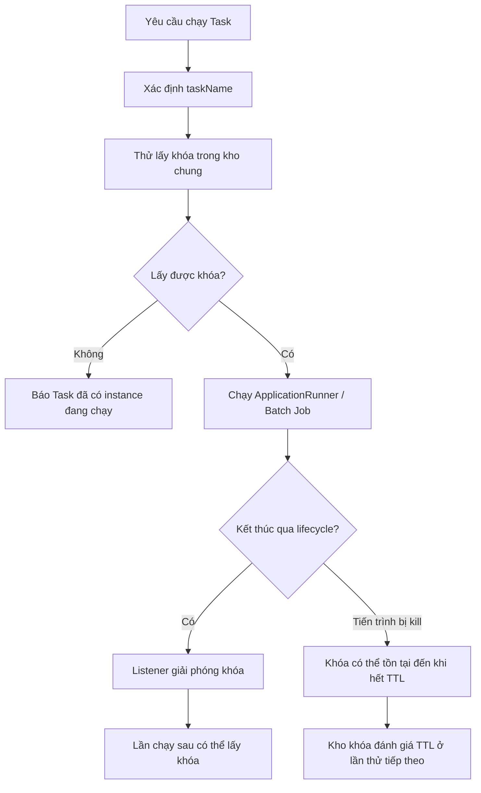

# Chu kỳ kiểm tra và thời gian sống của khóa trong Spring Cloud Task

## 1. Vì sao Task cần khóa?

**Spring Cloud Task** được dùng để xây dựng ứng dụng Spring Boot có thời gian chạy hữu hạn: khởi động, thực hiện công việc và kết thúc. Mỗi lần chạy có thể ghi metadata vào `TaskRepository` dưới dạng `TaskExecution`, gồm thời điểm bắt đầu, thời điểm kết thúc, mã thoát và kết quả. Task thường được gọi thủ công, theo lịch hoặc qua một hệ thống điều phối; các lời gọi có thể đến đồng thời.

Giả sử ứng dụng `daily-invoice-import` nhập hóa đơn:

- 01:00: Scheduler khởi chạy Task A, dự kiến chạy 18 phút.
- 01:05: Một yêu cầu chạy lại khởi động Task B cùng tên.
- Nếu A và B cùng ghi dữ liệu, hóa đơn có thể được nhập hai lần.
- Nếu A bị kill khi đang giữ khóa, một khóa cũ có thể ngăn các lần chạy sau dù không còn tiến trình nào thực sự chạy.

Spring Cloud Task có chế độ **single-instance** để hạn chế nhiều Task **cùng tên** chạy đồng thời. Khi dùng khóa JDBC chia sẻ giữa các instance, cơ chế cần hai tham số: **chu kỳ kiểm tra** và **thời gian sống của khóa (TTL)**. Cấu hình sai hai giá trị này có thể khiến ứng dụng liên tục bị từ chối, hoặc tệ hơn là hai tiến trình cùng xử lý dữ liệu.

Bài học thuộc chương **Khóa và đồng thời**, giúp bạn:

1. Hiểu `single-instance-enabled`, `single-instance-lock-check-interval` và `single-instance-lock-ttl`.
2. Phân biệt chu kỳ thử khóa với lịch chạy Task, retry của scheduler và thời gian chạy nghiệp vụ.
3. Đọc bảng khóa, nhận diện khóa cũ và rủi ro TTL hết khi Task còn hoạt động.
4. Chọn giá trị từ thời gian chạy thực tế, kiểm chứng bằng hai tiến trình và xây dựng phương án phục hồi.
5. Phối hợp an toàn với Spring Batch, giao dịch, idempotency và bộ điều phối.

## 2. Phạm vi của cơ chế single-instance

Khi `spring.cloud.task.single-instance-enabled=true`, Spring Cloud Task bật `SingleInstanceTaskListener` để cố lấy khóa theo **tên Task** trước khi logic nghiệp vụ chạy. Theo tài liệu chính thức, nếu một lần chạy khác cùng tên đang giữ khóa, lần chạy mới bị từ chối; trường hợp tranh chấp này được mô tả là thất bại với **exit code 1**.



Phạm vi khóa là **taskName**, không phải PID, `TaskExecutionId`, ngày báo cáo hay tham số dòng lệnh. Hai lần chạy cùng tên nhưng khác `--run-date` vẫn tranh chấp cùng khóa. Ngược lại, hai lần chạy khác tên có thể không chặn nhau dù cùng ghi vào một bảng nghiệp vụ.

Tên Task thường được giải quyết bởi `TaskNameResolver`. Bạn có thể đặt `spring.cloud.task.name` tường minh; nếu không, tên có thể được lấy từ định danh ứng dụng Spring Boot. Mọi instance cần chặn nhau phải dùng **cùng tên và cùng kho khóa**. Trong môi trường nhiều container, H2 in-memory riêng từng tiến trình **không** cung cấp khóa phân tán.

| Thành phần | Chức năng | Không đảm bảo |
| --- | --- | --- |
| `TASK_EXECUTION` / `TaskRepository` | Ghi lịch sử lần chạy | Không tự ngăn Task trùng |
| `SingleInstanceTaskListener` | Lấy/giải phóng khóa trước và sau công việc | Không bảo vệ dữ liệu sau khi khóa hết hạn |
| `TASK_LOCK` / JDBC lock store | Phối hợp giữa các JVM dùng chung database | Không tự hủy tiến trình khi TTL hết |
| Scheduler, Kubernetes Job, Cron | Quyết định khi nào gửi yêu cầu chạy | Không được thay thế bằng khoảng kiểm tra khóa |
| Unique constraint, khóa nghiệp vụ, idempotency | Chống ghi dữ liệu trùng khi retry hoặc chạy chồng | Không thay thế quan sát và điều phối |

## 3. Ba cấu hình cần hiểu cùng nhau

| Thuộc tính | Mặc định theo bảng cấu hình Spring Cloud Task | Ý nghĩa |
| --- | --- | --- |
| `spring.cloud.task.single-instance-enabled` | `false` | Bật/tắt bảo vệ một lần chạy cùng tên |
| `spring.cloud.task.single-instance-lock-check-interval` | `500` **mili giây** | Thời gian đợi giữa các lần kiểm tra/thử khóa do cơ chế lock thực hiện |
| `spring.cloud.task.single-instance-lock-ttl` | `Integer.MAX_VALUE` **mili giây** | Thời hạn hiệu lực tối đa của khóa trong cơ chế phân tán |

**Đơn vị là mili giây**, không phải giây. Ví dụ `1000` là 1 giây; `1800000` là 30 phút. Các số mặc định ở trên phản ánh tài liệu configuration properties được dẫn cuối bài. Khi nâng cấp Spring Cloud Task hoặc Spring Integration, hãy kiểm tra thông số của đúng phiên bản dự án sử dụng.

Ví dụ `application.yml`:

```yaml
spring:
  application:
    name: invoice-import
  main:
    web-application-type: none
  cloud:
    task:
      name: daily-invoice-import
      single-instance-enabled: true
      single-instance-lock-check-interval: 1000
      single-instance-lock-ttl: 1800000
```

Ở cấu hình này, interval là 1 giây, TTL là 30 phút. Nếu A kết thúc bình thường sau 10 phút và listener giải phóng khóa, lần chạy khác có thể lấy lại khóa **trước mốc 30 phút**. TTL không bắt Task phải giữ khóa đủ 30 phút.

### 3.1. Chu kỳ kiểm tra không phải lịch chạy

`single-instance-lock-check-interval` diễn tả khoảng đợi giữa các lượt kiểm tra/thử lại mà cơ chế lock thực hiện. Nó **không** có nghĩa cứ mỗi 1.000 ms Spring Cloud Task tạo một `TaskExecution` mới. Nó cũng không phải cơ chế heartbeat gia hạn TTL.

Tài liệu về single-instance mô tả yêu cầu thứ hai cùng tên đang bị chiếm khóa là **thất bại**, không hứa xếp hàng vô hạn để chờ instance thứ nhất. Vì vậy:

- Giảm interval không đảm bảo yêu cầu B sẽ chạy ngay khi A kết thúc.
- Tăng interval không tự giảm tần suất gọi Task từ scheduler.
- Muốn B được chạy sau A, cần dùng retry/backoff có giới hạn ở scheduler, message queue hoặc một cơ chế điều phối được thiết kế riêng.
- Nếu cơ chế lock đang thực hiện nhiều lượt thử JDBC, interval quá nhỏ có thể tăng số lần truy cập database; interval lớn hơn có thể tăng độ trễ trong các đường chờ. Hãy kiểm chứng cách sử dụng trên phiên bản đang chạy.

Đặc biệt, đừng nhầm `single-instance-lock-check-interval` với `@Scheduled(fixedDelay=...)`, `spring.task.scheduling.*`, khoảng polling của Spring Batch hay cấu hình retry của Kubernetes.

### 3.2. TTL không phải timeout thực thi

`single-instance-lock-ttl` xác định thời hạn khóa được xem là hợp lệ. **Nó không tự dừng JVM, không hủy runner, không rollback transaction và không ngắt Batch Job** khi đến hạn. Nếu A vẫn đang làm việc mà khóa đã hết TTL, B có thể được phép lấy lại khóa và **chạy song song với A**.

TTL cũng phục vụ phục hồi: nếu A chết không qua callback giải phóng, khóa có thể còn trong database, nhưng kho khóa có thể xem khóa là hết hạn ở lần kiểm tra/thu hồi tiếp theo. Hết TTL không đồng nghĩa dòng dữ liệu chắc chắn bị xóa đúng tại mili giây đó.

Lựa chọn TTL luôn có đánh đổi:

| TTL | Ưu điểm | Rủi ro |
| --- | --- | --- |
| Quá ngắn | Khóa mồ côi được thay thế sớm hơn | Task dài vẫn chạy có thể bị instance khác vượt qua |
| Quá dài | Giảm nguy cơ hết hạn khi Task còn chạy | Task bị crash có thể ngăn khởi chạy mới rất lâu |
| Phù hợp với giới hạn chạy thực tế | Cân bằng an toàn và phục hồi | Vẫn cần giám sát, xử lý sự cố và idempotency |

Giá trị mặc định `Integer.MAX_VALUE` mili giây rất lớn, **không phải một cơ chế vĩnh viễn an toàn**. Không để mặc định chỉ vì chưa có số đo thời gian chạy.

## 4. Mô hình theo trục thời gian

Giả sử TTL 30 phút, interval 1 giây và các instance dùng chung kho khóa JDBC:

```text
01:00  A lấy khóa và bắt đầu nhập hóa đơn.
01:05  B cùng taskName khởi chạy -> bị từ chối vì khóa A còn hiệu lực.
01:18  A hoàn tất; listener giải phóng khóa.
01:19  C khởi chạy -> có thể lấy khóa.

Nếu A chết bất thường:
01:00  A lấy khóa.
01:07  A bị kill, không thực hiện unlock qua lifecycle.
01:10  B thử lấy khóa -> có thể bị từ chối vì chưa đến TTL.
Sau TTL  Kho khóa có thể cho phép lần thử khác thu hồi/lấy lại khóa cũ.

Nếu TTL quá ngắn:
01:00  A lấy khóa nhưng công việc kéo dài hơn 30 phút.
01:30  Khóa bị xem là hết hạn trong khi A vẫn đang ghi dữ liệu.
01:31  B lấy được khóa -> nguy cơ A và B chạy chồng.
```

Các mốc trên **minh họa nguyên lý**. Khi triển khai thật, kết quả còn phụ thuộc giao dịch, độ trễ database, cách xác định hết hạn, đồng hồ và phiên bản lock registry. Không cam kết một lần chạy sẽ được phép đúng chính xác mốc TTL.

### Kho khóa JDBC nhìn thấy gì?

Schema khóa Spring Cloud Task thường dùng bảng `TASK_LOCK`:

| Cột | Ý nghĩa |
| --- | --- |
| `LOCK_KEY` | Định danh khóa ở tầng repository, trong DDL tiêu chuẩn có kiểu `CHAR(36)` |
| `REGION` | Nhóm/namespace khóa |
| `CLIENT_ID` | Định danh client của kho khóa |
| `CREATED_DATE` | Thời điểm record khóa được tạo/cập nhật theo cơ chế |

```sql
SELECT LOCK_KEY, REGION, CLIENT_ID, CREATED_DATE
FROM TASK_LOCK
ORDER BY CREATED_DATE DESC;
```

Đây là **truy vấn chỉ đọc**. Tên bảng/cột cần đối chiếu với DDL thực tế khi dùng table prefix hoặc phiên bản khác. Không mặc định `LOCK_KEY` trùng tên Task; lock registry có thể biến đổi key nội bộ trước khi lưu. Không JOIN `CLIENT_ID` trực tiếp với `TASK_EXECUTION_ID` nếu chưa xác minh implementation.

## 5. Chuẩn bị Maven, Gradle và datasource chung

Tài liệu Spring Cloud Task yêu cầu các phụ thuộc Spring Integration Core và Spring Integration JDBC khi sử dụng single-instance. Dự án phải import Spring Cloud BOM tương thích với Spring Boot để quản lý phiên bản; không tự ghép các bản `spring-cloud-*` riêng lẻ.

**Maven** — các dependency bên trong `pom.xml` hợp lệ:

```xml
<dependencies>
    <dependency>
        <groupId>org.springframework.cloud</groupId>
        <artifactId>spring-cloud-starter-task</artifactId>
    </dependency>
    <dependency>
        <groupId>org.springframework.integration</groupId>
        <artifactId>spring-integration-core</artifactId>
    </dependency>
    <dependency>
        <groupId>org.springframework.integration</groupId>
        <artifactId>spring-integration-jdbc</artifactId>
    </dependency>
    <dependency>
        <groupId>org.postgresql</groupId>
        <artifactId>postgresql</artifactId>
        <scope>runtime</scope>
    </dependency>
</dependencies>
```

**Gradle (Groovy DSL)** — khi dự án đã import BOM phù hợp:

```groovy
dependencies {
    implementation 'org.springframework.cloud:spring-cloud-starter-task'
    implementation 'org.springframework.integration:spring-integration-core'
    implementation 'org.springframework.integration:spring-integration-jdbc'
    runtimeOnly 'org.postgresql:postgresql'
}
```

Trong môi trường thực, dùng PostgreSQL hoặc RDBMS được hỗ trợ và đảm bảo **mọi instance trỏ cùng backend khóa**. Mỗi container có một H2 in-memory riêng sẽ không ngăn chạy chồng. Nếu schema do Flyway/Liquibase quản lý, triển khai các bảng Task và lock theo DDL đúng phiên bản trước khi Task chạy.

Ví dụ `application.yml` cho môi trường đã có schema và nhận cấu hình datasource qua biến môi trường:

```yaml
spring:
  datasource:
    # SPRING_DATASOURCE_URL, SPRING_DATASOURCE_USERNAME,
    # SPRING_DATASOURCE_PASSWORD được hệ thống triển khai cung cấp.
    driver-class-name: org.postgresql.Driver
  cloud:
    task:
      name: daily-invoice-import
      single-instance-enabled: true
      single-instance-lock-check-interval: 1000
      single-instance-lock-ttl: 1800000
      initialize-enabled: false
```

`initialize-enabled=false` chỉ phù hợp khi bạn đã chuẩn bị các bảng cần thiết. Nó không làm Spring Cloud Task tự tạo bảng `TASK_LOCK`. Không truyền database password qua CLI trong hệ thống thật vì đối số lệnh có thể xuất hiện trong lịch sử shell hoặc metadata.

## 6. Ứng dụng Java thử khóa với hai tiến trình

Đoạn sau minh họa Task chạy hữu hạn. Dùng Java 17+ với Spring Boot/Spring Cloud phù hợp, database và schema đã được chuẩn bị. `Thread.sleep` chỉ giúp mô phỏng công việc; không dùng trong xử lý nghiệp vụ thực tế.

```java
package com.example.invoice;

import org.springframework.boot.ApplicationArguments;
import org.springframework.boot.ApplicationRunner;
import org.springframework.boot.SpringApplication;
import org.springframework.boot.autoconfigure.SpringBootApplication;
import org.springframework.cloud.task.configuration.EnableTask;
import org.springframework.context.annotation.Bean;

@SpringBootApplication
@EnableTask
public class InvoiceImportTaskApplication {

    public static void main(String[] args) {
        SpringApplication.run(InvoiceImportTaskApplication.class, args);
    }

    @Bean
    ApplicationRunner importInvoices() {
        return args -> {
            int seconds = parseSeconds(args);
            System.out.printf("Starting; seconds=%d%n", seconds);
            Thread.sleep(seconds * 1000L);
            System.out.println("Completed");
        };
    }

    private static int parseSeconds(ApplicationArguments args) {
        var values = args.getOptionValues("demo.seconds");
        if (values == null) {
            return 30;
        }
        if (values.size() != 1 || values.get(0) == null) {
            throw new IllegalArgumentException(
                "demo.seconds phải có đúng một giá trị"
            );
        }
        int seconds;
        try {
            seconds = Integer.parseInt(values.get(0));
        } catch (NumberFormatException ex) {
            throw new IllegalArgumentException(
                "demo.seconds phải là số nguyên", ex
            );
        }
        if (seconds < 1 || seconds > 600) {
            throw new IllegalArgumentException(
                "demo.seconds phải nằm trong khoảng 1..600"
            );
        }
        return seconds;
    }
}
```

Vì `ApplicationRunner.run` cho phép ném ngoại lệ, `InterruptedException` do `Thread.sleep` phát sinh sẽ không bị bắt và bỏ qua. Với công việc thật, hãy bảo đảm transaction và xử lý lỗi phù hợp; **listener chỉ giải phóng khóa nếu cơ chế lifecycle có cơ hội chạy**.

### Thử hai terminal

Chuẩn bị hai terminal cùng kết nối PostgreSQL và cùng cấu hình `spring.cloud.task.name`, `single-instance-enabled=true`, schema khóa chia sẻ.

**Terminal A**:

```bash
java -jar invoice-import-task.jar --demo.seconds=60
```

**Terminal B**, chạy ngay khi A còn hoạt động:

```bash
java -jar invoice-import-task.jar --demo.seconds=10
```

B cần bị chặn bởi cơ chế single-instance vì A đang giữ khóa cùng tên; theo tài liệu Spring Cloud Task, trường hợp bị từ chối có thể trả mã thoát **1**. Sau khi A kết thúc bình thường, chạy lại B: nếu khóa đã được giải phóng, B có thể vào runner.

Đừng nhầm “khởi chạy B lại” với “B đã được framework tự xếp hàng từ lần trước”. Lần B bị từ chối là một **yêu cầu thất bại**, muốn thử lại phải có hành động mới từ người vận hành hoặc scheduler.

### Thử TTL quá ngắn trên dữ liệu giả

Đổi cấu hình môi trường thử nghiệm:

```yaml
spring:
  cloud:
    task:
      single-instance-enabled: true
      single-instance-lock-check-interval: 500
      single-instance-lock-ttl: 5000
```

Chạy A 30 giây; sau hơn 5 giây mới thử B. Nếu registry cho phép khóa hết hạn được thu hồi và A vẫn đang chạy, B **có thể** bắt đầu xử lý. Đây là bằng chứng về nguy cơ chạy chồng; không thử với dữ liệu thật. Nếu B vẫn bị từ chối, xem tài liệu/implementation đúng version và trạng thái khóa thực tế, không suy luận rằng TTL bị bỏ qua.

## 7. Chọn TTL và interval từ thời gian chạy thực tế

Giá trị TTL phải dựa trên số liệu và chính sách vận hành, không chỉ dựa vào thời gian chạy trung bình. Lấy p95/p99, thời gian tối đa hợp lệ, timeout của scheduler, độ trễ DB, GC và biên dự phòng.

| Số liệu minh họa cho Task | Giá trị |
| --- | --- |
| Thời gian trung vị | 4 phút |
| p95 | 9 phút |
| p99 | 13 phút |
| Timeout nghiệp vụ đã chốt | 20 phút |
| Biên dự phòng cho chậm bất thường | 10 phút |
| TTL ban đầu để thử | 30 phút (`1800000` ms) |
| Interval ban đầu để đo | 1 giây (`1000` ms) |

Đây là **ví dụ lựa chọn**, không phải khuyến nghị áp dụng cho mọi dịch vụ. Task hợp lệ có thể chạy 60 phút thì TTL 30 phút không an toàn. Nếu không xác định được một giới hạn chạy đáng tin cậy, cần cân nhắc cơ chế gia hạn khóa, điều phối công việc hoặc khóa nghiệp vụ có bảo vệ tốt hơn.

Quy trình thiết kế:

1. **Xác định phạm vi độc quyền:** cùng tên Task và vùng dữ liệu nào cần tránh xử lý song song.
2. **Đo phân phối thời gian chạy:** tính cả chờ DB, checkpoint Spring Batch, cleanup và thời gian kết thúc tiến trình.
3. **Chốt timeout:** timeout nghiệp vụ/scheduler phải là một quyết định riêng; TTL không tự tạo timeout.
4. **Chọn TTL có dư địa:** đủ dài để lần chạy hợp lệ không mất khóa trước lúc kết thúc, hoặc thiết kế gia hạn với kiểm chứng rõ.
5. **Đo interval thực tế:** theo dõi số lượt kiểm tra/thử JDBC, áp lực connection pool và độ trễ trong các trường hợp tranh chấp.
6. **Thử lỗi:** hai lần chạy đến cùng lúc, crash, database tạm mất kết nối, Task dài hơn TTL và sự kiện unlock.
7. **Kiểm tra sau nâng cấp:** mã nguồn Spring Cloud Task/Spring Integration có thể thay đổi cách thực thi; không mặc định mọi release giống nhau.

### Gia hạn khóa và heartbeat

Spring Integration có `RenewableLockRegistry`; `JdbcLockRegistry` ở các phiên bản phù hợp hỗ trợ `renewLock(...)`. Tuy nhiên **không** tự suy luận rằng `single-instance-lock-check-interval` là nhịp gia hạn, hoặc `SingleInstanceTaskListener` của mọi bản Spring Cloud Task mặc định gia hạn cho suốt thời gian chạy.

Nếu ứng dụng cần lease renewal, phải kiểm tra chính xác implementation và thread sở hữu khóa, xác định lịch renewal, cách xử lý khi renewal thất bại, và kiểm thử vượt TTL. Tài liệu Spring Integration lưu ý thao tác gia hạn cần tuân theo quyền sở hữu thread đối với lock registry tương ứng. Khi bảo vệ dữ liệu quan trọng, nên kết hợp unique constraint, khóa nghiệp vụ, idempotency hoặc fencing token để không cho một owner đã mất khóa tiếp tục ghi dữ liệu sai.

## 8. Phục hồi khóa cũ và quan sát vận hành

Một Task có `TASK_EXECUTION.END_TIME IS NULL` **không chắc chắn vẫn đang chạy**: tiến trình có thể bị kill trước khi repository ghi kết quả. Ngược lại, một Task vẫn còn chạy có thể đã **mất quyền giữ khóa** vì TTL hết. Do đó phải đối chiếu metadata Task, bảng khóa, log và scheduler.

### Quy trình điều tra

1. **Xác định yêu cầu bị từ chối:** taskName, thời gian, deployment, ID Job/Pod, thông báo lỗi và exit code.
2. **Kiểm tra tiến trình thật:** scheduler/container/OS có instance sở hữu đang sống không? Có giao dịch nghiệp vụ chưa hoàn tất không?
3. **Đọc trạng thái database:** bảng `TASK_LOCK`, `TASK_EXECUTION` và thời điểm gần nhất.
4. **Đối chiếu TTL:** xác định khóa đã hết hiệu lực về mặt repository chưa, có clock skew hay transaction còn giữ không.
5. **Lên phương án recovery:** chờ hết hạn, dừng owner đã xác minh hoặc chạy quy trình mở khóa được tổ chức phê duyệt; tuyệt đối tránh xóa tùy tiện bản ghi khóa đang sử dụng.
6. **Kiểm tra hậu quả:** dữ liệu nghiệp vụ đã ghi, JobExecution/StepExecution nếu có Batch, số lần retry và tính idempotent.

Truy vấn **chỉ đọc** để đối chiếu:

```sql
SELECT LOCK_KEY, REGION, CLIENT_ID, CREATED_DATE
FROM TASK_LOCK
ORDER BY CREATED_DATE DESC;

SELECT
    TASK_EXECUTION_ID,
    TASK_NAME,
    START_TIME,
    END_TIME,
    EXIT_CODE,
    EXIT_MESSAGE
FROM TASK_EXECUTION
WHERE TASK_NAME = 'daily-invoice-import'
ORDER BY TASK_EXECUTION_ID DESC;
```

Không xóa `TASK_LOCK` chỉ vì `CREATED_DATE` quá cũ: một owner còn sống hoặc transaction đang thực thi vẫn có thể cần khóa đó. Khi schema có tiền tố bảng khác mặc định, thay tên bảng theo DDL thực tế. Không coi `CLIENT_ID` là `TASK_EXECUTION_ID` nếu chưa kiểm chứng cách library lưu khóa.

### Tín hiệu nên theo dõi

| Triệu chứng | Câu hỏi cần điều tra |
| --- | --- |
| Nhiều lần chạy bị từ chối cùng tên | Scheduler gửi trùng hay Task hợp lệ đang chạy quá lâu? |
| Khóa tồn tại lâu sau khi process kết thúc | Có lỗi unlock, process bị kill hay TTL quá lớn? |
| Task chạy lâu gần/vượt TTL | Có nguy cơ owner mất khóa trong lúc ghi dữ liệu? |
| Lỗi connection pool khi kiểm tra khóa | Interval và số lần thử gây áp lực, hay DB có vấn đề? |
| Hai Task cùng tên hoạt động đồng thời | Có dùng cùng database, cùng taskName và cùng cấu hình? TTL đã hết hạn? |
| `END_TIME` trống lâu | Process vẫn sống hay metadata bị kẹt sau sự cố? |

Khi thiết kế cảnh báo, phân biệt **bị từ chối do owner hợp lệ** với **không thể truy cập lock repository**. Hai lỗi có thể khiến Task không chạy nhưng phương án xử lý rất khác.

## 9. Phối hợp với Spring Batch và chống chạy trùng dữ liệu

Spring Cloud Task theo dõi **tiến trình**, còn Spring Batch theo dõi `JobInstance`, `JobExecution`, `StepExecution` và trạng thái restart. Một Task có thể gọi Batch Job; cùng một Batch Job cũng có thể được gọi từ hai Task khác tên.

| Cơ chế | Đối tượng bảo vệ |
| --- | --- |
| Spring Cloud Task single-instance | Task có cùng tên trong một kho khóa |
| Spring Batch `JobRepository` | Trạng thái thực thi Job theo Job name và identifying `JobParameters` |
| Scheduler/orchestrator | Thời điểm khởi chạy, retry và timeout |
| Unique constraint/idempotency nghiệp vụ | Bản ghi kết quả như cặp `(tenant_id, period)` |

**Single-instance không phải bảo đảm exactly-once cho dữ liệu.** Nếu A ghi được 500 bản ghi rồi chết, B có thể được gọi lại sau TTL; nếu không có checkpoint, giao dịch hoặc idempotency phù hợp, 500 bản ghi cũ có thể bị tạo lần nữa. Một khóa có thể ngăn chạy chồng trong điều kiện bình thường, nhưng không thay thế cơ chế kiểm soát dữ liệu trong tình huống crash/retry.

Với Task dài nhiều partition, khóa theo một taskName có thể quá rộng. Nếu nhiều Task tên khác nhau cùng thao tác một tập dữ liệu, khóa theo Task name có thể quá hẹp. Xác định đúng khóa nghiệp vụ trước khi chọn chiến lược xử lý đồng thời.

## 10. Bài tập và câu hỏi tự đánh giá

### Bài tập 1 — Hai lần chạy cùng tên

Tạo Task mô phỏng 60 giây, dùng database chung, bật single-instance với interval 1 giây, TTL 2 phút. Chạy A và B cách nhau vài giây; ghi mã thoát B và thứ tự log. Khi A kết thúc, chạy lại B. Giải thích vì sao lần B đầu tiên không tự động được xếp hàng.

### Bài tập 2 — TTL hết khi Task còn chạy

Trên dữ liệu giả, đặt TTL 5 giây, cho A chạy 30 giây, sau 8 giây chạy B. Nếu B có thể vào runner, mô tả nguy cơ. Nếu B chưa vào, kiểm tra schema, log và implementation để tìm nguyên nhân. Không thử trên bảng nghiệp vụ production.

### Bài tập 3 — Khóa mồ côi sau crash

Cho A giữ khóa rồi dừng đột ngột trong môi trường thử nghiệm. Dùng truy vấn chỉ đọc để xem `TASK_LOCK` và `TASK_EXECUTION`; xác minh tiến trình đã dừng, chờ quá TTL rồi thử lại. Viết runbook xử lý với kiểm tra quyền sở hữu và trạng thái dữ liệu.

### Bài tập 4 — Ràng buộc phục hồi khó

Task có p99 50 phút, timeout 90 phút, nhưng đội vận hành cần khôi phục trong 10 phút khi node chết. Vì sao TTL 10 phút nguy hiểm nếu Task vẫn chạy? TTL hơn 90 phút làm chậm phục hồi ra sao? Đề xuất phương án renewal hoặc điều phối có kiểm chứng cùng idempotency/khóa nghiệp vụ.

### Câu hỏi tự kiểm tra

1. `single-instance-lock-check-interval=500` có nghĩa Spring Cloud Task tự chạy Job mỗi 500 ms không?
2. Khi TTL 30 phút, ứng dụng có bị JVM dừng ngay sau 30 phút không?
3. Vì sao các container phải dùng chung database khóa và cùng `spring.cloud.task.name`?
4. Vì sao `TASK_EXECUTION.END_TIME IS NULL` không đủ xác nhận khóa còn hợp lệ?
5. Điều gì xảy ra nếu một tiến trình giữ khóa đã quá TTL nhưng vẫn ghi dữ liệu?
6. Vì sao Batch Job và unique constraint vẫn quan trọng khi Task đã bật single-instance?

**Tiêu chí hoàn thành:** Bạn giải thích được vai trò của interval và TTL, chọn số mili giây từ thời gian chạy thực, mô phỏng tranh chấp trên hai tiến trình, phát hiện rủi ro TTL quá ngắn/quá dài, và đề xuất quy trình phục hồi cùng biện pháp chống ghi trùng.

## Tài liệu tham khảo chính thức

- [Spring Cloud Task — Features, Restricting Spring Cloud Task Instances](https://docs.spring.io/spring-cloud-task/reference/features.html): bật single-instance và hành vi khi trùng tên.
- [Spring Cloud — Configuration Properties](https://docs.spring.io/spring-cloud/docs/current/reference/html/configprops.html): các giá trị `single-instance-lock-check-interval`, `single-instance-lock-ttl`.
- [Spring Cloud Task — SingleInstanceTaskListener API](https://docs.spring.io/spring-cloud-task/docs/current/apidocs/org/springframework/cloud/task/configuration/SingleInstanceTaskListener.html): callback lấy và giải phóng khóa.
- [Spring Cloud Task — Repository Schema](https://docs.spring.io/spring-cloud-task/docs/current/reference/html/): bảng `TASK_LOCK`.
- [Spring Integration — JDBC Lock Registry](https://docs.spring.io/spring-integration/reference/jdbc/lock-registry.html): `JdbcLockRegistry`, TTL, `idleBetweenTries` và gia hạn khóa.
- [Spring Batch — Reference Documentation](https://docs.spring.io/spring-batch/reference/): vòng đời, checkpoint và restart của Job.
