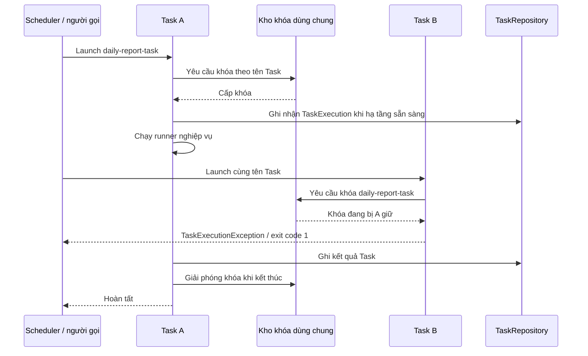
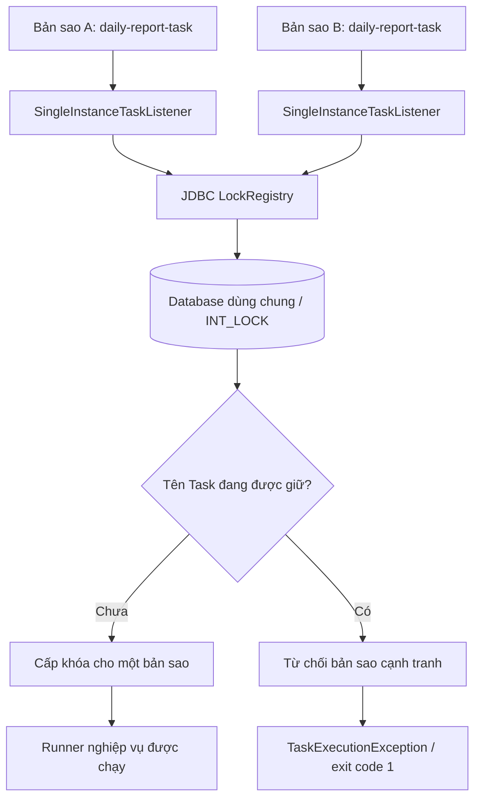

# Kết quả khi một bản sao khác đang giữ khóa

## Mục tiêu

**SPRING_CLOUD_TASK (Spring Cloud Task)** hỗ trợ ứng dụng Spring Boot chạy trong thời gian hữu hạn, lưu trạng thái và kết quả của mỗi lượt thực thi trong `TaskRepository`. Một tác vụ có thể được kích hoạt theo lịch, yêu cầu thủ công hoặc từ một Spring Batch pipeline. Khi nhiều yêu cầu đến gần nhau, hai bản sao của cùng một tác vụ có thể được khởi chạy đồng thời; nếu cùng ghi dữ liệu, chúng có thể tạo báo cáo trùng, ghi đè kết quả hoặc tranh chấp tài nguyên.

Trong chương **Khóa và đồng thời**, bài học này tập trung vào câu hỏi: **điều gì xảy ra khi bản sao thứ hai khởi động trong lúc bản sao thứ nhất vẫn giữ khóa single-instance?** Sau bài học, bạn có thể:

- Cấu hình `spring.cloud.task.single-instance-enabled` và giải thích phạm vi khóa theo **tên Task**.
- Nhận biết kết quả thực tế của bản sao thứ hai: không chạy runner nghiệp vụ, báo lỗi Task đang chạy và trả về **exit code 1** theo cơ chế được tài liệu hóa.
- Phân biệt lỗi bị từ chối do khóa với lỗi nghiệp vụ, lỗi database hoặc lỗi khởi động khác.
- Thiết lập kho khóa dùng chung với Spring Integration JDBC và quản lý schema, TTL, lịch chạy và retry.
- Theo dõi `TaskExecution`, log và trạng thái bộ điều phối mà không suy đoán từ một nguồn đơn lẻ.
- Hiểu giới hạn của khóa single-instance và bổ sung idempotency, khóa theo khóa nghiệp vụ hoặc điều phối khi cần.

## 1. Kết quả chính: bản sao thứ hai bị từ chối

Spring Cloud Task có tính năng giới hạn chỉ **một instance đang chạy cho mỗi tên Task**. Để bật, các lần chạy liên quan cần đặt:

```properties
spring.cloud.task.single-instance-enabled=true
```

Giá trị mặc định là `false`. Khi bật và một instance đã giữ khóa của cùng tên Task, `SingleInstanceTaskListener` không lấy được khóa và ném `TaskExecutionException`; tài liệu chính thức mô tả bản sao thứ hai **thất bại với mã thoát tiến trình 1**.

Thông báo điển hình được tài liệu ghi nhận là:

```text
Task with name "application" is already running.
```

`application` ở đây là tên Task trong ví dụ của tài liệu. Nếu ứng dụng đặt tên `daily-report-task`, nội dung thông báo tương ứng sẽ dùng tên ấy. Cần đối chiếu log thật vì cách đóng gói exception và câu chữ chi tiết có thể thay đổi theo phiên bản.

Điều này có ba hệ quả quan trọng:

1. **Bản sao thứ nhất tiếp tục chạy.** Nó vẫn giữ quyền thực thi cùng tên Task trong thời gian khóa còn hợp lệ.
2. **Bản sao thứ hai không chạy phần nghiệp vụ trong `ApplicationRunner`/`CommandLineRunner`.** Việc bị từ chối không đồng nghĩa một báo cáo đã được xử lý hoặc một Spring Batch Job đã hoàn thành.
3. **Bản sao thứ hai được hệ điều phối nhìn thấy như một lần chạy thất bại (exit code 1).** Spring Cloud Task không tự biến yêu cầu thứ hai thành một hàng đợi bền vững để chạy tiếp sau khi bản sao thứ nhất kết thúc.

**Không nhầm “chưa chạy nghiệp vụ” với “chưa có tác dụng phụ nào”.** Spring Boot vẫn có thể đã đọc cấu hình, tạo bean và chạy callback khởi tạo trước khi kiểm tra khóa. Vì vậy, thao tác nghiệp vụ có side effect không nên được đặt trong constructor, `@PostConstruct` hoặc logic khởi tạo context.

## 2. Minh họa bằng hai lần khởi chạy

Giả sử `daily-report-task` phải xuất báo cáo của ngày `2026-11-23`, mỗi lần chạy tốn khoảng 30 giây. Máy điều phối nhận hai lệnh gần nhau:

| Mốc minh họa | Bản sao A | Bản sao B |
| --- | --- | --- |
| 02:00:00 | Khởi động, lấy được khóa `daily-report-task`. | Chưa khởi chạy. |
| 02:00:02 | Đang xử lý báo cáo. | Khởi động với cùng tên Task và cùng kho khóa. |
| 02:00:03 | Tiếp tục xử lý. | Không lấy được khóa; báo Task đang chạy, **exit code 1**. |
| 02:00:30 | Runner hoàn thành, cơ chế kết thúc giải phóng khóa. | Đã kết thúc thất bại; **không tự khởi động lại**. |
| 02:00:35 | Đã hoàn tất. | Một **lần chạy mới** lúc này có thể lấy khóa nếu tài nguyên sẵn sàng. |



Sơ đồ là **mô hình logic**. Thứ tự cụ thể của các thao tác repository/listener và tình trạng một bản ghi `TaskExecution` của B phụ thuộc phiên bản và thời điểm lỗi. Không kết luận “B chắc chắn có một hàng `TASK_EXECUTION` thất bại” chỉ dựa vào sơ đồ; hãy kiểm tra log tiến trình và cơ sở dữ liệu thực tế.

## 3. Khóa thuộc về tên Task, không thuộc về ngày hay execution ID

`SingleInstanceTaskListener` tạo khóa dựa trên tên Task được giải quyết từ cấu hình, thường là `spring.cloud.task.name`. Khóa này bảo vệ phạm vi **một tên Task**, không tự phân tích tham số nghiệp vụ.

| Trường hợp | Có tranh chấp khóa single-instance? | Giải thích |
| --- | --- | --- |
| Hai tiến trình cùng tên `daily-report-task`, cùng database/lock registry | **Có**, khi cùng bật single-instance. | Bản sao thứ hai bị từ chối nếu A còn giữ khóa. |
| Cùng tên Task nhưng ngày A=`2026-11-22` và B=`2026-11-23` | **Có**. | Tên Task giống nhau dù ngày nghiệp vụ khác. |
| Hai tiến trình khác tên `daily-report-task` và `monthly-report-task` | **Không theo khóa tên Task này**. | Mỗi tên dùng một khóa riêng; vẫn có thể xung đột dữ liệu nghiệp vụ. |
| Hai tiến trình cùng tên nhưng dùng **hai database khóa khác nhau** | **Không bảo vệ lẫn nhau**. | Mỗi bên chỉ thấy khóa trong kho của mình. |
| A bật single-instance nhưng B tắt | **Không có bảo đảm bảo vệ B**. | B có thể không tham gia cơ chế kiểm tra khóa. |
| Hai tiến trình cùng ngày nhưng khác `TaskExecution.executionId` | **Vẫn có** nếu cùng tên và kho khóa. | Execution ID là ID mỗi lượt chạy, không phải khóa loại công việc. |

Ví dụ muốn cho phép chạy song song các ngày khác nhau nhưng cấm hai lần chạy **cùng một ngày**: khóa mặc định theo tên Task là **quá rộng**. Khi đó cần thiết kế khóa phân tán có key dạng `daily-report:2026-11-23`, hoặc dùng unique constraint/claim trên bảng nghiệp vụ, kết hợp với scheduler. Đừng biến tên Task thành chuỗi tùy ý chứa ngày chỉ để né cơ chế khóa mà không đánh giá tác động tới lịch sử metadata và vận hành.

## 4. Cơ chế bên dưới: SingleInstanceTaskListener và Spring Integration

Khi tính năng được bật, Spring Cloud Task sử dụng `SingleInstanceTaskListener`. Javadoc mô tả listener này cố gắng tạo khóa dựa trên `spring.cloud.task.name` và **ném `TaskExecutionException` nếu khóa đã tồn tại**. Listener có các phương thức tương ứng với mốc vòng đời như:

- `lockTask(TaskExecution)` — gắn với `@BeforeTask` để giành quyền chạy.
- `unlockTaskOnEnd(TaskExecution)` — gắn với `@AfterTask` để giải phóng khi Task kết thúc.
- `unlockTaskOnError(TaskExecution, Throwable)` — gắn với `@FailedTask` để xử lý giải phóng trên đường lỗi.

Trong triển khai thông dụng, Spring Cloud Task dựa vào các thành phần khóa phân tán của **Spring Integration JDBC**: `LockRegistry`, `JdbcLockRegistry` và `DefaultLockRepository`. Việc lock/unlock cần một **database chia sẻ** giữa các bản sao; khóa trong RAM của riêng JVM không thể chặn một JVM khác.



**Hai loại bảng cần phân biệt:**

- Metadata Spring Cloud Task, ví dụ `TASK_EXECUTION`, `TASK_EXECUTION_PARAMS`, ghi **lịch sử từng lượt thực thi**.
- Bảng khóa của Spring Integration, thường là `INT_LOCK` với các thông tin như `LOCK_KEY`, `REGION`, `CLIENT_ID`, `CREATED_DATE` (và có thể có cột bổ sung tùy phiên bản), ghi **quyền nắm khóa hiện tại**.

Đừng chỉ triển khai schema `TASK_EXECUTION` rồi cho rằng tính năng single-instance đã sẵn sàng. Cần DDL khóa tương thích **chính xác phiên bản Spring Integration**. Một số phiên bản mới thay đổi cấu trúc bảng khóa, ví dụ thêm thông tin TTL; vì vậy không sao chép nguyên một mẫu `CREATE TABLE INT_LOCK` từ bản tài liệu khác khi nâng cấp.

## 5. Cấu hình tối thiểu

### 5.1. Maven dependencies

Ngoài Spring Cloud Task và JDBC driver, tài liệu yêu cầu hai thư viện Spring Integration cho khóa:

```xml
<dependencies>
    <dependency>
        <groupId>org.springframework.cloud</groupId>
        <artifactId>spring-cloud-starter-task</artifactId>
    </dependency>
    <dependency>
        <groupId>org.springframework.boot</groupId>
        <artifactId>spring-boot-starter-jdbc</artifactId>
    </dependency>
    <dependency>
        <groupId>org.springframework.integration</groupId>
        <artifactId>spring-integration-core</artifactId>
    </dependency>
    <dependency>
        <groupId>org.springframework.integration</groupId>
        <artifactId>spring-integration-jdbc</artifactId>
    </dependency>
    <dependency>
        <groupId>org.postgresql</groupId>
        <artifactId>postgresql</artifactId>
        <scope>runtime</scope>
    </dependency>
</dependencies>
```

Ví dụ giả định `pom.xml` đã quản lý phiên bản Spring Boot và Spring Cloud bằng BOM **tương thích**, còn phiên bản Spring Integration do BOM tương ứng quản lý. Không thêm số phiên bản tùy ý cho từng artifact vì dễ gây lệch API và schema.

### 5.2. application.yml và cấu hình profile

```yaml
# application.yml
spring:
  application:
    name: daily-report-task
  main:
    web-application-type: none
  cloud:
    task:
      name: daily-report-task
      single-instance-enabled: true
```

```yaml
# application-prod.yml (giả định schema đã migrate)
spring:
  datasource:
    url: ${TASK_DB_URL}
    username: ${TASK_DB_USER}
    password: ${TASK_DB_PASSWORD}
  cloud:
    task:
      initialize-enabled: false
```

Mọi tiến trình cần tranh chấp cùng khóa phải dùng **cùng tên Task**, **cùng cơ chế registry**, **cùng kho dữ liệu khóa** và cùng bật tính năng này. Nếu môi trường `test` và `prod` dùng database khác nhau, chúng không thấy khóa của nhau; đó là cách cô lập môi trường đúng mong đợi.

`spring.cloud.task.initialize-enabled=false` trong ví dụ giả định **bảng metadata Task và bảng khóa JDBC đã được triển khai trước**. Thuộc tính khởi tạo schema Task không phải là quy trình quản lý schema khóa của Spring Integration. Không dùng H2 in-memory ở hai JVM để kiểm tra tranh chấp phân tán vì mỗi JVM có thể sở hữu database riêng.

## 6. Thử nghiệm hai bản sao trong môi trường cô lập

Tạo một runner đơn giản, kéo dài 30 giây để có thời gian khởi chạy bản sao B. Đây là **mã thực hành**, không phải cách cố tình trì hoãn tác vụ trong production:

```java
package com.example.report;

import java.time.LocalDate;
import java.util.List;

import org.springframework.boot.ApplicationRunner;
import org.springframework.boot.SpringApplication;
import org.springframework.boot.autoconfigure.SpringBootApplication;
import org.springframework.cloud.task.configuration.EnableTask;
import org.springframework.context.annotation.Bean;

@SpringBootApplication
@EnableTask
public class DailyReportTaskApplication {

    public static void main(String[] args) {
        SpringApplication.run(DailyReportTaskApplication.class, args);
    }

    @Bean
    ApplicationRunner reportRunner() {
        return arguments -> {
            List<String> dates =
                    arguments.getOptionValues("businessDate");
            if (dates == null || dates.size() != 1) {
                throw new IllegalArgumentException(
                        "Cần đúng một --businessDate=yyyy-MM-dd");
            }
            LocalDate businessDate = LocalDate.parse(dates.get(0));

            System.out.println("START businessDate=" + businessDate);
            Thread.sleep(30_000); // Chỉ để thử tranh chấp khóa.
            System.out.println("END businessDate=" + businessDate);
        };
    }
}
```

Chạy trong **hai terminal riêng** nhưng cùng database metadata/khóa:

**Terminal A:**

```bash
java -jar daily-report-task.jar \
  --spring.profiles.active=prod \
  --businessDate=2026-11-23
```

**Terminal B:** chạy cùng câu lệnh sau khi A đã in `START` nhưng trước khi A in `END`.

```bash
java -jar daily-report-task.jar \
  --spring.profiles.active=prod \
  --businessDate=2026-11-23
```

Trong hai terminal, cùng giá trị `TASK_DB_URL`, `TASK_DB_USER` và `TASK_DB_PASSWORD` phải được cấp từ môi trường. Tên JAR là minh họa; thay bằng artifact thực tế.

**Kết quả mong đợi:** A in `START` rồi `END`; B không in `START` từ runner, báo có instance cùng tên đang chạy và kết thúc với exit code 1. Sau khi A hoàn thành và nhả khóa, chạy **một tiến trình mới** để kiểm tra có thể lấy khóa bình thường.

Lưu ý: đừng chỉ nhìn thấy B “không in `START`” rồi coi như đã kiểm chứng khóa. Nếu B thất bại vì sai `DataSource` hoặc thiếu bảng `INT_LOCK` thì cũng có thể không in `START`. Phải xem **nguyên nhân lỗi** và mã thoát.

### 6.1. Nhận diện lỗi xung đột

Trong thực tế, thông báo có thể nằm trong chuỗi stack trace `TaskExecutionException` do `SingleInstanceTaskListener` ném. Cần ghi nhận:

| Dữ liệu | A (giữ khóa) | B (bị từ chối) |
| --- | --- | --- |
| Tên Task | `daily-report-task` | `daily-report-task` |
| Biến single-instance | `true` | `true` |
| Database/registry khóa | Kho dùng chung | Chính kho A sử dụng |
| Runner đã được gọi | Có | Không |
| Mã thoát tiến trình | Thường `0` nếu nghiệp vụ thành công | **1** do khóa đang được giữ |
| Nhật ký | Có mốc bắt đầu/kết thúc nghiệp vụ | Có thông báo Task đang chạy / `TaskExecutionException` |
| Bản ghi `TaskExecution` | Kiểm tra bản ghi của A | **Không giả định** có hoặc không có một bản ghi riêng của B |

Nếu A cuối cùng thất bại do nghiệp vụ, kết quả của A phải được chẩn đoán riêng; B bị từ chối vì xung đột khóa **không chứng minh** nghiệp vụ A thành công hay thất bại.

## 7. Có TaskExecution của bản sao bị từ chối không?

`TaskRepository` ghi metadata về các lượt chạy được framework quản lý, nhưng lỗi tranh chấp single-instance xuất hiện ở phần **khởi động vòng đời**. Tùy bản Spring Cloud Task, thứ tự listener, cách khởi chạy với `spring.cloud.task.executionid` và thời điểm xảy ra lỗi, B có thể:

- Không có một bản ghi `TASK_EXECUTION` mới được lưu hoàn chỉnh.
- Có một execution do hệ thống điều phối **tạo trước** nhưng tiến trình chưa cập nhật được trạng thái như mong đợi.
- Có log/mã thoát rõ ràng trong hệ điều phối dù bản ghi metadata không chứa thông tin cuối của B.

Vì vậy, câu trả lời vận hành đáng tin là **B thất bại vì không lấy được khóa và không được chạy nghiệp vụ; trạng thái ghi metadata cụ thể phải được xác minh trên phiên bản và luồng triển khai đang dùng**. Không xây dashboard trên giả định “mỗi lần bị chặn chắc chắn có một hàng `TASK_EXECUTION` với `EXIT_CODE=1`”.

Truy vấn sau giúp đối chiếu các lần chạy được lưu:

```sql
SELECT TASK_EXECUTION_ID,
       TASK_NAME,
       START_TIME,
       END_TIME,
       EXIT_CODE,
       EXIT_MESSAGE
FROM TASK_EXECUTION
WHERE TASK_NAME = 'daily-report-task'
ORDER BY TASK_EXECUTION_ID DESC;
```

Nếu cần kiểm tra bảng khóa Spring Integration, trong schema tương thích có thể truy vấn **chỉ đọc**:

```sql
SELECT LOCK_KEY, REGION, CLIENT_ID, CREATED_DATE
FROM INT_LOCK;
```

Tên bảng/cột có thể khác theo schema, prefix hoặc phiên bản Spring Integration. `INT_LOCK` là dữ liệu **hạ tầng điều phối khóa**; không tự `DELETE` bản ghi chỉ vì thấy một hàng tồn tại. Trước khi xử lý khóa nghi bị bỏ dở, phải kiểm tra chủ sở hữu còn sống hay không và chính sách TTL của phiên bản đang dùng.

## 8. TTL, khoảng kiểm tra và khóa bị bỏ dở

Spring Cloud Task cung cấp các thuộc tính liên quan đến cơ chế single-instance:

| Thuộc tính | Mặc định được tài liệu hóa | Ý nghĩa |
| --- | --- | --- |
| `spring.cloud.task.single-instance-enabled` | `false` | Có kiểm tra chỉ một instance theo tên Task hay không. |
| `spring.cloud.task.single-instance-lock-check-interval` | `500` ms | Khoảng thời gian giữa các lần kiểm tra khóa. |
| `spring.cloud.task.single-instance-lock-ttl` | `Integer.MAX_VALUE` ms | Thời hạn tối đa mà một lượt có thể giữ khóa theo cấu hình cơ chế. |

Các thuộc tính trên thuộc cấu hình Spring Cloud Task; các API TTL/renewal của Spring Integration có thể thay đổi theo phiên bản. Không suy từ tên thuộc tính rằng framework đảm bảo chờ trong hàng đợi cho đến lúc khóa rảnh. **Kết quả xung đột được tài liệu hóa vẫn là thất bại với exit code 1.**

Một ví dụ tùy chỉnh, **chỉ áp dụng khi thời lượng Task và phương án phục hồi đã được xác định**:

```yaml
spring:
  cloud:
    task:
      single-instance-enabled: true
      single-instance-lock-check-interval: 500
      single-instance-lock-ttl: 600000 # 10 phút, ví dụ minh họa
```

Không đặt TTL 10 phút cho một Task có thể chạy 30 phút: **khi TTL hết hạn trong lúc A còn chạy, B có nguy cơ giành khóa và chạy song song với A** nếu hạ tầng không có cơ chế gia hạn tương thích. Ngược lại, TTL rất dài làm chậm phục hồi khi tiến trình chết mà không giải phóng khóa. Cần thiết kế và kiểm thử TTL theo thời gian chạy tối đa, cơ chế heartbeat/renewal thực tế của phiên bản dùng và chính sách timeout của scheduler.

### Trường hợp node chết hoặc bị kill

Khi JVM kết thúc thông thường, callback kết thúc hoặc lỗi có cơ hội giải phóng khóa. Nhưng khi container bị `SIGKILL`, node mất điện hoặc mạng DB đứt, callback **có thể không chạy**. Một hàng khóa có thể còn tồn tại cho đến khi cơ chế TTL/cleanup nhận biết và cho phép lấy lại.

Quy trình xử lý:

1. Kiểm tra Job/Pod/tiến trình của A còn chạy hay không; đối chiếu thời điểm bắt đầu và heartbeat nếu có.
2. Kiểm tra database khóa còn sẵn sàng, schema đúng và trạng thái khóa qua công cụ hạ tầng.
3. Xác minh TTL, các lần retry và cách registry tương ứng với phiên bản hiện tại xử lý khóa hết hạn.
4. Chỉ giải phóng/reset khóa theo runbook đã thử nghiệm khi chắc chắn không còn chủ sở hữu hợp lệ; tránh tạo hai tiến trình cùng sửa dữ liệu.
5. Kiểm tra kết quả nghiệp vụ của A và khả năng idempotent trước khi khởi chạy B.

Không dựa chỉ vào `END_TIME IS NULL` của `TASK_EXECUTION` để quyết định được phép xóa khóa: giá trị đó có thể có nghĩa “đang chạy”, “chưa khởi động” hoặc “đã chết nhưng chưa ghi metadata”.

## 9. Bộ lập lịch xử lý exit code 1 như thế nào?

Về phía Spring Cloud Task, xung đột khóa là một **thất bại của lần khởi chạy B**. Nhưng ý nghĩa đối với người sử dụng có thể là “đã có một lần chạy khác đang xử lý” thay vì “logic xuất báo cáo hỏng”.

| Hệ thống điều phối | Rủi ro nếu xử lý mọi exit code 1 như lỗi cần retry tức thì | Gợi ý xử lý |
| --- | --- | --- |
| Cron hệ điều hành | Mỗi lần chạy chồng nhau thất bại và chỉ còn log rải rác. | Gửi cảnh báo có phân loại, hạn chế giờ chồng nhau; ghi lại yêu cầu cần chạy bù. |
| Kubernetes CronJob | Job có thể retry theo `backoffLimit`; sau khi A nhả khóa, retry của B có thể bắt đầu và xử lý trùng ngày. | Kết hợp `concurrencyPolicy` phù hợp, backoff/retry và khóa/idempotency nghiệp vụ. |
| API khởi chạy thủ công | API báo lỗi chung dù thực tế đang có lượt xử lý khác. | Trả trạng thái “đã có Task đang chạy”, cung cấp ID tiến trình A nếu xác định được và chính sách yêu cầu chạy sau. |
| Spring Cloud Data Flow hoặc launcher khác | Có một Task execution báo lỗi trong khi workload thực tế chưa được chạy. | Đối chiếu mã thoát, thông báo khóa và trạng thái launcher; không gộp với lỗi nghiệp vụ. |

**Quan trọng:** cơ chế khóa của Task không tự xác định người dùng muốn **bỏ qua** B, **hoãn** B hay **xếp hàng chạy lần lượt**. Đây là chính sách của hệ điều phối:

- **Skip:** bỏ qua yêu cầu trùng nếu A đang giải quyết cùng mục tiêu nghiệp vụ.
- **Queue:** lưu yêu cầu vào hàng đợi bền vững, thử khởi chạy **sau** khi A hoàn tất.
- **Reject:** trả lỗi xung đột cho người gọi và yêu cầu người gọi quyết định.

Nếu cần queue, đừng chỉ cho Task thứ hai `Thread.sleep` trong vòng lặp đến khi A nhả khóa. Việc chờ dài trong JVM tiêu tốn tài nguyên và có thể vẫn bị coi là lần chạy thất bại; hãy quản lý hàng đợi ở hệ điều phối.

## 10. Khóa Task không thay thế idempotency nghiệp vụ

Ngay cả khi mỗi thời điểm chỉ có một tiến trình `daily-report-task` đang chạy, tình huống này vẫn có thể xảy ra:

1. A ghi xong báo cáo cho `businessDate=2026-11-23` nhưng tiến trình bị kill trước khi cập nhật `TaskRepository`.
2. Scheduler nhận kết quả “failed” và khởi động B sau khi khóa của A hết hạn.
3. B lấy được khóa hợp lệ vì A không còn giữ khóa.
4. Nếu B chỉ dùng `INSERT` mà không kiểm tra khóa nghiệp vụ, báo cáo có thể bị tạo **lần thứ hai**.

`Single-instance` giải quyết **chạy đồng thời** cùng tên Task. `Idempotency` giải quyết **chạy lặp tuần tự** cùng nghiệp vụ. Hai yêu cầu bổ sung cho nhau.

Ví dụ bảng báo cáo có ràng buộc cho mỗi ngày:

```sql
CREATE TABLE daily_report (
    business_date DATE PRIMARY KEY,
    content_json TEXT NOT NULL,
    updated_at TIMESTAMP NOT NULL DEFAULT CURRENT_TIMESTAMP
);

-- Ví dụ PostgreSQL: ghi đè có kiểm soát báo cáo theo ngày.
INSERT INTO daily_report(business_date, content_json)
VALUES (DATE '2026-11-23', '{"totalOrders":125}')
ON CONFLICT (business_date)
DO UPDATE SET
    content_json = EXCLUDED.content_json,
    updated_at = CURRENT_TIMESTAMP;
```

Đoạn SQL chỉ minh họa một chính sách update; hệ thống thực tế phải quyết định có được ghi đè báo cáo đã chốt hay không, dùng versioning/khóa nếu cần, và đồng bộ side effect bên ngoài qua outbox/idempotency key. Không suy rằng `ON CONFLICT DO UPDATE` luôn phù hợp với nghiệp vụ cần giữ bất biến kết quả.

Với hệ thống yêu cầu “chỉ một Task cho mỗi ngày nhưng ngày khác được chạy song song”, cần một phương án khóa theo **khóa nghiệp vụ** hoặc unique claim. Không dùng khóa Task theo tên như cơ chế phân vùng tự động theo `businessDate`.

## 11. Phối hợp với Spring Batch

Khi một Spring Cloud Task khởi chạy Spring Batch Job:

- `SingleInstanceTaskListener` kiểm soát **vòng đời tiến trình Task theo tên Task**.
- `JobRepository` của Spring Batch quản lý `JobInstance`, `JobExecution` và các trạng thái `JobParameters`.
- Nếu B bị từ chối trước khi runner/Job launcher chạy, **không có Batch Job mới được xử lý bởi B** từ luồng nghiệp vụ thông thường.
- Nếu Job của A thất bại, điều đó là **một lỗi Batch riêng**; không được gộp với Task B bị từ chối do khóa.

Spring Batch có các quy tắc restart/uniqueness của JobInstance dựa trên JobParameters. Những quy tắc đó **không thay thế** khóa single-instance của Task, và ngược lại. Một Task chứa nhiều Job hoặc một Job được kích hoạt từ nhiều Task khác nhau có thể cần cơ chế kiểm soát đồng thời ở cấp Batch/DB.

Khi báo cáo kết quả cho người vận hành, tách ba câu hỏi: (1) có lấy được khóa để bắt đầu Task không, (2) Task đã bắt đầu và kết thúc thế nào, (3) Batch Job/đầu ra nghiệp vụ có thành công không.

## 12. Ma trận kết quả cần kiểm tra

| Tình huống | Kết quả khóa | Runner B | Điều cần xác minh |
| --- | --- | --- | --- |
| A giữ khóa, B cùng tên/cùng registry/single-instance bật | B bị từ chối | Không chạy | `TaskExecutionException`, **exit code 1**, A tiếp tục. |
| A đã nhả khóa, khởi chạy B mới | B có thể lấy khóa | Chạy nếu cấu hình hợp lệ | Metadata B độc lập, kết quả nghiệp vụ. |
| B có tên Task khác | Không tranh chấp **khóa tên A** | Có thể chạy | Kiểm soát xung đột dữ liệu nếu hai Task truy cập cùng bảng. |
| B cấu hình khác database khóa | Không nhìn thấy khóa A | Có thể chạy | Kiểm tra `DataSource`, profile và schema. |
| B để `single-instance-enabled=false` | Không tham gia chặn single-instance | Có thể chạy | Không giả định đã được bảo vệ. |
| A bị kill, còn khóa cũ | Tùy TTL/registry | Có thể bị chặn hoặc chạy sau khi hết hạn | Kiểm tra owner thực tế, lock row, deadline; xử lý theo runbook. |
| B thiếu `INT_LOCK`/quyền JDBC | Lỗi hạ tầng, khác lỗi bị A giữ | Không chạy | Stack trace SQL, migration và quyền; không phân loại nhầm xung đột. |
| A giữ khóa nhưng B được scheduler retry sau khi A xong | Lần retry có thể lấy khóa | Có thể chạy | Kiểm soát nghiệp vụ bị xử lý trùng, chính sách retry. |

### Những ngộ nhận cần tránh

- **“Exit code 1 của B có nghĩa báo cáo bị lỗi khi xử lý.”** Không nhất thiết: B có thể chưa chạy runner, chỉ bị từ chối quyền bắt đầu.
- **“B sẽ tự chờ A rồi chạy tiếp.”** Không có bảo đảm đó từ tính năng single-instance; cơ chế mặc định được tài liệu mô tả là thất bại khi có xung đột.
- **“Có `TASK_EXECUTION` của A nghĩa A còn đang chạy.”** Bản ghi có thể chưa được hoàn tất do crash; cần kiểm tra tiến trình thật và khóa.
- **“Đặt `single-instance-enabled=true` trong mỗi Pod là đủ.”** Các Pod phải cùng dùng một registry phân tán, cơ sở dữ liệu khóa và tên Task.
- **“Dùng một tên Task cho mọi pipeline giúp bảo vệ tất cả dữ liệu.”** Nó có thể khóa quá rộng, còn những Task khác tên vẫn có thể truy cập chung dữ liệu.
- **“TTL nhỏ giúp phục hồi nhanh mà không có rủi ro.”** Hết hạn quá sớm có thể cho phép hai bản sao chạy đồng thời.

## 13. Thực hành tổng hợp

**Tình huống:** hệ thống có cron chạy `daily-report-task` lúc 02:00, đồng thời cho phép người vận hành nhấn nút “chạy lại ngay”. Yêu cầu: không xử lý đồng thời cùng tác vụ và vẫn giữ được lịch sử kiểm tra lỗi.

1. Dùng PostgreSQL chung cho `TaskRepository` và lock registry JDBC trong môi trường thử nghiệm. Chuẩn bị schema Task **và** bảng khóa Spring Integration đúng phiên bản.
2. Thêm `spring-integration-core`, `spring-integration-jdbc` và bật `spring.cloud.task.single-instance-enabled=true`.
3. Chạy mã runner minh họa giữ tiến trình 30 giây từ terminal A, sau đó chạy B với cùng tên Task và database.
4. Kiểm tra B kết thúc với **exit code 1** và thông báo Task đang chạy; runner của B không in `START`.
5. Truy vấn `TASK_EXECUTION`, xem log và trạng thái hai tiến trình. Ghi lại kết quả metadata thực tế thay vì giả định B có bản ghi.
6. Sau khi A hoàn thành, chạy C mới. Xác nhận C có thể lấy khóa và bắt đầu.
7. Thử tên Task khác và tên Task giống nhau nhưng tham số `businessDate` khác; hiểu cơ chế khóa phân theo tên, không phân theo ngày.
8. Mô phỏng thất bại bằng cách kill A **chỉ trong môi trường thử nghiệm cô lập**. Quan sát TTL, retry và cách phát hiện khóa bị bỏ dở theo cơ chế đang dùng.
9. Bổ sung unique key theo ngày ở bảng nghiệp vụ. Chạy lại tuần tự cùng một ngày và xác nhận không sinh báo cáo trùng.
10. Cấu hình chính sách retry/concurrency của bộ điều phối và ghi rõ quy tắc khi gặp xung đột: `skip`, `queue` hoặc `reject`.

**Tiêu chí hoàn thành:** có thể chứng minh B bị chặn khi A đang giữ khóa, phân biệt rõ lỗi xung đột với lỗi DB/Batch, biết xem cả process exit code và metadata, hiểu phạm vi khóa theo tên và không tạo dữ liệu lặp khi scheduler chạy lại.

## 14. Tài liệu tham khảo

- [Spring Cloud Task — Restricting Spring Cloud Task Instances](https://docs.spring.io/spring-cloud-task/reference/features.html): cấu hình `single-instance-enabled`, ví dụ xung đột và exit code 1.
- [SingleInstanceTaskListener Javadoc](https://docs.spring.io/spring-cloud-task/docs/current/apidocs/org/springframework/cloud/task/configuration/SingleInstanceTaskListener.html): listener tạo khóa theo tên Task và ném `TaskExecutionException` khi khóa tồn tại.
- [Spring Cloud Task / Spring Cloud Properties](https://docs.spring.io/spring-cloud/docs/current/reference/html/configprops.html): `single-instance-lock-check-interval`, `single-instance-lock-ttl` và giá trị mặc định.
- [Spring Integration — JDBC Lock Registry](https://docs.spring.io/spring-integration/reference/jdbc/lock-registry.html): `JdbcLockRegistry`, `DefaultLockRepository`, schema `INT_LOCK` và TTL.

Các ví dụ được viết để giải thích hành vi phổ biến của Spring Cloud Task 3.x và hạ tầng Spring Integration JDBC; trước khi triển khai cần chốt bộ phiên bản tương thích và kiểm thử trên database/dialect thực tế.

## Ghi nhớ

- Khi `single-instance-enabled=true`, **bản sao thứ hai cùng tên Task đang bị giữ khóa sẽ thất bại với exit code 1**, không thực thi runner nghiệp vụ.
- Single-instance là **khóa theo tên Task và kho lock registry chung**. Không có registry chung hoặc một bên tắt cơ chế thì không bảo đảm chặn được nhau.
- `SingleInstanceTaskListener` dùng cơ chế khóa phân tán; bảng khóa Spring Integration và bảng metadata `TaskRepository` có vai trò khác nhau.
- **Khóa không tự xếp hàng** các yêu cầu bị từ chối. Scheduler phải có chính sách skip/queue/reject và retry được kiểm soát.
- TTL quá ngắn có thể làm mất bảo vệ đồng thời; TTL quá dài khiến phục hồi khi crash khó hơn. Luôn xác minh chủ sở hữu thực tế trước khi can thiệp khóa.
- Khóa Task ngăn **trùng đồng thời**, còn ràng buộc nghiệp vụ/idempotency ngăn **trùng khi chạy lại**. Cần cả hai khi kết quả phải an toàn.
