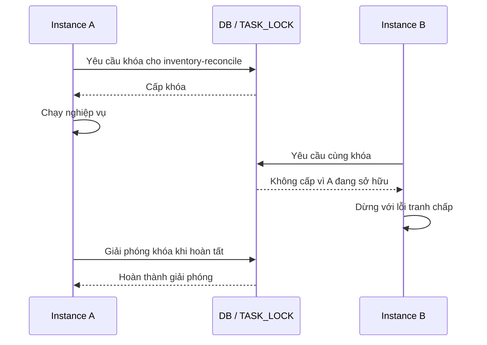
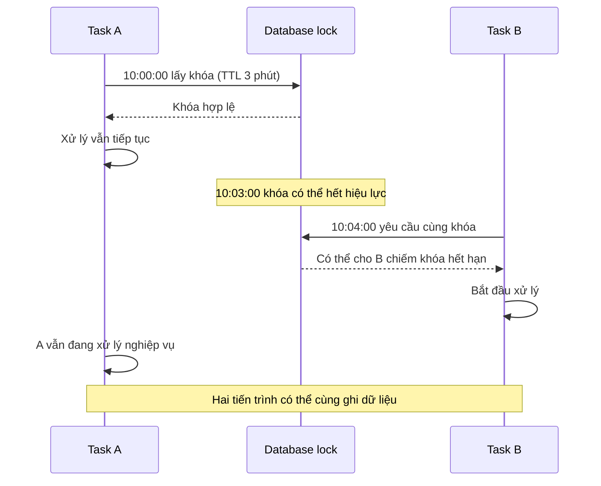
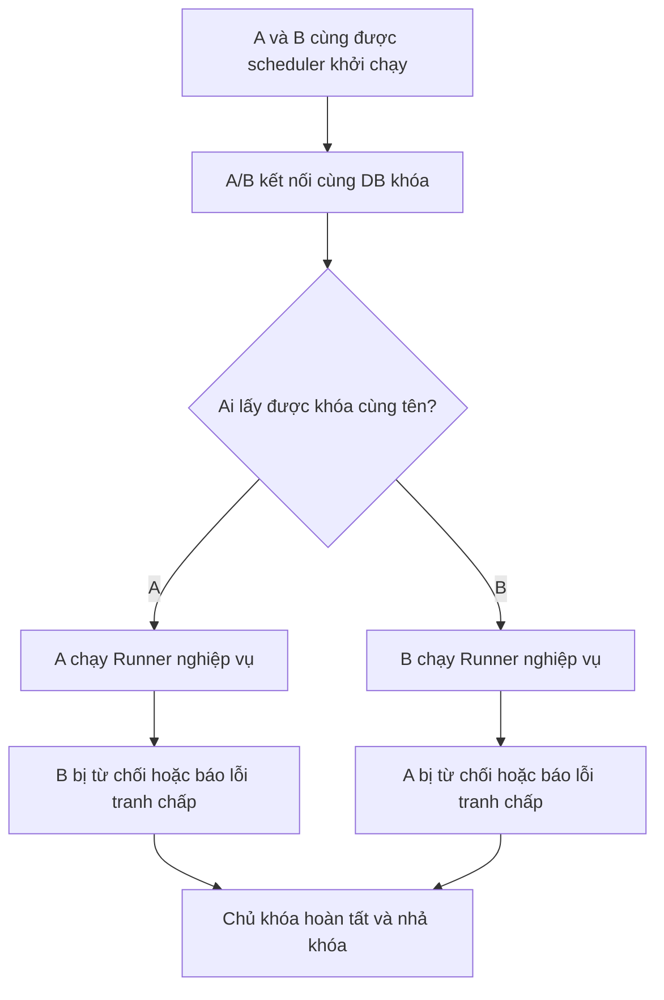

# Khóa hết hạn, tiến trình chết và tình huống tranh chấp

## 1. Bối cảnh: vì sao một Spring Cloud Task có thể cần khóa?

**Spring Cloud Task** giúp xây dựng ứng dụng Spring Boot chạy trong thời gian hữu hạn: khởi động, xử lý công việc, ghi kết quả thực thi qua `TaskRepository` rồi kết thúc. Công việc này có thể được chạy theo lịch, theo yêu cầu hoặc qua hệ thống điều phối, đồng thời tích hợp Spring Batch khi cần xử lý dữ liệu theo bước. Trong môi trường có nhiều máy chủ hoặc container, hai yêu cầu chạy Task có thể đến gần như cùng lúc.

Giả sử tác vụ `inventory-reconcile` đối soát tồn kho mỗi giờ. Lần chạy lúc 10:00 chưa hoàn tất, nhưng đúng 11:00, scheduler khởi chạy lần tiếp theo. Nếu cả hai cùng sửa trạng thái của cùng một kho, có thể xảy ra ghi đè, cập nhật hai lần hoặc gửi trùng thông báo. Một cách hạn chế rủi ro là **chỉ cho phép một instance cùng tên Task thực thi tại một thời điểm**.

Spring Cloud Task có tính năng **single-instance** sử dụng cơ chế khóa chia sẻ giữa các instance. Bài học này tập trung vào những tình huống không lý tưởng: **khóa hết hạn khi tiến trình vẫn chạy**, **tiến trình chết không kịp giải phóng khóa**, **hai instance tranh giành khóa**, **mất kết nối database**, và **cách khôi phục an toàn**.

Sau bài học, bạn sẽ có thể:

- Giải thích khác nhau giữa khóa trong JVM, khóa phân tán, transaction và khóa nghiệp vụ.
- Cấu hình `single-instance-enabled`, thời hạn khóa (TTL) và khoảng kiểm tra khóa theo phiên bản đang dùng.
- Đọc thông tin khóa trong database mà không tự ý sửa trạng thái sở hữu.
- Phân tích timeline tranh chấp, timeout, crash và nguy cơ **split-brain**.
- Lựa chọn timeout, cơ chế giám sát, idempotency và fencing theo mức độ quan trọng của dữ liệu.
- Thiết kế quy trình thử nghiệm và vận hành khi một task không thể lấy khóa hoặc khóa bị kẹt.

## 2. Bốn cơ chế thường bị nhầm với nhau

| Cơ chế | Phạm vi bảo vệ | Giải quyết vấn đề | Giới hạn |
| --- | --- | --- | --- |
| `synchronized` / `ReentrantLock` | Các thread trong **cùng một JVM** | Tránh truy cập đồng thời trong một process | Không ngăn hai pod hoặc hai máy khác nhau |
| Khóa phân tán qua database | Nhiều process dùng **cùng kho khóa** | Điều phối quyền thực thi giữa các instance | Có TTL, lỗi mạng, vấn đề giải phóng và thu hồi khóa |
| Transaction/row lock SQL | Những dòng hoặc thao tác trong **một giao dịch DB** | Tránh ghi dữ liệu không nhất quán | Không giữ quyền độc quyền cho cả Task sau khi giao dịch commit |
| Khóa nghiệp vụ, idempotency, fencing | Một **đơn vị công việc/dữ liệu** | Ngăn tác động trùng và ngăn chủ khóa cũ ghi đè | Phải thiết kế theo đặc thù nghiệp vụ |

**Khóa phân tán không tự làm dữ liệu nghiệp vụ trở nên an toàn tuyệt đối.** Nó giúp giảm khả năng chạy đồng thời khi các instance tuân thủ cùng quy tắc, nhưng vẫn cần transaction và cơ chế chống xử lý trùng để bảo vệ dữ liệu trong trường hợp khóa mất hiệu lực.

Ví dụ, hai bản JAR trên hai server cùng dùng `ReentrantLock` sẽ tạo **hai khóa độc lập**; cả hai vẫn có thể chạy. Ngược lại, nếu cả hai cùng cấu hình Spring Cloud Task single-instance với chung database repository và cùng tên Task, chúng dùng cơ chế điều phối chia sẻ.

## 3. Single-instance trong Spring Cloud Task

### 3.1. Nguyên tắc hoạt động

Khi bật `spring.cloud.task.single-instance-enabled=true`, Spring Cloud Task dùng thành phần khóa dựa trên Spring Integration để hạn chế nhiều lần chạy **cùng tên Task**. Theo tài liệu chính thức, nếu một instance đang giữ khóa và instance khác cố chạy cùng tên, lần chạy sau sẽ bị từ chối, thường với lỗi tương tự:

```text
Task with name "inventory-reconcile" is already running.
```

Trường hợp bị từ chối do trùng instance được tài liệu mô tả có exit code **1**. Đừng coi đây là kết quả bỏ qua thành công mặc định. Hệ thống điều phối cần hiểu rõ việc chặn lần chạy sau có chấp nhận được theo chính sách lịch chạy hay không.

Tính năng này mặc định **tắt** trong các bản tài liệu Spring Cloud Task phổ biến. Khi bật, các lần chạy cần dùng **cùng tên Task** và **cùng nguồn lưu khóa** để phối hợp. Tên Task thường được xác định bằng `TaskNameResolver`; có thể cấu hình `spring.cloud.task.name` rõ ràng, tránh các lần chạy dùng tên khác nhau ngoài ý muốn.



Sơ đồ là mô hình logic của **đường đi bình thường**. Việc callback có kịp chạy và release lock có thành công khi JVM hoặc DB gặp sự cố hay không là những câu hỏi phải xử lý riêng.

### 3.2. Dependency cần có

Ngoài starter Spring Cloud Task và JDBC driver phù hợp, tài liệu single-instance yêu cầu các module Spring Integration:

```xml
<dependencies>
    <dependency>
        <groupId>org.springframework.cloud</groupId>
        <artifactId>spring-cloud-starter-task</artifactId>
    </dependency>
    <dependency>
        <groupId>org.springframework.integration</groupId>
        <artifactId>spring-integration-core</artifactId>
    </dependency>
    <dependency>
        <groupId>org.springframework.integration</groupId>
        <artifactId>spring-integration-jdbc</artifactId>
    </dependency>
</dependencies>
```

Ví dụ Maven giả định dự án đã quản lý **phiên bản Spring Boot và Spring Cloud tương thích**, có `DataSource` và driver JDBC. Không tự chọn version Spring Integration độc lập gây lệch API với Spring Cloud Task. Kiểm tra tính tương thích với bản Task đang dùng, nhất là khi nâng cấp giữa các thế hệ Spring Boot.

### 3.3. Cấu hình Task sử dụng PostgreSQL

```yaml
spring:
  application:
    name: inventory-reconcile
  main:
    web-application-type: none
  datasource:
    url: ${TASK_DB_URL:jdbc:postgresql://localhost:5432/taskdb}
    username: ${TASK_DB_USER:task_user}
    password: ${TASK_DB_PASSWORD}
  cloud:
    task:
      name: inventory-reconcile
      single-instance-enabled: true
      single-instance-lock-ttl: 180000
      single-instance-lock-check-interval: 500
      initialize-enabled: false
      closecontextEnabled: true
```

Trong ví dụ:

- `single-instance-enabled: true` bật tính năng giới hạn một lần chạy cùng tên.
- `single-instance-lock-ttl: 180000` là **180.000 ms = 3 phút**, chỉ dùng cho thí nghiệm có thời lượng công việc ngắn.
- `single-instance-lock-check-interval: 500` mô tả khoảng kiểm tra khóa theo mili giây trong các phiên bản hỗ trợ thuộc tính này; **không phải heartbeat gia hạn khóa** và không phải lịch chạy lại của scheduler.
- `initialize-enabled: false` giả định migration đã tạo đầy đủ bảng repository và lock theo đúng DDL của bản Spring Cloud Task. Nếu chưa tạo schema, startup có thể lỗi.
- `closecontextEnabled: true` giúp đóng context sau khi Task hoàn thành; ứng dụng vẫn phải giải phóng tài nguyên do mình tự quản lý.

**Lưu ý về phiên bản:** Tên/giá trị mặc định của cấu hình có thể thay đổi theo dòng phát hành. Các tài liệu cấu hình Spring Cloud mô tả TTL mặc định là `Integer.MAX_VALUE` mili giây, và khoảng kiểm tra mặc định `500` mili giây; không coi đây là hằng số bất biến cho mọi phiên bản. **Đọc metadata cấu hình của dependency được chốt trong dự án** trước khi chọn TTL production.

### 3.4. Phạm vi khóa phụ thuộc tên Task

Một điều quan trọng: **single-instance theo tên Task**, không tự chia khóa theo tham số nghiệp vụ.

Ví dụ:

```bash
java -jar inventory-task.jar --warehouse=north
java -jar inventory-task.jar --warehouse=south
```

Nếu cùng tên Task và cùng repository, hai lệnh trên **vẫn có thể tranh chấp cùng một khóa**, dù xử lý hai kho độc lập. Nếu mục tiêu là chỉ tuần tự hóa theo từng `warehouse`, cần thiết kế khóa ở cấp nghiệp vụ/partition một cách có chủ đích; không giả định framework tự đưa `--warehouse` vào lock key.

Ngược lại, nếu hai process vô tình dùng tên Task khác nhau hoặc trỏ vào **hai database khóa khác nhau**, cấu hình `single-instance-enabled=true` trên cả hai **không tạo ra độc quyền toàn hệ thống**.

## 4. TASK_LOCK và cách đọc trạng thái khóa

### 4.1. Vai trò của bảng khóa

Trong cấu hình JDBC, Spring Cloud Task sử dụng bảng khóa như `TASK_LOCK` cho tính năng single-instance. Các trường thường gặp trong các bản DDL gồm:

| Trường | Vai trò thường gặp |
| --- | --- |
| `LOCK_KEY` | Khóa định danh bản ghi khóa |
| `REGION` | Nhóm/vùng khóa trong cơ chế Spring Integration |
| `CLIENT_ID` | Định danh bên lưu bản ghi khóa |
| `CREATED_DATE` | Thời gian được lưu để phục vụ quản lý khóa |

**Không suy đoán** tên cột, ràng buộc, khóa chính hoặc đối tượng bổ sung từ bảng minh họa. Cấu trúc có thể khác theo phiên bản Spring Integration và vendor. Một số bản Spring Integration mới có thêm dữ liệu về thời điểm hết hạn, chẳng hạn cột `EXPIRED_AFTER`. Phải dùng DDL **đúng phiên bản Spring Cloud Task/Spring Integration đang thực thi** để không gặp lỗi đọc/ghi khóa.

Trên PostgreSQL có thể **đọc** bảng này:

```sql
SELECT *
FROM TASK_LOCK;
```

Với môi trường production, nên giới hạn người có quyền truy vấn bảng này. Không đưa câu `DELETE FROM TASK_LOCK` vào kịch bản khắc phục lỗi một cách tự động, vì có thể vô tình xóa khóa mà Task đang sống vẫn sở hữu.

### 4.2. Vì sao không nên tìm tên Task trực tiếp trong LOCK_KEY?

`LOCK_KEY` trong cơ chế `JdbcLockRegistry` có thể là khóa đã được chuyển đổi/biểu diễn cho mục đích lưu trữ, chứ không nhất thiết chứa nguyên văn `spring.cloud.task.name`. `REGION` cũng không phải chắc chắn là tên job hoặc tên cluster.

Do đó, đừng tự viết truy vấn kiểu `WHERE LOCK_KEY = 'inventory-reconcile'` và kết luận không có khóa nếu không thấy hàng nào. Muốn đối chiếu **khóa đang nghi ngờ** với tên Task, cần biết cách implement khóa của đúng phiên bản hoặc sử dụng công cụ giám sát/hỗ trợ chính thức của nhóm vận hành.

### 4.3. TASK_EXECUTION không phải bảng sở hữu khóa

`TASK_EXECUTION` lưu vòng đời của một lần chạy: thời gian bắt đầu, thời gian kết thúc, tên Task, exit code và thông tin lỗi. Ví dụ:

```sql
SELECT TASK_EXECUTION_ID,
       TASK_NAME,
       START_TIME,
       END_TIME,
       EXIT_CODE,
       ERROR_MESSAGE
FROM TASK_EXECUTION
WHERE TASK_NAME = 'inventory-reconcile'
ORDER BY TASK_EXECUTION_ID DESC;
```

Đây là metadata giúp điều tra, nhưng **không thay thế việc xác minh process còn sống hay tình trạng khóa hiện tại**. Một bản ghi `END_TIME IS NULL` có thể là Task đang chạy hoặc Task đã chết nhưng chưa cập nhật repository. Không kết luận có thể xóa khóa chỉ từ bản ghi này.

## 5. TTL là gì, và điều gì xảy ra khi khóa hết hạn?

### 5.1. Khái niệm lease (quyền giữ khóa có thời hạn)

**Time to live (TTL)** là thời hạn một bản ghi khóa được coi là hợp lệ đối với cơ chế quản lý khóa. Mục đích quan trọng là cho phép quá trình khác **thu hồi hoặc chiếm quyền khóa cũ** khi chủ trước không thể giải phóng do bị crash, mất điện hoặc dừng không bình thường.

TTL không có nghĩa là:

- JVM tự bị dừng khi hết TTL.
- Transaction nghiệp vụ tự rollback vào đúng thời điểm hết TTL.
- Bản ghi khóa phải biến mất tức thì lúc đồng hồ chạm thời hạn.
- Một instance khác chắc chắn lập tức bắt đầu ngay sau TTL.
- Quyền của tiến trình cũ tự bị thu hồi khỏi mọi hệ thống bên ngoài.

Trong cơ chế JDBC lock, việc phát hiện và xử lý khóa hết hạn có thể diễn ra **khi có yêu cầu lấy khóa tiếp theo**, tùy implementation. TTL là **giới hạn về quyền sở hữu trong kho khóa**, không phải watchdog giết process.

### 5.2. Ví dụ timeline khóa hết hạn

Giả sử A chạy 10 phút nhưng TTL chỉ là 3 phút:



Đây là **rủi ro split-brain**: B được hệ thống khóa xem là chủ mới, nhưng A chưa dừng nên cả hai có thể tác động cùng một tài nguyên. Nếu cả hai cùng gọi API tạo phiếu giao hàng, khóa Task đơn thuần không ngăn được lệnh gửi trùng.

**Kết luận thiết kế:** TTL quá ngắn có thể gây chạy đồng thời; TTL quá dài khiến hệ thống chờ lâu sau crash. Không chọn TTL chỉ vì muốn “tự phục hồi nhanh”.

### 5.3. TTL mặc định lớn không phải bảo đảm an toàn

Ở một số bản cấu hình Spring Cloud Task, TTL mặc định được mô tả là `Integer.MAX_VALUE` mili giây, tức khoảng **24,9 ngày**. Giá trị này giúp giảm nguy cơ hết hạn khi job chạy lâu nhưng có thể khiến khóa bị bỏ lại lâu sau khi process chết.

Khi triển khai thật cần đo **thời lượng thực tế của Task**, thời gian chờ I/O, timeout của hệ điều phối, và quy trình thu hồi khóa. Không mặc định giữ TTL gần vô hạn là tối ưu.

### 5.4. Có thể gia hạn khóa không?

Spring Integration có giao diện/cơ chế **renewal** cho một số triển khai `JdbcLockRegistry`. Theo tài liệu Spring Integration, `renewLock(...)` phải được gọi **trong quá trình giữ khóa** và thường chỉ hợp lệ khi thread gọi còn là thread sở hữu khóa, tùy phiên bản API.

Không giả định bật `spring.cloud.task.single-instance-enabled` sẽ **tự động gia hạn vô hạn** hoặc mọi bản Spring Cloud Task đều triển khai heartbeat cho khóa. Nếu muốn tác vụ kéo dài quá TTL, cần:

1. Xác minh rõ thư viện Spring Integration/Task và việc renewal có được tích hợp vào luồng single-instance hay không.
2. Nếu không có renewal đáng tin cậy, chọn TTL dài hơn thời lượng xử lý tối đa đã ràng buộc và giám sát timeout.
3. Nếu thiết kế renewal riêng, xác thực quyền sở hữu trước mỗi lần gia hạn và có chính sách **dừng ghi dữ liệu khi renewal thất bại**.
4. Đối với dữ liệu quan trọng, bổ sung **fencing token** hoặc cơ chế từ chối chủ khóa cũ ở tài nguyên đích.

Việc gọi renewal sai thread hoặc dùng API của một phiên bản khác có thể thất bại. Không đưa một bean tự gia hạn khóa vào production trước khi kiểm chứng đầy đủ thời điểm lấy/nhả khóa và semantics của thư viện đang dùng.

## 6. Tiến trình chết khi đang giữ khóa

### 6.1. Có những kiểu dừng nào?

| Cách kết thúc | Khả năng xử lý giải phóng khóa | Tình trạng dữ liệu và metadata |
| --- | --- | --- |
| Runner hoàn tất bình thường | Thông thường framework có cơ hội nhả khóa | `TaskExecution` thường được cập nhật, transaction đã commit được giữ |
| Runner ném exception | Có cơ hội chạy đường xử lý lỗi và nhả khóa | Transaction hiện tại có thể rollback, nhưng phần đã commit vẫn còn |
| `SIGTERM`/đóng container có thời gian ân hạn | Có thể chạy shutdown callback | Không bảo đảm hoàn tất trước deadline |
| `SIGKILL`/`kill -9`/OOM kill | Không có đường cleanup Java tin cậy | Khóa có thể bị bỏ lại; metadata có thể thiếu `END_TIME` |
| JVM crash/host mất điện | Không chạy được cleanup | DB giữ metadata đã commit; lock có thể chỉ được xử lý khi hết TTL |
| Mất kết nối giữa Task và DB | Trạng thái quyền sở hữu không chắc chắn | Task có thể còn làm việc nhưng không xác thực/nhả khóa được |

**Khóa hết hạn** được thiết kế một phần để phục hồi tình huống chủ sở hữu chết. Nhưng việc tiến trình thực sự đã chết phải được xác minh qua hệ điều phối/host; không thể chỉ nhìn trạng thái timestamp trong bảng khóa.

### 6.2. Timeline crash và khôi phục

```mermaid
sequenceDiagram
    participant A as Task A
    participant DB as TaskRepository / khóa
    participant C as Hệ điều phối
    participant B as Task B
    A->>DB: Tạo TaskExecution và lấy khóa
    DB-->>A: Đồng ý
    A->>A: Xử lý một phần, đã commit
    Note over A: Process chết đột ngột
    C->>DB: Kiểm tra metadata và khóa
    DB-->>C: Có thể END_TIME rỗng; khóa còn tồn tại
    C->>C: Xác minh process đã dừng, đối soát dữ liệu
    Note over DB: TTL đến hạn hoặc cleanup có kiểm soát
    B->>DB: Yêu cầu khóa
    DB-->>B: Có thể được cấp
    B->>B: Tiếp tục theo cơ chế idempotency
```

Một điểm dễ bỏ sót: **khôi phục khóa không đồng nghĩa khôi phục công việc**. Task A có thể đã commit 80/100 bản ghi. Task B cần nhận biết các bản ghi đã xong, tránh xử lý trùng và xử lý tiếp những bản ghi còn lại theo yêu cầu nghiệp vụ.

### 6.3. Vì sao không tự động xóa TASK_LOCK?

Giả sử A chỉ mất kết nối DB trong 20 giây, vẫn đang xử lý dữ liệu ở hệ thống ngoài. Người vận hành tưởng A đã chết và xóa khóa; B lấy khóa rồi thực thi. A kết nối lại và tiếp tục gọi API. Kết quả có thể là **hai tác vụ cùng chạy**.

Ngoài ra, một bản ghi khóa có thể đã bị tiến trình B thay thế sau khi TTL hết hạn. Một lệnh xóa dựa trên dữ liệu cũ có thể xóa nhầm **khóa mới của B**. Vì thế:

- Không xóa toàn bộ bảng `TASK_LOCK`.
- Không xóa theo mỗi `CREATED_DATE` cũ mà không kiểm tra chủ sở hữu, schema và cơ chế hết hạn của đúng phiên bản.
- Không coi thao tác sửa `END_TIME` của `TASK_EXECUTION` là cách nhả khóa; hai hệ thống dữ liệu này phục vụ mục đích khác nhau.

Nếu thực sự cần xử lý thủ công, phải có **quy trình recovery được phê duyệt**, khóa mục tiêu chính xác, xác minh owner cũ đã dừng, ghi nhận audit và sử dụng thao tác tương thích với implementation. Việc sửa DB thủ công là giải pháp cuối khi không thể phục hồi theo luồng hỗ trợ chính thức.

## 7. Tình huống tranh chấp (contention) và race condition

### 7.1. Hai Task khởi chạy cùng thời điểm

Nếu hai instance A và B cùng yêu cầu khóa, cơ sở dữ liệu và cơ chế repository phải phân xử để **chỉ một bên** trở thành chủ khóa trong điều kiện bình thường.



Kết quả có thể thay đổi giữa các lần chạy; không nên dựa vào hostname, thứ tự in log hay số lần retry để mặc định A luôn thắng. Trong trường hợp single-instance bị từ chối, ứng dụng có thể kết thúc trước khi thực hiện nghiệp vụ; hãy kiểm tra exit code, log và metadata thực tế thay vì giả định luôn có bản ghi `TaskExecution` cho mọi lần thử khởi chạy.

### 7.2. Race khi TTL hết hạn

Một tình huống khó hơn:

1. A đã lấy khóa và bắt đầu xử lý.
2. A bị treo ở thao tác HTTP 5 phút, trong khi TTL chỉ 3 phút.
3. B đến sau và được phép lấy lại khóa đã hết hạn.
4. A trở lại sau timeout và tiếp tục ghi kết quả.
5. B cũng đang thực hiện cùng công việc.

Cơ chế khóa đã thực hiện đúng ý nghĩa **hết TTL**, nhưng nghiệp vụ vẫn có thể sai. Chính vì thế, **không coi TTL là công cụ chống chạy trùng duy nhất**.

### 7.3. Race khi giải phóng khóa

Sau khi A hết TTL và B trở thành chủ mới, A có thể cố nhả khóa nó đã mất. Các thư viện khóa có cơ chế kiểm tra ownership/ID để ngăn một số kiểu xóa nhầm, nhưng mức bảo đảm tùy phiên bản.

Với Spring Integration hiện đại, `JdbcLockRegistry` có thể ném lỗi khi phát hiện quyền sở hữu đã hết hạn trong lúc unlock. Ứng dụng không nên che giấu các dấu hiệu **mất quyền sở hữu khóa** và tiếp tục ghi dữ liệu như không có gì xảy ra. Kiểm tra log lock/unlock, exit code và dữ liệu nghiệp vụ; cần xử lý theo chính sách dừng an toàn.

### 7.4. Mất kết nối DB khi đang chạy

Khóa phân tán cần nơi lưu trạng thái chung. Nếu Task A không liên lạc được với database trong khi vẫn có thể gọi hệ thống ngoài, A không chắc còn giữ khóa. Với công việc quan trọng, lựa chọn an toàn thường là **ngừng tạo hiệu ứng nghiệp vụ mới** cho đến khi xác minh lại quyền sở hữu, thay vì tiếp tục dựa trên trạng thái khóa cũ trong bộ nhớ.

Điều này cần được thiết kế trong service/workflow, không thể chỉ bật property single-instance rồi mặc định mọi lời gọi HTTP tự biết rằng khóa đã mất.

## 8. Chọn TTL và timeout: cân bằng khôi phục với an toàn

### 8.1. Các đại lượng cần đo

| Tham số | Ví dụ | Vai trò |
| --- | --- | --- |
| Thời lượng chạy điển hình | 2 phút | Dùng cho ước lượng vận hành |
| Thời lượng p99 | 8 phút | Phản ánh phần lớn trường hợp chậm |
| Deadline/timeout Task | 12 phút | Mốc hệ thống bắt đầu dừng/hủy Task |
| Thời gian graceful shutdown tối đa | 1 phút | Khoảng thời gian dành cho rollback, cleanup |
| TTL của khóa | Ví dụ 15–20 phút | Phải được lựa chọn dựa trên giới hạn thực tế, không phải giá trị ngẫu nhiên |
| Thời gian chạy lại | Tùy chính sách | Cần đợi trạng thái ổn định và xét idempotency |

Các số trên là **ví dụ thiết kế**, không phải giá trị mặc định chính thức. Với tác vụ có thể bị treo vô thời hạn, chỉ tăng TTL không loại bỏ được nguy cơ; cần deadline và cơ chế dừng đáng tin cậy.

Một nguyên tắc định hướng khi **không có gia hạn khóa được kiểm chứng**:

> TTL cần lớn hơn thời gian tối đa mà một instance còn có thể tạo hiệu ứng nghiệp vụ (bao gồm một khoảng đệm cho shutdown và trễ quan sát), đồng thời đủ nhỏ để khôi phục sau crash trong thời gian chấp nhận được.

Nếu hai yêu cầu này mâu thuẫn (ví dụ task có thể chạy hàng giờ nhưng cần phục hồi sau 1 phút), **không giải quyết bằng cách đặt TTL = 1 phút**. Cần thiết kế renewal có kiểm tra ownership, fencing, phân đoạn công việc hoặc thay đổi cơ chế điều phối.

### 8.2. Tính TTL theo millis

Ví dụ quy đổi:

| Cấu hình | Thời gian |
| --- | --- |
| `60000` | 1 phút |
| `180000` | 3 phút |
| `900000` | 15 phút |
| `3600000` | 1 giờ |
| `Integer.MAX_VALUE` ms | Khoảng 24,9 ngày |

Luôn kiểm tra đơn vị của **đúng property** và bản framework đang chạy. `single-instance-lock-check-interval` và `single-instance-lock-ttl` đều được nhiều bản tài liệu cấu hình mô tả bằng **mili giây**, nhưng không nên nhầm khoảng kiểm tra với thời hạn giữ khóa.

### 8.3. Không dùng khoảng kiểm tra để thay thế gia hạn

`spring.cloud.task.single-instance-lock-check-interval` không phải lời cam kết cứ mỗi 500 ms sẽ làm mới TTL. Một vòng kiểm tra nhanh giúp implementation quan sát tình trạng khóa theo quy tắc của nó; điều này **không ngăn** khóa hết hạn khi chủ đang chạy lâu.

Nên thử cụ thể trên version của dự án: khởi chạy hai Task cùng tên, đo thời điểm thất bại do contention và khi nào một khóa cũ có thể được lấy lại. Không suy đoán toàn bộ semantics chỉ từ tên property.

## 9. Ví dụ thực hành: hai process tranh cùng một khóa

### 9.1. Ứng dụng Task mô phỏng công việc dài

Ví dụ Java 17+:

```java
import org.springframework.boot.ApplicationRunner;
import org.springframework.boot.SpringApplication;
import org.springframework.boot.autoconfigure.SpringBootApplication;
import org.springframework.cloud.task.configuration.EnableTask;
import org.springframework.context.annotation.Bean;

@SpringBootApplication
@EnableTask
public class LockDemoApplication {

    public static void main(String[] args) {
        SpringApplication.run(LockDemoApplication.class, args);
    }

    @Bean
    ApplicationRunner simulatedWork() {
        return args -> {
            String instance = java.util.UUID.randomUUID().toString();
            System.out.println("BẮT ĐẦU instance=" + instance);

            // Mô phỏng 45 giây xử lý, không ghi dữ liệu nghiệp vụ.
            Thread.sleep(45_000L);

            System.out.println("KẾT THÚC instance=" + instance);
        };
    }
}
```

Ứng dụng trên chỉ giả lập thời lượng, thuận tiện để quan sát tranh chấp **mà không có hiệu ứng nghiệp vụ thật**. Dự án cần Spring Cloud Task starter, Spring Integration JDBC/core và driver PostgreSQL tương thích. Database dùng để lưu TaskRepository và khóa cần có các bảng `TASK_*` từ DDL chính thức của phiên bản sử dụng.

Với TTL 180.000 ms trong ví dụ cấu hình phần 3.3, TTL dài hơn 45 giây chạy giả lập. Đây là cấu hình phù hợp để kiểm tra **đường tranh chấp thông thường**; thử TTL ngắn hơn thời gian chạy chỉ nên thực hiện ở thí nghiệm riêng.

### 9.2. Chạy bằng hai terminal

Giả sử JAR sau khi build mang tên `target/lock-demo-task.jar` (thay bằng tên thật):

**Terminal A:**

```bash
java -jar target/lock-demo-task.jar
```

Khi A đã in `BẮT ĐẦU`, chạy cùng lệnh ở **Terminal B** trước khi 45 giây trôi qua:

```bash
java -jar target/lock-demo-task.jar
```

Kỳ vọng trong điều kiện cùng tên/cùng DB và lock feature hoạt động:

- A nhận khóa trước và chạy qua phần mô phỏng.
- B không được thực thi công việc như instance thứ hai và có thể báo lỗi `Task with name ... is already running`.
- B thường trả mã lỗi khác 0; theo tài liệu single-instance, trường hợp bị từ chối có exit code 1.
- Sau khi A kết thúc và nhả khóa, lần chạy C tiếp theo có thể được chấp nhận.

Trường hợp B được chạy cùng lúc mà không lỗi, cần kiểm tra **tên Task**, `single-instance-enabled`, datasource, schema `TASK_LOCK`, dependency Spring Integration và thời điểm A thực sự còn chạy.

### 9.3. Thử tình huống khóa hết hạn

Chỉ trong **database thử nghiệm riêng**, thay TTL bằng `15000` (15 giây) nhưng giữ Task giả lập 45 giây. Khởi chạy A rồi sau hơn 15 giây khởi chạy B.

Khi implementation cho phép thu hồi khóa hết TTL, B **có thể** nhận khóa dù A chưa kết thúc. Kết quả phụ thuộc chính xác phiên bản Spring Task/Integration và cách quản lý TTL; vì vậy hãy ghi nhận timestamp, log, bản ghi khóa và trạng thái process thay vì mặc định mọi bản đều sẽ xử lý giống nhau.

Thí nghiệm này minh họa nguy cơ **split-brain**; tuyệt đối không dùng TTL 15 giây cho task thật chạy 45 giây mà không có biện pháp bảo vệ nghiệp vụ.

### 9.4. Thử tình huống tiến trình chết

Vẫn trong môi trường thử nghiệm:

1. Khởi chạy A và chờ log `BẮT ĐẦU`.
2. Dừng A bằng cách cưỡng bức để mô phỏng crash (theo công cụ của môi trường thử nghiệm).
3. Đọc `TASK_LOCK` và `TASK_EXECUTION`, ghi nhận thông tin hiện có.
4. Chạy B **trước** thời điểm TTL dự kiến, quan sát khả năng bị từ chối.
5. Khi đủ TTL và đã xác minh A thực sự không còn sống, thử chạy lại theo đúng cơ chế library.
6. Đối chiếu metadata cũ và mới; không sửa tay `END_TIME` hoặc xóa khóa để tạo kết quả đẹp.

Không mô phỏng kill trên production hoặc database chứa dữ liệu thật. Một lần thử lỗi nên có dữ liệu tách biệt và được khôi phục trước khi thử tiếp.

## 10. Khóa toàn Task chưa đủ: bảo vệ nghiệp vụ bằng idempotency

### 10.1. Trạng thái nghiệp vụ nên có khóa duy nhất

Giả sử Task tạo báo cáo cho một ngày. Dù có khóa single-instance, chương trình vẫn có thể được chạy lại sau crash. Một cách giúp chống trùng là tạo khóa nghiệp vụ duy nhất cho loại báo cáo/ngày:

```sql
CREATE TABLE report_results (
    report_type VARCHAR(60) NOT NULL,
    business_date DATE NOT NULL,
    result_uri VARCHAR(300),
    status VARCHAR(20) NOT NULL,
    PRIMARY KEY (report_type, business_date)
);
```

Một khóa `(report_type, business_date)` ngăn hai **bản ghi kết quả trùng khóa**, nhưng tự nó không ngăn được việc hai tiến trình cùng gửi email hoặc upload file trước khi ghi DB. Cần đưa quyết định chủ sở hữu và ghi nhận hoàn tất vào giao dịch/luồng nghiệp vụ thích hợp.

### 10.2. Chuyển trạng thái có điều kiện

Ví dụ PostgreSQL với một đơn hàng đang chờ:

```sql
UPDATE orders
SET status = 'PROCESSING'
WHERE id = :order_id
  AND status = 'PENDING';
```

Thao tác này chỉ nhận công việc khi đơn hàng còn `PENDING`. Hai transaction cùng cập nhật sẽ được DB phân xử theo ngữ nghĩa khóa/giao dịch; **số dòng cập nhật** cho biết một tiến trình có nhận được công việc hay không.

Đây là SQL minh họa dùng **named parameter** `:order_id` trong `NamedParameterJdbcTemplate` hoặc công cụ tương ứng; không truyền nguyên cú pháp đó vào `JdbcTemplate` dấu hỏi mà không chuyển đổi.

### 10.3. Fencing token: từ chối chủ khóa cũ

**Fencing token** là số phiên bản tăng đơn điệu được cấp khi một instance nhận quyền làm việc. Mỗi thao tác ghi quan trọng phải được **tài nguyên đích kiểm tra token** và từ chối token cũ.

Ví dụ tư duy:

```text
10:00  A lấy quyền, fencingToken = 41
10:03  Khóa A hết hạn dù A đang chờ mạng
10:04  B lấy quyền mới, fencingToken = 42
10:05  A tỉnh lại, gửi yêu cầu cập nhật với token 41
       Tài nguyên đích từ chối vì token 41 đã lỗi thời
10:06  B cập nhật với token 42 và được chấp nhận
```

Ví dụ **một điều kiện bảo vệ khi ghi** trong database:

```sql
UPDATE report_results
SET result_uri = :new_uri,
    status = 'DONE'
WHERE report_type = :report_type
  AND business_date = :business_date
  AND owner_token = :fencing_token
  AND status = 'PROCESSING';
```

Đoạn SQL là **mẫu ý tưởng**: cần bổ sung cột `owner_token` và cơ chế cấp token **nguyên tử, tăng đơn điệu**, chỉ sau khi takeover hợp lệ. Phải kiểm tra số dòng cập nhật và **dừng** nếu bằng 0. Không tự coi `TaskExecutionId` là fencing token đủ an toàn trong mọi kiến trúc: thứ tự cấp ID, phạm vi repository và thời điểm nhận quyền làm việc cần được xác minh.

Fencing chỉ bảo vệ những tài nguyên **thực sự kiểm tra token**. Nếu API email hoặc HTTP không hỗ trợ idempotency/fencing, ứng dụng vẫn cần outbox, khóa riêng hoặc phương án bù trừ khi gửi yêu cầu ngoài database.

### 10.4. Khác nhau giữa lease và fencing

| Tính năng | Lease/TTL | Fencing |
| --- | --- | --- |
| Ngăn bên mới nhận quyền khi khóa còn hợp lệ | Có | Không phải nhiệm vụ chính |
| Giúp phục hồi khi chủ cũ chết | Có thể, sau khi hết hạn | Không tự xử lý |
| Ngăn chủ cũ ghi sau khi mất quyền | **Không bảo đảm** | Có, nếu tài nguyên đích kiểm tra token |
| Cần cập nhật tất cả nơi có hiệu ứng nghiệp vụ | Không nhất thiết | Có, với những nơi cần bảo vệ |

Với nghiệp vụ tác động quan trọng hoặc không thể hoàn tác, nên xem TTL và fencing là hai lớp **bổ sung cho nhau**, thay vì chọn một trong hai và kỳ vọng nó giải quyết mọi rủi ro.

## 11. Tranh chấp cấp bản ghi: khi nào dùng FOR UPDATE SKIP LOCKED?

Single-instance áp dụng **độc quyền theo tên Task**, có thể làm giảm thông lượng nếu hai lần chạy thực sự cần xử lý **các bản ghi độc lập**. Với bài toán hàng đợi công việc trong PostgreSQL, có thể phân phối theo từng bản ghi bằng transaction và `FOR UPDATE SKIP LOCKED`.

Ví dụ truy vấn **nhận tối đa 20 đơn hàng đang chờ**:

```sql
WITH claimed AS (
    SELECT id
    FROM orders
    WHERE status = 'PENDING'
    ORDER BY id
    LIMIT 20
    FOR UPDATE SKIP LOCKED
)
UPDATE orders AS o
SET status = 'PROCESSING'
FROM claimed
WHERE o.id = claimed.id
RETURNING o.id;
```

Trong một transaction, các worker đồng thời sẽ cố nhận các dòng khác nhau thay vì chờ những dòng đã bị khóa. Khi transaction commit, **row lock được giải phóng**, nhưng trạng thái `PROCESSING` vẫn được lưu. Nếu process chết sau khi commit nhận việc, có thể còn những dòng `PROCESSING` bị bỏ dở; cần thêm lease/checkpoint/recovery ở cấp đơn hàng.

`FOR UPDATE SKIP LOCKED` có cú pháp/semantics riêng của PostgreSQL và một số hệ quản trị khác. Nó **không thay thế** single-instance trong mọi trường hợp; mục tiêu của nó là **phân vùng công việc ở cấp dòng**, không bảo đảm chỉ có một process Task chạy.

## 12. Kết hợp với scheduler và Kubernetes

### 12.1. Hai lớp kiểm soát đồng thời

Một hệ thống có thể áp dụng đồng thời:

1. **Scheduler-level policy** ngăn tạo lần chạy trùng do chính scheduler đó quản lý.
2. **Application-level distributed lock** ngăn process từ các nguồn khác nhau cùng xử lý khi chúng chia sẻ repository.

Ví dụ Kubernetes CronJob:

```yaml
apiVersion: batch/v1
kind: CronJob
metadata:
  name: inventory-reconcile
spec:
  schedule: "0 * * * *"
  concurrencyPolicy: Forbid
  jobTemplate:
    spec:
      backoffLimit: 1
      activeDeadlineSeconds: 900
      template:
        spec:
          restartPolicy: Never
          containers:
            - name: inventory-task
              image: registry.example.com/inventory-task:1.0.0
              args:
                - "--warehouse=main"
```

Đây là **mẫu cấu hình**, cần chỉnh tên image/registry, kết nối database, secret và chính sách cluster thực tế. `concurrencyPolicy: Forbid` giúp CronJob **đó** không chủ động chạy hai Job chồng nhau; nó không ngăn mọi Job do người dùng chạy thủ công, Job thuộc CronJob khác hoặc Task ở hạ tầng khác.

`activeDeadlineSeconds: 900` là hạn chạy Job ở tầng Kubernetes, **không phải TTL database**. `backoffLimit` quản lý số lần thử lại của Job theo quy tắc Kubernetes; khi instance bị từ chối do khóa và trả mã khác 0, scheduler có thể coi đó là lần chạy lỗi cần retry. Cần cân chỉnh policy để không tạo vòng lặp tranh chấp.

### 12.2. Tại sao không chọn Replace một cách tùy tiện?

`concurrencyPolicy: Replace` của CronJob có thể dừng Job cũ để chạy Job mới theo lịch. Điều này có thể hợp lý với công việc chỉ cần kết quả gần nhất, nhưng rủi ro với tác vụ nhập dữ liệu hoặc xử lý tài chính đã commit một phần.

Khi buộc phải dừng Job cũ, cần định nghĩa **điểm dừng an toàn**, timeout và cách tiếp tục từ checkpoint. Không giả định việc hủy Job cũ đã lập tức giải phóng khóa phân tán hay hủy mọi lời gọi đến hệ thống ngoài.

### 12.3. Phối hợp với Spring Batch

Trong Task tích hợp **Spring Batch**, có hai cấp trạng thái:

- `TaskExecution` của Spring Cloud Task: một lần chạy tiến trình.
- `JobExecution` và `StepExecution` của Spring Batch: tiến độ và trạng thái Job/Step; cơ chế restart dùng metadata riêng.

Khóa single-instance có thể hạn chế hai process Task cùng tên, nhưng **không thay thế** ràng buộc chạy Job cùng `JobParameters` của Spring Batch, cũng không tự đánh dấu lại những Step đã commit trước khi process chết.

Khi một Task chứa Batch Job được chạy lại sau timeout hoặc mất khóa, phải xét:

1. Process cũ đã dừng thật chưa?
2. Job/Step trước đã commit tới checkpoint nào?
3. Có `JobExecution` còn đang mang trạng thái chưa hoàn tất không?
4. Restart Batch Job bằng `JobParameters` nào là hợp lệ?
5. Có dữ liệu nghiệp vụ nào cần tránh xử lý lại không?

Không dùng lệnh xóa `TASK_LOCK` như một cách “reset toàn bộ Batch Job”, bởi bảng khóa và repository Batch quản lý hai loại trạng thái khác nhau.

## 13. Quy trình điều tra và khôi phục khóa bị kẹt

### 13.1. Phát hiện

Các tín hiệu có thể gồm:

- Nhiều lần chạy thất bại với thông báo Task cùng tên đang chạy.
- Không tìm thấy process đang chạy nhưng `TASK_LOCK` vẫn có bản ghi liên quan.
- `TaskExecution` có `START_TIME` và chưa có `END_TIME` trong thời gian dài.
- Một số Job/Kubernetes Pod đã bị kill, timeout hoặc mất node.
- Thời lượng job vượt ngưỡng TTL hoặc có lỗi DB connectivity/lock release.

Để kiểm tra metadata (PostgreSQL, bảng mặc định):

```sql
SELECT TASK_EXECUTION_ID,
       TASK_NAME,
       START_TIME,
       END_TIME,
       EXIT_CODE
FROM TASK_EXECUTION
WHERE TASK_NAME = 'inventory-reconcile'
ORDER BY TASK_EXECUTION_ID DESC
LIMIT 20;
```

Đọc khóa:

```sql
SELECT *
FROM TASK_LOCK;
```

Không nối hai bảng dựa trên suy đoán `CLIENT_ID` chính là `TASK_EXECUTION_ID`; schema và cách ánh xạ khóa phụ thuộc implementation.

### 13.2. Runbook khôi phục

**Bước 1 — Ngăn tạo thêm yêu cầu mới.** Tạm dừng lịch hoặc giảm retry nếu cần để có trạng thái ổn định. Ghi nhận tên Task, tên môi trường, thời điểm, ID Job/Pod, host và cấu hình TTL thực tế.

**Bước 2 — Xác minh chủ sở hữu.** Kiểm tra trạng thái Job/Pod/process, log lúc khởi động và các thao tác đang thực hiện. Xác định có instance nào vẫn còn ghi dữ liệu hay không. Nếu có sự nghi ngờ, ưu tiên ngăn hiệu ứng nghiệp vụ mới rồi mới tính tới takeover.

**Bước 3 — Xác minh database và schema.** Đảm bảo mọi instance trỏ đến cùng repository, không gặp sự cố DNS, sai `DataSource` hoặc thiếu bảng `TASK_LOCK`; kiểm tra phiên bản DDL và trạng thái kết nối.

**Bước 4 — Đối soát phần đã commit.** Xem checkpoint, bảng nghiệp vụ, outbox hoặc kết quả ở hệ thống ngoài. Đánh giá Task mới có thể chạy lại an toàn hay chưa.

**Bước 5 — Chờ hết TTL hoặc xử lý qua cơ chế được hỗ trợ.** Nếu chủ cũ đã dừng và lock có thể tự được thu hồi theo TTL, ưu tiên cơ chế đó. Chỉ dùng dọn khóa thủ công như biện pháp cuối, với bản ghi mục tiêu chính xác, kiểm tra ownership và sự chấp thuận vận hành phù hợp.

**Bước 6 — Thử một lần chạy có kiểm soát.** Quan sát process và `TaskExecution` mới, lock acquisition, kết quả nghiệp vụ và thời gian release. Tránh cho nhiều scheduler cùng retry một lúc.

**Bước 7 — Khắc phục gốc rễ.** Điều chỉnh TTL/timeout, loại bỏ tác vụ không dừng, thêm cảnh báo, bổ sung idempotency/fencing hoặc sửa cấu hình lock repository.

### 13.3. Những việc không nên làm trong sự cố

| Cách xử lý rủi ro | Vì sao có thể làm tình hình tệ hơn |
| --- | --- |
| `DELETE FROM TASK_LOCK` không điều kiện | Có thể xóa khóa của một process đang chạy hoặc chủ khóa mới |
| Đánh dấu tất cả `TASK_EXECUTION` chưa kết thúc là `SUCCESS` | Che giấu crash; không xác minh dữ liệu nghiệp vụ |
| Đặt TTL cực ngắn để “tự giải quyết khóa kẹt” | Chủ cũ còn chạy có thể mất quyền và tạo xử lý song song |
| Retry liên tục ngay khi bị từ chối khóa | Tăng contention, tiêu thụ kết nối và gây log nhiễu |
| Tin rằng Kubernetes Pod đã `Terminating` nghĩa là không còn ghi dữ liệu | Pod có thể đang graceful shutdown hoặc giữ tác vụ phụ thuộc |
| Đổi `spring.cloud.task.name` để né khóa | Vượt qua lớp điều phối và tạo hai tiến trình cùng tác động một nghiệp vụ |

## 14. Giám sát và kiểm thử các tình huống tranh chấp

### 14.1. Chỉ số nên theo dõi

| Chỉ số | Ý nghĩa |
| --- | --- |
| Số lần từ chối lấy khóa theo tên Task | Phát hiện lịch chồng chéo hoặc thao tác khởi chạy trùng |
| Thời gian chờ/lấy khóa | Phát hiện contention và trễ DB |
| Thời lượng thực thi p95/p99 | Cơ sở lựa chọn TTL và timeout |
| Số Task vượt ngưỡng thời lượng | Phát hiện có nguy cơ hết TTL trước khi kết thúc |
| Số Task có `END_TIME IS NULL` quá lâu | Tín hiệu cần đối soát với process |
| Số lần mất kết nối repository / lỗi unlock | Phát hiện quyền sở hữu không chắc chắn |
| Số lần ghi trùng, số bản ghi bỏ qua idempotent | Đo mức độ tác động nghiệp vụ |

Không phải mọi số liệu này đều được Spring Cloud Task xuất tự động theo mặc định. Có thể sử dụng Micrometer/Actuator, log có cấu trúc, metric từ DB và scheduler; cần xác định nguồn chính xác cho từng chỉ số.

### 14.2. Ma trận kiểm thử

| Trường hợp | Cách mô phỏng trong môi trường test | Kỳ vọng cần xác minh |
| --- | --- | --- |
| Không tranh chấp | Chạy một instance, đợi kết thúc | Nhận và nhả khóa, metadata hợp lệ |
| Hai instance cùng lúc | Chạy A rồi B khi A còn làm việc | Một instance chạy, bên còn lại bị từ chối theo chính sách |
| Khóa hết hạn trước khi Task xong | TTL nhỏ hơn thời lượng xử lý | Quan sát nguy cơ B nhận khóa khi A chưa dừng |
| Chủ khóa chết | Kill A sau khi nhận khóa | Lock có thể còn; sau TTL có cơ chế khôi phục |
| Kết nối DB chập chờn | Tạo gián đoạn có kiểm soát | Không giả định còn ownership sau mất kết nối |
| Task commit một phần rồi chết | Xử lý 10 đơn vị, kill ở giữa | Retry không tạo bản ghi/hiệu ứng trùng |
| Hai nguồn khởi chạy | CronJob và manual Job dùng cùng repository | Chính sách single-instance vẫn áp dụng nếu cùng tên |
| Hai tên Task khác nhau | Dùng tên khác trên cùng DB | Xác minh phạm vi khóa thật và bảo vệ nghiệp vụ |
| Schema chưa khởi tạo | Tắt migration trên DB test | Không thể ghi lock/TaskExecution; log lỗi rõ |
| Nâng cấp thư viện | Thử DDL của phiên bản mục tiêu | Không lỗi cấu trúc `TASK_LOCK`/sequence |

Test **mất quyền sở hữu trong khi vẫn còn xử lý** quan trọng hơn việc chỉ chạy hai Task bình thường. Nó giúp phát hiện các giả định sai như “TTL tự hủy process” hoặc “có lock thì khỏi cần idempotency”.

## 15. Bài tập vận dụng

**Bài tập 1 — Timeline TTL.** A chạy 15 phút, TTL khóa 5 phút, B khởi chạy ở phút thứ 6. Vẽ timeline và chỉ ra hai thời điểm có thể xảy ra tác động đồng thời. Đề xuất ít nhất hai cách giảm rủi ro.

**Bài tập 2 — Crash không cleanup.** A đã commit 80 trong 100 bản ghi rồi bị `SIGKILL`. Hãy phân biệt trạng thái `TASK_LOCK`, `TASK_EXECUTION` và dữ liệu nghiệp vụ. Đưa ra quy trình khôi phục an toàn.

**Bài tập 3 — Phạm vi khóa.** Hai lệnh `--warehouse=north` và `--warehouse=south` có được phép chạy đồng thời khi cùng tên Task và bật single-instance không? Thiết kế phương án khi doanh nghiệp yêu cầu khóa độc lập theo từng kho.

**Bài tập 4 — Cấu hình.** Với Task có thời lượng p99 8 phút, hard timeout 12 phút và graceful shutdown tối đa 1 phút, hãy đề xuất TTL có khoảng đệm, giải thích trade-off giữa an toàn và thời gian phục hồi sau crash.

**Bài tập 5 — Fencing.** A có token 41, B có token 42 sau khi khóa A hết hạn. Hãy viết điều kiện SQL để từ chối thao tác ghi của A và cho biết khi nào cần nâng token nguyên tử.

**Bài tập 6 — Kubernetes.** Một CronJob dùng `concurrencyPolicy: Forbid` nhưng người vận hành vẫn có thể chạy Job thủ công. Giải thích tại sao application-level distributed lock vẫn cần thiết trong một số hệ thống.

**Bài tập 7 — Spring Batch.** Task chạy Batch Job theo từng chunk, bị kill sau chunk thứ 3. Hãy phân biệt việc giải phóng khóa Task và cơ chế restart của `JobRepository`; lập kế hoạch chạy lại không nhân đôi dữ liệu.

**Bài tập 8 — Điều tra.** Dashboard báo “Task already running”, trong khi Kubernetes không còn Pod đang chạy. Liệt kê từng bước xác minh trước khi cho phép instance mới nhận quyền; giải thích vì sao không được xóa hết `TASK_LOCK`.

## 16. Những nguyên tắc cần nhớ

1. **Single-instance bảo vệ theo tên Task trong cùng kho khóa**; không tự khóa theo tham số hoặc khóa toàn bộ cluster nếu các instance dùng database khác nhau.
2. **TTL chỉ giới hạn hiệu lực của khóa**; nó không bảo đảm dừng JVM, rollback transaction hay ngăn một chủ cũ tiếp tục gọi hệ thống ngoài.
3. **Tiến trình chết có thể để lại khóa và metadata chưa hoàn tất**; phải đối soát process và dữ liệu trước khi retry.
4. **Khóa hết hạn khi chủ còn sống tạo nguy cơ split-brain**, đặc biệt với thời gian xử lý khó dự đoán hoặc lỗi mạng.
5. **Không xóa khóa thủ công tùy tiện** và không lấy `END_TIME IS NULL` làm bằng chứng chủ khóa đã chết.
6. **Idempotency và fencing** mới là lớp bảo vệ nghiệp vụ khi công việc bị chạy lại hoặc quyền sở hữu khóa thay đổi.
7. **TTL, timeout, shutdown, scheduler và chính sách retry** cần được thiết kế cùng nhau và kiểm chứng trên phiên bản thực tế.

## Tài liệu tham khảo

- [Spring Cloud Task — Features: Restricting Spring Cloud Task Instances](https://docs.spring.io/spring-cloud-task/reference/features.html): bật single-instance, hành vi khi hai Task cùng tên và dependency Spring Integration.
- [Spring Cloud Task — Task Repository Schema](https://docs.spring.io/spring-cloud-task/reference/appendix-task-repository-schema.html): vai trò bảng `TASK_LOCK` và các bảng metadata thực thi.
- [Spring Cloud — Configuration Properties](https://docs.spring.io/spring-cloud/docs/current/reference/html/configprops.html): mô tả `single-instance-lock-ttl`, `single-instance-lock-check-interval` và các thuộc tính Task theo dòng phát hành.
- [Spring Integration — JDBC Lock Registry](https://docs.spring.io/spring-integration/reference/jdbc/lock-registry.html): `JdbcLockRegistry`, TTL, cơ chế hết hạn và gia hạn khóa.
- [Spring Framework — Transaction Management](https://docs.spring.io/spring-framework/reference/data-access/transaction.html): ranh giới transaction và quản lý dữ liệu nhất quán.
- [Kubernetes — CronJob](https://kubernetes.io/docs/concepts/workloads/controllers/cron-jobs/): `concurrencyPolicy` và quy tắc lập lịch Job.
- [Spring Batch — Reference](https://docs.spring.io/spring-batch/reference/): metadata `JobExecution`, `StepExecution` và cơ chế restart.
