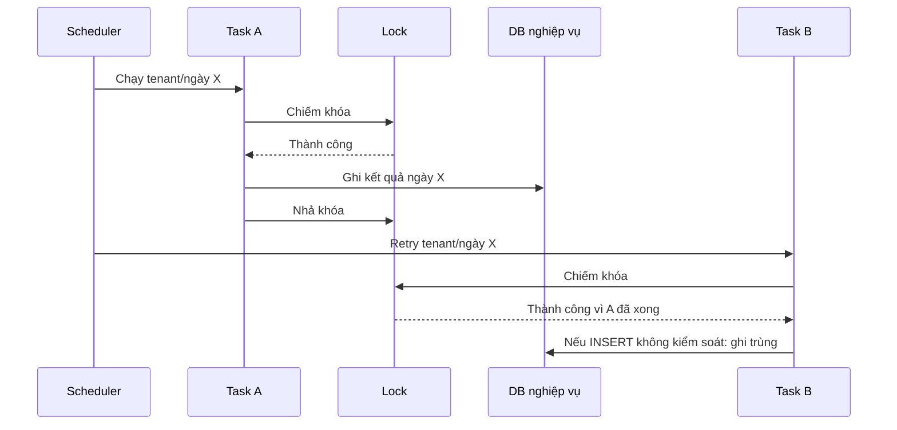
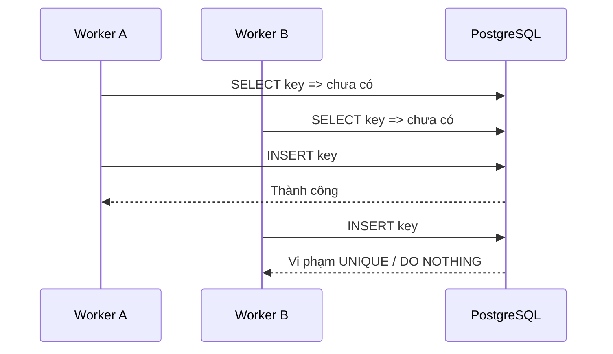
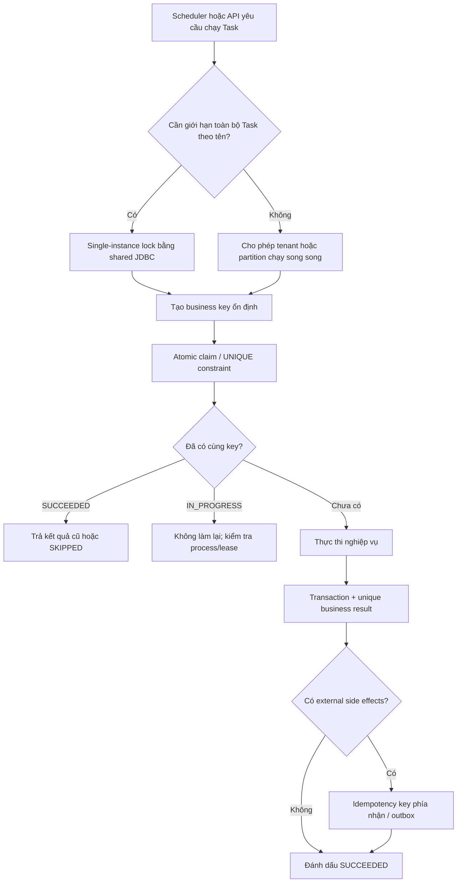

# Phân biệt khóa thực thi với chống xử lý trùng dữ liệu

## Mục tiêu và bối cảnh

Một ứng dụng **Spring Cloud Task** chạy trong thời gian hữu hạn: nhận yêu cầu, xử lý dữ liệu, ghi kết quả vào `TaskRepository` rồi kết thúc. Ví dụ, tác vụ `settlement-task` chốt giao dịch cho tenant `shop-42` vào ngày `2026-11-23`. Scheduler có thể khởi động tác vụ hai lần vì timeout, người vận hành có thể chạy lại sau vài giờ, hoặc hai replica có thể nhận cùng một thông điệp.

Có hai yêu cầu phải giải quyết riêng:

- **Khóa thực thi** (*execution lock/mutual exclusion*): giới hạn số tiến trình **được chạy đồng thời** trong phạm vi khóa, ví dụ cùng tên Task.
- **Chống xử lý trùng dữ liệu** (*idempotency/deduplication*): bảo đảm yêu cầu nghiệp vụ **được gọi lặp** không gây thêm hiệu ứng không mong muốn, kể cả khi các lần chạy cách nhau nhiều giờ.

Bài học thuộc chương **Khóa và đồng thời**. Sau bài này, bạn có thể bật chế độ một instance của Spring Cloud Task, hiểu phạm vi của khóa, thiết kế *business key* bền vững, thực hiện ghi nguyên tử có `UNIQUE`, và lên phương án khôi phục an toàn khi Task crash hoặc retry.

## 1. Khác nhau về mục tiêu, phạm vi và thời gian

| Tiêu chí | Khóa thực thi | Chống xử lý trùng dữ liệu |
| --- | --- | --- |
| Câu hỏi | “Ai được chạy **bây giờ**?” | “Thao tác nghiệp vụ này **đã diễn ra** chưa?” |
| Phạm vi điển hình | Tên Task, tenant, partition hoặc tài nguyên | Tenant + ngày nghiệp vụ, mã hóa đơn, mã yêu cầu |
| Tuổi thọ | Trong lúc giữ khóa/TTL | Qua nhiều lần chạy, retry và restart, theo thời hạn nghiệp vụ |
| Giải pháp | Spring Cloud Task single-instance, JDBC/Redis distributed lock, scheduler concurrency policy | Unique constraint, atomic claim, trạng thái nghiệp vụ, transaction, downstream idempotency key |
| Ngăn chạy cùng lúc | Có, trong phạm vi khóa đúng và khi mọi worker cùng tuân thủ | Không nhất thiết chặn tiến trình, nhưng có thể chặn cùng một hiệu ứng ghi |
| Ngăn chạy lại sau một giờ | Không: khóa đã được giải phóng | Có, khi dùng key và ràng buộc dữ liệu đúng |
| Sau khi JVM bị kill | Cần TTL/thu hồi khóa, xác minh owner | Trạng thái và kết quả nghiệp vụ phải còn để đối soát |
| Nếu sử dụng sai | Nghẽn tài nguyên hoặc hai worker cùng thao tác | Ghi trùng, thanh toán hai lần hoặc bỏ lỡ xử lý hợp lệ |

Ví dụ thời gian:

| Thời điểm | Diễn biến | Khóa thực thi | Chống trùng dữ liệu |
| --- | --- | --- | --- |
| 01:00 | A bắt đầu xử lý shop-42/ngày 23/11 | A giữ khóa | Key chưa có, A có thể claim |
| 01:01 | B cũng khởi chạy cùng tên Task | B bị chặn | B vẫn không nên ghi cùng key |
| 01:05 | A hoàn tất, nhả khóa | Không còn khóa | Key đã được lưu bền vững |
| 01:10 | C được chạy lại shop-42/ngày 23/11 | C **được phép khởi động** | DB nhận ra key đã xử lý, không ghi trùng |

**Kết luận của bảng:** cơ chế loại trừ đồng thời không ngăn lần xử lý trùng **tuần tự**. Và một bảng chống trùng không tự ngăn hai tác vụ độc lập cùng dùng CPU/memory tại thời điểm đó.

## 2. Cơ chế một instance có sẵn trong Spring Cloud Task

Spring Cloud Task hỗ trợ ngăn hai instance cùng **tên Task** thực thi đồng thời:

```yaml
spring:
  application:
    name: settlement-task
  main:
    web-application-type: none
  cloud:
    task:
      single-instance-enabled: true
```

Theo tài liệu [Spring Cloud Task – Restricting Instances](https://docs.spring.io/spring-cloud-task/reference/features.html#restricting-spring-cloud-task-instances), `spring.cloud.task.single-instance-enabled` mặc định là `false`. Khi bật và một instance cùng tên vẫn đang chạy, lần chạy kế tiếp bị từ chối; tài liệu nêu **mã thoát `1`** cho trường hợp này. Đây là khóa theo **tên Task**, không tự hiểu `businessDate`, `tenantId` hay nội dung một Batch Job.

### 2.1. Dependency và hạ tầng cần thiết

Chế độ single-instance dựa vào khóa phân tán của **Spring Integration JDBC**. Ngoài starter của Task, dự án cần những dependency được tài liệu chỉ rõ:

```xml
<dependencies>
    <dependency>
        <groupId>org.springframework.cloud</groupId>
        <artifactId>spring-cloud-starter-task</artifactId>
    </dependency>
    <dependency>
        <groupId>org.springframework.integration</groupId>
        <artifactId>spring-integration-core</artifactId>
    </dependency>
    <dependency>
        <groupId>org.springframework.integration</groupId>
        <artifactId>spring-integration-jdbc</artifactId>
    </dependency>
    <dependency>
        <groupId>org.postgresql</groupId>
        <artifactId>postgresql</artifactId>
        <scope>runtime</scope>
    </dependency>
</dependencies>
```

Đây là đoạn `dependencies` để chèn vào `pom.xml` Spring Boot. Cần có **Boot parent/BOM + Spring Cloud BOM tương thích** trong build; để chúng quản lý phiên bản của starter và Spring Integration.

Các instance cần:

1. **Cùng tên Task.** Thông thường `spring.application.name=settlement-task` xác định tên; cơ chế `TaskNameResolver` có thể thay đổi cách đặt tên. Nếu một launcher đặt `manual-settlement-task`, nó có thể dùng phạm vi khóa khác.
2. **Cùng kho khóa JDBC.** Nếu replica A kết nối DB X còn B kết nối DB Y, hai khóa không bảo vệ lẫn nhau. Không dùng H2 in-memory riêng cho mỗi JVM để kiểm tra tính loại trừ phân tán.
3. **Schema và quyền DB phù hợp.** Schema mặc định của Spring Cloud Task có `TASK_EXECUTION` để lưu lịch sử và `TASK_LOCK` phục vụ single-instance. Tạo schema theo **đúng phiên bản thư viện**, đặc biệt khi có prefix/schema tùy chỉnh.
4. **Cấu hình nhất quán ở mọi launcher.** Không để một đường kích hoạt bật single-instance trong khi đường khác chạy cùng tên nhưng không thực thi cơ chế khóa.
5. **Quy trình xử lý stale lock.** Lỗi kết nối, crash, timeout/TTL và thay đổi owner cần được điều tra trước khi thu hồi khóa.

Cấu hình tham khảo cho PostgreSQL đã migration sẵn schema Task:

```yaml
spring:
  application:
    name: settlement-task
  main:
    web-application-type: none
  datasource:
    url: ${TASK_DB_URL}
    username: ${TASK_DB_USER}
    password: ${TASK_DB_PASSWORD}
  cloud:
    task:
      single-instance-enabled: true
      initialize-enabled: false
      closecontext-enabled: true
```

Các biến `TASK_DB_*` do nền tảng cấp. Không truyền password/token qua option CLI vì có thể xuất hiện trong process list và `TASK_EXECUTION_PARAMS`. Khi cần lưu lịch sử và khóa xuyên nhiều lần chạy, TaskRepository và lock store phải ở DB bền vững có thể truy cập từ tất cả instance.

### 2.2. Tên Task có thể khiến khóa quá rộng

| A đang chạy | B muốn chạy | Ý nghĩa khi cùng lock store |
| --- | --- | --- |
| `settlement-task`, tenant A, ngày X | `settlement-task`, tenant A, ngày X | B bị chặn |
| `settlement-task`, tenant A, ngày X | `settlement-task`, tenant B, ngày Y | B **vẫn bị chặn**, dù không chung dữ liệu |
| `settlement-task`, tenant A, ngày X | `invoice-task`, tenant A, ngày X | Single-instance không loại trừ hai Task tên khác |
| A đã kết thúc | `settlement-task`, tenant A, ngày X | B có thể chạy lại, vì khóa cũ đã nhả |

Nếu nhiều tenant cần chạy song song, khóa toàn Task có thể gây nghẽn. Có thể thiết kế khóa **theo tenant/partition** bằng một registry phân tán riêng, nhưng đó là công việc bổ sung với lock key, TTL, renewal và lifecycle rõ ràng. **Đổi tên Task theo tenant không tự biến khóa thành idempotency**, vì chạy lại sau khi nhả khóa vẫn xảy ra.

### 2.3. TTL và giới hạn của khóa

Spring Cloud có các thuộc tính như `spring.cloud.task.single-instance-lock-ttl` và `spring.cloud.task.single-instance-lock-check-interval` ở những phiên bản hỗ trợ. Kiểm tra tài liệu/metadata cấu hình của phiên bản đang dùng trước khi gán giá trị. TTL quá ngắn so với thời gian xử lý có thể cho phép worker mới lấy khóa khi worker cũ chưa xong; TTL quá dài khiến một khóa còn lại sau crash chặn quá lâu. Các dạng `JdbcLockRegistry` khác nhau có hỗ trợ renewal và cách cấu hình khác nhau; xem [Spring Integration – JDBC Lock Registry](https://docs.spring.io/spring-integration/reference/jdbc/lock-registry.html).

Vì khóa có thể mất hoặc hết hạn, **mã nghiệp vụ không được dựa hoàn toàn vào giả định “đã có khóa thì không ai khác ghi”**. Constraint tại database vẫn là phòng tuyến bảo vệ kết quả cuối cùng.

## 3. Demo quan sát hai JVM tranh khóa

Tạo `src/main/java/com/example/task/LockDemoTaskApplication.java` trong một dự án Spring Boot đã bổ sung starter Task và hai Spring Integration dependency. Mẫu cố tình ngủ 30 giây để có thời gian mở terminal thứ hai.

```java
package com.example.task;

import java.time.Duration;
import java.time.LocalDate;
import java.util.List;
import org.springframework.boot.ApplicationRunner;
import org.springframework.boot.SpringApplication;
import org.springframework.boot.autoconfigure.SpringBootApplication;
import org.springframework.context.annotation.Bean;

@SpringBootApplication
public class LockDemoTaskApplication {
    public static void main(String[] args) {
        SpringApplication.run(LockDemoTaskApplication.class, args);
    }

    @Bean
    ApplicationRunner runOnce() {
        return args -> {
            List<String> dates = args.getOptionValues("business-date");
            if (dates == null || dates.size() != 1) {
                throw new IllegalArgumentException("Cần --business-date=YYYY-MM-DD");
            }

            LocalDate date = LocalDate.parse(dates.get(0));
            System.out.println("Bắt đầu xử lý " + date);
            Thread.sleep(Duration.ofSeconds(30).toMillis()); // Chỉ cho demo.
            System.out.println("Kết thúc " + date);
        };
    }
}
```

Build ra JAR thực tế và dùng hai terminal:

```bash
# Terminal A: chạy trước.
java -jar target/settlement-task.jar --business-date=2026-11-23

# Terminal B: chạy ngay trong 30 giây A chưa kết thúc.
java -jar target/settlement-task.jar --business-date=2026-11-24
```

Kỳ vọng: A chạy runner; B bị từ chối vì **cùng Task name** dù ngày khác, với mã lỗi theo tài liệu của single-instance. Chờ A kết thúc rồi chạy lại B; B được phép thực thi. Đổi tên Task của B thì khóa theo tên Task không thể ngăn B xử lý dữ liệu trùng với A.

Cần kiểm tra **mã thoát process/container và log**, đồng thời tra metadata `TaskExecution`. Nếu một lần khởi động lỗi quá sớm, chưa chắc có bản ghi Task. Khóa không phải là `TaskExecution.exitCode`: `exitCode` ghi kết quả lần thực thi, còn lock điều khiển quyền bắt đầu.

## 4. Tại sao khóa không đủ chống dữ liệu trùng?



Các đường trùng vẫn tồn tại dù từng tiến trình chấp hành khóa:

- **Retry tuần tự:** scheduler không nhận ACK và chạy lại khi khóa đã nhả.
- **Hai Task khác tên:** Task tự động và Task chạy tay cùng cập nhật một kỳ dữ liệu.
- **Lock store khác nhau:** một replica trỏ nhầm DB hoặc schema.
- **Khóa hết hạn khi A còn chạy:** B chiếm lại quyền, tạo chạy chồng.
- **Trùng bản ghi trong một JVM:** input có cùng `invoiceId` hai lần hoặc một batch retry một chunk.

`TaskExecutionId` là ID **mỗi lần khởi chạy vật lý**, không phải ID của yêu cầu nghiệp vụ. Nếu lấy ID này làm idempotency key, mọi lần retry đều tạo một key mới; kết quả là không ngăn được xử lý lặp. Tương tự, `TaskExecution.exitCode=0` chỉ cho biết framework coi lần chạy đã hoàn tất; nó không chứng minh một hóa đơn chưa từng được ghi.

## 5. Chọn business key cho idempotency

Định nghĩa trước: **khi nào hai request là cùng một ý định nghiệp vụ?**

Ví dụ tổng hợp giao dịch: `key = (tenantId, businessDate)`. Một ngày cần được chốt đúng một lần theo mỗi tenant; nhiều lần retry phải cùng key. Nếu nghiệp vụ cho phép tạo *phiên bản điều chỉnh* hợp lệ, key cần có `reportVersion` hoặc `generation` theo quy tắc nghiệp vụ.

| Nghiệp vụ | Key gợi ý | Điểm cần thỏa thuận |
| --- | --- | --- |
| Tổng hợp giao dịch/ngày | `(tenantId, businessDate)` | Chạy bù hay tạo phiên bản mới? |
| Nhập hóa đơn đối tác | `(partnerId, externalInvoiceId)` | Mã bên đối tác có tái sử dụng theo năm không? |
| Xử lý message broker | `(source, eventId)` | Lưu key bao lâu so với khả năng redelivery? |
| Thanh toán | `paymentRequestId` | Retry có cùng ý định và số tiền không? |
| Gửi thông báo | `(campaignId, recipientId, kind)` | Khi nào cho phép gửi lại có chủ ý? |

Key quá rộng sẽ chặn yêu cầu hợp lệ. Key quá hẹp sẽ cho phép trùng. Với nhiều tenant, quên `tenantId` trong key có thể khiến tenant A chặn tenant B; dùng `TaskExecutionId` thì mỗi lần retry lại không bị chặn.

## 6. Phòng tuyến dữ liệu: `UNIQUE` và `ON CONFLICT`

Trong PostgreSQL, đặt tính duy nhất **ngay tại nơi lưu kết quả**, thay vì chỉ đọc kiểm tra trước khi ghi.

Giả sử một kết quả tổng hợp duy nhất cho mỗi tenant/ngày:

```sql
CREATE TABLE settlement_result (
    tenant_id       VARCHAR(80) NOT NULL,
    business_date   DATE NOT NULL,
    invoice_count   INTEGER NOT NULL CHECK (invoice_count >= 0),
    total_amount    NUMERIC(20, 2) NOT NULL,
    created_at      TIMESTAMPTZ NOT NULL DEFAULT CURRENT_TIMESTAMP,
    CONSTRAINT settlement_result_pk
        PRIMARY KEY (tenant_id, business_date)
);
```

Ghi dữ liệu theo business key bằng thao tác nguyên tử:

```sql
INSERT INTO settlement_result (
    tenant_id, business_date, invoice_count, total_amount
) VALUES ('shop-42', DATE '2026-11-23', 120, 158000.00)
ON CONFLICT (tenant_id, business_date) DO NOTHING
RETURNING tenant_id, business_date;
```

Lần đầu chèn thành công sẽ trả một dòng. Lần sau trùng key sẽ không thêm dòng nào và `RETURNING` rỗng. Nếu hai tiến trình cùng chạy, ràng buộc `PRIMARY KEY` vẫn ngăn cả hai commit hai dòng cùng key. Tham khảo [PostgreSQL – INSERT / ON CONFLICT](https://www.postgresql.org/docs/current/sql-insert.html).

### Vì sao `SELECT` rồi `INSERT` là lỗi đồng thời?

Cả A và B có thể thực hiện `SELECT COUNT(*)` và cùng nhận `0` **trước khi ai kịp ghi**. Sau đó cả hai đều tưởng key còn trống. Không có constraint, hai bản ghi trùng có thể được commit. Với `UNIQUE`, DB từ chối một bản ghi; với `ON CONFLICT DO NOTHING`, chương trình chủ động xử lý tình huống đó.



**Giới hạn quan trọng:** khóa unique trong bảng kết quả **không** thể thu hồi những side effect xảy ra **trước khi ghi bảng**, ví dụ gọi API chuyển tiền hai lần. Với hệ thống ngoài, cần sử dụng idempotency key được API nhận hỗ trợ hoặc outbox/deduplication và đối soát.

`DO NOTHING` phù hợp khi muốn bỏ qua yêu cầu đã có kết quả, **nhưng phải kiểm tra payload**: nếu kết quả cũ khác yêu cầu mới, không nên âm thầm báo thành công. `ON CONFLICT DO UPDATE` phù hợp khi nghiệp vụ thực sự cho phép cập nhật trạng thái mong muốn; đó không phải phép màu bảo đảm mọi upsert đều idempotent.

## 7. Khi công việc kéo dài: trạng thái request và atomic claim

Với tác vụ vài phút hoặc nhiều giờ, chỉ một bảng kết quả cuối không cho biết **yêu cầu đang làm** hay **đang chờ retry**. Có thể tạo bảng business idempotency:

```sql
CREATE TABLE settlement_request (
    tenant_id       VARCHAR(80) NOT NULL,
    business_date   DATE NOT NULL,
    state           VARCHAR(20) NOT NULL
                    CHECK (state IN ('IN_PROGRESS', 'SUCCEEDED', 'FAILED')),
    attempt_id      UUID NOT NULL,
    claimed_at      TIMESTAMPTZ NOT NULL DEFAULT CURRENT_TIMESTAMP,
    completed_at    TIMESTAMPTZ,
    CONSTRAINT settlement_request_pk
        PRIMARY KEY (tenant_id, business_date)
);
```

Claim một yêu cầu chưa được ghi nhận:

```sql
INSERT INTO settlement_request (
    tenant_id, business_date, state, attempt_id
) VALUES (
    'shop-42', DATE '2026-11-23', 'IN_PROGRESS',
    'f7a0550a-29a0-4df1-b43c-a3694c8f0752'
)
ON CONFLICT (tenant_id, business_date) DO NOTHING
RETURNING tenant_id, business_date;
```

Có một dòng trả về nghĩa là lần này **được claim**. Không có dòng trả về nghĩa là **đã có record**, nhưng phải đọc `state` để biết kết quả:

| `state` hiện có | Xử lý yêu cầu lặp |
| --- | --- |
| `SUCCEEDED` | Trả kết quả cũ hoặc ghi nhận SKIPPED; nếu payload khác thì báo xung đột |
| `IN_PROGRESS` | Không tạo tác động thứ hai; đối chiếu owner, tiến trình và SLA |
| `FAILED` | Chỉ bắt đầu attempt mới khi có chính sách retry/recovery hợp lệ |
| Chưa có | Thử claim mới bằng INSERT nguyên tử |

Sau khi xử lý thành công, cập nhật **đúng chủ sở hữu attempt**:

```sql
UPDATE settlement_request
SET state = 'SUCCEEDED',
    completed_at = CURRENT_TIMESTAMP
WHERE tenant_id = 'shop-42'
  AND business_date = DATE '2026-11-23'
  AND attempt_id = 'f7a0550a-29a0-4df1-b43c-a3694c8f0752'
  AND state = 'IN_PROGRESS';
```

Ứng dụng phải kiểm tra số hàng ảnh hưởng **bằng `1`**. Nếu là `0`, attempt mất quyền hoặc trạng thái đã đổi; không được tự nhận hoàn tất. Nếu bảng `settlement_result` và `settlement_request` cùng một datasource, nên ghi kết quả + chuyển `SUCCEEDED` trong **cùng transaction**.

**Khoảng trống cần xử lý:** sau khi claim được commit, JVM có thể chết trước khi ghi kết quả, để lại `IN_PROGRESS` lâu dài. Hoặc nó chết **sau khi gọi API ngoài**, khiến không rõ side effect đã xảy ra chưa. Recovery cần đối chiếu, lease/timeout, ownership, fencing token cho worker bị thay thế và downstream idempotency; không tự xóa/đặt lại mọi bản ghi cũ chỉ theo đồng hồ.

## 8. Ví dụ Java: idempotency độc lập với khóa Task

Đây là **lớp service minh họa** trong một dự án Spring Boot dùng `JdbcTemplate`, PostgreSQL, transaction và hai bảng ở trên. Nó không tự tạo/giải phóng distributed lock; `single-instance-enabled` vẫn do Spring Cloud Task quản lý riêng.

```java
package com.example.task;

import java.math.BigDecimal;
import java.sql.Date;
import java.time.LocalDate;
import java.util.UUID;

import org.springframework.jdbc.core.JdbcTemplate;
import org.springframework.stereotype.Service;
import org.springframework.transaction.annotation.Transactional;

@Service
public class SettlementService {
    private final JdbcTemplate jdbc;

    public SettlementService(JdbcTemplate jdbc) {
        this.jdbc = jdbc;
    }

    public boolean tryClaim(
            String tenantId, LocalDate businessDate, UUID attemptId) {
        int inserted = jdbc.update(
                """
                INSERT INTO settlement_request (
                    tenant_id, business_date, state, attempt_id
                ) VALUES (?, ?, 'IN_PROGRESS', ?)
                ON CONFLICT (tenant_id, business_date) DO NOTHING
                """,
                tenantId, Date.valueOf(businessDate), attemptId);

        return inserted == 1;
    }

    @Transactional
    public void saveResultAndComplete(
            String tenantId, LocalDate businessDate, UUID attemptId,
            int invoiceCount, BigDecimal amount) {

        int inserted = jdbc.update(
                """
                INSERT INTO settlement_result (
                    tenant_id, business_date, invoice_count, total_amount
                ) VALUES (?, ?, ?, ?)
                ON CONFLICT (tenant_id, business_date) DO NOTHING
                """,
                tenantId, Date.valueOf(businessDate), invoiceCount, amount);

        if (inserted != 1) {
            // Replay hoặc payload xung đột: phải đọc dữ liệu cũ.
            throw new IllegalStateException("Kết quả đã tồn tại");
        }

        int updated = jdbc.update(
                """
                UPDATE settlement_request
                SET state = 'SUCCEEDED', completed_at = CURRENT_TIMESTAMP
                WHERE tenant_id = ?
                  AND business_date = ?
                  AND attempt_id = ?
                  AND state = 'IN_PROGRESS'
                """,
                tenantId, Date.valueOf(businessDate), attemptId);

        if (updated != 1) {
            // @Transactional rollback cả INSERT settlement_result.
            throw new IllegalStateException("Attempt không còn quyền hoàn tất");
        }
    }
}
```

Trong `ApplicationRunner`, dùng như sau (mã giả minh họa luồng):

```java
UUID attemptId = UUID.randomUUID();
if (!service.tryClaim(tenantId, businessDate, attemptId)) {
    // Đọc settlement_request + settlement_result:
    // SUCCEEDED -> đã có kết quả.
    // IN_PROGRESS -> không xử lý song song.
    // FAILED -> khởi động quy trình retry/recovery có kiểm soát.
    return;
}

// Tính invoiceCount, amount và xác minh tenant/quy tắc nghiệp vụ.
service.saveResultAndComplete(
        tenantId, businessDate, attemptId, invoiceCount, amount);
```

Đoạn `return` trong nhánh claim thất bại **không tự đồng nghĩa “thành công nghiệp vụ”**: cần trả trạng thái phù hợp cho caller, tách `SKIPPED/ALREADY_DONE` khỏi `IN_PROGRESS` và `FAILED`. Phần bổ sung này phụ thuộc hợp đồng API/scheduler của từng dự án.

**Những giới hạn của ví dụ:**

- `tryClaim` commit một row riêng trước quá trình dài. Nếu crash, `IN_PROGRESS` còn tồn tại; ví dụ **chưa có recovery** hoặc re-claim có fencing.
- `@Transactional` bảo vệ hai thao tác trong `saveResultAndComplete` **chỉ khi chúng dùng cùng transaction manager/datasource**. Nó không tạo transaction phân tán với DB TaskRepository khác hoặc API bên ngoài.
- Nếu gọi một API thanh toán hoặc gửi email, cần key idempotency phía nhận, outbox/inbox hoặc phương án đối soát. Unique constraint ở DB cục bộ không bảo đảm chỉ một external call.
- Trước khi coi duplicate là “đã hoàn tất”, phải kiểm tra `state`, payload/fingerprint và quyền truy cập theo tenant.

## 9. Phối hợp cả hai lớp trong một kiến trúc



Ba mô hình thường gặp:

| Bối cảnh | Quyết định về khóa | Quyết định về dữ liệu |
| --- | --- | --- |
| Job bảo trì schema toàn hệ thống, bắt buộc tuần tự | Khóa toàn tên Task, dùng chung JDBC | Key theo phiên bản/mốc migration để tránh chạy lại thao tác không an toàn |
| Báo cáo 10.000 tenant độc lập | Tránh khóa toàn Task gây nghẽn; khóa theo tenant/partition nếu có xung đột | `UNIQUE(tenant_id, business_date)`, state/attempt theo business key |
| Nhập thông điệp có thể giao lại | Có thể cho nhiều worker đồng thời | Key theo `event_id`, inbox/dedup và transaction tại nơi ghi |

Khóa giảm cạnh tranh và lãng phí tài nguyên; unique constraint và thiết kế idempotency mới bảo vệ tính đúng đắn lâu dài.

### Với Spring Batch cần hiểu thêm một lớp nhận diện

Spring Cloud Task lưu `TaskExecution` cho lần chạy ứng dụng; Spring Batch lưu `JobInstance`, `JobExecution` và `StepExecution`. Spring Batch xác định `JobInstance` qua **job name + các identifying `JobParameters`**. Điều này hỗ trợ restart và quản lý job, nhưng **không thay thế khóa unique trên dữ liệu nghiệp vụ**:

- Hai `JobParameters` khác nhau vẫn có thể trỏ đến cùng một hóa đơn.
- Restart có thể đọc/xử lý lại một phần dữ liệu tùy transaction, chunk và checkpoint.
- Mỗi lần chạy Task có thể có `TaskExecutionId` mới, kể cả khi xử lý lại cùng `JobInstance`.
- Khi writer ghi xuống database nghiệp vụ, vẫn cần ràng buộc cho invoice ID/business key và thiết kế ghi lại an toàn.

Đặc biệt, nếu Job gọi một API bên ngoài trong từng item, transaction DB của Spring Batch không tự rollback side effect ấy. Xem [Spring Batch – Configuring and Running a Job](https://docs.spring.io/spring-batch/reference/job/configuring-job.html).

## 10. Crash, timeout, mất khóa và retry

Trong hệ phân tán, một thao tác có thể hoàn thành ở nơi này nhưng chưa được ghi nhận ở nơi khác.

| Thời điểm phát sinh lỗi | Trạng thái có thể còn lại | Nguy cơ | Cách khôi phục |
| --- | --- | --- | --- |
| Trước khi `ApplicationContext` tạo Task | Không có `TaskExecution` | Scheduler không tìm thấy lịch sử trong DB | Xem process exit, container state, log bootstrap |
| Sau khi chiếm lock, trước khi chạy nghiệp vụ | Lock có thể còn đến khi timeout/recovery | Chặn yêu cầu sau | Kiểm tra owner, TTL, sức khỏe process rồi xử lý lock |
| Sau khi claim business key, trước khi ghi kết quả | `IN_PROGRESS` còn lại | Retry bị từ chối dù công việc đã chết | Recovery có ownership/lease và điều tra side effects |
| Sau khi commit kết quả nhưng chưa cập nhật TaskRepository | Kết quả có, `TaskExecution.exitCode` có thể `NULL` | Scheduler tưởng chưa xong và chạy lại | Dùng business key/constraint để không tạo kết quả trùng |
| Sau khi gọi API ngoài nhưng trước khi ghi kết quả DB | API có thể đã thực hiện, DB chưa biết | Chuyển tiền/gửi email lần nữa | Downstream idempotency key, đối soát hoặc outbox |
| TTL hết khi worker A vẫn hoạt động | B có thể chiếm lock | Chạy chồng | Renewal/fencing nếu hỗ trợ, unique/conditional writes |

**Không tự cập nhật `TASK_EXECUTION.EXIT_CODE` hoặc xóa dòng `TASK_LOCK` để “làm sạch” dashboard.** Những thao tác ấy thay đổi metadata mà không xác minh process và tác động nghiệp vụ. Nếu cần thu hồi lock, hãy thực hiện quy trình vận hành xác minh owner, giới hạn cạnh tranh và bảo vệ worker cũ khỏi tiếp tục ghi.

### Vì sao không nên hứa “exactly once” chỉ bằng một khóa?

Hệ thống điều phối có thể gửi lại cùng yêu cầu khi mất ACK. Nếu đã gọi API ngoài, tiến trình có thể chết trước khi lưu kết quả. Khóa chỉ có hiệu lực trong một khoảng thời gian và thường không kiểm soát API phía nhận.

Mục tiêu thực tế hơn là **“retry an toàn, hiệu ứng nghiệp vụ được chống trùng trong phạm vi đã thiết kế”**. Để làm được điều đó:

1. Dùng **business key ổn định** qua mọi retry.
2. Mọi đường ghi dữ liệu áp dụng constraint và transaction nguyên tử.
3. External API có idempotency key hoặc một phương pháp đối soát/bù hợp lệ.
4. Khi retry, kiểm tra trạng thái nghiệp vụ trước khi quyết định xử lý tiếp.
5. Nếu có worker/lease cũ, dùng attempt ownership hoặc fencing để từ chối ghi từ chủ sở hữu đã mất quyền.

## 11. Giám sát ba nguồn trạng thái

| Lớp | Dữ liệu quan sát | Câu hỏi cần trả lời |
| --- | --- | --- |
| **Task/process** | `TaskExecutionId`, `startTime`, `endTime`, `exitCode`, process exit, container state | Tiến trình còn sống? Đã chốt metadata chưa? |
| **Khóa** | Lock owner, key, region, TTL, thời điểm chiếm khóa | Ai còn quyền chạy? Khóa có stale hoặc hết hạn? |
| **Nghiệp vụ** | `tenantId`, `businessDate`, `attemptId`, `state`, kết quả ghi, external request ID | Key đã hoàn tất hay đang làm? Có side effect trùng không? |

Kiểm tra metadata Task (giả sử dùng schema mặc định):

```sql
SELECT TASK_EXECUTION_ID, TASK_NAME, START_TIME,
       END_TIME, EXIT_CODE
FROM TASK_EXECUTION
WHERE TASK_NAME = 'settlement-task'
ORDER BY TASK_EXECUTION_ID DESC
LIMIT 20;
```

Kiểm tra bảng khóa mặc định khi điều tra, **chỉ đọc**:

```sql
SELECT LOCK_KEY, REGION, CLIENT_ID, CREATED_DATE
FROM TASK_LOCK;
```

Cột `CLIENT_ID`, `LOCK_KEY` và `REGION` thuộc cấu trúc khóa ở phiên bản/scheme cụ thể. Không suy ra chỉ từ sự có mặt của một dòng khóa rằng tiến trình còn sống. Xem [Spring Cloud Task – Repository Schema](https://docs.spring.io/spring-cloud-task/reference/appendix-task-repository-schema.html) và schema dự án đang triển khai.

Kiểm tra yêu cầu nghiệp vụ bị treo:

```sql
SELECT tenant_id, business_date, state, attempt_id,
       claimed_at, completed_at
FROM settlement_request
WHERE state = 'IN_PROGRESS'
ORDER BY claimed_at;
```

`IN_PROGRESS` không tự chứng minh process còn chạy, tương tự `TaskExecution.exitCode=NULL` không đồng nghĩa `RUNNING`. Phải đối chiếu scheduler/container, SLA, log và tác động thật.

Các metric hữu ích: số lần bị chặn vì single-instance; thời gian giữ lock; số lần duplicate claim; số key `IN_PROGRESS` quá SLA; số lần retry sau lỗi; số lần database từ chối duplicate; và số lần bên nhận báo idempotent replay. Phân biệt lỗi “khóa bận” với lỗi kết nối DB dù cả hai có thể làm task thất bại.

## 12. Kiểm thử đồng thời và phục hồi

Không chỉ thử đường chạy một JVM thành công. Trên môi trường thử nghiệm với DB chung, hãy kiểm tra:

| Kịch bản | Hành động | Kết quả cần xác minh |
| --- | --- | --- |
| Hai JVM cùng tên Task | Khởi chạy A rồi B khi A chưa kết thúc | B bị từ chối bởi single-instance; A tiếp tục |
| Cùng business key nhưng chạy **nối tiếp** | Chạy ngày X, chờ xong, chạy lại X | Khóa không chặn lần sau; unique/idempotency không cho ghi trùng |
| Hai tên Task nhưng cùng key dữ liệu | Chạy task định kỳ và task thủ công | Ràng buộc DB vẫn bảo vệ kết quả |
| Hai transaction `INSERT` cùng key | Đưa A/B ghi cùng lúc | Chỉ một transaction tạo dòng mới |
| JVM chết sau khi claim | Dừng tiến trình trước khi kết quả được lưu | `IN_PROGRESS` còn; cơ chế recovery không tự xử lý trùng |
| JVM chết sau khi commit nghiệp vụ | Gây lỗi trước khi TaskRepository cập nhật kết quả | Process/Task metadata khác trạng thái nghiệp vụ; retry vẫn an toàn |
| Khóa hết TTL | Trên test, đặt TTL ngắn hơn thời gian xử lý | Quan sát khả năng chạy chồng; dữ liệu vẫn có constraint |
| API ngoài trả kết quả nhưng ACK thất lạc | Mô phỏng timeout sau khi bên nhận đã xử lý | Retry cùng key, phía nhận không gây side effect lần hai |

Đối với Task dài và có external side effects, kiểm thử fault injection có chủ đích là cách đánh giá thật sự. Không nên chỉ unit test một hàm `tryClaim` rồi suy ra hệ thống đã đạt exactly-once.

## 13. Bài tập tình huống

**Tình huống A.** Scheduler chạy `settlement-task` cho `shop-42` ngày 23/11; A kết thúc thành công. Sau một giờ, scheduler retry cùng ngày. `single-instance-enabled=true` có từ chối không?

**Gợi ý:** Không. Không còn instance cùng tên giữ khóa nên C có thể chạy. Business key `(tenantId,businessDate)` và unique/idempotency mới ngăn ghi trùng.

**Tình huống B.** Hệ thống xử lý độc lập `shop-42` và `shop-43` nhưng không thể chạy song song vì cả hai cùng tên `settlement-task`. Nên thay đổi gì?

**Gợi ý:** Khóa theo tên Task quá rộng cho nhu cầu song song. Cân nhắc khóa theo tenant/partition hoặc cho phép nhiều instance và bảo vệ dữ liệu bằng key/constraint. Giữ giám sát và khôi phục phù hợp.

**Tình huống C.** Worker A gọi API chuyển tiền rồi crash trước khi chuyển `settlement_request` sang `SUCCEEDED`. Worker B thấy `IN_PROGRESS` quá 30 phút. Có thể xóa dòng rồi gọi API lần nữa không?

**Gợi ý:** Không. Cần đối soát kết quả bên nhận, dùng cùng idempotency key nếu API hỗ trợ, kiểm tra owner/lease và giới hạn retry. Xóa claim có thể gây chuyển tiền hai lần.

**Tình huống D.** Hai worker cùng `SELECT COUNT(*)=0` rồi cùng định `INSERT`. Vì sao ràng buộc `PRIMARY KEY` quan trọng ngay cả khi đã bật distributed lock?

**Gợi ý:** Lock có thể không áp dụng cho mọi đường chạy, sai scope hoặc hết hạn. Constraint DB bảo vệ tại điểm ghi cuối cùng trước cạnh tranh thực tế.

**Tình huống E.** Spring Batch restart một Job với cùng identifying `JobParameters`, nhưng `TaskExecutionId` của lần chạy mới khác. Có nên dùng ID Task mới làm business idempotency key?

**Gợi ý:** Không. ID Task thay đổi mỗi lần thực thi vật lý. Dùng business key ổn định hoặc record-level key để lần restart không gây hiệu ứng trùng.

## 14. Checklist vận hành an toàn

- [ ] Định nghĩa rõ phạm vi khóa: toàn task, tenant, partition hay tài nguyên; kiểm tra khóa có đang chặn nhầm công việc độc lập.
- [ ] Với single-instance, tất cả JVM dùng cùng task name, shared JDBC lock store, các Spring Integration dependency và schema `TASK_LOCK` đúng phiên bản.
- [ ] Giám sát lock TTL, owner, thời gian chạy và quy trình khôi phục khi crash; không tùy tiện xóa bảng khóa.
- [ ] Chọn business key ổn định cho retry, không dùng `TaskExecutionId` làm khóa chống trùng nghiệp vụ.
- [ ] Bảo vệ bảng đích bằng `PRIMARY KEY`/`UNIQUE` và ghi nguyên tử; không chỉ `SELECT` trước `INSERT`.
- [ ] Quy định cách xử lý `SUCCEEDED`, `IN_PROGRESS`, `FAILED` và payload khác nhau cùng key.
- [ ] Khi cùng DB, ghi kết quả và chuyển trạng thái trong một transaction; xác minh `attempt_id` và số hàng cập nhật.
- [ ] Với external API, dùng idempotency key phía nhận, outbox hoặc đối soát; không giả định `@Transactional` bao trùm side effect bên ngoài.
- [ ] Thử crash/retry, hết TTL, hai replica và hai Task tên khác nhau cùng truy cập business key.
- [ ] Nếu có Spring Batch, đối chiếu JobInstance, identifying JobParameters, checkpoint và writer idempotent.
- [ ] Giữ an toàn thông tin trong arguments, `TaskRepository` và log; theo dõi cả process exit, khóa và kết quả nghiệp vụ.

## Tài liệu chính thức

1. [Spring Cloud Task – Features / Restricting Spring Cloud Task Instances](https://docs.spring.io/spring-cloud-task/reference/features.html#restricting-spring-cloud-task-instances) — chế độ `single-instance-enabled`, Spring Integration JDBC và hành vi từ chối instance cùng tên.
2. [Spring Cloud Task – Task Repository Schema](https://docs.spring.io/spring-cloud-task/reference/appendix-task-repository-schema.html) — bảng `TASK_EXECUTION`, `TASK_EXECUTION_PARAMS` và `TASK_LOCK`.
3. [Spring Integration – JDBC Lock Registry](https://docs.spring.io/spring-integration/reference/jdbc/lock-registry.html) — lock expiry, TTL, renewal và quyền sở hữu khóa.
4. [PostgreSQL – INSERT / ON CONFLICT](https://www.postgresql.org/docs/current/sql-insert.html) — xử lý xung đột nguyên tử theo unique/primary key.
5. [Spring Batch – Configuring and Running a Job](https://docs.spring.io/spring-batch/reference/job/configuring-job.html) — nhận diện JobInstance và cơ chế chạy/restart.

**Nguyên tắc ghi nhớ:** **Khóa thực thi giúp tránh hai tiến trình tranh cùng một phạm vi tại một thời điểm; chống xử lý trùng giúp cùng một ý định nghiệp vụ không tạo thêm hiệu ứng khi bị gọi lặp lại.** Dùng khóa để điều phối, dùng business key + constraint/transaction/idempotency để bảo toàn dữ liệu, và luôn có quy trình recovery khi tiến trình không kết thúc đúng cách.
