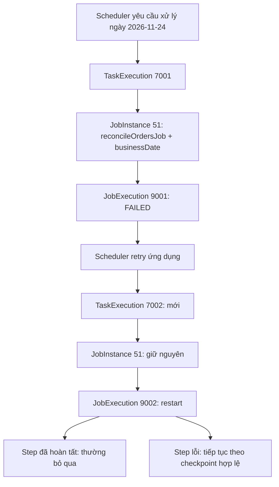
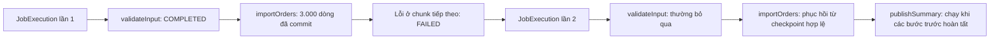
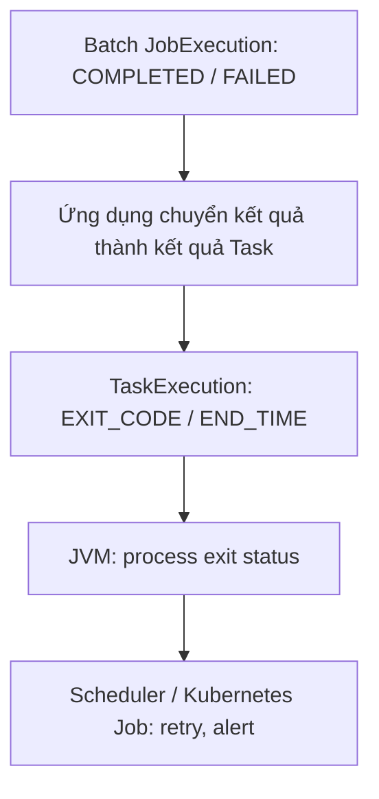

# Chạy lại Task và tiếp tục Spring Batch Job

## 1. Mục tiêu: chạy lại đúng phần cần làm

Trong chương **Chạy lại an toàn**, chúng ta cần giải quyết một tình huống thường gặp với **Spring Cloud Task**: ứng dụng chạy hữu hạn theo lịch hoặc theo yêu cầu, đã làm được một phần công việc rồi gặp lỗi. Bộ điều phối có thể khởi chạy ứng dụng lần nữa, nhưng câu hỏi khó hơn là **có nên xử lý lại toàn bộ dữ liệu, hay tiếp tục từ chỗ Spring Batch Job thất bại?**

Spring Cloud Task quản lý vòng đời **một lần chạy ứng dụng Spring Boot** thông qua `TaskExecution` và `TaskRepository`. Spring Batch quản lý **job/step xử lý theo lô** thông qua `JobInstance`, `JobExecution`, `StepExecution`, `ExecutionContext` và `JobRepository`. Chúng có thể phối hợp chặt chẽ, nhưng **retry Task** và **restart Batch Job** là hai khái niệm khác nhau.

Sau bài học, bạn sẽ có thể:

- Giải thích khi nào retry tạo một `TaskExecution` mới, khi nào Spring Batch tạo `JobExecution` mới thuộc `JobInstance` đã tồn tại.
- Chọn `JobParameters` định danh ổn định để restart đúng công việc và tránh tạo nhầm job mới.
- Hiểu cách các `Step` đã hoàn thành được bỏ qua, các chunk được commit và trạng thái `ExecutionContext` hỗ trợ tiếp tục.
- Viết đoạn khởi chạy Batch trong ứng dụng Spring Cloud Task, truyền lỗi đến cấp Task và bộ điều phối.
- Thiết kế **idempotency**, chống chạy trùng, kiểm soát dữ liệu nguồn và xử lý trường hợp task đã chạy xong nhưng metadata lỗi.
- Lập checklist thử nghiệm những lần thất bại, retry và restart trong môi trường có database metadata bền vững.

> **Nguyên tắc:** Spring Cloud Task **ghi nhận** lần chạy, không tự đảm bảo xử lý nghiệp vụ “exactly once”. Spring Batch **hỗ trợ** restart, nhưng khả năng tiếp tục an toàn còn phụ thuộc cấu hình job/step, trạng thái repository, cách đọc/ghi dữ liệu và hệ thống ngoài.

## 2. Bốn đơn vị cần phân biệt

| Đơn vị | Thuộc framework | Phạm vi | Ảnh hưởng của một lần chạy lại |
| --- | --- | --- | --- |
| `TaskExecution` | Spring Cloud Task | Một lần khởi chạy ứng dụng Task | Thường tạo **ID mới** khi scheduler chạy lại tiến trình |
| `JobInstance` | Spring Batch | Một công việc logic: **tên Job + các JobParameters định danh** | Có thể **giữ nguyên** khi restart bằng cùng tham số định danh |
| `JobExecution` | Spring Batch | Một lần thử chạy của JobInstance | Thường tạo **ID mới** cho lần restart hợp lệ |
| `StepExecution` | Spring Batch | Một lần thực thi Step trong JobExecution | Step cần chạy lại có execution mới; Step đã hoàn thành có thể được bỏ qua |

Ví dụ job `reconcileOrdersJob` xử lý ngày `2026-11-24`. Lượt đầu tiên khởi chạy lúc 02:00 gặp lỗi ở bước thứ hai, scheduler chạy lại ứng dụng lúc 02:10.

| Thời điểm | TaskExecution | JobInstance | JobExecution | Kết quả |
| --- | --- | --- | --- | --- |
| 02:00 | `7001` | `51` | `9001` | Step 1 hoàn tất; Step 2 lỗi |
| 02:10 | `7002` | `51` | `9002` | Step 1 được bỏ qua nếu đã `COMPLETED`; Step 2 restart theo cấu hình |

Các ID là **minh họa**, không phải giá trị framework bảo đảm. Quan hệ giữa Task và Job không nhất thiết một-một: một Task có thể chạy không job nào, một job, hoặc nhiều job. Khi có tích hợp Spring Cloud Task Batch và listener liên kết tương ứng, hệ thống có thể truy vết `JobExecution` về `TaskExecution` đã khởi chạy nó.



Hai repository có mục đích khác nhau: **`TaskRepository`** cho lịch sử khởi chạy ứng dụng, **`JobRepository`** cho lịch sử job/step và trạng thái restart. Chúng có thể nằm trong cùng cơ sở dữ liệu hoặc được cấu hình tách biệt; cả hai cần được lưu bền vững nếu muốn theo dõi qua nhiều lần khởi chạy container.

## 3. Retry Task không tự biến thành restart Batch

**Retry Task** nghĩa là hệ thống ngoài (CronJob, queue consumer, API orchestration, scheduler…) **khởi chạy lại tiến trình ứng dụng**. Spring Cloud Task ghi thêm một lần thực thi mới. Nếu logic trong ứng dụng luôn đọc toàn bộ file và gọi API từ đầu, các tác động đã thực hiện có thể lặp lại.

**Restart Batch Job** nghĩa là Spring Batch thấy một `JobInstance` đã tồn tại, tạo một `JobExecution` tiếp theo **nếu trạng thái và cấu hình cho phép**, rồi xác định step nào phải chạy và trạng thái nào có thể phục hồi. Không phải cứ gọi `JobLauncher` thêm lần nữa là chắc chắn restart được.

| Trường hợp | Hành vi Batch điển hình |
| --- | --- |
| Tên Job + tham số định danh **chưa tồn tại** | Tạo `JobInstance` mới và `JobExecution` đầu tiên |
| JobInstance đã `FAILED` hoặc `STOPPED` và job cho phép restart | Có thể tạo `JobExecution` mới cho **cùng JobInstance**, rồi tiếp tục các step hợp lệ |
| JobInstance đã `COMPLETED` | Thường từ chối chạy lại cùng instance bằng `JobInstanceAlreadyCompleteException` |
| Cùng JobInstance đang `STARTING` / `STARTED` / còn chạy | Thường từ chối chạy trùng bằng lỗi như `JobExecutionAlreadyRunningException` |
| Job được khai báo không cho restart | Có thể bị từ chối bằng `JobRestartException` |
| Tham số **định danh** thay đổi | Thành một **JobInstance mới**; không phải tiếp tục từ checkpoint của instance cũ |

Hành vi cụ thể còn phụ thuộc trạng thái Batch, `JobRepository`, version và chính sách của Job; đặc biệt `ABANDONED` không phải trạng thái được mặc nhiên cho restart như `FAILED`. Không nên tự sửa cột status trong repository để ép job chạy lại.

### Sự khác biệt quan trọng khi Task thất bại *sau* khi Batch hoàn tất

Giả sử Batch đã `COMPLETED`, nhưng ứng dụng còn bước gửi thông báo hoặc cập nhật một hệ thống ngoài rồi thất bại. Scheduler retry Task; lần chạy ứng dụng mới lại yêu cầu **cùng JobInstance đã hoàn tất**. Batch đúng khi từ chối chạy lại instance ấy. Đây không phải bằng chứng Task Repository bị lỗi.

Phải quyết định rõ: **Batch đã hoàn thành thì có thể bỏ qua và chỉ tiếp tục công việc hậu xử lý**, hay lỗi hậu xử lý yêu cầu cơ chế bù trừ? Không nên tạo một JobInstance mới bằng cách thêm tham số ngẫu nhiên chỉ để “cho chạy lại”.

## 4. `JobParameters` quyết định có tiếp tục đúng JobInstance hay không

Spring Batch định danh `JobInstance` thông thường bằng:

```text
JobInstance = Job name + identifying JobParameters
```

Giả sử một job xử lý **ngày nghiệp vụ** và **phiên bản dữ liệu nguồn**. Các giá trị sau cần ổn định qua mọi attempt muốn restart cùng công việc:

```text
jobName = reconcileOrdersJob
businessDate = 2026-11-24
inputVersion = snapshot-v1
```

Trong API Spring Batch 5.x, ví dụ tạo tham số có cờ định danh rõ ràng:

```java
JobParameters parameters = new JobParametersBuilder()
        .addString("businessDate", "2026-11-24", true)
        .addString("inputVersion", "snapshot-v1", true)
        .toJobParameters();
```

Hai giá trị trên cùng tên job định danh một JobInstance. Khi restart, giữ nguyên **giá trị, tên, kiểu dữ liệu và tính định danh**. Không tùy tiện biến một tham số từ string sang date hoặc đổi `inputVersion` nếu cần tiếp tục instance cũ.

**Sai lầm phổ biến:** thêm `run.id=timestamp`, `currentTimeMillis`, UUID hoặc `taskExecutionId` làm tham số **định danh** ở mỗi lần khởi chạy. Cách làm ấy tạo JobInstance mới, khiến cơ chế restart theo checkpoint của instance cũ không được sử dụng. `RunIdIncrementer` phù hợp khi **chủ động** muốn một instance mới, chứ không phải giải pháp mặc định cho retry sau lỗi.

Nếu muốn lưu ID của từng attempt từ scheduler, có thể:

- Giữ trong metadata `TaskExecution`, log hoặc một bảng audit riêng.
- Khi dùng `JobParameters`, đánh dấu tham số mang tính quan sát là **không định danh** nếu phiên bản hỗ trợ và mô hình job cho phép. Cần kiểm tra việc thay đổi non-identifying parameter giữa các execution không làm dữ liệu đọc/ghi thiếu nhất quán.
- Phân biệt `requestId` chung cho một yêu cầu và `attemptId` riêng cho từng lượt chạy; chỉ các giá trị **thực sự định danh công việc** mới nên ảnh hưởng `JobInstance`.

## 5. Ví dụ Spring Cloud Task khởi chạy Spring Batch có thể restart

### 5.1. Các thành phần cần có

Giả sử dự án Spring Boot có các dependency phù hợp:

```xml
<dependency>
    <groupId>org.springframework.cloud</groupId>
    <artifactId>spring-cloud-starter-task</artifactId>
</dependency>
<dependency>
    <groupId>org.springframework.boot</groupId>
    <artifactId>spring-boot-starter-batch</artifactId>
</dependency>
<!-- JDBC driver và cấu hình nguồn dữ liệu metadata thực tế. -->
```

Spring Cloud Task + Batch sử dụng các thư viện có **ma trận tương thích phiên bản**. Spring Batch 5.x và 6.x có khác biệt API, nên các ví dụ Java dưới đây mô tả cách sử dụng phổ biến **theo API Batch 5.x**; dự án Batch 6 cần đối chiếu chữ ký API tương ứng trước khi biên dịch. Không chạy Gradle/Maven chỉ để giả định một bản bất kỳ là “mới nhất”.

Schema metadata của **TaskRepository** và **JobRepository** phải được khởi tạo/migrate đúng version. Khi dùng datasource khác nhau, cần định tuyến chính xác metadata Task và Batch tới kho tương ứng.

### 5.2. Tắt auto-run Batch nếu tự gọi JobLauncher

Khi bạn chọn cách khởi chạy Job **chủ động trong ApplicationRunner**, tránh để Spring Boot tự động khởi chạy cùng job lần nữa. Với phiên bản Spring Boot có thuộc tính này:

```yaml
spring:
  main:
    web-application-type: none
  batch:
    job:
      enabled: false
  datasource:
    url: jdbc:postgresql://localhost:5432/task_batch_demo
    username: batch_app
    password: ${TASK_DB_PASSWORD}
  cloud:
    task:
      name: order-reconciliation
```

Đây là cấu hình minh họa, giả định JDBC driver, credential và các bảng metadata đã được chuẩn bị. Trong production, truyền secret từ nguồn an toàn, quản lý migration và quyền đọc/ghi. Bật property `spring.cloud.task.batch.fail-on-job-failure` có thể hỗ trợ trường hợp job **do cơ chế tự chạy Batch/Boot quản lý**; không coi property đó là bảo đảm cho mọi runner viết riêng.

### 5.3. Runner khởi chạy cùng tham số định danh

Giả sử dự án **đã định nghĩa** `Job reconcileOrdersJob` với các step xử lý và JobRepository phù hợp:

```java
import java.time.LocalDate;
import java.util.List;

import org.springframework.batch.core.BatchStatus;
import org.springframework.batch.core.Job;
import org.springframework.batch.core.JobExecution;
import org.springframework.batch.core.JobParameters;
import org.springframework.batch.core.JobParametersBuilder;
import org.springframework.batch.core.launch.JobLauncher;
import org.springframework.beans.factory.annotation.Qualifier;
import org.springframework.boot.ApplicationRunner;
import org.springframework.context.annotation.Bean;
import org.springframework.context.annotation.Configuration;

@Configuration(proxyBeanMethods = false)
public class ReconciliationLaunchConfig {

    @Bean
    ApplicationRunner runReconciliation(
            JobLauncher jobLauncher,
            @Qualifier("reconcileOrdersJob") Job job) {
        return args -> {
            List<String> dates = args.getOptionValues("business-date");
            List<String> versions = args.getOptionValues("input-version");

            if (dates == null || dates.size() != 1 ||
                    versions == null || versions.size() != 1) {
                throw new IllegalArgumentException(
                        "Cần --business-date và --input-version");
            }

            String businessDate = LocalDate.parse(dates.get(0)).toString();
            String inputVersion = versions.get(0);
            if (inputVersion.isBlank()) {
                throw new IllegalArgumentException("input-version rỗng");
            }

            JobParameters params = new JobParametersBuilder()
                    .addString("businessDate", businessDate, true)
                    .addString("inputVersion", inputVersion, true)
                    .toJobParameters();

            JobExecution result = jobLauncher.run(job, params);
            if (result.getStatus() != BatchStatus.COMPLETED) {
                throw new IllegalStateException(
                        "Batch chưa hoàn tất: " + result.getStatus());
            }
        };
    }
}
```

Ví dụ trên giả định `JobLauncher` **chạy đồng bộ**, nghĩa là `run` chỉ trả về khi Job đạt trạng thái cuối. Nếu dùng launcher bất đồng bộ, trạng thái khi `run` trả về có thể vẫn đang chạy; bạn phải chờ/giám sát `JobExecution` hoàn tất trước khi kết luận Task thành công. Code cố tình **phát lỗi ra ngoài** khi Batch chưa hoàn tất, để framework ghi nhận Task thất bại và hệ thống gọi có thể nhận mã thoát phù hợp.

Không bắt tất cả exception rồi trả về bình thường, vì cách đó dễ làm Task `EXIT_CODE=0` khi Job thực tế thất bại. Đồng thời, một Batch `COMPLETED` không tự bảo đảm mã thoát hệ điều hành bằng 0 nếu còn lỗi khác trong ứng dụng; cần kiểm thử đường Task → OS → scheduler.

Nếu `JobInstanceAlreadyCompleteException` xuất hiện, đừng bỏ qua mù quáng. Kiểm tra JobInstance đã hoàn tất thật, chính sách dữ liệu hiện tại và có còn bước nghiệp vụ **ngoài Batch** chưa hoàn thành không. Chỉ chủ động xem là “đã xử lý, không cần làm lại” khi hợp đồng nghiệp vụ cho phép.

### 5.4. Ví dụ cách chạy và thử lại

```bash
java -jar reconcile-task.jar \
  --business-date=2026-11-24 \
  --input-version=snapshot-v1
```

Giả sử lần đầu lỗi sau khi đã commit một số chunk. Bộ điều phối tạo một tiến trình mới với **cùng cặp tham số định danh**:

```bash
java -jar reconcile-task.jar \
  --business-date=2026-11-24 \
  --input-version=snapshot-v1
```

Lần gọi thứ hai tạo **TaskExecution mới**, còn Batch sẽ cố gắng restart **JobInstance cũ** nếu lần đầu ở trạng thái cho phép và metadata hợp lệ. Nếu job đã `COMPLETED`, lệnh thứ hai không mặc nhiên “chạy lại” job; cần quy tắc xử lý trường hợp đã xong như mục 3.

## 6. Batch tiếp tục như thế nào: step, chunk và checkpoint

Xét job ba bước:

1. `validateInput` — xác nhận snapshot dữ liệu tồn tại và hợp lệ.
2. `importOrders` — đọc 10.000 đơn, ghi database theo chunk 100.
3. `publishSummary` — tổng hợp và công bố báo cáo.

Lần đầu: `validateInput` hoàn tất; `importOrders` commit 30 chunk (3.000 dòng) rồi thất bại ở chunk tiếp theo; `publishSummary` chưa chạy.



Trong **chunk-oriented processing**, Spring Batch thường thực hiện đọc, xử lý và ghi theo chunk trong một ranh giới transaction. Khi một chunk đã commit, tác động của chunk đó thường tồn tại sau lỗi ở chunk kế tiếp. Khi restart, metadata trong `ExecutionContext` có thể cho reader/writer phục hồi vị trí hoặc trạng thái. **Điều này không có nghĩa framework luôn tự biết chính xác dòng số 3.001**, bởi khả năng phục hồi phụ thuộc reader, writer, transaction, checkpoint và việc dữ liệu nguồn có thay đổi không.

### `ItemStream` và `ExecutionContext`

Các thành phần đọc/ghi có khả năng lưu trạng thái thường sử dụng hợp đồng `ItemStream`, gồm các pha mở với context, cập nhật context và đóng tài nguyên. `ExecutionContext` được `JobRepository` duy trì qua các lần execution khi step/repository và transaction được cấu hình phù hợp. Với reader/writer delegate, cần đăng ký stream đúng cách nếu framework không tự nhận ra delegate.

Nếu dùng reader **không lưu trạng thái**, lặp lại step có thể đọc từ đầu; khi đó cần thiết kế writer idempotent hoặc tự quản lý checkpoint. Nếu cần restart ổn định, phải giữ **input snapshot bất biến**: cùng `inputVersion` không nên trỏ đến một tệp có nội dung hoặc thứ tự dòng đã thay đổi.

### Step đã hoàn tất thường được bỏ qua

Theo hành vi chuẩn của Spring Batch, step có `BatchStatus.COMPLETED` trong cùng JobInstance thường được **bỏ qua** khi restart. Với bước cố ý phải chạy lại, có thể cấu hình `allowStartIfComplete(true)` khi API của phiên bản hỗ trợ:

```java
// Phần cấu hình Step minh họa, không phải một Step hoàn chỉnh.
new StepBuilder("validateInput", jobRepository)
        .allowStartIfComplete(true)
        // .tasklet(..., transactionManager)
        .build();
```

Đoạn trên chỉ minh họa vị trí của option; cần khai báo loại step, tasklet/chunk và transaction manager thực tế trước khi build. **Không bật cho mọi step theo thói quen**: một step gửi tiền, gửi email hoặc phát hành hóa đơn có thể tạo tác dụng phụ trùng nếu chạy lại. Bạn cũng có thể đặt `startLimit` để giới hạn số lần bắt đầu một step có rủi ro.

### Restart không phải rollback toàn bộ

Đối với 3.000 dòng đã commit, restart không có ý nghĩa tự động rollback cả 3.000 dòng về trạng thái ban đầu. Với mỗi đích ghi, cần hiểu chính xác transaction đã commit và chính sách rollback khi exception. Nếu một item đã gửi thành công qua HTTP nhưng transaction database thất bại trước lúc cập nhật checkpoint, lần restart có thể gửi lại item đó. Batch không thể tự tạo một transaction nguyên tử xuyên qua mọi hệ thống ngoài.

## 7. Idempotency: điều kiện để retry không gây tác dụng phụ trùng

**Idempotent** nghĩa là thực hiện lại cùng một yêu cầu không làm thay đổi kết quả vượt quá kết quả đúng một lần theo định nghĩa nghiệp vụ. Ví dụ xử lý đơn hàng `order-123` hai lần vẫn chỉ có một bản ghi xử lý cuối cùng cho cùng ngày và phiên bản dữ liệu.

Một số kỹ thuật:

| Kỹ thuật | Ví dụ | Giới hạn cần biết |
| --- | --- | --- |
| Unique constraint | `UNIQUE(business_date, order_id, input_version)` | Phải định nghĩa khóa nghiệp vụ chính xác; tranh chấp vẫn cần xử lý lỗi |
| Upsert có điều kiện | PostgreSQL `INSERT ... ON CONFLICT ... DO UPDATE/NOTHING` | Cập nhật lại có thể không tương đương không gây side effect; cần chọn semantics |
| Bảng idempotency | Lưu `requestId + operation + outcome` | Phải quản lý trạng thái `IN_PROGRESS`, timeout, lỗi sau khi thực thi |
| Checkpoint với `ExecutionContext` | Reader lưu vị trí/chỉ mục/khóa cuối đã commit | Không đủ nếu nguồn đổi hoặc ngoại hệ thống không tham gia transaction |
| Outbox/inbox pattern | Ghi event ra outbox trong transaction, consumer dùng dedupe key | Cần triển khai publish/retry/deduplication đúng |
| Khóa xử lý nghiệp vụ | Chỉ một worker xử lý một ngày hoặc tenant tại một thời điểm | Cần lease/timeout an toàn; khóa không thay thế idempotency |

Ví dụ PostgreSQL cho bảng kết quả nhập đơn:

```sql
CREATE TABLE reconciled_order (
    business_date DATE NOT NULL,
    input_version VARCHAR(80) NOT NULL,
    order_id VARCHAR(100) NOT NULL,
    amount NUMERIC(18, 2) NOT NULL,
    PRIMARY KEY (business_date, input_version, order_id)
);

INSERT INTO reconciled_order (
    business_date, input_version, order_id, amount
) VALUES (
    DATE '2026-11-24', 'snapshot-v1', 'order-123', 125000.00
)
ON CONFLICT (business_date, input_version, order_id)
DO NOTHING;
```

Đây chỉ là **ví dụ chiến lược chống trùng**: `DO NOTHING` phù hợp nếu dữ liệu của cùng khóa là bất biến và bản ghi tồn tại đã được xác minh; nếu payload cùng khóa nhưng khác số tiền, bỏ qua âm thầm là lỗi dữ liệu. Ứng dụng cần so sánh nội dung, phát cảnh báo hoặc dùng upsert có điều kiện theo hợp đồng. DDL, isolation và kiểu dữ liệu phụ thuộc DB thực tế.

Với API ngoài như gửi email, thanh toán hoặc đẩy message, nếu provider hỗ trợ **idempotency key**, truyền khóa ổn định theo nghiệp vụ, không dùng `TaskExecutionId` mới làm khóa vì retry sẽ tạo ID khác. Nếu provider không hỗ trợ, cân nhắc outbox/inbox, kiểm tra trạng thái trước khi gửi lại và cơ chế bù trừ. Không hứa hẹn “exactly once” trên toàn hệ thống chỉ bằng checkpoint của Spring Batch.

## 8. Ma trận quyết định khi một Task chạy lại

| Trạng thái quan sát | Hành động an toàn cần cân nhắc |
| --- | --- |
| Task lỗi **trước khi bắt đầu Batch**, không thấy JobExecution | Điều tra startup, datasource/schema và input; khởi chạy lại khi nguyên nhân đã được giải quyết |
| Batch JobInstance đã `FAILED`, restartable, checkpoint hợp lệ | Chạy lại với **cùng tên job và identifying parameters**, quan sát JobExecution mới |
| Batch JobInstance đã `COMPLETED`, Task lỗi ở hậu xử lý | Không ép Batch chạy lại; tiếp tục/bù trừ hậu xử lý theo trạng thái nghiệp vụ |
| Batch JobInstance đang chạy | Chặn hoặc điều phối lại request; không cố chạy song song cùng instance |
| Job không restartable hoặc metadata hỏng | Phân tích cách phục hồi dữ liệu và chính sách tạo instance mới; không tự sửa JobRepository |
| Input snapshot đã thay đổi | Không giả định checkpoint còn hợp lệ; xác định phiên bản dữ liệu/khóa snapshot và quy trình xử lý lại |
| Task bị kill, `END_TIME` trống và Batch còn `STARTED` | Đối chiếu container/runtime, heartbeat và JobRepository trước khi quyết định chuyển trạng thái hoặc restart có kiểm soát |
| Batch hoàn tất nhưng Task/OS báo thất bại do lưu metadata kết thúc | Kiểm tra tác động thực tế; tránh retry mù quáng toàn bộ nghiệp vụ |
| Hai yêu cầu cùng ngày chạy đồng thời | Dùng khóa yêu cầu, unique constraint, JobRepository và cơ chế concurrency thích hợp |

**Lưu ý về JobExecution treo ở `STARTED`:** một container bị kill có thể không kịp chuyển status sang `FAILED` hoặc `STOPPED`. Spring Batch có thể từ chối restart vì vẫn thấy execution đang chạy. Chỉ xử lý trạng thái treo sau khi **xác nhận tiến trình thật sự đã dừng**, đánh giá dữ liệu đã commit và dùng công cụ/quy trình vận hành được hỗ trợ. Không cập nhật trực tiếp `BATCH_JOB_EXECUTION.STATUS` trong production theo phán đoán.

## 9. Mã thoát phải phản ánh Batch thất bại

Spring Cloud Task theo dõi kết quả **ứng dụng**; Spring Batch theo dõi kết quả **job**. Nếu Batch báo `FAILED` nhưng runner nuốt lỗi rồi return bình thường, Task có thể ghi exit code 0, khiến scheduler tưởng thành công và **không retry** dù job mới xử lý một phần.

Với tích hợp Batch tự chạy theo cơ chế Boot/Cloud Task tương ứng, property sau hỗ trợ trả mã lỗi khi job thất bại:

```yaml
spring:
  cloud:
    task:
      batch:
        fail-on-job-failure: true
```

Phạm vi áp dụng của property phụ thuộc phiên bản và cách ứng dụng khởi chạy Batch; khi tự quản lý `JobLauncher` như ví dụ mục 5, hãy chủ động **đợi job kết thúc và truyền thất bại ra cấp Task**. Một `BatchStatus.FAILED` không tự làm tất cả mã thoát Task, Java process và script bao ngoài bằng nhau.

Kiểm tra đủ các tầng:



Một scheduler thường dựa vào **process exit status**, còn việc tra cứu trong dashboard Task phụ thuộc **TaskRepository**. Cần kiểm thử cả đường xử lý lỗi, bao gồm launcher bất đồng bộ, script shell bao ngoài, lỗi shutdown và kết nối repository.

## 10. Quan sát hai repository sau khi retry

### 10.1. TaskRepository

Ví dụ SQL với schema Task mặc định:

```sql
SELECT TASK_EXECUTION_ID, TASK_NAME,
       START_TIME, END_TIME, EXIT_CODE, EXIT_MESSAGE
FROM TASK_EXECUTION
ORDER BY TASK_EXECUTION_ID DESC
LIMIT 20;
```

Hai lần khởi chạy ứng dụng thường tạo hai `TASK_EXECUTION_ID` khác nhau. `END_TIME IS NULL` chỉ có nghĩa **chưa ghi nhận kết thúc**, không khẳng định Task còn hoạt động. Nếu có `externalExecutionId`, sử dụng nó hoặc bảng audit để nối từ container/scheduler về lần chạy Task.

### 10.2. JobRepository

Ví dụ SQL kiểm tra JobInstance và các JobExecution tương ứng, giả định các bảng Batch JDBC mặc định:

```sql
SELECT ji.JOB_INSTANCE_ID,
       ji.JOB_NAME,
       je.JOB_EXECUTION_ID,
       je.STATUS,
       je.EXIT_CODE,
       je.START_TIME,
       je.END_TIME
FROM BATCH_JOB_INSTANCE ji
JOIN BATCH_JOB_EXECUTION je
  ON je.JOB_INSTANCE_ID = ji.JOB_INSTANCE_ID
WHERE ji.JOB_NAME = 'reconcileOrdersJob'
ORDER BY ji.JOB_INSTANCE_ID DESC, je.JOB_EXECUTION_ID DESC;
```

Xem trạng thái các step trong một JobExecution:

```sql
SELECT JOB_EXECUTION_ID, STEP_EXECUTION_ID, STEP_NAME,
       STATUS, READ_COUNT, WRITE_COUNT, COMMIT_COUNT,
       ROLLBACK_COUNT, START_TIME, END_TIME
FROM BATCH_STEP_EXECUTION
WHERE JOB_EXECUTION_ID = :jobExecutionId
ORDER BY STEP_EXECUTION_ID;
```

`:jobExecutionId` là placeholder mang tính minh họa cho thư viện hỗ trợ named parameter; SQL client trực tiếp cần cú pháp binding tương ứng. Các tên bảng/cột phụ thuộc schema và phiên bản Batch; không thay `BATCH_*` bằng `TASK_*` vì đây là hai loại metadata khác nhau.

Từ dữ liệu, hãy kiểm tra:

- Hai JobExecution có cùng `JOB_INSTANCE_ID` hay không.
- Step nào `COMPLETED` trong lần trước và có được bỏ qua đúng cách ở lần restart.
- Các count và checkpoint có phản ánh lượng dữ liệu đã commit hay chưa.
- Task mới có liên kết về JobExecution tương ứng hay không (nếu bật tích hợp Task–Batch).

Spring Cloud Task hỗ trợ liên kết Task Execution với Batch Job Execution qua `TaskBatchExecutionListener` khi có module tích hợp tương ứng trên classpath và cấu hình auto-config phù hợp. Cơ chế này giúp **truy vết**, không thay JobRepository hoặc tự quyết định chính sách restart.

## 11. Dùng `JobOperator` khi cần quản lý restart theo JobExecution

Ngoài khởi chạy lại bằng `JobLauncher` với cùng `JobParameters`, Spring Batch còn cung cấp API quản trị `JobOperator` để restart từ một JobExecution thất bại/đã dừng phù hợp. Điểm mạnh là bộ điều phối có thể chọn chính xác **job execution cần phục hồi**, thay vì chỉ đưa lại tham số CLI.

**Chú ý phiên bản API:** ở Spring Batch 5.x, ví dụ dùng `jobOperator.restart(long jobExecutionId)`; ở các bản Batch 6, API có các chữ ký hoặc thay đổi khác như `restart(JobExecution)`. Cần đọc đúng Javadoc của dependency đang dùng trước khi tích hợp. Cả hai cách vẫn phải tuân thủ trạng thái JobInstance, quyền restart và khả năng phục hồi dữ liệu.

Không dùng `startNextInstance` hoặc tự tăng `run.id` để “restart” job thất bại: chúng có thể tạo instance khác, bỏ qua trạng thái checkpoint của instance cần khôi phục. Chỉ chủ động tạo instance mới khi bạn thực sự muốn **chạy lại từ đầu**, đã xử lý các dữ liệu/sự kiện cũ và chấp nhận hệ quả nghiệp vụ.

## 12. Trình tự retry an toàn trên scheduler

Khi Kubernetes CronJob hoặc scheduler báo một attempt thất bại, một quy trình có thể kiểm chứng gồm:

1. **Ghi nhận yêu cầu và attempt:** lưu `requestId`/`businessDate`/`inputVersion` và external run ID; không dùng task ID của attempt mới làm khóa nghiệp vụ.
2. **Xác nhận tiến trình đã kết thúc:** đối chiếu status Pod/container với `TaskExecution.END_TIME`; nếu bị kill, metadata Task có thể chưa được đóng.
3. **Tra cứu JobRepository:** tìm JobInstance theo job name và identifying parameters; đọc JobExecution gần nhất và trạng thái các step.
4. **Phân loại lỗi:** input không hợp lệ, lỗi tạm thời, metadata hỏng, thất bại nghiệp vụ sau khi đã ghi dữ liệu hoặc lỗi ở khâu hậu xử lý.
5. **Kiểm tra dữ liệu đã commit:** xác định chunk nào đã ghi, nguồn có bất biến, side effect bên ngoài có thể lặp hay không.
6. **Chọn hành động:** restart cùng JobInstance, bỏ qua Batch đã hoàn tất và tiếp tục hậu xử lý, bù trừ, hoặc yêu cầu can thiệp thủ công.
7. **Chạy lại với tham số định danh đúng:** tạo TaskExecution mới, giám sát JobExecution tương ứng, số lần retry, backoff và timeout.
8. **Xác minh kết quả cuối:** đối chiếu kết quả nghiệp vụ, mã thoát Task và process; đóng cảnh báo chỉ khi yêu cầu đã đạt tiêu chí hoàn tất.

Đừng để retry chạy vô hạn: giới hạn số attempt, tránh hai tiến trình cùng xử lý một khóa nghiệp vụ, có deadline phù hợp và cảnh báo khi dữ liệu không nhất quán.

## 13. Tình huống thực hành từ đầu đến cuối

Giả sử nhiệm vụ nhập `snapshot-v1` gồm 1.000 đơn hàng, chunk size 100:

| Mốc | Sự kiện | Metadata mong đợi |
| --- | --- | --- |
| Lần 1 | Bắt đầu nhập ngày `2026-11-24` | TaskExecution A; JobInstance X; JobExecution 1 |
| Sau chunk 4 | 400 đơn đã commit vào database | StepExecution ghi tiến độ/ExecutionContext phù hợp |
| Chunk 5 lỗi | Transaction của chunk lỗi bị rollback theo cấu hình | JobExecution 1 = `FAILED`; Task A báo lỗi nếu ánh xạ đúng |
| Scheduler retry | Tiến trình ứng dụng mới, cùng `businessDate` và `inputVersion` | TaskExecution B mới; JobInstance X vẫn cũ |
| Lần 2 | Reader phục hồi checkpoint và ghi tiếp | JobExecution 2; step đã xong được bỏ qua; step lỗi chạy lại |
| Kết thúc | Đủ 1.000 đơn và các step hoàn tất | JobExecution 2 = `COMPLETED`, Task B kết thúc thành công nếu không lỗi khác |

**Bài tập 1 — Đổi tham số:** thêm một `run.id` định danh mới ở lần 2, so sánh `JOB_INSTANCE_ID` và giải thích vì sao restart theo checkpoint không còn xảy ra như dự kiến.

**Bài tập 2 — Thay dữ liệu nguồn:** sửa nội dung/sắp xếp của tệp `snapshot-v1` giữa hai attempt, dự đoán rủi ro khi reader tiếp tục từ vị trí đã lưu.

**Bài tập 3 — Lỗi ngoài transaction:** sau khi writer gửi thành công một HTTP request nhưng trước khi checkpoint được commit, cố ý làm tiến trình lỗi. Thiết kế idempotency key và chiến lược phát hiện request trùng.

**Bài tập 4 — Job hoàn tất, Task lỗi:** giả lập Batch `COMPLETED` nhưng bước gửi báo cáo cuối bị lỗi. Quan sát ngoại lệ `JobInstanceAlreadyCompleteException` khi retry và thiết kế đường xử lý hậu xử lý độc lập.

**Bài tập 5 — Chạy đồng thời:** gửi hai yêu cầu cùng ngày/phiên bản gần như đồng thời, xác định cách ngăn cùng một JobInstance chạy trùng, đồng thời bảo đảm tầng nghiệp vụ vẫn idempotent.

### Câu hỏi tự kiểm tra

1. Retry Kubernetes Job có làm Spring Batch tự động tiếp tục từ checkpoint không? Điều kiện nào phải thỏa?
2. Tại sao hai `TaskExecution` mới có thể cùng liên quan đến một `JobInstance` cũ?
3. Nếu lần đầu `JobExecution=FAILED`, cần giữ nguyên những `JobParameters` nào để restart đúng instance?
4. Vì sao `RunIdIncrementer` hoặc timestamp định danh có thể biến retry thành chạy một JobInstance mới?
5. Một Step đã `COMPLETED` thường được xử lý thế nào ở lần restart? Khi nào `allowStartIfComplete(true)` phù hợp?
6. Một chunk đã commit vào database rồi Job thất bại ở chunk tiếp theo: restart có rollback chunk trước không?
7. Vì sao `ExecutionContext` không đủ để đảm bảo không gọi trùng một API bên ngoài?
8. Batch job đã hoàn tất nhưng Task lỗi khi gửi thông báo. Nên quyết định gì thay vì ép tạo JobInstance mới?
9. Task đang có `END_TIME IS NULL` và Batch vẫn `STARTED` sau khi container bị kill. Vì sao không được tùy tiện sửa status rồi retry?
10. Khi nào cần dùng `JobOperator.restart`, và tại sao phải kiểm tra chữ ký API theo phiên bản?

## 14. Tài liệu tham khảo

- [Spring Batch — Configuring a Job, Restartability](https://docs.spring.io/spring-batch/reference/job/configuring-job.html).
- [Spring Batch — Configuring a Step for Restart](https://docs.spring.io/spring-batch/reference/step/chunk-oriented-processing/restart.html).
- [Spring Batch — Chunk-oriented Processing](https://docs.spring.io/spring-batch/reference/step/chunk-oriented-processing.html).
- [Spring Batch — ItemStream Registration](https://docs.spring.io/spring-batch/reference/step/chunk-oriented-processing/registering-item-streams.html).
- [Spring Cloud Task — Batch Integration and Exit Codes](https://docs.spring.io/spring-cloud-task/reference/batch.html).

**Ghi nhớ:** Chạy lại Spring Cloud Task thường tạo **TaskExecution mới**; restart Spring Batch tạo **JobExecution mới** cho **JobInstance cũ** nếu cùng job và identifying parameters, trạng thái cho phép và checkpoint hợp lệ. `JobRepository` quyết định phần xử lý có thể tiếp tục; **idempotency của dữ liệu nghiệp vụ và các hệ thống ngoài** mới quyết định lần chạy lại có an toàn hay không. Để vận hành ổn định, cần kiểm tra đồng thời TaskRepository, JobRepository, kết quả nghiệp vụ và trạng thái tiến trình/scheduler.
