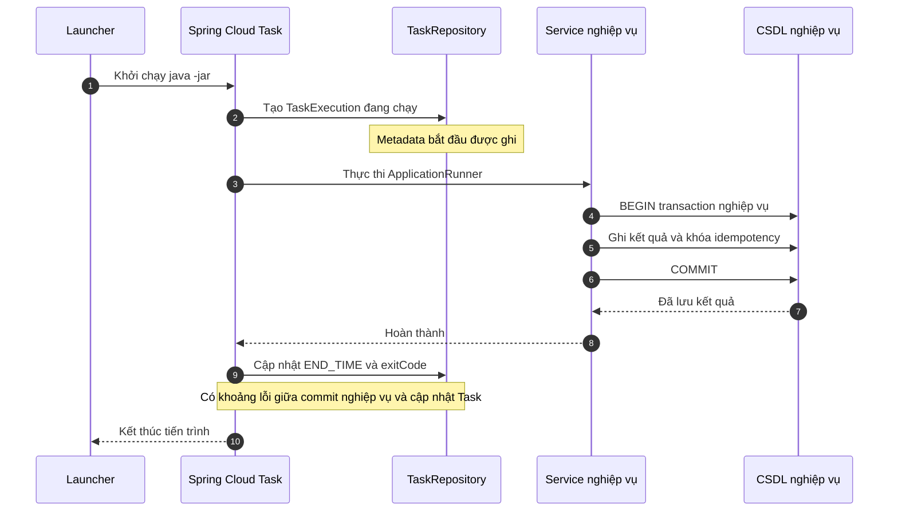
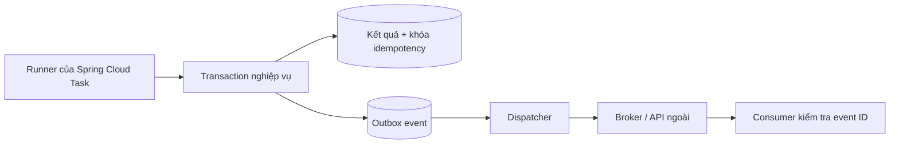

# Ranh giới giao dịch giữa kho Task và dữ liệu nghiệp vụ

Một ứng dụng **Spring Cloud Task** thường chỉ chạy trong thời gian hữu hạn: nhận tham số, xử lý công việc, ghi lại trạng thái thực thi và kết thúc. Khi triển khai theo lịch hoặc theo yêu cầu, sự cố có thể xảy ra ở bất kỳ thời điểm nào. Giả sử tác vụ tổng hợp doanh thu **đã ghi xong dữ liệu** nhưng bị dừng đột ngột trước khi cập nhật `TaskExecution` thành công. Bộ điều phối nhìn thấy một lần chạy lỗi hoặc chưa kết thúc và quyết định **retry**. Nếu nghiệp vụ không được thiết kế để chạy lại an toàn, doanh thu có thể bị cộng hai lần.

Trong chương **Chạy lại an toàn**, vấn đề cốt lõi là hiểu rằng **giao dịch ghi metadata của `TaskRepository` và giao dịch ghi dữ liệu nghiệp vụ có thể kết thúc ở những thời điểm khác nhau**. `TaskRepository` giúp truy vết các lần chạy; nó không tự biến toàn bộ tác vụ và mọi tác động bên ngoài thành một giao dịch nguyên tử.

Sau bài học, bạn có thể:

- Phân biệt `TaskRepository` và kho dữ liệu nghiệp vụ, kể cả khi nằm trong cùng database.
- Xác định các khoảng thời gian mà dữ liệu đã commit nhưng metadata Task chưa kịp cập nhật.
- Tạo **khóa idempotency** và ranh giới giao dịch ngắn để xử lý lại cùng yêu cầu một cách an toàn.
- Xử lý retry, nhiều tiến trình chạy đồng thời và các tác động ngoài database bằng chiến lược phù hợp.
- Phân biệt giao dịch Spring Cloud Task, giao dịch service và giao dịch `JobRepository`/`Step` của Spring Batch.

## 1. Hai loại dữ liệu, hai trách nhiệm

**`TaskRepository`** là kho metadata của Spring Cloud Task. Framework thường tạo một `TaskExecution` khi ứng dụng bắt đầu và cập nhật nó khi ứng dụng kết thúc. Bản ghi có thể chứa ID thực thi, tên tác vụ, thời điểm bắt đầu/kết thúc, mã thoát và các thông tin khác tùy phiên bản.

**Kho dữ liệu nghiệp vụ** là nơi ứng dụng thật sự tạo ra kết quả: tổng doanh thu theo ngày, hóa đơn, file báo cáo, trạng thái đối soát hoặc thông điệp gửi hệ thống khác.

| Nội dung | Metadata Spring Cloud Task | Dữ liệu nghiệp vụ |
| --- | --- | --- |
| Mục đích | Ghi nhận **một lần chạy ứng dụng** | Ghi nhận **kết quả công việc** |
| Đối tượng thường gặp | `TaskExecution`, tham số, `exitCode` | `daily_revenue`, hóa đơn, lịch sử thanh toán, file |
| Thành phần quản lý | `TaskRepository` và `TaskExplorer` | Service, repository hoặc API nghiệp vụ |
| Định danh | `TASK_EXECUTION_ID` mới ở mỗi lần chạy | Khóa nghiệp vụ như `business_date`, `tenant_id`, `request_id` |
| Khi retry | Thường có **TaskExecution mới** | Phải quyết định **tiếp tục, ghi đè có kiểm soát, bỏ qua hoặc bù trừ** |
| Bảo đảm | Có lịch sử nếu metadata kịp được ghi | Phụ thuộc transaction, khóa duy nhất và thiết kế nghiệp vụ |

**Không dùng `TASK_EXECUTION_ID` làm khóa chống trùng nghiệp vụ.** Một retry được tạo để xử lý *cùng yêu cầu* thường nhận execution ID mới. Nếu khóa idempotency thay đổi theo ID lần chạy, cả hai lần có thể cùng ghi dữ liệu.

### Cùng database không đồng nghĩa cùng transaction

Một ứng dụng có thể sử dụng **một `DataSource`** để lưu cả bảng `TASK_EXECUTION` và `daily_revenue`. Dù vậy, Spring Cloud Task ghi metadata ở đầu/cuối vòng đời, còn service nghiệp vụ có thể mở và commit transaction trong khi runner đang chạy. Giao dịch nghiệp vụ không tự kéo dài bao trùm các lần ghi metadata trước và sau nó.

Với **hai `DataSource`** hoặc hai database khác nhau, ranh giới này càng rõ: transaction manager của metadata và transaction manager nghiệp vụ quản lý các tài nguyên riêng. Một lệnh `rollback` ở database nghiệp vụ không tự rollback các bản ghi `TaskExecution` đã commit.



Sơ đồ mô tả đường chạy thành công; chi tiết callback và commit metadata phụ thuộc phiên bản/cấu hình. **Một lần cập nhật metadata cuối có thể thất bại ngay cả khi transaction nghiệp vụ đã commit.**

## 2. Các cửa sổ lỗi và hệ quả khi chạy lại

Hãy chia vòng đời thành những điểm mốc:

1. **M0:** Launcher tạo tiến trình, Spring Cloud Task chuẩn bị ghi `TaskExecution`.
2. **M1:** Bản ghi bắt đầu đã lưu, runner bắt đầu xử lý.
3. **M2:** Transaction nghiệp vụ đã commit.
4. **M3:** `TaskRepository` cập nhật kết quả và thời điểm kết thúc.
5. **M4:** Launcher quan sát mã thoát và quyết định hành động tiếp theo.

| Thời điểm sự cố | Trạng thái dữ liệu nghiệp vụ có thể có | Metadata Task có thể thấy | Cách xử lý trước retry |
| --- | --- | --- | --- |
| Trước M1 | Chưa xử lý | Không có bản ghi hoặc chưa tạo xong | Kiểm tra lỗi khởi động, datasource và trạng thái hạ tầng. |
| Giữa M1 và M2 | Đang xử lý, một số transaction ngắn có thể đã commit | `TaskExecution` đang chạy hoặc thiếu `END_TIME` | Kiểm tra từng hiệu ứng nghiệp vụ và khả năng khôi phục. |
| **Giữa M2 và M3** | **Kết quả đã commit** | Có thể vẫn chưa kết thúc hoặc được ghi lỗi | Kiểm tra khóa idempotency; **không thực hiện lại hiệu ứng** nếu đã hoàn tất. |
| Sau M3, trước M4 | Có thể đã commit đầy đủ | Metadata đã ghi kết quả | Đối chiếu mã OS và trạng thái launcher; tránh retry mù. |
| Container bị `SIGKILL`/OOM | Phụ thuộc transaction đã commit trước đó | Có thể thiếu metadata kết thúc | Kết hợp log, sự kiện container và dữ liệu nghiệp vụ. |

Điều quan trọng là **không thể suy ra “chưa có `END_TIME`” nghĩa là “chưa làm gì”**. Cũng không thể suy ra `exitCode = 0` là bằng chứng tuyệt đối rằng mọi hệ thống bên ngoài đã nhận kết quả.

### Ví dụ cụ thể: cộng doanh thu hai lần

Giả sử một worker chạy lệnh sau cho ngày 2026-11-24:

```sql
UPDATE account_balance
SET total_revenue = total_revenue + 1500000
WHERE account_id = 42;
```

Nếu transaction đã commit nhưng worker bị kill trước khi cập nhật metadata, retry thực hiện cùng câu lệnh sẽ cộng thêm **1.500.000** lần nữa. Transaction giúp câu `UPDATE` nguyên tử **trong một lần gọi**, nhưng **không làm phép cộng này idempotent giữa nhiều lần chạy**.

Có hai hướng thiết kế an toàn hơn:

- **Tính kết quả xác định rồi ghi đè có kiểm soát:** ví dụ tổng hợp lại doanh thu của một ngày và `UPSERT` theo khóa ngày, thay vì cộng dồn mù.
- **Dùng khóa idempotency** có ràng buộc duy nhất, ghi dấu đã xử lý và hiệu ứng nghiệp vụ **trong cùng transaction**.

## 3. Chọn khóa idempotency theo yêu cầu nghiệp vụ

**Idempotency** có nghĩa là xử lý lặp một yêu cầu không làm phát sinh thêm tác động ngoài ý muốn sau khi yêu cầu đã hoàn thành. Khóa idempotency phải ổn định **qua các lần retry của cùng đơn vị công việc**.

| Loại công việc | Khóa gợi ý | Điều cần tránh |
| --- | --- | --- |
| Tổng hợp doanh thu theo ngày | `tenant_id + business_date + report_type` | Chỉ dùng `TaskExecution.executionId`, vì mỗi lần retry có ID khác. |
| Nhập một file giao dịch | ID file hoặc checksum nội dung + loại import | Chỉ dùng tên file nếu tên có thể được tái sử dụng cho nội dung khác. |
| Xử lý một lệnh thanh toán | ID lệnh nghiệp vụ duy nhất | Tạo ID mới mỗi lần scheduler retry. |
| Xuất báo cáo của một phiên bản dữ liệu | `report_type + period + data_version` | Chặn luôn những lần tái tạo hợp lệ sau khi nguồn dữ liệu thay đổi. |

Khóa phải phản ánh **ranh giới được phép chạy lại**. Nếu cần tính lại dữ liệu cho cùng ngày sau khi có giao dịch bổ sung, quy trình phải có **phiên bản đầu vào** hoặc cơ chế cho phép tái xử lý có kiểm soát. Một khóa “ngày đã xong” vĩnh viễn có thể khiến dữ liệu cũ không bao giờ được cập nhật.

### Bảo vệ đồng thời

Chỉ kiểm tra bằng một câu `SELECT` trước khi xử lý không đủ:

```text
Worker A: SELECT chưa thấy ngày đã xử lý
Worker B: SELECT chưa thấy ngày đã xử lý
Worker A: ghi doanh thu
Worker B: ghi doanh thu lần nữa
```

Hai tiến trình có thể qua kiểm tra cùng lúc. Cần **ràng buộc duy nhất ở database**, thao tác ghi có tính nguyên tử, cơ chế khóa/lease hoặc chiến lược concurrency phù hợp. Các cơ chế này giải quyết những vấn đề khác nhau: khóa duy nhất giúp ngăn một kết quả trùng đã commit; lease hữu ích với công việc chạy dài nhưng cần xử lý hết hạn và fencing để tránh worker cũ vẫn ghi.

## 4. Ví dụ hoàn chỉnh: ghi dữ liệu và dấu đã xử lý trong cùng transaction

Ví dụ sau dùng **PostgreSQL**, Spring Boot, Spring Cloud Task và Spring JDBC. Để tập trung vào idempotency, giả sử metadata Task và bảng nghiệp vụ nằm trong **cùng một PostgreSQL database**, nhưng có **các ranh giới transaction khác nhau** như đã giải thích. Thiết kế cũng áp dụng khi metadata tách sang database riêng, miễn là transaction nghiệp vụ chứa **cả dấu idempotency và kết quả kinh doanh**.

### 4.1. Schema nghiệp vụ

Tạo các bảng minh họa:

```sql
CREATE TABLE sales_transaction (
    id BIGINT GENERATED ALWAYS AS IDENTITY PRIMARY KEY,
    business_date DATE NOT NULL,
    amount NUMERIC(18, 2) NOT NULL
);

CREATE TABLE daily_revenue (
    business_date DATE PRIMARY KEY,
    total_amount NUMERIC(18, 2) NOT NULL,
    calculated_at TIMESTAMPTZ NOT NULL DEFAULT CURRENT_TIMESTAMP
);

CREATE TABLE reconciliation_done (
    business_date DATE PRIMARY KEY,
    completed_at TIMESTAMPTZ NOT NULL DEFAULT CURRENT_TIMESTAMP
);

INSERT INTO sales_transaction (business_date, amount)
VALUES
    (DATE '2026-11-24', 1000000),
    (DATE '2026-11-24', 500000);
```

Ý nghĩa: `sales_transaction` là đầu vào; `daily_revenue` chứa **một kết quả cho mỗi ngày**; `reconciliation_done` là **dấu đã xử lý**. Khóa chính trên `business_date` ngăn hai transaction cùng commit hai dấu thành công cho cùng ngày.

**Quan trọng:** Dấu `reconciliation_done` và kết quả `daily_revenue` phải được ghi **trong cùng transaction của database nghiệp vụ**. Nếu lưu dấu ở transaction A rồi cập nhật kết quả trong transaction B, lỗi giữa chúng có thể tạo trạng thái “đã xử lý” nhưng thực tế chưa có báo cáo.

### 4.2. Dependency và cấu hình

Trong dự án Maven đã có Spring Boot parent/plugin và **Spring Cloud BOM tương thích**, cần các dependency:

```xml
<dependencies>
    <dependency>
        <groupId>org.springframework.cloud</groupId>
        <artifactId>spring-cloud-starter-task</artifactId>
    </dependency>
    <dependency>
        <groupId>org.springframework.boot</groupId>
        <artifactId>spring-boot-starter-jdbc</artifactId>
    </dependency>
    <dependency>
        <groupId>org.postgresql</groupId>
        <artifactId>postgresql</artifactId>
        <scope>runtime</scope>
    </dependency>
</dependencies>
```

File `src/main/resources/application.yml`:

```yaml
spring:
  application:
    name: reconcile-revenue-task
  main:
    web-application-type: none
  datasource:
    url: jdbc:postgresql://localhost:5432/reconcile_db
    username: reconcile_app
    password: ${RECONCILE_DB_PASSWORD}
  cloud:
    task:
      name: dailyRevenueReconcile
      initialize-enabled: false
```

Ví dụ giả định các bảng metadata Spring Cloud Task đã được tạo bằng **migration đúng phiên bản** trong database này. Với một `DataSource` và transaction manager JDBC mặc định phù hợp, Spring Boot có thể tự cấu hình các thành phần cần thiết cho `JdbcTemplate` và `@Transactional`. Không dùng password thật trong file nguồn.

### 4.3. Service xử lý trong transaction ngắn

Tạo `src/main/java/com/example/reconcile/DailyRevenueService.java`:

```java
package com.example.reconcile;

import java.math.BigDecimal;
import java.sql.Date;
import java.time.LocalDate;

import org.springframework.jdbc.core.JdbcTemplate;
import org.springframework.stereotype.Service;
import org.springframework.transaction.annotation.Transactional;

@Service
public class DailyRevenueService {

    private final JdbcTemplate jdbc;

    public DailyRevenueService(JdbcTemplate jdbc) {
        this.jdbc = jdbc;
    }

    @Transactional
    public void reconcile(LocalDate businessDate) {
        Date sqlDate = Date.valueOf(businessDate);

        // Ghi dấu trong cùng transaction với kết quả.
        // PostgreSQL xử lý xung đột trên PRIMARY KEY một cách nguyên tử.
        int inserted = jdbc.update("""
            INSERT INTO reconciliation_done (business_date)
            VALUES (?)
            ON CONFLICT (business_date) DO NOTHING
            """, sqlDate);

        if (inserted == 0) {
            System.out.println(
                "Ngay " + businessDate + " da doi soat, bo qua retry"
            );
            return;
        }

        BigDecimal total = jdbc.queryForObject("""
            SELECT COALESCE(SUM(amount), 0)
            FROM sales_transaction
            WHERE business_date = ?
            """, BigDecimal.class, sqlDate);

        jdbc.update("""
            INSERT INTO daily_revenue (business_date, total_amount)
            VALUES (?, ?)
            ON CONFLICT (business_date)
            DO UPDATE SET
                total_amount = EXCLUDED.total_amount,
                calculated_at = CURRENT_TIMESTAMP
            """, sqlDate, total);

        System.out.println(
            "Da doi soat " + businessDate + ", tong = " + total
        );
    }
}
```

**Tại sao mẫu này an toàn khi retry cùng một ngày?**

1. Lần chạy đầu tạo một dòng `reconciliation_done` nhưng **chưa commit** cho đến khi phương thức `reconcile` kết thúc thành công.
2. Cùng transaction đó, service tính tổng và ghi vào `daily_revenue`. Nếu một bước ném ngoại lệ khiến transaction rollback, **cả dấu lẫn kết quả trong transaction đều rollback**.
3. Sau khi transaction commit, lần chạy lại cùng `businessDate` gặp xung đột khóa chính: `ON CONFLICT DO NOTHING` trả về số dòng chèn là `0` và service bỏ qua phần xử lý trùng.
4. Nếu hai tiến trình PostgreSQL cùng cố chèn ngày đó, ràng buộc unique/primary key buộc các transaction phải giải quyết xung đột. Sau khi transaction đầu kết thúc, chỉ một dấu được commit; transaction còn lại có thể bỏ qua hoặc tiếp tục nếu transaction đầu rollback.

Ví dụ trên phù hợp với **khối xử lý database ngắn**. Trong thực tế, nên thêm metrics/log cho trường hợp “đã xử lý” và kiểm tra dữ liệu đầu vào ổn định trong suốt phép tính. Đừng giữ transaction mở khi gọi API bên ngoài hoặc chờ hàng giờ.

**Giới hạn phạm vi:** Cách này chặn xử lý lại cùng một ngày **vĩnh viễn** cho đến khi có quy trình tái tính được thiết kế rõ ràng. Muốn hỗ trợ các phiên bản dữ liệu mới, hãy thêm `source_version`/`calculation_version` vào khóa và định nghĩa quy tắc thay thế kết quả.

### 4.4. Runner khởi động Spring Cloud Task

Tạo `src/main/java/com/example/reconcile/ReconcileTaskApplication.java`:

```java
package com.example.reconcile;

import java.time.LocalDate;
import java.util.List;

import org.springframework.boot.ApplicationArguments;
import org.springframework.boot.ApplicationRunner;
import org.springframework.boot.SpringApplication;
import org.springframework.boot.autoconfigure.SpringBootApplication;
import org.springframework.cloud.task.configuration.EnableTask;
import org.springframework.context.annotation.Bean;

@SpringBootApplication
@EnableTask
public class ReconcileTaskApplication {

    public static void main(String[] args) {
        SpringApplication.run(ReconcileTaskApplication.class, args);
    }

    @Bean
    ApplicationRunner run(DailyRevenueService service) {
        return args -> {
            List<String> values = args.getOptionValues("business-date");
            if (values == null || values.size() != 1
                    || values.get(0) == null || values.get(0).isBlank()) {
                throw new IllegalArgumentException(
                    "Can dung --business-date=YYYY-MM-DD"
                );
            }
            LocalDate date = LocalDate.parse(values.get(0));
            service.reconcile(date);
        };
    }
}
```

`ApplicationRunner` gọi **bean service qua Spring proxy**, nên `@Transactional` trên phương thức `reconcile` có hiệu lực khi transaction management được cấu hình đúng. Nếu gọi `this.reconcile(...)` từ chính lớp service hoặc tự tạo đối tượng bằng `new` ngoài Spring, lời gọi có thể **bỏ qua proxy**, làm transaction không hoạt động như dự kiến.

### 4.5. Chạy hai lần và so sánh kết quả

Sau khi đóng gói thành executable JAR với `spring-boot-maven-plugin`:

```bash
./mvnw clean package

java -jar target/reconcile-revenue-task-0.0.1-SNAPSHOT.jar \
  --business-date=2026-11-24

java -jar target/reconcile-revenue-task-0.0.1-SNAPSHOT.jar \
  --business-date=2026-11-24
```

Tên JAR giả định `artifactId=reconcile-revenue-task` và `version=0.0.1-SNAPSHOT`. Kết quả mong đợi: lần đầu ghi tổng **1.500.000**, lần hai thông báo đã xử lý và bỏ qua. Sau hai lần chạy, có thể có **hai `TaskExecution` riêng** trong metadata, nhưng chỉ có **một dòng** cho ngày này trong `reconciliation_done` và `daily_revenue`.

Kiểm tra nghiệp vụ:

```sql
SELECT business_date, total_amount
FROM daily_revenue
WHERE business_date = DATE '2026-11-24';

SELECT business_date, completed_at
FROM reconciliation_done
WHERE business_date = DATE '2026-11-24';
```

Kiểm tra metadata Spring Cloud Task:

```sql
SELECT
    TASK_EXECUTION_ID,
    TASK_NAME,
    START_TIME,
    END_TIME,
    EXIT_CODE
FROM TASK_EXECUTION
ORDER BY TASK_EXECUTION_ID DESC;
```

Các cột metadata phải phù hợp schema của phiên bản Spring Cloud Task được sử dụng. Nếu lần chạy đầu bị kill **trước khi transaction nghiệp vụ commit**, PostgreSQL rollback cả dấu và kết quả, nên lần retry có thể thử lại. Nếu lần chạy đầu **đã commit** nhưng chưa kịp cập nhật metadata kết thúc, lần retry vẫn thấy dấu đã xử lý và không nhân đôi kết quả.

## 5. Nếu metadata và nghiệp vụ ở hai `DataSource` khác nhau

Trong triển khai thực tế, bạn có thể dùng một PostgreSQL cho metadata và một PostgreSQL khác cho nghiệp vụ:

```text
Spring Cloud Task
  ├── TaskRepository
  │     └── taskDataSource + taskTransactionManager
  │           └── TASK_EXECUTION, các bảng metadata
  └── DailyRevenueService
        └── businessDataSource + businessTransactionManager
              └── reconciliation_done, daily_revenue, sales_transaction
```

Service nghiệp vụ khi đó phải dùng đúng manager của nó:

```java
@Transactional(transactionManager = "businessTransactionManager")
public void reconcile(LocalDate businessDate) {
    // Ghi dấu idempotency và kết quả bằng businessDataSource.
}
```

Đây là **mảnh cấu hình minh họa**, không phải một phương thức hoàn chỉnh. Phải cấu hình các bean `businessDataSource`, `businessTransactionManager` và `TaskConfigurer`/datasource metadata nhất quán theo phiên bản Spring Cloud Task.

**Không đặt dấu idempotency trong `TaskRepository` nhưng ghi kết quả nghiệp vụ ở một database khác rồi tưởng hai thao tác cùng commit.** Một transaction manager JDBC cục bộ chỉ quản lý đúng tài nguyên được gắn cho nó. Hai transaction manager độc lập có thể commit một bên và lỗi bên kia. Nếu cần nhất quán về mặt nghiệp vụ, ưu tiên giữ **dấu đã xử lý cùng dữ liệu kết quả trong một transaction nghiệp vụ**.

Giao dịch phân tán JTA/XA có thể là một lựa chọn trong hệ thống có transaction coordinator và các tài nguyên hỗ trợ, nhưng mang chi phí và rủi ro vận hành đáng kể. Phần lớn tác vụ theo lịch không cần dùng nó chỉ để làm cho metadata Task và dữ liệu nghiệp vụ “thành công cùng lúc”; thường hữu ích hơn là làm nghiệp vụ **idempotent**, theo dõi được và có khả năng đối chiếu sau sự cố.

## 6. Khi có tác động bên ngoài database: outbox và idempotency phía nhận

Transaction JDBC không thể tự rollback một email đã gửi, một API thanh toán đã gọi hoặc một thông điệp đã được hệ thống khác nhận. Ví dụ:

```text
1. Ghi báo cáo vào database
2. Gửi sự kiện "report-ready" tới message broker
3. Bị kill trước khi cập nhật TaskExecution
4. Retry, gửi lại "report-ready"
```

Nếu bước 2 thành công nhưng ứng dụng không nhận được xác nhận, trạng thái thực của bên nhận có thể **không xác định**. Chỉ dùng `@Transactional` cho database không ngăn được việc gửi trùng.

Một cách tiếp cận phổ biến là **transactional outbox**:

1. Trong **cùng transaction nghiệp vụ**, lưu kết quả báo cáo, dấu idempotency và một bản ghi `outbox_event` có **event ID/khóa duy nhất**.
2. Một tiến trình riêng đọc các event chưa phát và gửi tới broker/API.
3. Sau khi nhận xác nhận, tiến trình đánh dấu đã gửi. Nếu crash giữa gửi và đánh dấu, event có thể được gửi **lặp lại**.
4. Consumer hoặc API nhận cần xử lý **idempotent theo event ID**, hoặc dùng khả năng idempotency key của nhà cung cấp nếu có.



Outbox giúp không mất ý định gửi khi kết quả nghiệp vụ đã commit, nhưng **không tự cung cấp exactly-once end-to-end**. Nếu mục tiêu là không tạo hiệu ứng trùng ở hệ thống ngoài, bên nhận phải có cơ chế deduplication/khóa idempotency và chính sách xử lý xác nhận hoặc bù trừ rõ ràng.

## 7. Nếu một task chứa Spring Batch Job

Spring Cloud Task và Spring Batch bổ sung cho nhau nhưng có **kho metadata và phạm vi transaction riêng**:

| Phạm vi | Kho và trạng thái | Ý nghĩa khi retry |
| --- | --- | --- |
| Spring Cloud Task | `TaskRepository` / `TaskExecution` | Mỗi lần khởi chạy ứng dụng hữu hạn có lịch sử và mã thoát riêng. |
| Spring Batch | `JobRepository` / `JobExecution` / `StepExecution` | Job/Step có trạng thái, checkpoint và quy tắc restart theo `JobParameters`. |
| Service nghiệp vụ | Các bảng kinh doanh hoặc hệ thống ngoài | Phải tránh hiệu ứng lặp và quản lý commit/rollback của từng đơn vị xử lý. |

Một Batch Step xử lý theo chunk có thể commit mỗi 500 bản ghi. Nếu lỗi xuất hiện sau khi vài chunk đã commit, Spring Batch có thể dùng checkpoint để tiếp tục theo chính sách restart. Tuy vậy, **TaskExecution của lần chạy ứng dụng** đã được tạo từ trước và có vòng đời riêng. Lần khởi chạy lại ứng dụng thường tạo `TaskExecution` mới ngay cả khi Batch được cấu hình để restart cùng một `JobInstance`.

Khi tích hợp, cần phân định:

- Transaction manager cho metadata Spring Cloud Task theo `TaskConfigurer`/`TaskRepository`.
- Transaction manager cho Spring Batch `JobRepository` và các `Step` theo phiên bản Spring Batch.
- Transaction manager cho dữ liệu nghiệp vụ; với chunk, kiểm tra ranh giới commit và cách checkpoint phản ánh tiến độ.

Đừng giả định `JobExecution.exitStatus`, `TaskExecution.exitCode` và mã thoát hệ điều hành luôn tự đồng bộ. Một Batch Job báo lỗi nhưng runner bắt ngoại lệ rồi trả về bình thường có thể làm kết quả ứng dụng khó hiểu nếu không ánh xạ đúng lỗi.

## 8. Retry an toàn cần cả chính sách điều phối

Ngay cả khi code nghiệp vụ đã idempotent, hệ thống vận hành vẫn phải xử lý các tình huống:

| Tình huống | Rủi ro | Hành động phù hợp |
| --- | --- | --- |
| Scheduler không nhận được kết quả | Tác vụ cũ có thể vẫn chạy | Đối chiếu process/container và metadata trước khi tạo retry. |
| Hai tiến trình nhận cùng `business-date` | Cùng ghi dữ liệu | Khóa unique ở database; với tác vụ dài, lock/lease có fencing và timeout. |
| Mất kết nối database metadata sau khi nghiệp vụ commit | `TaskExecution` chưa hoàn tất | Dựa vào dấu nghiệp vụ đã commit, log và hạ tầng để quyết định. |
| Retry sau lỗi đầu vào | Lặp lại cùng lỗi | Sửa tham số, tránh retry mù và đặt mã thoát phân loại. |
| Retry sau lỗi hạ tầng tạm thời | Tạo quá nhiều tải hoặc xử lý đồng thời | Giới hạn số lần, backoff, jitter và kiểm soát concurrency. |
| Dữ liệu nguồn thay đổi sau lần xử lý đầu | Bản kết quả cũ không được cập nhật | Khóa theo phiên bản dữ liệu hoặc quy trình tái tính có kiểm soát. |
| Nghiệp vụ có bước gọi API bên ngoài | Dùng lại có thể tạo yêu cầu trùng | Outbox, idempotency key từ phía nhận hoặc bù trừ. |

**Phân biệt ba định danh:**

- `TaskExecution.executionId`: định danh **lần chạy cụ thể**, thay đổi khi retry.
- **Business idempotency key**: định danh **công việc logic**, phải giữ ổn định qua retry cùng yêu cầu.
- **Correlation ID**: phục vụ truy vết liên hệ giữa yêu cầu, launcher, log, TaskExecution và hệ thống ngoài; có thể được thiết kế trùng business key hoặc là giá trị riêng.

Trong hệ thống đa tenant, khóa nghiệp vụ cần bao gồm phạm vi tenant nếu các tenant có thể dùng cùng ngày/ID tài liệu. Không truyền token, mật khẩu hay dữ liệu bí mật vào các tham số CLI và metadata được ghi log.

## 9. Một số hiểu nhầm cần tránh

**“`@Transactional` làm toàn bộ Spring Cloud Task nguyên tử.”** Không đúng. Annotation áp dụng cho phương thức được gọi qua proxy với transaction manager và propagation tương ứng. Nó không tự bao trùm `TaskRepository` ở đầu/cuối vòng đời và không rollback được hiệu ứng bên ngoài database.

**“Task có `EXIT_CODE=0` thì retry sẽ không bao giờ trùng.”** Không đúng. Scheduler có thể gửi lại cùng yêu cầu, người vận hành chạy lại thủ công hoặc launcher mất phản hồi. Tính an toàn khi chạy lại phải được đảm bảo ở lớp nghiệp vụ.

**“`END_TIME` trống nghĩa là dữ liệu chưa được commit.”** Không đúng. Kho metadata và transaction nghiệp vụ có thể độc lập; phải kiểm tra dấu idempotency và kết quả kinh doanh.

**“Dùng `SELECT` kiểm tra trước là đủ chống chạy đồng thời.”** Không đúng khi hai worker cùng đọc trước khi có ai ghi. Cần constraint, lock hoặc thao tác ghi nguyên tử có kiểm soát.

**“Đã có bản ghi `reconciliation_done` thì xóa nó rồi chạy lại là an toàn.”** Không hẳn. Nếu có kết quả ngoại vi, lịch sử phiên bản hoặc dữ liệu downstream, việc xóa dấu có thể tạo tác động lặp. Hãy thiết kế quy trình **reprocess** riêng, có version/correlation và tiêu chí xác nhận.

## 10. Bài thực hành và câu hỏi tự kiểm tra

Thử trên database thử nghiệm, **không can thiệp dữ liệu production**:

1. Chạy JAR với `--business-date=2026-11-24`. Đối chiếu một hàng `daily_revenue`, một hàng `reconciliation_done` và một `TaskExecution` mới.
2. Chạy lại cùng ngày. Xác nhận số hàng và tổng doanh thu nghiệp vụ không tăng, dù lịch sử `TaskExecution` thêm một lần chạy.
3. Cho service ném ngoại lệ **sau khi đã insert dấu, trước khi ghi kết quả**. Kiểm tra transaction rollback cả hai thay đổi; lần retry sau đó có thể xử lý từ đầu.
4. Cho service hoàn tất commit rồi mô phỏng lỗi **trước khi metadata kết thúc** ở môi trường thử nghiệm. Quan sát retry phát hiện dấu đã xử lý và không tính lại.
5. Khởi chạy đồng thời hai tiến trình cho cùng ngày. Giải thích vai trò của khóa chính `reconciliation_done.business_date` trong việc giải quyết xung đột.
6. Thêm một cột `source_version` vào khóa nghiệp vụ. Nêu điều kiện nào cho phép tính lại báo cáo khi dữ liệu nguồn thay đổi.
7. Vẽ lại ranh giới transaction nếu metadata task ở `taskdb` nhưng báo cáo nằm ở `businessdb`. Bên nào có thể commit khi bên kia thất bại?
8. Thiết kế outbox cho sự kiện `report-ready`. Điều gì xảy ra nếu dispatcher gửi thành công nhưng bị kill trước khi đánh dấu đã gửi?

**Câu hỏi ôn tập:**

- Tại sao `TASK_EXECUTION_ID` không thích hợp làm khóa idempotency cho cùng kỳ doanh thu?
- Trong ví dụ SQL, vì sao dấu `reconciliation_done` và bảng `daily_revenue` cần được cập nhật **trong cùng transaction**?
- Nếu transaction nghiệp vụ đã commit nhưng `TaskExecution` thiếu `END_TIME`, điều gì nên được kiểm tra trước khi retry?
- Khi một Spring Batch Job xử lý nhiều chunk, checkpoint Batch và metadata Spring Cloud Task có giống nhau không?
- Với API ngoài không hỗ trợ idempotency key, những giới hạn nào vẫn tồn tại dù đã sử dụng outbox?

**Ghi nhớ:** `TaskRepository` cung cấp **lịch sử thực thi**; transaction nghiệp vụ quyết định **khi nào kết quả thực tế được commit**. Hai sự kiện này không tự động nguyên tử. Chạy lại Spring Cloud Task an toàn đòi hỏi **khóa idempotency ổn định**, ràng buộc dữ liệu và transaction phù hợp, kết hợp với chính sách retry/giám sát rõ ràng. Khi cần phối hợp Spring Batch hoặc hệ thống ngoài, phải mở rộng chiến lược an toàn tới từng chunk, event và nơi nhận.
