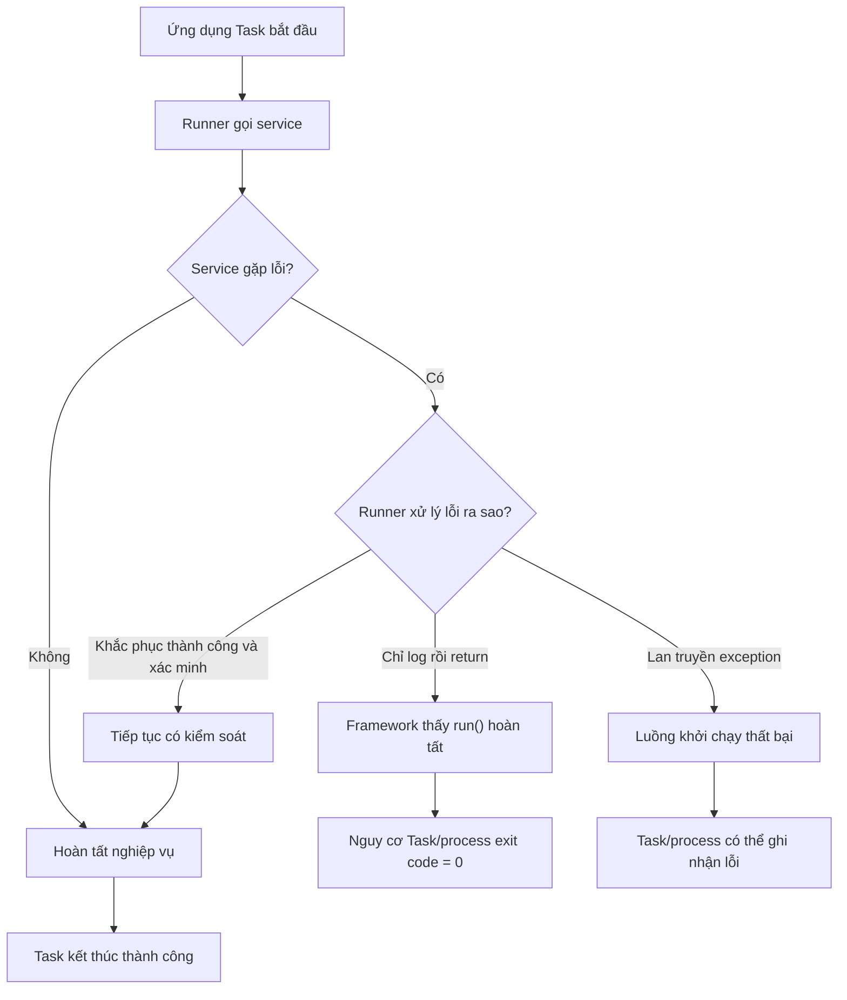

# Ngoại lệ bị bắt và nguy cơ ghi nhận thành công sai

## Mục tiêu học tập

Sau bài này, bạn có thể:

- Giải thích vì sao **bắt ngoại lệ rồi chỉ ghi log** có thể khiến Spring Cloud Task và hệ điều hành nhận kết quả thành công dù nghiệp vụ đã thất bại.
- Phân biệt trạng thái nghiệp vụ, `TaskExecution.exitCode` trong `TaskRepository`, trạng thái `JobExecution` của Spring Batch và **exit code tiến trình** mà scheduler nhận.
- Chọn ranh giới `try/catch` phù hợp: xử lý để phục hồi, chuyển thành lỗi có ý nghĩa hoặc lan truyền exception để dừng Task.
- Hiểu tác động của việc nuốt ngoại lệ đối với `@Transactional`, dữ liệu xử lý dở, cơ chế retry và idempotency.
- Thiết kế kiểm thử đường lỗi, SQL đối soát và tiêu chí vận hành an toàn cho Task chạy theo lịch hoặc theo yêu cầu.

> **Ngữ cảnh:** Đây là bài thuộc chương **Chạy lại an toàn** của module **SPRING_CLOUD_TASK**. Spring Cloud Task dùng để xây dựng ứng dụng Spring Boot chạy hữu hạn, lưu lịch sử thực thi qua `TaskRepository` và có thể phối hợp với Spring Batch. Một lần chạy phải báo kết quả trung thực để hệ thống điều phối quyết định cảnh báo, chạy lại hay yêu cầu can thiệp. Bài này tập trung vào tình huống lỗi **đã xảy ra nhưng bị code che mất** trước khi đến hạ tầng quản lý Task.

## 1. Vấn đề: lỗi đã xuất hiện nhưng Task vẫn “thành công”

Giả sử mỗi đêm Kubernetes CronJob kích hoạt tiến trình `daily-settlement` để đối soát giao dịch:

1. Runner nhận `--business-date=2026-11-24`.
2. Service tải giao dịch từ database và gọi hệ thống thanh toán.
3. API thanh toán trả lỗi kết nối.
4. Runner bắt `Exception`, in log `ERROR` rồi **kết thúc bình thường**.
5. Spring Cloud Task có thể ghi `TaskExecution` với kết quả thành công; tiến trình Java thoát mã `0`.
6. Scheduler đánh dấu Job thành công, không thực hiện retry, trong khi giao dịch chưa được xử lý xong.

Ví dụ code có vấn đề:

```java
@Component
class SettlementRunner implements ApplicationRunner {

    private static final Logger log =
            LoggerFactory.getLogger(SettlementRunner.class);

    private final SettlementService service;

    SettlementRunner(SettlementService service) {
        this.service = service;
    }

    @Override
    public void run(ApplicationArguments args) {
        try {
            service.settle();
        } catch (Exception ex) {
            log.error("Settlement failed", ex);
            // Sai nếu nghiệp vụ bắt buộc phải thành công:
            // exception bị nuốt, run() vẫn trả về bình thường.
        }
    }
}
```

Trong đoạn này, `log.error(...)` **chỉ tạo thông điệp quan sát**. Nó không tự đổi trạng thái kết quả, không yêu cầu rollback của một giao dịch đã hoàn tất, cũng không báo cho shell hoặc Kubernetes rằng tiến trình đã thất bại.

| Điều quan sát | Người vận hành nhìn thấy | Kết luận sai có thể xảy ra |
| --- | --- | --- |
| Log | Có dòng `ERROR` với stack trace. | “Ứng dụng chắc chắn báo thất bại cho scheduler.” |
| Runner | Phương thức `run` trả về bình thường. | “Xử lý nghiệp vụ đã thành công.” |
| `TaskRepository` | Có thể ghi exit code `0` khi không nhận được lỗi. | “Dữ liệu đối soát đã hoàn chỉnh.” |
| Tiến trình | Exit status có thể là `0`. | “Không cần thử lại.” |
| Database nghiệp vụ | Có thể chỉ lưu một phần kết quả. | “Tất cả giao dịch đã commit an toàn.” |

**Thông điệp log và trạng thái thực thi là hai kênh khác nhau.** Một lỗi chỉ được ghi log không nhất thiết thay đổi giá trị trả về của runner, trạng thái repository hay mã thoát của hệ điều hành.

## 2. Spring Cloud Task biết một lần chạy thất bại bằng cách nào?

Spring Cloud Task quản lý metadata vòng đời của ứng dụng Boot có thời gian chạy hữu hạn. Khi cấu hình `TaskRepository` JDBC đúng và hạ tầng có thể truy cập database, mỗi lần chạy thường được mô tả bằng `TaskExecution` với các thông tin:

- `executionId` và `taskName`: lần chạy cụ thể và tên Task.
- `startTime` / `endTime`: thời điểm bắt đầu, kết thúc được ghi nhận.
- `exitCode`, `exitMessage`, `errorMessage`: dữ liệu kết quả/lỗi mà framework ghi được.
- `arguments`: các đối số của tiến trình, nếu có.

Hạ tầng Spring Boot gọi các `ApplicationRunner` và `CommandLineRunner` trong quá trình khởi chạy. Spring Cloud Task theo dõi vòng đời tương ứng để tạo và cập nhật metadata. Nếu runner ném exception và lỗi **lan truyền ra ngoài `run(...)`**, luồng khởi chạy thất bại; framework có cơ hội ghi nhận lỗi và mã thoát khác `0` khi repository còn hoạt động.

Nếu runner tự bắt toàn bộ lỗi rồi trả về, tầng bên ngoài có thể **không biết bất kỳ lỗi nào đã xảy ra**. Đặc biệt, `TaskExecutionListener.onTaskFailed(...)` không phải công cụ tự nhận diện mọi câu lệnh `log.error`. Listener thất bại thường chỉ có cơ sở chạy khi hạ tầng Task thực sự nhận được sự kiện thất bại.

### Một lần thực thi có nhiều tín hiệu kết quả

| Tín hiệu | Nguồn | Giới hạn |
| --- | --- | --- |
| Kết quả nghiệp vụ | Bảng đối soát, response API, bản ghi sự kiện, kiểm tra bất biến. | Do ứng dụng định nghĩa; có thể khác mã thoát hệ thống. |
| `TaskExecution.exitCode` | `TaskRepository`, bảng `TASK_EXECUTION`. | Có thể không được ghi nếu Task lỗi quá sớm hoặc chết đột ngột. |
| `JobExecution.status` | `JobRepository` của Spring Batch khi có Job. | Một Job có thể `FAILED` dù Task bao ngoài vẫn chạy đến cuối. |
| Mã thoát JVM | Exit status của process `java`. | Scheduler thường phân biệt `0` với khác `0`; không chứa đủ nguyên nhân. |



Không giả định sơ đồ này bảo đảm mọi lần ném exception đều có hàng `TASK_EXECUTION` thất bại: lỗi xảy ra trước lúc repository đăng ký Task hoặc database mất kết nối có thể khiến metadata không được ghi.

## 3. Phân biệt “đã bắt lỗi” và “đã xử lý lỗi”

Trong Java, `catch` chỉ có nghĩa đoạn code đã **nhận** ngoại lệ. Để xem lỗi đã được **xử lý hoàn chỉnh**, cần trả lời: sau `catch`, bất biến nghiệp vụ có còn đúng và kết quả có đủ điều kiện thành công hay không?

| Tình huống | Được phép tiếp tục? | Hướng xử lý phù hợp |
| --- | --- | --- |
| Gọi API thất bại một lần, thử lại trong giới hạn rồi thành công và kiểm chứng kết quả. | Có. | Log theo mức phù hợp, giữ nguyên semantics thành công. |
| Một bản ghi đầu vào không hợp lệ và chính sách nghiệp vụ cho phép bỏ qua, có số lượng/ngưỡng rõ ràng. | Có điều kiện. | Ghi kết quả skip, số liệu đối soát và trạng thái hoàn thành được chấp nhận. |
| Database ghi dữ liệu thất bại, không rõ giao dịch đã commit hay chưa. | Không thể tự kết luận. | Dừng hoặc đối soát trạng thái trước khi retry; không trả về thành công giả. |
| Tổng thanh toán không khớp nhưng runner chỉ log mismatch. | Không, nếu khớp số tiền là điều kiện bắt buộc. | Ném exception hoặc báo mã thoát khác `0`. |
| Công việc bất đồng bộ trả `Future` rồi chạy nền; runner thoát trước khi có kết quả. | Chưa biết. | Chờ kết thúc, kiểm tra kết quả và lan truyền lỗi/timeout. |
| Một Spring Batch Job có `BatchStatus.FAILED` nhưng lời gọi launcher không ném exception. | Không, nếu Job bắt buộc hoàn tất. | Kiểm tra `JobExecution` rồi báo thất bại ở tầng Task/process. |

**Quy tắc quyết định:** Nếu `catch` không thể khôi phục trạng thái hợp lệ, phải truyền một tín hiệu thất bại đến tầng chịu trách nhiệm kết luận kết quả Task. Thao tác log chỉ hỗ trợ chẩn đoán, không thay thế tín hiệu đó.

## 4. Mẫu đúng: log có ngữ cảnh rồi ném lại lỗi

Một cách phù hợp cho ứng dụng Task chạy đồng bộ là giữ runner mỏng, đặt xử lý nghiệp vụ trong service riêng và để lỗi quan trọng lan truyền:

```java
package com.example.settlement;

import java.time.LocalDate;
import java.util.List;

import org.slf4j.Logger;
import org.slf4j.LoggerFactory;
import org.springframework.boot.ApplicationArguments;
import org.springframework.boot.ApplicationRunner;
import org.springframework.stereotype.Component;

@Component
public class SettlementRunner implements ApplicationRunner {

    private static final Logger log =
            LoggerFactory.getLogger(SettlementRunner.class);

    private final SettlementService service;

    public SettlementRunner(SettlementService service) {
        this.service = service;
    }

    @Override
    public void run(ApplicationArguments args) {
        List<String> dates = args.getOptionValues("business-date");
        if (dates == null || dates.size() != 1) {
            throw new IllegalArgumentException(
                    "Cần đúng một --business-date=yyyy-MM-dd");
        }

        LocalDate date = LocalDate.parse(dates.get(0));

        try {
            service.settle(date);
            log.info("Settlement completed for {}", date);
        } catch (RuntimeException ex) {
            log.error("Settlement failed for {}", date, ex);
            throw ex; // Báo lỗi lên Spring Boot/Spring Cloud Task.
        }
    }
}
```

Bước quan trọng là `throw ex`. Nó giữ thông tin lỗi gốc và khiến `run` **không trả về bình thường**. Nếu muốn bổ sung thông tin, có thể ném `new IllegalStateException("Settlement failed for " + date, ex)` để giữ `cause` thay vì thay exception bằng một thông điệp không còn stack trace.

### Cấu hình ứng dụng Task

```java
package com.example.settlement;

import org.springframework.boot.SpringApplication;
import org.springframework.boot.autoconfigure.SpringBootApplication;
import org.springframework.cloud.task.configuration.EnableTask;
import org.springframework.context.ConfigurableApplicationContext;

@SpringBootApplication
@EnableTask
public class DailySettlementTaskApplication {

    public static void main(String[] args) {
        ConfigurableApplicationContext context =
                SpringApplication.run(DailySettlementTaskApplication.class, args);

        int code = SpringApplication.exit(context);
        System.exit(code);
    }
}
```

`SpringApplication.exit(context)` tính mã thoát theo cơ chế Spring Boot được cấu hình và đóng context. `System.exit(code)` đưa mã đó tới JVM/hệ điều hành. **Khi `SpringApplication.run(...)` ném exception**, code ở dưới lời gọi đó không được chạy theo đường bình thường; Spring Boot xử lý sự cố startup và exception không được bắt ở `main` thường khiến tiến trình kết thúc khác `0`. Kiểm thử exit code thật, vì các cơ chế xử lý exception và wrapper có thể ảnh hưởng kết quả.

`application.yml` ví dụ dùng một PostgreSQL DataSource đã có schema Task:

```yaml
spring:
  application:
    name: daily-settlement-task
  main:
    web-application-type: none
  datasource:
    url: jdbc:postgresql://localhost:5432/taskdb
    username: ${TASK_DB_USER}
    password: ${TASK_DB_PASSWORD}
  cloud:
    task:
      initialize-enabled: false
```

Ví dụ giả định ứng dụng có `spring-cloud-starter-task`, JDBC driver và các dependency được quản lý bởi Spring Boot/Spring Cloud BOM tương thích. `initialize-enabled=false` chỉ phù hợp khi bảng Task đã được tạo bằng migration trước. Với hai `DataSource` riêng cho nghiệp vụ và Task, cần cấu hình `TaskConfigurer` để chọn đúng repository Task.

### Trường hợp không cần `try/catch` ở runner

Nếu runner không có hành động phục hồi hoặc bổ sung ngữ cảnh, có thể gọi thẳng:

```java
@Override
public void run(ApplicationArguments args) {
    LocalDate date = parseDate(args);
    service.settle(date);
}
```

Khi service ném lỗi không được xử lý, lỗi vẫn lan truyền tự nhiên. Việc đặt `try/catch` quanh mọi dòng code chỉ để log rồi `throw` không phải lúc nào cũng cần thiết, vì Spring Boot thường đã ghi stack trace của lỗi khởi chạy. Hãy thêm log khi nó cung cấp giá trị chẩn đoán như ngày xử lý, ID yêu cầu hoặc số lượng bản ghi.

## 5. Bẫy với `@Transactional`: bắt lỗi có thể dẫn tới commit ngoài ý muốn

Xét một service nghiệp vụ có transaction:

```java
@Service
public class SettlementService {

    private final JdbcTemplate jdbcTemplate;
    private final BankGateway bankGateway;

    public SettlementService(JdbcTemplate jdbcTemplate,
                             BankGateway bankGateway) {
        this.jdbcTemplate = jdbcTemplate;
        this.bankGateway = bankGateway;
    }

    @Transactional
    public void settle(LocalDate date) {
        jdbcTemplate.update(
            "UPDATE settlements SET status = 'PROCESSING' WHERE business_date = ?",
            java.sql.Date.valueOf(date)
        );

        try {
            bankGateway.submit(date);
        } catch (RuntimeException ex) {
            // NGUY HIỂM: nuốt lỗi trước khi thoát khỏi @Transactional.
            log.error("Cannot submit settlements", ex);
        }
    }
}
```

Trong trường hợp thông thường, interceptor `@Transactional` thấy phương thức kết thúc bình thường và có thể **commit thay đổi JDBC trước đó**. Việc ghi log trong `catch` không yêu cầu rollback. Như vậy, bảng `settlements` có thể ở trạng thái `PROCESSING` dù yêu cầu với ngân hàng thất bại.

Sửa bằng cách lan truyền lỗi trong phạm vi giao dịch:

```java
@Transactional
public void settle(LocalDate date) {
    jdbcTemplate.update(
        "UPDATE settlements SET status = 'PROCESSING' WHERE business_date = ?",
        java.sql.Date.valueOf(date)
    );

    try {
        bankGateway.submit(date);
    } catch (RuntimeException ex) {
        log.error("Cannot submit settlements", ex);
        throw ex;
    }
}
```

Theo cấu hình transaction mặc định của Spring, `RuntimeException`/`Error` được lan truyền qua proxy khiến transaction tương ứng được đánh dấu rollback. Với checked exception hoặc quy tắc tùy biến, cần khai báo `rollbackFor`/cấu hình rollback phù hợp. Đồng thời cần gọi phương thức `@Transactional` qua bean Spring được proxy; gọi nội bộ cùng đối tượng có thể bỏ qua interceptor.

**Giới hạn cực kỳ quan trọng:** Rollback JDBC **không hoàn tác được** một yêu cầu ngân hàng hoặc API bên ngoài đã thực hiện thành công. Trường hợp client timeout sau khi ngân hàng đã nhận giao dịch có kết quả *không chắc chắn*. Không nên retry mù; phải dùng idempotency key, API truy vấn trạng thái hoặc quy trình đối soát với bên ngoài.

### Bẫy ở tầng ngoài transaction

Ngay cả khi service rollback đúng, runner vẫn có thể giấu lỗi:

```java
@Override
public void run(ApplicationArguments args) {
    try {
        transactionalService.settle(...);
    } catch (Exception ex) {
        log.warn("Transaction rolled back, continuing anyway", ex);
        // Task có thể hoàn tất với exit code = 0.
    }
}
```

Ở tình huống này, **database nghiệp vụ rollback** nhưng **Task có thể bị ghi thành công sai**. Transaction bảo vệ dữ liệu trong phạm vi quản lý của nó; TaskRepository và mã thoát tiến trình cần nhận được tín hiệu lỗi từ một tầng khác. Đó là lý do phải thiết kế cả **tính nhất quán dữ liệu** và **báo cáo kết quả thực thi**.

## 6. Bắt lỗi để thử lại: khi nào được trả về thành công?

Có thể bắt lỗi tạm thời (mất kết nối ngắn, throttling) để retry ngay trong cùng Task. Việc này hợp lệ nếu **chỉ báo thành công sau khi hành động cuối cùng thật sự thành công**.

Ví dụ minh họa retry có giới hạn, dành cho thao tác **được chứng minh idempotent**:

```java
public void runWithBoundedRetry(String businessKey) {
    int maxAttempts = 3;

    for (int attempt = 1; attempt <= maxAttempts; attempt++) {
        try {
            paymentGateway.submitWithIdempotencyKey(businessKey);
            return; // Chỉ trả về sau khi xác minh thao tác thành công.
        } catch (TemporaryGatewayException ex) {
            if (attempt == maxAttempts) {
                throw new IllegalStateException(
                    "Payment gateway failed after retries", ex
                );
            }
            // Thực tế: dùng backoff có jitter và xử lý interrupt/timeout.
            log.warn("Temporary gateway error, attempt={}", attempt, ex);
        }
    }
}
```

Các class `TemporaryGatewayException` và `paymentGateway` là thành phần nghiệp vụ minh họa; snippet tập trung vào điều kiện dừng và lan truyền lỗi. Với API có thể trả kết quả **không chắc chắn sau timeout**, lời gọi retry phải dùng idempotency key được phía nhận hỗ trợ hoặc kiểm tra trạng thái từ nguồn đáng tin cậy trước. Không phải mọi lỗi “network” đều an toàn để gửi lại yêu cầu.

Khi áp dụng `Spring Retry`, Spring Batch retry hoặc retry của scheduler, vẫn phải xác định:

- Loại lỗi có thể retry: lỗi tạm thời khác lỗi dữ liệu không hợp lệ.
- Số lần thử tối đa, backoff, jitter, timeout và giới hạn tổng thời gian chạy.
- Khóa idempotency và cách kiểm tra kết quả trước khi thực hiện lại.
- Kết quả sau khi hết retry: **ném lỗi hoặc trả mã không bằng `0`**, không nuốt exception cuối cùng.
- Tác động của retry lồng nhau: retry trong API client, trong Task, trong Batch và trong Kubernetes có thể làm số lần thực hiện thực tế tăng mạnh.

`Spring Cloud Task` theo dõi một tiến trình hữu hạn; nó **không tự lập lịch retry nghiệp vụ** chỉ vì có `TaskRepository`. Việc gọi lại từ CronJob, Kubernetes Job hoặc bộ điều phối là một lần thực thi mới, thường sinh `executionId` mới.

## 7. Thất bại một phần: đừng đánh đồng “xử lý hết vòng lặp” với “thành công”

Giả sử Task xử lý 1.000 hóa đơn; 990 hóa đơn thành công, 10 hóa đơn lỗi. Code sau dễ gây thông tin sai:

```java
for (Invoice invoice : invoices) {
    try {
        process(invoice);
    } catch (Exception ex) {
        log.warn("Skipped invoice {}", invoice.id(), ex);
    }
}
log.info("All invoices processed"); // Không phản ánh 10 hóa đơn thất bại.
```

Nếu yêu cầu là **tất cả hóa đơn phải thành công**, sau vòng lặp phải phản ánh thất bại:

```java
List<String> failedIds = new ArrayList<>();

for (Invoice invoice : invoices) {
    try {
        process(invoice);
    } catch (RecoverableInvoiceException ex) {
        failedIds.add(invoice.id());
        log.warn("Invoice failed: {}", invoice.id(), ex);
    }
}

if (!failedIds.isEmpty()) {
    throw new IllegalStateException(
        "Failed invoices: count=" + failedIds.size()
    );
}

log.info("Invoice processing completed successfully");
```

Snippet minh họa chính sách báo lỗi; `Invoice` và `RecoverableInvoiceException` là kiểu nghiệp vụ do dự án định nghĩa. Trong hệ thống thật, không nên chỉ giữ ID trong bộ nhớ nếu cần tiếp tục xử lý khi tiến trình chết; lưu checkpoint/trạng thái bản ghi bền vững và xem xét Spring Batch khi có nhiều bước/khả năng restart.

Nếu nghiệp vụ **cho phép skip tối đa N bản ghi**, hãy định nghĩa chính sách cụ thể và có thể kiểm thử: loại lỗi được phép bỏ qua, tỷ lệ tối đa, nơi lưu danh sách skip, điều kiện phát cảnh báo và ý nghĩa của thành công. Một Task “thành công có cảnh báo” cần được phân biệt rõ trên dashboard nghiệp vụ; exit code `0` chỉ hợp lý khi các điều kiện chấp nhận thực sự đạt.

| Chính sách | Điều kiện kết thúc | Tín hiệu đề xuất |
| --- | --- | --- |
| Tất cả bản ghi bắt buộc hoàn tất | `failedCount == 0` | Thành công; nếu khác `0` thì thất bại. |
| Cho phép skip xác định | Chỉ skip các lỗi được chấp nhận và số lượng trong ngưỡng. | Thành công có cảnh báo kèm báo cáo skip; vượt ngưỡng thì thất bại. |
| Cho phép hoàn tất theo giai đoạn | Có checkpoint bền vững, giai đoạn sau tiếp tục có kiểm soát. | Mã/trạng thái nghiệp vụ biểu diễn rõ tiến độ; không gắn nhãn “đã hoàn tất” quá sớm. |
| Không xác định có thanh toán ngoài đã commit | Chưa thể kết luận. | Dừng để đối soát hoặc báo trạng thái cần điều tra; không retry phát lại mù. |

## 8. Phân biệt lỗi bị bắt với `SpringApplication.exit` và mã thoát JVM

Hàm `main` thường có thể kết thúc bằng:

```java
public static void main(String[] args) {
    ConfigurableApplicationContext context =
            SpringApplication.run(DailySettlementTaskApplication.class, args);

    int exitCode = SpringApplication.exit(context);
    System.exit(exitCode);
}
```

`SpringApplication.exit(context)` lấy mã thoát theo cơ chế Spring Boot, trong đó có các bean `ExitCodeGenerator` khi được cấu hình; nó **không tự buộc JVM trả mã đó cho hệ điều hành**. `System.exit(exitCode)` thực hiện bước này.

Nếu runner bắt lỗi rồi trả về **mà không cung cấp một tín hiệu thất bại**, `SpringApplication.exit` có thể trả `0`. Cũng cần nhớ: nếu `SpringApplication.run` ném exception trước khi trả context, các dòng sau `run` không thực thi. Trong đường lỗi khởi chạy, Spring Boot có cơ chế xử lý exception/exit code riêng; cần xác minh exit status thực tế khi chạy ứng dụng.

### Nếu chủ động bắt lỗi và muốn mã thoát theo loại lỗi

Có thể dùng bean Spring Boot `ExitCodeGenerator` để tính mã dựa trên kết quả nghiệp vụ đã ghi nhận:

```java
@Component
class TaskExitStatus implements ExitCodeGenerator {

    private volatile int exitCode = 0;

    public void invalidInput() {
        exitCode = 2;
    }

    public void businessFailure() {
        exitCode = 10;
    }

    @Override
    public int getExitCode() {
        return exitCode;
    }
}
```

Runner có thể gọi `taskExitStatus.businessFailure()` sau khi xác định lỗi nghiệp vụ. Khi `main` gọi `SpringApplication.exit` và `System.exit`, mã này có thể được truyền ra tiến trình. **Nhưng đây không tự bảo đảm `TaskExecution.exitCode` hoặc callback `onTaskFailed` sẽ được cập nhật giống hệt** trong mọi release và cách triển khai. Nếu mục tiêu là quan sát thất bại qua `TaskRepository` lẫn process, cách rõ ràng cho lỗi không thể phục hồi là **lan truyền exception**, sau đó kiểm thử cả hai tín hiệu.

Với lỗi đã được phục hồi hoàn toàn và nghiệp vụ xác nhận thành công, không nhất thiết phải báo mã khác `0` chỉ vì trong log có một exception tạm thời. Quyết định kết quả phải dựa trên điều kiện kết thúc nghiệp vụ, không dựa vào việc có từng xuất hiện log warn/error hay không.

## 9. Trường hợp Spring Batch Job thất bại nhưng Task báo thành công

Spring Cloud Task ghi metadata của **toàn bộ lần chạy ứng dụng**; Spring Batch ghi `JobExecution`, `StepExecution` và các trạng thái riêng. Có thể xảy ra:

1. Batch Job được khởi chạy.
2. Một Step thất bại; `JobRepository` ghi `BatchStatus.FAILED`.
3. Runner bao ngoài **không kiểm tra `JobExecution`** hoặc nuốt exception.
4. Runner kết thúc bình thường; Task/process có nguy cơ trả mã `0`.

Ví dụ tự gọi `JobLauncher` phải kiểm tra kết quả:

```java
@Component
class BatchSettlementRunner implements ApplicationRunner {

    private final JobLauncher jobLauncher;
    private final Job settlementJob;

    BatchSettlementRunner(JobLauncher jobLauncher,
                          @Qualifier("settlementJob") Job settlementJob) {
        this.jobLauncher = jobLauncher;
        this.settlementJob = settlementJob;
    }

    @Override
    public void run(ApplicationArguments args) throws Exception {
        String businessDate = args.getOptionValues("business-date").get(0);

        JobParameters parameters = new JobParametersBuilder()
                .addString("businessDate", businessDate, true)
                .toJobParameters();

        JobExecution execution =
                jobLauncher.run(settlementJob, parameters);

        // Ví dụ giả định launcher chạy đồng bộ và Job đã kết thúc.
        if (execution.getStatus() != BatchStatus.COMPLETED) {
            throw new IllegalStateException(
                "Batch Job did not complete: " + execution.getStatus()
            );
        }
    }
}
```

Các import tương ứng thuộc `org.springframework.batch.core` (`Job`, `JobExecution`, `JobParameters`, `JobParametersBuilder`, `BatchStatus`), `org.springframework.batch.core.launch.JobLauncher`, cùng các kiểu Spring Boot và Spring Framework. Ví dụ giả định JobLauncher đồng bộ; nếu cấu hình bất đồng bộ, phải đợi Job hoàn tất trước khi đánh giá kết quả. Đoạn lấy tham số cũng cần thêm bước kiểm tra thiếu/sai định dạng như runner thường dùng.

Nếu tự điều khiển Job bằng runner, tránh để cơ chế auto-run của Spring Boot khởi chạy **cùng Job thêm lần nữa**. Tùy phiên bản có thể tắt tự chạy qua:

```properties
spring.batch.job.enabled=false
```

Khi tích hợp `spring-cloud-task-batch`, một số release hỗ trợ:

```properties
spring.cloud.task.batch.fail-on-job-failure=true
```

Thuộc tính này giúp phản ánh lỗi Batch Job trong cơ chế Task–Batch được hỗ trợ; **không thay thế việc kiểm tra kết quả khi có luồng tự viết, async hoặc runner nuốt exception**. Khi điều tra, đối chiếu `BATCH_JOB_EXECUTION.STATUS`, `TASK_EXECUTION.EXIT_CODE` và exit code của tiến trình.

`TaskExecution.executionId` và `JobExecution.id` là hai khóa độc lập. Nếu có bảng liên kết `TASK_TASK_BATCH`, sử dụng nó để nối kết đúng lần chạy, tránh tự giả định hai ID bằng nhau.

## 10. Chạy lại an toàn khi Task đã báo “thành công sai”

Một Task bị đánh dấu thành công giả có thể để lại **dữ liệu đã xử lý một phần**. Việc sửa code để ném exception ở lần chạy sau vẫn chưa giải quyết trạng thái còn sót từ trước. Trước khi retry cần xác định:

- Bản ghi nào đã commit tại database nghiệp vụ?
- Những hiệu ứng ngoài database (API thanh toán, email, phát message) đã xảy ra chưa?
- Có khóa nghiệp vụ đủ ổn định để nhận diện yêu cầu lặp lại hay không?
- Có checkpoint hoặc trạng thái bền vững để tiếp tục phần chưa hoàn thành?
- Những dữ liệu đang nằm ở trạng thái `IN_PROGRESS` có thể do tiến trình cũ chết không?

### 10.1. Dùng khóa nghiệp vụ thay vì `executionId` để chống xử lý trùng

`executionId` của Spring Cloud Task định danh **mỗi lần thực thi**. Khi scheduler retry, Task mới thường có ID mới dù vẫn xử lý cùng ngày đối soát. Vì thế, `executionId` không phù hợp làm khóa chống trùng nghiệp vụ.

Ví dụ khóa của một đợt đối soát có thể là cặp `(business_date, region)`. Tạo unique constraint:

```sql
CREATE TABLE settlement_runs (
    business_date DATE NOT NULL,
    region        VARCHAR(30) NOT NULL,
    status        VARCHAR(20) NOT NULL,
    updated_at    TIMESTAMPTZ NOT NULL DEFAULT CURRENT_TIMESTAMP,
    PRIMARY KEY (business_date, region)
);
```

Với PostgreSQL, thao tác tạo bản ghi thử:

```sql
INSERT INTO settlement_runs(business_date, region, status)
VALUES (DATE '2026-11-24', 'apac', 'IN_PROGRESS')
ON CONFLICT (business_date, region) DO NOTHING;
```

**Đây mới chỉ là cơ chế ngăn chèn hai hàng cùng khóa**, không phải thuật toán idempotency hoàn chỉnh. Khi conflict xảy ra, cần đọc trạng thái hiện có:

| Trạng thái đã tồn tại | Hành động cần xem xét |
| --- | --- |
| `COMPLETED` và kết quả được xác minh | Không phát lại hiệu ứng nghiệp vụ; trả lại kết quả đã lưu. |
| `IN_PROGRESS`, tiến trình còn giữ lease/lock hợp lệ | Tránh chạy song song; chờ hoặc trả trạng thái đang thực hiện. |
| `IN_PROGRESS` nhưng lease hết hạn, tiến trình cũ đã chết | Cần cơ chế chuyển quyền/khôi phục có kiểm soát và đối soát tác động cũ. |
| `FAILED` có thể retry | Phân loại nguyên nhân, kiểm tra trạng thái bên ngoài, rồi tiếp tục theo quy tắc đã thiết kế. |
| `FAILED` do dữ liệu không hợp lệ | Không retry mù; yêu cầu sửa dữ liệu/đầu vào. |

Trong môi trường có nhiều Pod, chỉ dùng `SELECT` rồi `INSERT` không đủ để chống race condition; cần ràng buộc database, khóa, optimistic locking, lease hoặc cơ chế concurrency tương đương.

### 10.2. Không retry mù khi có hiệu ứng ngoài database

Giả sử Task gọi API chuyển tiền. API client timeout, nhưng ngân hàng **đã nhận giao dịch**; ứng dụng bắt lỗi, log và thoát `0`. Khi sửa lại để báo thất bại, bộ điều phối có thể retry và tạo **giao dịch trùng** nếu không có biện pháp kiểm soát.

Giải pháp thường là kết hợp:

1. Idempotency key ổn định theo **lệnh chuyển tiền thực**, không theo ID lần chạy Task.
2. API phía nhận có contract idempotency hoặc endpoint tra trạng thái đáng tin cậy.
3. Ghi trạng thái ý định/tác động trong database nghiệp vụ trước khi gửi, nếu kiến trúc cần và cho phép.
4. Dùng outbox/inbox hoặc cơ chế điều phối tương đương khi phải kết hợp commit database với gửi message.
5. Chỉ đánh dấu `COMPLETED` khi đáp ứng điều kiện nghiệp vụ xác minh được; lưu bằng chứng phục vụ đối soát.

Spring Cloud Task ghi lịch sử vòng đời, **không cung cấp exactly-once cho mọi hiệu ứng bên ngoài**. Retry an toàn là thuộc tính của thiết kế nghiệp vụ cùng hạ tầng, không xuất phát tự động từ việc có `TaskRepository`.

## 11. Quan sát Task và phát hiện “thành công sai”

Dùng SQL tra những lần chạy gần đây (tên bảng/cột mặc định có thể phụ thuộc schema/version):

```sql
SELECT
    TASK_EXECUTION_ID,
    TASK_NAME,
    START_TIME,
    END_TIME,
    EXIT_CODE,
    EXIT_MESSAGE,
    ERROR_MESSAGE
FROM TASK_EXECUTION
WHERE TASK_NAME = 'daily-settlement-task'
ORDER BY START_TIME DESC, TASK_EXECUTION_ID DESC;
```

**Chỉ từ bảng trên, không thể chứng minh dữ liệu nghiệp vụ đã hoàn tất.** Muốn phát hiện thành công sai, đối chiếu Task với bảng nghiệp vụ qua một khóa an toàn như ngày, khu vực và mã yêu cầu:

```sql
-- Ví dụ truy vấn trên database nghiệp vụ, không phải TaskRepository.
SELECT business_date, region, status, updated_at
FROM settlement_runs
WHERE business_date = DATE '2026-11-24'
  AND region = 'apac';
```

Nếu thấy `TASK_EXECUTION.EXIT_CODE=0` nhưng `settlement_runs.status=IN_PROGRESS` hoặc thiếu kết quả đã được xác nhận, cần đánh dấu vụ việc **bất nhất** để điều tra. Không sửa `EXIT_CODE` bằng SQL để làm lịch sử “đúng” vì nó che mất bằng chứng hệ thống đã báo gì tại thời điểm chạy.

### Gắn `executionId` vào log

`TaskExecutionListener` có thể hỗ trợ ghi ID của lần chạy:

```java
@Component
class TaskAuditListener implements TaskExecutionListener {

    private static final Logger log =
            LoggerFactory.getLogger(TaskAuditListener.class);

    @Override
    public void onTaskStartup(TaskExecution taskExecution) {
        log.info("Task started executionId={}",
                 taskExecution.getExecutionId());
    }

    @Override
    public void onTaskFailed(TaskExecution taskExecution, Throwable throwable) {
        log.error("Task failure executionId={}",
                  taskExecution.getExecutionId(), throwable);
    }

    @Override
    public void onTaskEnd(TaskExecution taskExecution) {
        log.info("Task ended executionId={}, exitCode={}",
                 taskExecution.getExecutionId(),
                 taskExecution.getExitCode());
    }
}
```

Đoạn minh họa cần import `org.springframework.cloud.task.listener.TaskExecutionListener` và `org.springframework.cloud.task.repository.TaskExecution`. Nếu runner nuốt lỗi, callback thất bại **không nhất thiết xảy ra**, vì vậy luôn đối chiếu log nghiệp vụ, repository và process.

Khi Task chạy trên nhiều node, thêm môi trường/cluster, Job ID của scheduler và correlation ID vào structured log. Không đưa mật khẩu, access token hoặc dữ liệu nhạy cảm vào đối số CLI vì `TASK_EXECUTION_PARAMS` và log có thể lưu chúng.

### Phân biệt các trạng thái dễ bị hiểu sai

| Dữ liệu quan sát | Có thể kết luận gì? | Chưa thể kết luận gì? |
| --- | --- | --- |
| Log có `ERROR` | Có thành phần đã ghi nhận một sự kiện lỗi. | Task chắc chắn thất bại hay rollback. |
| `TASK_EXECUTION.EXIT_CODE=0` | Repository ghi mã thành công theo cơ chế hiện tại. | Mọi thay đổi nghiệp vụ đúng và đủ. |
| `END_TIME IS NULL` | Chưa có thời điểm kết thúc trong metadata. | Tiến trình chắc chắn vẫn chạy. |
| Process exit status khác `0` | Hệ điều hành nhận trạng thái thất bại/bất thường. | Mọi hiệu ứng nghiệp vụ đã được rollback. |
| `BATCH_JOB_EXECUTION.STATUS=FAILED` | Spring Batch Job thất bại. | Task/process đã báo thất bại tương ứng. |
| `settlement_runs.status=COMPLETED` | Bảng nghiệp vụ lưu trạng thái hoàn tất. | API ngoài hoặc message broker đã xác nhận nếu không có bằng chứng tương ứng. |

## 12. Kiểm thử đường lỗi từ runner đến hệ điều hành

Chỉ kiểm tra `log.error` được gọi là **không đủ**. Cần test cả kết quả công việc, transaction, metadata Task và exit status tiến trình ở các nhánh quan trọng.

### 12.1. Ma trận kiểm thử

| Tình huống | Kỳ vọng nghiệp vụ | Kỳ vọng Task/process |
| --- | --- | --- |
| Tham số hợp lệ, service thành công | Kết quả đầy đủ, trạng thái `COMPLETED`. | Exit code `0`; metadata được ghi nếu repository hoạt động. |
| Thiếu `--business-date` | Không xử lý dữ liệu; báo lỗi đầu vào. | Không được trả thành công; mã khác `0` theo chính sách. |
| Service ném `RuntimeException` | Transaction JDBC rollback theo cấu hình mặc định; không báo đã hoàn tất. | Runner lan truyền lỗi; process thất bại; metadata ghi lỗi nếu có thể. |
| Lỗi API tạm thời rồi retry thành công an toàn | Kết quả được xác minh, không lặp hiệu ứng. | Có thể thành công `0` sau phục hồi. |
| Retry hết số lần | Không đánh dấu hoàn tất khi thiếu kết quả. | Có mã thất bại, log nguyên nhân và số lần thử. |
| 10/1.000 bản ghi lỗi, chính sách yêu cầu hoàn tất toàn bộ | Danh sách lỗi được lưu, không công bố hoàn tất. | Task/process thất bại. |
| Batch Job trả `FAILED` nhưng launcher không ném lỗi | Job failure được nhận diện rõ. | Runner kiểm tra kết quả; Task/process không báo thành công giả. |
| Container bị kill trong lúc commit | Trạng thái có thể chưa chắc chắn; cần đối soát. | Dùng termination info và log; DB có thể thiếu `END_TIME`. |
| Scheduler retry cùng khóa nghiệp vụ | Không tạo tác động trùng; nhận ra bản ghi đã hoàn tất hoặc đang xử lý. | Có `TaskExecution` mới nhưng kết quả nghiệp vụ nhất quán. |

### 12.2. Đọc exit code trong Bash và PowerShell

Với Bash hoặc shell POSIX:

```bash
java -jar daily-settlement-task.jar --business-date=2026-11-24
echo $?
```

`$?` là mã của lệnh ngay trước đó, nên cần đọc ngay sau `java`; shell wrapper không được nuốt exit code.

Với Windows PowerShell:

```powershell
java -jar daily-settlement-task.jar --business-date=2026-11-24
$LASTEXITCODE
```

Nếu ứng dụng được chạy qua script, script phải chuyển mã lỗi của Java cho bên gọi. Trong Kubernetes Job/CronJob, đọc thêm `containerStatuses[].state.terminated.exitCode` hoặc `kubectl describe` để xác định container đã kết thúc ra sao.

### 12.3. Một kiểm thử tích hợp nên kiểm chứng điều gì?

Thay vì chỉ assert runner đã log exception, kiểm thử tích hợp có thể:

1. Chuẩn bị database Task và database nghiệp vụ riêng của môi trường test.
2. Khởi chạy ứng dụng như **process con**, truyền tham số xác định và áp timeout.
3. Giả lập một phụ thuộc thất bại (service API hoặc JDBC) bằng stub/test container.
4. Chờ process kết thúc; assert mã khác `0` khi lỗi bắt buộc phải thất bại.
5. Tra `TASK_EXECUTION` theo lần chạy để xác nhận metadata **nếu repository ghi được**.
6. Kiểm tra transaction/bảng nghiệp vụ không bị đánh dấu `COMPLETED` sai.
7. Kích hoạt retry cùng khóa nghiệp vụ; xác nhận không có hiệu ứng bị nhân đôi.

Không gọi trực tiếp `main` có `System.exit(...)` trong JVM của JUnit vì có thể dừng cả tiến trình test. Dùng `ProcessBuilder`/subprocess hoặc công cụ kiểm thử container để xác minh tín hiệu từ JVM đến hệ điều hành.

## 13. Bảng lỗi và cách khắc phục nhanh

| Hiện tượng | Khả năng cần kiểm tra | Cách xử lý |
| --- | --- | --- |
| Log `ERROR` nhưng CronJob thành công | Runner đã bắt exception rồi return, hoặc wrapper trả `0`. | Lan truyền lỗi/đặt exit code đúng; kiểm tra process và script wrapper. |
| `TaskExecution.exitCode=0` dù service thất bại | Không có tín hiệu thất bại tới hạ tầng Task; exception đã được xử lý trong runner. | Đổi quy tắc catch và kiểm thử repository lẫn nghiệp vụ. |
| Database có dữ liệu cập nhật dở | Exception bị bắt bên trong `@Transactional`, transaction commit; hoặc hiệu ứng ngoài DB không rollback. | Di chuyển ranh giới catch, lan truyền exception, thiết kế idempotency và đối soát. |
| Cứ retry là nhân đôi giao dịch | Không có business key, idempotency key hoặc cơ chế xác minh hiệu ứng trước. | Dùng khóa và contract idempotency đáng tin cậy, không dùng `executionId` làm business key. |
| Batch `FAILED` nhưng shell trả `0` | Chỉ kiểm tra exception của launcher, bỏ qua `JobExecution.status`. | Kiểm tra JobExecution, dùng tích hợp Task–Batch phù hợp và báo lỗi ra tiến trình. |
| Task không có row `TASK_EXECUTION` sau lỗi | Database metadata chưa sẵn sàng hoặc startup thất bại quá sớm. | Xem log bootstrap, nguồn dữ liệu, schema và termination status của container. |
| `END_TIME` trống dù Pod đã chết | Kill đột ngột hoặc cập nhật metadata thất bại. | Đối chiếu pod/log/timeouts; không coi NULL là còn chạy chắc chắn. |
| Lỗi bất đồng bộ xuất hiện sau khi runner hoàn tất | Runner không đợi `Future`/Job thực sự kết thúc. | Chờ kết quả có timeout, xử lý exception và đưa lỗi lên tầng Task. |
| Nhiều cơ chế retry làm tăng tải đột ngột | Retry client + Task + Batch + scheduler chồng nhau. | Thống nhất retry budget và backoff cho toàn luồng. |
| Đã sửa code nhưng lịch sử cũ báo thành công | Metadata phản ánh mã tại thời điểm chạy trước khi sửa. | Giữ lịch sử, lập báo cáo đối soát riêng, không sửa số liệu cũ tùy tiện. |

## 14. Bài tập thực hành

### Bài tập 1 — Tái hiện “thành công sai”

Tạo `ApplicationRunner` gọi service ném `IllegalStateException`. Trong runner, bắt lỗi và chỉ `log.error` rồi `return`. Chạy ứng dụng qua `java -jar`, kiểm tra `$?` hoặc `$LASTEXITCODE` và hàng `TASK_EXECUTION`. Giải thích vì sao log lỗi có thể xuất hiện trong một lần chạy vẫn được đánh dấu thành công.

### Bài tập 2 — Lan truyền lỗi

Thêm `throw ex` vào catch của runner. Chạy lại và so sánh mã thoát JVM, `ERROR_MESSAGE` và `EXIT_CODE` trong repository khi ghi được. Tìm trường hợp lỗi quá sớm khiến không có metadata Task và nêu nguồn thông tin còn có thể sử dụng.

### Bài tập 3 — Transaction và dữ liệu dở

Trong service `@Transactional`, cập nhật bảng `settlements` sang `PROCESSING` rồi gây exception. So sánh kết quả khi bắt lỗi **bên trong** phương thức transaction và khi để exception lan ra ngoài proxy. Chứng minh trường hợp nào rollback, trường hợp nào có thể commit.

### Bài tập 4 — Retry idempotent

Cho Task xử lý `(business_date, region)` và gọi một API giả lập có timeout. Thiết kế unique key, trạng thái xử lý, idempotency key và cơ chế tra trạng thái API sau timeout. Khởi chạy lại cùng tham số ba lần; xác minh kết quả cuối chỉ được ghi một lần dù `TaskExecution.executionId` khác nhau.

### Bài tập 5 — Batch thất bại

Tạo Spring Batch Job có một Step cố ý thất bại, dùng runner gọi `JobLauncher` và kiểm tra `JobExecution.status`. So sánh hai phiên bản: bỏ qua status và ném lỗi khi khác `COMPLETED`. Đối chiếu `BATCH_JOB_EXECUTION`, `TASK_EXECUTION` và mã process.

### Bài tập 6 — Chính sách skip

Với 1.000 hóa đơn, định nghĩa rõ những loại lỗi nào được skip, ngưỡng chấp nhận và cách lưu danh sách bị skip. Viết tiêu chí cho `COMPLETED`, `COMPLETED_WITH_WARNINGS` ở tầng nghiệp vụ và `FAILED`, rồi nêu tín hiệu nào phải được trả về scheduler khi vượt ngưỡng.

## Ghi nhớ

- **Bắt exception rồi log không đồng nghĩa đã giải quyết lỗi.** Nếu runner kết thúc bình thường, Spring Cloud Task và tiến trình có thể báo thành công dù nghiệp vụ thất bại.
- Với lỗi khiến điều kiện hoàn tất không đạt, hãy **lan truyền exception hoặc truyền tín hiệu thất bại rõ ràng** đến tầng quyết định kết quả; kiểm chứng cả `TaskRepository` và exit code JVM.
- **`@Transactional` không tự rollback nếu lỗi bị nuốt trước khi interceptor nhận được**, và rollback JDBC không hoàn tác hiệu ứng ngoài database.
- Retry chỉ an toàn khi có business key, kiểm soát đồng thời, cách xác minh trạng thái và idempotency cho các hiệu ứng có thể lặp.
- `TaskExecution.executionId` định danh một lần chạy, không thay thế khóa nghiệp vụ; một lần scheduler retry thường có executionId mới.
- Với Spring Batch, phải kiểm tra `JobExecution` và bảo đảm lỗi Job được phản ánh đúng lên Task/process.
- Khi điều tra sự cố, kết hợp **log, TaskExecution, Batch status, exit status container và trạng thái dữ liệu nghiệp vụ**; không kết luận chỉ từ một nguồn.

## Tài liệu tham khảo

- [Spring Cloud Task — Reference Documentation](https://docs.spring.io/spring-cloud-task/reference/)
- [Spring Cloud Task — Features và TaskRepository](https://docs.spring.io/spring-cloud-task/reference/features.html)
- [Spring Cloud Task — Batch Integration](https://docs.spring.io/spring-cloud-task/reference/batch.html)
- [Spring Boot — Application Exit](https://docs.spring.io/spring-boot/reference/features/spring-application.html#features.spring-application.application-exit)
- [Spring Framework — Declarative Transaction Rollback](https://docs.spring.io/spring-framework/reference/data-access/transaction/declarative/rolling-back.html)
- [Spring Batch — Configuring a Step](https://docs.spring.io/spring-batch/reference/step/chunk-oriented-processing/configuring.html)
- [Kubernetes — Jobs](https://kubernetes.io/docs/concepts/workloads/controllers/job/)
