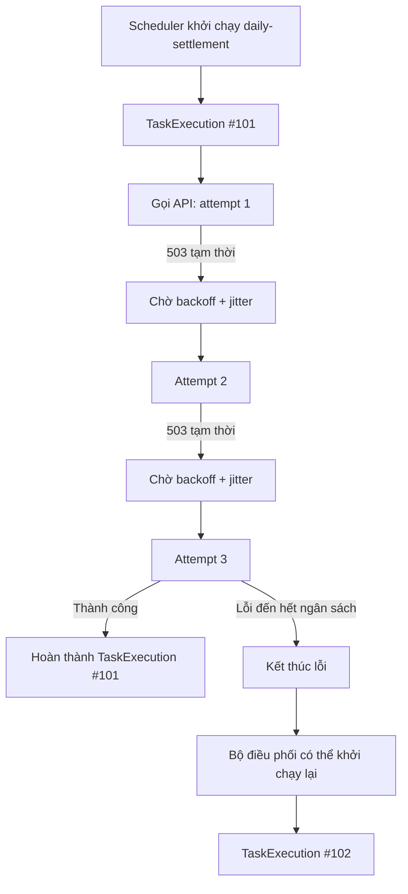

# Thử lại có giới hạn và khoảng chờ tăng dần trong Spring Cloud Task

## 1. Tại sao không nên thử lại liên tục?

Một ứng dụng **Spring Cloud Task** thường thực hiện công việc có thời gian chạy hữu hạn: đối soát thanh toán, nhập dữ liệu, tạo báo cáo hoặc gọi một dịch vụ bên ngoài rồi kết thúc. Trong lúc chạy, ứng dụng có thể gặp lỗi tạm thời như timeout, máy chủ trả HTTP `503`, giới hạn tốc độ `429` hoặc xung đột khóa database. Những lỗi này **đôi khi tự hết**, vì vậy thử lại có thể giúp công việc hoàn thành mà không cần người vận hành can thiệp.

Tuy nhiên, thử lại ngay và vô hạn gây ra ba vấn đề:

1. **Làm quá tải hệ thống đang gặp sự cố:** nhiều tác vụ gọi lại cùng lúc khiến dịch vụ phụ thuộc càng khó phục hồi.
2. **Tăng thời gian chạy không kiểm soát:** một `ApplicationRunner` có thể bị mắc kẹt, chiếm kết nối và vượt deadline của scheduler hoặc Kubernetes Job.
3. **Gây tác dụng phụ lặp:** yêu cầu thanh toán hoặc ghi dữ liệu có thể đã thành công ở phía đích dù ứng dụng chỉ nhìn thấy timeout.

Vì vậy, trong chương **Chạy lại an toàn**, ta kết hợp **retry có giới hạn** (*bounded retry*), **khoảng chờ tăng dần** (*exponential backoff*), **độ lệch ngẫu nhiên** (*jitter*) và **idempotency** (thực thi lặp mà không tạo thêm tác dụng phụ không mong muốn).

Sau bài học, bạn có thể phân biệt retry bên trong một lần chạy với khởi chạy lại cả ứng dụng, cấu hình các giới hạn hợp lý, viết ví dụ Java, phân loại lỗi nên thử lại và thiết kế khả năng phục hồi khi hệ thống phối hợp Spring Batch.

## 2. Retry trong cùng tiến trình khác gì chạy lại cả task?

Spring Cloud Task ghi nhận một lần khởi chạy ứng dụng bằng **`TaskExecution`** trong **`TaskRepository`**. Nó không tự biến mọi lần gọi lại API ở bên trong `ApplicationRunner` thành một bản ghi `TaskExecution` mới.

| Phạm vi | Ai quyết định thử lại? | Điều gì được tạo mới? | Khi nào phù hợp? |
| --- | --- | --- | --- |
| **Retry tại thao tác** (*in-process retry*) | Code trong runner, một thư viện retry hoặc cơ chế của Spring Batch | Một **attempt** gọi lại API/SQL, vẫn thuộc cùng một lần chạy ứng dụng | Lỗi mạng ngắn, deadlock đã rollback, dịch vụ phụ thuộc sắp phục hồi |
| **Chạy lại toàn ứng dụng** (*task relaunch*) | Scheduler, Kubernetes Job, người vận hành hoặc bộ điều phối | Tiến trình mới và thường là **`TaskExecution` mới** | Tiến trình đã chết, hết ngân sách retry cục bộ, cần khởi động lại sạch |
| **Restart job/step Batch** | Spring Batch và quy trình vận hành job | Các bản ghi `JobExecution`/`StepExecution` theo cơ chế restart của Batch | Xử lý batch có checkpoint, cần tiếp tục từ trạng thái đã lưu |

Ví dụ: `daily-settlement` có `executionId=101` gọi API ba lần do hai lần đầu nhận `503`. Nếu lần thứ ba thành công, **vẫn chỉ có một `TaskExecution`** cho lần chạy này. Nếu cả bốn attempt đều thất bại, runner ném lỗi và Kubernetes Job khởi chạy một Pod khác, lần chạy kế tiếp thông thường nhận `executionId=102`.



Sơ đồ thể hiện các nhánh minh họa. Bản ghi `TaskExecution` có thể không được tạo hoặc không được cập nhật đầy đủ nếu ứng dụng không khởi động được context hay mất kết nối database. **Đếm số dòng trong `TASK_EXECUTION` không cho biết số attempt gọi dịch vụ bên ngoài.** Muốn quan sát số lần thử nội bộ phải bổ sung log và metric phù hợp.

## 3. Thiết kế một chính sách retry có giới hạn

Một chính sách cần định nghĩa ít nhất năm yếu tố:

| Yếu tố | Câu hỏi thiết kế | Giá trị minh họa |
| --- | --- | --- |
| **`maxAttempts`** | Gọi thao tác tối đa bao nhiêu lần, **tính cả lần đầu**? | `4` = một lần đầu + tối đa ba lần thử lại |
| **`initialDelay`** | Chờ bao lâu sau lỗi retryable đầu tiên? | `1 giây` |
| **`multiplier`** | Khoảng chờ tăng theo hệ số nào? | `2` |
| **`maxDelay`** | Một khoảng chờ dài nhất bao nhiêu? | `8 giây` |
| **`jitter`** | Các tiến trình có cần lệch thời điểm retry? | Có, dùng độ lệch ngẫu nhiên có giới hạn |

Ngoài ra, nên giới hạn **timeout mỗi lần gọi**, **tổng thời gian chạy**, **số lần khởi chạy lại từ scheduler**, loại lỗi được phép retry và mức tải lên downstream.

### 3.1. Exponential backoff hoạt động ra sao?

Nếu `n` là lần thất bại liên tiếp thứ `n` sau đó *còn được retry*, khoảng chờ cơ sở là:

\[
  d_n = \min(d_{\max},\ d_0 \times m^{n-1})
\]

Trong đó `d0` là khoảng chờ ban đầu, `m` là hệ số tăng và `d_max` là trần. Với `d0 = 1 giây`, `m = 2`, `d_max = 8 giây`:

| Attempt vừa thất bại | Còn attempt tiếp theo? | Backoff cơ sở trước lần gọi tiếp theo |
| --- | --- | --- |
| `1` | Có | `1 giây` |
| `2` | Có | `2 giây` |
| `3` | Có | `4 giây` |
| `4` | Không: đã hết `maxAttempts = 4` | **Không chờ**; trả lỗi cuối cùng |

Nếu tăng `maxAttempts`, dãy tiếp tục thành `8, 8, 8, ...` vì đã chạm trần. Trong cấu hình bốn attempt của ví dụ, **tổng thời gian chờ tối đa là 1 + 2 + 4 = 7 giây**, chưa tính thời gian thực hiện mỗi request. Đây là giới hạn chờ của thuật toán, **không phải** giới hạn toàn bộ thời gian tác vụ.

### 3.2. Vì sao nên có jitter?

Giả sử 100 Pod cùng bị trả `503` lúc 02:00. Nếu tất cả chờ đúng `1`, `2`, `4` giây, chúng sẽ đồng loạt gọi lại, tạo hiệu ứng *thundering herd*. **Jitter** làm ngẫu nhiên hóa khoảng chờ, phân tán tải và giảm nguy cơ các tiến trình tiếp tục va vào nhau.

Một chiến lược dễ hiểu là **full jitter**: sau mỗi lỗi, chọn thời gian chờ ngẫu nhiên trong khoảng **từ `0` đến `d_n`**. Khi `d_n = 2 giây`, lần chạy A có thể chờ `0,4 giây`, B chờ `1,6 giây`. Giá trị thực tế thay đổi mỗi lần; không nên dùng con số ví dụ để dự đoán thứ tự retry.

Một chiến lược khác là **equal jitter**, luôn chờ ít nhất nửa khoảng cơ sở rồi cộng ngẫu nhiên phần còn lại. Cả hai đều hợp lý trong các hệ thống khác nhau. Điều quan trọng là **có giới hạn**, giảm đồng bộ hóa và không làm scheduler mất kiểm soát deadline. Nếu dịch vụ trả `Retry-After`, cần cân nhắc tín hiệu đó và tổng ngân sách thời gian trước khi quyết định thời điểm thử tiếp.

## 4. Phân loại lỗi trước khi quyết định thử lại

Không phải ngoại lệ nào cũng đáng thử lại. Lỗi **chắc chắn tái diễn với cùng đầu vào** nên dừng sớm để tránh lãng phí.

| Tình huống | Chính sách đề xuất | Lý do |
| --- | --- | --- |
| Timeout kết nối hoặc dịch vụ trả `502`, `503`, `504` | Có thể retry có giới hạn | Dịch vụ phụ thuộc có thể phục hồi; cần xác minh yêu cầu có tác dụng phụ hay không |
| HTTP `429 Too Many Requests` | Có thể retry, tôn trọng `Retry-After`/quota | Gọi lại quá sớm có thể bị giới hạn tiếp |
| Deadlock hoặc lỗi transaction tạm thời đã rollback | Retry **một transaction mới** | Giữ transaction cũ rồi ngủ không tự sửa được deadlock |
| HTTP `400` do dữ liệu không hợp lệ | Thường không retry | Đầu vào không đổi thì lỗi không đổi |
| HTTP `401`/`403` do thiếu quyền | Không retry mù quáng | Cần sửa thông tin xác thực hoặc phân quyền |
| Không tìm thấy đối tượng nghiệp vụ cố định | Thường không retry | Cần kiểm tra tiền điều kiện và ý nghĩa nghiệp vụ |
| HTTP `409` | Phụ thuộc API | Có thể là trùng idempotency key hoặc xung đột tạm thời; phải hiểu giao thức |
| Mất kết nối sau khi gửi yêu cầu ghi tiền | **Chưa rõ kết quả**; tra cứu trạng thái/idempotency trước | Không thể kết luận phía đích chưa xử lý |

Danh sách trên là **gợi ý thiết kế**, không phải quy tắc cứng cho mọi API. Một số `500` cũng có thể khôi phục, nhưng có dịch vụ trả `500` sau khi đã xử lý thành công. Chính sách phải dựa trên tài liệu của API, hành vi thực tế và khả năng xử lý lặp an toàn.

**Nguyên tắc:** chỉ retry các lỗi mà bạn **hiểu nguyên nhân**, **biết rõ phép gọi được lặp an toàn** và **còn ngân sách để thử tiếp**. Nếu không chắc tác dụng phụ đã xảy ra hay chưa, cần đối chiếu trạng thái với hệ thống đích trước khi lặp lại.

## 5. Ví dụ Java: thử lại tối đa bốn lần với exponential backoff và full jitter

Ví dụ dưới đây dùng **Java 17**, Spring Boot và Spring Cloud Task. `ApplicationRunner` nhận ngày đối soát, mô phỏng một dịch vụ có thể tạm thời không khả dụng rồi thử lại tối đa bốn lần. Mỗi lần thất bại vì `TemporaryGatewayFailure`, mã sẽ chờ ngẫu nhiên theo khoảng chờ cơ sở `1`, `2`, `4` giây. Mọi lỗi đầu vào xảy ra ngoài khối retry và được trả về ngay.

> Đây là mô phỏng có thể chạy thử sau khi cấu hình dependencies và database. Không gọi hệ thống thanh toán thật; khi thay bằng API thực, phải bảo đảm idempotency và timeout như các phần tiếp theo.

```java
import java.time.LocalDate;
import java.util.List;
import java.util.concurrent.ThreadLocalRandom;
import java.util.concurrent.atomic.AtomicInteger;

import org.springframework.boot.ApplicationRunner;
import org.springframework.boot.SpringApplication;
import org.springframework.boot.autoconfigure.SpringBootApplication;
import org.springframework.cloud.task.configuration.EnableTask;
import org.springframework.context.annotation.Bean;

@SpringBootApplication
@EnableTask
public class SettlementTaskApplication {

    private static final int MAX_ATTEMPTS = 4;
    private static final long INITIAL_DELAY_MS = 1_000L;
    private static final long MAX_DELAY_MS = 8_000L;

    public static void main(String[] args) {
        SpringApplication.run(SettlementTaskApplication.class, args);
    }

    @Bean
    ApplicationRunner settlementRunner() {
        return args -> {
            List<String> dates = args.getOptionValues("businessDate");
            if (dates == null || dates.size() != 1) {
                throw new IllegalArgumentException(
                    "Phải truyền --businessDate=yyyy-MM-dd");
            }
            LocalDate date = LocalDate.parse(dates.get(0));

            // Chỉ để mô phỏng: số lần gọi đầu tiên sẽ trả lỗi tạm thời.
            int failFirst = 2;
            List<String> values = args.getOptionValues("failFirst");
            if (values != null) {
                if (values.size() != 1) {
                    throw new IllegalArgumentException("Dùng --failFirst=<số>");
                }
                failFirst = Integer.parseInt(values.get(0));
            }
            if (failFirst < 0) {
                throw new IllegalArgumentException("failFirst phải >= 0");
            }

            final int transientFailures = failFirst;
            AtomicInteger callCount = new AtomicInteger();
            retryTemporaryFailure(() -> {
                int call = callCount.incrementAndGet();
                System.out.printf("Gọi dịch vụ, attempt=%d%n", call);

                if (call <= transientFailures) {
                    throw new TemporaryGatewayFailure("Dịch vụ trả 503 giả lập");
                }

                // Thay bằng gọi API có timeout và idempotency key ổn định.
                System.out.println("Đối soát hoàn thành cho " + date);
            });
        };
    }

    static void retryTemporaryFailure(CheckedOperation operation)
            throws Exception {
        long delayCapMs = INITIAL_DELAY_MS;

        for (int attempt = 1; attempt <= MAX_ATTEMPTS; attempt++) {
            try {
                operation.run();
                return; // Thành công: không gọi lại.
            } catch (TemporaryGatewayFailure error) {
                if (attempt == MAX_ATTEMPTS) {
                    throw error; // Hết ngân sách: để Task ghi nhận thất bại.
                }

                // Full jitter: giá trị trong [0, delayCapMs].
                long waitMs = ThreadLocalRandom.current()
                    .nextLong(delayCapMs + 1);
                System.out.printf(
                    "Attempt %d/%d thất bại; chờ %d ms rồi thử lại%n",
                    attempt, MAX_ATTEMPTS, waitMs);

                try {
                    Thread.sleep(waitMs);
                } catch (InterruptedException interrupted) {
                    Thread.currentThread().interrupt();
                    throw interrupted; // Tuân thủ yêu cầu dừng tiến trình.
                }
                delayCapMs = Math.min(MAX_DELAY_MS, delayCapMs * 2);
            }
        }
    }

    @FunctionalInterface
    interface CheckedOperation {
        void run() throws Exception;
    }

    static class TemporaryGatewayFailure extends RuntimeException {
        TemporaryGatewayFailure(String message) {
            super(message);
        }
    }
}
```

Điểm quan trọng của ví dụ:

- Vòng lặp có **`MAX_ATTEMPTS = 4`**, bao gồm lần gọi đầu, không phải bốn lần retry cộng thêm lần đầu.
- `catch` chỉ bắt `TemporaryGatewayFailure`. `IllegalArgumentException`, lỗi cấu hình hoặc các ngoại lệ không được phân loại **không bị retry**.
- `Thread.sleep(...)` chỉ chạy giữa các attempt, **không chờ** sau lần cuối đã thất bại.
- Với cấu hình này, `delayCapMs + 1` an toàn vì trần là 8.000 ms. Nếu đưa các giá trị cấu hình thành đầu vào tùy ý, phải xác thực số dương, trần và nguy cơ tràn số khi nhân/tính ngẫu nhiên.
- Nếu bị interrupt khi chờ, mã giữ lại interrupt flag và thoát ra, để ứng dụng có thể dừng có kiểm soát.
- `callCount` chỉ dùng để giả lập lỗi trong một tiến trình. **Đừng dựa vào biến đếm trong bộ nhớ** để theo dõi trạng thái thanh toán thật qua nhiều lần khởi chạy.

### 5.1. Cấu hình Spring Cloud Task để lưu lịch sử

```yaml
spring:
  application:
    name: settlement-worker
  main:
    web-application-type: none
  cloud:
    task:
      name: daily-settlement
  datasource:
    url: ${TASK_DB_URL}
    username: ${TASK_DB_USER}
    password: ${TASK_DB_PASSWORD}
```

Cần `spring-cloud-starter-task`, JDBC driver và schema phù hợp phiên bản Spring Cloud Task đang dùng. Dùng database bền vững để lịch sử còn lại sau khi JVM kết thúc. Đoạn Java cố ý đặt các hằng số retry ngay trong class để dễ đọc; trong production nên đưa chúng sang cấu hình riêng của ứng dụng, validate ràng buộc và truyền vào bean quản lý chính sách.

Không có nghĩa rằng Spring Cloud Task sẽ tự hiểu các thuộc tính như `spring.cloud.task.retry.max-attempts` nếu bạn tự thêm chúng. **Retry nghiệp vụ phải được lập trình hoặc cấu hình qua cơ chế retry mà bạn thực sự sử dụng.**

### 5.2. Chạy ba kịch bản

Chạy với hai lỗi tạm thời, thành công ở attempt thứ ba:

```bash
java -jar settlement-task.jar --businessDate=2026-11-23 --failFirst=2
```

Chạy thành công ngay lần đầu:

```bash
java -jar settlement-task.jar --businessDate=2026-11-23 --failFirst=0
```

Chạy thất bại sau tối đa bốn attempt:

```bash
java -jar settlement-task.jar --businessDate=2026-11-23 --failFirst=10
```

Trong trường hợp thứ ba, runner ném `TemporaryGatewayFailure` sau attempt thứ tư. Nếu context và `TaskRepository` hoạt động bình thường, Spring Cloud Task có thể ghi nhận lần thực thi thất bại. Bộ điều phối sau đó có thể quyết định chạy lại cả ứng dụng theo một **ngân sách retry độc lập**.

## 6. Dùng Spring Retry hoặc cơ chế retry của framework

Ví dụ vòng lặp giúp nhìn rõ thuật toán. Với mã nguồn thực tế, có thể dùng **Spring Retry** để tập trung chính sách: `RetryPolicy` giới hạn số lần thử, `BackOffPolicy` điều chỉnh thời gian chờ và các callback cung cấp dữ liệu quan sát. Đó là thư viện riêng; **Spring Cloud Task tự nó chủ yếu theo dõi vòng đời**, không có nghĩa mọi runner đều được thử lại tự động.

Ví dụ với API builder của Spring Retry **2.x** (cần thêm dependency Spring Retry tương thích với Spring Boot đang dùng):

```java
import java.time.Duration;
import org.springframework.retry.support.RetryTemplate;

RetryTemplate template = RetryTemplate.builder()
    .maxAttempts(4)
    .retryOn(TemporaryGatewayFailure.class)
    .exponentialBackoff(
        Duration.ofSeconds(1),
        2.0,
        Duration.ofSeconds(8),
        true // Bật độ ngẫu nhiên theo chính sách của Spring Retry.
    )
    .build();

template.execute(context -> {
    gateway.call();
    return null;
});
```

Đoạn này minh họa cách khai báo policy trong một phương thức đã có biến `gateway` và lớp ngoại lệ `TemporaryGatewayFailure`; nó **không phải** class độc lập có thể biên dịch ngay. API, kiểu backoff ngẫu nhiên và yêu cầu tích hợp có thể khác giữa các dòng phiên bản, vì vậy phải đối chiếu đúng tài liệu được quản lý bởi BOM của ứng dụng. Cờ `true` dùng cách ngẫu nhiên do **Spring Retry** triển khai, không nhất thiết trùng chính xác thuật toán *full jitter* viết tay ở mục 5.

Có thể dùng `@Retryable` khi phiên bản Spring Retry và cơ chế proxy/AOP được cấu hình phù hợp. Tuy nhiên, lời gọi **nội bộ trong cùng bean** có thể bỏ qua proxy; khi đó annotation không phát huy tác dụng. Cần chỉ rõ ngoại lệ retryable, trần số lần thử, backoff và hành vi cuối cùng sau khi hết lượt.

**Đừng gom toàn bộ xử lý nghiệp vụ phức tạp vào một lời gọi retry** nếu phần đó đã ghi dữ liệu hoặc gửi yêu cầu không idempotent. Nên đặt chính sách ở thao tác có ranh giới rõ ràng và có thể lặp an toàn.

## 7. Retry an toàn phải đi cùng idempotency

**Idempotency** nghĩa là thực hiện lại một thao tác với cùng danh tính nghiệp vụ không tạo thêm tác dụng phụ không mong muốn. Đây là yêu cầu đặc biệt quan trọng khi tác vụ tạo thanh toán, gửi email, xuất kho hoặc gọi API tạo đối tượng.

### 7.1. Timeout không cho biết phía đích đã xử lý hay chưa

Giả sử ứng dụng gửi yêu cầu đối soát cho đối tác rồi timeout. Có thể xảy ra:

- Request chưa đến máy chủ đích.
- Đích đã nhận nhưng chưa xử lý xong.
- Đích đã **ghi thành công** rồi nhưng response bị mất.

Trong trường hợp thứ ba, thử lại với một request mới không có idempotency key có thể tạo bản ghi hoặc tác dụng phụ thứ hai. **Cùng `TaskExecution` không có nghĩa thao tác bên ngoài tự được chống trùng.**

### 7.2. Tạo khóa nghiệp vụ ổn định

Ví dụ với đối soát theo ngày, khóa hợp lý có thể dựa trên cặp `(merchantId, businessDate)` và loại công việc `settlement`. Một chuỗi như `settlement:merchant-42:2026-11-23` có thể được dùng làm **idempotency key** nếu API đối tác hỗ trợ và phạm vi khóa phù hợp với hợp đồng của họ.

Các nguyên tắc:

1. **Giữ cùng khóa qua mọi attempt và mọi lần task relaunch** xử lý lại cùng một yêu cầu nghiệp vụ.
2. **Đổi khóa khi yêu cầu nghiệp vụ thực sự khác**, thay vì thay theo `executionId` hoặc timestamp của lần chạy.
3. **Lưu khóa và trạng thái xử lý bền vững** để biết yêu cầu nào còn đang xử lý, hoàn thành hoặc cần đối chiếu.
4. **Kiểm tra phạm vi và thời gian lưu khóa ở hệ thống đích**: một số API chỉ giữ idempotency key trong một khoảng thời gian nhất định.
5. **Bảo vệ bằng ràng buộc dữ liệu hoặc lock thích hợp** để hai task chạy đồng thời không cùng tạo tác dụng phụ ngoài ý muốn.

Nếu kết quả không rõ sau timeout, có thể truy vấn trạng thái theo khóa/định danh giao dịch. Chỉ sau khi biết kết quả, ứng dụng mới quyết định đánh dấu thành công, thử lại với **cùng khóa** hay chuyển sang đối soát thủ công.

### 7.3. Ví dụ thiết kế bảng lưu kết quả

Với PostgreSQL, một bảng trạng thái xử lý nghiệp vụ có thể được thiết kế như sau (schema là **ví dụ** do ứng dụng tự định nghĩa, không phải bảng của Spring Cloud Task):

```sql
CREATE TABLE settlement_work (
    merchant_id VARCHAR(64) NOT NULL,
    business_date DATE NOT NULL,
    idempotency_key VARCHAR(160) NOT NULL,
    status VARCHAR(24) NOT NULL,
    updated_at TIMESTAMPTZ NOT NULL DEFAULT CURRENT_TIMESTAMP,
    PRIMARY KEY (merchant_id, business_date),
    UNIQUE (idempotency_key)
);
```

Trước khi gửi yêu cầu ra ngoài, tác vụ kiểm tra hoặc ghi nhận công việc theo khóa này trong một transaction ngắn. Khi nhận kết quả chắc chắn, cập nhật `status`. Nếu ứng dụng bị kill, lần khởi chạy sau có thể dựa vào bảng để phục hồi/đối chiếu, thay vì chỉ nhìn `executionId`. **Một unique constraint không tự làm giao dịch giữa database của bạn và API bên ngoài trở thành atomic**; cần quy trình xử lý trạng thái chưa chắc chắn.

## 8. Giới hạn tổng thời gian và tránh cộng dồn nhiều lớp retry

`maxAttempts` chỉ giới hạn **số lần gọi**, còn `maxDelay` chỉ giới hạn **một khoảng chờ**. Một lời gọi API có thể treo rất lâu nếu không có timeout. Do đó cần ngân sách thời gian ở nhiều tầng.

Giả sử mỗi HTTP request có deadline tối đa `5 giây`, tối đa `4` attempt, khoảng chờ cơ sở sau ba lỗi là `1 + 2 + 4 = 7 giây`. Thời gian tối đa để hoàn tất phần gọi API xấp xỉ:

\[
T_{\text{retry}} \le 4 \times 5s + 7s = 27s
\]

Chưa tính thời gian khởi động JVM, truy vấn database, ghi kết quả và shutdown. Với **full jitter**, thời gian chờ thực tế có thể ngắn hơn. Đặt timeout toàn tác vụ và deadline của scheduler/container có đủ biên an toàn; nếu còn ít thời gian hơn một attempt dự kiến, có thể dừng thử lại và để bộ điều phối xử lý.

### 8.1. Cẩn thận khi retry ở nhiều tầng

Giả sử:

- HTTP client tự thử tối đa **4** lần.
- Bộ điều phối cho phép **3** lần khởi chạy task tổng cộng (một lần đầu và hai lần chạy lại).

Khi tất cả lần đều thất bại, một thao tác nghiệp vụ có thể bị gửi đến **12 lần** (`4 × 3`), chưa kể retry của proxy, load balancer hoặc Spring Batch nếu có. Nếu mỗi tầng đều cấu hình retry thiếu phối hợp, hệ thống đích nhận tải lớn hơn dự kiến.

Hãy quy định **một chủ sở hữu chính cho retry tại từng ranh giới**, lập bảng tổng ngân sách qua các lớp và tránh để client, service và scheduler cùng thử lại vô hạn. Nếu Spring Batch đã retry từng item, runner không nhất thiết cần bao toàn bộ job trong một vòng retry nữa.

### 8.2. Không ngủ trong transaction dài

Nếu lỗi là database deadlock hoặc optimistic locking, một lần thử lại thường cần **transaction mới**, sau khi transaction trước đã rollback hoặc kết thúc. Không `Thread.sleep(...)` bên trong transaction đang giữ khóa hoặc kết nối khi chờ backoff. Cách thiết kế phổ biến là đặt khối retry **bên ngoài lời gọi transactional**, để mỗi attempt gọi lại phương thức transactional qua proxy phù hợp, rồi trả kết nối về pool giữa các attempt.

Khi dùng Spring Batch, cần hiểu thêm ranh giới transaction của chunk/step trước khi retry `ItemProcessor`, `ItemWriter` hoặc `ItemReader`. Một reader có thể đã di chuyển con trỏ trước khi ném lỗi; gọi lại `read()` chưa chắc đọc lại đúng cùng item nếu reader không được thiết kế restart/retry an toàn.

## 9. Kết quả retry được phản ánh trong `TaskRepository` như thế nào?

Spring Cloud Task theo dõi **lần chạy ứng dụng**. Khi một runner xử lý được lỗi tạm thời rồi hoàn tất bình thường, `TaskRepository` thường ghi kết quả thành công của `TaskExecution` đó. Nó không tự ghi từng attempt thành các dòng riêng trong `TASK_EXECUTION`.

Khi retry đã hết ngân sách và runner ném lỗi không được xử lý, Spring Boot phát đường lỗi; nếu hạ tầng và database còn hoạt động, Spring Cloud Task cập nhật metadata thất bại. Kết quả `exitCode`, `exitMessage` và mã thoát của tiến trình còn phụ thuộc cách ứng dụng ánh xạ lỗi và chính sách của Spring Boot; nên kiểm chứng thực tế thay vì mặc định tất cả giống nhau.

| Tình huống | `TaskExecution` trong lần chạy hiện tại | Dữ liệu cần quan sát thêm |
| --- | --- | --- |
| Attempt 1 lỗi, attempt 2 thành công | Thường một bản ghi hoàn tất thành công | `attemptCount=2`, lỗi tạm thời lần đầu, thời gian backoff |
| Hết bốn attempt, runner ném lỗi | Thường một bản ghi thất bại nếu cập nhật repository được | Exception cuối, số lần đã thử, dịch vụ đích, mã tiến trình |
| Scheduler khởi chạy lại sau thất bại | Một `TaskExecution` **mới** | Liên kết lần chạy trước và khóa nghiệp vụ giống nhau |
| JVM bị kill trong khi chờ | Bản ghi có thể thiếu `endTime` | Trạng thái container/process, log và kết quả giao dịch đích |
| Database metadata không khả dụng | Có thể không tạo hoặc không hoàn tất bản ghi | Log bootstrap, mã thoát thực tế và trạng thái scheduler |

### 9.1. Tra cứu lịch sử chạy lại

Với schema JDBC Spring Cloud Task thông dụng, có thể truy vấn:

```sql
SELECT TASK_EXECUTION_ID,
       TASK_NAME,
       START_TIME,
       END_TIME,
       EXIT_CODE,
       EXIT_MESSAGE
FROM TASK_EXECUTION
WHERE TASK_NAME = 'daily-settlement'
ORDER BY TASK_EXECUTION_ID DESC;
```

Đối chiếu tên bảng/cột với schema phiên bản thực tế. Có thể dùng `TaskExplorer` để truy vấn bằng Java. Nếu cần biết **đã gọi API bao nhiêu attempt**, hãy lưu metric/log như `task_name`, `execution_id`, `operation`, `attempt`, `retryable_error_class`, `next_delay_ms` với giới hạn cardinality hợp lý. Không đưa token, payload nhạy cảm hoặc thông tin cá nhân vào log.

## 10. Chạy theo lịch và khởi chạy lại toàn ứng dụng

Một Kubernetes Job hoặc bộ điều phối có thể tạo Pod/tiến trình mới khi tác vụ kết thúc lỗi. Ở tầng này cần cấu hình **giới hạn số lần khởi chạy**, **deadline**, **backoff của bộ điều phối**, **chính sách đồng thời** và **cảnh báo sau khi thất bại cuối cùng**. Ví dụ, Kubernetes Job có `backoffLimit` và `activeDeadlineSeconds` phục vụ các mục đích khác nhau; CronJob còn có chính sách đồng thời cho các lịch chạy. Chúng không thay thế timeout, idempotency và giới hạn retry bên trong code.

Một lỗi đầu vào không thể tự sửa (`businessDate` sai định dạng) không nên bị scheduler khởi chạy lại nhiều lần. Có thể phân biệt mã thoát hoặc lý do thất bại để áp chính sách phù hợp, tùy khả năng của nền tảng. Nếu chính sách điều phối không lọc được loại lỗi, hãy giảm retry tổng thể và bổ sung xử lý cảnh báo/thủ công.

Trong hệ thống vận hành thật, **một lần chạy thất bại không đủ để kết luận mọi thao tác đã rollback**. Nếu Pod chết sau khi gửi request nhưng trước khi cập nhật trạng thái local, lần chạy kế tiếp phải kiểm tra khóa nghiệp vụ và dữ liệu phía đích trước khi thực hiện lại.

## 11. Kết hợp với Spring Batch và cơ chế retry khác

Spring Cloud Task và Spring Batch xử lý **hai phạm vi khác nhau**:

| Thành phần | Theo dõi cái gì? | Retry ở cấp nào? |
| --- | --- | --- |
| Spring Cloud Task | `TaskExecution`: một lần khởi chạy ứng dụng | Không tự retry từng phép gọi nghiệp vụ |
| Spring Batch | `JobExecution`, `StepExecution`, chunk/item, checkpoint | Có thể cấu hình retry ở reader/processor/writer và restart job |
| Spring Retry hoặc mã tự viết | Một lời gọi API, SQL hoặc phương thức cụ thể | Cấu hình số attempt, lỗi được phép thử và backoff |
| Scheduler/Kubernetes | Tiến trình/Job/Pod đã chạy | Có thể khởi chạy lại toàn tác vụ |

Trong một step Batch, hãy chỉ retry những lỗi thực sự tạm thời. Nếu một bản ghi CSV có ngày tháng sai cú pháp, đọc lại nó nhiều lần thường vẫn thất bại; tùy yêu cầu, có thể ghi nhận lỗi dữ liệu hoặc dùng chính sách skip có kiểm soát. Ngược lại, deadlock đã rollback có thể xử lý bằng retry phù hợp với transaction của step.

Nếu ứng dụng task khởi chạy Batch job **bất đồng bộ** rồi runner trả về sớm, `TaskExecution` có thể được đánh dấu hoàn tất trước khi job xử lý xong. Khi cần metadata phản ánh toàn bộ kết quả, runner nên chờ job kết thúc và chuyển trạng thái thất bại ra kết quả của ứng dụng theo cách đã thiết kế.

Không nên coi `TaskExecution.executionId` là `JobExecution.id` của Spring Batch hoặc dùng chúng làm idempotency key cho thao tác nghiệp vụ. Cả hai định danh chỉ mô tả **lần thực thi**, có thể thay đổi sau mỗi lần chạy lại.

## 12. Các lỗi thiết kế thường gặp

| Biểu hiện | Nguyên nhân | Cách khắc phục |
| --- | --- | --- |
| Task chạy hàng giờ dù dịch vụ đích đã ngừng | Retry vô hạn hoặc không đặt timeout | Giới hạn attempt, backoff, deadline tổng và cảnh báo cuối |
| Nhiều Pod gửi request cùng một thời điểm | Backoff cố định, thiếu jitter | Áp dụng jitter và giới hạn đồng thời/tốc độ |
| Thanh toán bị ghi trùng sau timeout | Retry request ghi mà không có idempotency key | Dùng khóa ổn định, kiểm tra trạng thái đích và ràng buộc unique |
| Lỗi `400` vẫn bị thử bốn lần | Bắt mọi `Exception` là retryable | Chỉ cho phép các lỗi tạm thời đã phân loại |
| Retry vẫn lỗi sau database deadlock | Giữ transaction đã rollback hoặc chờ khi còn khóa | Bắt đầu transaction mới cho mỗi attempt |
| Đã hết attempt nhưng dashboard ghi thành công | Code log lỗi cuối rồi trả về bình thường | Truyền lỗi hoặc cung cấp kết quả thất bại đúng cơ chế |
| Retry trong runner thành công nhưng không thấy nhiều `TaskExecution` | Nhầm attempt nội bộ với task relaunch | Ghi metric/log attempt; hiểu phạm vi của `TaskRepository` |
| Sau retry, throughput giảm nghiêm trọng | Quá nhiều lớp retry và ngủ giữ kết nối | Tính tổng ngân sách, tách transaction, giảm tải, dùng circuit breaker khi thích hợp |
| Tác vụ chết khi đang sleep và lịch sử chưa kết thúc | JVM bị dừng cưỡng bức | Đối chiếu trạng thái process/Pod, kiểm tra kết quả nghiệp vụ và retry an toàn |

## 13. Checklist triển khai và kiểm thử

Trước khi bật retry cho một tác vụ có tác dụng phụ, cần hoàn thành các kiểm tra sau:

- [ ] Đã phân biệt **lỗi tạm thời**, **lỗi đầu vào cố định** và **kết quả chưa rõ sau timeout**.
- [ ] Có `maxAttempts` tính cả lần đầu, có trần backoff, jitter và timeout cho mỗi attempt.
- [ ] Có deadline tổng của tác vụ và số lần khởi chạy lại từ bộ điều phối được giới hạn.
- [ ] Không ngủ khi giữ transaction dài hoặc kết nối database không cần thiết.
- [ ] Các tác vụ tạo tác dụng phụ dùng idempotency key ổn định qua mọi attempt và task relaunch.
- [ ] Hết lượt retry phải tạo kết quả thất bại rõ ràng; không nuốt exception.
- [ ] Có log/metric về số attempt, lỗi tạm thời và khoảng chờ, có thể đối chiếu với `executionId`.
- [ ] Đã kiểm tra xử lý interrupt, shutdown và trạng thái không chắc chắn khi tiến trình bị kill.
- [ ] Với Spring Batch, đã xác định retry diễn ra tại tầng nào để tránh nhân số lần gọi.
- [ ] Đã thử tình huống thành công ngay, thành công sau retry, lỗi cố định, hết ngân sách và hai phiên chạy đồng thời.

### Ma trận kiểm thử tối thiểu

| Kịch bản | Số attempt kỳ vọng | Kết quả cần kiểm chứng |
| --- | --- | --- |
| `--failFirst=0` | `1` | Không sleep; runner hoàn tất |
| `--failFirst=2` | `3` | Hai lần backoff, thành công trong cùng `TaskExecution` |
| `--failFirst=10` | `4` | Không attempt thứ năm; exception cuối được truyền ra |
| `businessDate` sai định dạng | `0` lần gọi gateway | Lỗi đầu vào xảy ra trước retry |
| Interrupt trong khi chờ | Ngừng theo interrupt | Không tiếp tục lặp vô hạn |
| Scheduler thử lại sau task lỗi | Tùy ngân sách bên ngoài | `TaskExecution` mới và **cùng idempotency key** cho cùng công việc |

## 14. Câu hỏi tự kiểm tra

**Câu 1.** `maxAttempts = 4` nghĩa là bốn lần thử lại **sau** lần đầu hay tổng cộng bốn lần gọi?

**Câu 2.** Với backoff cơ sở `1, 2, 4` giây và tối đa bốn attempt, tổng thời gian **chờ** tối đa là bao nhiêu nếu không tính request và jitter không vượt trần?

**Câu 3.** Vì sao 100 Pod cùng retry sau đúng một giây có thể làm downstream tiếp tục quá tải? Jitter giúp gì?

**Câu 4.** Một request tạo thanh toán timeout nhưng phía đích có thể đã ghi thành công. Hãy nêu ba bước cần cân nhắc trước khi thử lại.

**Câu 5.** Nếu retry ba lần bên trong runner rồi thành công, Spring Cloud Task thường tạo bao nhiêu `TaskExecution` cho lần khởi chạy ứng dụng đó?

**Câu 6.** Vì sao không nên vừa cấu hình bốn attempt tại HTTP client vừa khởi chạy lại toàn task ba lần mà không tính ngân sách tổng?

**Gợi ý trả lời:** (1) tổng cộng bốn lần gọi; (2) tối đa `7 giây` chờ; (3) các Pod retry đồng loạt gây *thundering herd*, jitter phân tán thời điểm; (4) giữ khóa nghiệp vụ ổn định, tra cứu trạng thái bên đích, quyết định gửi lại có kiểm soát; (5) thường một bản ghi, attempt nội bộ không tạo `TaskExecution` mới; (6) có thể thành mười hai lần gọi và làm tăng tải hoặc tác dụng phụ lặp.

## 15. Tổng kết và tài liệu tham khảo

Để **chạy lại an toàn** một Spring Cloud Task, hãy thử lại **chỉ những lỗi tạm thời**, **có giới hạn số lần**, chờ **tăng dần và có jitter**, đồng thời bảo vệ dữ liệu bằng **idempotency**. Cần phân biệt retry thao tác trong một `ApplicationRunner` với khởi chạy lại toàn bộ ứng dụng: một cơ chế tạo thêm attempt, cơ chế kia thường tạo `TaskExecution` mới trong `TaskRepository`.

Một chính sách tốt có trần thời gian, biết khi nào dừng, phản ánh kết quả lỗi rõ ràng, đối chiếu được dữ liệu nghiệp vụ và không làm nổ số lần gọi qua nhiều lớp retry. Khi phối hợp với Spring Batch, cần xét thêm transaction, checkpoint, chính sách retry/skip của step và kết quả job trước khi quyết định chạy lại ở tầng Task.

**Tài liệu chính thức để tra cứu theo phiên bản đang dùng:**

- [Spring Cloud Task Reference — Features và `TaskExecution`](https://docs.spring.io/spring-cloud-task/reference/features.html)
- [Spring Retry — `SimpleRetryPolicy`, giới hạn tổng attempt](https://docs.spring.io/spring-retry/docs/current/apidocs/spring.retry/org/springframework/retry/policy/SimpleRetryPolicy.html)
- [Spring Retry — `RetryTemplateBuilder` và backoff](https://docs.spring.io/spring-retry/docs/current/apidocs/spring.retry/org/springframework/retry/support/RetryTemplateBuilder.html)
- [Spring Batch — Configuring Retry Logic](https://docs.spring.io/spring-batch/reference/step/chunk-oriented-processing/retry-logic.html)
