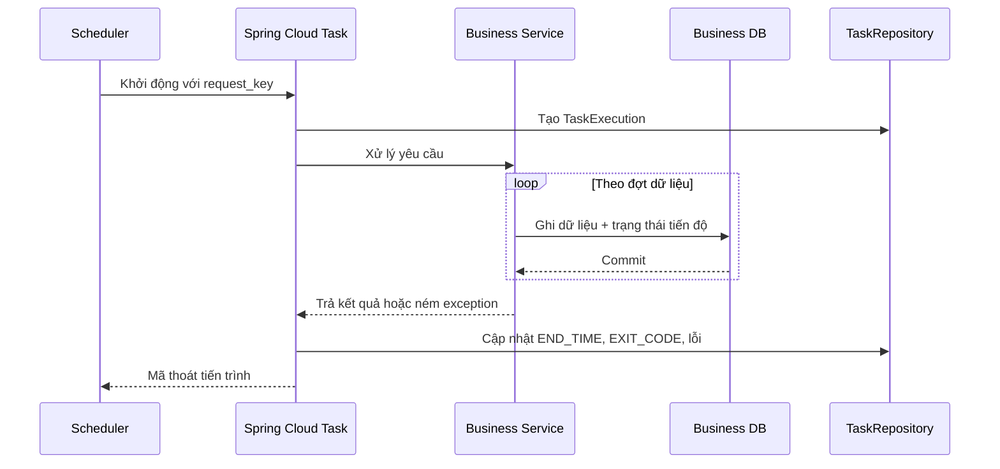
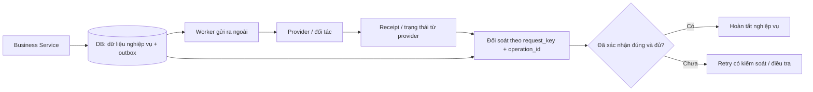

# Đối soát lịch sử thực thi với kết quả thực tế

## 1. Vì sao một `TaskExecution` thành công chưa đủ?

**Spring Cloud Task** giúp xây dựng các ứng dụng Spring Boot chạy trong thời gian hữu hạn: nhập dữ liệu, kết xuất báo cáo, đồng bộ từ đối tác hoặc xử lý một yêu cầu được kích hoạt theo lịch. Khi có cơ sở dữ liệu, `TaskRepository` lưu metadata của mỗi lần chạy dưới dạng **`TaskExecution`**. Metadata cho biết task nào bắt đầu lúc nào, kết thúc lúc nào và framework ghi nhận mã thoát, lỗi ra sao.

Nhưng câu hỏi vận hành thường quan trọng hơn là: **Dữ liệu đáng lẽ phải được xử lý đã thực sự được xử lý đầy đủ và chính xác chưa?** Đây là câu hỏi về **kết quả nghiệp vụ**, không chỉ về trạng thái tiến trình.

Ví dụ một task nhập 1.000 đơn hàng:

- Task ghi vào CSDL được 850 đơn, rồi mất kết nối và thất bại. `TaskExecution` có thể báo lỗi nhưng **850 đơn đã tồn tại**.
- Task ghi đủ 1.000 đơn, commit thành công, rồi JVM bị tắt cưỡng bức trước khi cập nhật metadata kết thúc. `END_TIME` có thể rỗng nhưng **kết quả nghiệp vụ đã hoàn tất**.
- Runner bắt exception, chỉ in log rồi trả về bình thường. Metadata có thể ghi `EXIT_CODE = 0` trong khi thực tế **mới xử lý một phần**.
- Task ghi yêu cầu gửi 1.000 thông báo vào CSDL và thoát thành công, nhưng dịch vụ gửi tin bên ngoài vẫn chưa xác nhận đã phát đi đủ 1.000 thông báo.

Vì vậy, khi thiết kế **chạy lại an toàn**, phải đối chiếu **lịch sử thực thi** và **bằng chứng về kết quả thực tế** trước khi quyết định chạy lại, bỏ qua, tiếp tục từ checkpoint hay điều tra thủ công.

### Kết quả cần đạt

Sau bài học, bạn có thể thiết lập khóa tương quan giữa nhiều lần chạy và một yêu cầu nghiệp vụ; đối chiếu `TASK_EXECUTION` với dữ liệu đích, sổ trạng thái và hệ thống ngoài; phát hiện trường hợp task báo thành công nhưng dữ liệu thiếu hoặc task báo lỗi dù nghiệp vụ đã commit; từ đó đề xuất retry có idempotency và theo dõi vận hành phù hợp.

## 2. Phân biệt bốn lớp thông tin

| Lớp | Đối tượng tiêu biểu | Câu hỏi trả lời | Giới hạn |
| --- | --- | --- | --- |
| **Lần thực thi task** | `TASK_EXECUTION`, `TaskExecution` | Tiến trình task bắt đầu/kết thúc ra sao? | Không chứng minh mọi side effect đã hoàn tất |
| **Yêu cầu nghiệp vụ** | `request_key`, `source_hash`, trạng thái xử lý | Công việc logic nào cần thực hiện? | Một yêu cầu có thể được chạy nhiều lần |
| **Dữ liệu thực tế** | Hàng đã nhập, bản báo cáo, object lưu trữ | Đầu ra đã được tạo đúng và đủ chưa? | Đếm hàng chưa chắc chứng minh dữ liệu đúng |
| **Bằng chứng bên ngoài** | Receipt của API, trạng thái giao hàng, xác nhận đối tác | Side effect ngoài CSDL đã được phía nhận xác nhận chưa? | Timeout có thể khiến kết quả chưa xác định ngay |

Một số định danh dễ nhầm:

| Định danh | Ví dụ | Nên dùng vào việc gì? |
| --- | --- | --- |
| `TASK_NAME` | `orders-import` | Gom lịch sử các lần chạy cùng loại công việc |
| `TASK_EXECUTION_ID` | `412`, `413` | Truy vết **một lần chạy** trong `TaskRepository` |
| `request_key` | `partner-a-2026-11-24` | Nhận diện **một yêu cầu nghiệp vụ** qua các lần retry |
| `source_hash` | SHA-256 của bản dữ liệu đầu vào | Phát hiện đầu vào bị thay đổi nhưng dùng lại cùng `request_key` |
| Business key | `(partner_id, external_order_id)` | Chặn ghi trùng cùng một đơn hàng trong dữ liệu đích |
| Provider operation ID | ID phản hồi từ hệ thống ngoài | Đối chiếu kết quả của một side effect ngoài CSDL |

**Quy tắc:** một `request_key` ổn định qua các lần retry; `TASK_EXECUTION_ID` có thể thay đổi giữa các attempt. Không lấy ID tự tăng của `TaskRepository` làm khóa chống trùng cho đơn hàng. Nếu scheduler phát lại cùng dữ liệu với `request_key` mới tùy ý, lớp idempotency ở mức yêu cầu có thể bị vô hiệu hóa.

## 3. Những khoảng trống giữa commit và metadata

Hãy xem thứ tự khái niệm khi task chạy:



Giữa các bước có thể xảy ra mất kết nối, timeout, JVM bị dừng hoặc mất điện. Việc cập nhật bảng nghiệp vụ và metadata task **không mặc nhiên nằm trong cùng một transaction nguyên tử**; trường hợp side effect ngoài CSDL còn khó bảo đảm hơn.

| Thời điểm sự cố | `TaskRepository` có thể thấy | Kết quả thực tế có thể thấy | Quyết định thích hợp |
| --- | --- | --- | --- |
| Trước khi tạo `TaskExecution` | Không có bản ghi | Chưa xử lý hoặc chưa biết | Kiểm tra log khởi động, yêu cầu và side effect trước khi phát lại |
| Sau khi tạo execution, trước commit nghiệp vụ | Có `START_TIME`, chưa kết thúc | Chưa có dữ liệu mới | Xác minh tiến trình đã dừng; cân nhắc retry |
| Sau khi commit một số đợt | Thất bại hoặc `END_TIME` rỗng | Dữ liệu một phần | Tiếp tục dựa trên business key/checkpoint; tránh nhập lại mù quáng |
| Sau khi đã commit toàn bộ, trước khi update task | Thất bại hoặc chưa kết thúc | Nghiệp vụ có thể hoàn thành đầy đủ | Đối soát, ghi nhận hoàn tất; không lặp side effect chỉ vì metadata lỗi |
| Sau khi task kết thúc với mã 0 | `EXIT_CODE = 0` | Đầu ra có thể chưa đủ hoặc downstream còn pending | Đối soát trước khi công bố đã hoàn thành |

Ngay cả khi `TaskExecution` có `END_TIME` và `EXIT_CODE = 0`, câu trả lời cuối cùng vẫn phải dựa vào **tiêu chí hoàn thành nghiệp vụ**. Ngược lại, một hàng `TaskExecution` chưa có `END_TIME` có thể do JVM chết sau khi đã commit; đừng tự suy ra task đang chạy mãi.

## 4. Xác định nguồn sự thật và điều kiện hoàn thành

Trước khi viết SQL đối soát, hãy trả lời ba câu hỏi cho **từng loại tác vụ**:

1. **Phạm vi cần xử lý là gì?** Ví dụ file của đối tác A cho ngày 24/11, gồm 1.000 `external_order_id` duy nhất và checksum của tệp nguồn.
2. **Kết quả đúng được xác nhận bằng gì?** Ví dụ tất cả ID hợp lệ phải xuất hiện đúng một lần trong bảng đơn hàng; nội dung khớp bản nguồn; những dòng không hợp lệ phải có bản ghi từ chối rõ nguyên nhân.
3. **Ai là nguồn sự thật cuối cùng?** Ví dụ CSDL đơn hàng là nguồn sự thật cho dữ liệu nhập; API nhà cung cấp thanh toán là nguồn sự thật cho giao dịch đã thanh toán; object storage và checksum là nguồn sự thật cho tệp đã xuất.

Không nên dùng một cờ `completed = true` do chính runner tự đặt mà không kiểm tra dữ liệu thực. Cờ trạng thái vẫn hữu ích, nhưng cần được gắn với **invariant** (bất biến) kiểm chứng được.

### Ví dụ invariant cho task nhập đơn hàng

Giả sử input manifest liệt kê tập ID nguồn (S), tập ID thực tế đã nhập là (D), và tập ID bị từ chối có lý do là (R). Nếu nghiệp vụ cho phép từ chối một số bản ghi, điều kiện hoàn thành có thể là:

\[
S = D \cup R,\qquad D \cap R = \varnothing
\]

Đồng thời, mỗi ID trong (D) phải có payload hoặc hash tương ứng đúng với nguồn. Đếm `COUNT(*) = 1000` **chưa đủ**: một bản ghi có thể bị thiếu nhưng một bản ghi khác bị nhân đôi. Nếu 1.000 bản ghi đều hợp lệ và không có bản ghi từ chối, có thể kiểm tra tập ID nguồn với tập ID đích và checksum của từng bản ghi.

Đối với task tạo tệp, invariant có thể là **file tồn tại, có checksum trùng manifest, đúng số bản ghi và đã được hệ thống nhận xác nhận**. Đối với task gửi thông báo, cần tách “đã ghi yêu cầu gửi” khỏi “nhà cung cấp đã nhận” và “người nhận đã nhận” vì đây là các trạng thái khác nhau.

## 5. Thiết kế sổ đối soát riêng với TaskRepository

Ví dụ dưới đây dùng **PostgreSQL** để các lần chạy khác nhau cùng truy cập một kho bền vững. Bảng trong phần này là **bảng nghiệp vụ do ứng dụng quản lý**. Không tự sửa cấu trúc `TASK_EXECUTION` hoặc `TASK_EXECUTION_PARAMS` của Spring Cloud Task.

### 5.1. Bảng yêu cầu và dữ liệu đã nhập

```sql
-- DDL minh họa cho PostgreSQL, tạo bằng migration được kiểm soát.
CREATE TABLE import_requests (
    request_key VARCHAR(80) PRIMARY KEY,
    source_hash CHAR(64) NOT NULL,
    expected_rows INTEGER NOT NULL CHECK (expected_rows >= 0),
    status VARCHAR(20) NOT NULL
        CHECK (status IN ('PENDING', 'RUNNING', 'PARTIAL',
                         'COMPLETED', 'NEEDS_REVIEW')),
    updated_at TIMESTAMPTZ NOT NULL DEFAULT CURRENT_TIMESTAMP,
    completed_at TIMESTAMPTZ
);

CREATE TABLE imported_orders (
    source_system VARCHAR(60) NOT NULL,
    external_order_id VARCHAR(100) NOT NULL,
    request_key VARCHAR(80) NOT NULL REFERENCES import_requests(request_key),
    payload_hash CHAR(64) NOT NULL,
    amount NUMERIC(18, 2) NOT NULL,
    PRIMARY KEY (source_system, external_order_id)
);

CREATE INDEX idx_imported_orders_request
    ON imported_orders(request_key);
```

Ở đây:

- `request_key` không thay đổi khi retry cùng một yêu cầu; `source_hash` ngăn vô tình tái sử dụng mã với nội dung đầu vào đã đổi.
- `expected_rows` là số **ID đơn hàng hợp lệ và duy nhất** theo hợp đồng nghiệp vụ của ví dụ. Nếu có dòng được từ chối, cần bổ sung sổ từ chối rồi thay điều kiện đối soát cho phù hợp.
- Khóa chính `(source_system, external_order_id)` bảo vệ không ghi trùng đơn từ cùng nguồn ngay cả khi một yêu cầu khác cố nhập lại cùng đơn. Khi gặp trùng khóa, phải so sánh payload và quy tắc nghiệp vụ; không tự động coi mọi `ON CONFLICT DO NOTHING` là thành công.
- `status` là dấu mốc nghiệp vụ; chỉ được chuyển `COMPLETED` sau khi kiểm tra điều kiện đầy đủ và dữ liệu đã commit. Những lần chạy chết đột ngột có thể để lại `RUNNING`, cần điều tra thay vì coi đó là bằng chứng tiến trình còn sống.

Không lưu mật khẩu, token hoặc toàn bộ payload nhạy cảm vào các bảng đối soát. Dùng checksum/ID được chuẩn hóa, quyền truy cập tối thiểu và chính sách lưu trữ phù hợp.

### 5.2. Nối một yêu cầu với nhiều lần chạy task

Thêm bảng liên kết (chỉ là bảng nghiệp vụ, không phải bảng Spring Cloud Task):

```sql
CREATE TABLE import_task_attempts (
    task_execution_id BIGINT PRIMARY KEY,
    request_key VARCHAR(80) NOT NULL REFERENCES import_requests(request_key),
    linked_at TIMESTAMPTZ NOT NULL DEFAULT CURRENT_TIMESTAMP
);

CREATE INDEX idx_import_attempts_request
    ON import_task_attempts(request_key);
```

Ứng dụng hoặc tầng điều phối cần **ghi liên kết chính xác** giữa `TaskExecution.getExecutionId()` và `request_key` tại thời điểm đã có ID execution. Có thể dùng listener Spring Cloud Task hoặc cơ chế tương quan do hệ thống điều phối quản lý, nhưng phải xử lý trường hợp lỗi xảy ra trước khi liên kết được ghi. Không liên kết hai bảng **chỉ dựa vào giờ bắt đầu gần nhau** vì nhiều task có thể chạy đồng thời, lệch đồng hồ hoặc được retry sát nhau.

Trong ví dụ, bảng `import_task_attempts` lưu ID thuộc cùng `TaskRepository` mà truy vấn đối soát sẽ dùng. Nếu metadata task ở một database khác, không tạo foreign key trực tiếp tùy tiện; hãy đồng bộ bằng cơ chế tích hợp được thiết kế rõ ràng và kiểm tra tính nhất quán khi đối soát.

### 5.3. Cách ghi an toàn theo từng đợt

Một phương án khi import khối lượng lớn là ghi dữ liệu theo các transaction ngắn:

```text
1. Nhận request_key và checksum của tệp nguồn.
2. Tạo/đọc import_requests; nếu request_key đã tồn tại thì
   phải kiểm tra source_hash và phạm vi đầu vào giống lần trước.
3. Với từng đợt:
   - kiểm tra đơn hàng đã tồn tại theo source_system + external_order_id;
   - nếu đã tồn tại, so sánh payload_hash và quy tắc cập nhật;
   - nếu chưa tồn tại, chèn đơn hàng với ràng buộc UNIQUE;
   - commit đợt xử lý, ghi checkpoint bằng cùng transaction nếu có.
4. Đối chiếu đầy đủ tập ID/payload đã nhập với manifest đầu vào.
5. Chỉ khi đối chiếu đạt, đặt import_requests.status = COMPLETED.
6. Nếu còn thiếu hoặc có xung đột, ghi PARTIAL hoặc NEEDS_REVIEW.
```

Lệnh SQL minh họa để **đánh dấu hoàn tất sau khi đã xác minh**:

```sql
-- Minh họa: chỉ dùng sau khi quy trình đối chiếu ID/hash đã PASS.
UPDATE import_requests
SET status = 'COMPLETED',
    completed_at = CURRENT_TIMESTAMP,
    updated_at = CURRENT_TIMESTAMP
WHERE request_key = 'partner-a-2026-11-24'
  AND status IN ('RUNNING', 'PARTIAL');
```

Đối với hệ thống thật, việc kiểm tra invariant và cập nhật `COMPLETED` cần có thiết kế transaction/khóa thích hợp để dữ liệu không thay đổi giữa lúc kiểm tra và lúc ghi trạng thái. Nếu nhiều instance có thể cập nhật một yêu cầu, cân nhắc khóa hàng, optimistic locking hoặc một cơ chế điều phối riêng. Cờ single instance theo tên task **không bảo vệ** mọi trường hợp hai yêu cầu khác tên cùng cập nhật một đơn hàng.

## 6. Truy vấn đối soát thực tế

Ví dụ giả định các bảng trên cùng schema PostgreSQL với schema metadata mặc định của Spring Cloud Task. Tên cột, table prefix và tính sẵn có của metadata Task phải được kiểm tra theo **phiên bản framework và cấu hình** của dự án.

### 6.1. Xem lịch sử thực thi theo tên task

```sql
SELECT TASK_EXECUTION_ID,
       TASK_NAME,
       START_TIME,
       END_TIME,
       EXIT_CODE,
       EXIT_MESSAGE,
       ERROR_MESSAGE
FROM TASK_EXECUTION
WHERE TASK_NAME = 'orders-import'
ORDER BY START_TIME DESC, TASK_EXECUTION_ID DESC;
```

Đọc các trường này trước khi xử lý retry: `EXIT_CODE = 0` thường biểu thị một lần task được framework ghi nhận thành công; mã khác 0 là lỗi theo cơ chế ánh xạ exit code. Một bản ghi có `END_TIME IS NULL` **chưa chắc** task còn chạy; kiểm tra thêm tiến trình, log và trạng thái scheduler. Không lấy `TASK_EXECUTION_ID` lớn nhất làm bằng chứng về thứ tự **kết thúc**.

### 6.2. Đối chiếu số đơn đã nhập với dự kiến

```sql
SELECT r.request_key,
       r.status AS declared_status,
       r.expected_rows,
       COUNT(o.external_order_id) AS actual_rows,
       (COUNT(o.external_order_id) = r.expected_rows) AS count_matches,
       r.completed_at
FROM import_requests AS r
LEFT JOIN imported_orders AS o
       ON o.request_key = r.request_key
WHERE r.request_key = 'partner-a-2026-11-24'
GROUP BY r.request_key, r.status, r.expected_rows, r.completed_at;
```

Ví dụ kết quả:

| `declared_status` | `expected_rows` | `actual_rows` | Nhận định ban đầu |
| --- | ---: | ---: | --- |
| `COMPLETED` | 1.000 | 1.000 | **Cần** xác minh ID/hash và đầu ra ngoài DB trước khi kết luận xong |
| `COMPLETED` | 1.000 | 950 | Cờ hoàn tất và dữ liệu thực tế **mâu thuẫn** |
| `PARTIAL` | 1.000 | 850 | Có tiến độ đã commit; retry phải giữ dữ liệu hợp lệ |
| `RUNNING` | 1.000 | 1.000 | Có thể đã ghi đủ nhưng chưa cập nhật trạng thái; kiểm tra tiến trình và invariant |

Nếu cần kiểm tra từng ID nguồn, hãy lưu **manifest** (hoặc bảng snapshot ID nguồn) và so sánh tập ID theo phép `EXCEPT`/anti-join. Chỉ có `COUNT` không phát hiện payload sai, record thừa hoặc hai ID bị tráo đổi. Với dữ liệu không thể lưu toàn bộ, dùng checksum được tính theo quy tắc chuẩn hóa rõ ràng và có đủ độ tin cậy, nhưng cũng nên giữ khả năng truy vết tới từng bản ghi khi có sai khác.

### 6.3. Ghép các attempt với kết quả nghiệp vụ

```sql
SELECT a.request_key,
       t.TASK_EXECUTION_ID,
       t.START_TIME,
       t.END_TIME,
       t.EXIT_CODE,
       r.status AS business_status,
       r.expected_rows,
       COUNT(o.external_order_id) AS actual_rows
FROM import_task_attempts AS a
JOIN TASK_EXECUTION AS t
  ON t.TASK_EXECUTION_ID = a.task_execution_id
JOIN import_requests AS r
  ON r.request_key = a.request_key
LEFT JOIN imported_orders AS o
  ON o.request_key = r.request_key
WHERE a.request_key = 'partner-a-2026-11-24'
GROUP BY a.request_key, t.TASK_EXECUTION_ID, t.START_TIME,
         t.END_TIME, t.EXIT_CODE,
         r.status, r.expected_rows
ORDER BY t.START_TIME, t.TASK_EXECUTION_ID;
```

Điểm quan trọng của kết quả: **nhiều `TASK_EXECUTION_ID` có thể cùng trỏ đến một `request_key` và cùng trạng thái nghiệp vụ cuối cùng**. Truy vấn này giúp thấy lịch sử thử lại, nhưng không thể suy ra chính xác bao nhiêu đơn mỗi attempt đã ghi chỉ từ tổng `actual_rows` hiện tại. Nếu cần attribution theo attempt, hãy lưu `first_written_by_execution_id` hoặc sự kiện checkpoint trong bảng nghiệp vụ với quy ước nhất quán.

### 6.4. Tìm các yêu cầu đã đánh dấu xong nhưng sai số lượng

```sql
SELECT r.request_key, r.expected_rows,
       COUNT(o.external_order_id) AS actual_rows
FROM import_requests AS r
LEFT JOIN imported_orders AS o
  ON o.request_key = r.request_key
WHERE r.status = 'COMPLETED'
GROUP BY r.request_key, r.expected_rows
HAVING COUNT(o.external_order_id) <> r.expected_rows;
```

Đây là **tín hiệu cảnh báo**, không phải công cụ tự sửa dữ liệu. Cần điều tra xem dữ liệu nguồn bị thay đổi, thao tác ghi trùng/thiếu, xóa sau khi hoàn tất hoặc lỗi chuyển trạng thái. Tùy nghiệp vụ, thiếu dữ liệu cần import bổ sung; sai payload cần sửa theo chính sách kiểm soát; không dùng một câu `UPDATE status='COMPLETED'` để che giấu bất nhất.

### 6.5. Xác định các attempt chưa có kết thúc

```sql
SELECT t.TASK_EXECUTION_ID,
       t.TASK_NAME,
       t.START_TIME,
       a.request_key,
       r.status AS business_status
FROM TASK_EXECUTION AS t
LEFT JOIN import_task_attempts AS a
  ON a.task_execution_id = t.TASK_EXECUTION_ID
LEFT JOIN import_requests AS r
  ON r.request_key = a.request_key
WHERE t.TASK_NAME = 'orders-import'
  AND t.END_TIME IS NULL
ORDER BY t.START_TIME;
```

Không tự động coi tất cả hàng này là “mồ côi”: một số attempt có thể còn chạy. Hãy đối chiếu pod/JVM đang sống, lock/lease của hệ điều phối, log và khoảng thời gian chạy bình thường trước khi đánh dấu cần phục hồi.

## 7. Ví dụ Java: task đối soát chạy **sau** task nhập dữ liệu

Nên triển khai đối soát như một bước độc lập **sau khi lần import đã kết thúc hoặc đã được xác định dừng hẳn**. Nếu runner đang nhập đơn hàng rồi tự truy vấn `TASK_EXECUTION` của chính nó, `END_TIME` và `EXIT_CODE` cuối cùng có thể chưa được ghi, dẫn đến kết luận sai.

Ví dụ dưới đây minh họa một **Spring Cloud Task đối soát** tên `orders-import-audit` đọc bảng nghiệp vụ. Nó chỉ kiểm tra số lượng và trạng thái để tạo một tín hiệu đầu tiên; bước kiểm tra ID/hash và side effect bên ngoài vẫn phải bổ sung theo hợp đồng của từng dự án.

### 7.1. Dependency và cấu hình

Trong dự án Maven dùng BOM Spring Cloud tương thích với Spring Boot, các dependency chính gồm:

```xml
<dependencies>
    <dependency>
        <groupId>org.springframework.cloud</groupId>
        <artifactId>spring-cloud-starter-task</artifactId>
    </dependency>
    <dependency>
        <groupId>org.springframework.boot</groupId>
        <artifactId>spring-boot-starter-jdbc</artifactId>
    </dependency>
    <dependency>
        <groupId>org.postgresql</groupId>
        <artifactId>postgresql</artifactId>
        <scope>runtime</scope>
    </dependency>
</dependencies>
```

`src/main/resources/application.yml`:

```yaml
spring:
  application:
    name: orders-import-audit
  main:
    web-application-type: none
  datasource:
    url: ${TASK_DB_URL}
    username: ${TASK_DB_USER}
    password: ${TASK_DB_PASSWORD}
  cloud:
    task:
      name: orders-import-audit
      initialize-enabled: false
```

`initialize-enabled: false` giả định schema `TASK_*` và các bảng nghiệp vụ đã được **migration trước** khi chạy. Tránh đặt mật khẩu trong source hoặc tham số CLI. Tài khoản chạy đối soát có thể dùng quyền đọc các bảng nghiệp vụ; quyền cần thiết cho chính `TaskRepository` phụ thuộc cấu hình cấp riêng `DataSource`/tài khoản.

### 7.2. Dịch vụ đối soát

```java
package com.example.audit;

public record ImportAuditResult(
        String requestKey,
        String declaredStatus,
        long expectedRows,
        long actualRows) {

    public boolean countMatches() {
        return expectedRows == actualRows;
    }

    public boolean basicCheckPassed() {
        return "COMPLETED".equals(declaredStatus) && countMatches();
    }
}
```

```java
package com.example.audit;

import org.springframework.jdbc.core.JdbcTemplate;
import org.springframework.stereotype.Service;
import org.springframework.transaction.annotation.Transactional;

@Service
public class ImportAuditService {

    private final JdbcTemplate jdbc;

    public ImportAuditService(JdbcTemplate jdbc) {
        this.jdbc = jdbc;
    }

    @Transactional(readOnly = true)
    public ImportAuditResult inspect(String requestKey) {
        return jdbc.queryForObject("""
                SELECT r.request_key,
                       r.status,
                       r.expected_rows,
                       COUNT(o.external_order_id) AS actual_rows
                FROM import_requests r
                LEFT JOIN imported_orders o
                  ON o.request_key = r.request_key
                WHERE r.request_key = ?
                GROUP BY r.request_key, r.status, r.expected_rows
                """,
                (rs, rowNum) -> new ImportAuditResult(
                        rs.getString("request_key"),
                        rs.getString("status"),
                        rs.getLong("expected_rows"),
                        rs.getLong("actual_rows")),
                requestKey);
    }
}
```

Phương thức `inspect` chạy một truy vấn tổng hợp theo `request_key`. Nếu không có yêu cầu tương ứng, `JdbcTemplate` ném ngoại lệ; trong hệ thống thật nên ánh xạ lỗi này thành kết quả `UNKNOWN_REQUEST` và cảnh báo có ngữ cảnh. `@Transactional(readOnly = true)` thể hiện mục đích đọc; mức nhất quán của snapshot còn phụ thuộc isolation level và database. Không kết luận final khi một tiến trình khác đang sửa dữ liệu cùng yêu cầu.

### 7.3. Runner nhận tham số, trình bày kết quả và báo thất bại

```java
package com.example.audit;

import java.util.List;

import org.springframework.boot.ApplicationArguments;
import org.springframework.boot.ApplicationRunner;
import org.springframework.boot.SpringApplication;
import org.springframework.boot.autoconfigure.SpringBootApplication;
import org.springframework.context.annotation.Bean;

@SpringBootApplication
public class ImportAuditApplication {

    public static void main(String[] args) {
        SpringApplication.run(ImportAuditApplication.class, args);
    }

    @Bean
    ApplicationRunner auditOnce(ImportAuditService service) {
        return args -> {
            List<String> values = args.getOptionValues("audit.request-key");
            if (values == null || values.size() != 1 ||
                    values.get(0) == null || values.get(0).isBlank()) {
                throw new IllegalArgumentException(
                        "Cần --audit.request-key=<mã yêu cầu>");
            }

            ImportAuditResult result = service.inspect(values.get(0));
            System.out.printf(
                    "request=%s status=%s expected=%d actual=%d%n",
                    result.requestKey(), result.declaredStatus(),
                    result.expectedRows(), result.actualRows());

            if (!result.basicCheckPassed()) {
                throw new IllegalStateException(
                        "Đối soát cơ bản chưa đạt; cần điều tra trước khi retry");
            }
            System.out.println("Đối soát cơ bản đạt; tiếp tục kiểm tra ID/hash nếu cần.");
        };
    }
}
```

Ví dụ dùng Java 17 trở lên do có `record` và text block (`"""`). Runner ném exception để **lần chạy audit** được nhận diện là không đạt kiểm tra cơ bản; nó **không tự chạy lại import, không tự xóa dữ liệu và không tự kết luận đã kiểm tra đủ mọi side effect**.

Giả sử đã build thành `target/orders-import-audit.jar`, môi trường có đủ biến kết nối PostgreSQL, chạy:

```bash
# Chạy sau khi job import đã kết thúc hoặc được xác nhận đã dừng hẳn.
java -jar target/orders-import-audit.jar \
  --audit.request-key=partner-a-2026-11-24
```

Với dữ liệu bài lab: `COMPLETED`, `expected_rows=3`, `actual_rows=3`, runner in trạng thái đạt kiểm tra cơ bản. Nếu chỉ có hai đơn đã nhập hoặc status vẫn là `PARTIAL`, audit ném exception để scheduler/hệ thống giám sát nhận biết cần xem xét.

## 8. Bảng quyết định: khi nào chạy lại?

Sau khi xác minh task cũ **không còn chạy**, dùng trạng thái thực thi và dữ liệu thật để phân loại:

| Metadata của attempt cuối | Bằng chứng nghiệp vụ | Kết luận | Hướng xử lý |
| --- | --- | --- | --- |
| `END_TIME` có giá trị, `EXIT_CODE=0` | Tất cả invariant đạt, downstream xác nhận nếu cần | Hoàn thành | Ghi nhận thành công; không retry |
| `EXIT_CODE=0` | Thiếu ID, sai checksum hoặc downstream chưa hoàn tất | **Mâu thuẫn** giữa kỹ thuật và nghiệp vụ | Điều tra, sửa lỗi và thực hiện bước còn thiếu; không công bố hoàn thành |
| `EXIT_CODE!=0` | Dữ liệu đã commit đủ, kiểm tra nghiệp vụ đạt | Có thể lỗi **sau commit** | Không nhân đôi side effect; ghi chú lần chạy lỗi nhưng yêu cầu đã hoàn thành |
| `EXIT_CODE!=0` | Một phần dữ liệu hợp lệ đã commit | Chưa hoàn thành | Tiếp tục dựa trên checkpoint/khóa nghiệp vụ, retry có giới hạn |
| `END_TIME IS NULL` | Chưa xác định tiến trình còn sống | Chưa đủ căn cứ | Kiểm tra orchestrator, log, timeout/lease trước khi quyết định |
| Task bị dừng cưỡng bức | Bảng nghiệp vụ hoàn tất nhưng receipt bên ngoài chưa xác định | Kết quả ngoài DB **chưa rõ** | Truy vấn trạng thái tại đối tác theo idempotency key, không gửi lại mù quáng |
| Không có metadata Task | Không thấy dữ liệu nghiệp vụ nhưng có thể có side effect ngoài hệ thống | Cần điều tra | Kiểm tra log, request key, outbox/provider trước khi phát lại |

**Nguyên tắc vận hành:** retry là **một quyết định dựa trên bằng chứng**, không phải phản xạ đơn giản khi thấy `EXIT_CODE != 0`. Thực tế có thể cần “resume phần còn thiếu”, “reconcile lại sau vài phút” hoặc “chuyển vào hàng đợi điều tra” thay vì chạy lại từ đầu.

### Điều kiện tiên quyết để retry an toàn

1. **Khóa logic ổn định:** scheduler truyền lại cùng `request_key`, `source_hash` và phạm vi xử lý; ứng dụng từ chối thay nội dung bằng cùng khóa.
2. **Chống trùng ở DB:** unique business key và thao tác upsert/kiểm tra xung đột đúng quy tắc; không dùng `SELECT ...` rồi `INSERT` tách rời không có ràng buộc khi chạy đồng thời.
3. **Checkpoint bền vững:** đánh dấu item/đợt đã hoàn tất trong transaction phù hợp để lần sau bỏ qua đúng phần đã commit.
4. **Không chạy chồng khi chưa được thiết kế:** phối hợp `spring.cloud.task.single-instance-enabled`, khóa nghiệp vụ hoặc scheduler concurrency policy phù hợp; một khóa theo task name không đủ khi nhiều task name cùng sửa dữ liệu.
5. **Giới hạn retry:** backoff, số lần thử tối đa, phân biệt lỗi tạm thời với dữ liệu không hợp lệ và có đường chuyển sang `NEEDS_REVIEW`.
6. **Đối soát lại sau retry:** kiểm tra tập ID/hash, trạng thái và side effect thực tế; không dừng ở việc runner lần cuối thoát mã 0.

## 9. Khi tác vụ có side effect ngoài cơ sở dữ liệu

Gửi email, gọi API thanh toán, xuất tệp lên object storage hay gửi message đều có khoảng trống giữa “ứng dụng đã yêu cầu” và “bên nhận đã thực hiện”. Một lần timeout không chứng minh bên nhận chưa xử lý; gửi lại có thể gây tác động trùng.

### Mô hình outbox và receipt



Khi tạo side effect cần bền vững, ghi **dữ liệu nghiệp vụ và outbox** trong một transaction nếu cùng CSDL. Worker gửi thông điệp bằng **idempotency key** hoặc operation ID ổn định, lưu trạng thái/receipt từ nhà cung cấp. Sau đó đối soát dựa trên phản hồi chính thức của hệ thống nhận, không dựa vào một dòng log “sent” vừa được in.

Outbox giúp tránh mất yêu cầu gửi, nhưng vẫn có thể phát lại thông điệp khi worker chết sau khi gửi và trước khi đánh dấu đã gửi. Vì vậy, **đầu nhận hoặc provider cũng cần xử lý idempotency**. Nếu nhà cung cấp không hỗ trợ truy vấn trạng thái hoặc idempotency key, phải thừa nhận có trường hợp “không rõ đã thực thi hay chưa” và có quy trình điều tra thủ công.

### Đối soát theo thời gian

Nhiều hệ thống chỉ đạt trạng thái hoàn tất **sau một khoảng trễ**: webhook đến muộn, đối tác xử lý theo batch, object storage chưa hoàn thành quy trình xác nhận. Hãy định nghĩa các trạng thái như `PENDING_EXTERNAL`, `CONFIRMED`, `REJECTED`, `UNKNOWN`; giới hạn thời gian chờ và lên lịch đối soát lại với backoff. Không đánh dấu yêu cầu thất bại vĩnh viễn chỉ vì chưa có xác nhận ở lần kiểm tra đầu tiên.

## 10. Phối hợp với Spring Batch và lịch chạy

Nếu task khởi chạy **Spring Batch**, có thêm một lớp bằng chứng:

- `TaskExecution` của Spring Cloud Task: trạng thái **tiến trình ứng dụng**.
- `JobExecution` và `StepExecution` của Spring Batch: trạng thái **job/step**, `readCount`, `writeCount`, `skipCount`, lỗi và khả năng restart theo job parameters.
- Bảng nghiệp vụ/nguồn đích: dữ liệu **thực sự được commit**, có đúng tập ID và quy tắc xử lý hay không.

Đừng suy ra “đã xử lý đúng 1.000 dòng” chỉ từ `writeCount=1000` nếu còn cơ chế skip, retry, filter, writer idempotent, nhiều step hoặc side effect ngoài DB. Đếm Batch hỗ trợ chẩn đoán nhưng **không thay thế đối soát dữ liệu đích**. Khi task kích hoạt nhiều job hoặc job chạy bất đồng bộ, metadata Task có thể hoàn tất trước một số xử lý downstream; phải theo dõi cả job và điều kiện hoàn tất tổng thể.

Scheduler (cron, Kubernetes CronJob, workflow engine) nên kích hoạt task đối soát **sau khi task nhập hoàn thành hoặc được xác nhận dừng**, với cùng `request_key`. Nếu yêu cầu còn pending, có thể lên lịch đối soát lại; chỉ chạy lại nhập dữ liệu sau khi đánh giá bảng quyết định ở mục 8. Không để nhiều scheduler tự quyết định retry cùng một yêu cầu theo các quy tắc khác nhau.

### Giám sát và cảnh báo nên có

| Tín hiệu | Diễn giải | Phản ứng gợi ý |
| --- | --- | --- |
| `EXIT_CODE=0` nhưng invariant nghiệp vụ sai | Thành công giả hoặc dữ liệu bị thay đổi sau khi task chạy | Cảnh báo ưu tiên cao, điều tra dữ liệu đích |
| `EXIT_CODE!=0` nhưng nghiệp vụ đã xác nhận đủ | Task lỗi sau commit / lỗi metadata / hậu xử lý | Ghi nhận sai khác; ngăn retry gây trùng |
| `END_TIME IS NULL` vượt ngưỡng hợp lý | Task có thể đang chạy lâu hoặc bị dừng đột ngột | Kiểm tra tiến trình và log trước khi phục hồi |
| `PARTIAL` lâu hơn SLA | Có dữ liệu một phần chưa được hoàn tất | Retry theo checkpoint hoặc chuyển điều tra |
| `PENDING_EXTERNAL` quá thời gian chờ | Provider chưa xác nhận side effect | Truy vấn receipt, backoff, escalation |
| Nhiều execution cho cùng `request_key` | Có retry hoặc duplicate trigger | Kiểm tra idempotency và nguyên nhân chạy lại |
| Thiếu bản ghi liên kết execution/request | Lỗ hổng truy vết hoặc lỗi khi khởi động rất sớm | Truy tìm theo request key/log/orchestrator rồi bổ sung điều tra |

Đặt khoảng thời gian truy vấn theo **múi giờ và độ trễ đã thống nhất**; đừng ghép attempt chỉ vì timestamp gần nhau. Giữ các log/metadata cần thiết lâu đủ để điều tra nhưng tuân thủ chính sách lưu trữ, phân quyền và bảo vệ dữ liệu nhạy cảm.

## 11. Các sai lầm thường gặp

| Sai lầm | Hệ quả | Cách sửa |
| --- | --- | --- |
| Thấy `EXIT_CODE=0` thì mặc định dữ liệu đủ | Bỏ sót output thiếu/sai | Định nghĩa invariant và đối soát dữ liệu đích |
| Thấy `EXIT_CODE!=0` thì import lại từ đầu | Trùng các đợt đã commit | Đọc checkpoint, khóa nghiệp vụ và bằng chứng side effect |
| Dùng `TASK_EXECUTION_ID` làm idempotency key | Retry sinh ID mới, không nhận ra cùng yêu cầu | Dùng `request_key` ổn định qua các lần chạy |
| Chỉ so `COUNT(*)` | Không phát hiện ID bị thay thế hoặc payload sai | Đối chiếu tập ID, checksum và quy tắc nghiệp vụ |
| `ON CONFLICT DO NOTHING` cho mọi xung đột | Có thể che giấu bản ghi cũ có payload khác | So sánh dữ liệu và từ chối trường hợp mâu thuẫn |
| `RUNNING` trong DB đồng nghĩa còn tiến trình | Bản ghi có thể bị bỏ lại sau crash | Kiểm tra orchestrator, lease, log, thời gian cập nhật |
| Gửi lại HTTP request ngay sau timeout | Provider có thể đã thực hiện, gây giao dịch trùng | Dùng idempotency key và API truy vấn trạng thái |
| Tự sửa `TASK_EXECUTION` cho “đẹp lịch sử” | Mất chứng cứ vận hành, sai sự thật lịch sử | Giữ metadata framework, ghi kết luận đối soát riêng |
| Chạy audit đồng thời khi import chưa commit xong | Đối soát thấy dữ liệu tạm thời và báo sai | Kiểm tra trạng thái tiến trình/transaction, chạy sau khi ổn định |

## 12. Bài thực hành tự kiểm tra

1. Giả sử `orders-import` có hai `TaskExecution`: lần đầu lỗi sau khi commit 850/1.000 đơn, lần hai xử lý được 150 đơn còn lại. Nêu số lượng bản ghi dữ liệu thực tế sau retry đúng, và giải thích vì sao không cộng tổng `writeCount` hoặc dựa vào `EXIT_CODE` đơn lẻ.
2. Tạo các bảng `import_requests`, `imported_orders` của ví dụ trên môi trường PostgreSQL thử nghiệm. Thêm một yêu cầu có `expected_rows=3` và hai đơn hàng, chạy truy vấn mục 6.2; giải thích trạng thái `PARTIAL` khác `COMPLETED` như thế nào.
3. Thêm đơn hàng thứ ba và xác minh từng `external_order_id`/`payload_hash`; sau đó chỉ khi invariant đạt mới cập nhật trạng thái nghiệp vụ thành `COMPLETED`.
4. Giả lập `TASK_EXECUTION.EXIT_CODE=0` nhưng `import_requests.status='PARTIAL'`. Bạn sẽ cảnh báo và quyết định retry thế nào? Vì sao không coi TaskRepository là nguồn sự thật duy nhất?
5. Giả lập task bị dừng sau khi commit đủ dữ liệu nhưng trước khi ghi `END_TIME`. Phân biệt dấu hiệu tiến trình còn hoạt động, bản ghi metadata bỏ dở và kết quả nghiệp vụ thực tế.
6. Thiết kế cách liên kết `request_key` với nhiều `TASK_EXECUTION_ID`, không dựa vào timestamp; giải thích cách xử lý attempt thất bại trước khi liên kết được ghi.
7. Mô tả trường hợp gọi API gửi thanh toán bị timeout nhưng đối tác đã thực hiện. Những trường dữ liệu và endpoint nào cần để đối soát trước khi gửi lại?
8. Nếu task chạy Spring Batch, đối chiếu `TaskExecution`, `JobExecution`, `StepExecution`, `writeCount` và bảng đích trong một kịch bản restart sau lỗi.
9. Lập ma trận quyết định cho bốn tổ hợp `EXIT_CODE` (0/khác 0) và kết quả nghiệp vụ (đủ/thiếu), kèm hướng xử lý an toàn.

Sau khi làm bài, bạn cần có khả năng trả lời **“một yêu cầu đã thực sự hoàn tất chưa?”** bằng dữ liệu và bằng chứng xác minh được, liên kết nhiều lần chạy với cùng yêu cầu, phân biệt trạng thái framework với trạng thái nghiệp vụ, và xây dựng đường retry/idempotency an toàn cho Spring Cloud Task chạy theo lịch, theo yêu cầu hoặc phối hợp Spring Batch.

## 13. Tài liệu tham khảo

- [Spring Cloud Task Reference — Features](https://docs.spring.io/spring-cloud-task/reference/features.html): `TaskExecution`, lifecycle và metadata trạng thái.
- [Spring Cloud Task — Task Repository Schema](https://docs.spring.io/spring-cloud-task/reference/appendix-task-repository-schema.html): các bảng metadata của TaskRepository và cấu trúc lưu lịch sử.
- [Spring Batch Reference](https://docs.spring.io/spring-batch/reference/): `JobRepository`, `JobExecution`, `StepExecution`, restart và metadata xử lý.
- [PostgreSQL Documentation — Constraints](https://www.postgresql.org/docs/current/ddl-constraints.html): unique key và ràng buộc toàn vẹn hỗ trợ idempotency.

Trong môi trường thực tế, hãy dùng schema và API **đúng phiên bản Spring Cloud Task/Spring Batch** của ứng dụng; kiểm tra tiêu chí hoàn thành nghiệp vụ, transaction và hành vi của hệ thống đối tác trước khi tự động quyết định retry.
