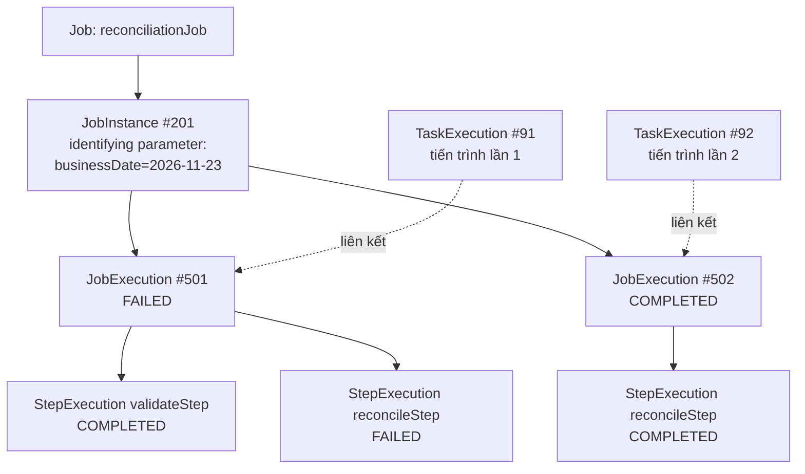
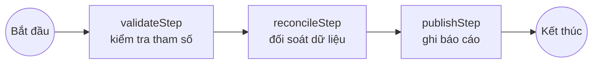
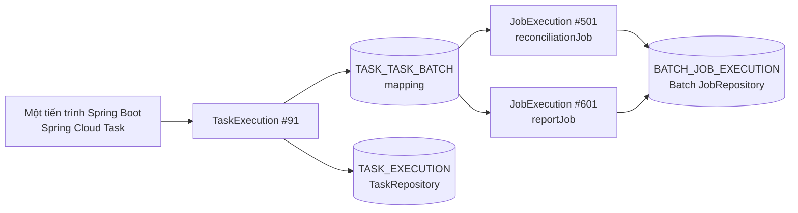

# Job, Step, JobInstance và JobExecution trong ứng dụng Task

## Mục tiêu bài học

Trong chương **Spring Batch** của mô-đun **Spring Cloud Task**, bài này giải thích mô hình thực thi Batch khi được đóng gói thành ứng dụng Spring Boot có thời gian chạy hữu hạn. Thay vì chỉ biết “Task đã chạy xong”, chúng ta sẽ xác định **Job nào được chạy, chạy cho tập dữ liệu nào, đã thử bao nhiêu lần, Step nào thành công hoặc thất bại, và làm sao liên kết kết quả với TaskExecution**.

Sau bài học, bạn có thể:

- Phân biệt chính xác `Job`, `Step`, `JobInstance`, `JobExecution` và `StepExecution`.
- Giải thích vì sao **tên Job + identifying JobParameters** xác định một JobInstance, trong khi **mỗi lần thử** có một JobExecution riêng.
- Phân biệt vòng đời **TaskExecution** của Spring Cloud Task với vòng đời Job/Step của Spring Batch.
- Cấu hình một Batch Job đơn giản chạy bên trong Spring Cloud Task bằng Spring Boot, truyền tham số và tra cứu metadata.
- Phân tích restart sau thất bại, sự khác nhau giữa restart và chạy instance mới, đồng thời tránh vô tình xử lý dữ liệu trùng.
- Hiểu vai trò của `TaskBatchExecutionListener`, bảng `TASK_TASK_BATCH`, `fail-on-job-failure` và cách đối chiếu kết quả từ Task đến từng Step.

## 1. Bài toán: một tiến trình Task cần xử lý hàng triệu bản ghi

Ứng dụng đối soát thanh toán chạy mỗi đêm với ngày nghiệp vụ `businessDate=2026-11-23`. Mỗi lần khởi chạy, JVM sẽ:

1. Kiểm tra ngày và nguồn dữ liệu.
2. Đọc giao dịch thành từng nhóm, đối chiếu với hệ thống đối tác.
3. Ghi kết quả đối soát và tổng hợp số dòng thành công/thất bại.
4. Thoát và trả mã kết quả cho cron, Docker hoặc Kubernetes Job.

**Spring Cloud Task** phù hợp để theo dõi **một lần chạy của toàn bộ ứng dụng**: bắt đầu lúc nào, kết thúc lúc nào, mã thoát và lỗi chung là gì. Nhưng nếu bước 2 xử lý được 800.000/1.000.000 giao dịch rồi lỗi, chỉ biết `TaskExecution.exitCode != 0` chưa trả lời được:

- Bước nào thất bại?
- Những bản ghi nào đã commit?
- Khi chạy lại cùng ngày, có được bỏ qua những bước đã hoàn tất không?
- Có thể tiếp tục xử lý từ checkpoint thay vì bắt đầu lại từ đầu không?

**Spring Batch** cung cấp mô hình `Job`/`Step`, quản lý giao dịch/chunk, trạng thái từng lần chạy và dữ liệu `ExecutionContext` phục vụ restart. Khi kết hợp, **Task quản lý tiến trình hữu hạn; Batch quản lý công việc dữ liệu bên trong tiến trình**.

## 2. Năm khái niệm không được đánh đồng

| Khái niệm | Bản chất | Ví dụ đối soát |
| --- | --- | --- |
| **`Job`** | Định nghĩa một quy trình Batch gồm một hoặc nhiều Step | `reconciliationJob` gồm `validateStep` và `reconcileStep` |
| **`Step`** | Định nghĩa một giai đoạn xử lý độc lập trong Job, có thể là tasklet hoặc chunk | `reconcileStep` đọc/xử lý/ghi giao dịch |
| **`JobInstance`** | **Một công việc logic** của Job, được định danh bằng **tên Job + các JobParameters đánh dấu identifying** | `reconciliationJob` cho `businessDate=2026-11-23` |
| **`JobExecution`** | **Một lần thử chạy** của một JobInstance; có trạng thái, thời gian, lỗi, exit status | Lần thử #1 `FAILED`, lần thử #2 `COMPLETED` |
| **`StepExecution`** | **Một lần thực thi Step** thuộc một JobExecution; có số bản ghi read/write, commit, rollback và context | `reconcileStep` của lần thử #2 đọc 1.000.000 dòng |

Ngoài năm khái niệm Batch còn có **`TaskExecution`** của Spring Cloud Task:

| Khái niệm | ID và phạm vi |
| --- | --- |
| `TaskExecution` | ID một lần chạy **ứng dụng Spring Boot Task**; trong một tiến trình có thể chạy một hoặc nhiều Batch Job |
| `JobInstance` | ID một công việc Batch logic; không phụ thuộc số lần thử |
| `JobExecution` | ID một lần thử Batch Job; có thể thuộc cùng JobInstance với lần thử thất bại trước đó |
| `StepExecution` | ID lần chạy một Step trong một JobExecution; cùng Step có thể có StepExecution mới khi restart |

**`TaskExecution` và `JobExecution` không phải một.** Chúng có ID riêng, bảng lưu riêng và vòng đời khác nhau. Một lần khởi chạy Task có thể thực thi nhiều Batch Job, và **cùng một JobInstance có thể được thử ở nhiều lượt Task khác nhau**.

### 2.1. Minh họa hai lần chạy lại cùng ngày



Các ID trong sơ đồ chỉ **minh họa**. Lần thứ hai dùng cùng các tham số *identifying*, nên vẫn là **JobInstance #201** nhưng có **JobExecution #502** mới. Nếu `validateStep` đã hoàn thành và Step cấu hình restart mặc định phù hợp, Spring Batch có thể không chạy lại Step đó. Step thất bại được thực thi lại theo chính sách restart và dữ liệu checkpoint đã lưu.

Nếu lần thứ nhất đã **COMPLETED**, chạy tiếp cùng tên Job và cùng identifying JobParameters thường dẫn tới `JobInstanceAlreadyCompleteException`; đó là cơ chế tránh vô ý chạy lại một instance đã hoàn thành, **không phải** đảm bảo exactly-once đối với hệ thống ngoài.

## 3. `Job`: định nghĩa một quy trình Batch

`Job` là định nghĩa bất biến về cấu trúc công việc ở cấp logic. Một Job có tên và trình tự/chuyển tiếp các Step; nó không phải trạng thái của lần chạy cụ thể.

Ví dụ:



Job có thể được chạy cho nhiều ngày khác nhau, với nhiều JobInstance và JobExecution. Trong ứng dụng thực tế, định nghĩa Job còn có thể có điều kiện rẽ nhánh, flow, partition hoặc xử lý song song. Bài này sử dụng mô hình tuyến tính để làm rõ quan hệ dữ liệu.

**`JobRepository` của Spring Batch** lưu metadata Job/Step, khác với **`TaskRepository` của Spring Cloud Task**. Có thể dùng **cùng một DataSource** để lưu cả hai bộ bảng, nhưng hai hợp đồng và bảng vẫn tách biệt.

## 4. `Step` và `StepExecution`: đơn vị theo dõi chi tiết

Một `Job` gồm ít nhất một `Step`. Có hai cách triển khai Step phổ biến:

| Loại Step | Chức năng | Phù hợp |
| --- | --- | --- |
| **Tasklet Step** | Chạy một thao tác hoặc một nhóm thao tác do lập trình viên định nghĩa | Validate tham số, tạo file tổng kết, dọn dữ liệu |
| **Chunk-oriented Step** | Đọc → xử lý → ghi theo chunk; commit định kỳ, hỗ trợ skip/retry phù hợp | Xử lý số lượng lớn dữ liệu, cần checkpoint và thống kê read/write |

`Step` là **định nghĩa**, còn `StepExecution` là **bản ghi của một lần Step thực sự được chạy**. Một Step có thể có nhiều StepExecution qua những lần restart của cùng JobInstance.

Các trường hay dùng của `StepExecution`:

- `status` / `exitStatus`: trạng thái chạy và mã kết quả ở cấp Step.
- `startTime`, `endTime`: thời điểm bắt đầu/kết thúc.
- `readCount`, `writeCount`, `filterCount`: số bản ghi đã đọc/ghi/lọc.
- `commitCount`, `rollbackCount`: thông tin giao dịch.
- `readSkipCount`, `processSkipCount`, `writeSkipCount`: lỗi được bỏ qua theo chính sách.
- `ExecutionContext`: thông tin checkpoint/trạng thái cần được lưu bền vững để tiếp tục xử lý.

Nếu `validateStep` lỗi trước khi `reconcileStep` bắt đầu, có thể **không có `StepExecution` của `reconcileStep`** trong lần thử đó. Spring Batch chỉ tạo StepExecution khi Step thực sự được khởi chạy, không tạo sẵn một bản ghi cho tất cả Step trên sơ đồ.

**Chunk commit không mặc định bảo đảm exactly-once đối với HTTP API hoặc message broker bên ngoài.** Nếu Step vừa ghi DB vừa gọi hệ thống khác, phải thiết kế idempotency, outbox hoặc cơ chế bù trừ phù hợp.

## 5. `JobInstance`: danh tính công việc logic

Định nghĩa trọng tâm:

**`JobInstance = tên Job + tập JobParameters được đánh dấu identifying`.**

Ví dụ:

| Tên Job | Identifying parameter | Non-identifying parameter | JobInstance |
| --- | --- | --- | --- |
| `reconciliationJob` | `businessDate=2026-11-23` | `logLevel=INFO` | A |
| `reconciliationJob` | `businessDate=2026-11-23` | `logLevel=DEBUG` | Vẫn A |
| `reconciliationJob` | `businessDate=2026-11-24` | `logLevel=INFO` | B |
| `inventoryJob` | `businessDate=2026-11-23` | `logLevel=INFO` | C |

*`A/B/C` là nhãn minh họa, không phải ID của hệ thống.*

### 5.1. `JobParameters` có tác dụng gì?

`JobParameters` truyền dữ liệu vào Job và xác định JobInstance. Spring Batch có hỗ trợ các kiểu giá trị và cờ **identifying** cho từng tham số. Mặc định nhiều bộ chuyển đổi/thao tác builder đánh dấu tham số là identifying nếu không nói khác.

Khi tự khởi chạy Job bằng Java, ví dụ cho Spring Batch 5.x:

```java
JobParameters parameters = new JobParametersBuilder()
        .addString("businessDate", "2026-11-23", true)
        .addString("operator", "nightly-scheduler", false)
        .toJobParameters();
```

Trong đoạn trên, `businessDate` tham gia danh tính, còn `operator` là thông tin bổ sung. Thay `operator` không tạo JobInstance mới. Để restart instance đã thất bại, các tham số identifying phải giữ nguyên; với Boot launcher, tham số non-identifying vẫn phải được chỉ định lại theo nhu cầu của từng lần chạy.

### 5.2. Lỗi thường gặp: thêm `run.id` vào mỗi lần retry

Giả sử hệ thống dùng:

```text
businessDate=2026-11-23
run.id=1700000001
```

Nếu `run.id` cũng là identifying, thay đổi nó mỗi lần retry sẽ tạo **JobInstance mới**. Spring Batch khi đó không dùng đường restart của JobInstance cũ; có thể chạy lại từ đầu và ghi trùng dữ liệu. `RunIdIncrementer` hữu ích khi **cố ý tạo instance mới**, nhưng không phải công cụ thay thế cho restart thất bại.

Chính sách nên rõ ràng:

- **Retry/restart JobInstance lỗi:** giữ nguyên tên Job và các tham số identifying.
- **Chạy ngày nghiệp vụ khác:** dùng `businessDate` khác để tạo JobInstance mới.
- **Cố ý tái xử lý một ngày đã hoàn tất:** định nghĩa một phiên bản dữ liệu hoặc khóa tái xử lý có chủ đích, và đảm bảo dữ liệu đích chịu được chạy lại.

**Tham số dòng lệnh của Task khác `JobParameters` của Batch.** Spring Cloud Task có thể ghi các chuỗi arguments thô của tiến trình; Spring Batch sử dụng JobParameters đã chuyển đổi và cờ identifying để tính danh tính JobInstance.

## 6. `JobExecution`: một lần thử, có trạng thái và exit status

`JobExecution` mô tả **một lần thử chạy cụ thể**. Mỗi lần thử có ID mới, tham chiếu về JobInstance, thời gian, trạng thái, thông tin lỗi và `ExecutionContext`.

| Tình huống | `JobInstance` | `JobExecution` |
| --- | --- | --- |
| Chạy lần đầu cho 2026-11-23 | A | #501 — `FAILED` |
| Sửa lỗi tạm thời và restart cùng identifying parameters | Vẫn A | #502 — `COMPLETED` |
| Chạy cho 2026-11-24 | B mới | #503 — `COMPLETED` |
| Chạy lại instance A đã hoàn thành mà không thay chính sách | A | Thường từ chối với `JobInstanceAlreadyCompleteException` |

### 6.1. `BatchStatus` và `ExitStatus` khác nhau

| Thuộc tính | Dạng | Ví dụ | Ý nghĩa |
| --- | --- | --- | --- |
| `JobExecution.status` | Enum `BatchStatus` | `STARTING`, `STARTED`, `COMPLETED`, `FAILED`, `STOPPED` | Trạng thái điều khiển của vòng đời Job |
| `JobExecution.exitStatus` | Đối tượng `ExitStatus` có mã chuỗi | `"COMPLETED"`, `"FAILED"` hoặc mã tùy chỉnh | Kết quả nghiệp vụ/kết thúc mà Job công bố |
| `TaskExecution.exitCode` | Số nguyên | `0`, `1`, mã tùy chỉnh | Mã Spring Cloud Task ghi cho **toàn bộ tiến trình** |
| Exit code của JVM/container | Số nguyên | `0`, `1`, `137`... | Giá trị mà scheduler/container nhận được |

**`ExitStatus` của Spring Batch không phải số nguyên giống `TaskExecution.exitCode`.** Nếu một Step dùng `ExitStatus` tùy chỉnh để điều khiển flow, không nên giả định Task tự hiểu mã này. Với Job thất bại, cần kiểm tra việc ánh xạ sang mã thoát tiến trình.

### 6.2. Restart không luôn có nghĩa “tiếp tục đúng từ dòng cuối”

Batch lưu `ExecutionContext` và metadata để hỗ trợ restart, nhưng kết quả thực tế phụ thuộc cách triển khai `ItemReader`, `ItemWriter`, transaction và chính sách Step:

- Step đã hoàn thành trong cùng JobInstance thường được bỏ qua khi restart, trừ khi có cấu hình như `allowStartIfComplete`.
- Step thất bại có thể được chạy lại, đọc lại từ checkpoint nếu reader/step đã lưu trạng thái chính xác.
- Tasklet đơn giản không tự biết nó đã xử lý được bao nhiêu giao dịch.
- Nếu nguồn dữ liệu đổi giữa hai lần chạy, checkpoint và định danh input không nhất quán có thể làm mất/nhân đôi dữ liệu.
- Với tác vụ có side effect ngoài DB, cần thêm idempotency và thiết kế khôi phục.

Không được mô tả “Spring Batch luôn tiếp tục từ bản ghi N+1” nếu chưa xác minh reader, commit interval và ranh giới giao dịch.

## 7. `TaskExecution` trong Spring Cloud Task liên kết Batch như thế nào?

Spring Cloud Task tạo/cập nhật một `TaskExecution` cho **tiến trình Spring Boot có thời gian chạy hữu hạn**. Nếu ứng dụng chạy một hoặc nhiều Spring Batch Job, việc liên kết xảy ra thông qua **`TaskBatchExecutionListener`** của tích hợp `spring-cloud-task-batch`.

Theo tài liệu chính thức, listener này thường được auto-configure khi ứng dụng có:

1. Bean Spring Batch thuộc kiểu `Job`.
2. Thư viện `spring-cloud-task-batch` trên classpath.
3. Cấu hình tích hợp Task/Batch được bật và repository khả dụng.

Listener gắn với các Job phù hợp để lưu liên hệ giữa `JobExecution` và `TaskExecution`. Điều này khác **`TaskExecutionListener`** của Spring Cloud Task: loại thứ hai là callback startup/failure/end ở cấp tiến trình Task, trong khi `TaskBatchExecutionListener` phục vụ **liên kết Batch Job**.



Trong mô hình này, một `TaskExecution` có thể gắn **nhiều `JobExecution`** nếu ứng dụng chạy nhiều Job. Khi restart một JobInstance thất bại bằng một JVM mới, sẽ có **TaskExecution mới** và **JobExecution mới**, nhưng JobInstance có thể vẫn giữ nguyên.

### 7.1. Các bảng metadata tương ứng

| Kho | Bảng | Ý nghĩa |
| --- | --- | --- |
| Spring Cloud Task | `TASK_EXECUTION` | Một lượt chạy tiến trình, tên Task, thời gian, exit code |
| Spring Cloud Task | `TASK_EXECUTION_PARAMS` | Những argument nguyên bản gắn với lượt Task |
| Spring Cloud Task | `TASK_TASK_BATCH` | Cầu nối `TASK_EXECUTION_ID ↔ JOB_EXECUTION_ID` |
| Spring Batch | `BATCH_JOB_INSTANCE` | Một JobInstance có `JOB_INST_ID` và `JOB_NAME` |
| Spring Batch | `BATCH_JOB_EXECUTION` | Mỗi JobExecution, trạng thái và quan hệ tới JobInstance |
| Spring Batch | `BATCH_JOB_EXECUTION_PARAMS` | JobParameters của lần chạy; cột phụ thuộc phiên bản Batch |
| Spring Batch | `BATCH_STEP_EXECUTION` | Các StepExecution, số lần đọc/ghi, commit, rollback |
| Spring Batch | `BATCH_JOB_EXECUTION_CONTEXT`, `BATCH_STEP_EXECUTION_CONTEXT` | Metadata context hỗ trợ xử lý/restart |

**Một DataSource có thể chứa cả bộ bảng `TASK_` lẫn `BATCH_`**, nhưng chúng là **hai repository logic**. Nếu dùng nhiều DataSource, phải định nghĩa rõ Task dùng DB nào, Batch dùng DB nào và bảng mapping được lưu ở đâu. Không giả định thay `spring.datasource.url` là đủ nếu ứng dụng đã tùy chỉnh `TaskConfigurer`, Batch datasource hoặc transaction manager.

### 7.2. Truy vấn từ Task đến Job và Step

Ví dụ cho **schema mặc định Spring Cloud Task và Spring Batch 5.x**:

```sql
SELECT
    t.TASK_EXECUTION_ID,
    t.TASK_NAME,
    t.EXIT_CODE AS TASK_EXIT_CODE,
    ji.JOB_NAME,
    je.JOB_INST_ID,
    je.JOB_EXEC_ID,
    je.STATUS AS JOB_STATUS,
    je.EXIT_CODE AS JOB_EXIT_CODE,
    se.STEP_NAME,
    se.STATUS AS STEP_STATUS,
    se.READ_COUNT,
    se.WRITE_COUNT
FROM TASK_EXECUTION AS t
JOIN TASK_TASK_BATCH AS link
    ON link.TASK_EXECUTION_ID = t.TASK_EXECUTION_ID
JOIN BATCH_JOB_EXECUTION AS je
    ON je.JOB_EXEC_ID = link.JOB_EXECUTION_ID
JOIN BATCH_JOB_INSTANCE AS ji
    ON ji.JOB_INST_ID = je.JOB_INST_ID
LEFT JOIN BATCH_STEP_EXECUTION AS se
    ON se.JOB_EXEC_ID = je.JOB_EXEC_ID
WHERE t.TASK_EXECUTION_ID = 91
ORDER BY je.JOB_EXEC_ID, se.STEP_EXEC_ID;
```

Thay `91` bằng ID thực tế. **Một JobExecution có nhiều StepExecution** nên JOIN trả nhiều dòng với cùng Job ID; đây là kết quả đúng, không phải dữ liệu Batch bị trùng. Nếu không có hàng trong `TASK_TASK_BATCH` nhưng có JobExecution, hãy kiểm tra dependency `spring-cloud-task-batch`, listener liên kết, schema và sự khác nhau giữa DataSource Task/Batch.

Các bản **Spring Batch 6.x** đã có thay đổi API và schema ở một số cấu phần. Không áp dụng nguyên xi SQL/DDL của Batch 5 cho Batch 6 mà không kiểm tra script và reference guide của phiên bản đang triển khai.

## 8. Thực hành: chạy một Job gồm hai Step bên trong Task

Ví dụ sau được viết theo **API Spring Boot 3.x + Spring Batch 5.x + Spring Cloud Task 3.x tương thích**. Với Spring Boot 4.x/Spring Batch 6.x, kiểm tra lại package, builder, schema và cấu hình theo đúng phiên bản; không phối trộn tùy ý các dependency giữa các release train.

### 8.1. Tạo dự án và dependencies

Trên [Spring Initializr](https://start.spring.io/), tạo Maven project Java 17 hoặc phiên bản Java được Spring Boot đang dùng hỗ trợ. Chọn **Spring Batch**, **Spring Cloud Task** và **H2 Database**. Ngoài starter Batch và starter Task, khai báo **spring-cloud-task-batch** để liên kết JobExecution với TaskExecution.

Nếu đã có Spring Boot parent và Spring Cloud BOM tương thích, các dependencies chính là:

```xml
<dependencies>
    <dependency>
        <groupId>org.springframework.boot</groupId>
        <artifactId>spring-boot-starter-batch</artifactId>
    </dependency>
    <dependency>
        <groupId>org.springframework.cloud</groupId>
        <artifactId>spring-cloud-starter-task</artifactId>
    </dependency>
    <dependency>
        <groupId>org.springframework.cloud</groupId>
        <artifactId>spring-cloud-task-batch</artifactId>
    </dependency>
    <dependency>
        <groupId>com.h2database</groupId>
        <artifactId>h2</artifactId>
        <scope>runtime</scope>
    </dependency>
</dependencies>
```

Đây là **phần dependencies**, không phải `pom.xml` hoàn chỉnh. Để Spring Boot quản lý phiên bản Batch và Spring Cloud BOM quản lý phiên bản Task. Việc nạp hai starter vào cùng ứng dụng không thay thế cấu hình DataSource và schema.

### 8.2. Lớp khởi động Task

```java
package com.example.batchtask;

import org.springframework.boot.SpringApplication;
import org.springframework.boot.autoconfigure.SpringBootApplication;
import org.springframework.cloud.task.configuration.EnableTask;

@SpringBootApplication
@EnableTask
public class BatchTaskApplication {

    public static void main(String[] args) {
        SpringApplication.run(BatchTaskApplication.class, args);
    }
}
```

`@EnableTask` kích hoạt listener theo dõi một lượt Spring Cloud Task. Spring Boot Batch auto-configuration có thể tự khởi chạy **một bean `Job`** trên startup (khi cấu hình cho phép). Ví dụ này **không viết thêm `ApplicationRunner` gọi `JobLauncher`**, tránh vô tình chạy cùng Job hai lần.

### 8.3. Định nghĩa Job và Step

Tạo `ReconciliationJobConfiguration.java`:

```java
package com.example.batchtask;

import java.time.LocalDate;

import org.springframework.batch.core.Job;
import org.springframework.batch.core.Step;
import org.springframework.batch.core.job.builder.JobBuilder;
import org.springframework.batch.core.repository.JobRepository;
import org.springframework.batch.core.step.builder.StepBuilder;
import org.springframework.batch.repeat.RepeatStatus;
import org.springframework.context.annotation.Bean;
import org.springframework.context.annotation.Configuration;
import org.springframework.core.env.Environment;
import org.springframework.transaction.PlatformTransactionManager;

@Configuration(proxyBeanMethods = false)
public class ReconciliationJobConfiguration {

    @Bean
    Job reconciliationJob(
            JobRepository jobRepository,
            Step validateStep,
            Step reconcileStep) {
        return new JobBuilder("reconciliationJob", jobRepository)
                .start(validateStep)
                .next(reconcileStep)
                .build();
    }

    @Bean
    Step validateStep(
            JobRepository jobRepository,
            PlatformTransactionManager transactionManager) {
        return new StepBuilder("validateStep", jobRepository)
                .tasklet((contribution, chunkContext) -> {
                    Object rawDate = chunkContext.getStepContext()
                            .getJobParameters().get("businessDate");
                    if (rawDate == null) {
                        throw new IllegalArgumentException(
                                "Thieu JobParameter businessDate");
                    }
                    LocalDate.parse(rawDate.toString());
                    return RepeatStatus.FINISHED;
                }, transactionManager)
                .build();
    }

    @Bean
    Step reconcileStep(
            JobRepository jobRepository,
            PlatformTransactionManager transactionManager,
            Environment environment) {
        return new StepBuilder("reconcileStep", jobRepository)
                .tasklet((contribution, chunkContext) -> {
                    String date = chunkContext.getStepContext()
                            .getJobParameters().get("businessDate").toString();

                    System.out.println("Dang doi soat " + date);

                    if (environment.getProperty(
                            "demo.fail", Boolean.class, false)) {
                        throw new IllegalStateException(
                                "Mo phong loi o buoc doi soat");
                    }

                    // Ung dung that: goi service doi soat co idempotency.
                    System.out.println("Doi soat hoan tat");
                    return RepeatStatus.FINISHED;
                }, transactionManager)
                .build();
    }
}
```

Giải thích:

- `Job` có tên `reconciliationJob`, chạy `validateStep` trước `reconcileStep`.
- `validateStep` lấy **Batch JobParameter** `businessDate` và xác minh là ngày hợp lệ.
- `reconcileStep` minh họa xử lý dữ liệu; cờ `demo.fail` dùng **Spring Environment** để cố tình tạo lỗi khi học.
- Hai Step ở đây là **Tasklet Steps**. Chúng minh họa trạng thái Step/Job, **chưa có chunk, checkpoint từng dòng hay retry**. Muốn xử lý tập dữ liệu lớn thì thay bằng chunk-oriented Step với `ItemReader`/`ItemProcessor`/`ItemWriter`.
- Trong Batch 5, `JobBuilder(name, jobRepository)` và `StepBuilder(name, jobRepository)` là cách xây dựng Job/Step với hạ tầng repository được cấp từ Spring Boot.

### 8.4. Cấu hình demo H2 trong bộ nhớ

Tạo `src/main/resources/application.yml`:

```yaml
spring:
  application:
    name: reconciliation-batch-task
  main:
    web-application-type: none
  datasource:
    url: jdbc:h2:mem:batchtask;DB_CLOSE_DELAY=-1
    driver-class-name: org.h2.Driver
    username: sa
    password: ""
  batch:
    job:
      enabled: true
      name: reconciliationJob
    jdbc:
      initialize-schema: always
  cloud:
    task:
      initialize-enabled: true
      closecontext-enabled: true
      batch:
        fail-on-job-failure: true
```

H2 **in-memory** giúp demo khởi động một lần mà không quản lý file DB. Mỗi JVM mới có kho metadata mới, nên cấu hình này **không phù hợp để kiểm tra restart giữa hai tiến trình**. Để thử restart thật, chuyển sang **PostgreSQL/H2 file/DB bền vững**, khởi tạo cả hai bộ schema `TASK_` và `BATCH_` theo phiên bản rồi dùng migration (với production, thường đặt các cờ tự khởi tạo schema về `false`/`never`).

`spring.cloud.task.batch.fail-on-job-failure=true` yêu cầu tích hợp Task/Batch phản ánh Job `FAILED` thành lỗi Task thay vì coi tiến trình Boot hoàn tất bình thường. Có thể cần kiểm tra thêm cơ chế exit code của phiên bản Spring Boot và container.

### 8.5. Truyền tham số đúng định dạng

Với launcher Batch tự động của **Spring Boot**, đối số Batch thường ở dạng **không có tiền tố `--`**:

```bash
./mvnw package
java -jar target/reconciliation-batch-task-0.0.1-SNAPSHOT.jar businessDate=2026-11-23
```

Thay tên JAR theo `artifactId`/`version` thực tế. Lưu ý sự khác biệt:

| Cú pháp | Cách Spring Boot nhìn nhận | Batch JobParameters? |
| --- | --- | --- |
| `businessDate=2026-11-23` | Non-option argument cho launcher Batch | **Có**, theo bộ chuyển đổi của Boot/Batch |
| `--businessDate=2026-11-23` | Thuộc tính `Environment` | **Không tự trở thành JobParameter** của Boot Batch launcher |
| `--demo.fail=true` | Thuộc tính `Environment` | Không; chỉ để ví dụ chủ động ném lỗi |
| `--spring.batch.job.name=reconciliationJob` | Chọn Job chạy qua cấu hình Boot | Không phải tham số định danh của Job |

Tài liệu Spring Boot nhấn mạnh **không dùng `--` để truyền tham số của Batch Job** khi chạy launcher mặc định. Nếu tự viết `JobLauncher` hoặc dùng công cụ `JobOperator` riêng, quy tắc chuyển đổi có thể khác; phải theo hợp đồng của launcher đó.

Chạy một kịch bản lỗi:

```bash
java -jar target/reconciliation-batch-task-0.0.1-SNAPSHOT.jar \
  --demo.fail=true businessDate=2026-11-23
```

Khi `validateStep` thành công nhưng `reconcileStep` ném exception, Batch ghi `JobExecution=FAILED` và `StepExecution` tương ứng. Tích hợp Task/Batch cấu hình `fail-on-job-failure` giúp tiến trình phản ánh thất bại. Vì `businessDate` là identifying parameter, nếu dùng **kho bền vững** rồi khởi chạy lại mà bỏ `--demo.fail=true`, đây có thể là **lần thử thứ hai của cùng JobInstance**.

**Không chạy lại kịch bản trên để kiểm tra restart khi vẫn dùng H2 in-memory**: bạn sẽ tạo kho JobRepository mới và không còn lịch sử của lần thử trước.

### 8.6. Kiểm chứng dữ liệu ở hai cấp

Với kho metadata bền vững và các bảng mặc định đã được tạo:

```sql
SELECT
    JOB_INST_ID,
    JOB_NAME
FROM BATCH_JOB_INSTANCE
ORDER BY JOB_INST_ID DESC;

SELECT
    JOB_EXEC_ID,
    JOB_INST_ID,
    START_TIME,
    END_TIME,
    STATUS,
    EXIT_CODE
FROM BATCH_JOB_EXECUTION
ORDER BY JOB_EXEC_ID DESC;

SELECT
    STEP_EXEC_ID,
    JOB_EXEC_ID,
    STEP_NAME,
    STATUS,
    READ_COUNT,
    WRITE_COUNT,
    COMMIT_COUNT,
    ROLLBACK_COUNT
FROM BATCH_STEP_EXECUTION
ORDER BY STEP_EXEC_ID DESC;
```

Sau đó kiểm tra `TASK_EXECUTION` và `TASK_TASK_BATCH` bằng truy vấn ở mục 7.2. Mã `EXIT_CODE` của Job/Step là chuỗi, trong khi `TASK_EXECUTION.EXIT_CODE` là số nguyên; không ghép hai cột thành cùng một kiểu khi hiển thị dashboard.

## 9. Phân biệt ba cách chạy lại

| Yêu cầu | Thao tác | Kết quả mong đợi |
| --- | --- | --- |
| **Restart Job thất bại** | Dùng lại tên Job + identifying JobParameters; kho Batch cũ còn nguyên | JobInstance cũ, `JobExecution` mới; các Step chạy lại theo restart semantics |
| **Chạy công việc logic mới** | Đổi identifying parameter có ý nghĩa, ví dụ `businessDate` | JobInstance mới; có thể có các JobExecution mới |
| **Cố ý tái xử lý một JobInstance đã hoàn thành** | Thiết kế chiến lược reprocess riêng và khóa/idempotency | Phải tránh ghi trùng; thông thường không thể chỉ chạy lại y hệt instance đã `COMPLETED` |

### 9.1. Lỗi concurrent launch

Nếu hai scheduler cùng khởi chạy `reconciliationJob` cho cùng `businessDate` khi một `JobExecution` đang chạy, Spring Batch có thể từ chối với `JobExecutionAlreadyRunningException`, tùy trạng thái repository và cơ chế khóa. Nhưng hai JobInstance khác nhau có thể chạy đồng thời và cùng truy cập một bộ dữ liệu nếu ứng dụng thiết kế không chặt.

Ngoài các kiểm tra của Batch, vẫn cần **khóa nghiệp vụ**, unique constraint, transaction hoặc lịch chạy phù hợp để bảo vệ hệ thống.

### 9.2. Vì sao Job/Step restart không đồng nghĩa Task restart?

Spring Cloud Task tạo **TaskExecution mới khi JVM được khởi chạy mới**, dù bên trong Batch có thể dùng lại JobInstance đã thất bại. Đừng gọi “restart Task” với kỳ vọng `TaskExecutionId` cũ được tái sử dụng. Phần được restart theo nghĩa checkpoint là **Batch JobInstance/Step** dựa trên JobRepository.

Ngược lại, nếu Job chạy bất đồng bộ và tiến trình Task kết thúc trước Job, Task có thể ghi kết quả cuối khi Job chưa xong. Với tác vụ hữu hạn và bộ điều phối dựa vào exit code, ưu tiên mô hình đồng bộ hoặc có cơ chế chờ kết thúc và ánh xạ trạng thái đáng tin cậy.

## 10. Giám sát và vận hành an toàn

**Liên kết ID xuyên suốt.** Trong log hoặc hệ thống dashboard, ghi `taskExecutionId`, `jobExecutionId`, `jobInstanceId`, `businessDate` và tên Step. Một lần chạy có thể có nhiều JobExecution; không dùng một JobExecutionId làm đại diện cho mọi lượt Task.

**Metadata lâu dài.** Khi cần restart qua nhiều JVM, cả **TaskRepository** và **Batch JobRepository** phải dùng storage bền vững. H2 in-memory phù hợp minh họa, nhưng không phù hợp audit hay restart sau khi tiến trình thoát. Quản lý migration của `TASK_` và `BATCH_` độc lập nhưng phối hợp thống nhất.

**An toàn với tham số.** Các argument của Task có thể được lưu trong `TASK_EXECUTION_PARAMS`; Batch cũng lưu JobParameters trong metadata. Không truyền password/token làm tham số dòng lệnh; dùng secrets của nền tảng, phân quyền xem bảng metadata và hạn chế log dữ liệu nhạy cảm.

**Kiểm tra dữ liệu nghiệp vụ.** `BatchStatus.COMPLETED` và `Task exitCode=0` cho biết framework đánh giá một lần chạy thành công. Cần thêm các kiểm tra số lượng giao dịch, tổng tiền, đối soát chênh lệch hoặc checksum; nếu dữ liệu không hợp lệ, phải phát lỗi đúng cấp và phản ánh vào trạng thái Job/Task.

**Retry và idempotency.** Scheduler có thể retry sau lỗi mạng hoặc khi Pod bị kill. Mỗi retry có thể tạo TaskExecution mới; Batch có cơ chế chống chạy lại JobInstance đã hoàn tất nhưng không bảo đảm exactly-once đối với tác động bên ngoài. Với import/đối soát, ưu tiên business key và constraint để không tạo dữ liệu trùng.

**Exit code.** Spring Cloud Task có cấu hình `spring.cloud.task.batch.fail-on-job-failure=true`; cần chạy smoke test với Job cố ý lỗi để xác minh `JobExecution.status`, `TaskExecution.exitCode` và mã thoát JVM/container nhất quán. `@EnableTask` hoặc `TaskBatchExecutionListener` tự thân không bảo đảm mọi lỗi Batch sẽ biến thành mã thoát khác 0.

**Tham số của nhiều Job.** Một ứng dụng có thể có nhiều bean `Job`. Hãy chọn rõ tên Job khi launcher của Spring Boot tự chạy, ví dụ `spring.batch.job.name` theo phiên bản. Nếu cần chạy nhiều Job trong một lần Task, quản lý thứ tự, tham số, kết quả và liên kết từng JobExecution một cách tường minh.

## 11. Bảng chẩn đoán thường gặp

| Triệu chứng | Cần kiểm tra | Hướng xử lý |
| --- | --- | --- |
| Có `TASK_EXECUTION` nhưng không có `BATCH_JOB_EXECUTION` | Job có được khởi chạy? `spring.batch.job.enabled`? Job bean? | Kiểm tra launcher Boot và cấu hình chọn Job |
| Có Batch JobExecution nhưng `TASK_TASK_BATCH` trống | Thiếu `spring-cloud-task-batch`, listener không được auto-configure, hoặc repo khác nhau | Xác minh `TaskBatchExecutionListener` và metadata |
| Chạy lại cùng ngày nhưng xuất hiện JobInstance mới | Identifying JobParameters thay đổi (thường `run.id` hoặc timestamp) | Giữ nguyên định danh khi restart; phân tách tham số vận hành non-identifying |
| Chạy lại Job đã `COMPLETED` bị từ chối | Cùng identifying parameters → JobInstance đã hoàn tất | Thiết kế quy trình reprocess riêng nếu thật sự cần |
| Job `FAILED`, Task ghi `exitCode=0` | Chưa ánh xạ thất bại Batch sang kết quả Task | Kiểm tra `fail-on-job-failure` và cách launcher chạy Job |
| `StepExecution` không có của Step cuối | Một Step trước đã lỗi, Step cuối chưa khởi chạy | Kiểm tra flow Job và trạng thái Step trước đó |
| Restart nhưng đọc lại từ dòng đầu | Reader không lưu checkpoint, context mất hoặc JobInstance mới | Chọn reader/step restartable, metadata bền vững và identifying parameters ổn định |
| JVM chết, Task thiếu `endTime` hoặc Batch đang `STARTED` | Tiến trình bị kill trước khi ghi metadata cuối | Đối chiếu container/scheduler và có quy trình phục hồi metadata |
| SQL lấy nhiều dòng cho một JobExecution | JOIN với nhiều StepExecution | Hiển thị theo cấp Job/Step, tổng hợp có chủ đích |
| Batch schema không tạo được sau nâng cấp | DDL/schema không tương thích phiên bản/dialect | Dùng migration và script chính thức tương ứng phiên bản |

## 12. Câu hỏi tự đánh giá

**1. Job có ba Step nhưng `validateStep` thất bại ngay. Có bao nhiêu StepExecution?**

> Thông thường chỉ có StepExecution của Step đã thực sự được chạy. Các Step nằm sau `validateStep` không nhất thiết có bản ghi StepExecution.

**2. Chạy `reconciliationJob` với cùng `businessDate` hai lần, lần đầu `FAILED`, lần thứ hai `COMPLETED`. Có bao nhiêu JobInstance?**

> Một JobInstance nếu tập identifying JobParameters giống nhau; có hai JobExecution. Nếu hai lần chạy ở hai JVM, thường có hai TaskExecution riêng.

**3. Đổi `logLevel=INFO` thành `DEBUG` có tạo JobInstance mới không?**

> Chỉ khi `logLevel` được đánh dấu identifying. Nếu non-identifying thì danh tính JobInstance giữ nguyên.

**4. Vì sao thêm `run.id` mới khi retry có thể nguy hiểm?**

> Nếu `run.id` là identifying, lần thử mới thuộc một JobInstance mới thay vì restart instance cũ, có thể bỏ qua checkpoint và làm trùng tác động nghiệp vụ.

**5. Muốn xem một Batch Job đã chạy trong TaskExecution #91 thì tra ở đâu?**

> Dùng `TASK_TASK_BATCH` để tìm JobExecutionId tương ứng, sau đó tra `BATCH_JOB_EXECUTION`, `BATCH_JOB_INSTANCE` và `BATCH_STEP_EXECUTION`. Có thể dùng các API TaskExplorer/JobExplorer phù hợp thay cho SQL trực tiếp.

**6. Job `FAILED` nhưng Docker nhận exit code `0`. Nên xử lý thế nào?**

> Kiểm tra `spring.cloud.task.batch.fail-on-job-failure` và đường launcher/exit code của ứng dụng; viết smoke test đo cả JobExecution, TaskExecution và mã thoát tiến trình.

**7. Tại sao Spring Batch có checkpoint nhưng vẫn cần idempotency?**

> Checkpoint/transaction của Batch không tự kiểm soát mọi side effect tới API, message broker hay các giao dịch đã commit ở hệ thống ngoài. Phải thiết kế xử lý lặp an toàn theo khóa nghiệp vụ.

## Ghi nhớ

- **`Job` và `Step` là định nghĩa; `JobExecution` và `StepExecution` là các lần thực thi.**
- **`JobInstance = Job + identifying JobParameters`**. Một instance có thể có nhiều JobExecution khi restart sau thất bại.
- **`TaskExecution` đại diện một lần chạy của tiến trình Spring Cloud Task**, không đồng nhất với JobExecution; một Task có thể liên kết nhiều Batch Job.
- **`TaskBatchExecutionListener` và `TASK_TASK_BATCH`** cho phép truy vết từ TaskExecution đến JobExecution, rồi tới StepExecution.
- **JobRepository của Batch và TaskRepository của Cloud Task là hai kho metadata logic riêng**; để restart qua các lần chạy cần database/schema bền vững.
- **Job `FAILED` không mặc định đồng nghĩa JVM trả mã khác 0** trong mọi cấu hình; phải kiểm chứng `fail-on-job-failure` và cơ chế exit code.
- Restart an toàn cần **identifying parameters ổn định, checkpoint đáng tin cậy, transaction và idempotency**.

## Tài liệu tham khảo

1. [Spring Batch Reference — Domain Language: Job, Step, JobInstance, JobExecution, StepExecution](https://docs.spring.io/spring-batch/reference/domain.html)
2. [Spring Batch Reference — Running a Job và JobParameters](https://docs.spring.io/spring-batch/reference/job/running.html)
3. [Spring Boot — Batch Applications: tự khởi chạy Job, tham số CLI và restart](https://docs.spring.io/spring-boot/how-to/batch.html)
4. [Spring Cloud Task — Batch: liên kết JobExecution với TaskExecution, mã thoát](https://docs.spring.io/spring-cloud-task/reference/batch.html)
5. [Spring Cloud Task — Task Repository Schema: TASK_TASK_BATCH](https://docs.spring.io/spring-cloud-task/docs/current/reference/html/appendix-task-repository-schema.html)
6. [Spring Cloud Task — Features: TaskExecution, TaskRepository và cấu hình](https://docs.spring.io/spring-cloud-task/reference/features.html)
7. [Spring Batch 5.2 API — JobLauncher và xử lý JobExecution](https://docs.spring.io/spring-batch/docs/current/api/org/springframework/batch/core/launch/JobLauncher.html)
