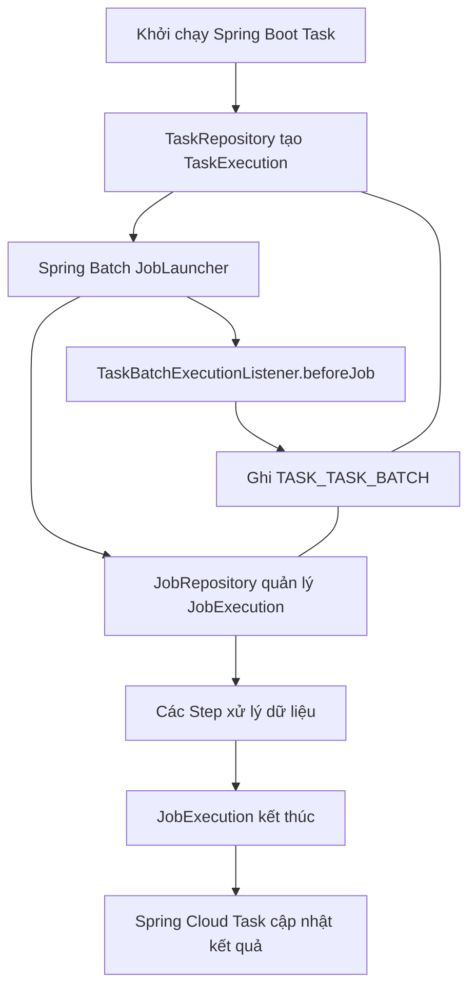

# Tự cấu hình tích hợp `spring-cloud-task-batch`

## 1. Tích hợp Spring Cloud Task và Spring Batch để làm gì?

**Spring Cloud Task** phù hợp với ứng dụng Spring Boot có thời gian chạy hữu hạn: khởi động, thực hiện một nhiệm vụ rồi kết thúc. Framework sử dụng **`TaskRepository`** để lưu thông tin của mỗi lần chạy, ví dụ `TaskExecution`, thời gian bắt đầu/kết thúc, tham số và mã thoát.

**Spring Batch** giải quyết một cấp độ chi tiết hơn: mô hình `Job` gồm một hoặc nhiều `Step`, theo dõi các `JobExecution`/`StepExecution`, quản lý transaction, retry và khả năng restart tùy cấu hình. Hai framework có thể cùng hoạt động trong **một tiến trình Spring Boot**, nhưng nếu không liên kết metadata, người vận hành khó trả lời “JobExecution này đã chạy trong TaskExecution nào?”.

Thư viện **`spring-cloud-task-batch`** bổ sung cơ chế nối hai cấp độ thực thi đó. Đặc biệt, `TaskBatchExecutionListener` ghi mối liên hệ giữa **ID của lần thực thi Spring Cloud Task** và **ID của lần thực thi Spring Batch Job** vào bảng `TASK_TASK_BATCH`.

Đề bài của chương **Spring Batch** là **tự cấu hình tích hợp `spring-cloud-task-batch`**. Trong bài này, “tự cấu hình” bao gồm hiểu điều kiện auto-configuration, khai báo dependency và schema, kiểm soát Job nào được gắn listener, xác định Job cần chạy khi ứng dụng khởi động, và quyết định mã thoát của Task khi Batch Job thất bại.

Sau bài, bạn có thể:

- Thêm `spring-cloud-task-batch` và cấu hình Spring Boot/Cloud Task/Batch tương thích.
- Giải thích vai trò `TaskBatchExecutionListener` và `TaskBatchExecutionListenerBeanPostProcessor`.
- Chỉ liên kết **một số Job được chọn**, thay vì để listener tự gắn vào tất cả Job.
- Phân biệt `spring.batch.job.name`, `spring.cloud.task.batch.listener.enabled` và `spring.cloud.task.batch.fail-on-job-failure`.
- Truy vấn bảng `TASK_TASK_BATCH` để đi từ TaskExecution sang JobExecution.
- Phát hiện lỗi cấu hình, lỗi schema, vấn đề restart, chạy bất đồng bộ và thực hành vận hành an toàn.

## 2. Hai repository và một bảng liên kết

| Cấp độ | Thành phần quản lý | Metadata tiêu biểu | Nội dung lưu |
| --- | --- | --- | --- |
| Ứng dụng hữu hạn | Spring Cloud Task / `TaskRepository` | `TASK_EXECUTION` | Một lần chạy ứng dụng, thời điểm, mã thoát và thông điệp lỗi. |
| Job xử lý | Spring Batch / `JobRepository` | `BATCH_JOB_INSTANCE`, `BATCH_JOB_EXECUTION` | Job instance, tham số định danh và từng lần thực thi Job. |
| Step xử lý | Spring Batch / `JobRepository` | `BATCH_STEP_EXECUTION` | Trạng thái và thống kê từng Step trong Job. |
| Liên kết hai cấp độ | `spring-cloud-task-batch` / `TaskBatchExecutionListener` | `TASK_TASK_BATCH` | Cặp `TASK_EXECUTION_ID` và `JOB_EXECUTION_ID`. |

Sơ đồ:



Một `TaskExecution` có thể liên kết với **nhiều `JobExecution`** nếu ứng dụng cố ý khởi chạy nhiều Job. Ngược lại, một Job được chạy lại trong một lần khởi chạy Task khác sẽ có `JobExecution` mới và có thể liên kết với `TaskExecution` khác. Vì vậy:

- Không đồng nhất `TASK_EXECUTION_ID` với `JOB_EXECUTION_ID`, ngay cả khi cả hai tình cờ bằng `1` trong database mới.
- Không coi `TASK_TASK_BATCH` là bảng lưu kết quả xử lý nghiệp vụ. Kết quả như số đơn hàng đã nhập nên được lưu tại bảng nghiệp vụ hoặc metadata Batch phù hợp.
- Tạo bảng metadata **Task** và **Batch** đầy đủ trước khi chạy ứng dụng. Có bảng `TASK_EXECUTION` nhưng thiếu `BATCH_JOB_EXECUTION` hoặc `TASK_TASK_BATCH` sẽ dẫn tới lỗi.

## 3. Cơ chế mặc định của `spring-cloud-task-batch`

Theo tài liệu Spring Cloud Task 3.2, khi trên classpath có **`spring-cloud-task-batch`** và Spring context có bean `Job` của Spring Batch cùng hạ tầng Task, framework mặc định tự cấu hình `TaskBatchExecutionListener`. Listener này được chèn vào các Batch Job phù hợp, nên mỗi lần Job thực thi trong phạm vi Task có thể tạo một bản ghi liên kết.

Hai thành phần chính:

| Thành phần | Chức năng |
| --- | --- |
| `TaskBatchExecutionListener` | Là listener liên quan đến vòng đời Task và Batch Job; khi Job bắt đầu, nó lưu liên hệ giữa hai ID thực thi. |
| `TaskBatchExecutionListenerBeanPostProcessor` | Tìm các bean Job phù hợp và thêm listener vào Job. Có thể giới hạn bằng danh sách **tên bean Job**. |

Điều kiện cần hiểu:

1. **Đúng dependency:** Có `spring-cloud-task-batch`, không chỉ `spring-boot-starter-batch`.
2. **Có Batch Job:** Context phải có bean kiểu `Job`; ứng dụng chỉ chứa một `ApplicationRunner` thông thường sẽ không tự tạo liên kết Batch.
3. **Có hạ tầng Task:** Cần Spring Cloud Task được kích hoạt và repository tương ứng.
4. **Bật listener:** `spring.cloud.task.batch.listener.enabled` thường mặc định là `true` trong dòng phiên bản này; đặt `false` để tắt cơ chế liên kết tự động.
5. **Có schema:** `TASK_TASK_BATCH` và các bảng Task/Batch phải tồn tại và tài khoản DB có quyền thích hợp.

**Tự động gắn listener** khác với **tự động chạy Job**. Spring Boot (hoặc runner của Spring Cloud Task khi có tính năng liên quan) đảm nhiệm việc khởi chạy Job lúc startup; `TaskBatchExecutionListener` chỉ ghi liên kết khi Job thực sự chạy. Một Job có listener nhưng chưa được launch thì không tự xuất hiện một `JobExecution`.

## 4. Tạo dự án minh họa có hai Batch Job

Ví dụ dùng **JDK 17**, **Spring Boot 3.4.5**, **Spring Cloud 2024.0.2** và Spring Batch thuộc phiên bản do Spring Boot quản lý. Đây là cặp phiên bản Boot–Cloud cùng thế hệ; nếu làm trên dự án phiên bản khác, phải chọn release train tương thích thay vì tự ép version các thư viện.

Ta khai báo hai Job:

- `importOrdersJob`: mô phỏng nhập đơn hàng, **cần** liên kết với TaskExecution.
- `maintenanceJob`: mô phỏng dọn dữ liệu thử nghiệm; dùng làm đối chứng để kiểm tra cấu hình chỉ gắn listener vào Job được chọn.

Khi chạy JAR, mặc định chỉ khởi chạy `importOrdersJob`. Có thể đổi Job bằng thuộc tính Spring Boot để xem khác biệt.

```text
task-batch-demo/
├── pom.xml
└── src/main/
    ├── java/com/example/taskbatch/
    │   ├── TaskBatchApplication.java
    │   ├── DemoBatchConfiguration.java
    │   └── TaskBatchLinkConfiguration.java
    └── resources/
        ├── application.yml
        └── application-init.yml
```

### 4.1. `pom.xml`

```xml
<?xml version="1.0" encoding="UTF-8"?>
<project xmlns="http://maven.apache.org/POM/4.0.0"
         xmlns:xsi="http://www.w3.org/2001/XMLSchema-instance"
         xsi:schemaLocation="http://maven.apache.org/POM/4.0.0 https://maven.apache.org/xsd/maven-4.0.0.xsd">
    <modelVersion>4.0.0</modelVersion>

    <parent>
        <groupId>org.springframework.boot</groupId>
        <artifactId>spring-boot-starter-parent</artifactId>
        <version>3.4.5</version>
        <relativePath/>
    </parent>

    <groupId>com.example</groupId>
    <artifactId>task-batch-demo</artifactId>
    <version>0.0.1-SNAPSHOT</version>

    <properties>
        <java.version>17</java.version>
    </properties>

    <dependencyManagement>
        <dependencies>
            <dependency>
                <groupId>org.springframework.cloud</groupId>
                <artifactId>spring-cloud-dependencies</artifactId>
                <version>2024.0.2</version>
                <type>pom</type>
                <scope>import</scope>
            </dependency>
        </dependencies>
    </dependencyManagement>

    <dependencies>
        <dependency>
            <groupId>org.springframework.cloud</groupId>
            <artifactId>spring-cloud-starter-task</artifactId>
        </dependency>
        <dependency>
            <groupId>org.springframework.cloud</groupId>
            <artifactId>spring-cloud-task-batch</artifactId>
        </dependency>
        <dependency>
            <groupId>org.springframework.boot</groupId>
            <artifactId>spring-boot-starter-batch</artifactId>
        </dependency>
        <dependency>
            <groupId>com.h2database</groupId>
            <artifactId>h2</artifactId>
            <scope>runtime</scope>
        </dependency>
    </dependencies>

    <build>
        <plugins>
            <plugin>
                <groupId>org.springframework.boot</groupId>
                <artifactId>spring-boot-maven-plugin</artifactId>
            </plugin>
        </plugins>
    </build>
</project>
```

`spring-cloud-starter-task` cung cấp `TaskRepository`/vòng đời Task. `spring-boot-starter-batch` cung cấp Batch Job, `JobRepository`, `JobLauncher` và cấu hình cơ bản. `spring-cloud-task-batch` cung cấp **listener liên kết** và các cấu hình Task liên quan tới Batch.

### 4.2. `application.yml`: tách cấu hình Task và Batch

```yaml
spring:
  application:
    name: task-batch-demo
  main:
    web-application-type: none
  datasource:
    url: jdbc:h2:file:./data/task-batch-db;DB_CLOSE_ON_EXIT=FALSE
    driver-class-name: org.h2.Driver
    username: sa
    password: ""
  cloud:
    task:
      name: task-batch-demo
      initialize-enabled: false
      closecontext-enabled: true
      batch:
        listener:
          enabled: true
        fail-on-job-failure: true
  batch:
    job:
      enabled: true
      name: importOrdersJob
    jdbc:
      initialize-schema: never
```

Giải thích cấu hình:

| Thuộc tính | Tác dụng |
| --- | --- |
| `spring.cloud.task.name` | Tên một lần chạy **Spring Cloud Task**. |
| `spring.cloud.task.batch.listener.enabled` | Có cho phép cơ chế liên kết `TaskExecution` ↔ `JobExecution` tự cấu hình hay không. |
| `spring.cloud.task.batch.fail-on-job-failure` | Khi `true`, giúp mã thoát Task phản ánh Job có `BatchStatus.FAILED` (thay vì mặc nhiên thành công). |
| `spring.batch.job.name` | Chọn **Job nào được khởi chạy** khi có nhiều Job bean. |
| `spring.batch.job.enabled` | Cho phép việc tự chạy Job lúc ứng dụng khởi động. |
| `spring.cloud.task.initialize-enabled` | Khởi tạo **schema Task** khi được bật. |
| `spring.batch.jdbc.initialize-schema` | Khởi tạo **schema Batch** khi đặt đúng chế độ. |

`spring.cloud.task.batch.listener.enabled` và `spring.batch.job.enabled` độc lập nhau: tắt listener có thể khiến Job vẫn chạy nhưng **không được liên kết** với Task; tắt auto-launch có thể khiến listener tồn tại nhưng **không có JobExecution** nếu ứng dụng không tự khởi chạy Job.

### 4.3. `application-init.yml`: khởi tạo hai schema lần đầu

```yaml
spring:
  cloud:
    task:
      initialize-enabled: true
  batch:
    jdbc:
      initialize-schema: always
```

Profile `init` phục vụ **database H2 mới, riêng biệt**. Khi bật profile này, hạ tầng Task được phép tạo bảng Task và Spring Boot được phép tạo bảng Batch. Với ứng dụng có dữ liệu cần giữ lại, hãy dùng migration kiểm soát phiên bản và không chạy các DDL tạo bảng nhiều lần.

Đường dẫn `jdbc:h2:file:./data/task-batch-db` lưu database xuống tệp, giúp đọc lại dữ liệu sau khi JAR kết thúc. Đường dẫn tương đối phải được hiểu từ thư mục làm việc của lệnh chạy; hai lần chạy hoặc SQL client dùng thư mục khác có thể kết nối sang database khác.

### 4.4. Kích hoạt Spring Cloud Task

Tạo `TaskBatchApplication.java`:

```java
package com.example.taskbatch;

import org.springframework.boot.SpringApplication;
import org.springframework.boot.autoconfigure.SpringBootApplication;
import org.springframework.cloud.task.configuration.EnableTask;

@SpringBootApplication
@EnableTask
public class TaskBatchApplication {

    public static void main(String[] args) {
        SpringApplication.run(TaskBatchApplication.class, args);
    }
}
```

Không thêm `@EnableBatchProcessing` trong ví dụ này. Với Spring Boot 3.4, annotation đó làm auto-configuration Batch của Boot **back off**, có thể khiến cơ chế tự tạo schema và tự launch Job mà ta đang minh họa không hoạt động như mong đợi. Khi cần cấu hình Batch hoàn toàn thủ công, phải chủ động tạo đầy đủ `JobRepository`, launcher, transaction manager và khởi tạo schema.

### 4.5. Khai báo hai Job với `JobBuilder` và `StepBuilder`

Tạo `DemoBatchConfiguration.java`:

```java
package com.example.taskbatch;

import org.springframework.batch.core.Job;
import org.springframework.batch.core.Step;
import org.springframework.batch.core.job.builder.JobBuilder;
import org.springframework.batch.core.repository.JobRepository;
import org.springframework.batch.core.step.builder.StepBuilder;
import org.springframework.batch.repeat.RepeatStatus;
import org.springframework.beans.factory.annotation.Qualifier;
import org.springframework.context.annotation.Bean;
import org.springframework.context.annotation.Configuration;
import org.springframework.core.env.Environment;
import org.springframework.transaction.PlatformTransactionManager;

@Configuration(proxyBeanMethods = false)
public class DemoBatchConfiguration {

    @Bean
    public Step importOrdersStep(
            JobRepository jobRepository,
            PlatformTransactionManager transactionManager,
            Environment environment) {
        return new StepBuilder("importOrdersStep", jobRepository)
                .tasklet((contribution, chunkContext) -> {
                    System.out.println("[BATCH] Importing orders...");
                    boolean shouldFail = environment.getProperty(
                            "demo.fail", Boolean.class, false);
                    if (shouldFail) {
                        throw new IllegalStateException(
                                "Giả lập lỗi importOrdersJob");
                    }
                    System.out.println("[BATCH] Orders imported");
                    return RepeatStatus.FINISHED;
                }, transactionManager)
                .build();
    }

    @Bean
    public Job importOrdersJob(
            JobRepository jobRepository,
            @Qualifier("importOrdersStep") Step step) {
        return new JobBuilder("importOrdersJob", jobRepository)
                .start(step)
                .build();
    }

    @Bean
    public Step maintenanceStep(
            JobRepository jobRepository,
            PlatformTransactionManager transactionManager) {
        return new StepBuilder("maintenanceStep", jobRepository)
                .tasklet((contribution, chunkContext) -> {
                    System.out.println("[BATCH] Maintenance completed");
                    return RepeatStatus.FINISHED;
                }, transactionManager)
                .build();
    }

    @Bean
    public Job maintenanceJob(
            JobRepository jobRepository,
            @Qualifier("maintenanceStep") Step step) {
        return new JobBuilder("maintenanceJob", jobRepository)
                .start(step)
                .build();
    }
}
```

Trong Spring Batch 5, `JobBuilder(String, JobRepository)` và `StepBuilder(String, JobRepository)` là cách tạo Job/Step trực tiếp. Một tasklet step cần transaction manager thông qua `tasklet(Tasklet, PlatformTransactionManager)`.

Hai tên bean, `importOrdersJob` và `maintenanceJob`, được đặt **trùng với tên Job** để việc chọn Job bằng cấu hình và lọc listener dễ hiểu. `Environment` đọc `--demo.fail=true` từ đối số cấu hình Spring Boot để mô phỏng lỗi.

## 5. Tự cấu hình: chỉ gắn listener vào Job cần liên kết

Nếu giữ nguyên auto-configuration, `TaskBatchExecutionListener` thường được gắn vào tất cả bean Job phù hợp. Trong một ứng dụng có nhiều Job, bạn có thể chỉ muốn ghi liên kết cho nhóm Job do Task chịu trách nhiệm, đồng thời bỏ qua Job phục vụ công việc phụ trợ.

Spring Cloud Task cho phép **ghi đè bean** `batchTaskExecutionListenerBeanPostProcessor`. Tạo `TaskBatchLinkConfiguration.java`:

```java
package com.example.taskbatch;

import java.util.List;

import org.springframework.cloud.task.batch.configuration
        .TaskBatchExecutionListenerBeanPostProcessor;
import org.springframework.context.annotation.Bean;
import org.springframework.context.annotation.Configuration;

@Configuration(proxyBeanMethods = false)
public class TaskBatchLinkConfiguration {

    @Bean
    public static TaskBatchExecutionListenerBeanPostProcessor
            batchTaskExecutionListenerBeanPostProcessor() {

        TaskBatchExecutionListenerBeanPostProcessor processor =
                new TaskBatchExecutionListenerBeanPostProcessor();
        processor.setJobNames(List.of("importOrdersJob"));
        return processor;
    }
}
```

Đoạn này chủ động giới hạn listener:

- **`importOrdersJob`:** được gắn `TaskBatchExecutionListener`, nên khi chạy trong task sẽ tạo quan hệ trong `TASK_TASK_BATCH`.
- **`maintenanceJob`:** không nằm trong danh sách; nếu chạy, Job vẫn có `BATCH_JOB_EXECUTION` nhưng **không có liên kết Task–Batch do listener tự động đó tạo ra**.

Tại đây `setJobNames(...)` lọc theo **tên bean Job** mà `BeanPostProcessor` quan sát, không phải tên bảng database hay `TASK_NAME`. Nếu bean method tên `importJobBean` mà Job name là `importOrdersJob`, cần kiểm tra và thống nhất tên bean được lọc.

Vì `BeanPostProcessor` cần được tạo rất sớm trong quá trình khởi tạo context, khai báo phương thức `@Bean static` là mẫu phù hợp để tránh kéo theo việc khởi tạo sớm không cần thiết của các bean cấu hình khác.

**Không tự tạo một bean `TaskBatchExecutionListener` thứ hai chỉ để chọn Job.** Auto-configuration đã tạo listener cần thiết; trong trường hợp này ta chỉ thay bộ phận quyết định Job nào được gắn. API `TaskBatchExecutionListenerBeanPostProcessor` mong đợi có một listener phù hợp trong context.

### 5.1. Cấu hình ba tình huống

| Mục tiêu | Cách thiết lập | Kết quả |
| --- | --- | --- |
| Gắn listener vào mọi Job đủ điều kiện | Giữ auto-configuration và không định nghĩa bộ lọc tùy chỉnh | Mỗi Job chạy trong Task được liên kết theo cơ chế mặc định. |
| Chỉ gắn vào một số Job | Định nghĩa `batchTaskExecutionListenerBeanPostProcessor` và gọi `setJobNames(...)` | Chỉ các Job có bean ID trong danh sách được gắn listener. |
| Tắt toàn bộ liên kết tự động | Đặt `spring.cloud.task.batch.listener.enabled=false` | Job vẫn có thể chạy, nhưng auto-configuration không gắn listener liên kết. |

Muốn kiểm soát việc gắn listener bằng chính `JobBuilder` sau khi tắt autoconfiguration đòi hỏi **đăng ký listener đúng kiểu cùng cơ chế ghi `TaskBatchDao`**; đừng chỉ tự viết một `JobExecutionListener` in log rồi mong bảng `TASK_TASK_BATCH` tự xuất hiện. Với phần lớn bài toán cần lọc Job, tùy biến `BeanPostProcessor` là cách ít cấu hình và dễ kiểm chứng hơn.

## 6. Chạy ví dụ và xác minh liên kết

### 6.1. Chuẩn bị schema và lần chạy đầu

Đứng trong thư mục `task-batch-demo`:

```bash
mkdir -p data
mvn clean package
```

Trên PowerShell, tạo thư mục bằng `New-Item -ItemType Directory -Force data`.

Lần đầu trên **database mới**:

```bash
java -jar target/task-batch-demo-0.0.1-SNAPSHOT.jar --spring.profiles.active=init run.id=1
```

`run.id=1` là **JobParameter** được truyền theo cú pháp đối số Batch không có tiền tố `--`. Nó giúp phân biệt một `JobInstance` với lần chạy có tham số định danh khác. Khi truyền tham số bằng cơ chế khác, phải hiểu cách launcher của phiên bản Boot đang dùng chuyển argument thành `JobParameters`.

Ứng dụng kỳ vọng:

1. Khởi tạo schema metadata Spring Cloud Task và Spring Batch từ các initializer tương ứng.
2. Ghi `TaskExecution` mới.
3. Tự launch `importOrdersJob` do `spring.batch.job.name`.
4. `TaskBatchExecutionListener` ghi cặp ID vào `TASK_TASK_BATCH`.
5. Chạy `importOrdersStep` thành công, hoàn tất Batch Job và cập nhật TaskExecution.

Nhật ký nghiệp vụ minh họa:

```text
[BATCH] Importing orders...
[BATCH] Orders imported
```

### 6.2. Lần chạy thứ hai trên schema đã có

Không bật profile `init`:

```bash
java -jar target/task-batch-demo-0.0.1-SNAPSHOT.jar run.id=2
```

`spring.cloud.task.initialize-enabled=false` và `spring.batch.jdbc.initialize-schema=never` giữ schema hiện tại. Một lần chạy Task mới và một JobExecution mới được tạo; mối liên kết nằm ở một hàng khác của `TASK_TASK_BATCH`.

**Không tái sử dụng cùng JobParameters cho một JobInstance đã hoàn tất** rồi coi `JobInstanceAlreadyCompleteException` là lỗi của listener. Spring Batch phân biệt JobInstance bằng tên Job và tham số định danh; hãy dùng giá trị định danh mới khi muốn chạy một phiên bản xử lý khác. Nếu cần restart một lần thất bại, phải tuân thủ quy tắc restart của Spring Batch thay vì đổi mọi tham số một cách tùy tiện.

### 6.3. Chạy Job không nằm trong danh sách listener

Chỉ thay tên Job được launch và giá trị tham số:

```bash
java -jar target/task-batch-demo-0.0.1-SNAPSHOT.jar --spring.batch.job.name=maintenanceJob run.id=3
```

`maintenanceJob` vẫn chạy bình thường và có `JobExecution` trong Spring Batch. Tuy nhiên, vì `TaskBatchLinkConfiguration` chỉ chọn `importOrdersJob`, **không kỳ vọng một hàng Task–Batch tương ứng được tạo tự động** cho `maintenanceJob`.

Việc chọn Job để chạy (`spring.batch.job.name`) và việc chọn Job để **gắn listener** (`setJobNames(...)`) là hai thao tác khác nhau. Chúng có thể chọn cùng một Job, nhưng không bắt buộc.

## 7. Kiểm tra dữ liệu bằng SQL

Sau khi các tiến trình Java kết thúc, dùng H2 Console/JDBC client kết nối tới database `jdbc:h2:file:./data/task-batch-db`, user `sa`, password rỗng. Mở SQL client từ đúng thư mục làm việc hoặc dùng đường dẫn tuyệt đối để tránh truy vấn nhầm file H2.

### 7.1. Kiểm tra bảng metadata

```sql
SELECT TABLE_NAME
FROM INFORMATION_SCHEMA.TABLES
WHERE TABLE_NAME IN (
    'TASK_EXECUTION',
    'TASK_TASK_BATCH',
    'BATCH_JOB_INSTANCE',
    'BATCH_JOB_EXECUTION',
    'BATCH_STEP_EXECUTION'
)
ORDER BY TABLE_NAME;
```

`TASK_TASK_BATCH` thuộc schema của Spring Cloud Task; `BATCH_JOB_EXECUTION` thuộc schema của Spring Batch. Cả hai nhóm bảng phải có mặt nếu muốn liên kết thành công với JDBC.

### 7.2. Truy vấn từ TaskExecution sang JobExecution

```sql
SELECT t.TASK_EXECUTION_ID,
       t.TASK_NAME,
       t.START_TIME AS TASK_START_TIME,
       t.EXIT_CODE AS TASK_EXIT_CODE,
       b.JOB_EXECUTION_ID,
       j.JOB_NAME,
       e.STATUS AS JOB_STATUS,
       e.EXIT_CODE AS JOB_EXIT_CODE
FROM TASK_TASK_BATCH b
JOIN TASK_EXECUTION t
  ON t.TASK_EXECUTION_ID = b.TASK_EXECUTION_ID
JOIN BATCH_JOB_EXECUTION e
  ON e.JOB_EXECUTION_ID = b.JOB_EXECUTION_ID
JOIN BATCH_JOB_INSTANCE j
  ON j.JOB_INSTANCE_ID = e.JOB_INSTANCE_ID
ORDER BY t.TASK_EXECUTION_ID, b.JOB_EXECUTION_ID;
```

Kết quả minh họa sau hai lần chạy `importOrdersJob`:

| TaskExecution ID | Task name | JobExecution ID | Job name | Job status |
| ---: | --- | ---: | --- | --- |
| 1 | task-batch-demo | 1 | importOrdersJob | COMPLETED |
| 2 | task-batch-demo | 2 | importOrdersJob | COMPLETED |

Đây là **ID minh họa**; số ID thực tế do repository tạo. Lần chạy `maintenanceJob` sau đó có thể xuất hiện ở `BATCH_JOB_EXECUTION` nhưng không xuất hiện trong kết quả JOIN này do bộ lọc listener.

Để kiểm tra Job nào đang **không có liên kết**, có thể dùng:

```sql
SELECT e.JOB_EXECUTION_ID, j.JOB_NAME, e.STATUS
FROM BATCH_JOB_EXECUTION e
JOIN BATCH_JOB_INSTANCE j
  ON j.JOB_INSTANCE_ID = e.JOB_INSTANCE_ID
LEFT JOIN TASK_TASK_BATCH b
  ON b.JOB_EXECUTION_ID = e.JOB_EXECUTION_ID
WHERE b.JOB_EXECUTION_ID IS NULL
ORDER BY e.JOB_EXECUTION_ID;
```

Một Job không có liên kết **không nhất thiết là lỗi**: nó có thể được chạy ngoài Spring Cloud Task, đã được chủ ý loại khỏi danh sách listener, hoặc gặp lỗi trước thời điểm listener ghi liên kết.

## 8. Cấu hình mã thoát khi Spring Batch Job thất bại

**Liên kết được metadata** và **báo đúng trạng thái thất bại** là hai mục tiêu riêng biệt.

Trong hành vi mặc định của Spring Boot/Batch ở dòng phiên bản tham chiếu, Job có thể trả `BatchStatus.FAILED` nhưng ứng dụng Spring Boot vẫn kết thúc với mã thoát thành công, vì JobExecution thất bại không nhất thiết phát sinh ngoại lệ chưa xử lý tại cấp ứng dụng.

Spring Cloud Task có tùy chọn:

```yaml
spring:
  cloud:
    task:
      batch:
        fail-on-job-failure: true
```

Khi bật, framework sử dụng runner tích hợp để đánh giá kết quả Batch Job và làm mã thoát của Task phản ánh Job thất bại (mã phổ biến là `1`, hoặc giá trị từ `ExitCodeGenerator` nếu có tùy biến). Thuộc tính này **không thay thế** việc gắn `TaskBatchExecutionListener`: một cấu hình quyết định **quan hệ Task–Batch**, cấu hình còn lại quyết định **mã thoát**.

Thử tạo lỗi trong `importOrdersStep`:

```bash
java -jar target/task-batch-demo-0.0.1-SNAPSHOT.jar --demo.fail=true run.id=4
```

Lúc này `Environment` đọc `demo.fail=true`; tasklet ném `IllegalStateException`, Spring Batch ghi `JobExecution` với trạng thái thất bại. Do `fail-on-job-failure=true`, Task được kỳ vọng trả mã thoát khác `0`. Kiểm tra đồng thời:

```sql
SELECT t.TASK_EXECUTION_ID,
       t.EXIT_CODE AS TASK_EXIT_CODE,
       e.JOB_EXECUTION_ID,
       e.STATUS AS JOB_STATUS,
       e.EXIT_CODE AS JOB_EXIT_CODE
FROM TASK_TASK_BATCH b
JOIN TASK_EXECUTION t ON t.TASK_EXECUTION_ID = b.TASK_EXECUTION_ID
JOIN BATCH_JOB_EXECUTION e ON e.JOB_EXECUTION_ID = b.JOB_EXECUTION_ID
ORDER BY t.TASK_EXECUTION_ID DESC;
```

**Lưu ý:** Không kết luận “Task thành công” chỉ vì một bản ghi Batch đã có quan hệ trong `TASK_TASK_BATCH`. Listener ghi liên kết gần thời điểm **Job bắt đầu**; Job vẫn có thể thất bại ở một Step phía sau.

### 8.1. Job bất đồng bộ

Nếu tự cung cấp `JobLauncher` với `TaskExecutor` bất đồng bộ, lời gọi launch có thể trả `JobExecution` khi Job **chưa hoàn tất**. Khi đó, runner phải chờ kết quả cuối hoặc dùng cơ chế kiểm tra trạng thái phù hợp nếu muốn thời gian sống của Task bao phủ toàn bộ Job.

Không tự động giả định rằng mọi đoạn mã gọi `jobLauncher.run(...)` đều đồng bộ. Với luồng bất đồng bộ, hãy xác định rõ trách nhiệm chờ, timeout, hủy, giao dịch và thử lại. Nếu sử dụng runner tích hợp `fail-on-job-failure`, kiểm tra hành vi poll/đánh giá trạng thái của đúng phiên bản Spring Cloud Task.

### 8.2. Tránh hai runner cùng launch một Job

Khi Spring Boot/Cloud Task đã tạo runner để tự chạy `Job`, **không thêm một `ApplicationRunner` khác gọi `jobLauncher.run(...)` cho cùng Job** trừ khi bạn cố ý muốn thêm lần chạy. Nếu muốn tự điều khiển hoàn toàn thứ tự và tham số:

1. Đặt `spring.batch.job.enabled=false` để tắt cơ chế auto-launch tương ứng.
2. Định nghĩa runner rõ ràng, tự tạo `JobParameters` hợp lệ và gọi `JobLauncher`.
3. Chờ Job hoàn tất, kiểm tra `BatchStatus`/`ExitStatus` và chuyển lỗi cần thiết thành mã thoát ứng dụng.
4. Giữ listener liên kết (hoặc cấu hình thủ công tương đương) nếu muốn có hàng `TASK_TASK_BATCH`.

Khi chọn cấu hình thủ công này, phải xem điều kiện auto-configuration của runner trong phiên bản sử dụng; `spring.batch.job.enabled` và các thuộc tính `spring.cloud.task.batch.*` có thể phối hợp để bật/tắt các runner khác nhau.

## 9. Nhiều `DataSource` và quản lý schema

Ví dụ dùng **một H2 DataSource** cho cả metadata Spring Cloud Task và Spring Batch nên dễ thiết lập `TASK_TASK_BATCH` cùng các bảng `BATCH_*`.

Trong hệ thống thật, có thể dùng:

- Một datasource cho **Task metadata**.
- Một datasource cho **Batch JobRepository**.
- Một datasource khác cho **dữ liệu nghiệp vụ**.

Lúc này không nên chỉ đánh dấu một `@Primary DataSource` rồi phỏng đoán các framework sẽ cùng trỏ đúng nơi. Với Spring Cloud Task, có thể cấu hình `TaskConfigurer`; với Spring Batch/Boot có cơ chế chọn batch datasource hoặc cấu hình JobRepository riêng. Cần đảm bảo bộ phận ghi `TASK_TASK_BATCH` truy cập được **schema Task**, còn JobRepository truy cập **schema Batch**.

Vì `TASK_TASK_BATCH` chỉ lưu ID của hai đối tượng, phép JOIN SQL trực tiếp như ví dụ **chỉ áp dụng khi hai nhóm bảng nằm trong cùng database hoặc có cơ chế truy vấn liên database thích hợp**. Nếu hai repository ở hai hệ quản trị khác nhau, cần truy vấn riêng rồi ghép dữ liệu ở lớp ứng dụng, và thiết kế cách xử lý sai lệch nếu một nơi ghi thành công còn nơi khác thất bại.

Ở production, nên quản lý schema bằng Flyway/Liquibase hoặc pipeline DBA, áp dụng DDL của **đúng phiên bản Task và Batch** rồi để:

```yaml
spring:
  cloud:
    task:
      initialize-enabled: false
  batch:
    jdbc:
      initialize-schema: never
```

Không sử dụng khởi tạo schema lúc startup như một chiến lược migration khi nhiều container được khởi chạy đồng thời. Cần quản lý cả quyền DDL/DML, các sequence, backup, chính sách lưu giữ metadata và liên kết với job restart.

## 10. Khắc phục sự cố tích hợp

| Hiện tượng | Nguyên nhân thường gặp | Cách xử lý |
| --- | --- | --- |
| Job chạy nhưng `TASK_TASK_BATCH` không có hàng | Thiếu `spring-cloud-task-batch`, listener bị tắt hoặc Job bị loại khỏi bộ lọc | Kiểm tra dependency, `listener.enabled`, danh sách `setJobNames` và bean Job thực tế. |
| Không tìm thấy `TASK_TASK_BATCH` | Schema Task chưa tạo hoặc sai database | Áp dụng DDL Task đúng phiên bản, kiểm tra URL datasource và quyền DB. |
| Không tìm thấy `BATCH_JOB_EXECUTION` | Schema Batch chưa tạo | Kiểm tra `spring.batch.jdbc.initialize-schema` hoặc migration Batch. |
| Chạy ứng dụng nhưng không có `JobExecution` | `spring.batch.job.enabled=false`, chưa có Job bean hoặc cấu hình tên Job sai | Kiểm tra bean `Job`, runner và `spring.batch.job.name`. |
| Có hai Job, Spring Boot báo không biết chạy Job nào | Chưa chọn tên khi nhiều Job | Đặt `spring.batch.job.name` đúng Job; không nhầm với `setJobNames`. |
| Job `FAILED` nhưng Task vẫn có mã `0` | Chưa bật cơ chế truyền trạng thái thất bại | Dùng `spring.cloud.task.batch.fail-on-job-failure=true` và kiểm tra launcher/runner. |
| Job báo `JobInstanceAlreadyCompleteException` | Chạy lại cùng Job và cùng tham số định danh đã hoàn tất | Cấp bộ `JobParameters` mới cho lần xử lý mới; phân biệt với restart. |
| Job có link nhưng Step chưa chạy xong | Job launcher bất đồng bộ, Task kết thúc sớm | Chờ Job kết thúc hoặc dùng runner tích hợp phù hợp; cấu hình timeout. |
| Kỳ vọng liên kết cho `maintenanceJob` nhưng không có | Bộ lọc chỉ chọn `importOrdersJob` | Thêm bean ID tương ứng vào `setJobNames` nếu đó là chủ ý. |
| Liên kết bị nhân đôi hoặc nhiều listener | Tạo nhiều listener/configuration chồng nhau | Giữ một chiến lược cấu hình và kiểm tra bean `TaskBatchExecutionListener`. |
| SQL JOIN không thấy dữ liệu | Task và Batch dùng database khác nhau hoặc đọc nhầm file H2 | Xác minh datasource, schema và truy vấn dữ liệu qua đúng repository. |

Khi gặp sự cố, nên chẩn đoán theo thứ tự: **classpath → bean Job → launcher → listener → schema → metadata**. Bước này giúp tách lỗi “Job không chạy” khỏi lỗi “Job chạy nhưng không có liên kết”.

Một lần khởi động lỗi rất sớm có thể không tạo đủ `TaskExecution`/`JobExecution` để quan sát bằng SQL. Vì vậy cần xem log startup và sự kiện của container/scheduler cùng với bảng metadata.

## 11. Giới hạn và vận hành an toàn

Spring Cloud Task **không tự lập lịch**; ứng dụng có thể được gọi bởi cron, Kubernetes `Job`/`CronJob`, API hoặc một công cụ điều phối. Khi tích hợp Batch, cần chú ý:

1. **Không chạy chồng dữ liệu nghiệp vụ:** Scheduler và cơ chế khóa/định danh Job cần tránh xử lý trùng; mỗi TaskExecution không tự bảo đảm exactly-once.
2. **JobParameters rõ ràng:** Tham số định danh quyết định JobInstance. Retry, restart và một lần xử lý mới là các tình huống khác nhau.
3. **Xử lý lỗi chính xác:** Có liên kết Task–Batch chưa có nghĩa Job đã thành công; quan sát cả `EXIT_CODE` của Task và `STATUS`/`EXIT_CODE` của Batch.
4. **Chờ công việc thực sự kết thúc:** Nếu có async launcher hoặc worker bên ngoài, giữ vòng đời Task đủ lâu hoặc dùng cơ chế điều phối riêng.
5. **Secret và tham số:** `TaskRepository` có thể lưu tham số dòng lệnh; không truyền mật khẩu, token hoặc dữ liệu nhạy cảm trong JobParameters hay argument.
6. **Giám sát:** Theo dõi Task không có `END_TIME` bất thường, Batch Job thất bại, Step bị treo, các liên kết bị thiếu và thời lượng thực thi.
7. **Phân quyền và schema:** Giữ `TaskRepository`, `JobRepository` và bảng liên kết đủ quyền đọc/ghi, quản lý schema bằng migration và backup.
8. **Giới hạn tùy biến:** Khi thay `BeanPostProcessor`, chỉ áp dụng cho các bean Job được framework nhận diện; test lại nếu chuyển sang factory, job tạo động hoặc đổi phiên bản Spring Batch.

Phần liên kết của `spring-cloud-task-batch` phục vụ **truy vết**, không thay thế cơ chế transaction, checkpoint và restart ở Spring Batch. Khi đưa tác vụ vào hệ thống thật, hãy xác định rõ phạm vi trách nhiệm của từng framework.

## 12. Bài tập thực hành và câu hỏi tự kiểm tra

### Bài tập 1: Tự cấu hình listener cho một Job

1. Tạo dự án mẫu và chuẩn bị schema Task/Batch trên H2 file.
2. Chạy `importOrdersJob` với `run.id=1` và `run.id=2`.
3. Truy vấn `TASK_TASK_BATCH` và xác nhận có hai liên kết.
4. Chạy `maintenanceJob` với `run.id=3`; xác nhận Batch có JobExecution nhưng không có liên kết Task–Batch tương ứng.
5. Thêm `maintenanceJob` vào `setJobNames(...)` rồi chạy lại với tham số mới; giải thích thay đổi quan sát được.

### Bài tập 2: Mã thoát khi Batch thất bại

1. Bật `spring.cloud.task.batch.fail-on-job-failure=true`.
2. Chạy `importOrdersJob` với `--demo.fail=true run.id=4`.
3. Kiểm tra bảng `BATCH_JOB_EXECUTION` và `TASK_EXECUTION`, xác nhận mã thoát Task phản ánh Job thất bại.
4. Thử tắt tính năng và giải thích vì sao Job có thể `FAILED` nhưng ứng dụng vẫn báo mã `0` theo hành vi mặc định.

### Bài tập 3: Thiết kế tích hợp trên production

Giả sử ba container cùng dùng PostgreSQL cho metadata Task/Batch và mỗi container có thể nhận lệnh chạy một Job nhập đơn hàng. Hãy đề xuất cách chuẩn bị schema, chọn Job, hạn chế đồng thời, đặt tham số định danh, phát hiện lỗi và tra cứu TaskExecution liên quan đến một JobExecution thất bại.

### Câu hỏi ôn tập

1. `spring-cloud-task-batch` bổ sung điều gì so với việc chỉ có `spring-cloud-starter-task` và `spring-boot-starter-batch`?
2. `TaskBatchExecutionListener` và `TaskBatchExecutionListenerBeanPostProcessor` khác vai trò ra sao?
3. Khi nào `TASK_TASK_BATCH` có dữ liệu? Tại sao có liên kết chưa chứng minh Job thành công?
4. `spring.batch.job.name` khác `setJobNames(...)` thế nào?
5. Vì sao nên khai báo `@Bean static` cho `BeanPostProcessor` tùy biến?
6. Tắt `spring.cloud.task.batch.listener.enabled` có đồng nghĩa dừng chạy Batch Job không?
7. Vì sao cần `spring.cloud.task.batch.fail-on-job-failure` khi điều phối task qua scheduler?
8. Vì sao `@EnableBatchProcessing` có thể làm ví dụ phụ thuộc Boot auto-configuration không chạy như dự kiến?

**Ghi nhớ:** `spring-cloud-task-batch` nối `TaskExecution` và `JobExecution` qua `TaskBatchExecutionListener`. Khi muốn **tự cấu hình phạm vi tích hợp**, hãy dùng `TaskBatchExecutionListenerBeanPostProcessor.setJobNames(...)` để chọn bean Job cần liên kết, `spring.batch.job.name` để chọn Job khởi chạy, và `spring.cloud.task.batch.fail-on-job-failure` để đồng bộ mã thoát của Task với kết quả Batch. Mỗi mục tiêu cần cấu hình riêng, có schema phù hợp và được xác minh bằng dữ liệu thực thi.

## Tài liệu tham khảo

- [Spring Cloud Task 3.2 — Batch](https://docs.spring.io/spring-cloud-task/reference/3.2/batch.html): `TaskBatchExecutionListener`, cách giới hạn Job nhận listener và mã thoát Job.
- [Spring Cloud Task 3.2 — Task Repository Schema](https://docs.spring.io/spring-cloud-task/reference/3.2/appendix-task-repository-schema.html): bảng liên kết `TASK_TASK_BATCH`.
- [Spring Cloud Task — TaskBatchExecutionListenerBeanPostProcessor API](https://docs.spring.io/spring-cloud-task/docs/current/apidocs/org/springframework/cloud/task/batch/configuration/TaskBatchExecutionListenerBeanPostProcessor.html): `setJobNames(List<String>)` và cách gắn listener.
- [Spring Boot 3.4 — Batch Applications](https://docs.spring.io/spring-boot/3.4/how-to/batch.html): tự launch Batch Job, `spring.batch.job.name`, `spring.batch.job.enabled` và auto-configuration.
- [Spring Batch 5 — TaskletStep](https://docs.spring.io/spring-batch/reference/step/tasklet.html): cách xây dựng Step với `JobRepository` và transaction manager.
