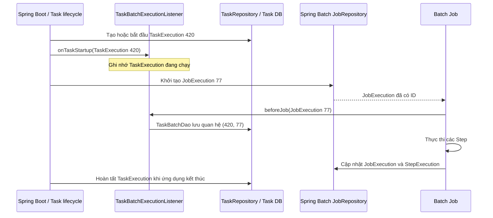
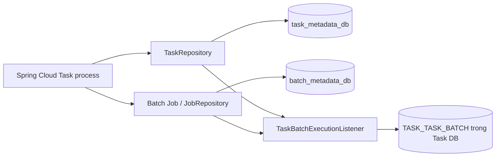

# Liên kết TaskExecution với JobExecution qua TaskBatchExecutionListener

## Mục tiêu

Trong **SPRING_CLOUD_TASK (Spring Cloud Task)**, một ứng dụng Spring Boot có thể khởi động theo lịch hoặc theo yêu cầu, thực hiện công việc hữu hạn rồi kết thúc. Spring Cloud Task ghi nhận từng lượt chạy trong cơ sở dữ liệu bằng `TaskRepository` và `TaskExecution`. Khi ứng dụng chạy một hoặc nhiều Spring Batch Job, Spring Batch còn ghi nhận riêng các `JobExecution` và `StepExecution`. Người vận hành cần **biết JobExecution nào đã chạy bên trong TaskExecution nào** để truy vết lỗi, đối chiếu kết quả và khôi phục chính xác.

Bài học thuộc chương **Spring Batch** giải thích cách `TaskBatchExecutionListener` tự động tạo mối liên kết giữa hai loại execution. Sau bài học, bạn có thể:

- Phân biệt `TaskExecution`, `JobInstance`, `JobExecution` và `StepExecution`.
- Trình bày các điều kiện auto-configuration của `TaskBatchExecutionListener` và thời điểm liên kết được ghi.
- Kiểm tra liên kết trong bảng `TASK_TASK_BATCH` hoặc qua các API tra cứu hai chiều của `TaskExplorer`.
- Xây dựng một ứng dụng Spring Cloud Task chạy Spring Batch Job, có cấu hình metadata phù hợp.
- Giới hạn việc gắn listener cho các Job mong muốn khi có nhiều Job trong một context.
- Phân biệt **liên kết metadata** với **quyết định thành công/thất bại**, quản lý restart, tham số và vận hành an toàn.

## 1. Vì sao cần nối hai loại execution?

Giả sử `daily-report-task` khởi chạy lúc 02:00 để tổng hợp báo cáo đơn hàng. Toàn bộ tiến trình Spring Boot là một **Task execution**. Bên trong, một Spring Batch Job `dailyReportJob` chạy hai Step: đọc dữ liệu và xuất báo cáo. Nếu Step thứ hai lỗi, ta cần trả lời:

1. Task nào đang chạy khi Batch Job lỗi?
2. `JobExecution` và `StepExecution` nào chứa stack trace, số item đã đọc/ghi và checkpoint?
3. Tiến trình Task đã ghi nhận mã thoát nào và hệ điều phối có thực hiện retry hay không?
4. Khi chạy lại, đây là một `JobExecution` mới trong cùng `JobInstance` hay một job instance khác?

Spring Cloud Task và Spring Batch không dùng chung một execution ID. Cùng một giá trị số giữa hai kho metadata chỉ có thể là **trùng hợp**, không chứng minh hai bản ghi liên quan.

| Khái niệm | Framework/kho dữ liệu | Ý nghĩa | Ví dụ |
| --- | --- | --- | --- |
| `TaskExecution` | Spring Cloud Task / `TaskRepository` | Một lượt chạy ứng dụng Task từ khởi động đến kết thúc. | Task ID `420`. |
| `JobInstance` | Spring Batch / `JobRepository` | Danh tính logic của Job dựa trên tên Job và **identifying JobParameters**. | `dailyReportJob` cho ngày `2026-11-23`. |
| `JobExecution` | Spring Batch / `JobRepository` | Một lần thử chạy cụ thể của `JobInstance`. | Batch Job ID `77`. |
| `StepExecution` | Spring Batch / `JobRepository` | Một lần chạy của một Step trong một `JobExecution`. | Step ID `120`. |
| `TASK_TASK_BATCH` | Schema metadata Spring Cloud Task | Bảng liên kết hai khóa `TASK_EXECUTION_ID` và `JOB_EXECUTION_ID`. | Cặp `(420, 77)`. |

**Quan hệ thường gặp:** một `TaskExecution` có thể liên kết với **nhiều** `JobExecution` nếu một tiến trình chạy nhiều Job. Với những Job được chạy trong cùng ứng dụng Task, một `JobExecution` sẽ trỏ tới `TaskExecution` bao quanh nó. `JobInstance` có thể có nhiều `JobExecution` do retry/restart; mỗi `JobExecution` cần được theo dõi theo ID riêng.

## 2. TaskBatchExecutionListener làm gì?

`TaskBatchExecutionListener` thuộc package:

```java
org.springframework.cloud.task.batch.listener.TaskBatchExecutionListener
```

Theo API Spring Cloud Task, lớp này kết hợp vai trò của:

- **`TaskExecutionListener`:** nhận thông tin lượt Task tại callback `onTaskStartup(TaskExecution)`.
- **`JobExecutionListener`:** nhận `JobExecution` của Spring Batch tại `beforeJob(JobExecution)`.
- **`Ordered`:** cung cấp mức thứ tự callback trong nhóm listener khi framework hỗ trợ.

Mục tiêu của listener là **ghi nhận mối quan hệ giữa Task hiện tại và Batch Job đang bắt đầu**, thông qua `TaskBatchDao`. Tầng JDBC mặc định có `JdbcTaskBatchDao` ghi cặp ID vào bảng `TASK_TASK_BATCH`.

Đây là **listener liên kết metadata**, không phải listener tự xuất báo cáo, không tạo `JobInstance` và không quyết định Job có thành công hay không. Nó cũng khác với `@BeforeTask`/`@AfterTask` do lập trình viên viết để ghi log hoặc metric.

### Vòng đời liên kết



Điều kiện then chốt là **Task execution hiện tại phải được nhận diện trước khi Job bắt đầu**. Với cách chạy chuẩn của Spring Cloud Task và Spring Boot, framework điều phối vòng đời cho trường hợp này. Nếu bạn tự khởi chạy Batch Job cực sớm trong constructor, `@PostConstruct` hoặc một callback khởi tạo không phù hợp, listener có thể chưa có ngữ cảnh Task.

Liên kết được tạo **ở thời điểm `beforeJob`**, khi Batch Job bắt đầu xử lý, do đó thường có thể tồn tại **ngay cả khi Job thất bại trong một Step**. Ngược lại, nếu lỗi xảy ra **trước khi Batch tạo `JobExecution` hoặc trước khi `beforeJob` chạy**, không thể mặc định sẽ có liên kết.

## 3. Khi nào listener được tự động cấu hình?

Tài liệu Spring Cloud Task nêu hai điều kiện cốt lõi:

1. Có thư viện `spring-cloud-task-batch` trên classpath.
2. Có ít nhất một bean kiểu `org.springframework.batch.core.Job` trong Spring `ApplicationContext`.

Khi các điều kiện phù hợp và cấu hình liên kết được bật, `TaskBatchExecutionListener` được tự động tạo và gắn vào các Batch Job đủ điều kiện. `TaskBatchExecutionListenerBeanPostProcessor` là thành phần giúp thêm listener vào các bean Job có kiểu triển khai phù hợp (theo Javadoc, các bean `AbstractJob`).

| Điều kiện | Kết quả mong đợi |
| --- | --- |
| Có `spring-cloud-task-batch` + bean `Job` + metadata Task hợp lệ | Có thể tự động gắn listener và lưu quan hệ khi Job thực sự chạy. |
| Thiếu `spring-cloud-task-batch` | Không có tích hợp liên kết Task–Batch tự động từ thư viện này. |
| Có dependency nhưng không có Job bean | Chưa có Job nào để gắn listener; không sinh một liên kết chỉ nhờ khởi động Task. |
| Có Job bean nhưng Job không được chạy | Không có `JobExecution` mới để liên kết cho lần Task này. |
| Tắt liên kết bằng cấu hình của phiên bản sử dụng | Listener liên kết không được kích hoạt theo cấu hình. |
| Job được tạo/khởi chạy ngoài context Task hoặc không qua cơ chế gắn listener | Không nên giả định liên kết được tạo tự động. |

Property `spring.cloud.task.batch.listener.enabled` được Spring Cloud Task công bố để điều khiển cơ chế liên kết (mặc định là `true` trong các phiên bản hỗ trợ). Đây là cấu hình **khác** với `spring.cloud.task.batch.fail-on-job-failure`, vốn liên quan mã thoát khi Job thất bại.

**Quan trọng:** Nếu Job được chạy trong một JVM khác với ứng dụng Task gốc, hoặc được điều phối trực tiếp bởi một hệ thống khác, cơ chế `TaskBatchExecutionListener` của tiến trình Task **không thể tự liên kết một Job ở xa**. Khi đó phải có thiết kế truyền và lưu định danh tương ứng ở hệ điều phối.

## 4. Chuẩn bị dependency và schema

Ví dụ cấu hình Maven cho một ứng dụng có cả hai framework (phiên bản được quản lý bởi Spring Boot parent/BOM và Spring Cloud BOM **tương thích**):

```xml
<dependencies>
    <dependency>
        <groupId>org.springframework.cloud</groupId>
        <artifactId>spring-cloud-starter-task</artifactId>
    </dependency>
    <dependency>
        <groupId>org.springframework.cloud</groupId>
        <artifactId>spring-cloud-task-batch</artifactId>
    </dependency>
    <dependency>
        <groupId>org.springframework.boot</groupId>
        <artifactId>spring-boot-starter-batch</artifactId>
    </dependency>
    <dependency>
        <groupId>org.postgresql</groupId>
        <artifactId>postgresql</artifactId>
        <scope>runtime</scope>
    </dependency>
</dependencies>
```

Phần này chỉ minh họa **dependencies**; dự án vẫn cần parent/BOM và build plugin phù hợp để đóng gói JAR thực thi. Không tự chọn các version độc lập cho Spring Boot, Spring Batch và Spring Cloud Task khi chưa kiểm tra compatibility matrix.

### Schema metadata phải có những gì?

Nếu dùng JDBC, ít nhất cần:

| Nhóm dữ liệu | Bảng ví dụ |
| --- | --- |
| Spring Cloud Task | `TASK_EXECUTION`, `TASK_EXECUTION_PARAMS` và các đối tượng cấp ID. |
| Liên kết Task–Batch | `TASK_TASK_BATCH` chứa `TASK_EXECUTION_ID` và `JOB_EXECUTION_ID`. |
| Spring Batch | `BATCH_JOB_INSTANCE`, `BATCH_JOB_EXECUTION`, `BATCH_JOB_EXECUTION_PARAMS`, `BATCH_STEP_EXECUTION`, các bảng execution context và đối tượng cấp ID tương ứng. |

Tên bảng thực tế phụ thuộc schema, table prefix, database dialect và phiên bản; **không** tự tạo bảng thủ công chỉ với hai cột mà bỏ qua ràng buộc/index/DDL chính thức. Có thể đặt Task và Batch metadata trong cùng database hoặc khác database; nếu khác, `TASK_TASK_BATCH` vẫn là dữ liệu thuộc **Task repository**, lưu các số ID của Batch, và phép SQL `JOIN` trực tiếp xuyên database chỉ khả thi nếu hạ tầng DB hỗ trợ.

Ở production, áp dụng DDL/migration phù hợp **trước khi** chạy Task, cấp quyền đọc/ghi cần thiết cho tài khoản thực thi, và tránh cạnh tranh tạo bảng từ nhiều Job chạy đồng thời.

Ví dụ cấu hình JDBC với schema đã được migrate:

```yaml
# application-prod.yml
spring:
  application:
    name: daily-report-task
  main:
    web-application-type: none
  datasource:
    url: ${TASK_DB_URL}
    username: ${TASK_DB_USER}
    password: ${TASK_DB_PASSWORD}
  cloud:
    task:
      name: daily-report-task
      initialize-enabled: false
      batch:
        listener:
          enabled: true
        fail-on-job-failure: true
  batch:
    jdbc:
      initialize-schema: never
```

Ví dụ dùng một database cho cả hai kho metadata. `TASK_DB_*` phải được cấp từ biến môi trường/secret manager; không viết mật khẩu thật vào Git. `spring.batch.jdbc.initialize-schema: never` là cấu hình khởi tạo bảng Batch theo cách thường dùng trong Spring Boot 3.x; hãy xác nhận tên property với bản Boot đã chốt.

## 5. Ứng dụng mẫu: một Task chạy một Batch Job

Ví dụ dưới đây dùng phong cách Spring Batch 5 / Spring Boot 3. Một Job ngắn có một Step `Tasklet` để minh họa quá trình liên kết, chưa xử lý dữ liệu thật.

```java
package com.example.report;

import org.springframework.batch.core.Job;
import org.springframework.batch.core.Step;
import org.springframework.batch.core.job.builder.JobBuilder;
import org.springframework.batch.core.repository.JobRepository;
import org.springframework.batch.core.step.builder.StepBuilder;
import org.springframework.batch.repeat.RepeatStatus;
import org.springframework.boot.SpringApplication;
import org.springframework.boot.autoconfigure.SpringBootApplication;
import org.springframework.cloud.task.configuration.EnableTask;
import org.springframework.context.annotation.Bean;
import org.springframework.transaction.PlatformTransactionManager;

@SpringBootApplication
@EnableTask
public class DailyReportTaskApplication {

    public static void main(String[] args) {
        SpringApplication.run(DailyReportTaskApplication.class, args);
    }

    @Bean
    Step createReportStep(JobRepository jobRepository,
                          PlatformTransactionManager transactionManager) {
        return new StepBuilder("createReportStep", jobRepository)
                .tasklet((contribution, chunkContext) -> {
                    System.out.println("Đang tạo báo cáo minh họa");
                    return RepeatStatus.FINISHED;
                }, transactionManager)
                .build();
    }

    @Bean
    Job dailyReportJob(JobRepository jobRepository, Step createReportStep) {
        return new JobBuilder("dailyReportJob", jobRepository)
                .start(createReportStep)
                .build();
    }
}
```

Trong cấu hình Spring Boot phổ biến, khi có đúng một bean `Job` và cho phép chạy Batch Job lúc khởi động, `JobLauncherApplicationRunner` của Spring Boot sẽ chạy Job đó. Spring Cloud Task được kích hoạt cho vòng đời ứng dụng, còn `spring-cloud-task-batch` giúp gắn listener liên kết vào Job.

**Không đồng thời** khởi chạy Job thủ công từ một `ApplicationRunner` khác nếu Boot đã tự động chạy nó, vì có thể dẫn đến chạy trùng hoặc `JobInstanceAlreadyCompleteException`. Khi chủ động dùng `JobLauncher` trong runner, cần kiểm soát `spring.batch.job.enabled=false` và ánh xạ `JobParameters` của riêng ứng dụng.

Khi chạy:

```bash
java -jar target/daily-report-task.jar \
  --spring.profiles.active=prod
```

Tên JAR là ví dụ. Sau khi Task và Job hoàn tất, ta có thể tìm hai ID (ví dụ `TaskExecution=420`, `JobExecution=77`) và xác minh dòng `(420, 77)` trong `TASK_TASK_BATCH`. **Không suy ra** ID bằng cách lấy ID Task cộng/trừ một giá trị bất kỳ.

### TaskExecution và JobExecution được tạo khi nào?

1. `SpringApplication` chuẩn bị `ApplicationContext`, các bean, `DataSource`, `TaskRepository` và `JobRepository`.
2. Spring Cloud Task bắt đầu theo dõi lượt chạy, cấp một `TaskExecution`.
3. Spring Boot hoặc một runner do ứng dụng kiểm soát gọi `JobLauncher`. Spring Batch tạo `JobExecution`.
4. Khi Batch gọi `beforeJob` trên `TaskBatchExecutionListener` đã được gắn, listener ghi cặp ID.
5. Batch thực hiện Step, cập nhật `JobExecution` và `StepExecution`; Spring Cloud Task cập nhật `TaskExecution` khi ứng dụng kết thúc.

Liên kết được thiết kế để **truy vết**; nó không gộp hai repository vào một giao dịch duy nhất. Nếu kết nối Task DB gặp sự cố ở bước 4, Job chưa chắc xử lý được như bình thường và có thể thiếu dòng liên kết.

## 6. Quan sát bảng TASK_TASK_BATCH

Với DDL mặc định, bảng liên kết có hai cột:

```text
TASK_TASK_BATCH
  TASK_EXECUTION_ID   BIGINT
  JOB_EXECUTION_ID    BIGINT
```

Giả sử trong Task execution `420` đã thực thi hai Batch Job `77` và `78`:

| `TASK_EXECUTION_ID` | `JOB_EXECUTION_ID` |
| ---: | ---: |
| 420 | 77 |
| 420 | 78 |

Điều này **không** có nghĩa `77` và `78` là hai Step của một Job. Mỗi `JOB_EXECUTION_ID` xác định **một lần chạy Job riêng**. Muốn biết Step nào lỗi, tra `BATCH_STEP_EXECUTION` theo từng `JOB_EXECUTION_ID`.

Truy vấn để xem các Job nằm trong một Task:

```sql
SELECT t.TASK_EXECUTION_ID,
       t.TASK_NAME,
       t.START_TIME AS TASK_START_TIME,
       t.END_TIME AS TASK_END_TIME,
       t.EXIT_CODE AS TASK_EXIT_CODE,
       l.JOB_EXECUTION_ID
FROM TASK_EXECUTION t
JOIN TASK_TASK_BATCH l
  ON l.TASK_EXECUTION_ID = t.TASK_EXECUTION_ID
WHERE t.TASK_EXECUTION_ID = 420
ORDER BY l.JOB_EXECUTION_ID;
```

Nếu Task và Batch metadata **cùng** một database/schema và cùng tài khoản có quyền truy vấn, có thể nối sang metadata Batch:

```sql
SELECT t.TASK_EXECUTION_ID,
       t.TASK_NAME,
       l.JOB_EXECUTION_ID,
       je.STATUS AS JOB_BATCH_STATUS,
       je.EXIT_CODE AS JOB_EXIT_CODE,
       je.START_TIME AS JOB_START_TIME,
       je.END_TIME AS JOB_END_TIME
FROM TASK_EXECUTION t
JOIN TASK_TASK_BATCH l
  ON t.TASK_EXECUTION_ID = l.TASK_EXECUTION_ID
JOIN BATCH_JOB_EXECUTION je
  ON je.JOB_EXECUTION_ID = l.JOB_EXECUTION_ID
WHERE t.TASK_NAME = 'daily-report-task'
ORDER BY t.TASK_EXECUTION_ID DESC, l.JOB_EXECUTION_ID DESC;
```

Truy vấn trên là **mẫu cho schema mặc định**. Khi metadata Task/Batch ở database khác nhau, phải tra riêng theo ID rồi ghép trong ứng dụng hoặc hệ thống quan sát. Nếu có table prefix tùy chỉnh, thay tên bảng cho đúng; không thêm `JOIN` qua hai database rồi kỳ vọng mọi hệ quản trị hỗ trợ.

**Lưu ý:** `TASK_TASK_BATCH` lưu quan hệ, không lưu toàn bộ trạng thái Batch. Muốn xác định Job đã thất bại hay được restart, phải đọc `BATCH_JOB_EXECUTION`, `BATCH_STEP_EXECUTION` và `JobRepository`/`JobExplorer`.

## 7. Tra cứu liên kết hai chiều bằng TaskExplorer

Spring Cloud Task cung cấp hai phương thức quan trọng trên `TaskExplorer`:

| Phương thức | Tham số | Kết quả |
| --- | --- | --- |
| `getJobExecutionIdsByTaskExecutionId(long taskExecutionId)` | Task execution ID | Tập `Set<Long>` ID các Batch Job execution thuộc Task đó. |
| `getTaskExecutionIdByJobExecutionId(long jobExecutionId)` | Batch Job execution ID | Task execution ID tương ứng, hoặc `null` nếu không có quan hệ. |

Ví dụ Spring Service đọc từ repository Task:

```java
package com.example.report.monitoring;

import java.util.Set;
import org.springframework.cloud.task.repository.TaskExplorer;
import org.springframework.stereotype.Service;

@Service
public class TaskBatchLinkReader {

    private final TaskExplorer taskExplorer;

    public TaskBatchLinkReader(TaskExplorer taskExplorer) {
        this.taskExplorer = taskExplorer;
    }

    public Set<Long> findJobsOfTask(long taskExecutionId) {
        if (taskExplorer.getTaskExecution(taskExecutionId) == null) {
            throw new IllegalArgumentException(
                    "Không tồn tại TaskExecution " + taskExecutionId);
        }
        return taskExplorer.getJobExecutionIdsByTaskExecutionId(
                taskExecutionId);
    }

    public Long findTaskOfJob(long jobExecutionId) {
        return taskExplorer.getTaskExecutionIdByJobExecutionId(
                jobExecutionId);
    }
}
```

Ví dụ nhận `420` và trả tập `{77, 78}` nếu hai Job executions đã được liên kết. Ngược lại, nhận `77` và trả `420`. `null` hoặc tập rỗng có thể có nghĩa **không có liên kết được ghi**, nhưng chưa chứng minh Job chưa từng chạy: kiểm tra cấu hình listener, thời điểm lỗi và kho metadata trước khi đưa ra kết luận.

Nếu cần đọc chi tiết Batch, dùng thêm `org.springframework.batch.core.explore.JobExplorer` (hoặc API `JobRepository` phù hợp):

```java
import org.springframework.batch.core.JobExecution;
import org.springframework.batch.core.explore.JobExplorer;

// jobExplorer được tiêm từ cấu hình Spring Batch.
JobExecution jobExecution = jobExplorer.getJobExecution(77L);
if (jobExecution != null) {
    System.out.println(jobExecution.getStatus());
    System.out.println(jobExecution.getExitStatus());
}
```

`JobExplorer` cần kết nối tới đúng **Batch metadata repository**. Không dùng `TaskExplorer` để đọc `StepExecution` hoặc `ExecutionContext`, vì đây là trách nhiệm riêng của Spring Batch.

## 8. Chỉ gắn listener cho một số Batch Job

Mặc định, Spring Cloud Task tự gắn listener cho các Job phù hợp trong context. Với ứng dụng có nhiều Job, đôi khi chỉ một số Job cần liên kết, chẳng hạn `dailyReportJob` và `monthlyBillingJob`, còn `maintenanceJob` là Job kỹ thuật.

Tài liệu chính thức cho phép cấu hình bean `batchTaskExecutionListenerBeanPostProcessor` và gọi `setJobNames(…)` với **danh sách tên bean Job**:

```java
package com.example.report.config;

import java.util.List;
import org.springframework.cloud.task.batch.configuration.TaskBatchExecutionListenerBeanPostProcessor;
import org.springframework.context.annotation.Bean;
import org.springframework.context.annotation.Configuration;

@Configuration(proxyBeanMethods = false)
public class TaskBatchLinkSelectionConfiguration {

    @Bean(name = "batchTaskExecutionListenerBeanPostProcessor")
    static TaskBatchExecutionListenerBeanPostProcessor
            batchTaskExecutionListenerBeanPostProcessor() {

        TaskBatchExecutionListenerBeanPostProcessor processor =
                new TaskBatchExecutionListenerBeanPostProcessor();

        processor.setJobNames(List.of(
                "dailyReportJob",
                "monthlyBillingJob"));
        return processor;
    }
}
```

**Lưu ý khi áp dụng:**

- Đây là ví dụ **tùy chọn**, thay cho đường đăng ký processor mặc định; đừng tạo hai bean post-processor cạnh tranh.
- `dailyReportJob` và `monthlyBillingJob` ở đây là **bean IDs**, có thể khác với tên Job bên trong `new JobBuilder("…")`. `setJobNames` theo Javadoc là bộ lọc trong bean post-processor; hãy xác minh tên thật trong context.
- Đăng ký một bean post-processor là cấu hình hạ tầng; dùng `static @Bean` giúp hạn chế việc tạo sớm bean cấu hình phụ thuộc. Kiểm thử việc gắn listener trong phiên bản Spring Cloud Task đang dùng.
- API có thể thay đổi giữa phiên bản; nếu dự án tùy chỉnh quá nhiều, hãy ưu tiên kiểm tra cấu hình tự động và tài liệu của đúng release.

Để tắt **toàn bộ** liên kết tự động trong bản hỗ trợ property, có thể dùng:

```yaml
spring:
  cloud:
    task:
      batch:
        listener:
          enabled: false
```

Đây chỉ là tắt chức năng **liên kết Task–Batch**; không có nghĩa đã tắt Spring Batch Job hoặc tắt mọi `JobExecutionListener` do người dùng khai báo.

## 9. Liên kết không tự quyết định Task thành công hay thất bại

Một lỗi vận hành phổ biến là cho rằng “có liên kết `TASK_TASK_BATCH` thì Task tự nhận trạng thái `FAILED` của Job”. Hai điều này **độc lập**.

- `TaskBatchExecutionListener` ghi **mối quan hệ** giữa TaskExecution và JobExecution.
- Spring Batch ghi trạng thái `BatchStatus` (như `COMPLETED`, `FAILED`) cùng `ExitStatus` của Job.
- Spring Cloud Task ghi mã thoát **Task** theo vòng đời Spring Boot và cách ứng dụng xử lý lỗi.

Trong cách chạy mặc định của Spring Boot/Batch, một Batch Job có thể báo `FAILED` nhưng runner khởi chạy Job vẫn hoàn thành bình thường; do đó Task có nguy cơ được ghi mã thoát `0`. Tài liệu Spring Cloud Task cung cấp thuộc tính:

```yaml
spring:
  cloud:
    task:
      batch:
        fail-on-job-failure: true
```

Với phiên bản hỗ trợ property này, khi Batch Job kết thúc với `BatchStatus.FAILED`, cơ chế tích hợp có thể trả exit code khác `0` cho tiến trình Task (mặc định `1` hoặc theo `ExitCodeGenerator` phù hợp). Nếu tự viết runner gọi `JobLauncher` hoặc xử lý Batch bất đồng bộ, cần **xác minh** cách ánh xạ trạng thái và mã thoát thực tế; property không bảo đảm sửa mọi cách khởi chạy tùy biến.

| Tình huống | Quan hệ Task–Batch | Trạng thái Job | Kết quả Task cần theo dõi |
| --- | --- | --- | --- |
| Job hoàn thành | Có nếu listener chạy và ghi được | `COMPLETED` | Thường thành công nếu không có lỗi khác. |
| Step thất bại sau khi `beforeJob` đã chạy | Thường **vẫn có quan hệ** | `FAILED` | Cần cơ chế chuyển lỗi Job thành mã thoát Task phù hợp. |
| Job chưa bắt đầu vì cấu hình/metadata sai | Có thể **không có quan hệ** | Có thể chưa có `JobExecution` | Tra log startup, scheduler và trạng thái Task. |
| Listener liên kết không được gắn | Không có dòng liên kết tự động | Job vẫn có thể chạy | Sửa dependency, auto-config, bean selection, không suy Job chưa chạy. |
| Task bị kill đột ngột trong khi Batch đang chạy | Quan hệ có thể tồn tại | Có thể chưa kết thúc | Đối chiếu `JobRepository`, Task DB và hệ điều phối. |

## 10. Restart và nhiều Job: một liên kết cho mỗi JobExecution

Giả sử `dailyReportJob` cho ngày `2026-11-23` chạy lần đầu trong Task `420` và Batch `77`, sau đó lỗi. Người vận hành chạy lại, tạo Task `421` và Spring Batch tạo `JobExecution` `78` cho cùng `JobInstance` khi đủ điều kiện restart.

| Lượt | TaskExecution ID | JobInstance logic | JobExecution ID | Kết quả |
| --- | ---: | --- | ---: | --- |
| Lần đầu | 420 | `dailyReportJob` + identifying `businessDate=2026-11-23` | 77 | `FAILED` |
| Restart | 421 | Cùng JobInstance nếu identifying parameters không đổi và Job restartable | 78 | `COMPLETED` |

Trong `TASK_TASK_BATCH` sẽ có **hai quan hệ**: `(420, 77)` và `(421, 78)`. Không ghi đè quan hệ cũ; lịch sử lỗi của lần đầu là dữ liệu điều tra quan trọng.

**JobParameters có hai trách nhiệm:** các tham số `identifying` tham gia xác định `JobInstance`; các tham số không identifying có thể thay đổi mà không đổi JobInstance. Truyền một timestamp/ngẫu nhiên làm identifying parameter trên mọi lần chạy có thể khiến Batch coi mỗi lần là một JobInstance mới, **không phải restart** JobInstance cũ. Cần quyết định chính sách từ yêu cầu nghiệp vụ.

Khi trong **một TaskExecution** chạy hai Batch Job, ví dụ `loadOrdersJob` và `generateReportJob`, nếu đều được gắn listener thì cùng Task ID sẽ có hai cặp liên kết. Không suy ra mối quan hệ cha-con giữa các Job chỉ từ việc chúng chung Task; thứ tự và điều kiện phụ thuộc nghiệp vụ phải được cấu hình riêng.

### Điều gì xảy ra với lỗi hoặc retry?

- Lỗi khi ghi vào `TASK_TASK_BATCH` có thể làm Batch Job không khởi chạy theo cách dự kiến hoặc không có dấu vết liên kết đầy đủ; phải xem stack trace và cơ chế giao dịch thực tế.
- Một `JobExecution` có thể ở trạng thái chưa kết thúc khi tiến trình bị kill; đừng tự đánh dấu thành công chỉ để cho phép restart.
- Chạy lại Task **không tự bảo đảm** không nhân đôi output của Batch. Dùng checkpoint, idempotency, unique key và logic restart phù hợp từng Step.
- Giới hạn chạy đồng thời theo lịch hoặc qua khóa phân tán nếu hai lượt cùng JobInstance hay cùng nguồn dữ liệu có thể xung đột.

## 11. Tách TaskRepository và JobRepository khi có nhiều DataSource

Đối với ứng dụng có hai database:

- `taskMetadataDataSource` lưu `TASK_EXECUTION` và `TASK_TASK_BATCH`.
- `batchMetadataDataSource` lưu `BATCH_JOB_INSTANCE`, `BATCH_JOB_EXECUTION`, `BATCH_STEP_EXECUTION` và các bảng khác.
- Database nghiệp vụ có thể là nguồn thứ ba; không nhất thiết phải dùng chính một trong hai database metadata.

`TaskConfigurer` chọn nguồn cho metadata Spring Cloud Task, còn cấu hình Spring Batch xác định `JobRepository`/`JobExplorer` và transaction manager tương ứng. `TaskBatchExecutionListener` vẫn cần có quyền lưu quan hệ trong kho Task; giá trị `JOB_EXECUTION_ID` chỉ là **ID tham chiếu** đến Batch metadata ở kho khác.



Vì có nhiều nguồn dữ liệu, không được cho rằng chúng tự nằm trong **một giao dịch ACID xuyên database**. Nếu Batch metadata đã commit nhưng ghi quan hệ Task–Batch thất bại, có thể xuất hiện JobExecution không có liên kết tương ứng. Dashboard nên phân biệt **Job chưa chạy** với **link chưa được ghi**; khi cần đối chiếu thủ công, dùng log/correlation ID và dữ liệu của cả hai repository.

Nếu Task metadata có custom table prefix, cần bảo đảm bảng liên kết và cấu hình `JdbcTaskBatchDao`/auto-configuration tương ứng cùng prefix. Chỉ thay một property mà không migrate đủ bảng là nguyên nhân thường gặp của lỗi ghi liên kết.

## 12. Chẩn đoán khi liên kết bị thiếu

| Triệu chứng | Nguyên nhân khả dĩ | Cách kiểm tra/khắc phục |
| --- | --- | --- |
| Có `TaskExecution` và `JobExecution` nhưng không có dòng `TASK_TASK_BATCH` | Thiếu `spring-cloud-task-batch` hoặc liên kết bị tắt. | Kiểm tra dependency, property `spring.cloud.task.batch.listener.enabled` và bean listener thực tế. |
| Job không có listener được gắn | Bean Job không phù hợp với cơ chế post-processor, hoặc lọc tên sai. | Kiểm tra bean ID, kiểu `AbstractJob` và cấu hình `TaskBatchExecutionListenerBeanPostProcessor`. |
| Chạy Job trong constructor/`@PostConstruct` | Job khởi chạy trước khi Task lifecycle có ngữ cảnh. | Chuyển về cơ chế runner chuẩn hoặc điều phối sau khi Task bắt đầu. |
| SQL báo thiếu `TASK_TASK_BATCH` | Migration schema Task chưa đầy đủ, sai schema hoặc prefix. | Triển khai DDL Task và quyền bảng liên kết đúng phiên bản. |
| `TaskExplorer` không tìm thấy link nhưng SQL thấy ở database khác | Hai phía kết nối khác kho Task hoặc khác schema. | Kiểm tra nguồn kết nối thực tế, schema/table prefix và profile. |
| Job `FAILED` nhưng Task exit code `0` | Chưa cấu hình hoặc chưa kích hoạt chuyển lỗi Batch sang Task. | Thử `fail-on-job-failure=true` trong đường khởi chạy được hỗ trợ; kiểm chứng mã thoát. |
| Task bị kill, có link nhưng `END_TIME` Task rỗng | Tiến trình không chạy phần hoàn tất metadata. | Đối chiếu scheduler, Batch JobRepository và log; tránh kết luận Job còn đang chạy. |
| Restart có ID Job khác nhưng hệ thống nghĩ là Job hoàn toàn mới | Nhầm `JobExecution` với `JobInstance`. | Kiểm tra tên Job và identifying JobParameters. |
| Một Task có hai JobExecution IDs | Ứng dụng chạy nhiều Job hoặc có retry trong cùng tiến trình. | Đọc đầy đủ tập ID; không thiết kế hệ thống giả định một-một. |

**Lưu ý về version:** ví dụ Java dùng phong cách Spring Batch 5, cấu hình phổ biến của Spring Boot 3 và các API Spring Cloud Task đã được tài liệu hóa; không trộn tự do API và schema của Spring Cloud Task 3.x với bộ dependency mới khác release. Khi thay đổi phiên bản, kiểm thử lại auto-configuration, bean post-processor, property và migration.

## 13. Bài thực hành

**Bối cảnh:** một Spring Cloud Task chạy Batch Job tính tổng số đơn hàng mỗi ngày. Người vận hành muốn mở một màn hình Task history, nhấn vào execution ID và xem được các JobExecution cùng trạng thái từng Step.

1. Chuẩn bị PostgreSQL cho metadata Task và Batch, áp dụng schema tương thích rồi cấu hình `initialize-enabled=false` cho Task và `spring.batch.jdbc.initialize-schema=never`.
2. Thêm `spring-cloud-starter-task`, `spring-cloud-task-batch` và `spring-boot-starter-batch`; tạo một bean `Job` với một Step `Tasklet` như ví dụ.
3. Chạy Task thành công. Lấy Task ID trong `TASK_EXECUTION` và Batch Job ID trong `BATCH_JOB_EXECUTION`, truy vấn `TASK_TASK_BATCH` để đối chiếu.
4. Dùng `TaskExplorer.getJobExecutionIdsByTaskExecutionId(taskId)` và `getTaskExecutionIdByJobExecutionId(jobId)`; xác nhận hai chiều khớp với SQL.
5. Cho Step ném ngoại lệ kiểm soát trong môi trường thử nghiệm; xác minh link vẫn có nếu `beforeJob` chạy thành công, rồi so sánh Job status và Task exit code.
6. Bật `spring.cloud.task.batch.fail-on-job-failure=true`, chạy lại với điều kiện tạo được lần thực thi Batch mới; kiểm tra mã thoát và metadata.
7. Tạo hai Job bean, cấu hình post-processor chỉ gắn listener cho một Job, rồi kiểm tra sự khác biệt giữa hai bảng JobExecution và các dòng liên kết.
8. Thực hiện restart theo identifying JobParameters hợp lệ; kiểm tra JobExecution ID mới và TaskExecution ID mới, không xóa lịch sử lần trước.
9. Tùy chọn: chuyển Task metadata và Batch metadata sang hai DB riêng, kiểm tra API hai chiều và giới hạn khi truy vấn SQL xuyên DB.

**Tiêu chí hoàn thành:** liên kết Task–Batch đúng ID và đúng repository; có thể truy vấn cả hai chiều; phân biệt `JobInstance`/`JobExecution`/`TaskExecution`; xử lý được trường hợp Job thất bại nhưng Task báo thành công; và biết chẩn đoán khi không xuất hiện dòng liên kết.

## 14. Tài liệu tham khảo

- [Spring Cloud Task — Batch: Associating a Job Execution](https://docs.spring.io/spring-cloud-task/reference/batch.html): điều kiện auto-configuration, `TaskBatchExecutionListener`, lọc Job và xử lý mã thoát khi Job lỗi.
- [TaskBatchExecutionListener — API](https://docs.spring.io/spring-cloud-task/docs/current/apidocs/org/springframework/cloud/task/batch/listener/TaskBatchExecutionListener.html): vai trò `TaskExecutionListener` / `JobExecutionListener` và callback `beforeJob`.
- [TaskBatchExecutionListenerBeanPostProcessor — API](https://docs.spring.io/spring-cloud-task/docs/current/apidocs/org/springframework/cloud/task/batch/configuration/TaskBatchExecutionListenerBeanPostProcessor.html): cơ chế gắn listener và `setJobNames`.
- [TaskExplorer — API](https://docs.spring.io/spring-cloud-task/docs/current/apidocs/org/springframework/cloud/task/repository/TaskExplorer.html): `getJobExecutionIdsByTaskExecutionId` và `getTaskExecutionIdByJobExecutionId`.
- [Spring Cloud Task — Task Repository Schema](https://docs.spring.io/spring-cloud-task/docs/current/reference/html/appendix-task-repository-schema.html): bảng `TASK_TASK_BATCH` và các bảng metadata.
- [Spring Batch — Reference](https://docs.spring.io/spring-batch/reference/): `JobInstance`, `JobExecution`, `JobRepository` và chính sách restart.

## Ghi nhớ

- `TaskBatchExecutionListener` **ghi mối quan hệ** giữa Task execution và Batch Job execution, không tự chạy Job và không tự quyết định Job thành công hay thất bại.
- Có `spring-cloud-task-batch` và bean `Job` phù hợp thì listener thường được gắn tự động; có thể chọn Job cụ thể qua `TaskBatchExecutionListenerBeanPostProcessor`.
- Bảng `TASK_TASK_BATCH` chứa hai ID khác loại; `TaskExplorer` cho phép tra cứu **Task → Jobs** và **Job → Task**.
- Một Task có thể liên kết với nhiều JobExecution; restart có thể tạo các ID execution mới, còn `JobInstance` phụ thuộc identifying JobParameters.
- `fail-on-job-failure` điều khiển tín hiệu thất bại của Task theo kết quả Batch trong cơ chế hỗ trợ, **khác** với chức năng liên kết metadata.
- Khi thiếu link, phải kiểm tra dependency, bean Job, lifecycle, schema, DataSource và lỗi ghi metadata. Kết hợp Task repository, Batch repository và trạng thái hệ điều phối để vận hành an toàn.
