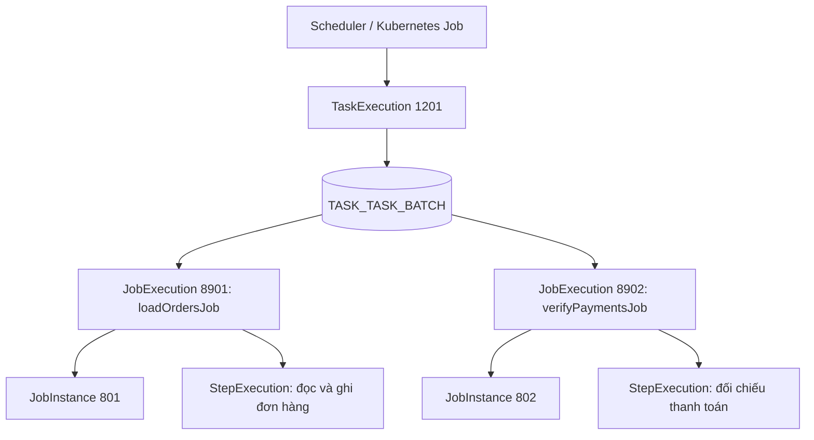
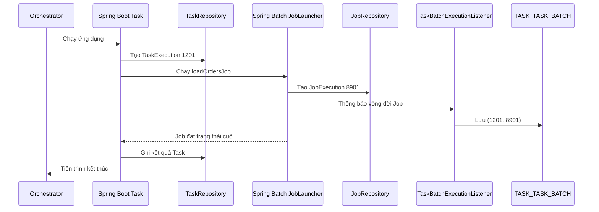
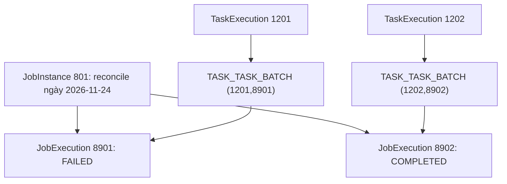

# Bảng liên kết TASK_TASK_BATCH và truy vết hai chiều

## 1. Vì sao cần nối Spring Cloud Task với Spring Batch?

Trong chương **Spring Batch** của **Spring Cloud Task**, chúng ta xét một ứng dụng **Spring Boot có thời gian chạy hữu hạn**: bộ điều phối khởi chạy ứng dụng, ứng dụng thực hiện một hoặc nhiều Batch Job, ghi nhận kết quả rồi kết thúc. Ở đây có hai lớp metadata khác nhau:

- **Spring Cloud Task** ghi mỗi lần chạy ứng dụng bằng một `TaskExecution` trong `TaskRepository`.
- **Spring Batch** ghi các lần chạy job, step và trạng thái xử lý bằng `JobExecution`, `StepExecution` trong `JobRepository`.

Ví dụ một Kubernetes Job khởi chạy ứng dụng `nightly-reconciliation` lúc 02:00, bên trong chạy `loadOrdersJob` và `verifyPaymentsJob`. Khi dashboard chỉ có `TASK_EXECUTION_ID=1201`, làm thế nào biết những Batch Job nào đã chạy? Ngược lại, khi cảnh báo cho biết `JOB_EXECUTION_ID=8902` thất bại, làm sao truy về đúng lượt chạy ứng dụng, container và log?

**`TASK_TASK_BATCH`** là bảng liên kết của Spring Cloud Task dành cho nhu cầu này. Bảng lưu cặp **ID của Task Execution** và **ID của Batch Job Execution**. Framework cung cấp `TaskBatchExecutionListener` để ghi mối quan hệ khi Batch Job được chạy trong phạm vi một Task, đồng thời `TaskExplorer` có hai phương thức tra cứu theo cả hai chiều.

Sau bài học, bạn có thể:

1. Đọc đúng hai cột `TASK_EXECUTION_ID`, `JOB_EXECUTION_ID` và phân biệt chúng với `JOB_INSTANCE_ID`.
2. Giải thích điều kiện để `TaskBatchExecutionListener` tự ghi bản ghi liên kết.
3. Truy vết **Task → các JobExecution** và **JobExecution → Task** bằng `TaskExplorer` hoặc SQL.
4. Join bảng Task với các bảng Batch khi cùng database, hoặc tra cứu qua hai repository khi dùng datasource riêng.
5. Phân tích mối quan hệ khi một Task chạy nhiều job, job bị restart, Batch thất bại hoặc metadata liên kết bị thiếu.
6. Tổ chức truy vết và vận hành an toàn khi ứng dụng chạy theo lịch, theo yêu cầu và có retry.

> **Giới hạn phiên bản:** Những API và tên bảng dưới đây được trình bày theo mô hình JDBC phổ biến trong Spring Cloud Task và Spring Batch. Hãy dùng bộ phiên bản Spring Boot/Spring Cloud Task/Spring Batch tương thích, kiểm tra schema và package Java của dependency đang triển khai. Không coi một đoạn SQL với tên bảng mặc định là áp dụng được nguyên xi cho mọi database hoặc cấu hình table prefix.

## 2. Bốn loại ID phải giữ riêng

| ID | Nguồn | Định danh điều gì? | Được lưu ở đâu? |
| --- | --- | --- | --- |
| `TASK_EXECUTION_ID` | Spring Cloud Task | **Một lượt chạy ứng dụng task** | `TASK_EXECUTION`; xuất hiện trong `TASK_TASK_BATCH` |
| `JOB_EXECUTION_ID` | Spring Batch | **Một lần thử chạy một Batch Job** | `BATCH_JOB_EXECUTION`; xuất hiện trong `TASK_TASK_BATCH` |
| `JOB_INSTANCE_ID` | Spring Batch | **Một công việc logic**, thường theo tên job + `JobParameters` định danh | `BATCH_JOB_INSTANCE` và `BATCH_JOB_EXECUTION` |
| `STEP_EXECUTION_ID` | Spring Batch | **Một lần chạy một Step** trong Job Execution | `BATCH_STEP_EXECUTION` |

Một `JobInstance` có thể có **nhiều `JobExecution`** khi restart sau thất bại. Một lượt chạy ứng dụng Task có thể chứa **nhiều JobExecution** nếu nó chạy nhiều Batch Job. Vì vậy `TASK_TASK_BATCH` nối vào **JobExecution**, không nối vào JobInstance hoặc StepExecution.

Ví dụ quan hệ:



Sơ đồ là dữ liệu minh họa. Cần đọc từng tầng đúng mục đích: `TaskRepository` trả lời “ứng dụng đã chạy lượt nào?”, `JobRepository` trả lời “job/step xử lý đến đâu?”, còn `TASK_TASK_BATCH` chỉ trả lời “**lượt Task nào liên quan đến lượt Batch nào?**”.

## 3. Cấu trúc bảng `TASK_TASK_BATCH`

Theo tài liệu schema Spring Cloud Task, bảng liên kết có hai cột chính:

| Cột | Kiểu thường dùng | Ý nghĩa |
| --- | --- | --- |
| `TASK_EXECUTION_ID` | `BIGINT NOT NULL` | ID một TaskExecution trong Task Repository |
| `JOB_EXECUTION_ID` | `BIGINT NOT NULL` | ID một JobExecution của Spring Batch |

Mô hình DDL rút gọn để **minh họa quan hệ**, không phải migration dùng ngay:

```sql
CREATE TABLE TASK_TASK_BATCH (
    TASK_EXECUTION_ID BIGINT NOT NULL,
    JOB_EXECUTION_ID BIGINT NOT NULL,
    CONSTRAINT TASK_EXEC_BATCH_FK
        FOREIGN KEY (TASK_EXECUTION_ID)
        REFERENCES TASK_EXECUTION(TASK_EXECUTION_ID)
);
```

DDL chuẩn thực tế có thể thay đổi theo database, phiên bản hoặc table prefix. Đáng chú ý, cấu trúc ví dụ có **khóa ngoại tới `TASK_EXECUTION`** nhưng không khẳng định một khóa ngoại database tới `BATCH_JOB_EXECUTION`: hai loại metadata có thể nằm ở **hai datasource khác nhau**. Không tự thêm foreign key xuyên database hoặc unique constraint nếu chưa kiểm tra luồng ghi và migration của dự án.

**`TASK_TASK_BATCH` không lưu kết quả Batch** như `STATUS`, `EXIT_CODE`, `STEP_NAME` hay checkpoint. Muốn xem job thành công/thất bại, bạn phải đọc `BATCH_JOB_EXECUTION`; muốn xem bước nào lỗi và số dòng đã xử lý, đọc `BATCH_STEP_EXECUTION` hoặc qua `JobExplorer`.

### Một Task có thể có bao nhiêu dòng liên kết?

Giả sử ứng dụng chạy ba job trong cùng một Task:

| TASK_EXECUTION_ID | JOB_EXECUTION_ID |
| --- | --- |
| 1201 | 8901 |
| 1201 | 8902 |
| 1201 | 8903 |

Đây là quan hệ **một TaskExecution → nhiều JobExecution**. `TaskExplorer.getJobExecutionIdsByTaskExecutionId(1201)` có thể trả về tập `{8901, 8902, 8903}`. Truy ngược một `JOB_EXECUTION_ID` thường tìm được TaskExecution mà nó chạy bên trong, nhưng **đừng tự giả định schema của mọi phiên bản áp đặt unique constraint ở cột Job**; khi phát hiện liên kết trùng hoặc sai, cần kiểm tra dữ liệu và đường ghi trước khi xây logic dựa trên tính duy nhất.

## 4. Ai tạo bản ghi liên kết?

Spring Cloud Task có `TaskBatchExecutionListener`, là thành phần tích hợp các lần chạy Batch với Task. Theo tài liệu chính thức, listener được cấu hình tự động khi những điều kiện phù hợp cùng tồn tại:

- Ứng dụng đang chạy có cơ chế Spring Cloud Task và tạo được `TaskExecution`.
- Context có Bean `Job` của Spring Batch đủ điều kiện để được listener gắn vào.
- JAR **`spring-cloud-task-batch`** nằm trong classpath và auto-configuration liên quan không bị loại trừ.
- `TaskRepository`, `TaskExplorer`, bảng liên kết và datasource cần thiết được cấu hình đúng.

`TaskBatchExecutionListener` được gắn vào các Batch Job thỏa điều kiện. Khi Job được chạy trong phạm vi Task, nó ghi cặp ID thông qua cơ chế DAO liên kết (ví dụ `TaskBatchDao.saveRelationship` ở API tương ứng). Có thể giới hạn listener vào một số Job hoặc tắt auto-configuration nếu dự án có lý do cụ thể. Không cần viết SQL `INSERT INTO TASK_TASK_BATCH` thủ công cho trường hợp tích hợp mặc định.



Sơ đồ biểu diễn **trình tự logic**. Chính xác lúc callback/transaction commit và cách listener được gắn vào Job phụ thuộc phiên bản/cấu hình. Nếu ứng dụng bị kill hoặc không kết nối được database tại lúc lưu liên kết, có thể đã có JobExecution nhưng **chưa có dòng `TASK_TASK_BATCH`**; không nên coi một liên kết thiếu là chứng minh Job chưa từng chạy.

### Dependency tích hợp

Với một dự án Maven **đã khai báo Spring Boot và Spring Cloud BOM tương thích**, các dependency liên quan có thể gồm:

```xml
<dependencies>
    <dependency>
        <groupId>org.springframework.cloud</groupId>
        <artifactId>spring-cloud-starter-task</artifactId>
    </dependency>
    <dependency>
        <groupId>org.springframework.cloud</groupId>
        <artifactId>spring-cloud-task-batch</artifactId>
    </dependency>
    <dependency>
        <groupId>org.springframework.boot</groupId>
        <artifactId>spring-boot-starter-batch</artifactId>
    </dependency>
    <dependency>
        <groupId>org.postgresql</groupId>
        <artifactId>postgresql</artifactId>
        <scope>runtime</scope>
    </dependency>
</dependencies>
```

Đoạn XML trên là **phần dependency minh họa**, không phải `pom.xml` đầy đủ. `spring-cloud-task-batch` cung cấp phần liên kết; `spring-boot-starter-batch` cung cấp các thành phần Batch trong ứng dụng Boot. Không chọn các phiên bản bằng cách ghép ngẫu nhiên thư viện mới nhất; cần đối chiếu release train tương thích.

### Cấu hình ứng dụng không-web

Ví dụ metadata được ghi vào PostgreSQL đã có schema Task và Batch phù hợp:

```yaml
spring:
  application:
    name: nightly-reconciliation
  main:
    web-application-type: none
  datasource:
    url: jdbc:postgresql://localhost:5432/task_batch_demo
    username: task_batch_app
  cloud:
    task:
      name: nightly-reconciliation
      batch:
        listener:
          enabled: true
```

Mật khẩu có thể được cấp qua biến môi trường `SPRING_DATASOURCE_PASSWORD` hoặc nguồn secret khác. `spring.cloud.task.batch.listener.enabled` là thuộc tính điều khiển liên kết ở các phiên bản Spring Cloud Task hỗ trợ property này; nếu không khai báo, listener thường được bật mặc định khi điều kiện auto-configuration thỏa. Dùng DDL đúng version, kiểm soát quyền, và xác nhận schema có `TASK_TASK_BATCH`.

## 5. Ví dụ một Task chạy Batch Job rồi truy vết

Giả sử dự án đã có Bean `Job loadOrdersJob` được định nghĩa với các Step tương ứng. Một Bean `ApplicationRunner` có thể gọi `JobLauncher` bằng tham số ngày nghiệp vụ:

```java
import java.time.LocalDate;
import java.util.List;

import org.springframework.batch.core.BatchStatus;
import org.springframework.batch.core.Job;
import org.springframework.batch.core.JobExecution;
import org.springframework.batch.core.JobParameters;
import org.springframework.batch.core.JobParametersBuilder;
import org.springframework.batch.core.launch.JobLauncher;
import org.springframework.beans.factory.annotation.Qualifier;
import org.springframework.boot.ApplicationRunner;
import org.springframework.context.annotation.Bean;
import org.springframework.context.annotation.Configuration;

@Configuration(proxyBeanMethods = false)
public class BatchLaunchConfiguration {

    @Bean
    ApplicationRunner launchOrders(
            JobLauncher jobLauncher,
            @Qualifier("loadOrdersJob") Job job) {
        return args -> {
            List<String> values = args.getOptionValues("business-date");
            if (values == null || values.size() != 1) {
                throw new IllegalArgumentException(
                        "Cần --business-date=yyyy-MM-dd");
            }

            String businessDate = LocalDate.parse(values.get(0)).toString();
            JobParameters parameters = new JobParametersBuilder()
                    .addString("businessDate", businessDate, true)
                    .toJobParameters();

            JobExecution jobExecution = jobLauncher.run(job, parameters);
            if (jobExecution.getStatus() != BatchStatus.COMPLETED) {
                throw new IllegalStateException(
                        "Batch chưa hoàn tất: " + jobExecution.getStatus());
            }
        };
    }
}
```

Ví dụ dùng API Batch 5.x phổ biến, chỉ là **cấu hình khởi chạy**, chưa bao gồm phần định nghĩa `Job`/`Step`, bean application `@SpringBootApplication` và `@EnableTask`. Với phiên bản Batch khác, cần đối chiếu package/chữ ký API trước khi biên dịch.

Nếu chủ động chạy Batch bằng `ApplicationRunner` như trên, tránh để Boot cũng tự khởi chạy cùng job:

```yaml
spring:
  batch:
    job:
      enabled: false
```

Property áp dụng trong những phiên bản Spring Boot hỗ trợ. Ví dụ giả định `JobLauncher` chạy **đồng bộ**; khi launcher bất đồng bộ, `run(...)` có thể trả về khi job chưa kết thúc, vì vậy cần đợi trạng thái cuối trước khi kết luận Task thành công.

Điều cần kiểm tra là **listener tự gắn vào Job thực thi**, không phải chỉ phụ thuộc việc gọi `JobLauncher` từ runner hay từ Boot. Nếu lớp `Job` không được auto-configuration hỗ trợ, listener bị tắt hoặc Job chạy ngoài phạm vi Task, bảng liên kết có thể không được ghi dù cả hai repository đều có metadata.

### Kết quả minh họa

Sau một lần chạy hoàn tất, database có thể có:

| TASK_EXECUTION | JOB_EXECUTION | TASK_TASK_BATCH |
| --- | --- | --- |
| `TASK_EXECUTION_ID=1201`, `EXIT_CODE=0` | `JOB_EXECUTION_ID=8901`, `STATUS=COMPLETED` | `(1201, 8901)` |

Các mã trong bảng chỉ là ví dụ. Hai câu hỏi truy vết giờ đã có câu trả lời: **Task 1201** đã chạy **Job 8901**, và **Job 8901** được thực thi trong **Task 1201**.

## 6. Truy vết từ Task sang Batch bằng SQL

### 6.1. Đọc quan hệ trực tiếp

Nếu biết `TASK_EXECUTION_ID`:

```sql
SELECT TASK_EXECUTION_ID, JOB_EXECUTION_ID
FROM TASK_TASK_BATCH
WHERE TASK_EXECUTION_ID = :taskExecutionId
ORDER BY JOB_EXECUTION_ID;
```

`:taskExecutionId` là **named parameter** dùng với những client/JDBC abstraction hỗ trợ (chẳng hạn `NamedParameterJdbcTemplate`). Khi chạy trực tiếp từ SQL client, dùng cơ chế bind parameter của client đó. Không nối giá trị chưa kiểm soát thành chuỗi SQL.

Câu truy vấn chỉ trả **các Batch execution ID**, chưa cho biết tên job, trạng thái hay chi tiết step.

### 6.2. Join đủ lịch sử Task → Job

Nếu các bảng **Task và Batch cùng nằm trong một database/schema có thể truy cập bằng một kết nối**, có thể dùng truy vấn:

```sql
SELECT
    t.TASK_EXECUTION_ID,
    t.TASK_NAME,
    t.START_TIME AS TASK_START_TIME,
    t.END_TIME AS TASK_END_TIME,
    t.EXIT_CODE AS TASK_EXIT_CODE,
    l.JOB_EXECUTION_ID,
    ji.JOB_INSTANCE_ID,
    ji.JOB_NAME,
    je.STATUS AS BATCH_STATUS,
    je.EXIT_CODE AS BATCH_EXIT_CODE,
    je.START_TIME AS JOB_START_TIME,
    je.END_TIME AS JOB_END_TIME
FROM TASK_EXECUTION t
LEFT JOIN TASK_TASK_BATCH l
    ON l.TASK_EXECUTION_ID = t.TASK_EXECUTION_ID
LEFT JOIN BATCH_JOB_EXECUTION je
    ON je.JOB_EXECUTION_ID = l.JOB_EXECUTION_ID
LEFT JOIN BATCH_JOB_INSTANCE ji
    ON ji.JOB_INSTANCE_ID = je.JOB_INSTANCE_ID
WHERE t.TASK_EXECUTION_ID = :taskExecutionId
ORDER BY l.JOB_EXECUTION_ID;
```

**Vì sao `LEFT JOIN`?** Một Task có thể chỉ thực hiện logic Java, lỗi trước khi Batch được khởi chạy hoặc thiếu liên kết do cấu hình. `LEFT JOIN` giữ bản ghi Task ngay cả khi không tìm được Job liên quan. Tuy nhiên, `NULL` ở phần Job **không chứng minh Batch chưa chạy**; cần kiểm tra listener, datasource và log.

**Phân biệt mã thoát:** `TASK_EXECUTION.EXIT_CODE` của Cloud Task thường là **số nguyên**; `BATCH_JOB_EXECUTION.EXIT_CODE` là **chuỗi** chứa `ExitStatus` của Batch. Không so sánh hai giá trị như cùng một enum hay coi chúng luôn phản ánh cùng kết quả.

### 6.3. Drill down đến Step

Khi đã biết `JOB_EXECUTION_ID`, xem số liệu Step:

```sql
SELECT
    JOB_EXECUTION_ID,
    STEP_EXECUTION_ID,
    STEP_NAME,
    STATUS,
    READ_COUNT,
    WRITE_COUNT,
    COMMIT_COUNT,
    ROLLBACK_COUNT,
    START_TIME,
    END_TIME
FROM BATCH_STEP_EXECUTION
WHERE JOB_EXECUTION_ID = :jobExecutionId
ORDER BY STEP_EXECUTION_ID;
```

Đây là **metadata của Spring Batch**, không thuộc bảng `TASK_TASK_BATCH`. Các count giúp đánh giá tiến độ nhưng không tự chứng minh mọi side effect ngoài database đã diễn ra đúng một lần.

## 7. Truy vết ngược từ Batch về Task bằng SQL

Giả sử dashboard Batch thông báo `JOB_EXECUTION_ID=8902` ở trạng thái `FAILED`. Bạn muốn tìm đúng lượt Task để mở log Kubernetes và kiểm tra mã thoát của ứng dụng:

```sql
SELECT
    je.JOB_EXECUTION_ID,
    ji.JOB_INSTANCE_ID,
    ji.JOB_NAME,
    je.STATUS AS BATCH_STATUS,
    je.EXIT_CODE AS BATCH_EXIT_CODE,
    t.TASK_EXECUTION_ID,
    t.TASK_NAME,
    t.START_TIME AS TASK_START_TIME,
    t.END_TIME AS TASK_END_TIME,
    t.EXIT_CODE AS TASK_EXIT_CODE,
    t.EXTERNAL_EXECUTION_ID
FROM BATCH_JOB_EXECUTION je
JOIN BATCH_JOB_INSTANCE ji
    ON ji.JOB_INSTANCE_ID = je.JOB_INSTANCE_ID
LEFT JOIN TASK_TASK_BATCH l
    ON l.JOB_EXECUTION_ID = je.JOB_EXECUTION_ID
LEFT JOIN TASK_EXECUTION t
    ON t.TASK_EXECUTION_ID = l.TASK_EXECUTION_ID
WHERE je.JOB_EXECUTION_ID = :jobExecutionId;
```

Ở đây `LEFT JOIN` giữ kết quả Batch nếu **chưa có liên kết Task**. Khi tìm thấy `TASK_EXECUTION_ID`, sử dụng Task Repository, `EXTERNAL_EXECUTION_ID` (nếu có), log/metrics hoặc dữ liệu bộ điều phối để xác định container nào đã chạy job.

Nếu truy vấn trả về **nhiều dòng** cho một Job Execution, hãy kiểm tra dữ liệu và schema thực tế trước khi mặc định nhiều dòng đều hợp lệ. API `TaskExplorer.getTaskExecutionIdByJobExecutionId` trả một `Long` hoặc `null`, nên dữ liệu liên kết lặp/không nhất quán có thể làm API hoặc logic ứng dụng có hành vi ngoài dự kiến.

## 8. Dùng API `TaskExplorer` thay cho SQL thủ công

Khi đã có bean `TaskExplorer` và `JobExplorer`, bạn có thể tra cứu hai chiều mà không tự join các bảng metadata.

### Task → tập JobExecution ID

API của Spring Cloud Task:

```java
Set<Long> jobExecutionIds =
        taskExplorer.getJobExecutionIdsByTaskExecutionId(taskExecutionId);
```

Phương thức trả **`Set<Long>`**, phản ánh một Task có thể liên kết với nhiều JobExecution; đừng giả định thứ tự phần tử của Set là thứ tự chạy job.

### JobExecution ID → TaskExecution ID

```java
Long taskExecutionId =
        taskExplorer.getTaskExecutionIdByJobExecutionId(jobExecutionId);
```

Nếu không tìm thấy liên kết, API có thể trả **`null`**. Đừng tự tạo một ID Task giả từ `JOB_EXECUTION_ID` hoặc `JOB_INSTANCE_ID`; đó là các namespace ID khác nhau.

### Dịch vụ tra cứu hai chiều

Ví dụ Java 17+ với **Spring Batch 5.x**:

```java
import java.util.ArrayList;
import java.util.List;
import java.util.Set;

import org.springframework.batch.core.JobExecution;
import org.springframework.batch.core.explore.JobExplorer;
import org.springframework.cloud.task.repository.TaskExecution;
import org.springframework.cloud.task.repository.TaskExplorer;
import org.springframework.stereotype.Service;

@Service
public class TaskBatchTraceService {
    private final TaskExplorer taskExplorer;
    private final JobExplorer jobExplorer;

    public TaskBatchTraceService(
            TaskExplorer taskExplorer,
            JobExplorer jobExplorer) {
        this.taskExplorer = taskExplorer;
        this.jobExplorer = jobExplorer;
    }

    public List<JobExecution> findJobsOfTask(long taskExecutionId) {
        Set<Long> ids =
                taskExplorer.getJobExecutionIdsByTaskExecutionId(taskExecutionId);
        List<JobExecution> found = new ArrayList<>();
        for (Long id : ids) {
            JobExecution execution = jobExplorer.getJobExecution(id);
            if (execution != null) {
                found.add(execution);
            }
        }
        return found;
    }

    public TaskExecution findTaskOfJob(long jobExecutionId) {
        Long taskId =
                taskExplorer.getTaskExecutionIdByJobExecutionId(jobExecutionId);
        return taskId == null ? null : taskExplorer.getTaskExecution(taskId);
    }
}
```

Đây là một **service đọc** minh họa. Cần kiểm soát quyền truy cập khi đưa ra API cho dashboard. Nếu hai repository dùng datasource khác nhau, `TaskExplorer` đọc bảng liên kết của Task, còn `JobExplorer` đọc `JobRepository` của Batch; cách gọi theo ID vẫn giúp điều hướng qua cả hai nguồn.

**Chú ý phiên bản:** `JobExplorer` và package Java của Spring Batch 6 có thay đổi so với Batch 5. Các import trong ví dụ là cho Batch 5.x; đối chiếu API thực tế của dự án trước khi biên dịch. Nếu một ID Job có trong `TASK_TASK_BATCH` nhưng `JobExplorer.getJobExecution(id)` trả `null`, cần kiểm tra **đúng datasource/namespace, migration và retention**, không coi kết quả là job tự xóa khỏi trí nhớ của Task.

## 9. Khi Task và Batch dùng hai datasource khác nhau

Có hai mô hình triển khai phổ biến:

| Mô hình | Điểm thuận tiện | Lưu ý |
| --- | --- | --- |
| **Chung database/schema** | Có thể join `TASK_TASK_BATCH` với bảng `BATCH_*` trực tiếp; thuận tiện cho SQL dashboard | Phải kiểm soát schema, version, table prefix, quyền và tải ghi/đọc |
| **Tách datasource hoặc database** | Phân quyền, backup, retention và khả năng vận hành độc lập | Không thể giả định một SQL join trực tiếp xuyên hai nguồn; cần `TaskExplorer` → `JobExplorer` hoặc dịch vụ tổng hợp |

Thông thường, `TASK_TASK_BATCH` nằm cùng Task metadata trong datasource mà thành phần liên kết sử dụng. Nó lưu **ID tham chiếu** tới Job Execution, vì vậy Batch metadata có thể tồn tại trong database khác mà vẫn truy vết qua API. Tuy nhiên, nếu bạn tùy chỉnh `TaskConfigurer`, datasource của Batch, table prefix hoặc schema, phải xác minh bean listener và DAO liên kết trỏ đúng kho dữ liệu.

### Ranh giới transaction quan trọng

Việc Spring Batch ghi `JobExecution` và việc Spring Cloud Task ghi dòng `TASK_TASK_BATCH` có thể **không thuộc cùng một transaction** khi hai repository nằm ở hai database khác nhau. Một lỗi mạng có thể khiến Job Execution đã có nhưng dòng liên kết chưa được ghi. Tương tự, khi di chuyển hoặc xóa lịch sử Batch, bảng liên kết Task có thể còn tham chiếu tới một ID không còn truy vấn được.

Khi thiết kế báo cáo, cần:

- Chấp nhận và thể hiện trạng thái **liên kết chưa tìm thấy / dữ liệu chưa đồng bộ**.
- Giữ chính sách retention metadata Task và Batch tương thích với nhu cầu truy vết.
- Không tuyên bố liên kết “luôn nguyên tử” chỉ vì hai repository nằm trong một Spring Boot application.
- Nếu triển khai nhiều Batch repository độc lập, tránh hiểu nhầm những `JOB_EXECUTION_ID` trùng số nhưng thuộc **namespace dữ liệu khác nhau**. Khi cần, bổ sung nguồn/tenant/cluster ID trong audit nghiệp vụ.

## 10. Truy vết khi Task retry và Batch restart

Giả sử task đối soát ngày `2026-11-24` chạy lần đầu rồi thất bại ở Step thứ hai. Bộ điều phối retry bằng **cùng bộ `JobParameters` định danh**.

| Lượt | TaskExecution | JobInstance | JobExecution | BatchStatus | Bảng liên kết |
| --- | --- | --- | --- | --- | --- |
| Lần đầu | `1201` | `801` | `8901` | `FAILED` | `(1201, 8901)` |
| Retry | `1202` | `801` | `8902` | `COMPLETED` | `(1202, 8902)` |

Vì **Task chạy lại**, Spring Cloud Task tạo `TaskExecution` mới. Vì **Batch restart cùng JobInstance**, Spring Batch tạo `JobExecution` mới nhưng giữ `JOB_INSTANCE_ID=801`. Cả hai cặp liên kết đều đúng; bảng liên kết không được cập nhật để “thay” `8901` thành `8902`.



Vì vậy, để tìm **toàn bộ các attempt của một JobInstance**, không chỉ xem `TASK_TASK_BATCH` với một JobExecution ID. Hãy đọc `BATCH_JOB_EXECUTION` theo `JOB_INSTANCE_ID`, rồi truy vết từng `JOB_EXECUTION_ID` ngược về `TASK_TASK_BATCH`.

Ví dụ SQL khi cùng database:

```sql
SELECT
    ji.JOB_INSTANCE_ID,
    ji.JOB_NAME,
    je.JOB_EXECUTION_ID,
    je.STATUS,
    l.TASK_EXECUTION_ID,
    t.START_TIME AS TASK_START_TIME,
    t.EXIT_CODE AS TASK_EXIT_CODE
FROM BATCH_JOB_INSTANCE ji
JOIN BATCH_JOB_EXECUTION je
    ON je.JOB_INSTANCE_ID = ji.JOB_INSTANCE_ID
LEFT JOIN TASK_TASK_BATCH l
    ON l.JOB_EXECUTION_ID = je.JOB_EXECUTION_ID
LEFT JOIN TASK_EXECUTION t
    ON t.TASK_EXECUTION_ID = l.TASK_EXECUTION_ID
WHERE ji.JOB_INSTANCE_ID = :jobInstanceId
ORDER BY je.JOB_EXECUTION_ID;
```

Truy vấn sẽ hiển thị cả JobExecution không có liên kết nếu dùng `LEFT JOIN`. Không được kết luận `Task 1201` là lần chạy thành công cuối chỉ vì có một dòng liên kết; cần đọc `STATUS` và `EXIT_CODE` ở **cả hai repository**.

## 11. Lỗi thường gặp: có JobExecution nhưng không có `TASK_TASK_BATCH`

| Hiện tượng | Nguyên nhân có thể | Cách điều tra |
| --- | --- | --- |
| Không có bảng `TASK_TASK_BATCH` | Schema chưa khởi tạo/migrate đúng version hoặc table prefix khác | Kiểm tra DDL Task Repository, schema đang kết nối và quyền tạo bảng |
| Có JobExecution, không có dòng liên kết | Thiếu `spring-cloud-task-batch`, listener bị tắt, Job không được gắn listener hoặc chạy ngoài phạm vi Task | Kiểm tra classpath, bean Job, auto-configuration, log JobListener |
| Cả Task và Job đều có dữ liệu nhưng truy vết API trả rỗng | TaskExplorer đang đọc DB/schema/prefix khác nơi ghi liên kết | Kiểm tra datasource, kết nối, migration, table prefix |
| SQL join không tìm thấy Job dù có liên kết | Batch metadata ở datasource khác hoặc đã bị dọn lịch sử | Dùng `JobExplorer` với Batch datasource đúng hoặc tra cứu hai DB riêng |
| Một Task trả nhiều JobExecution ID | Task chạy nhiều job hoặc có nhiều lần chạy job trong ứng dụng | Kiểm tra các cặp liên kết, tên job và khoảng thời gian |
| Lần retry có JobExecution mới nhưng Task ID cũ được kỳ vọng | Hiểu nhầm retry và restart | So sánh `TaskExecution` mới với `JobInstance` cũ |
| Task báo `EXIT_CODE=0` nhưng Batch `FAILED` | Ứng dụng chưa chuyển kết quả lỗi Batch lên cấp Task | Kiểm tra runner, `fail-on-job-failure` và mã thoát tiến trình |
| Không có dòng liên kết sau khi bị kill | Tiến trình/DB lỗi trước khi listener kịp lưu hoặc commit | Kiểm tra log, runtime, thời điểm tạo job và trạng thái repository |

Đừng tự thêm `INSERT` thủ công vào bảng liên kết khi chưa hiểu nguyên nhân và nguồn ID. Việc “vá” một hàng liên kết có thể khiến lịch sử suy diễn sai, che giấu lỗi listener/datasource hoặc gán nhầm JobExecution thuộc một Task khác.

### Kiểm tra dữ liệu liên kết bất thường

Trong môi trường kiểm thử hoặc khi điều tra dữ liệu đã có, có thể phát hiện cặp ID xuất hiện nhiều lần:

```sql
SELECT TASK_EXECUTION_ID, JOB_EXECUTION_ID, COUNT(*) AS LINK_COUNT
FROM TASK_TASK_BATCH
GROUP BY TASK_EXECUTION_ID, JOB_EXECUTION_ID
HAVING COUNT(*) > 1;
```

Câu truy vấn chỉ giúp **tìm bản ghi nghi vấn**, không khẳng định ngay nguyên nhân. Kiểm tra DDL/constraint, transaction và luồng retry trước khi sửa hoặc thêm unique index. Nếu muốn phân tích các JobExecution chưa được ánh xạ, sử dụng `LEFT JOIN` từ `BATCH_JOB_EXECUTION`; không tự gắn nhãn “lỗi framework” cho tất cả job không chạy trong Spring Cloud Task.

## 12. Mối liên kết không đồng nhất trạng thái và mã thoát

Giả sử Job thứ nhất thành công, Job thứ hai thất bại, nhưng code ứng dụng bắt exception rồi trả về bình thường:

| Tầng | Metadata | Kết quả có thể thấy |
| --- | --- | --- |
| Batch Job A | `JobExecution 8901` | `BatchStatus.COMPLETED` |
| Batch Job B | `JobExecution 8902` | `BatchStatus.FAILED` |
| Task chứa hai job | `TaskExecution 1201` | Có thể có `EXIT_CODE=0` nếu xử lý lỗi chưa đúng |
| OS / Kubernetes Job | Process exit status | Có thể nhận `0`, dẫn đến không retry |

`TASK_TASK_BATCH` liên kết các execution **nhưng không tự chuyển trạng thái Batch thành mã thoát Task**. Với luồng Boot/Batch tích hợp phù hợp, Spring Cloud Task có thuộc tính:

```yaml
spring:
  cloud:
    task:
      batch:
        fail-on-job-failure: true
```

Tính năng này giúp biểu diễn Batch Job thất bại thành mã thoát Task khác 0 theo cơ chế và version tương ứng. Nếu bạn **tự viết runner gọi JobLauncher** hoặc dùng launcher bất đồng bộ, hãy chủ động kiểm tra `JobExecution` đã kết thúc và truyền lỗi lên cấp Task; đừng chỉ tin property là đủ trong mọi luồng.

Để vận hành an toàn, cần kiểm tra **BatchStatus**, **TaskExecution.EXIT_CODE**, **process exit status** và **kết quả nghiệp vụ**. Cùng có liên kết `TASK_TASK_BATCH` không có nghĩa bốn lớp này đồng ý với nhau.

## 13. Checklist triển khai và vận hành

Khi cấu hình tích hợp Spring Cloud Task + Spring Batch trong môi trường có dữ liệu thật:

1. **Khóa phiên bản tương thích** giữa Spring Boot, Spring Cloud Task và Spring Batch; xác minh `spring-cloud-task-batch` đã ở classpath.
2. **Chạy migration đúng phiên bản** cho Task Repository và Job Repository; kiểm tra `TASK_TASK_BATCH` và các bảng `BATCH_*` có mặt ở schema dự kiến.
3. **Xác định datasource/table prefix** cho Task, liên kết và Batch; kiểm tra `TaskExplorer`/`JobExplorer` đọc đúng nơi.
4. **Khởi chạy một task nhỏ có một Job**, xác nhận có `TaskExecution`, `JobExecution` và một cặp liên kết đúng.
5. **Chạy Task có hai Job**, xác nhận một TaskExecution liên kết được với nhiều JobExecution.
6. **Tạo một job thất bại có chủ đích**, kiểm tra bản ghi liên kết vẫn có thể truy vết đến `BatchStatus.FAILED` và Task/OS báo kết quả đúng.
7. **Restart với identifying JobParameters giữ nguyên**, xác nhận TaskExecution mới, JobExecution mới, JobInstance có thể giữ nguyên khi đủ điều kiện.
8. **Thử bất thường có kiểm soát**: kill container, DB Task không kết nối, thiếu Job metadata, table prefix sai; quan sát đúng sự khác nhau giữa “chưa chạy”, “không có liên kết” và “lỗi truy vấn”.
9. **Giới hạn quyền và thông tin trả về** ở dashboard; tránh đưa argument/exception chứa secret vào log công khai.
10. **Thiết lập retention và cảnh báo**: dọn lịch sử Task/Batch nhất quán, giám sát lỗi ghi liên kết, task không có `END_TIME` và job bị kẹt `STARTED`.

### Bài tập tự kiểm tra

1. Vì sao `TASK_TASK_BATCH` lưu `JOB_EXECUTION_ID` thay vì `JOB_INSTANCE_ID`?
2. Một Task chạy ba Batch Job; `TaskExplorer.getJobExecutionIdsByTaskExecutionId` có thể trả về kiểu dữ liệu gì và bao nhiêu phần tử?
3. Từ `JOB_EXECUTION_ID`, dùng API nào để tra ngược ID Task, và API trả gì nếu không có liên kết?
4. Tại sao `LEFT JOIN` có ích khi truy vấn lịch sử Task? Khi nào một kết quả `NULL` ở phía Batch không chứng minh job chưa chạy?
5. Task và Batch dùng hai database khác nhau. Vì sao một câu SQL join trực tiếp thường không phù hợp, và dịch vụ Java cần những thành phần nào?
6. Một JobInstance bị lỗi và restart, hai JobExecution tương ứng với hai TaskExecution khác nhau. Bảng liên kết nên giữ những dòng nào?
7. Vì sao `TASK_TASK_BATCH` có dữ liệu nhưng mã thoát Task vẫn có thể bằng 0 khi Batch Job thất bại?
8. Khi dashboard không thấy liên kết, bạn sẽ kiểm tra JAR, listener, schema, datasource và trạng thái tiến trình theo thứ tự nào?

## 14. Tài liệu tham khảo

- [Spring Cloud Task — Batch: liên kết JobExecution với TaskExecution](https://docs.spring.io/spring-cloud-task/reference/batch.html).
- [Spring Cloud Task — Task Repository Schema, bảng TASK_TASK_BATCH](https://docs.spring.io/spring-cloud-task/docs/current/reference/html/appendix-task-repository-schema.html).
- [Spring Cloud Task — TaskExplorer API](https://docs.spring.io/spring-cloud-task/docs/current/apidocs/org/springframework/cloud/task/repository/TaskExplorer.html).
- [Spring Cloud Task — JdbcTaskBatchDao API](https://docs.spring.io/spring-cloud-task/docs/current/apidocs/org/springframework/cloud/task/batch/listener/support/JdbcTaskBatchDao.html).
- [Spring Batch — Metadata Schema](https://docs.spring.io/spring-batch/reference/schema-appendix.html).
- [Spring Batch 5 — JobExplorer API](https://docs.spring.io/spring-batch/docs/current/api/org/springframework/batch/core/explore/JobExplorer.html).

**Ghi nhớ:** `TASK_TASK_BATCH` là bảng ánh xạ **TaskExecution ↔ JobExecution** với hai cột `TASK_EXECUTION_ID` và `JOB_EXECUTION_ID`. `TaskBatchExecutionListener` ghi liên kết khi điều kiện tích hợp thỏa, còn `TaskExplorer` cho phép truy vết theo cả hai chiều. Muốn hiểu một lần chạy có thành công hay có thể retry, phải kết hợp liên kết này với **TaskRepository**, **JobRepository**, kết quả nghiệp vụ và trạng thái tiến trình; bản thân bảng liên kết không chứa kết quả xử lý.
