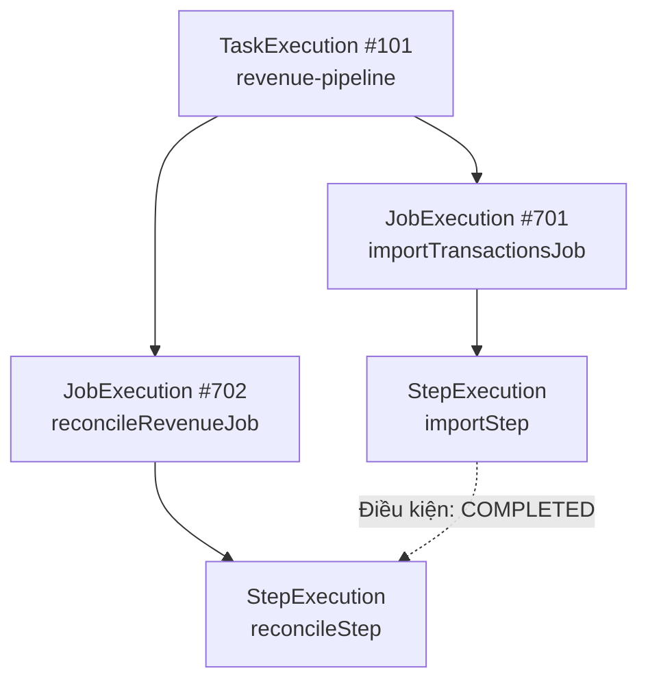
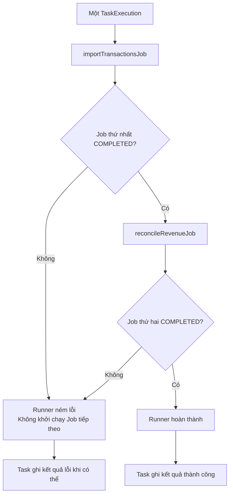

# Chạy nhiều Job trong cùng một Task

Một ứng dụng **Spring Cloud Task** có thời gian chạy hữu hạn: khởi động, thực hiện công việc, ghi nhận trạng thái qua `TaskRepository` và kết thúc. Khi bài toán gồm nhiều giai đoạn, chẳng hạn **nạp giao dịch → đối soát doanh thu → tạo báo cáo**, ta có thể sử dụng **Spring Batch** để quản lý từng công việc xử lý theo lô.

Trong chương **Spring Batch**, câu hỏi là: **một lần khởi chạy ứng dụng Spring Cloud Task có thể chạy nhiều Spring Batch `Job` hay không, và trạng thái, tham số, lỗi, lần chạy lại được quản lý thế nào?** Câu trả lời là **có**. Một `ApplicationRunner` có thể dùng `JobLauncher` gọi nhiều `Job`, đồng bộ theo thứ tự mà nghiệp vụ cần. Spring Cloud Task ghi nhận vòng đời **của tiến trình ứng dụng**, còn Spring Batch ghi nhận vòng đời **của từng Job và Step**.

Mục tiêu bài học:

- Phân biệt `TaskExecution`, `JobInstance`, `JobExecution` và `StepExecution`.
- Khởi chạy hai Batch Job trong cùng một ứng dụng bằng `JobLauncher`.
- Vô hiệu hóa cơ chế tự chạy Batch Job khi muốn điều phối thủ công.
- Chỉ chạy Job tiếp theo khi Job trước thực sự hoàn thành, đồng thời xử lý Job thất bại.
- Chạy lại ứng dụng an toàn với `JobParameters` và trạng thái đã lưu trong `JobRepository`.
- Kiểm tra dữ liệu thực thi và lựa chọn khi nào nên dùng nhiều Job, nhiều Step hoặc nhiều Task độc lập.

## 1. Một Task, nhiều Job: hiểu đúng các cấp độ

Giả sử ta chạy:

```bash
java -jar revenue-pipeline.jar --business-date=2026-11-24
```

Ứng dụng thực hiện hai Batch Job:

1. `importTransactionsJob`: nạp và kiểm tra giao dịch của một ngày.
2. `reconcileRevenueJob`: tổng hợp doanh thu từ các giao dịch đã nạp.

Nếu cả hai hoàn thành, ứng dụng kết thúc. Về mặt metadata, có thể quan sát:

| Cấp độ | Ví dụ | Chứa thông tin gì? |
| --- | --- | --- |
| **Spring Cloud Task** | `TaskExecution #101` | Một lần chạy ứng dụng `revenue-pipeline`, thời điểm bắt đầu/kết thúc, mã thoát. |
| **Spring Batch JobInstance** | `importTransactionsJob` + `businessDate=2026-11-24` | Danh tính logic của một Batch Job với các **JobParameters nhận dạng**. |
| **Spring Batch JobExecution** | `JobExecution #701`, `#702` | Những lần thực thi hoặc restart của từng JobInstance. |
| **Spring Batch StepExecution** | `importStep`, `reconcileStep` | Số bản ghi đọc/ghi, lỗi, trạng thái và checkpoint của từng step. |

Mỗi lần chạy JAR được ghi nhận thành **một `TaskExecution`** nếu Spring Cloud Task khởi động và lưu metadata thành công. Trong lần chạy đó có thể phát sinh **nhiều `JobExecution`**, tùy số Job được gọi và trạng thái lịch sử. Mỗi Job có thể chứa một hoặc nhiều Step.



Đường nét đứt thể hiện **quy tắc điều phối do ứng dụng đặt ra**, không phải một phụ thuộc tự có giữa hai Job. Spring Batch không tự biết rằng Job thứ hai phải đợi Job thứ nhất; chính đoạn mã gọi `JobLauncher` phải thực hiện và kiểm tra điều này.

### Phân biệt `JobInstance` với `JobExecution`

Spring Batch xác định `JobInstance` theo **tên Job và các `JobParameters` được đánh dấu là *identifying***. Ví dụ:

```text
JobInstance A = (importTransactionsJob, businessDate=2026-11-24)
JobInstance B = (reconcileRevenueJob, businessDate=2026-11-24)
```

Hai Job trên có cùng tham số nhưng **khác tên**, nên là hai JobInstance khác nhau. Nếu một Job thất bại rồi restart với cùng tham số nhận dạng, Spring Batch có thể tạo **JobExecution mới thuộc cùng JobInstance** theo quy tắc restart. Nếu JobInstance đã `COMPLETED`, gọi lại cùng Job và cùng tham số nhận dạng thường gây `JobInstanceAlreadyCompleteException`; **không mặc nhiên chạy lại phần đã hoàn thành**.

Điểm này rất quan trọng vì retry **toàn bộ Spring Cloud Task** sẽ khởi động một JVM mới, nhưng không có nghĩa Spring Batch cần chạy lại mọi Job đã thành công.

## 2. Ai quản lý trạng thái và giao dịch?

| Trách nhiệm | Spring Cloud Task | Spring Batch |
| --- | --- | --- |
| Đơn vị thực thi | Toàn **tiến trình ứng dụng hữu hạn** | Một `Job` và các `Step` bên trong |
| Kho trạng thái | `TaskRepository` | `JobRepository` |
| Bản ghi chính | `TaskExecution` | `JobInstance`, `JobExecution`, `StepExecution` |
| Kết quả | `exitCode` và metadata vòng đời task | `BatchStatus`, `ExitStatus`, thống kê Step |
| Restart | Lần khởi chạy mới thường có `TaskExecution` mới | Dựa vào `JobParameters`, JobInstance, Step và checkpoint |
| Điều phối các đơn vị | Launcher/orchestrator ngoài ứng dụng | Flow/Step trong Job; nhiều Job cần logic gọi và kiểm tra |

**`TaskRepository` và `JobRepository` không phải cùng một API.** Ngay cả khi cả hai cùng dùng một database, chúng vẫn lưu các bản ghi khác nhau. Các bảng metadata thường có tiền tố `TASK_` và `BATCH_`, với schema đúng phiên bản tương ứng.

Các lần commit của Batch Step **không tự động** nằm trong một transaction kéo dài bao quanh toàn bộ Spring Cloud Task. Nếu Job đầu đã commit dữ liệu rồi Job sau lỗi, việc Task kết thúc không thành công không rollback các dữ liệu đã commit ở Job đầu.

## 3. Chiến lược chạy nhiều Job

Có ba cách tổ chức thường gặp:

| Cách tổ chức | Phù hợp khi | Lưu ý |
| --- | --- | --- |
| **Một Job gồm nhiều Step** | Các bước thuộc **một quy trình Batch**, cần flow, checkpoint và restart theo Step | Thường đơn giản nhất khi các bước phụ thuộc chặt chẽ. |
| **Một Task chạy nhiều Job** | Các Job có ý nghĩa độc lập, cần `JobInstance`/`JobExecution` riêng nhưng vẫn được chạy trong một tiến trình | Cần tự điều phối thứ tự, lỗi và xử lý Job đã hoàn thành khi retry Task. |
| **Nhiều Task, mỗi Task chạy một Job** | Các Job cần scale, quyền, lịch chạy và tài nguyên riêng | Cần launcher/workflow orchestrator bên ngoài, có nhiều `TaskExecution`. |

Bài này tập trung vào **cách thứ hai**. Ta dùng một `ApplicationRunner` để chạy Job thứ nhất, kiểm tra trạng thái rồi mới chạy Job thứ hai.

### Điều kiện quan trọng: `JobLauncher` chạy đồng bộ

Trong ví dụ, `JobLauncher.run(...)` được giả định **chờ Job thực thi xong** rồi mới trả `JobExecution` cuối cùng. Cấu hình `TaskExecutorJobLauncher` với executor đồng bộ đáp ứng điều kiện đó.

Nếu launcher được cấu hình **bất đồng bộ**, `run(...)` có thể trả về khi trạng thái mới là `STARTING` hoặc `STARTED`. Khi ấy, so sánh trạng thái ngay với `COMPLETED` sẽ cho kết quả sai. Phải **đợi Job kết thúc**, có timeout và xử lý lỗi; nếu muốn chạy song song hai Job, phải có cơ chế tổng hợp trạng thái riêng trước khi Task đóng.

## 4. Ứng dụng mẫu: hai Job trong một Spring Cloud Task

Ví dụ sau minh họa cú pháp phổ biến của **Spring Boot 3.x / Spring Batch 5.x** cùng một phiên bản Spring Cloud Task tương thích. API của Spring Batch và cơ chế tự cấu hình có thể thay đổi ở release lớn; khi chọn Spring Boot 4 / Batch 6 hoặc bản khác, cần kiểm tra API và ma trận tương thích trước khi áp dụng.

### 4.1. Dependency

Tạo Spring Boot Maven project có Java runtime và Spring Cloud BOM tương thích. Thêm vào `pom.xml`:

```xml
<dependencies>
    <dependency>
        <groupId>org.springframework.cloud</groupId>
        <artifactId>spring-cloud-starter-task</artifactId>
    </dependency>
    <dependency>
        <groupId>org.springframework.boot</groupId>
        <artifactId>spring-boot-starter-batch</artifactId>
    </dependency>
    <dependency>
        <groupId>com.h2database</groupId>
        <artifactId>h2</artifactId>
        <scope>runtime</scope>
    </dependency>
</dependencies>
```

Đây là **phần dependency**, không phải POM hoàn chỉnh. Dự án phải có Spring Boot parent hoặc dependency management tương đương, Spring Cloud BOM đúng phiên bản và `spring-boot-maven-plugin` để đóng gói executable JAR. `spring-boot-starter-batch` cung cấp các thành phần Spring Batch và hạ tầng JDBC cần thiết trong cấu hình thông thường.

### 4.2. Cấu hình ứng dụng

Tạo `src/main/resources/application.yml`:

```yaml
spring:
  application:
    name: revenue-pipeline-task
  main:
    web-application-type: none
  datasource:
    url: jdbc:h2:file:./revenue-pipeline-metadata
    driver-class-name: org.h2.Driver
    username: sa
    password: ""
  batch:
    job:
      enabled: false
    jdbc:
      initialize-schema: always
  cloud:
    task:
      name: revenuePipelineTask
      initialize-enabled: true
```

Các lựa chọn có chủ đích:

- `spring.main.web-application-type: none`: ứng dụng CLI không tạo web server.
- `spring.batch.job.enabled: false`: **không cho Spring Boot tự chạy Batch Job khi khởi động**, vì `ApplicationRunner` của chúng ta sẽ tự chọn và gọi Job. Nếu bỏ thuộc tính này, tính năng tự chạy Job có thể can thiệp vào thứ tự hoặc gây chạy ngoài ý muốn.
- `spring.batch.jdbc.initialize-schema: always` và `spring.cloud.task.initialize-enabled: true`: hỗ trợ tạo schema trong **môi trường thực hành** khi phiên bản/framework hỗ trợ.
- `jdbc:h2:file:./revenue-pipeline-metadata`: lưu lịch sử trên đĩa, có thể quan sát qua nhiều lần khởi chạy từ **cùng working directory**.

Trong **production**, dùng database bền vững được hỗ trợ, migration theo schema của từng phiên bản Spring Batch/Task, quyền tối thiểu, backup và giám sát. Không để nhiều container trên nhiều máy phụ thuộc vào một file H2 cục bộ. Cấu hình khởi tạo tự động chỉ phục vụ ví dụ.

### 4.3. Tạo hai `Job`

Tạo `src/main/java/com/example/pipeline/RevenuePipelineTaskApplication.java`:

```java
package com.example.pipeline;

import java.time.LocalDate;
import java.util.List;

import org.springframework.batch.core.BatchStatus;
import org.springframework.batch.core.Job;
import org.springframework.batch.core.JobExecution;
import org.springframework.batch.core.JobParameters;
import org.springframework.batch.core.JobParametersBuilder;
import org.springframework.batch.core.Step;
import org.springframework.batch.core.job.builder.JobBuilder;
import org.springframework.batch.core.launch.JobLauncher;
import org.springframework.batch.core.repository.JobRepository;
import org.springframework.batch.core.step.builder.StepBuilder;
import org.springframework.batch.repeat.RepeatStatus;
import org.springframework.beans.factory.annotation.Qualifier;
import org.springframework.boot.ApplicationArguments;
import org.springframework.boot.ApplicationRunner;
import org.springframework.boot.SpringApplication;
import org.springframework.boot.autoconfigure.SpringBootApplication;
import org.springframework.cloud.task.configuration.EnableTask;
import org.springframework.context.annotation.Bean;
import org.springframework.transaction.PlatformTransactionManager;

@SpringBootApplication
@EnableTask
public class RevenuePipelineTaskApplication {

    public static void main(String[] args) {
        SpringApplication.run(RevenuePipelineTaskApplication.class, args);
    }

    @Bean
    Step importStep(
            JobRepository repository,
            PlatformTransactionManager transactionManager) {
        return new StepBuilder("importStep", repository)
            .tasklet((contribution, context) -> {
                Object date = context.getStepContext()
                    .getJobParameters().get("businessDate");
                System.out.println("1. Nap giao dich ngay " + date);
                // TODO: Goi service nhap/kiem tra du lieu.
                return RepeatStatus.FINISHED;
            }, transactionManager)
            .build();
    }

    @Bean
    Step reconcileStep(
            JobRepository repository,
            PlatformTransactionManager transactionManager) {
        return new StepBuilder("reconcileStep", repository)
            .tasklet((contribution, context) -> {
                Object date = context.getStepContext()
                    .getJobParameters().get("businessDate");
                System.out.println("2. Doi soat doanh thu ngay " + date);

                Object simulateError = context.getStepContext()
                    .getJobParameters().get("simulateError");
                if ("true".equals(simulateError)) {
                    throw new IllegalStateException(
                        "Loi mo phong khi doi soat"
                    );
                }
                // TODO: Goi service tong hop doanh thu.
                return RepeatStatus.FINISHED;
            }, transactionManager)
            .build();
    }

    @Bean
    Job importTransactionsJob(
            JobRepository repository,
            @Qualifier("importStep") Step step) {
        return new JobBuilder("importTransactionsJob", repository)
            .start(step)
            .build();
    }

    @Bean
    Job reconcileRevenueJob(
            JobRepository repository,
            @Qualifier("reconcileStep") Step step) {
        return new JobBuilder("reconcileRevenueJob", repository)
            .start(step)
            .build();
    }

    @Bean
    ApplicationRunner runPipeline(
            JobLauncher launcher,
            JobRepository repository,
            @Qualifier("importTransactionsJob") Job importJob,
            @Qualifier("reconcileRevenueJob") Job reconcileJob) {
        return args -> {
            LocalDate date = requiredBusinessDate(args);
            JobParameters parameters = new JobParametersBuilder()
                .addString("businessDate", date.toString(), true)
                .addString(
                    "simulateError",
                    Boolean.toString(args.containsOption("simulate-error")),
                    false
                )
                .toJobParameters();

            runOrSkipCompleted(launcher, repository, importJob, parameters);
            runOrSkipCompleted(launcher, repository, reconcileJob, parameters);
            System.out.println("Pipeline hoan tat");
        };
    }

    private static void runOrSkipCompleted(
            JobLauncher launcher,
            JobRepository repository,
            Job job,
            JobParameters parameters) throws Exception {
        JobExecution last =
            repository.getLastJobExecution(job.getName(), parameters);

        if (last != null && last.getStatus() == BatchStatus.COMPLETED) {
            System.out.println(
                "Bo qua Job da hoan thanh: " + job.getName()
            );
            return;
        }

        JobExecution execution = launcher.run(job, parameters);
        System.out.printf(
            "Job %s: status=%s, exitStatus=%s%n",
            job.getName(),
            execution.getStatus(),
            execution.getExitStatus()
        );

        if (execution.getStatus() != BatchStatus.COMPLETED) {
            throw new IllegalStateException(
                "Job " + job.getName()
                + " chua hoan thanh: " + execution.getStatus()
            );
        }
    }

    private static LocalDate requiredBusinessDate(
            ApplicationArguments args) {
        List<String> values = args.getOptionValues("business-date");
        if (values == null || values.size() != 1
                || values.get(0) == null || values.get(0).isBlank()) {
            throw new IllegalArgumentException(
                "Can dung mot --business-date=YYYY-MM-DD"
            );
        }
        return LocalDate.parse(values.get(0));
    }
}
```

**Lưu ý cấu hình:** Trong ví dụ Spring Boot 3 / Spring Batch 5, ta **không cần thêm `@EnableBatchProcessing`** vì muốn Spring Boot tự cấu hình hạ tầng Batch qua starter.

Giải thích luồng thực thi:

1. Spring Cloud Task khởi tạo metadata `TaskExecution` cho **toàn ứng dụng**.
2. Spring Boot gọi bean `ApplicationRunner` tên `runPipeline`.
3. Runner lấy `business-date` và tạo **một bộ `JobParameters`** dùng chung cho hai Job.
4. `runOrSkipCompleted` kiểm tra xem JobInstance tương ứng đã hoàn thành trước đó chưa; nếu có, **bỏ qua** khi retry cùng yêu cầu.
5. Nếu cần chạy, `JobLauncher` thực thi Job. Trong cấu hình **đồng bộ**, runner chờ `JobExecution` kết thúc rồi kiểm tra `BatchStatus.COMPLETED`.
6. Khi Job thứ nhất thành công, Job thứ hai mới được gọi. Nếu một Job lỗi, runner ném ngoại lệ và ngừng chuỗi.
7. Spring Cloud Task ghi nhận kết quả vòng đời nếu ứng dụng và kết nối metadata còn hoạt động; launcher bên ngoài quan sát mã thoát tiến trình.

Các `Tasklet` trong ví dụ chỉ in log. Trong ứng dụng thật cần thay `TODO` bằng service nghiệp vụ xử lý dữ liệu; các service đó phải có ranh giới transaction, khả năng restart và idempotency phù hợp.

**Quan trọng về bean:** `@Qualifier` được dùng để chỉ rõ hai Job. Nếu inject `Job` mà không chọn tên khi đã có nhiều Job beans, có thể gặp lỗi phân giải dependency.

## 5. Đóng gói và chạy từ terminal

Với Maven project có `artifactId=revenue-pipeline` và `version=0.0.1-SNAPSHOT`, chạy:

```bash
./mvnw clean package

java -jar target/revenue-pipeline-0.0.1-SNAPSHOT.jar \
  --business-date=2026-11-24
echo $?
```

Trên Windows PowerShell:

```powershell
.\mvnw.cmd clean package
java -jar .\target\revenue-pipeline-0.0.1-SNAPSHOT.jar --business-date=2026-11-24
$LASTEXITCODE
```

Một số dòng log nghiệp vụ kỳ vọng:

```text
1. Nap giao dich ngay 2026-11-24
Job importTransactionsJob: status=COMPLETED, exitStatus=exitCode=COMPLETED;...
2. Doi soat doanh thu ngay 2026-11-24
Job reconcileRevenueJob: status=COMPLETED, exitStatus=exitCode=COMPLETED;...
Pipeline hoan tat
```

Định dạng `ExitStatus.toString()` và các log framework thay đổi theo phiên bản; điều cần quan sát là **hai Job hoàn thành theo thứ tự** và tiến trình thoát. Trên đường chạy thành công bình thường, mã OS thường là **`0`**.

### Vì sao tắt `spring.batch.job.enabled`?

Spring Boot có thể tự kích hoạt cơ chế chạy Batch Job khi khởi động nếu có Job bean và cấu hình cho phép. Điều này tiện cho ứng dụng **một Job**, nhưng trong ví dụ **nhiều Job**:

- Chúng ta muốn chọn chính xác Job nào chạy trước.
- Muốn truyền một bộ tham số đã kiểm tra vào cả hai Job.
- Muốn dừng toàn bộ quy trình nếu một Job không hoàn tất.
- Muốn chủ động quyết định bỏ qua Job đã hoàn thành trong lần retry.

Vì vậy, `spring.batch.job.enabled=false` giúp tránh cơ chế tự chạy ngoài ý muốn và dành trách nhiệm điều phối cho `ApplicationRunner`.

## 6. Khi Job thứ hai thất bại thì sao?

Thử lần chạy với **ngày chưa từng xử lý**, ví dụ:

```bash
java -jar target/revenue-pipeline-0.0.1-SNAPSHOT.jar \
  --business-date=2026-11-25 \
  --simulate-error
echo $?
```

Trong ví dụ:

1. `importTransactionsJob` hoàn thành và có một `JobExecution` trạng thái `COMPLETED`.
2. `reconcileRevenueJob` đến `reconcileStep` và ném `IllegalStateException`.
3. Spring Batch ghi trạng thái thất bại của `JobExecution`/`StepExecution` khi có thể.
4. Vì `JobLauncher.run(...)` thường **trả về `JobExecution` kể cả khi Step thất bại**, runner phải **tự kiểm tra `BatchStatus`** rồi ném ngoại lệ nếu Job chưa thành công.
5. Ngoại lệ từ runner khiến luồng khởi động tác vụ báo lỗi thay vì in “Pipeline hoan tat”; Spring Cloud Task có thể cập nhật metadata lỗi.



**Đừng chỉ nhìn `JobLauncher.run(...)` có ném exception hay không.** Một Job được chạy thành công về mặt *lời gọi launcher* vẫn có thể kết thúc với `BatchStatus.FAILED`, `STOPPED` hoặc `UNKNOWN`. Với pipeline yêu cầu mọi Job hoàn thành, runner phải kiểm tra trạng thái trước khi đi tiếp.

**`BatchStatus` khác `ExitStatus`:** `BatchStatus` mô tả trạng thái vòng đời chung (như `COMPLETED` hoặc `FAILED`), còn `ExitStatus` mang mã thoát Batch và thông tin mô tả có thể tùy biến. Nếu quy trình nghiệp vụ cần điều kiện đặc biệt theo `ExitStatus`, thêm chính sách kiểm tra rõ ràng; ví dụ trên chỉ yêu cầu `BatchStatus.COMPLETED`.

### Nếu `JobLauncher` chạy bất đồng bộ

Trường hợp launcher trả về khi Job vẫn `STARTING`, đoạn kiểm tra ngay lập tức không còn đúng giả định. Có hai lựa chọn:

- **Ưu tiên launcher đồng bộ** cho chuỗi ngắn, mỗi Job cần hoàn thành trước khi Job tiếp theo bắt đầu.
- Hoặc theo dõi `JobExecution` qua `JobExplorer`/`JobRepository` đến trạng thái kết thúc, với **timeout, xử lý hủy và lỗi kết nối**, rồi mới quyết định chạy Job tiếp theo và cho Task kết thúc.

Không cho `ApplicationRunner` trả về khi Batch Job vẫn đang chạy nền nếu kết quả cuối cùng phải phản ánh **cả chuỗi Job**.

## 7. Chạy lại toàn Task: bỏ qua Job đã hoàn thành

Với lần chạy `--business-date=2026-11-25 --simulate-error` ở trên, metadata Batch có thể có:

| Job | JobInstance | JobExecution gần nhất | Kết quả |
| --- | --- | --- | --- |
| `importTransactionsJob` | `businessDate=2026-11-25` | `#801` | `COMPLETED` |
| `reconcileRevenueJob` | `businessDate=2026-11-25` | `#802` | `FAILED` |

Để **retry** sau khi xử lý nguyên nhân lỗi, chạy lại cùng tham số nhận dạng và bỏ cờ mô phỏng:

```bash
java -jar target/revenue-pipeline-0.0.1-SNAPSHOT.jar \
  --business-date=2026-11-25
```

Khi ấy:

1. Spring Cloud Task tạo **TaskExecution mới** cho lần khởi chạy này.
2. `JobRepository.getLastJobExecution(...)` cho biết `importTransactionsJob` đã `COMPLETED`, nên runner **bỏ qua Job đầu**.
3. `reconcileRevenueJob` chưa hoàn thành. `JobLauncher` có thể **restart JobInstance trước** với một `JobExecution` mới, nếu Job và các Step cho phép restart.
4. Khi Job thứ hai hoàn thành, Task kết thúc thành công.

Trong ví dụ, `businessDate` được khai báo tham số **identifying** bằng:

```java
.addString("businessDate", date.toString(), true)
```

Cờ `simulateError` được khai báo **non-identifying** bằng:

```java
.addString("simulateError", value, false)
```

Do đó, việc bật/tắt cờ mô phỏng **không tạo JobInstance mới** cho cùng ngày. Cờ này chỉ phục vụ bài thực hành. Trong production, tham số nhận dạng phải phản ánh **đơn vị dữ liệu nghiệp vụ** và phiên bản xử lý cần thiết; không tùy tiện dùng `run.id` hoặc timestamp mới cho mỗi retry vì điều đó tạo JobInstance mới và có thể bỏ qua checkpoint/restart dự định.

### Vì sao cần kiểm tra Job đã hoàn thành?

Nếu runner luôn gọi lại:

```java
launcher.run(importJob, parameters);
launcher.run(reconcileJob, parameters);
```

thì khi `importTransactionsJob` đã `COMPLETED` với cùng tham số nhận dạng, lời gọi đầu có thể ném `JobInstanceAlreadyCompleteException`. Pipeline dừng **trước khi đến Job thứ hai cần retry**. Kiểm tra trạng thái Job trước khi gọi là một cách tránh tình huống này.

Tuy nhiên, ví dụ `getLastJobExecution` rồi `run` vẫn có **khoảng đua (race condition)** nếu hai tiến trình cùng điều phối một bộ JobParameters. Spring Batch có cơ chế bảo vệ JobInstance đang chạy và các lỗi khởi chạy tương ứng, nhưng ứng dụng vẫn cần **giới hạn chạy đồng thời**, lock/lease phù hợp và xử lý lỗi `JobExecutionAlreadyRunningException`, `JobRestartException`, `JobInstanceAlreadyCompleteException` theo chính sách rõ ràng. Kiểm tra trước không thay thế bảo vệ tại database.

### Khi cần chạy lại một Job đã hoàn thành có chủ đích

Với một JobInstance đã hoàn thành, muốn xử lý lại do dữ liệu nguồn thay đổi, cần có **quy trình reprocess** rõ ràng: dùng phiên bản dữ liệu, tham số nhận dạng phù hợp hoặc cơ chế tái tạo được thiết kế. Không sửa thủ công `BATCH_JOB_EXECUTION.STATUS` hay metadata `TASK_EXECUTION` để “ép” framework chạy lại, vì dễ làm hỏng tính nhất quán.

## 8. Quan sát metadata của cả Task và Batch

Với schema được tạo đúng phiên bản, có thể kiểm tra riêng:

**Các lần chạy Spring Cloud Task:**

```sql
SELECT
    TASK_EXECUTION_ID,
    TASK_NAME,
    START_TIME,
    END_TIME,
    EXIT_CODE
FROM TASK_EXECUTION
ORDER BY TASK_EXECUTION_ID DESC;
```

**Các lần chạy Batch Job:**

```sql
SELECT
    JOB_EXECUTION_ID,
    JOB_INSTANCE_ID,
    STATUS,
    EXIT_CODE,
    START_TIME,
    END_TIME
FROM BATCH_JOB_EXECUTION
ORDER BY JOB_EXECUTION_ID DESC;
```

Nếu dùng cơ chế tích hợp ghi liên kết Task–Batch của phiên bản Spring Cloud Task đang triển khai, schema có thể có bảng liên kết **`TASK_TASK_BATCH`** giữa `TASK_EXECUTION_ID` và `JOB_EXECUTION_ID`. Khi bảng và cơ chế liên kết hoạt động, có thể truy vấn:

```sql
SELECT
    t.TASK_EXECUTION_ID,
    t.TASK_NAME,
    t.EXIT_CODE AS TASK_EXIT_CODE,
    j.JOB_EXECUTION_ID,
    j.STATUS AS JOB_STATUS,
    j.EXIT_CODE AS JOB_EXIT_CODE
FROM TASK_EXECUTION t
JOIN TASK_TASK_BATCH link
    ON link.TASK_EXECUTION_ID = t.TASK_EXECUTION_ID
JOIN BATCH_JOB_EXECUTION j
    ON j.JOB_EXECUTION_ID = link.JOB_EXECUTION_ID
ORDER BY t.TASK_EXECUTION_ID, j.JOB_EXECUTION_ID;
```

**Không giả định bảng liên kết luôn tồn tại hoặc tự được ghi trong mọi cấu hình.** Cần kiểm tra DDL, cách đăng ký listener liên kết và phiên bản Spring Cloud Task / Batch. Nếu các bảng metadata nằm ở **hai database khác nhau**, câu SQL `JOIN` trực tiếp trên một kết nối cũng có thể không áp dụng; khi đó cần tầng truy vấn/tổng hợp riêng với correlation ID hoặc nguồn metadata liên kết được hỗ trợ.

### Khi báo cáo trạng thái, xem cả ba lớp

| Lớp | Nguồn trạng thái | Câu hỏi |
| --- | --- | --- |
| **Process/launcher** | Mã thoát JVM/container, log, sự kiện Kubernetes | Tiến trình còn sống không? Bị kill/OOM không? |
| **Spring Cloud Task** | `TaskExecution` qua `TaskExplorer` | Lần chạy ứng dụng được ghi nhận đã kết thúc ra sao? |
| **Spring Batch** | `JobExecution`, `StepExecution`, `JobExplorer` | Job nào hoàn tất, Job nào lỗi, Step nào cần restart? |

Nếu Step thứ hai lỗi nhưng runner bắt lỗi rồi trả về bình thường, có thể xuất hiện **Batch Job thất bại nhưng Task báo thành công**. Vì vậy, kiểm tra trạng thái của từng Job trong runner và **lan truyền lỗi** là thiết kế quan trọng, đặc biệt khi orchestrator chỉ nhìn mã thoát ứng dụng.

## 9. Giao dịch, idempotency và vận hành an toàn

### Không có transaction chung kéo dài qua tất cả Job

Mỗi Job hoặc Step có thể dùng transaction manager của riêng mình. Batch chunk có thể commit theo từng đợt. Nếu Job đầu đã hoàn thành, Job thứ hai thất bại thì các thay đổi nghiệp vụ đã commit trước đó **không tự rollback** chỉ vì Task trả mã thoát lỗi.

Ví dụ `importTransactionsJob` đã nạp 10.000 giao dịch, còn `reconcileRevenueJob` lỗi khi tính tổng. Trong lần retry, cần **giữ nguyên dữ liệu nhập đã thành công** và chỉ xử lý phần còn thiếu theo quy tắc nghiệp vụ. Đó là lý do runner phải nhận diện Job đầu đã hoàn tất và Batch Step phải có khả năng restart phù hợp.

### Chọn đúng `JobParameters`

- Tham số nhận dạng như `businessDate` hoặc `sourceVersion` xác định **JobInstance**.
- Tham số không nhận dạng như cờ chẩn đoán không làm thay đổi JobInstance.
- Một retry cần giữ **cùng bộ identifying parameters** nếu mục tiêu là restart JobInstance đã thất bại.
- Một lần xử lý dữ liệu mới thực sự có thể cần identifying parameters khác; đừng dùng timestamp tùy ý để né lỗi `JobInstanceAlreadyCompleteException`.

### Bảo vệ kết quả nghiệp vụ

- Thiết kế **khóa idempotency** theo kỳ dữ liệu, file ID, request ID hoặc phiên bản nguồn.
- Có **unique constraint**, upsert/transaction và cơ chế chống chạy đồng thời khi cần.
- Không dựa duy nhất vào `TaskExecution.executionId`: ID này đổi khi Task được khởi chạy lại.
- Nếu Job gọi API ngoài, gửi thông điệp hoặc tạo file, kiểm soát side effect và retry (outbox, event ID, tên file xác định, thao tác ghi nguyên tử).
- Nếu quy trình có nhiều Job và đòi hỏi khôi phục sau lỗi phức tạp, cân nhắc dùng **một Batch Job gồm nhiều Step** để tận dụng flow, checkpoint và restart theo Step, hoặc tách Job thành những Task riêng cho orchestrator điều phối.

### Khi chạy theo lịch hoặc theo yêu cầu

Cron, Kubernetes CronJob, Spring Cloud Data Flow hay một dịch vụ launcher có thể tạo tiến trình mới. Chúng chịu trách nhiệm **khi nào khởi chạy, timeout, retry, giới hạn đồng thời và cảnh báo**. Spring Cloud Task lưu lịch sử cấp ứng dụng; Spring Batch lưu lịch sử Job/Step; **không framework nào tự bảo đảm toàn bộ workflow không bao giờ được yêu cầu chạy hai lần**.

## 10. Thực hành tự kiểm tra

1. Dùng Maven đóng gói ứng dụng với `spring.batch.job.enabled=false`; chạy `--business-date=2026-11-24` và xác nhận thứ tự hai dòng log Step.
2. Kiểm tra bảng `TASK_EXECUTION` và `BATCH_JOB_EXECUTION`. Giải thích vì sao một Task có thể tương ứng nhiều JobExecution.
3. Chạy lại cùng ngày khi **cả hai Job đã hoàn thành**; runner phải bỏ qua Job đã hoàn thành theo thiết kế ví dụ. Quan sát TaskExecution mới được ghi.
4. Chạy một **ngày mới** với `--simulate-error`; xác nhận Job thứ nhất `COMPLETED`, Job thứ hai `FAILED` và Task nhận lỗi.
5. Bỏ `--simulate-error` rồi retry cùng ngày: kiểm tra Job đầu được bỏ qua, Job hai tạo lần JobExecution mới và hoàn thành.
6. Thử bỏ kiểm tra `getLastJobExecution` và chạy lại Job đã hoàn thành: giải thích `JobInstanceAlreadyCompleteException` xảy ra ở đâu.
7. Thay `JobLauncher` bằng launcher bất đồng bộ trong môi trường thử nghiệm và quan sát giá trị `STARTING`/`STARTED`; thiết kế cách đợi kết quả trước khi kết thúc Task.
8. Giả sử Job đầu đã commit dữ liệu nhưng ứng dụng bị kill trước khi ghi kết thúc Task. Đề xuất phương án xác minh và retry không nhân đôi dữ liệu nghiệp vụ.

**Câu hỏi ôn tập:**

- Một lần `java -jar` chạy ba Batch Job sẽ có bao nhiêu `TaskExecution` và có thể có bao nhiêu `JobExecution`?
- Vì sao `JobLauncher.run(...)` trả về bình thường chưa chứng minh Batch Job đã thành công?
- `JobInstance` được xác định từ những thành phần nào, và điều gì xảy ra khi gọi lại một JobInstance đã `COMPLETED`?
- Vì sao cần `spring.batch.job.enabled=false` trong một ứng dụng muốn tự điều phối nhiều Job?
- Khi Job thứ hai lỗi, có nên chạy lại Job đầu đã thành công không? Khi nào cần một quy trình reprocess riêng?
- Spring Cloud Task và Spring Batch lưu kết quả vào cùng một metadata hay vào hai repository có trách nhiệm khác nhau?

**Ghi nhớ:** Một Spring Cloud Task có thể **chạy nhiều Spring Batch Job trong cùng một tiến trình**, nhưng **mỗi Job vẫn có JobInstance/JobExecution/StepExecution của riêng nó**. Để vận hành an toàn, hãy tắt tự chạy Job khi điều phối thủ công, xác nhận Job trước hoàn thành rồi mới chạy Job sau, và thiết kế retry dựa trên JobParameters, metadata Batch và idempotency nghiệp vụ. Spring Cloud Task cung cấp bức tranh cấp ứng dụng; Spring Batch cung cấp mức chi tiết và khả năng restart ở cấp Job/Step.
