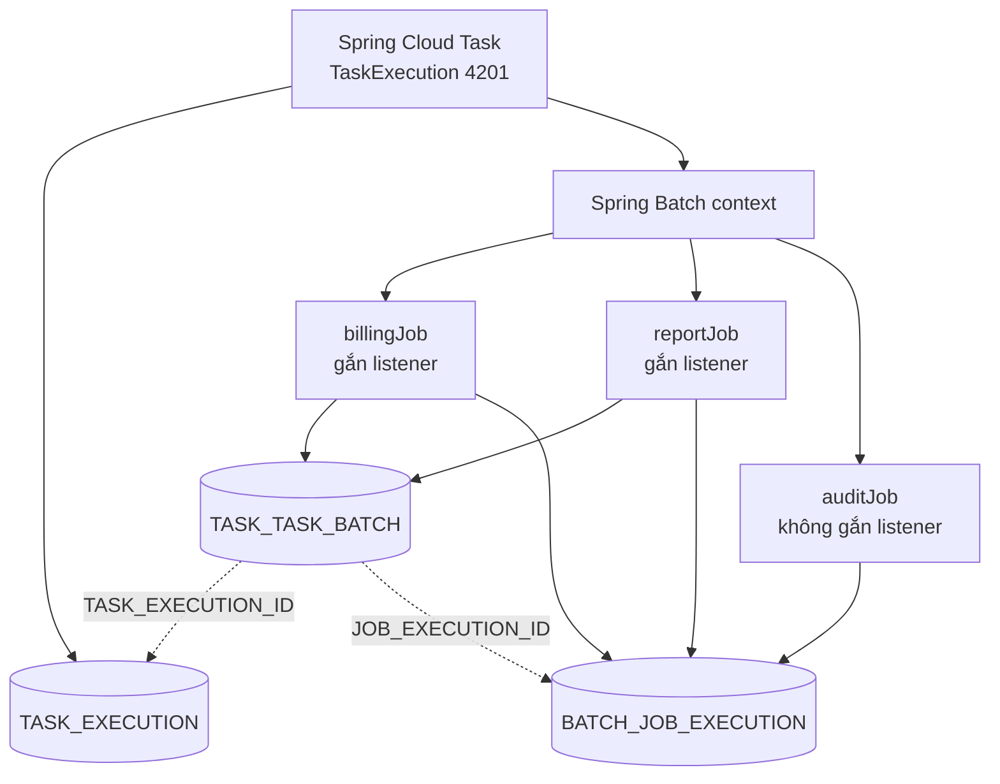

# Tùy chỉnh phạm vi gắn `TaskBatchExecutionListener`

## Mục tiêu học tập

Sau bài học, bạn có thể:

- Giải thích vai trò của `TaskBatchExecutionListener` khi Spring Cloud Task chạy một hoặc nhiều Spring Batch `Job`.
- Mô tả cơ chế mặc định gắn listener vào các Job đủ điều kiện và nhận biết phạm vi tác động của `TaskBatchExecutionListenerBeanPostProcessor`.
- Giới hạn tự động gắn listener vào **những Job được chỉ định** bằng bean `batchTaskExecutionListenerBeanPostProcessor` và `setJobNames(...)`.
- Phân biệt **bean ID** dùng để chọn Job nhận listener, **tên logic của Job** và cấu hình **Job nào thực sự được khởi chạy**.
- Hiểu tác động của việc tắt hoàn toàn liên kết Task–Batch, tách biệt với phát sự kiện Batch và với kết quả/exit code của ứng dụng.
- Kiểm chứng bằng `TASK_EXECUTION`, `TASK_TASK_BATCH`, `BATCH_JOB_EXECUTION` và kiểm thử các đường thành công, lỗi, retry.

> **Ngữ cảnh:** Bài thuộc chương **Spring Batch** của module **SPRING_CLOUD_TASK**. Spring Cloud Task theo dõi ứng dụng Spring Boot chạy hữu hạn, ghi thời gian, trạng thái và kết quả của từng lần chạy vào `TaskRepository`. Spring Batch tổ chức xử lý theo Job/Step và ghi metadata vào `JobRepository`. `TaskBatchExecutionListener` giúp nối **một lần chạy Batch Job** với **lần chạy Task chứa nó**. Tùy chỉnh phạm vi listener đặc biệt cần thiết khi một ứng dụng khai báo nhiều Job nhưng chỉ muốn theo dõi một phần Job theo quan hệ Task–Batch.

## 1. Bài toán: một Task có nhiều Batch Job

Hãy xét ứng dụng `finance-nightly-task` được gọi theo lịch hoặc theo yêu cầu. Trong cùng `ApplicationContext`, ứng dụng đăng ký ba bean Spring Batch:

| Bean ID | Tên Job minh họa | Mục đích | Có muốn gắn Task–Batch? |
| --- | --- | --- | --- |
| `billingJob` | `billingJob` | Chốt giao dịch và tính tiền. | Có. |
| `reportJob` | `reportJob` | Tổng hợp báo cáo định kỳ. | Có. |
| `auditJob` | `auditJob` | Kiểm tra/phân tích nội bộ độc lập. | Không, theo yêu cầu ví dụ. |

Giả sử lần chạy Task số `4201` thực thi cả `billingJob` và `auditJob`. Với listener mặc định, nếu cả hai Job thuộc diện được gắn và đã chạy, bảng liên kết Task–Batch có thể có hai quan hệ. Nhưng mục tiêu nghiệp vụ ở đây là chỉ tự động ghi liên kết của `billingJob` và `reportJob`; `auditJob` vẫn chạy bình thường, vẫn có `JobExecution` trong repository Batch, chỉ không được liên kết bằng listener này.

Sự khác biệt cần nắm:

1. **Job được đăng ký:** bean `Job` tồn tại trong Spring context.
2. **Job được gắn listener:** cấu hình chọn đưa `TaskBatchExecutionListener` vào Job đó.
3. **Job thực sự chạy:** Job được launcher hoặc Spring Boot khởi động, sinh `JobExecution`.
4. **Liên kết được lưu:** listener của Job đã chạy ghi cặp ID Task–Batch vào bảng quan hệ.

Một Job được gắn listener nhưng **không chạy** sẽ không sinh `JobExecution` mới chỉ nhờ listener. Ngược lại, một Job được chạy nhưng **không gắn listener** vẫn có metadata Batch, nhưng thông thường sẽ không tạo quan hệ `TASK_TASK_BATCH` qua cơ chế này.

## 2. `TaskBatchExecutionListener` làm gì?

Một lần Spring Cloud Task thực thi được nhận diện bằng `TaskExecution.executionId`. Một lần Spring Batch Job thực thi được nhận diện bằng `JobExecution.id`. Hai số này được cấp theo **hai hệ thống metadata khác nhau**, không nên giả định chúng giống nhau.

`TaskBatchExecutionListener` hoạt động trong vòng đời Job để giúp ghi liên hệ giữa hai đối tượng thực thi. Khi cấu hình tích hợp Task–Batch phù hợp và repository khả dụng, liên hệ được lưu trong bảng `TASK_TASK_BATCH` với các khóa:

- `TASK_EXECUTION_ID`: mã lần chạy Task.
- `JOB_EXECUTION_ID`: mã lần chạy Batch Job.



Sơ đồ biểu diễn phạm vi gắn listener. Những mũi tên đến `TASK_TASK_BATCH` chỉ phát sinh dữ liệu khi Job tương ứng **được thực thi** và listener/repository hoạt động.

### Phân biệt với các thành phần khác

| Thành phần | Trách nhiệm | Có quyết định Job nào chạy? |
| --- | --- | --- |
| `TaskBatchExecutionListener` | Theo dõi, liên kết `JobExecution` với `TaskExecution`. | Không. |
| `TaskBatchExecutionListenerBeanPostProcessor` | Gắn listener vào các bean Job đủ điều kiện; có thể lọc bằng danh sách tên bean. | Không. |
| `TaskRepository` / `TaskExplorer` | Ghi và đọc metadata vòng đời Task. | Không. |
| Spring Batch `JobRepository` | Ghi JobInstance, JobExecution, StepExecution, tham số và trạng thái Batch. | Không. |
| `JobLauncher` hoặc runner tự động của Spring Boot | Khởi chạy Job với `JobParameters`. | Có. |
| `spring.batch.job.name` / `spring.batch.job.enabled` | Điều khiển hành vi tự khởi chạy Job của Spring Boot, tùy release. | Có. |

**Không xem listener là bộ lập lịch, JobLauncher hoặc bộ điều phối Job.** Tương tự, việc giới hạn listener không làm Job bị xóa, không ngăn Job chạy và không thay đổi tự động cấu trúc Step/transaction của Job.

## 3. Điều kiện và hành vi mặc định

Theo cơ chế tích hợp Spring Cloud Task–Batch được mô tả trong tài liệu Spring Cloud Task, listener thường được tự cấu hình khi:

1. Context có bean `Job` của Spring Batch.
2. Classpath có module `spring-cloud-task-batch`.
3. Auto-configuration tích hợp Task–Batch đang được bật và các bean hạ tầng cần thiết được tạo thành công.

Trong cấu hình mặc định, `TaskBatchExecutionListener` được gắn vào **các Job đủ điều kiện** trong context. Bộ hậu xử lý bean hỗ trợ việc này là `TaskBatchExecutionListenerBeanPostProcessor`. Tài liệu API mô tả bộ xử lý gắn listener vào những Job bean có thể gán cho `AbstractJob`, vì vậy cần kiểm tra các lớp Job tùy biến/proxy có nằm trong phạm vi được hỗ trợ ở release đang dùng hay không.

### Dependency Maven tham khảo

Ứng dụng Task có Spring Batch thường cần:

```xml
<dependencies>
    <dependency>
        <groupId>org.springframework.cloud</groupId>
        <artifactId>spring-cloud-starter-task</artifactId>
    </dependency>

    <dependency>
        <groupId>org.springframework.boot</groupId>
        <artifactId>spring-boot-starter-batch</artifactId>
    </dependency>

    <dependency>
        <groupId>org.postgresql</groupId>
        <artifactId>postgresql</artifactId>
        <scope>runtime</scope>
    </dependency>
</dependencies>
```

Dự án cần Spring Boot parent/BOM và Spring Cloud BOM **tương thích**; ví dụ không cố định phiên bản. Trong nhiều release, `spring-cloud-starter-task` đã kéo theo `spring-cloud-task-batch`. Nên kiểm tra cây phụ thuộc thay vì mặc định phải khai báo artifact đó lần thứ hai:

```bash
./mvnw dependency:tree -Dincludes=org.springframework.cloud
```

Hoặc với Gradle:

```bash
./gradlew dependencies --configuration runtimeClasspath
```

Nếu thiếu module tích hợp trên **runtime classpath**, listener không tự xuất hiện dù ứng dụng có `spring-boot-starter-batch`. Ngược lại, có thư viện Task–Batch không tự sinh bean `Job` nếu ứng dụng chưa khai báo.

## 4. Ba cách lựa chọn phạm vi listener

Có ba cấu hình điển hình:

| Mục tiêu | Cơ chế | Kết quả mong đợi |
| --- | --- | --- |
| Gắn listener cho toàn bộ Job đủ điều kiện | Dùng auto-configuration mặc định. | Job nào được chạy và được gắn listener sẽ có thể ghi liên kết Task–Batch. |
| **Chỉ gắn cho một danh sách Job** | Khai báo `batchTaskExecutionListenerBeanPostProcessor` và gọi `setJobNames(...)`. | Chỉ các Job bean được chọn có listener tích hợp. |
| Không gắn cho bất kỳ Job nào | Tắt tính năng liên kết listener/auto-configuration ở mức ứng dụng, tùy phiên bản. | Task và Batch vẫn có metadata riêng; bảng liên kết không được cập nhật qua listener tự động. |

Điểm khác biệt quan trọng: một Job **không nằm trong danh sách** vẫn có thể chạy và ghi `BATCH_JOB_EXECUTION`. Việc giới hạn listener chỉ làm thay đổi quan hệ truy vết từ Job về Task qua cơ chế này.

## 5. Cách chính: chọn Job bằng `setJobNames(...)`

Tài liệu Spring Cloud Task hướng dẫn tùy chỉnh bean mang **tên chính xác** `batchTaskExecutionListenerBeanPostProcessor`. Ta khai báo bộ xử lý bean đó rồi cung cấp danh sách **bean ID của Job**:

```java
package com.example.financetask.config;

import java.util.List;

import org.springframework.cloud.task.batch.configuration
        .TaskBatchExecutionListenerBeanPostProcessor;
import org.springframework.context.annotation.Bean;
import org.springframework.context.annotation.Configuration;

@Configuration(proxyBeanMethods = false)
public class TaskBatchListenerScopeConfiguration {

    @Bean(name = "batchTaskExecutionListenerBeanPostProcessor")
    public static TaskBatchExecutionListenerBeanPostProcessor
            batchTaskExecutionListenerBeanPostProcessor() {

        TaskBatchExecutionListenerBeanPostProcessor postProcessor =
                new TaskBatchExecutionListenerBeanPostProcessor();

        postProcessor.setJobNames(
                List.of("billingJob", "reportJob")
        );

        return postProcessor;
    }
}
```

### Giải thích từng phần

- `@Bean(name = "batchTaskExecutionListenerBeanPostProcessor")` đặt tên bean theo điểm mở rộng được tài liệu Spring Cloud Task mô tả. Việc chỉ tạo một bean bất kỳ cùng kiểu với tên khác có thể dẫn tới **hai post-processor** hoặc không thay thế đúng cơ chế mặc định, tùy release.
- Phương thức `static` là phù hợp khi tạo `BeanPostProcessor`: giúp Spring đăng ký sớm mà không buộc tạo trước các bean khác của cùng lớp `@Configuration`.
- `new TaskBatchExecutionListenerBeanPostProcessor()` tạo bộ xử lý dùng để gắn listener theo cơ chế của thư viện.
- `setJobNames(List.of("billingJob", "reportJob"))` xác định **những Job bean được chọn**. Ở ví dụ này, `auditJob` không nằm trong danh sách.
- Trên các phiên bản còn API này, cách chọn chỉ tác động tới việc gắn listener; không tắt Job và không thay `JobParameters`.

**Bản chất của danh sách:** tên gọi method là `setJobNames` nhưng tài liệu chính thức mô tả đầu vào là **Job bean IDs** trong Spring container. Không tự động điền giá trị bằng `@Bean` method name, `Job#getName()` hay tên lớp khi chúng khác nhau; hãy đối chiếu bean ID thực tế và xác minh trong runtime.

### Khi bean ID khác tên logic của Job

Ví dụ:

```java
@Bean(name = "billingJobBean")
Job billingJob(JobRepository repository, Step billingStep) {
    return new JobBuilder("dailyBillingV2", repository)
            .start(billingStep)
            .build();
}
```

Trong ví dụ này:

| Thứ cần phân biệt | Giá trị |
| --- | --- |
| Bean ID trong `ApplicationContext` | `billingJobBean` |
| `Job#getName()` | `dailyBillingV2` |
| Giá trị danh sách chọn listener theo hướng dẫn bean ID | `billingJobBean` |
| Tên Job khi chọn để khởi chạy bằng cấu hình Spring Boot, tùy release | `dailyBillingV2` |

Nhờ phân biệt như trên, bạn tránh tình trạng cấu hình `setJobNames(List.of("dailyBillingV2"))` nhưng post-processor không khớp bean `billingJobBean`. Không giả định tên method tạo bean, bean alias và tên logic Job luôn đồng nhất.

### Lưu ý về vòng đời bean

`BeanPostProcessor` làm việc trong giai đoạn Spring tạo các bean Job. Do đó danh sách phải được thiết lập **trước khi** các Job được khởi tạo/được post-process. Gọi `setJobNames` sau khi ứng dụng đã start không có nghĩa các Job đã tạo sẽ được gắn/bỏ listener lại theo cấu hình mới.

Trong môi trường dùng nhiều `ApplicationContext`, phạm vi post-processor thông thường là các bean được xử lý trong context chứa post-processor đó. Nếu Job được tạo thủ công ngoài Spring, hoặc nằm trong context khác, không thể giả định cơ chế auto-injection vẫn tác dụng.

## 6. Ví dụ Java: ba Job và phạm vi listener có chọn lọc

Đây là ví dụ tối giản tạo ba Job thật, mỗi Job có một Step đơn giản để quan sát. Ví dụ theo API builder của Spring Batch 5 và cần kiểm tra tương thích nếu đang dùng dòng Spring Batch 6.

### 6.1. Ứng dụng Spring Cloud Task

```java
package com.example.financetask;

import org.springframework.boot.SpringApplication;
import org.springframework.boot.autoconfigure.SpringBootApplication;
import org.springframework.cloud.task.configuration.EnableTask;

@SpringBootApplication
@EnableTask
public class FinanceNightlyTaskApplication {

    public static void main(String[] args) {
        SpringApplication.run(FinanceNightlyTaskApplication.class, args);
    }
}
```

### 6.2. Khai báo ba Job

```java
package com.example.financetask.config;

import org.springframework.batch.core.Job;
import org.springframework.batch.core.Step;
import org.springframework.batch.core.job.builder.JobBuilder;
import org.springframework.batch.core.repository.JobRepository;
import org.springframework.batch.core.step.builder.StepBuilder;
import org.springframework.batch.repeat.RepeatStatus;
import org.springframework.beans.factory.annotation.Qualifier;
import org.springframework.context.annotation.Bean;
import org.springframework.context.annotation.Configuration;
import org.springframework.transaction.PlatformTransactionManager;

@Configuration(proxyBeanMethods = false)
public class FinanceJobConfiguration {

    @Bean("billingStep")
    Step billingStep(JobRepository repository,
                     PlatformTransactionManager transactionManager) {
        return new StepBuilder("billingStep", repository)
                .tasklet((contribution, context) -> {
                    System.out.println("Billing complete");
                    return RepeatStatus.FINISHED;
                }, transactionManager)
                .build();
    }

    @Bean("reportStep")
    Step reportStep(JobRepository repository,
                    PlatformTransactionManager transactionManager) {
        return new StepBuilder("reportStep", repository)
                .tasklet((contribution, context) -> {
                    System.out.println("Report complete");
                    return RepeatStatus.FINISHED;
                }, transactionManager)
                .build();
    }

    @Bean("auditStep")
    Step auditStep(JobRepository repository,
                   PlatformTransactionManager transactionManager) {
        return new StepBuilder("auditStep", repository)
                .tasklet((contribution, context) -> {
                    System.out.println("Audit complete");
                    return RepeatStatus.FINISHED;
                }, transactionManager)
                .build();
    }

    @Bean("billingJob")
    Job billingJob(
            JobRepository repository,
            @Qualifier("billingStep") Step step) {
        return new JobBuilder("billingJob", repository)
                .start(step)
                .build();
    }

    @Bean("reportJob")
    Job reportJob(
            JobRepository repository,
            @Qualifier("reportStep") Step step) {
        return new JobBuilder("reportJob", repository)
                .start(step)
                .build();
    }

    @Bean("auditJob")
    Job auditJob(
            JobRepository repository,
            @Qualifier("auditStep") Step step) {
        return new JobBuilder("auditJob", repository)
                .start(step)
                .build();
    }
}
```

Khi dùng cùng với `TaskBatchListenerScopeConfiguration` ở mục 5:

- `billingJob` và `reportJob` thuộc danh sách được gắn `TaskBatchExecutionListener`.
- `auditJob` không thuộc danh sách, nên không được tự động gắn listener đó theo quy tắc lọc.
- Cả ba Job vẫn có thể chạy, và Spring Batch tiếp tục ghi metadata Job/Step vào `JobRepository`.

**Không chạy cả ba Job chỉ bằng cách tạo bean.** Bean `Job` mô tả công việc; việc chạy là trách nhiệm của launcher hoặc auto-runner. Các bước sau chọn cách chạy chủ động để xác minh kết quả rõ ràng.

### 6.3. Cấu hình cơ sở dữ liệu

Ví dụ `application.yml` khi TaskRepository và JobRepository sử dụng cùng PostgreSQL đã được chuẩn bị đầy đủ schema:

```yaml
spring:
  application:
    name: finance-nightly-task
  main:
    web-application-type: none
  datasource:
    url: jdbc:postgresql://localhost:5432/taskbatchdb
    username: ${TASK_BATCH_DB_USER}
    password: ${TASK_BATCH_DB_PASSWORD}
  cloud:
    task:
      initialize-enabled: false
      batch:
        listener:
          enabled: true
  batch:
    job:
      enabled: false
    jdbc:
      initialize-schema: never
```

Ví dụ minh họa một datasource cho dễ quan sát; cần tạo **cả schema Task và schema Batch** bằng migration đúng release trước khi chạy. `spring.batch.job.enabled=false` tắt việc Spring Boot tự khởi chạy Job; ở mục sau, runner riêng sẽ gọi launcher. `spring.cloud.task.batch.listener.enabled=true` giữ khả năng liên kết Task–Batch, còn **danh sách Job được gắn** nằm trong `TaskBatchListenerScopeConfiguration`.

Cấu hình database in-memory có thể dùng để học trong một lần chạy nhưng không phù hợp nếu cần truy vết các Task đã thoát trong nhiều phiên làm việc. Khi database Task và Batch khác nhau, cần cấu hình rõ cả hai repository và kiểm tra kỹ cơ chế liên kết; không giả định có khóa ngoại xuyên database.

## 7. Chọn Job để chạy khác với chọn Job để gắn listener

Một cách kiểm thử phạm vi là chủ động chạy các Job theo đối số `--jobs=...`. Đoạn minh họa dưới đây giả định `JobLauncher` chạy **đồng bộ**, và mọi lần chạy được cấp tham số xác định. Ứng dụng phải bảo đảm không có cơ chế tự khởi chạy Job song song.

```java
package com.example.financetask;

import java.util.Arrays;
import java.util.List;

import org.springframework.batch.core.BatchStatus;
import org.springframework.batch.core.Job;
import org.springframework.batch.core.JobExecution;
import org.springframework.batch.core.JobParameters;
import org.springframework.batch.core.JobParametersBuilder;
import org.springframework.batch.core.launch.JobLauncher;
import org.springframework.beans.factory.annotation.Qualifier;
import org.springframework.boot.ApplicationArguments;
import org.springframework.boot.ApplicationRunner;
import org.springframework.stereotype.Component;

@Component
public class SelectedJobsRunner implements ApplicationRunner {

    private final JobLauncher launcher;
    private final Job billingJob;
    private final Job reportJob;
    private final Job auditJob;

    public SelectedJobsRunner(
            JobLauncher launcher,
            @Qualifier("billingJob") Job billingJob,
            @Qualifier("reportJob") Job reportJob,
            @Qualifier("auditJob") Job auditJob) {
        this.launcher = launcher;
        this.billingJob = billingJob;
        this.reportJob = reportJob;
        this.auditJob = auditJob;
    }

    @Override
    public void run(ApplicationArguments args) throws Exception {
        List<String> values = args.getOptionValues("jobs");
        if (values == null || values.size() != 1) {
            throw new IllegalArgumentException(
                    "Truyền đúng một --jobs=billing,report,audit");
        }

        List<String> selected = Arrays.asList(values.get(0).split(","));
        String businessDate = args.getOptionValues("business-date") == null
                ? null
                : args.getOptionValues("business-date").get(0);

        if (businessDate == null || businessDate.isBlank()) {
            throw new IllegalArgumentException(
                    "Thiếu --business-date=yyyy-MM-dd");
        }

        for (String name : selected) {
            Job job = switch (name.strip()) {
                case "billing" -> billingJob;
                case "report" -> reportJob;
                case "audit" -> auditJob;
                default -> throw new IllegalArgumentException(
                        "Job không hỗ trợ: " + name);
            };

            JobParameters parameters = new JobParametersBuilder()
                    .addString("businessDate", businessDate, true)
                    .toJobParameters();

            JobExecution execution = launcher.run(job, parameters);

            if (execution.getStatus() != BatchStatus.COMPLETED) {
                throw new IllegalStateException(
                        "Job thất bại: " + job.getName()
                        + ", status=" + execution.getStatus());
            }
        }
    }
}
```

Các import trong ví dụ sử dụng API phổ biến của Spring Batch 5, Spring Boot 3 và Java hỗ trợ `switch` expression; hãy xác minh khi dùng phiên bản khác. Ví dụ để học sự kiện liên kết, còn bản production cần:

- Kiểm tra tham số ngày bằng `LocalDate.parse(...)`, không chỉ kiểm tra chuỗi rỗng.
- Chống tên Job lặp trong `--jobs`, tránh chạy trùng theo cùng tham số.
- Thiết kế quy tắc `JobParameters` để chạy lại: một `JobInstance` đã `COMPLETED` có thể không được khởi chạy lại với cùng identifying parameters.
- Chờ trạng thái hoàn tất nếu `JobLauncher` có cấu hình bất đồng bộ.
- Dừng, báo lỗi và xử lý chính sách retry thay vì cho các Job sau chạy khi điều kiện trước không đạt.

**Hai bộ lọc khác nhau:** `--jobs=billing,audit` chọn Job để **thực thi**; `setJobNames(List.of("billingJob","reportJob"))` chọn Job để **gắn listener**. Vì vậy cả `billingJob` và `auditJob` có thể sinh `JobExecution`, nhưng chỉ `billingJob` được dự kiến có liên kết Task–Batch qua listener.

## 8. Ba kịch bản và kết quả metadata kỳ vọng

Sau khi thiết lập schema và hai cấu hình Java, có thể chạy:

```bash
java -jar finance-nightly-task.jar \
  --jobs=billing,report \
  --business-date=2026-11-24
```

Sau đó tạo một lần chạy khác cho `audit` hoặc `billing,audit`. Với metadata minh họa:

| Task execution | Danh sách chạy | Các `JobExecution` được tạo | Bản ghi trong `TASK_TASK_BATCH` |
| ---: | --- | --- | --- |
| `4201` | `billing,report` | `6101` billing; `6102` report | Liên kết `4201↔6101` và `4201↔6102`. |
| `4202` | `audit` | `6103` audit | Không thêm liên kết từ `auditJob` qua listener lọc. |
| `4203` | `billing,audit` | `6104` billing; `6105` audit | Liên kết `4203↔6104`; không có liên kết `4203↔6105` qua listener lọc. |

Đây là số liệu giả định. Khi chạy lại cùng một Job với identifying `JobParameters` đã hoàn tất, Spring Batch có thể ngăn tạo lượt chạy mới (`JobInstanceAlreadyCompleteException`). Trong thực hành, chọn ngày nghiệp vụ khác cho mỗi kịch bản hoặc thiết kế JobParameters phù hợp. **Không thêm tham số random vô tội vạ** để né quy tắc chống lặp của Batch nếu nghiệp vụ không cho phép xử lý lại.

Cũng đừng xem việc bảng liên kết trống là chứng minh Job không chạy; Job có thể chạy hoàn toàn bình thường nhưng đã bị loại khỏi phạm vi listener.

## 9. Truy vấn kiểm tra liên kết Task–Batch

Với bảng mặc định và một database chung:

```sql
SELECT
    t.TASK_EXECUTION_ID,
    t.TASK_NAME,
    t.START_TIME,
    t.END_TIME,
    t.EXIT_CODE AS TASK_EXIT_CODE,
    x.JOB_EXECUTION_ID,
    j.STATUS AS JOB_STATUS,
    j.EXIT_CODE AS JOB_EXIT_CODE,
    i.JOB_NAME
FROM TASK_EXECUTION t
LEFT JOIN TASK_TASK_BATCH x
    ON x.TASK_EXECUTION_ID = t.TASK_EXECUTION_ID
LEFT JOIN BATCH_JOB_EXECUTION j
    ON j.JOB_EXECUTION_ID = x.JOB_EXECUTION_ID
LEFT JOIN BATCH_JOB_INSTANCE i
    ON i.JOB_INSTANCE_ID = j.JOB_INSTANCE_ID
WHERE t.TASK_EXECUTION_ID = 4201
ORDER BY x.JOB_EXECUTION_ID;
```

`LEFT JOIN` giúp xem Task ngay cả khi không có Job được liên kết. `BATCH_JOB_INSTANCE.JOB_NAME` là tên Job logic trong metadata Batch, có thể khác bean ID dùng trong post-processor. Để xác nhận Job bị loại khỏi listener **vẫn chạy**, cần truy vấn bảng Batch độc lập:

```sql
SELECT
    j.JOB_EXECUTION_ID,
    i.JOB_NAME,
    j.START_TIME,
    j.END_TIME,
    j.STATUS
FROM BATCH_JOB_EXECUTION j
JOIN BATCH_JOB_INSTANCE i
    ON i.JOB_INSTANCE_ID = j.JOB_INSTANCE_ID
WHERE i.JOB_NAME = 'auditJob'
ORDER BY j.JOB_EXECUTION_ID DESC;
```

Nếu Job `auditJob` có dòng trong `BATCH_JOB_EXECUTION` nhưng không có dòng tương ứng trong `TASK_TASK_BATCH`, đó là kết quả **đúng theo mục đích lọc** ở bài này. Tuy nhiên, trước khi kết luận, hãy xác minh listener đã được gắn vào các Job khác và không có lỗi repository hoặc giao dịch.

### Mô hình quan hệ một–nhiều

Một `TaskExecution` có thể liên kết với **nhiều** `JobExecution`; cùng một bean Job cũng có thể có nhiều lần thực thi khác nhau. Do đó:

- Không join hai bảng bằng `TASK_EXECUTION_ID = JOB_EXECUTION_ID`; đó là hai hệ cấp khóa độc lập.
- Không đếm số lượt chạy Task bằng `COUNT(*)` trên kết quả join nhiều hàng.
- Không mong mọi `BATCH_JOB_EXECUTION` đều có liên kết Task: có thể được chạy ngoài Task hoặc nằm ngoài phạm vi listener.
- Không suy ra Job thành công chỉ vì có dòng `TASK_TASK_BATCH`. Trạng thái Job nằm ở `JobRepository`.

## 10. Tắt hoàn toàn việc gắn listener

Nếu muốn **không gắn `TaskBatchExecutionListener` cho bất kỳ Job nào** trong ứng dụng, Spring Cloud Task có thuộc tính kiểm soát tính năng liên kết trong các release hỗ trợ:

```properties
spring.cloud.task.batch.listener.enabled=false
```

Khi sử dụng thuộc tính này, cần kiểm tra tài liệu cấu hình và runtime của đúng release. Nó được dùng để tắt cơ chế liên kết Task với Batch Job do Task cung cấp, không phải để ngăn Spring Batch Job chạy.

Tài liệu cũng mô tả cách tắt auto-configuration theo cơ chế Spring Boot. Tuy nhiên, loại trừ cả lớp auto-configuration có thể ảnh hưởng thêm các bean liên quan, nên hãy chọn cấu hình đúng phạm vi yêu cầu và kiểm thử sau nâng cấp.

| Cấu hình | Vòng đời Task | Batch Job | Liên kết Task–Batch qua listener |
| --- | --- | --- | --- |
| Listener mặc định bật | Vẫn hoạt động. | Vẫn có thể chạy. | Gắn cho các Job đủ điều kiện. |
| Bộ lọc `setJobNames(...)` | Vẫn hoạt động. | Vẫn có thể chạy cả Job trong và ngoài danh sách. | Chỉ các Job được chọn. |
| `spring.cloud.task.batch.listener.enabled=false` | Vẫn hoạt động nếu Task được cấu hình đúng. | Vẫn có thể chạy. | Tắt cơ chế liên kết tự động. |
| `spring.batch.job.enabled=false` | Vẫn hoạt động. | Không được Spring Boot **tự khởi chạy**; vẫn có thể gọi `JobLauncher` thủ công. | Không tự thay đổi danh sách listener. |

Đừng nhầm `spring.batch.job.enabled=false` với “tắt Spring Batch”. Nó chỉ điều chỉnh cách tự chạy Job của Spring Boot; Job bean, JobRepository và JobLauncher vẫn có thể tồn tại.

## 11. Phân biệt với cấu hình phát sự kiện Spring Batch

Spring Cloud Task còn có tích hợp Spring Cloud Stream để **phát thông điệp sự kiện** từ Job/Step/Chunk. Các listener phát sự kiện thuộc mục đích khác với `TaskBatchExecutionListener`, vốn dùng để liên kết metadata thực thi.

| Cấu hình | Mục tiêu | Có phải lọc Job gắn `TaskBatchExecutionListener`? |
| --- | --- | --- |
| `spring.cloud.task.batch.listener.enabled` | Bật/tắt liên kết metadata Task–Batch. | Có, ở mức tất cả hoặc không. |
| `batchTaskExecutionListenerBeanPostProcessor` + `setJobNames(...)` | Giới hạn **Job bean** được gắn listener liên kết. | Có, theo danh sách bean. |
| `spring.cloud.task.batch.events.enabled` | Bật/tắt hệ thống phát sự kiện Batch qua tích hợp Stream khi khả dụng. | Không. |
| `spring.cloud.task.batch.events.job-execution.enabled` | Bật/tắt sự kiện JobExecution được phát qua Stream khi khả dụng. | Không. |
| `spring.cloud.task.batch.fail-on-job-failure` | Hỗ trợ phản ánh thất bại Batch Job lên kết quả Task/exit code theo cơ chế được hỗ trợ. | Không dùng để chọn bean Job. |

Ví dụ:

```properties
spring.cloud.task.batch.events.enabled=false
spring.cloud.task.batch.listener.enabled=true
```

Ý định của hai dòng này là **không phát Batch events qua Stream** nhưng **vẫn cho phép gắn listener liên kết metadata**. Tính năng Stream chỉ có hiệu lực khi có dependency/binder và cấu hình thích hợp. Không suy ra rằng tắt một loại listener sẽ luôn tắt mọi loại callback trong Spring Batch.

## 12. Vòng đời, thứ tự và trường hợp Job tùy biến

### 12.1. Job bean được xử lý khi nào?

`TaskBatchExecutionListenerBeanPostProcessor` là một `BeanPostProcessor` của Spring. Nó tham gia vào vòng đời bean, vì vậy việc gắn listener phụ thuộc vào **cách tạo Job**:

- Bean Job do Spring quản lý, thuộc loại triển khai mà post-processor hỗ trợ: được xét trong giai đoạn tạo bean.
- Bean Job không nằm trong danh sách `setJobNames`: bỏ qua việc gắn listener qua bộ lọc này.
- Đối tượng Job tạo bằng `new` rồi dùng ngoài Spring context: không được post-process tự động chỉ vì có bean listener trong context.
- Job nằm trong context khác: cần kiểm tra post-processor có thuộc context xử lý Job đó hay không.
- Job tự viết không dựa trên `AbstractJob`: không giả định post-processor tự nhận diện, vì API tài liệu hóa phạm vi Job bean tương thích `AbstractJob`.

### 12.2. Khi có listener khác

Spring Batch Job có thể đã có `JobExecutionListener` dùng để audit, đo thời gian hoặc báo cáo lỗi. `TaskBatchExecutionListener` là một listener khác, có trách nhiệm liên kết metadata. Không cố thay thế toàn bộ danh sách listener của Job khi chỉ muốn lọc Task–Batch.

Nếu ứng dụng cần thứ tự callback giữa các listener, hãy kiểm tra API và cách đăng ký của Spring Batch release đang dùng. `@Order` trên `ApplicationRunner` không quyết định thứ tự callback của `JobExecutionListener`; đây là hai cơ chế sắp xếp khác nhau.

### 12.3. Tránh gắn trùng

Khi đã có post-processor tự động, đừng vô tình đăng ký thêm **cùng `TaskBatchExecutionListener`** bằng `.listener(...)` ở JobBuilder cho chính Job đó. Hai callback liên kết trùng có thể gây ghi dữ liệu lặp hoặc các lỗi không mong muốn tùy implementation/schema.

Đồng thời, Javadoc của `TaskBatchExecutionListenerBeanPostProcessor` cho biết context kỳ vọng có **một bean loại `TaskBatchExecutionListener`**. Tự tạo nhiều bean cùng loại có thể làm cơ chế tự wiring nhập nhằng. Thông thường nên dùng điểm mở rộng post-processor được tài liệu hóa thay vì tự dựng nhiều bản listener riêng.

## 13. Phạm vi listener khác phạm vi giao dịch và quyền truy cập dữ liệu

Việc Job `auditJob` không được gắn listener **không bảo vệ nó khỏi thực thi**, cũng không thu hẹp quyền đọc/ghi database của Job. Nếu mục tiêu là ngăn Job truy cập bảng nhạy cảm, phải thực hiện bằng **phân quyền database, cấu hình credential và chính sách chạy Job**.

Cần tách các tầng trách nhiệm:

1. **Chọn Job chạy:** runner, `JobLauncher` hoặc cấu hình auto-run.
2. **Chọn Job được liên kết về Task:** `TaskBatchExecutionListenerBeanPostProcessor` và listener.
3. **Giao dịch của Step:** transaction manager và chính sách rollback/retry của Spring Batch.
4. **Ghi metadata Task:** `TaskRepository`, schema `TASK_*`.
5. **Ghi metadata Batch:** `JobRepository`, schema `BATCH_*`.
6. **Vận hành scheduler:** Kubernetes CronJob/Job hoặc hệ điều phối khác quyết định thời điểm, concurrency và retry.

**Không xem bảng `TASK_TASK_BATCH` là nhật ký bảo đảm exactly-once.** Một Task retry có `executionId` mới dù cùng tham số nghiệp vụ. Spring Batch JobParameters có chính sách JobInstance riêng, còn tính idempotent phải được thiết kế theo khóa nghiệp vụ và các hiệu ứng bên ngoài.

## 14. Xử lý lỗi và mã thoát khi listener bị lọc

Việc lọc listener liên kết không thay đổi điều kiện thành công của Job. Nếu `auditJob` thất bại, việc nó không có liên kết `TASK_TASK_BATCH` **không có nghĩa lỗi được phép bỏ qua**.

Trong runner tự gọi `JobLauncher`, phải đọc `JobExecution.status` sau khi Job kết thúc và lan truyền thất bại:

```java
JobExecution execution = jobLauncher.run(job, parameters);

if (execution.getStatus() != BatchStatus.COMPLETED) {
    throw new IllegalStateException(
            "Batch Job failed: " + job.getName()
            + ", status=" + execution.getStatus());
}
```

Với Job chạy đồng bộ, cách kiểm tra này giúp tránh runner trả về bình thường khi Batch Job đã `FAILED`. Nếu dùng launcher bất đồng bộ, phải chờ Job kết thúc và kiểm tra trạng thái cuối cùng trước khi Task báo hoàn tất.

Trong các phiên bản hỗ trợ, có thể cân nhắc:

```properties
spring.cloud.task.batch.fail-on-job-failure=true
```

Thuộc tính này phục vụ chính sách phản ánh lỗi Job lên Task/exit code; không phải tùy chọn chọn Job để gắn listener. Với thiết kế tùy biến và Job bị lọc, phải **kiểm thử thực tế** xem cấu hình phản ánh lỗi ở các Job đó ra sao. Nên tự kiểm tra `JobExecution` tại runner để không phụ thuộc hoàn toàn vào một callback liên kết metadata.

Khi kết thúc ứng dụng hữu hạn, mẫu `main` sau có thể đưa exit code từ Spring Boot ra JVM nếu `SpringApplication.run` hoàn tất bình thường:

```java
ConfigurableApplicationContext context =
        SpringApplication.run(FinanceNightlyTaskApplication.class, args);

int exitCode = SpringApplication.exit(context);
System.exit(exitCode);
```

Nếu `SpringApplication.run` ném exception trước khi trả context, code phía sau không được thực thi theo đường bình thường; cần quan sát mã thoát process thực sự. Trạng thái `TaskExecution`, `JobExecution` và mã thoát JVM có thể khác nhau nếu lỗi bị bắt/nuốt hoặc tiến trình bị kill.

## 15. Lỗi thường gặp và cách chẩn đoán

| Triệu chứng | Khả năng cần kiểm tra | Cách khắc phục |
| --- | --- | --- |
| Mọi Job đều có liên kết dù muốn lọc | Bean post-processor tùy chỉnh không thay đúng bean mặc định, chưa được tạo đúng lúc hoặc còn bộ xử lý thứ hai. | Xác minh tên bean chính xác và số lượng post-processor ở runtime; kiểm tra release. |
| Chỉ `auditJob` không xuất hiện trong `TASK_TASK_BATCH` | Có thể đúng với danh sách lọc; Job vẫn được chạy. | Truy vấn `BATCH_JOB_EXECUTION` để phân biệt “không chạy” với “không được liên kết”. |
| Job mong muốn không được gắn listener | `setJobNames` dùng tên logic thay vì bean ID, hoặc Job bean không thuộc loại được hỗ trợ. | Kiểm tra bean ID thật, `AbstractJob` và classpath tích hợp. |
| Không có bản ghi Task–Batch nào | `spring.cloud.task.batch.listener.enabled=false`, thiếu `spring-cloud-task-batch`, thiếu schema/Job, hoặc listener/repository lỗi. | Kiểm tra cấu hình, classpath, bean `Job`, `TaskRepository` và SQL. |
| Job không chạy dù listener đã gắn | Chưa gọi `JobLauncher`, tắt auto-run hoặc chọn sai Job trong cấu hình Boot. | Kiểm tra launcher và `spring.batch.job.enabled`, `spring.batch.job.name`. |
| Một Job chạy hai lần | Vừa dùng Boot auto-run vừa tự gọi JobLauncher. | Chọn một cơ chế khởi chạy rõ ràng, bảo vệ theo JobParameters và khóa nghiệp vụ. |
| Batch Job `FAILED` nhưng scheduler thấy thành công | Runner không kiểm tra `JobExecution`, lỗi bị nuốt hoặc mã thoát không lan truyền. | Kiểm tra status Job, Task exit code và mã JVM; bổ sung đường báo thất bại. |
| `TASK_TASK_BATCH` có nhiều hàng cho một Task | Task chạy nhiều JobExecution, quan hệ một–nhiều. | Join qua khóa chính xác; không đếm các hàng join thành số Task. |
| Đổi danh sách lọc sau startup không có tác dụng | Job bean đã qua giai đoạn BeanPostProcessor. | Đặt danh sách trước khi context tạo Job; restart ứng dụng khi thay cấu hình. |
| Mất liên kết khi nâng cấp | Tên API, auto-configuration, loại bean Job hoặc dependency thay đổi. | Kiểm tra tài liệu/Javadoc của release, có integration test kiểm tra `TASK_TASK_BATCH`. |
| Job tùy chỉnh không được nhận diện | Implementation không phải `AbstractJob` hoặc proxy che loại bean. | Kiểm tra runtime class và cách tạo Job; thay đổi cách wiring theo contract hỗ trợ. |

## 16. Kiểm thử phạm vi listener

Để kiểm chứng sau mỗi lần thay phiên bản, nên xây dựng kiểm thử tích hợp có **TaskRepository và JobRepository thật** (có thể dùng PostgreSQL container test). Dữ liệu test cần được cô lập để không làm ảnh hưởng lịch sử production.

### Ma trận kiểm thử tối thiểu

| Tình huống | Job thực thi | Liên kết `TASK_TASK_BATCH` kỳ vọng |
| --- | --- | --- |
| Cấu hình mặc định, không lọc | `billingJob` | Có khi listener hoạt động bình thường. |
| Lọc `billingJob,reportJob` | `billingJob` | Có. |
| Lọc `billingJob,reportJob` | `reportJob` | Có. |
| Lọc `billingJob,reportJob` | `auditJob` | Không có quan hệ được tạo qua listener này. |
| Lọc, chạy `billingJob` và `auditJob` trong cùng Task | Cả hai | Chỉ liên kết của `billingJob`. |
| Tắt `spring.cloud.task.batch.listener.enabled` | `billingJob` | Không có liên kết tự động. |
| Job `auditJob` thất bại | `auditJob` | Không có liên kết; Task/process vẫn phải báo lỗi theo chính sách. |

### Bước thực hành

1. Chuẩn bị schema `TASK_*` và `BATCH_*` theo đúng version; giữ nguồn dữ liệu bền vững để truy vấn sau khi tiến trình thoát.
2. Khởi chạy Task với `--jobs=billing,report`, ghi lại `TaskExecution.executionId` từ log listener hoặc truy vấn repository.
3. Xác minh `BATCH_JOB_EXECUTION` có hai JobExecution, `TASK_TASK_BATCH` có liên kết tương ứng và Task metadata có kết quả đầy đủ.
4. Chạy Task mới với `--jobs=audit` và ngày khác để tránh `JobInstanceAlreadyCompleteException`; xác minh Batch Job thực sự chạy nhưng không sinh liên kết Task–Batch tự động.
5. Chạy Task mới với `--jobs=billing,audit`; kiểm tra chỉ một trong hai JobExecution được liên kết.
6. Thử `spring.cloud.task.batch.listener.enabled=false` trên môi trường test; xác minh Job vẫn chạy và dữ liệu Task/Batch riêng vẫn tồn tại.
7. Ép một Job thất bại, kiểm tra `BatchStatus`, `TaskExecution.exitCode` nếu được ghi và mã thoát tiến trình.
8. Nếu dùng nhiều nguồn `DataSource`, kiểm tra riêng đích `TaskRepository` và `JobRepository`. Không suy ra liên kết bị lọc chỉ từ việc SQL chạy trên sai database.

### Tránh kiểm thử sai

- Không dùng duy nhất `assertThat(job).isNotNull()`: bean tồn tại không chứng minh đã gắn listener hoặc được chạy.
- Không chỉ kiểm tra log “Batch Job completed”: phải đối chiếu bản ghi `BATCH_JOB_EXECUTION` và `TASK_TASK_BATCH`.
- Không đưa Job name/bean ID trùng nhau vào mọi bài kiểm tra: nên có một ca bean ID khác `Job#getName()` để xác nhận danh sách lọc đúng contract.
- Không dựa vào một ID JobExecution cố định; database cấp ID mới khi chạy.
- Không tự sửa/xóa trực tiếp `TASK_TASK_BATCH` để biến kết quả test thành “đạt”; hãy chạy theo kịch bản tạo dữ liệu thật.

## 17. Câu hỏi luyện tập

**Bài tập 1 — Chọn lọc listener:** Tạo ba bean `paymentJob`, `reportJob`, `cleanupJob`. Cấu hình post-processor chỉ chọn `paymentJob` và `reportJob`. Chạy lần lượt từng Job, ghi lại TaskExecution ID và JobExecution ID, rồi giải thích sự khác biệt trong `TASK_TASK_BATCH`.

**Bài tập 2 — Đổi tên bean:** Đổi bean ID của `paymentJob` thành `paymentJobBean` nhưng giữ `Job#getName() = "paymentJob"`. Dự đoán điều gì xảy ra nếu danh sách `setJobNames` không đổi. Sửa danh sách và xác minh lại kết quả.

**Bài tập 3 — Chạy và gắn là hai hoạt động:** Với `spring.batch.job.enabled=false`, tạo bean Job và đặt nó vào danh sách listener nhưng **không gọi JobLauncher**. Chỉ ra những bảng nào có thể có metadata Task, và vì sao JobExecution chưa tồn tại.

**Bài tập 4 — Tắt hoàn toàn:** Đặt `spring.cloud.task.batch.listener.enabled=false`. Chạy `billingJob` thành công, dùng SQL chứng minh có TaskExecution và JobExecution nhưng không có liên kết tạo bởi TaskBatchExecutionListener.

**Bài tập 5 — Lỗi Job không liên kết:** Cho `auditJob`, vốn bị loại khỏi danh sách listener, ném exception ở Step. Kiểm tra xem runner có trả lỗi ra JVM hay không. Phân tích vì sao không được dựa vào `TASK_TASK_BATCH` để xác định mọi Job thất bại.

**Bài tập 6 — Kiểm tra khả năng nâng cấp:** So sánh tài liệu API của release Spring Cloud Task đang chạy với cấu hình `TaskBatchExecutionListenerBeanPostProcessor`. Kiểm tra package, tên bean, cách lọc Job bean, loại Job hỗ trợ và chạy lại integration test sau khi nâng cấp.

## Ghi nhớ

- `TaskBatchExecutionListener` liên kết **JobExecution của Spring Batch** với **TaskExecution của Spring Cloud Task**, giúp truy vết từ Job về lần chạy ứng dụng.
- Mặc định listener được gắn vào những Job đủ điều kiện khi tích hợp Task–Batch hoạt động.
- Muốn **chọn một số Job**, dùng bean `batchTaskExecutionListenerBeanPostProcessor` với `setJobNames(...)` chứa **Job bean IDs**.
- **Gắn listener, khởi chạy Job và phát sự kiện Batch là ba cơ chế khác nhau**. Giới hạn listener không cấm Job chạy, cũng không tự đặt lại kết quả hay mã thoát.
- Kiểm chứng bằng `TASK_EXECUTION`, `TASK_TASK_BATCH` và `BATCH_JOB_EXECUTION`, đặc biệt với Job được chọn, Job bị loại và Job thất bại.
- Luôn quản lý phiên bản dependency/schema, thiết kế idempotency và chuyển lỗi nghiệp vụ lên Task/process để bộ điều phối nhận đúng tín hiệu.

## Tài liệu tham khảo

- [Spring Cloud Task — Batch: Associating a Job Execution to the Task](https://docs.spring.io/spring-cloud-task/reference/batch.html)
- [Spring Cloud Task — TaskBatchExecutionListenerBeanPostProcessor API](https://docs.spring.io/spring-cloud-task/docs/current/apidocs/org/springframework/cloud/task/batch/configuration/TaskBatchExecutionListenerBeanPostProcessor.html)
- [Spring Cloud Task — Features and TaskRepository](https://docs.spring.io/spring-cloud-task/reference/features.html)
- [Spring Cloud Task — Spring Cloud Stream Integration](https://docs.spring.io/spring-cloud-task/reference/stream.html)
- [Spring Boot — Spring Batch](https://docs.spring.io/spring-boot/reference/io/spring-batch.html)
- [Spring Batch — Configuring a Job](https://docs.spring.io/spring-batch/reference/job/configuring.html)
- [Spring Batch — Metadata Schema](https://docs.spring.io/spring-batch/reference/schema-appendix.html)
