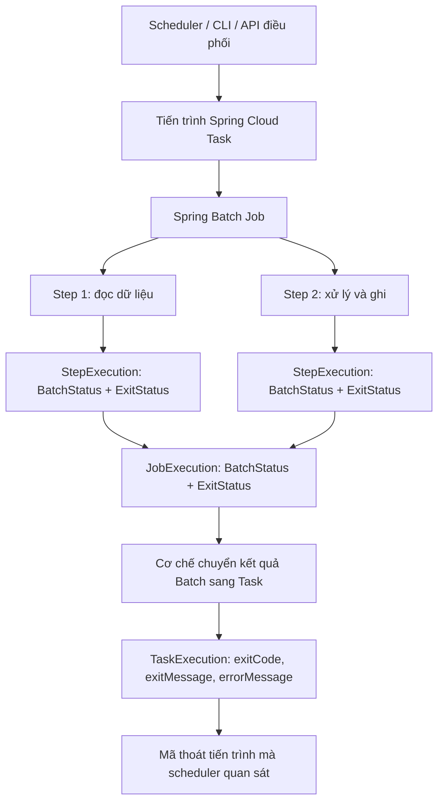

# Phân biệt BatchStatus, ExitStatus và mã thoát Task trong Spring Cloud Task

## 1. Bối cảnh: Một công việc nhưng nhiều lớp kết quả

**Spring Cloud Task** được dùng để xây dựng ứng dụng Spring Boot chạy trong thời gian hữu hạn, ví dụ nhập hóa đơn ban đêm, tổng hợp doanh thu hoặc tạo báo cáo theo yêu cầu. Mỗi lần chạy Task có thể được ghi vào **TaskRepository** thành một bản ghi **`TaskExecution`** với thời điểm bắt đầu, kết thúc và mã thoát.

Khi Task gọi **Spring Batch**, framework Batch còn ghi **`JobExecution`** và các **`StepExecution`** trong **JobRepository**. Kết quả của Job/Step được biểu diễn bằng **`BatchStatus`** và **`ExitStatus`**. Hai trạng thái đó **không tự đồng nhất** với **mã thoát số** của Task.

Ví dụ: Task `nightly-order-import` khởi chạy Batch Job `importOrders`. Đến bước thứ hai, một file đầu vào không hợp lệ khiến Job kết thúc với `BatchStatus.FAILED`. Nhưng runner khởi chạy Batch Job có thể hoàn tất mà không ném ngoại lệ ra ngoài, nên Spring Boot/Spring Cloud Task có thể ghi **`TaskExecution.exitCode = 0`** theo hành vi mặc định. Scheduler chỉ nhìn mã thoát sẽ kết luận sai rằng lần nhập dữ liệu đã thành công.

Sau bài học thuộc chương **Spring Batch**, bạn có thể:

1. Đọc và phân biệt **`BatchStatus`** (trạng thái vòng đời), **`ExitStatus`** (kết quả/điều kiện điều hướng của Job/Step) và **`TaskExecution.exitCode`** (số nguyên ở cấp tiến trình Task).
2. Giải thích tại sao `FAILED` ở Spring Batch không nhất thiết sinh mã thoát Task khác 0.
3. Bật `spring.cloud.task.batch.fail-on-job-failure` hoặc chủ động ánh xạ kết quả khi điều phối thủ công.
4. Phân biệt trạng thái của **Step**, **Job**, **Task** và mã thoát tiến trình nhìn từ hệ điều phối.
5. Thiết kế chính sách retry, restart, cảnh báo, truy vấn metadata và xử lý trạng thái tùy chỉnh an toàn.

## 2. Bốn lớp cần quan sát



| Lớp | Đơn vị theo dõi | Trường quan trọng | Ai sử dụng? |
| --- | --- | --- | --- |
| Spring Batch Step | `StepExecution` | `getStatus()`, `getExitStatus()`, số đọc/ghi/skip/rollback | Batch flow, xử lý và điều tra lỗi ở từng bước |
| Spring Batch Job | `JobExecution` | `getStatus()`, `getExitStatus()`, `getEndTime()` | JobRepository, vận hành Batch và logic restart |
| Spring Cloud Task | `TaskExecution` | `getExitCode()` (kiểu số), `getExitMessage()`, `getErrorMessage()` | TaskRepository, dashboard, điều phối Task |
| Hệ điều hành/scheduler | Tiến trình JVM/container/Job | **Process exit code** | Lập lịch, retry, cảnh báo và kết thúc pipeline |

**Điểm mấu chốt:** một lần chạy Task có thể gọi **nhiều Batch Job**; mỗi Job có nhiều Step; mỗi Step/Job có trạng thái riêng. Hệ thống phải có quy tắc tường minh để quyết định *tổ hợp kết quả nào* được xem là Task thành công.

## 3. BatchStatus: trạng thái vòng đời của Job hoặc Step

`BatchStatus` là **enum** của Spring Batch. Nó mô tả **vòng đời thực thi** chứ không phải một thông điệp tùy ý. Cả `JobExecution` và `StepExecution` đều có `getStatus()`.

| Giá trị | Ý nghĩa | Hướng vận hành |
| --- | --- | --- |
| `STARTING` | Job/Step chuẩn bị chạy | Chưa có kết quả cuối |
| `STARTED` | Đang thực thi | Không được xem là thành công chỉ vì launcher đã trả về |
| `STOPPING` | Đã nhận yêu cầu dừng, đang chờ hoàn tất việc dừng | Theo dõi thời gian dừng, không khởi chạy chồng tùy tiện |
| `STOPPED` | Đã dừng có kiểm soát | Có thể cần restart, tùy cấu hình và trạng thái |
| `COMPLETED` | Hoàn tất theo định nghĩa flow của Job/Step | Thường không restart được cùng JobInstance sau khi Job `COMPLETED` |
| `FAILED` | Thất bại khi thực thi | Điều tra nguyên nhân, có thể restart theo chính sách Batch |
| `ABANDONED` | Bị đánh dấu bỏ, thông thường không restart | Cần xử lý theo runbook, không tự ép chạy lại |
| `UNKNOWN` | Không xác định rõ trạng thái | Điều tra metadata và log trước khi quyết định |

Những giá trị này có ý nghĩa **ở cấp đối tượng tương ứng**. Ví dụ một Step `FAILED` không bắt buộc kéo theo cả Job `FAILED` nếu flow định nghĩa nhánh kết thúc đặc biệt. Một Job có `COMPLETED` cũng không tự chứng minh dữ liệu nghiệp vụ đúng nếu logic đã bỏ qua lỗi và tự coi là thành công.

```java
// Đoạn đọc thông tin từ JobExecution đã được Spring Batch tạo.
BatchStatus jobStatus = jobExecution.getStatus();

if (jobStatus == BatchStatus.FAILED) {
    // Job bị đánh dấu thất bại ở cấp Spring Batch.
}
if (jobStatus.isRunning()) {
    // Kết quả chưa hoàn tất; không gắn nhãn thành công.
}
```

`BatchStatus.isRunning()` giúp nhận biết `STARTING`, `STARTED` và `STOPPING`. Đừng đồng nhất trạng thái đang chạy trong repository với sự tồn tại chắc chắn của tiến trình: một JVM bị kill có thể để metadata chưa cập nhật.

## 4. ExitStatus: kết quả có thể tùy chỉnh và điều hướng luồng Batch

`ExitStatus` là **value object** của Spring Batch, chứa:

- **`exitCode`**: chuỗi, ví dụ `"COMPLETED"`, `"FAILED"`, `"COMPLETED WITH SKIPS"` hoặc `"BUSINESS_WARNING"`.
- **`exitDescription`**: chuỗi mô tả thêm (có thể chứa thông tin lỗi), không phải mã thoát số của JVM.

Các hằng thường dùng gồm `ExitStatus.COMPLETED`, `FAILED`, `STOPPED`, `UNKNOWN`, `EXECUTING` và `NOOP`. Vì `ExitStatus` có thể tạo từ chuỗi tùy chỉnh, **không nên ép `exitCode` sang số** hoặc coi mọi giá trị đều là phần tử của enum `BatchStatus`.

| `BatchStatus` | `ExitStatus.getExitCode()` có thể có | Giải thích |
| --- | --- | --- |
| `COMPLETED` | `COMPLETED` | Thành công thông thường |
| `COMPLETED` | `COMPLETED WITH SKIPS` | Step hoàn tất nhưng có bản ghi bỏ qua; mã được listener/flow tùy chỉnh |
| `FAILED` | `FAILED` | Thất bại theo quy tắc thông thường |
| `FAILED` | `IMPORT_REJECTED` | Mã mô tả nghiệp vụ tùy chỉnh khi Job/Step bị thất bại |
| `STOPPED` | `STOPPED` | Dừng có kiểm soát |

Các dòng chứa mã tùy chỉnh là **ví dụ về kết hợp có thể xảy ra**, không phải các giá trị mà Spring Batch mặc định tự gán trong mọi Job.

### 4.1. Flow `on(...)` đọc ExitStatus, không đọc BatchStatus

Trong DSL xây dựng flow của Spring Batch, điều kiện:

```java
// Đoạn trích cấu hình flow, không phải toàn bộ lớp @Configuration.
.start(readStep).on("COMPLETED WITH SKIPS").to(reviewStep)
.from(readStep).on("*").to(writeStep)
.end()
```

được so khớp với **`readStep.getExitStatus().getExitCode()`**, không phải trực tiếp với `readStep.getStatus()`. Đây là lý do có thể cho Step hoàn tất `BatchStatus.COMPLETED` nhưng rẽ nhánh sang bước xử lý dữ liệu bị bỏ qua.

Ví dụ listener đánh dấu Step “hoàn thành nhưng có skip”:

```java
package com.example.batch;

import org.springframework.batch.core.ExitStatus;
import org.springframework.batch.core.listener.StepExecutionListener;
import org.springframework.batch.core.step.StepExecution;
import org.springframework.stereotype.Component;

@Component
public class SkipAwareStepListener implements StepExecutionListener {

    @Override
    public ExitStatus afterStep(StepExecution stepExecution) {
        if (stepExecution.getStatus() ==
                    org.springframework.batch.core.BatchStatus.COMPLETED
                && stepExecution.getSkipCount() > 0) {
            return new ExitStatus("COMPLETED WITH SKIPS");
        }
        return null; // Giữ exit status hiện có.
    }
}
```

Đây là ví dụ theo **API Spring Batch 6.x** (ứng với Spring Boot 4.x) và cần được **gắn vào Step** khi cấu hình Step. `afterStep` trả một `ExitStatus` được Spring Batch kết hợp với exit status hiện có; việc trả `null` giữ nguyên giá trị. Với Spring Batch 5.x, package của một số lớp như `StepExecution` và `JobExecution` có thể khác; đối chiếu API theo BOM thực tế.

**Không sửa `BatchStatus` chỉ để tạo nhãn cảnh báo.** Giữ `COMPLETED` khi quy trình đã hoàn tất đúng điều kiện; dùng `ExitStatus` và số lượng `skip` để mô tả mức độ hoàn tất.

### 4.2. Job và Step có thể có kết quả khác nhau

Spring Batch cho phép flow dùng các nhánh `end()`, `fail()` hoặc `stopAndRestart(...)`. Ví dụ, nếu Step xử lý thất bại mà flow đi vào một nhánh `end()`, Job có thể được đánh dấu **`BatchStatus.COMPLETED`** dù Step ở nhánh trước `FAILED`. Khi Job `COMPLETED`, chính JobInstance đó thường **không thể restart** theo cách thông thường.

Khi cấu hình nhánh, cần phân biệt:

- `end()`: kết thúc Job với trạng thái **`COMPLETED`**, thích hợp nếu lỗi Step đã được nghiệp vụ coi là kết quả có thể chấp nhận.
- `fail()`: đánh dấu Job **`FAILED`**, cho phép cân nhắc restart theo quy tắc Batch.
- `stopAndRestart(...)`: dừng Job và chỉ định điểm quay lại khi restart.

Không dùng `end()` để “giấu” lỗi chưa xử lý nhằm làm dashboard xanh. Quyết định hoàn tất, thất bại hay dừng ảnh hưởng đến cả cách scheduler retry và cách Spring Batch quản lý restart.

## 5. Mã thoát Task: một số nguyên, được xác định ở cấp Spring Boot

Khi chạy Spring Cloud Task, `TaskExecution.exitCode` là **`Integer`** và có thể là `null` khi Task vẫn đang chạy. Trong trường hợp thông thường:

- `0` biểu thị hoàn tất bình thường nếu ứng dụng không phát tín hiệu lỗi.
- `1` thường dùng cho lỗi không được ánh xạ sang mã khác.
- Mã khác, ví dụ `2` hoặc `3`, là **quy ước riêng của ứng dụng** qua các cơ chế exit code của Spring Boot/Spring Cloud Task.

`TaskExecution.exitMessage` là thông điệp kết thúc (có thể đặt bằng `TaskExecutionListener`), còn `TaskExecution.errorMessage` thường chứa stack trace trong tình huống thất bại được lifecycle ghi nhận. **Chúng không phải** `JobExecution.getExitStatus()` và cũng không phải `StepExecution.getExitStatus()`.

| Giá trị | Kiểu | Ví dụ | Không được nhầm với |
| --- | --- | --- | --- |
| `JobExecution.status` | `BatchStatus` enum | `FAILED` | Mã thoát JVM |
| `JobExecution.exitStatus.exitCode` | `String` | `"IMPORT_REJECTED"` | `TaskExecution.exitCode` |
| `StepExecution.exitStatus.exitCode` | `String` | `"COMPLETED WITH SKIPS"` | `BatchStatus.COMPLETED` |
| `TaskExecution.exitCode` | `Integer` | `1` | Chuỗi `"FAILED"` |
| Mã thoát tiến trình | Số do OS/scheduler nhận | `1` | Cột Batch `EXIT_CODE` vốn lưu **chuỗi** |

Spring Boot có `ExitCodeGenerator` và `ExitCodeExceptionMapper` để xác định mã thoát trong các tình huống tương ứng. Khi cần truyền kết quả ra hệ điều hành, phải bảo đảm **entrypoint/launcher thực sự trả mã đó**. Đặc biệt với cách tự chạy Task bằng launcher tùy chỉnh, mã trong `TaskRepository` và mã scheduler nhận được phải được **kiểm chứng riêng**.

### Luồng hay gây nhầm lẫn

```text
Task khởi động, Batch Job chạy.
Step nhập dữ liệu ném lỗi -> StepExecution.status = FAILED.
Flow không xử lý như nhánh được chấp nhận -> JobExecution.status = FAILED.
Job launcher trả về JobExecution (có FAILED), nhưng không nhất thiết ném lỗi.
Runner của ứng dụng hoàn tất bình thường.
Spring Cloud Task có thể ghi TaskExecution.exitCode = 0 (mặc định).
Scheduler chỉ nhìn mã 0 -> hiểu sai thành công.
```

**Đây là lý do cần cầu nối giữa kết quả Batch và Task.** Không chờ `TaskExecutionListener.onTaskFailed` tự phát hiện mọi `BatchStatus.FAILED`: nếu lỗi chỉ được Batch ghi thành trạng thái mà không lan ra vòng đời Task, callback lỗi Task có thể không được gọi.

## 6. Cách chuẩn: bật fail-on-job-failure trong Spring Cloud Task

Tài liệu chính thức Spring Cloud Task nêu rằng để một lần Batch Job có **`BatchStatus.FAILED`** khiến ứng dụng Task trả mã khác 0, có thể bật:

```yaml
spring:
  main:
    web-application-type: none
  cloud:
    task:
      batch:
        fail-on-job-failure: true
```

Thuộc tính đầy đủ: **`spring.cloud.task.batch.fail-on-job-failure=true`**. Mặc định được tài liệu cấu hình công bố là **`false`**. Khi bật, Spring Cloud Task dùng cơ chế khởi chạy và kiểm tra Batch phù hợp để đánh dấu Task thất bại nếu một Batch Job được theo dõi có `BatchStatus.FAILED`; mã thất bại mặc định thường là `1` hoặc dựa trên cơ chế `ExitCodeGenerator` được cấu hình.

**Điều kiện áp dụng:**

1. Dự án thực sự có tích hợp Batch với Spring Cloud Task. Cần dependency **`org.springframework.cloud:spring-cloud-task-batch`** bên cạnh Batch/Task tương ứng.
2. Có các `Job` được Spring Boot/Spring Cloud Task khởi chạy trong lifecycle hỗ trợ; khi tự quản lý `JobOperator` và runner, cần hiểu rõ đường khởi chạy và trạng thái Task.
3. Các phiên bản Spring Boot, Spring Batch và Spring Cloud Task phải tương thích theo BOM. Không gắn riêng phiên bản Batch hoặc Task nếu không có lý do rõ ràng.
4. Kiểm tra **mã thoát tiến trình và metadata** trên đúng phiên bản được triển khai. Không mặc định chỉ cần cài dependency là scheduler sẽ nhận đúng mã trong mọi kiểu đóng ứng dụng.

Ví dụ dependency **Maven** (trích khối `dependencies`, giả định `pom.xml` đã import BOM):

```xml
<dependencies>
    <dependency>
        <groupId>org.springframework.boot</groupId>
        <artifactId>spring-boot-starter-batch</artifactId>
    </dependency>
    <dependency>
        <groupId>org.springframework.cloud</groupId>
        <artifactId>spring-cloud-starter-task</artifactId>
    </dependency>
    <dependency>
        <groupId>org.springframework.cloud</groupId>
        <artifactId>spring-cloud-task-batch</artifactId>
    </dependency>
</dependencies>
```

Ví dụ **Gradle Groovy DSL** tương đương, khi đã import BOM:

```groovy
dependencies {
    implementation 'org.springframework.boot:spring-boot-starter-batch'
    implementation 'org.springframework.cloud:spring-cloud-starter-task'
    implementation 'org.springframework.cloud:spring-cloud-task-batch'
}
```

Đoạn dependency chưa đủ để chạy một Job: phải có `Job`/`Step` hợp lệ, một JobRepository và TaskRepository phù hợp, datasource và schema đã chuẩn bị. Với production, nên quản lý schema bằng migration và không dựa vào H2 in-memory để giữ lịch sử.

### 6.1. Spring Boot tự khởi chạy Batch Job như thế nào?

Khi Spring Boot tự cấu hình Spring Batch và tìm một `Job`, Boot có thể chạy Job lúc ứng dụng khởi động. Nếu có nhiều Job, chọn theo `spring.batch.job.name` để tránh chạy nhầm:

```yaml
spring:
  batch:
    job:
      name: importOrders
  cloud:
    task:
      batch:
        fail-on-job-failure: true
```

Đừng viết thêm một `ApplicationRunner` tự gọi Job nếu vẫn để auto-run hoạt động, vì có nguy cơ **khởi chạy Job hai lần** hoặc tạo lỗi `JobInstanceAlreadyCompleteException`. Nếu bạn chọn cách tự khởi chạy, hãy chủ động **tắt auto-run** bằng `spring.batch.job.enabled=false` và thiết kế quy tắc chuyển trạng thái riêng (xem mục 7).

Tài liệu Spring Cloud Task cũng nêu thuộc tính `spring.cloud.task.batch.fail-on-job-failure-poll-interval` (mặc định **5000 ms**) cho khoảng kiểm tra các JobExecution khi tính năng fail-on-job-failure hoạt động. Đây là **khoảng polling trạng thái Batch**, không phải lịch chạy Job, không phải timeout và cũng không phải tần suất retry Job.

```yaml
spring:
  cloud:
    task:
      batch:
        fail-on-job-failure: true
        fail-on-job-failure-poll-interval: 5000
```

**Phạm vi của thuộc tính:** tài liệu mô tả ánh xạ **`BatchStatus.FAILED`** sang Task không thành công. Không suy luận rằng nó tự biến mọi mã `ExitStatus` tùy chỉnh, mọi `STOPPED`, `UNKNOWN` hoặc trường hợp Job chạy bất đồng bộ không được giám sát thành mã thoát ứng dụng theo chính sách riêng của bạn.

## 7. Khi ứng dụng tự chạy Job: kiểm tra kết quả rồi mới quyết định Task

Có những Task tự nhận tham số đầu vào, chọn nhiều Job hoặc chạy Batch theo quy tắc riêng. Khi đó, bạn có thể **tự thiết kế cầu nối** từ `JobExecution` sang thất bại của Task. Nhưng cần chọn đúng **một** cơ chế khởi chạy để không đụng với auto-run.

### 7.1. Ví dụ kiểm tra trạng thái từ JobOperator

Đoạn code dưới đây minh họa **Spring Batch 6.x**, dùng `JobOperator.start(Job, JobParameters)` (API được khuyến nghị thay cho `JobLauncher` đã bị deprecated trong Batch 6). Giả định `JobOperator` được cấu hình **đồng bộ**, nên khi `start` trả về thì `JobExecution` đã kết thúc. Nếu dùng JobOperator bất đồng bộ, phải chờ/truy vấn trạng thái từ JobRepository trước khi đánh giá; không kết luận ngay một trạng thái `STARTED` là thất bại.

```java
package com.example.taskbatch;

import org.springframework.batch.core.BatchStatus;
import org.springframework.batch.core.job.Job;
import org.springframework.batch.core.job.JobExecution;
import org.springframework.batch.core.job.parameters.JobParameters;
import org.springframework.batch.core.job.parameters.JobParametersBuilder;
import org.springframework.batch.core.launch.JobOperator;
import org.springframework.boot.ApplicationRunner;
import org.springframework.context.annotation.Bean;
import org.springframework.context.annotation.Configuration;

@Configuration
public class ManualBatchRunnerConfiguration {

    @Bean
    ApplicationRunner runDailyImport(JobOperator jobOperator, Job importOrders) {
        return arguments -> {
            // Chỉ minh họa: dữ liệu thật phải lấy từ đầu vào đã validate.
            JobParameters parameters = new JobParametersBuilder()
                .addString("businessDate", "2026-11-24", true)
                .toJobParameters();

            JobExecution result = jobOperator.start(importOrders, parameters);

            // Ví dụ YÊU CẦU JobOperator chạy đồng bộ.
            // Nếu STARTED/STARTING/STOPPING: phải đợi bằng chính sách riêng.
            if (result.getStatus().isRunning()) {
                throw new IllegalStateException(
                    "Job chưa kết thúc; phải theo dõi kết quả cuối"
                );
            }

            if (result.getStatus() != BatchStatus.COMPLETED) {
                throw new IllegalStateException(
                    "Batch Job không hoàn tất: id=" + result.getId()
                    + ", batchStatus=" + result.getStatus()
                    + ", exitStatus=" + result.getExitStatus().getExitCode()
                );
            }
        };
    }
}
```

Lớp trên là **cấu hình một runner**, không bao gồm bean `Job`/`Step`, DataSource, các starter và class main. Trong `application.yml` cần **tắt Batch auto-run**:

```yaml
spring:
  batch:
    job:
      enabled: false
  cloud:
    task:
      batch:
        fail-on-job-failure: false
```

Ở đường thủ công này, runner ném ngoại lệ khi Job không `COMPLETED`; Spring Boot/Spring Cloud Task nhận tín hiệu lỗi và có thể ghi `exitCode` khác 0. Một cách khác là ánh xạ lỗi qua `ExitCodeExceptionMapper`/`ExitCodeGenerator` theo quy ước của ứng dụng. **Không đồng thời bật hai đường điều phối Batch và không bắt ngoại lệ rồi kết thúc bình thường.**

**Điểm cần sửa trước khi triển khai thật:**

- `businessDate` phải lấy từ tham số đã được parse/validate; không ghi ngày cố định và không tự thêm tham số ngẫu nhiên sau mỗi lần restart.
- Nếu JobOperator **bất đồng bộ**, chờ Job kết thúc bằng cách kiểm tra định kỳ `JobRepository` với timeout và hủy có kiểm soát. Ví dụ ném `IllegalStateException` ngay khi Job mới `STARTED` là **chính sách fail fast minh họa**, không phải chiến lược theo dõi chính xác cho async.
- Nếu có nhiều Job, phải đánh giá **tất cả** Job theo chính sách được công bố (ví dụ “chỉ thành công khi tất cả COMPLETED”).
- Nếu Job `COMPLETED` nhưng `ExitStatus` là `COMPLETED WITH SKIPS` hoặc `BUSINESS_WARNING`, quyết định xem có phải thành công chấp nhận được hay phải phát cảnh báo/đánh dấu lỗi nghiệp vụ. Không chuyển tùy tiện tất cả custom ExitStatus thành lỗi Task.

### 7.2. Chọn chính sách thành công theo nghiệp vụ

Ví dụ bảng ánh xạ do một nhóm **tự định nghĩa**, không phải giá trị mặc định của framework:

| Kết quả Batch Job | Task outcome mong muốn | Hành động |
| --- | --- | --- |
| `BatchStatus.COMPLETED`, `ExitStatus.COMPLETED` | Mã `0` | Không retry |
| `BatchStatus.COMPLETED`, `ExitStatus.COMPLETED WITH SKIPS` | Mã `0` kèm cảnh báo hoặc mã cảnh báo riêng | Xem số bản ghi skip và ngưỡng nghiệp vụ |
| `BatchStatus.FAILED` | Mã `1` hoặc mã theo loại lỗi | Điều tra, retry/restart có kiểm soát |
| `BatchStatus.STOPPED` | Mã khác 0 theo quy ước dừng | Xem lịch sử stop và điểm restart |
| `BatchStatus.UNKNOWN` / `ABANDONED` | Mã khác 0, cần can thiệp | Không retry mù |
| `STARTING` / `STARTED` / `STOPPING` | **Chưa có kết quả cuối** | Theo dõi, giới hạn thời gian chờ |

Với cách mặc định `fail-on-job-failure=true`, chỉ nên dựa vào hành vi mà Spring Cloud Task **công bố** là bắt `FAILED`; các trường hợp khác cần chính sách giám sát hoặc mapping bổ sung nếu hệ thống coi là thất bại.

## 8. Ghi và đọc ExitStatus tùy chỉnh an toàn

Bạn có thể viết `StepExecutionListener` để phân biệt `COMPLETED` hoàn toàn và `COMPLETED WITH SKIPS`. Tuy nhiên:

1. `ExitStatus` là một value object, không phải enum `BatchStatus`.
2. `StepExecutionListener.afterStep` có thể trả một `ExitStatus` được kết hợp với status hiện tại. Nếu code trả `null`, nó không sửa exit status.
3. Pattern `.on("COMPLETED WITH SKIPS")` trong flow phải so khớp **chính xác mã được listener tạo**.
4. `JobExecution.exitStatus` cuối cùng do **toàn bộ flow** quyết định; nó có thể khác exit status của một Step.
5. Nếu dùng exit code tùy chỉnh làm tín hiệu cho scheduler, hãy ánh xạ thành **mã số riêng** ở tầng Task hoặc bộ chạy command line thích hợp, thay vì mong chuỗi `"COMPLETED WITH SKIPS"` tự được hệ điều hành hiểu.

Khi cần lưu giải thích, `ExitStatus.getExitDescription()` là mô tả ở cấp Batch; `TaskExecution.exitMessage` là mô tả ở cấp Task; `TaskExecution.errorMessage` thường là stack trace do lifecycle Task ghi khi có lỗi chưa xử lý. Chúng có **nguồn ghi và chính sách bảo mật khác nhau**.

## 9. Tra cứu Job và Task trong cơ sở dữ liệu

Với schema JDBC mặc định, Spring Cloud Task quản lý `TASK_EXECUTION` và bảng liên kết `TASK_TASK_BATCH`. Spring Batch có bộ bảng riêng, ví dụ `BATCH_JOB_EXECUTION` và `BATCH_STEP_EXECUTION`. Bảng liên kết giúp truy ngược một JobExecution tới lần thực thi Task đã gọi nó khi có `spring-cloud-task-batch` và `TaskBatchExecutionListener` được cấu hình.

### 9.1. Xem kết quả Job và Task cùng nhau

```sql
SELECT
    t.TASK_EXECUTION_ID,
    t.TASK_NAME,
    t.START_TIME  AS TASK_START_TIME,
    t.END_TIME    AS TASK_END_TIME,
    t.EXIT_CODE   AS TASK_EXIT_CODE,
    j.JOB_EXECUTION_ID,
    j.STATUS      AS JOB_BATCH_STATUS,
    j.EXIT_CODE   AS JOB_EXIT_STATUS_CODE,
    j.EXIT_MESSAGE AS JOB_EXIT_DESCRIPTION
FROM TASK_EXECUTION t
JOIN TASK_TASK_BATCH link
  ON link.TASK_EXECUTION_ID = t.TASK_EXECUTION_ID
JOIN BATCH_JOB_EXECUTION j
  ON j.JOB_EXECUTION_ID = link.JOB_EXECUTION_ID
WHERE t.TASK_EXECUTION_ID = :taskExecutionId
ORDER BY j.JOB_EXECUTION_ID;
```

Chú ý: cột **`BATCH_JOB_EXECUTION.EXIT_CODE` lưu mã chuỗi** của `ExitStatus`, còn **`TASK_EXECUTION.EXIT_CODE` lưu mã số** của Task. Tên cột giống nhau không có nghĩa dữ liệu cùng loại. Một `TASK_EXECUTION_ID` có thể trả nhiều dòng vì Task chạy nhiều Job.

### 9.2. Tìm một Job thất bại nhưng Task báo 0

```sql
SELECT
    t.TASK_EXECUTION_ID,
    t.TASK_NAME,
    t.EXIT_CODE AS TASK_EXIT_CODE,
    j.JOB_EXECUTION_ID,
    j.STATUS AS BATCH_STATUS,
    j.EXIT_CODE AS BATCH_EXIT_STATUS
FROM TASK_EXECUTION t
JOIN TASK_TASK_BATCH link
  ON link.TASK_EXECUTION_ID = t.TASK_EXECUTION_ID
JOIN BATCH_JOB_EXECUTION j
  ON j.JOB_EXECUTION_ID = link.JOB_EXECUTION_ID
WHERE j.STATUS = 'FAILED'
  AND t.EXIT_CODE = 0;
```

Nếu câu truy vấn có kết quả, trước hết kiểm tra `fail-on-job-failure`, cách Job được khởi chạy, thứ tự runner và việc ngoại lệ có bị bắt rồi bỏ qua không. Trong hệ thống dùng nhiều Job hoặc chạy bất đồng bộ, còn cần xác nhận Task có **đợi đúng kết quả cuối** của các Job hay không.

### 9.3. Xem Step để tìm nguyên nhân gốc

```sql
SELECT
    STEP_EXECUTION_ID,
    STEP_NAME,
    STATUS,
    EXIT_CODE,
    READ_COUNT,
    WRITE_COUNT,
    READ_SKIP_COUNT,
    PROCESS_SKIP_COUNT,
    WRITE_SKIP_COUNT
FROM BATCH_STEP_EXECUTION
WHERE JOB_EXECUTION_ID = :jobExecutionId
ORDER BY STEP_EXECUTION_ID;
```

Các câu SQL giả định tên bảng/cột mặc định và cách đặt tham số `:...` theo JDBC/framework. Nếu có table prefix hoặc schema tùy chỉnh, phải đổi đúng tên. Không dùng `SELECT *` chứa toàn bộ thông điệp lỗi hoặc tham số trên dashboard công khai: metadata có thể chứa dữ liệu nội bộ/nhạy cảm.

## 10. Retry, restart và trạng thái kết thúc không đồng nhất

**Retry của Task** (scheduler tạo một tiến trình mới) khác với **restart của Batch Job** (Spring Batch mở một `JobExecution` mới cho cùng `JobInstance` theo bộ identifying JobParameters).

| Tình huống | Hành động nên cân nhắc |
| --- | --- |
| Job `FAILED` vì lỗi kết nối tạm thời | Restart hoặc retry có backoff, kiểm tra transaction/checkpoint |
| Job `FAILED` vì tham số sai | Sửa đầu vào; không retry nguyên bộ tham số |
| Job `STOPPED` có kiểm soát | Xác định điểm có thể restart; không coi là thành công |
| Job `COMPLETED` với dữ liệu skip được phép | Có thể Task thành công kèm metric cảnh báo |
| Job `COMPLETED` nhưng người dùng muốn chạy lại cùng JobParameters | Thường nhận `JobInstanceAlreadyCompleteException`; cần hiểu định danh JobInstance |
| Job `ABANDONED` hoặc `UNKNOWN` | Điều tra metadata, không tự ép restart |
| Task bị kill không có kết quả cuối | Đối chiếu container/scheduler/log và cơ chế recovery, không suy luận chỉ từ `endTime` |

**Không truyền tham số ngẫu nhiên chỉ để “qua mặt” JobInstance** khi mục tiêu là restart đúng Job đã thất bại. Phải chọn identifying JobParameters đúng nghiệp vụ (ví dụ ngày báo cáo + tenant), và dùng cơ chế restart của Spring Batch khi phù hợp. Nếu cần chạy lại Job đã `COMPLETED` để tái tạo kết quả, thiết kế một JobInstance mới có chủ đích và bảo đảm idempotency.

Khi Task có nhiều Batch Job, hãy định nghĩa rõ điều kiện tổng hợp: “tất cả hoàn tất”, “cho phép một số Job skip”, hoặc “dừng khi Job trọng yếu thất bại”. Đồng thời tính đến kết quả phụ trợ như upload file, gửi notification, ghi dữ liệu vào database, vì chúng có thể xảy ra sau khi Batch Job hoàn tất nhưng trước khi tiến trình Task kết thúc.

## 11. Những lỗi thường gặp

| Triệu chứng | Nguyên nhân có thể | Hướng kiểm tra |
| --- | --- | --- |
| Batch Job `FAILED` nhưng Task `exitCode=0` | Chưa bật cầu nối hoặc runner không phát tín hiệu thất bại | Kiểm tra `spring-cloud-task-batch`, `fail-on-job-failure` và Job runner |
| Step `COMPLETED` nhưng `ExitStatus` có cảnh báo | Listener đã tạo mã custom | Xem `getExitStatus().getExitCode()` và số skip |
| Một Step `FAILED` nhưng Job `COMPLETED` | Flow xử lý nhánh bằng `end()` | Xem DSL `on(...)`/`end()`/`fail()` và ý nghĩa nghiệp vụ |
| Job vẫn `STARTED` nhưng Task báo thành công | Job khởi chạy async, Task không chờ kết quả | Xem `JobOperator`/TaskExecutor, polling/timeout |
| Job chạy hai lần khi ứng dụng khởi động | Auto-run Spring Boot và runner tự viết đều gọi Job | Giữ một cơ chế duy nhất, dùng `spring.batch.job.enabled=false` nếu tự chạy |
| Scheduler không thấy lỗi dù repository có lỗi | Launcher/entrypoint không truyền mã thoát đúng cách | Kiểm tra process exit code, cấu hình container và shell script |
| Retry Job cùng tham số nhận lỗi already complete | JobInstance trước đã `COMPLETED` | Phân biệt restart với lần chạy mới |
| Dashboard nhầm `BATCH_JOB_EXECUTION.EXIT_CODE` và `TASK_EXECUTION.EXIT_CODE` | Cùng tên cột nhưng khác loại dữ liệu | Gắn nhãn `JOB_EXIT_STATUS_CODE` và `TASK_EXIT_CODE` trong SQL/DTO |

### Kiểm chứng trên đúng phiên bản

Một kịch bản kiểm chứng có thể gồm:

1. Tạo một Job có một Step luôn hoàn tất và một nhánh ném lỗi thử nghiệm. Dùng datasource bền vững để quan sát.
2. Chạy với `fail-on-job-failure=false`, đọc `JobExecution.status`, `ExitStatus` và `TaskExecution.exitCode`. Ghi cả mã thoát tiến trình scheduler nhận.
3. Bật `fail-on-job-failure=true` và chạy một JobInstance **mới hợp lệ**. So sánh bốn loại kết quả.
4. Thêm `StepExecutionListener` tạo `COMPLETED WITH SKIPS`; xác minh điều kiện `.on(...)` đọc mã chuỗi này.
5. Kiểm tra trường hợp STOPPED, timeout hoặc operator bất đồng bộ; xác định chính sách riêng thay vì giả định thuộc tính `fail-on-job-failure` xử lý tất cả.
6. Khi có nhiều Job, chạy một Job thành công và một Job thất bại, đối chiếu bảng `TASK_TASK_BATCH` và kết quả cuối Task.

Chạy kiểm thử theo phiên bản đã chốt trong Spring Boot/Spring Cloud BOM. Một bản build thành công chưa chứng minh scheduler nhìn thấy mã thoát đúng hoặc TaskRepository được ghi đầy đủ khi JVM bị kill.

## 12. Bài tập và tự đánh giá

**Bài 1 — Điền bảng kết quả.** Với mỗi tình huống, hãy dự đoán `BatchStatus`, `ExitStatus` và mã thoát Task theo chính sách:

| Tình huống | Câu hỏi |
| --- | --- |
| Step hoàn tất không skip | Có bao nhiêu trường mang giá trị `COMPLETED`? |
| Step hoàn tất nhưng skip 3 bản ghi | Vì sao `BatchStatus` vẫn có thể `COMPLETED`? |
| Job thất bại, không bật `fail-on-job-failure` | Task có bắt buộc trả mã 1 không? |
| Job thất bại, bật `fail-on-job-failure` | Cơ chế nào quyết định mã Task? |
| Job `STOPPED` | Vì sao không nên suy luận thuộc tính chỉ bắt `FAILED` sẽ tự xử lý? |

**Bài 2 — Viết listener.** Tạo `StepExecutionListener` trả `"COMPLETED WITH SKIPS"` khi số skip lớn hơn 0. Cấu hình flow rẽ sang Step ghi báo cáo skip và kiểm tra `JobExecution.exitStatus` cuối.

**Bài 3 — Thử ánh xạ kết quả.** Với một Job ném lỗi, chạy hai lần trên JobInstance mới: lần một tắt, lần hai bật `spring.cloud.task.batch.fail-on-job-failure`. Ghi lại metadata Batch, Task và mã thoát OS. Giải thích mọi khác biệt.

**Bài 4 — Restart.** Cho một Job ghi dữ liệu theo chunk và thất bại ở giữa; dùng chính sách Batch phù hợp để restart. So sánh `JobInstance`, `JobExecution`, `TaskExecution` của hai lần, kiểm tra không nhập trùng.

**Bài 5 — Điều phối nhiều Job.** Task chạy `validateOrders` và `persistOrders`; Job thứ nhất thành công với cảnh báo, Job thứ hai thất bại. Đề xuất chính sách tổng hợp và cách báo trạng thái cho scheduler.

### Câu hỏi tự kiểm tra

- `BatchStatus` là enum hay chuỗi có thể tự tạo? `ExitStatus` có thể chứa mã tùy chỉnh không?
- `.on("FAILED")` trong Batch flow so với `BatchStatus` hay `ExitStatus`?
- Vì sao `JobOperator.start(...)` có thể trả một `JobExecution` đã `FAILED` mà không ném lỗi nghiệp vụ ra runner?
- `spring.cloud.task.batch.fail-on-job-failure` giải quyết trường hợp nào? Vì sao cần kiểm chứng riêng `STOPPED` và custom `ExitStatus`?
- Khi nào nên dùng `spring.batch.job.enabled=false`?
- Sự khác nhau giữa retry một tiến trình Task mới và restart cùng Batch JobInstance là gì?

**Tiêu chí hoàn thành:** Bạn phân biệt được status ở cả Step/Job/Task, đọc đúng kiểu `String` và `Integer` của các exit code, thiết lập cầu nối khi Batch Job thất bại, đối chiếu mã thoát thực tế của tiến trình với metadata và đề xuất được chiến lược restart/retry an toàn.

## Tài liệu tham khảo chính thức

- [Spring Batch — Controlling Step Flow: BatchStatus versus ExitStatus](https://docs.spring.io/spring-batch/reference/step/controlling-flow.html).
- [Spring Batch — The Domain Language of Batch](https://docs.spring.io/spring-batch/reference/domain.html): JobExecution, StepExecution và metadata.
- [Spring Cloud Task — Batch: Batch Job Exit Codes](https://docs.spring.io/spring-cloud-task/reference/batch.html): `TaskBatchExecutionListener` và `fail-on-job-failure`.
- [Spring Cloud Task — Features / TaskExecution](https://docs.spring.io/spring-cloud-task/reference/features.html): `exitCode`, `exitMessage` và `errorMessage`.
- [Spring Boot — Spring Batch Auto-configuration](https://docs.spring.io/spring-boot/reference/io/spring-batch.html): `spring.batch.job.enabled` và `spring.batch.job.name`.
- [Spring Batch 6 — JobOperator API](https://docs.spring.io/spring-batch/reference/api/org/springframework/batch/core/launch/JobOperator.html): khởi chạy và nhận `JobExecution`.
- [Spring Batch 6 — StepExecutionListener API](https://docs.spring.io/spring-batch/reference/api/org/springframework/batch/core/listener/StepExecutionListener.html): tùy chỉnh `ExitStatus` của Step.
