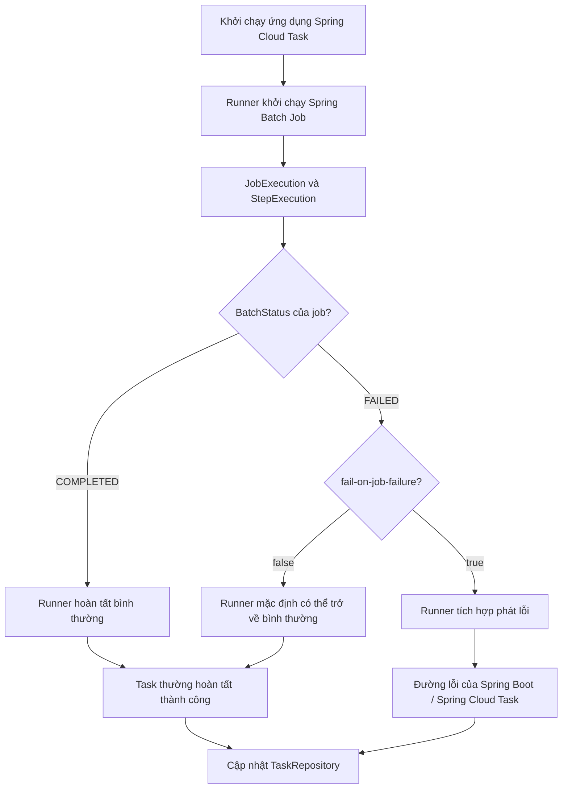
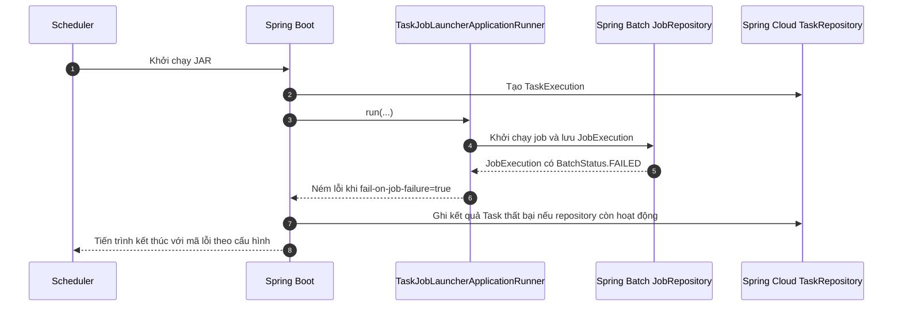

# `spring.cloud.task.batch.fail-on-job-failure`: báo lỗi Task khi Spring Batch job thất bại

## 1. Bài toán: Batch job thất bại nhưng tác vụ vẫn báo thành công

Trong module **Spring Cloud Task**, một ứng dụng Spring Boot có thời gian chạy hữu hạn có thể khởi chạy một hoặc nhiều **Spring Batch job**. Spring Batch chịu trách nhiệm xử lý dữ liệu theo job/step, quản lý transaction, checkpoint và trạng thái từng lần chạy. Spring Cloud Task theo dõi vòng đời **ứng dụng tác vụ** thông qua `TaskExecution` trong `TaskRepository`.

Hai framework quan sát hai phạm vi khác nhau. Vì vậy có thể xảy ra tình huống: một step đọc dữ liệu lỗi, **`JobExecution` có `BatchStatus.FAILED`**, nhưng runner khởi chạy job trở về bình thường; Spring Boot kết thúc quá trình khởi động mà không phát sinh exception ra bên ngoài, khiến lần chạy Spring Cloud Task **được ghi nhận thành công**.

Điều này nguy hiểm nếu một scheduler hoặc Kubernetes Job chỉ nhìn mã thoát tiến trình để quyết định có chạy bước tiếp theo hay không. Một job nhập dữ liệu đã thất bại nhưng pipeline vẫn tiếp tục đối soát, gửi báo cáo hoặc xóa tệp nguồn.

Để xử lý trường hợp này, Spring Cloud Task cung cấp thuộc tính:

```properties
spring.cloud.task.batch.fail-on-job-failure=true
```

Khi tích hợp Batch/Task được cấu hình đúng, thuộc tính giúp **chuyển một job có `BatchStatus.FAILED` thành đường thất bại của ứng dụng Task**, để mã thoát Task có thể khác `0` (mặc định thường là `1`). Đây là trọng tâm bài học thuộc chương **Spring Batch**.

Sau bài này, bạn sẽ biết lúc nào cần bật thuộc tính, cơ chế runner tích hợp, cách dùng với một batch job tối giản, cách đọc metadata của cả hai repository, sự khác biệt với `ExitStatus`, và các giới hạn khi chạy bất đồng bộ hoặc triển khai job bằng cơ chế tùy chỉnh.

## 2. Hiểu đúng ba lớp trạng thái

Một lần khởi chạy `order-import-task` có thể tạo các đối tượng sau:

| Tầng | Thành phần | Ví dụ trạng thái | Ý nghĩa |
| --- | --- | --- | --- |
| Spring Batch — step | `StepExecution` | `FAILED` | Một bước của job thực thi lỗi. |
| Spring Batch — job | `JobExecution` với `BatchStatus` | `FAILED` | Toàn bộ job kết thúc thất bại. |
| Spring Cloud Task | `TaskExecution` với `exitCode` | `0` hoặc `1` | Kết quả ghi nhận của **lần chạy ứng dụng tác vụ**. |
| Hệ điều hành/bộ điều phối | Mã thoát tiến trình | `0`, khác `0` | Tín hiệu mà shell, Job hoặc scheduler nhận được khi JVM kết thúc. |

Điểm cần phân biệt:

- **`BatchStatus`** là trạng thái thực thi của Spring Batch, ví dụ `STARTING`, `STARTED`, `COMPLETED`, `FAILED`, `STOPPING`, `STOPPED`, `ABANDONED`, `UNKNOWN`.
- **`ExitStatus`** là kết quả có mã dạng chuỗi, ví dụ `COMPLETED`, `FAILED` hoặc giá trị do ứng dụng đặt. `ExitStatus` có thể khác cách nhìn của `BatchStatus`.
- **`TaskExecution.exitCode`** là số nguyên; nó không phải `JobExecution.getExitStatus().getExitCode()` vì giá trị bên Batch thường là chuỗi.
- **Mã thoát tiến trình** được hệ điều hành nhận; nó thường được dùng cho retry/alert nhưng có thể bị ảnh hưởng bởi cách JVM kết thúc hoặc bộ điều phối xử lý lỗi.

**`spring.cloud.task.batch.fail-on-job-failure` tập trung vào `BatchStatus.FAILED`.** Nó không có nghĩa tất cả `ExitStatus` khác `COMPLETED` hoặc tất cả trường hợp còn item bị bỏ qua đều tự động trở thành Task thất bại.



Sơ đồ trình bày luồng phổ biến khi Spring Boot tự khởi chạy Batch job. Nếu ứng dụng còn có runner tự định nghĩa, exception khác, hoặc một cơ chế chạy job riêng, kết quả cần được kiểm chứng theo triển khai thực tế.

## 3. Thuộc tính `fail-on-job-failure` hoạt động ra sao?

### 3.1. Giá trị mặc định `false`

Theo danh mục cấu hình của Spring Cloud Task, `spring.cloud.task.batch.fail-on-job-failure` có giá trị mặc định **`false`**. Với cơ chế runner Batch/Boot mặc định, Batch có thể lưu `JobExecution` là `FAILED` nhưng không nhất thiết ném exception tới Spring Boot. Khi không có lỗi nào khác, Spring Cloud Task có thể ghi `TaskExecution.exitCode = 0`.

Lý do là **Spring Batch đã ghi nhận job lỗi trong `JobRepository`**, còn Spring Cloud Task nhận biết trạng thái ứng dụng ở mức runner/lifecycle. Dữ liệu lỗi của một job không tự động trở thành exception của ứng dụng nếu không có cơ chế lan truyền thích hợp.

### 3.2. Bật `true`: chuyển lỗi Batch thành lỗi Task

Khi thuộc tính là **`true`** và auto-configuration tích hợp được kích hoạt, Spring Cloud Task sử dụng runner dành cho Batch để kiểm tra kết quả các job được khởi chạy. Nếu một job có `BatchStatus.FAILED`, runner phát lỗi; Spring Boot xử lý qua đường thất bại và Spring Cloud Task cố gắng lưu kết quả khác `0` vào metadata.

Mã `1` là giá trị lỗi mặc định được tài liệu mô tả. Ứng dụng có thể có cơ chế cung cấp mã thoát riêng, ví dụ `ExitCodeGenerator`/`ExitCodeExceptionMapper` tùy đường xử lý và phiên bản. Đừng cho rằng mọi lỗi trong mọi môi trường đều trả đúng `1`: hãy **đo mã thoát tiến trình và đọc `TaskExecution.exitCode`**.

### 3.3. Bảng so sánh hành vi

| Kết quả Batch job | `fail-on-job-failure=false` | `fail-on-job-failure=true` |
| --- | --- | --- |
| `BatchStatus.COMPLETED` | Thông thường Task thành công nếu không có lỗi khác. | Thông thường Task thành công nếu không có lỗi khác. |
| `BatchStatus.FAILED` do lỗi step nhưng runner vẫn trả bình thường | Task **có thể** được ghi `0` dù Batch lỗi. | Runner tích hợp báo thất bại; Task có thể ghi mã khác `0`. |
| Lỗi khởi tạo context hoặc database trước khi job chạy | Ứng dụng có thể thất bại độc lập với thuộc tính. | Ứng dụng có thể thất bại độc lập với thuộc tính. |
| Job được khởi chạy hoàn toàn bằng mã tùy chỉnh | Phụ thuộc mã kiểm tra kết quả. | **Không nên mặc định** thuộc tính tự giám sát mọi `JobLauncher` do ứng dụng gọi. |
| Job `COMPLETED` nhưng có item `SKIPPED` | Phụ thuộc chính sách nghiệp vụ và cấu hình Batch. | Không tự đổi thành `FAILED` chỉ vì có item bị skip. |
| Job `STOPPED`/`UNKNOWN` | Phụ thuộc cách dừng và runner. | Không nên mặc định được xử lý như `BatchStatus.FAILED`; cần quy tắc riêng. |

Điểm quan trọng nhất: **bật thuộc tính xử lý một đường lan truyền lỗi cụ thể**, không thay thế tất cả chính sách định nghĩa thế nào là kết quả nghiệp vụ đạt yêu cầu.

## 4. Runner nào thực hiện việc kiểm tra Batch job?

Ở các phiên bản Spring Cloud Task tích hợp với Spring Boot Batch, cơ chế này dùng **`TaskJobLauncherApplicationRunner`** để thay cho `JobLauncherApplicationRunner` mặc định của Spring Boot khi chức năng báo lỗi job được bật. Runner tích hợp khởi chạy job và kiểm tra `JobExecution`.

Điều đó giải thích vì sao chỉ thay đổi property có thể tạo khác biệt rõ ràng ngay cả khi bạn không sửa code job. Khi runner phát lỗi sau khi thấy `BatchStatus.FAILED`, lỗi được chuyển qua đường lifecycle của Boot, nơi Spring Cloud Task có thể cập nhật `TaskExecution`.



**Lưu ý về phiên bản:** tài liệu Spring Cloud Task hiện hành mô tả runner kiểu `ApplicationRunner`. Một số tài liệu cũ dùng tên `CommandLineRunner` và `spring.cloud.task.batch.command-line-runner-order`. Khi nâng cấp hoặc làm theo ví dụ lịch sử, luôn đối chiếu tài liệu đúng dòng Spring Boot/Spring Cloud Task mà ứng dụng đang dùng.

### 4.1. `application-runner-order`: thứ tự runner

Khi có nhiều `ApplicationRunner` hoặc `CommandLineRunner`, **thứ tự chạy** có thể ảnh hưởng đến việc chuẩn bị dữ liệu, thời điểm thực hiện Batch job và kết quả cuối cùng. Với runner tích hợp, thuộc tính sau được tài liệu mô tả:

```yaml
spring:
  cloud:
    task:
      batch:
        application-runner-order: 0
```

Giá trị mặc định thông dụng là **`0`**. Nếu cần thay đổi thứ tự, hãy xem cụ thể những runner khác và các dependency liên quan; không thay đổi chỉ để che lỗi hoặc ép job chạy trước khi dữ liệu sẵn sàng.

### 4.2. `fail-on-job-failure-poll-interval`: chu kỳ kiểm tra

Spring Cloud Task còn công bố thuộc tính:

```yaml
spring:
  cloud:
    task:
      batch:
        fail-on-job-failure-poll-interval: 5000
```

Đơn vị của giá trị là **mili giây**; giá trị mặc định được công bố là **`5000`**, tức khoảng **5 giây**. Nó điều chỉnh khoảng chờ khi hạ tầng kiểm tra các `JobExecution` đã hoàn tất, đặc biệt cần chú ý khi dùng `JobLauncher` có `TaskExecutor` bất đồng bộ.

Giá trị này **không phải timeout tổng của job** và **không giới hạn số lần retry**. Nếu job treo, một poll interval nhỏ không tự giải quyết được; cần timeout, chính sách shutdown và giám sát tại Batch hoặc bộ điều phối.

## 5. Điều kiện để thuộc tính phát huy tác dụng

Trước khi kỳ vọng một `BatchStatus.FAILED` làm hỏng cả Task, hãy kiểm tra:

1. **Spring Boot và Spring Cloud Task tương thích phiên bản.** Phụ thuộc của Spring Cloud Task phải được quản lý theo BOM phù hợp với Boot.
2. **Có Spring Batch trên classpath**, và ứng dụng có ít nhất một bean `Job` được khởi chạy theo cơ chế Spring Boot/Task hỗ trợ.
3. **Có tích hợp `spring-cloud-task-batch`** theo hướng dẫn phiên bản đang dùng. Cơ chế liên kết Task và Batch phụ thuộc thư viện tích hợp tương ứng.
4. **Auto-launch Batch còn hoạt động.** Nếu đặt `spring.batch.job.enabled=false`, job có thể không được khởi chạy tự động; property không làm một job chưa chạy trở thành thất bại.
5. **Không thay thế runner tích hợp bằng đường chạy tự viết mà bỏ quên kiểm tra kết quả.** Khi tự gọi `JobLauncher`, phải tự xử lý `JobExecution` và lan truyền lỗi nếu cần.
6. **Repository và schema phù hợp.** `TaskRepository` và `JobRepository` cần các bảng metadata và kết nối database hoạt động.

Đối với một ứng dụng Batch đơn giản, có thể khai báo `spring-boot-starter-batch`, `spring-cloud-starter-task`, phần tích hợp `spring-cloud-task-batch` theo bộ phiên bản, cùng JDBC driver. Một số starter có thể mang phụ thuộc bắc cầu; hãy xem cây dependency của dự án thật để tránh thêm trùng hay phối phiên bản không tương thích.

Khi dùng auto-configuration của Spring Boot, không vội thêm `@EnableBatchProcessing` chỉ vì muốn bật Batch: trong một số phiên bản, annotation này làm thay đổi cơ chế auto-configuration. Ví dụ phía dưới để Spring Boot tạo hạ tầng Batch mặc định từ DataSource đã cấu hình.

## 6. Ví dụ cấu hình ứng dụng Task chạy một Batch job

Giả sử cần nhập các đơn hàng của một ngày. Mục tiêu: khi step nhập đơn hàng gặp lỗi, cả lần chạy `order-import-task` phải được đánh dấu thất bại để scheduler không tiếp tục quy trình.

### 6.1. `application.yml`

```yaml
spring:
  application:
    name: order-import-worker
  main:
    web-application-type: none
  cloud:
    task:
      name: order-import-task
      batch:
        fail-on-job-failure: true
        # Mặc định 5000 ms; chỉ điều chỉnh khi có nhu cầu vận hành.
        fail-on-job-failure-poll-interval: 5000
  batch:
    job:
      enabled: true
  datasource:
    url: ${TASK_DB_URL}
    username: ${TASK_DB_USER}
    password: ${TASK_DB_PASSWORD}
```

Ý nghĩa quan trọng:

- `spring.cloud.task.name` giúp tìm lịch sử `TaskExecution` theo tên `order-import-task`.
- `spring.cloud.task.batch.fail-on-job-failure: true` kích hoạt cơ chế báo lỗi khi Batch job có `BatchStatus.FAILED`.
- `spring.batch.job.enabled: true` thể hiện ví dụ muốn Spring Boot tự khởi chạy job khi ứng dụng bắt đầu (giá trị mặc định có thể tùy cấu hình và phiên bản).
- `spring.datasource` trỏ tới database lưu metadata. Nếu Task và Batch sử dụng chung DataSource, database cần **cả schema của Spring Cloud Task và schema của Spring Batch**; chúng là hai bộ bảng khác nhau.

Các biến `TASK_DB_URL`, `TASK_DB_USER`, `TASK_DB_PASSWORD` được cấp từ môi trường hoặc secret manager. Không đưa mật khẩu thật vào lệnh khởi chạy hay commit vào repository. Trong sản xuất, nên tạo bảng bằng migration có kiểm soát thay vì phụ thuộc vào quyền DDL của tài khoản runtime.

### 6.2. Một ứng dụng Java với job/step mô phỏng lỗi

Ví dụ dưới đây dùng phong cách API của **Spring Batch 5** (`JobBuilder` và `StepBuilder` nhận `JobRepository` tường minh); cần chọn phiên bản Boot/Task tương thích. Đây là một file Java hoàn chỉnh cho phần job/step; dự án vẫn phải khai báo các dependency và schema như ở trên.

```java
import org.springframework.batch.core.Job;
import org.springframework.batch.core.Step;
import org.springframework.batch.core.job.builder.JobBuilder;
import org.springframework.batch.core.repository.JobRepository;
import org.springframework.batch.core.step.builder.StepBuilder;
import org.springframework.batch.repeat.RepeatStatus;
import org.springframework.beans.factory.annotation.Value;
import org.springframework.boot.SpringApplication;
import org.springframework.boot.autoconfigure.SpringBootApplication;
import org.springframework.cloud.task.configuration.EnableTask;
import org.springframework.context.annotation.Bean;
import org.springframework.transaction.PlatformTransactionManager;

@SpringBootApplication
@EnableTask
public class OrderImportTaskApplication {

    public static void main(String[] args) {
        SpringApplication.run(OrderImportTaskApplication.class, args);
    }

    @Bean
    Job importOrdersJob(JobRepository jobRepository, Step importOrdersStep) {
        return new JobBuilder("importOrdersJob", jobRepository)
            .start(importOrdersStep)
            .build();
    }

    @Bean
    Step importOrdersStep(
            JobRepository jobRepository,
            PlatformTransactionManager transactionManager,
            @Value("${demo.fail:false}") boolean simulateFailure) {

        return new StepBuilder("importOrdersStep", jobRepository)
            .tasklet((contribution, chunkContext) -> {
                if (simulateFailure) {
                    throw new IllegalStateException(
                        "Lỗi nhập đơn hàng được giả lập");
                }

                // TODO: thay bằng logic nhập và kiểm tra đơn hàng thực tế.
                System.out.println("Đã nhập đơn hàng thành công");
                return RepeatStatus.FINISHED;
            }, transactionManager)
            .build();
    }
}
```

Khi `demo.fail=false`, tasklet kết thúc bình thường, step và job có thể hoàn tất với `BatchStatus.COMPLETED`. Khi `demo.fail=true`, ngoại lệ trong tasklet làm step và job có trạng thái `FAILED` theo luồng Batch thông thường.

Điểm cần hiểu là **Spring Batch có thể bắt lỗi của step và lưu trạng thái thất bại vào `JobRepository` trước khi runner trả về**. Vì thế, nếu muốn toàn bộ Task báo lỗi, cần cơ chế xem lại `JobExecution`. Trong ví dụ, runner tích hợp khi `fail-on-job-failure=true` đảm nhiệm bước đó.

Đừng gọi `System.exit(1)` từ bên trong tasklet để thử mô phỏng lỗi: cách này có thể cắt ngang việc ghi metadata và giải phóng tài nguyên. Hãy ném exception trong tasklet và để Batch/Task thực hiện các bước kết thúc được kiểm soát.

## 7. Thực hành hai kịch bản thành công và thất bại

Đầu tiên, chuẩn bị database có hai schema metadata và build JAR. Sau đó chạy riêng từng tình huống.

### 7.1. Batch job thành công

```bash
java -jar order-import-task.jar --demo.fail=false run.id=success-001
```

Kỳ vọng: job `importOrdersJob` có `BatchStatus.COMPLETED`, Task có metadata kết thúc thành công nếu không phát sinh lỗi khác, và tiến trình thường trả mã `0`.

### 7.2. Batch job thất bại khi bật thuộc tính

```bash
java -jar order-import-task.jar --demo.fail=true run.id=failed-001
```

Kỳ vọng: step ném exception, `JobExecution` được ghi nhận `FAILED`, runner tích hợp báo lỗi; Spring Cloud Task cố gắng ghi lần thực thi lỗi, còn hệ điều phối thấy mã tiến trình khác `0` theo hành vi Boot và runtime đã cấu hình.

### 7.3. So sánh khi tắt thuộc tính

```bash
java -jar order-import-task.jar \
  --spring.cloud.task.batch.fail-on-job-failure=false \
  --demo.fail=true \
  run.id=failed-without-propagation-001
```

Trong cấu hình runner mặc định và nếu không có exception nào khác thoát ra, Batch vẫn ghi job lỗi nhưng Task **có thể** hoàn tất với `exitCode=0`. Đây là tình huống mà thuộc tính giúp giải quyết.

**Cú pháp tham số cần phân biệt:** tham số bắt đầu bằng `--` (ví dụ `--demo.fail=true`) là **thuộc tính môi trường Spring Boot**. Chuỗi không có dấu `--`, như `run.id=failed-001`, có thể được runner Batch chuyển thành **JobParameters**. Các giá trị `run.id` khác nhau giúp tạo các job instance riêng cho thử nghiệm. Khi muốn **restart đúng job thất bại**, đừng tự đổi mọi tham số định danh: Spring Batch phân biệt `JobInstance` theo tên job và identifying job parameters, và cơ chế restart có quy tắc riêng.

Để quan sát mã tiến trình trên Linux/macOS, chạy `echo $?` **ngay sau lệnh Java**; với PowerShell, xem `$LASTEXITCODE`. Các lệnh kiểm tra log hoặc truy vấn database chạy sau đó không được làm bạn nhầm mã của lệnh Java với mã của lệnh kiểm tra.

## 8. Kiểm tra kết quả trong hai kho metadata

Spring Cloud Task và Spring Batch có mô hình metadata độc lập:

| Repository | Bản ghi chính | Nội dung cần xem |
| --- | --- | --- |
| `TaskRepository` | `TaskExecution` | `taskName`, `executionId`, thời gian chạy, `exitCode`, lỗi ứng dụng. |
| `JobRepository` | `JobExecution`, `StepExecution` | `BatchStatus`, `ExitStatus`, lỗi step, số item đọc/ghi/skip và checkpoint. |

Với schema JDBC phổ biến, có thể truy vấn lịch sử tác vụ:

```sql
SELECT TASK_EXECUTION_ID,
       TASK_NAME,
       START_TIME,
       END_TIME,
       EXIT_CODE,
       EXIT_MESSAGE,
       ERROR_MESSAGE
FROM TASK_EXECUTION
WHERE TASK_NAME = 'order-import-task'
ORDER BY TASK_EXECUTION_ID DESC;
```

Và truy vấn các lần chạy Batch job:

```sql
SELECT JOB_EXECUTION_ID,
       STATUS,
       EXIT_CODE,
       EXIT_MESSAGE,
       START_TIME,
       END_TIME
FROM BATCH_JOB_EXECUTION
ORDER BY JOB_EXECUTION_ID DESC;
```

Trong schema tích hợp Spring Cloud Task thông dụng, bảng **`TASK_TASK_BATCH`** lưu quan hệ giữa `TASK_EXECUTION_ID` và `JOB_EXECUTION_ID`. Nếu hai nhóm bảng nằm trong cùng database/schema và listener liên kết được bật, có thể dùng câu SQL tham khảo:

```sql
SELECT t.TASK_EXECUTION_ID,
       t.TASK_NAME,
       t.EXIT_CODE AS TASK_EXIT_CODE,
       j.JOB_EXECUTION_ID,
       j.STATUS AS BATCH_STATUS,
       j.EXIT_CODE AS BATCH_EXIT_STATUS
FROM TASK_EXECUTION t
JOIN TASK_TASK_BATCH link
  ON link.TASK_EXECUTION_ID = t.TASK_EXECUTION_ID
JOIN BATCH_JOB_EXECUTION j
  ON j.JOB_EXECUTION_ID = link.JOB_EXECUTION_ID
WHERE t.TASK_NAME = 'order-import-task'
ORDER BY t.TASK_EXECUTION_ID DESC;
```

SQL chỉ minh họa: tên bảng/cột và kiểu dữ liệu phải khớp schema của phiên bản đang dùng. Nếu `TaskRepository` và `JobRepository` ở **hai database khác nhau**, câu JOIN này có thể không chạy trực tiếp; hãy tra cứu từng nguồn rồi liên kết theo các ID mà listener hoặc hệ thống điều phối đã ghi nhận.

**Không được đồng nhất `TASK_EXECUTION_ID` với `JOB_EXECUTION_ID`.** Chúng được tạo và quản lý bởi hai repository khác nhau. Cũng không được lấy `TaskExecution.exitCode = 0` làm chứng cứ rằng báo cáo nghiệp vụ đạt chất lượng; vẫn phải kiểm tra dữ liệu đích.

## 9. `BatchStatus.FAILED` khác `ExitStatus.FAILED` như thế nào?

Spring Batch có cả **`BatchStatus`** (trạng thái tiến trình xử lý) và **`ExitStatus`** (mã kết quả phục vụ điều hướng/logic). Trong nhiều job đơn giản, cả hai thể hiện `FAILED` khi step ném lỗi. Tuy nhiên có những trường hợp chúng không giống nhau:

- Job thực hiện xong với `BatchStatus.COMPLETED` nhưng `ExitStatus` do ứng dụng đặt thành `COMPLETED WITH SKIPS` để báo có bản ghi bị bỏ qua.
- Một step có lỗi được xử lý bằng chính sách skip, và job vẫn kết thúc `BatchStatus.COMPLETED` theo quy tắc cấu hình.
- Job bị yêu cầu dừng và kết thúc `STOPPED`, khác với `FAILED` về ý nghĩa vận hành và khả năng restart.
- Ứng dụng định nghĩa `ExitStatus` riêng để điều khiển flow mà không thay đổi cách gán `BatchStatus` ở mọi bước.

**Thuộc tính `fail-on-job-failure` không phải một bộ kiểm tra chất lượng dữ liệu.** Nó dựa trên điều kiện job có `BatchStatus.FAILED` trong cơ chế tích hợp được mô tả. Nếu nghiệp vụ coi `COMPLETED WITH SKIPS` là không chấp nhận được, cần thêm chính sách: chẳng hạn khiến job thực sự trở thành `FAILED` khi số bản ghi skip vượt ngưỡng, hoặc tự ánh xạ kết quả sang mã thoát ứng dụng.

| Kết quả | Có tự được xem như lỗi nhờ property? | Hành động cần cân nhắc |
| --- | --- | --- |
| `BatchStatus.FAILED` | **Có**, khi runner tích hợp đang được dùng. | Đọc exception/step lỗi, quyết định restart/retry. |
| `COMPLETED` với vài item skip | **Không nhất thiết.** | Kiểm tra ngưỡng chấp nhận và dữ liệu bị skip. |
| `STOPPED` do người vận hành yêu cầu | **Không mặc định xem là `FAILED`.** | Xây chính sách dừng và khởi chạy lại phù hợp. |
| `UNKNOWN` hoặc metadata mất nhất quán | Cần kiểm tra thêm. | Xác minh database, log, trạng thái process và dữ liệu nghiệp vụ. |

## 10. Trường hợp chạy Batch bất đồng bộ

Một `JobLauncher` có `TaskExecutor` bất đồng bộ có thể trả về `JobExecution` khi job vẫn đang chạy. Nếu runner kết thúc trước khi job hoàn tất và không chờ kết quả, Spring Cloud Task có thể ghi metadata ứng dụng thành công **quá sớm**.

`TaskJobLauncherApplicationRunner` trong các phiên bản hỗ trợ đã tính đến trường hợp sử dụng `TaskExecutor` bằng việc theo dõi các `JobExecution` để nhận biết lỗi. Thuộc tính `fail-on-job-failure-poll-interval` giúp điều chỉnh tần suất kiểm tra này.

Dù vậy, khi tự tạo luồng, tự gọi `JobLauncher` từ runner khác hoặc thay đổi quá trình đóng context, bạn **không nên mặc định** property giám sát được mọi công việc bất đồng bộ. Cần bảo đảm một trong các chiến lược:

1. Cho runner chạy job **đồng bộ** và chỉ trở về khi job hoàn tất.
2. Nếu chạy bất đồng bộ, **đợi và xác minh trạng thái cuối** bằng cơ chế phù hợp trước khi cho Task kết thúc.
3. Khi có worker/process khác xử lý tiếp sau khi ứng dụng cha thoát, dùng bộ điều phối theo dõi riêng worker đó; không đánh đồng việc “đã gửi lệnh” với “đã xử lý thành công”.

Poll interval **không thay thế deadline**: nếu job treo vô hạn, cần timeout cho job, cảnh báo và quy tắc phục hồi. Không đặt interval cực nhỏ chỉ vì muốn nhận lỗi nhanh; điều đó có thể tạo tải đọc metadata không cần thiết.

## 11. Nhiều Batch job trong một Task

Một ứng dụng có thể chứa các job như `importOrdersJob`, `reconcilePaymentsJob`, `publishReportJob`. Nếu chúng được runner tích hợp khởi chạy và một job có `BatchStatus.FAILED`, việc bật `fail-on-job-failure` có thể làm cả Task thất bại. Với runner đồng bộ, lỗi đầu tiên có thể làm dừng quá trình khởi chạy các job tiếp theo; với cơ chế bất đồng bộ, runner có thể khởi chạy nhiều job rồi đánh giá kết quả.

Điều này **không phải** một cơ chế workflow đầy đủ. Nếu yêu cầu là “chỉ chạy B sau khi A đã thành công”, nên dùng job flow của Spring Batch hoặc một bộ điều phối có dependency rõ ràng. Đừng trông chờ thứ tự các bean `Job` hay thứ tự runner bất kỳ để thay thế quy tắc nghiệp vụ.

Khi có nhiều job, hãy chỉ định job nào được phép chạy khi startup theo cách mà Spring Boot/phiên bản Batch đang hỗ trợ, chẳng hạn `spring.batch.job.name` trong các phiên bản Boot phù hợp. Không phải mọi `Job` bean đều cần được chạy trong mỗi lần khởi động.

## 12. Chạy lại an toàn khi job thất bại

Bật property có lợi vì scheduler nhận được tín hiệu thất bại. Tuy vậy, **mã thoát khác `0` không tự bảo đảm lần retry tiếp theo an toàn**. Phải phân biệt hai lớp thực thi:

- **Task relaunch:** scheduler tạo tiến trình mới, Spring Cloud Task thường tạo **`TaskExecution` mới**.
- **Spring Batch restart:** job thất bại có thể được chạy lại với cùng **identifying `JobParameters`** để tạo `JobExecution` mới cho cùng `JobInstance`, tiếp tục theo checkpoint/trạng thái lưu trong Batch repository nếu job được thiết kế restartable.

Ví dụ: tác vụ nhập ngày `2026-11-23` thất bại ở item 7.000/10.000. Nếu Batch restart từ checkpoint, các chunk đã commit không cần xử lý lại tùy thiết kế. Nếu scheduler chạy lại với `run.id` mới, Spring Batch có thể xem đó là **job instance mới** và bắt đầu lại từ đầu. Vì thế, không thêm timestamp hoặc UUID vào identifying job parameters ở mọi retry chỉ để “né” lỗi job đã chạy.

Ứng dụng phải có **idempotency** ở phần ghi dữ liệu: unique constraint, upsert, kiểm tra khóa nghiệp vụ hoặc chiến lược xử lý file đã nhập. Nếu job gửi yêu cầu ra bên ngoài, có thể cần idempotency key và đối soát kết quả sau timeout.

Nên giới hạn retry trong cả Spring Batch lẫn scheduler. Một Batch step retry bốn lần, cộng với ba lần khởi chạy lại Task, có thể dẫn đến tối đa mười hai attempt gọi cùng dịch vụ, chưa kể retry của HTTP client. Bên vận hành cần xác định lỗi có thể retry, backoff, deadline và ngưỡng cảnh báo.

## 13. Các lỗi cấu hình thường gặp

| Hiện tượng | Nguyên nhân khả dĩ | Cách kiểm tra |
| --- | --- | --- |
| Job `FAILED` nhưng Task `exitCode=0` | Property chưa nạp, vẫn dùng runner mặc định, hoặc job được khởi chạy từ đường tùy chỉnh. | Kiểm tra cấu hình hữu hiệu, bean runner, log Batch và Task. |
| Bật property nhưng không có job nào chạy | `spring.batch.job.enabled=false`, không có bean `Job`, thiếu dependency Batch hoặc job được chọn không đúng. | Kiểm tra auto-configuration, danh sách `Job` và job name. |
| Không thấy `TaskExecution` | Context thất bại trước khi TaskRepository có thể tạo bản ghi. | Đọc lỗi khởi động, datasource, schema và mã tiến trình. |
| Không thấy `JobExecution` | Batch job chưa khởi chạy hoặc `JobRepository` không sẵn sàng. | Kiểm tra `BATCH_JOB_EXECUTION`, config job launcher và Batch schema. |
| Có hai bản ghi nhưng không JOIN được | `TaskRepository` và `JobRepository` khác database, hoặc listener liên kết chưa chạy. | Kiểm tra `TASK_TASK_BATCH`, cấu hình listener, phân tách DataSource. |
| Job `COMPLETED` nhưng kết quả nghiệp vụ chưa đạt | Quy tắc skip/exit status không được ánh xạ thành `BatchStatus.FAILED`. | Xem skip count, exit description và tiêu chí nghiệm thu dữ liệu. |
| Task kết thúc nhưng job nền vẫn chạy | Runner tự viết khởi chạy bất đồng bộ rồi trả về sớm. | Chờ `JobExecution` kết thúc hoặc giám sát ở bộ điều phối. |
| Bật property rồi Task lỗi vì job đã hoàn thành trước đó | Dùng lại cùng identifying `JobParameters` cho một instance đã `COMPLETED`. | Kiểm tra `JobInstance`, quyết định tạo instance mới hay restart đúng instance lỗi. |
| Sau nâng cấp, thuộc tính runner order không hoạt động như cũ | Dùng tên property của dòng phiên bản cũ hoặc thay đổi runner. | Đối chiếu API và tài liệu đúng version. |
| Scheduler retry vô hạn sau job lỗi | Policy retry ở scheduler thiếu giới hạn hoặc không phân loại lỗi. | Đặt max attempts, backoff, deadline và giám sát. |

## 14. Checklist triển khai và quan sát

- [ ] Đã bật `spring.cloud.task.batch.fail-on-job-failure: true` trong cấu hình hiệu lực của môi trường cần lan truyền lỗi Batch.
- [ ] Có Spring Batch, Spring Cloud Task và module tích hợp Batch tương thích với nhau.
- [ ] Runner tích hợp đang quản lý đường khởi chạy job hoặc ứng dụng đã tự kiểm tra/truyền lỗi ở đường custom.
- [ ] Có đúng hai bộ schema metadata (`TASK_*`, `BATCH_*`) và database bền vững sau khi tiến trình kết thúc.
- [ ] Phân biệt `BatchStatus`, `ExitStatus`, `TaskExecution.exitCode` và mã thoát tiến trình.
- [ ] Thử được ít nhất hai kịch bản: job thành công và step ném exception khiến job `FAILED`.
- [ ] Đối chiếu kết quả trong `BATCH_JOB_EXECUTION`, `TASK_EXECUTION`, log và shell/scheduler.
- [ ] Nếu chạy async, kiểm tra runner có đợi job kết thúc và có timeout phù hợp.
- [ ] Đã thiết kế Batch restart với identifying parameters và checkpoint đúng; tránh retry lặp dữ liệu nghiệp vụ.
- [ ] Bộ điều phối có giới hạn số lần thử, phân loại lỗi và cảnh báo khi hết ngân sách.

### Ma trận kiểm thử gợi ý

| Kịch bản | `BatchStatus` kỳ vọng | Kết quả Task cần đối chiếu |
| --- | --- | --- |
| Job bình thường, property `true` | `COMPLETED` | Task thường thành công. |
| Job có tasklet ném exception, property `true` | `FAILED` | Task được báo lỗi; mã khác `0` nếu cập nhật và lan truyền thành công. |
| Job có tasklet ném exception, property `false` | `FAILED` | Task có thể vẫn thành công khi runner mặc định không ném lỗi. |
| Job `COMPLETED` kèm skip | `COMPLETED` | Property không thay định nghĩa thành công nghiệp vụ. |
| Job chạy trong luồng riêng không được đợi | Có thể còn `STARTED` | Nguy cơ Task hoàn tất sớm; cần đồng bộ/quan sát bổ sung. |
| Repository không truy cập được | Không chắc có bản ghi | Đọc log, exit code và trạng thái bộ điều phối. |

## 15. Tự kiểm tra

**Câu 1.** Vì sao một `JobExecution` có `BatchStatus.FAILED` vẫn có thể đi cùng một `TaskExecution.exitCode=0` khi dùng runner mặc định?

**Câu 2.** Giá trị mặc định của `spring.cloud.task.batch.fail-on-job-failure` là gì? Khi bật, điều kiện Batch nào làm runner tích hợp phát lỗi?

**Câu 3.** `BatchStatus.FAILED` và `ExitStatus` có mã `COMPLETED WITH SKIPS` có cùng ý nghĩa không? Property có tự xem mọi job có skip là lỗi không?

**Câu 4.** `fail-on-job-failure-poll-interval=5000` là timeout tối đa năm giây, hay là khoảng chờ giữa các lần kiểm tra?

**Câu 5.** Một job đã `COMPLETED` với identifying parameters của ngày D. Vì sao khởi chạy lại nguyên job với cùng tham số không giống restart một job `FAILED`?

**Câu 6.** Ở hệ thống tích hợp Spring Batch và Spring Cloud Task, có thể dùng riêng `TASK_EXECUTION_ID` để đoán `JOB_EXECUTION_ID` không?

**Gợi ý đáp án:** (1) Batch ghi trạng thái lỗi trong repository nhưng runner mặc định có thể không ném exception; (2) `false`, điều kiện được công bố là `BatchStatus.FAILED`; (3) không, và property không tự kiểm tra ngưỡng skip; (4) khoảng kiểm tra tính bằng mili giây, không phải timeout; (5) một job instance đã hoàn tất không thể đơn giản chạy lại như instance thất bại, cần quyết định job parameters/restart phù hợp; (6) không, cần liên kết qua metadata hoặc cơ chế truy vết.

## 16. Tổng kết

**`spring.cloud.task.batch.fail-on-job-failure` giúp lỗi của Spring Batch job ảnh hưởng đến kết quả của ứng dụng Spring Cloud Task.** Mặc định thuộc tính là `false`; đặt `true` để runner tích hợp có thể phát lỗi khi một job kết thúc với `BatchStatus.FAILED`, khiến Task nhận mã thoát khác `0` thay vì bị coi là thành công dù Batch đã lỗi.

Giá trị của thuộc tính nằm ở khả năng giúp **scheduler, dashboard và quy trình vận hành không bỏ qua một job thất bại**. Tuy nhiên, phải kiểm tra đúng runner, schema, trạng thái `JobExecution` và `TaskExecution`, đường khởi chạy bất đồng bộ, mã tiến trình và chính sách retry. Với ứng dụng có yêu cầu dữ liệu chặt chẽ hơn `BatchStatus.FAILED`, hãy bổ sung quy tắc nghiệp vụ thay vì chỉ trông chờ vào một flag cấu hình.

**Tài liệu chính thức để đối chiếu theo phiên bản:**

- [Spring Cloud Task Reference — Batch Job Exit Codes](https://docs.spring.io/spring-cloud-task/reference/batch.html)
- [Spring Cloud Task API — TaskJobLauncherApplicationRunner](https://docs.spring.io/spring-cloud-task/docs/current/apidocs/org/springframework/cloud/task/batch/handler/TaskJobLauncherApplicationRunner.html)
- [Spring Cloud — Configuration Properties (mặc định và poll interval)](https://docs.spring.io/spring-cloud/docs/current/reference/html/configprops.html)
- [Spring Cloud Task — Task Repository Schema](https://docs.spring.io/spring-cloud-task/docs/current/reference/html/appendix-task-repository-schema.html)
- [Spring Boot — Batch Applications](https://docs.spring.io/spring-boot/how-to/batch.html)
- [Spring Batch — Running a Job và JobParameters](https://docs.spring.io/spring-batch/reference/job/running.html)
