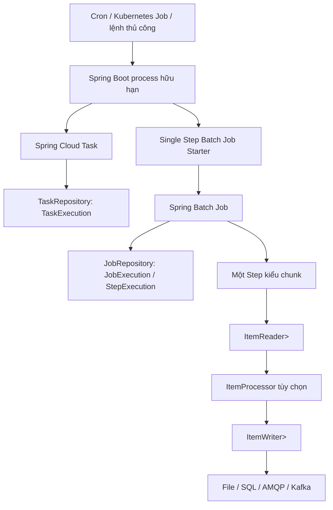
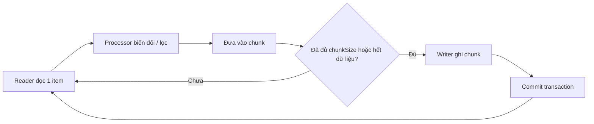

# Phạm vi của spring-cloud-starter-single-step-batch-job

## 1. Starter này giải quyết bài toán nào?

**Spring Cloud Task** được dùng để xây dựng ứng dụng Spring Boot có thời gian chạy hữu hạn: khởi động, thực hiện công việc, ghi nhận trạng thái thực thi thông qua `TaskRepository` rồi kết thúc. Khi công việc là đọc, xử lý và ghi một lượng lớn bản ghi, ứng dụng có thể phối hợp với **Spring Batch** để tận dụng xử lý theo chunk, transaction, thống kê, khả năng restart và metadata của `JobRepository`.

`spring-cloud-starter-single-step-batch-job` là một starter của Spring Cloud Task dành cho **trường hợp đơn giản nhưng phổ biến**: một Spring Batch `Job` gồm **một `Step` xử lý theo chunk**. Nó giúp cấu hình sẵn kết cấu Job/Step, cùng các `ItemReader` và `ItemWriter` được hỗ trợ, bằng **properties** hoặc các bean do ứng dụng khai báo.

Ví dụ: mỗi đêm đọc file CSV đơn hàng, chuẩn hóa một vài trường, rồi ghi file CSV khác hoặc ghi vào database. Nếu luồng chỉ cần **một bước tuyến tính**, starter này có thể giảm đáng kể lượng code cấu hình Spring Batch.

Mục tiêu của bài:

- Phân biệt **Spring Cloud Task**, **Spring Batch** và **single-step batch starter**.
- Mô tả phạm vi mà starter tự cấu hình và những phần vẫn cần tự xây dựng.
- Hiểu mô hình `ItemReader → ItemProcessor (tùy chọn) → ItemWriter`, chunk và giới hạn kiểu dữ liệu `Map<String, Object>`.
- Nhận biết các reader/writer tích hợp: file, JDBC, AMQP và Kafka.
- Cấu hình ví dụ một Job/Step, khởi chạy, quan sát metadata, xử lý thất bại và restart.
- Chọn thời điểm nên dùng starter hoặc chuyển sang cấu hình Spring Batch trực tiếp.

> **Phạm vi học thuật:** Tài liệu Spring Cloud Task mô tả starter này như công cụ cấu hình một Job **một Step theo chunk**. Đó không phải cơ chế tổng quát tự tạo mọi loại Job, không thay thế Spring Batch và không tự cấp lịch chạy hay bảo đảm exactly-once cho mọi hệ thống ngoài.

## 2. Vị trí của starter trong kiến trúc



Trong một lần chạy:

1. Bộ điều phối khởi chạy JAR Spring Boot.
2. Spring Cloud Task ghi `TaskExecution` khi hạ tầng repository sẵn sàng.
3. Spring Boot và Spring Batch khởi chạy Job được cấu hình.
4. Job tạo một `JobExecution`; Step tạo `StepExecution`, đọc và ghi theo từng chunk.
5. Batch lưu trạng thái thành công/thất bại và thông tin restart.
6. Spring Cloud Task cập nhật kết quả lần chạy rồi ứng dụng kết thúc theo cấu hình.

Ba tên dễ nhầm:

| Thành phần | Nó là gì? | Metadata | Phạm vi |
| --- | --- | --- | --- |
| **Spring Cloud Task** | Quản lý vòng đời một tiến trình hữu hạn | `TASK_*`, đặc biệt `TASK_EXECUTION` | Toàn bộ lần chạy ứng dụng |
| **Spring Batch** | Framework xử lý batch: Job, Step, chunk, retry, restart | `BATCH_*`, `JobExecution`, `StepExecution` | Công việc batch và các bước bên trong |
| **Single-step starter** | Bộ tự cấu hình Job **một Step** và một số reader/writer | Dùng metadata của Spring Batch và Task | Giảm code cho cấu trúc batch đơn giản |

**Một TaskExecution không đồng nghĩa một StepExecution.** Task có thể bao Job; một Job có thể được restart và tạo `JobExecution` mới; mỗi JobExecution có một hoặc nhiều StepExecution tùy cấu trúc. Starter tập trung vào Job chỉ có **một Step**.

## 3. Starter tạo sẵn phần nào, phần nào vẫn do bạn làm?

### 3.1. Phạm vi được tự cấu hình

Theo tài liệu chính thức, với các property lõi:

| Property | Kiểu | Mặc định trong tài liệu | Ý nghĩa |
| --- | --- | --- | --- |
| `spring.batch.job.jobName` | `String` | `null` | Tên `Job` do starter tạo |
| `spring.batch.job.stepName` | `String` | `null` | Tên `Step` của Job |
| `spring.batch.job.chunkSize` | `Integer` | `null` | Số item xử lý cho mỗi chunk/transaction |

Sau khi cấu hình các property cần thiết, starter tạo cấu trúc **Job một Step kiểu chunk**. Tuy nhiên, **chỉ ba property đó chưa tạo ra nghiệp vụ hữu ích**: Step cần có `ItemReader` và `ItemWriter` phù hợp; `ItemProcessor` là tùy chọn.

Bạn có hai cách cung cấp các thành phần:

1. Dùng **autoconfiguration** của starter cho các reader/writer được liệt kê trong tài liệu.
2. Khai báo bean reader/writer/processor tùy chỉnh bằng Spring Configuration, đúng kiểu dữ liệu của Step.

Không nhất thiết phải tự viết bean `Job` và `Step` nếu mô hình starter đã đủ. Nhưng việc chọn các thành phần, cấu hình endpoint, định dạng dữ liệu, xác thực, lỗi và chính sách vận hành vẫn là trách nhiệm ứng dụng.

### 3.2. Luồng chunk diễn ra như thế nào?



Với `chunkSize=100`, Step thường đọc đến 100 item mỗi đợt, biến đổi rồi gọi writer cho nhóm đó và commit theo chính sách transaction. Nếu nguồn có 230 item, thông thường được chia thành các chunk 100, 100 và 30.

**Không đồng nhất chunkSize với số thread, số connection hay kích thước toàn bộ file.** Starter không mặc định xử lý song song chỉ vì chunkSize lớn. Việc commit phụ thuộc transaction manager và tài nguyên tham gia; JDBC và Kafka/AMQP/file không đương nhiên có một giao dịch nguyên tử xuyên hệ thống.

### 3.3. Kiểu dữ liệu mặc định là Map<String, Object>

Điểm giới hạn quan trọng của starter: các reader/writer được cấu hình sẵn dùng **`Map<String, Object>`** làm item đầu vào/đầu ra, thay vì tự suy ra các POJO bất kỳ.

Ví dụ đọc dòng:

```csv
order_id,customer,total
101,An,250000
```

Một item ở tầng Step có thể được biểu diễn gần như:

```java
Map<String, Object> item = Map.of(
        "order_id", "101",
        "customer", "An",
        "total", "250000"
);
```

Đây là **hình dung kiểu dữ liệu**: với file CSV, các giá trị có thể là chuỗi; với JDBC, `RowMapper` có thể trả về số/ngày/kiểu JDBC thích hợp. Đừng giả định `Map.get("total")` luôn trả `Integer` hoặc `BigDecimal`. Cần xác thực và chuyển đổi trước khi ghi.

Nếu khai báo processor riêng, nên dùng đúng chữ ký tương thích:

```java
ItemProcessor<Map<String, Object>, Map<String, Object>>
```

Một processor xử lý `Order` thành `Invoice` sẽ không tương thích trực tiếp với pipeline `Map → Map` được starter tự cấu hình, trừ khi bạn viết adapter hoặc chuyển sang cấu hình Spring Batch do mình sở hữu.

## 4. Những nguồn đọc mà starter hỗ trợ

Tài liệu Spring Cloud Task mô tả autoconfiguration cho **bốn reader**:

| Reader | Nguồn dữ liệu | Điều cần chuẩn bị | Lưu ý |
| --- | --- | --- | --- |
| `FlatFileItemReader` | File CSV/delimited/fixed-width | Resource, tên trường, tokenizer/line mapper | Định dạng, encoding, header, quyền đọc và state khi restart |
| `JdbcCursorItemReader` | Truy vấn SQL qua JDBC | `DataSource`, SQL, có thể cần `RowMapper`/`PreparedStatementSetter` | Cursor, connection, thứ tự truy vấn ổn định, fetchSize |
| `AmqpItemReader` | Hàng đợi AMQP | `AmqpTemplate` và cấu hình broker | Cần hiểu ack/requeue và ngữ nghĩa tiêu thụ thông điệp |
| `KafkaItemReader` | Topic/partition Kafka | Spring Kafka và cấu hình topic/partition | Offset, checkpoint, rebalance và message ordering |

Danh sách này mô tả phạm vi được tài liệu starter liệt kê. Nếu muốn đọc từ S3, REST API, R2DBC hoặc một nguồn chuyên biệt, có thể cần **reader tùy chỉnh** hoặc một Job/Step cấu hình trực tiếp, tùy phiên bản và nhu cầu thực tế.

### 4.1. FlatFileItemReader

Các property đặc trưng:

| Property | Tác dụng |
| --- | --- |
| `spring.batch.job.flatfileitemreader.resource` | Resource đầu vào, ví dụ `file:./data/orders.csv` |
| `spring.batch.job.flatfileitemreader.name` | Tên reader ổn định phục vụ lưu `ExecutionContext` |
| `spring.batch.job.flatfileitemreader.delimited` | Chọn cách tách trường theo delimiter |
| `spring.batch.job.flatfileitemreader.delimiter` | Dấu phân cách, thường là dấu phẩy |
| `spring.batch.job.flatfileitemreader.names` | Tên các cột làm key trong `Map` |
| `spring.batch.job.flatfileitemreader.linesToSkip` | Số dòng bỏ qua đầu file, ví dụ header |
| `spring.batch.job.flatfileitemreader.saveState` | Có lưu tiến độ reader để restart hay không |
| `spring.batch.job.flatfileitemreader.strict` | Có báo lỗi nếu resource không tồn tại không |

Nếu file có header, cần tránh vừa bỏ qua header vừa ánh xạ nhầm dòng đầu. Nếu file CSV có cột chứa dấu phẩy trong dấu ngoặc kép, phải thử cách tokenizer xử lý quoting đúng với dữ liệu thật; không assume `String.split(",")` đủ cho mọi CSV.

### 4.2. JdbcCursorItemReader

Các property thường dùng:

```yaml
spring:
  batch:
    job:
      jdbccursoritemreader:
        name: pendingOrdersReader
        sql: "SELECT id, customer, total FROM orders WHERE status = 'PENDING' ORDER BY id"
        fetchSize: 100
        saveState: true
```

SQL phải tương thích database đích; **ORDER BY theo khóa ổn định** rất quan trọng khi muốn restart và khi dữ liệu thay đổi trong lúc chạy. Query dùng điều kiện đầu vào động nên dùng bind parameter hoặc `PreparedStatementSetter` thay vì nối chuỗi. `fetchSize` là hint tới JDBC driver, không phải cam kết luôn lấy đúng 100 dòng mỗi lần gọi.

Reader có thể dùng `DataSource` mặc định; khi cần nguồn riêng, phải kiểm tra nhóm property datasource riêng theo phiên bản. Dùng nhiều datasource đồng thời kéo theo câu hỏi về transaction manager và tính nhất quán giữa dữ liệu đọc/ghi với JobRepository.

### 4.3. AmqpItemReader và KafkaItemReader

Reader AMQP được mô tả với cờ:

```properties
spring.batch.job.amqpitemreader.enabled=true
```

Ngoài cờ, cần có `AmqpTemplate` hoặc auto-configuration kết nối broker phù hợp. Với Kafka, tài liệu mô tả `spring.batch.job.kafkaitemreader.topic`, `partitions`, `pollTimeOutInSeconds` và `saveState`, đồng thời yêu cầu cấu hình Spring Kafka tương ứng.

Không nên xem đọc từ queue/topic giống đọc một file tĩnh. Cần quyết định cách xử lý khi message đã được đọc nhưng writer lỗi, khi consumer restart, khi offset đã commit và khi broker redeliver. Starter cung cấp lớp cấu hình cơ bản, **không tự thiết kế cơ chế exactly-once cho nghiệp vụ**.

## 5. Những đích ghi mà starter hỗ trợ

| Writer | Đích | Những điều cần cấu hình |
| --- | --- | --- |
| `FlatFileItemWriter` | File văn bản/CSV/fixed-width | Resource, field names, delimiter/format, encoding, hành vi ghi đè/append |
| `JdbcBatchItemWriter` | Bảng SQL qua JDBC | SQL, map tham số/statement setter, `DataSource` và chính sách assertUpdates |
| `AmqpItemWriter` | Broker AMQP | `AmqpTemplate`, định dạng message, xác nhận gửi |
| `KafkaItemWriter` | Kafka topic | Producer config, topic và chính sách ghi hoặc xóa |

### 5.1. FlatFileItemWriter

Ví dụ các property:

```yaml
spring:
  batch:
    job:
      flatfileitemwriter:
        name: normalizedOrdersWriter
        resource: file:./data/output/orders-normalized.csv
        delimited: true
        delimiter: ","
        names:
          - order_id
          - customer
          - total
        encoding: UTF-8
```

Trong tài liệu starter, `delimited` và `formatted` là hai cách xuất khác nhau; không bật đồng thời. `names` chỉ định key cần lấy từ `Map` để ghi ra file. `resource` phải trỏ tới đường dẫn mà tiến trình có quyền ghi và thư mục cha đã tồn tại.

**Chú ý khi restart:** Property `shouldDeleteIfExists` của writer được tài liệu liệt kê với mặc định `true`, còn `append` mặc định `false`. Nếu mở một file kết quả đang chứa dữ liệu của lần chạy trước, việc khởi động lại có thể xóa/ghi đè kết quả theo cấu hình và lifecycle của writer. Với sản phẩm thật, hãy thiết kế tên file theo `runId`, file tạm + atomic rename (khi filesystem hỗ trợ), hoặc cơ chế lưu trạng thái an toàn; **không chỉ bật append rồi coi như restart đúng**.

### 5.2. JdbcBatchItemWriter

Tài liệu starter hỗ trợ SQL và `assertUpdates`:

```yaml
spring:
  batch:
    job:
      jdbcbatchitemwriter:
        name: orderOutputWriter
        sql: >
          INSERT INTO imported_orders(order_id, customer, total)
          VALUES (:order_id, :customer, :total)
        assertUpdates: true
```

Trong ví dụ, câu SQL sử dụng **named parameters** tương ứng với key của `Map`; cách bind cần phù hợp `ItemSqlParameterSourceProvider` mà cấu hình thực tế hỗ trợ. Phải tạo bảng `imported_orders` và có quyền ghi trước khi chạy. `assertUpdates` yêu cầu thao tác ghi tác động đến số dòng mong đợi, giúp phát hiện một số lỗi ghi im lặng, nhưng không thay thế kiểm tra nghiệp vụ.

Khi cần `ON CONFLICT`, `MERGE` hay upsert, SQL phụ thuộc database. Phải phân biệt một bản ghi **được cố tình bỏ qua vì đã tồn tại** với một thao tác đáng lẽ cập nhật nhưng trả về 0 dòng; cân chỉnh `assertUpdates` và quy tắc idempotency phù hợp.

### 5.3. Writer AMQP/Kafka

Với AMQP, tài liệu hỗ trợ cấu hình `spring.batch.job.amqpitemwriter.enabled` và JSON conversion khi có `AmqpTemplate`. Với Kafka, cần chỉ định `spring.batch.job.kafkaitemwriter.topic` và tham số phù hợp, đồng thời cấu hình producer.

**Một chunk commit ở JobRepository không mặc nhiên là một transaction phân tán bao gồm database, filesystem và broker.** Nếu writer gửi message thành công nhưng tiến trình chết trước khi ghi checkpoint, khi restart có thể phát lại message. Dùng idempotency key, outbox hoặc giao thức xử lý trùng phù hợp ở phía nhận.

## 6. Ví dụ: một Job CSV → CSV chỉ dùng properties

Ví dụ dưới đây minh họa **phạm vi cơ bản nhất** của starter: đọc một file CSV, chuyển từng dòng thành `Map<String,Object>` rồi ghi ra một file mới. Mục tiêu là học cách cấu hình Job/Step/reader/writer. Chương trình chưa chứa logic xử lý dữ liệu nghiệp vụ phức tạp.

### 6.1. Chuẩn bị dự án

Dự án cần Spring Boot, Spring Cloud Task/Batch starter phù hợp và một cơ sở dữ liệu cho metadata (ví dụ PostgreSQL). Với Maven và **BOM Spring Cloud tương thích** đang được quản lý trong dự án:

```xml
<dependency>
    <groupId>org.springframework.cloud</groupId>
    <artifactId>spring-cloud-starter-single-step-batch-job</artifactId>
</dependency>

<dependency>
    <groupId>org.postgresql</groupId>
    <artifactId>postgresql</artifactId>
    <scope>runtime</scope>
</dependency>
```

Đây là **đoạn dependency bổ sung**, không phải `pom.xml` hoàn chỉnh. Cần có Boot parent/BOM, Spring Cloud BOM tương thích và repository chứa artifact; xác nhận starter kéo theo những thành phần Task/Batch nào bằng dependency tree của **dự án thực tế**.

**Bẫy phiên bản:** Một số trang tài liệu chính thức (kể cả những trang được gắn nhãn release mới) vẫn minh họa dependency `spring-cloud-starter-single-step-batch-job` ở phiên bản **`2.3.0`** và Gradle `compile` kiểu cũ. Đừng copy số `2.3.0` sang dự án Spring Boot mới nếu chưa kiểm tra ma trận tương thích. Hãy chọn artifact theo release train/BOM và kiểm tra API thực tế. Nếu starter không được BOM của dự án quản lý, chốt **phiên bản tương thích cụ thể** sau khi đối chiếu metadata phát hành; không để Maven tải version tùy ý.

Đối với ví dụ ứng dụng:

```java
import org.springframework.boot.SpringApplication;
import org.springframework.boot.autoconfigure.SpringBootApplication;
import org.springframework.cloud.task.configuration.EnableTask;

@SpringBootApplication
@EnableTask
public class OneStepCsvTaskApplication {
    public static void main(String[] args) {
        SpringApplication.run(OneStepCsvTaskApplication.class, args);
    }
}
```

Không cần tự viết bean `Job` và `Step` trong ví dụ property-only vì starter tạo cấu trúc một bước. `@EnableTask` làm rõ mục tiêu bật hạ tầng Task; với tổ hợp starter và phiên bản hỗ trợ tự cấu hình, cách kích hoạt có thể khác, cần kiểm tra ứng dụng thực tế.

### 6.2. Chuẩn bị file đầu vào

Tạo thư mục `data/input` và `data/output` trên máy chạy JAR. File `data/input/orders.csv`:

```csv
order_id,customer,total
101,An,250000
102,Binh,320000
103,Chi,180000
```

File ví dụ có một dòng header và ba dòng dữ liệu. Trước khi chạy, đảm bảo encoding UTF-8, quyền đọc file đầu vào và quyền ghi vào thư mục đầu ra.

### 6.3. application.yml

```yaml
spring:
  application:
    name: one-step-csv-task
  main:
    web-application-type: none
  datasource:
    url: ${TASK_DB_URL:jdbc:postgresql://localhost:5432/taskdb}
    username: ${TASK_DB_USER:task_user}
    password: ${TASK_DB_PASSWORD}
  cloud:
    task:
      initialize-enabled: false
      closecontextEnabled: true
      batch:
        fail-on-job-failure: true
  batch:
    jdbc:
      initialize-schema: never
    job:
      enabled: true
      jobName: normalizeOrdersJob
      stepName: normalizeOrdersStep
      chunkSize: 2
      flatfileitemreader:
        name: ordersReader
        resource: file:./data/input/orders.csv
        encoding: UTF-8
        linesToSkip: 1
        delimited: true
        delimiter: ","
        names: [order_id, customer, total]
        saveState: true
        strict: true
      flatfileitemwriter:
        name: normalizedOrdersWriter
        resource: file:./data/output/orders-normalized.csv
        encoding: UTF-8
        delimited: true
        delimiter: ","
        names: [order_id, customer, total]
        saveState: true
```

Với cấu hình mẫu:

- `spring.batch.job.jobName`, `stepName` và `chunkSize` là nhóm thuộc tính **của starter**. Giá trị `chunkSize: 2` giúp dễ quan sát hai chunk từ ba dòng CSV.
- `flatfileitemreader` và `flatfileitemwriter` thuộc nhóm cấu hình reader/writer của starter.
- `spring.batch.job.enabled: true` thuộc **Spring Boot**, cho phép tự chạy Job tìm thấy khi ứng dụng khởi động.
- `spring.cloud.task.batch.fail-on-job-failure: true` yêu cầu tích hợp Task–Batch phát tín hiệu lỗi khi Batch Job thất bại, thay vì mặc định để Task báo thành công trong một số đường chạy.
- `initialize-enabled: false` và `spring.batch.jdbc.initialize-schema: never` giả định các bảng `TASK_*` và `BATCH_*` đã được chuẩn bị bằng DDL/migration của đúng phiên bản tương ứng.
- `TASK_DB_PASSWORD` phải được cung cấp qua môi trường hoặc secret manager; không đưa password vào CLI vì tham số có thể bị ghi vào metadata hoặc log.

**Phân biệt hai property gần giống:** `spring.batch.job.jobName` (starter **định nghĩa tên Job**) và `spring.batch.job.name` (Spring Boot **chọn Job để khởi chạy** khi có nhiều Job). Chúng không đồng nghĩa. Nếu ứng dụng chỉ có Job được starter tạo, thường không cần thêm property chọn Job; khi có nhiều Job, dùng đúng thuộc tính chọn Job theo phiên bản Boot.

Vì các bản Spring Cloud Task và Spring Batch thay đổi qua thời gian, cần kiểm tra rằng các property của starter thực sự được bind trong version đã chốt. Nếu file không được đọc hoặc writer không được tạo, xem mục khắc phục lỗi và kiểm tra auto-configuration report thay vì giả định mọi tổ hợp version đều hỗ trợ y hệt.

### 6.4. Chạy và quan sát

Sau khi build JAR, chạy (tên file JAR chỉ là ví dụ):

```bash
java -jar target/one-step-csv-task.jar
```

Nếu database/schema và auto-configuration được chuẩn bị đúng, Job được khởi chạy, reader đọc ba dòng và writer ghi ra file `data/output/orders-normalized.csv`. Vì `chunkSize: 2`, thường có hai nhóm xử lý: hai dòng đầu rồi một dòng cuối.

Kết quả dự kiến trong file:

```csv
101,An,250000
102,Binh,320000
103,Chi,180000
```

Trong ví dụ này **không có processor**: output không được chuẩn hóa theo nghĩa chuyển đổi dữ liệu; tên Job `normalizeOrdersJob` chỉ là tên minh họa. Muốn thay đổi chữ hoa/thường, kiểm tra giá trị hoặc loại bản ghi, cần thêm processor phù hợp.

Lưu ý, file đầu ra có thể **không** có header vì cấu hình writer không khai báo `FlatFileHeaderCallback`. Cần bổ sung header callback hoặc bước tạo header nếu hệ thống đích yêu cầu đúng định dạng.

## 7. Thêm ItemProcessor tùy chỉnh nhưng vẫn giữ Job một bước

`ItemProcessor` là thành phần **tùy chọn**. Starter có thể nhận một bean đúng kiểu `ItemProcessor<Map<String, Object>, Map<String, Object>>`.

Ví dụ chuẩn hóa tên khách hàng và kiểm tra trường bắt buộc:

```java
import java.util.LinkedHashMap;
import java.util.Map;
import org.springframework.batch.item.ItemProcessor;
import org.springframework.context.annotation.Bean;
import org.springframework.context.annotation.Configuration;

@Configuration
public class OrderNormalizeProcessorConfiguration {

    @Bean
    ItemProcessor<Map<String, Object>, Map<String, Object>>
    orderNormalizer() {
        return item -> {
            Map<String, Object> result =
                    new LinkedHashMap<>(item);

            Object id = result.get("order_id");
            if (id == null || id.toString().isBlank()) {
                throw new IllegalArgumentException(
                        "Thiếu order_id");
            }

            Object customer = result.get("customer");
            if (customer != null) {
                result.put(
                        "customer",
                        customer.toString().trim().toUpperCase());
            }
            return result;
        };
    }
}
```

Bean này nhận và trả về `Map<String,Object>` để khớp pipeline của starter. `LinkedHashMap` tạo bản sao item, giúp hạn chế sửa trực tiếp Map nguồn do reader cung cấp. Với ví dụ trên, `An` thành `AN` và `Binh` thành `BINH`.

Một processor có thể **trả về `null` để lọc item** khỏi đường ghi theo quy tắc Spring Batch, nhưng cần phân biệt lọc hợp lệ với lỗi dữ liệu: trả `null` âm thầm khi thiếu dữ liệu có thể khiến Job báo thành công dù thất thoát bản ghi quan trọng.

Với quy tắc nghiệp vụ phức tạp, nhiều processor cùng loại hoặc yêu cầu POJO `OrderRecord`, hãy cân nhắc tự định nghĩa Spring Batch Job/Step. Không mặc định starter sẽ tự chọn đúng processor khi context có nhiều bean phù hợp.

## 8. Khi nào starter không còn phù hợp?

### 8.1. Những giới hạn do kiến trúc một Step

| Yêu cầu | Có phù hợp với single-step starter? | Hướng triển khai |
| --- | --- | --- |
| Đọc CSV và ghi CSV, một pipeline tuyến tính | **Rất phù hợp** | Properties + reader/writer, processor nếu cần |
| Đọc SQL và ghi SQL với Map | **Phù hợp trong phạm vi được hỗ trợ** | JDBC reader/writer + transaction và idempotency |
| Đọc Kafka rồi ghi JDBC | **Có thể**, cần kiểm tra ngữ nghĩa offset/transaction | Test khả năng lặp và commit độc lập |
| Một Job gồm nhiều Step có phụ thuộc | **Ngoài phạm vi chính** | Tự xây Spring Batch Job bằng `JobBuilder`/`StepBuilder` |
| Quyết định rẽ nhánh theo trạng thái Step | **Ngoài phạm vi chính** | Flow/transition tùy chỉnh của Spring Batch |
| Partitioning, remote chunking, worker song song | **Không tự có chỉ nhờ starter** | Cấu hình Spring Batch/Spring Cloud Task/Deployer thích hợp |
| Tasklet chỉ chạy một lệnh đơn giản | **Không phải mục tiêu chunk starter** | `ApplicationRunner` hoặc Spring Batch Tasklet Step |
| Item kiểu POJO với mapping phức tạp | **Cần tùy biến đáng kể** | Reader/writer/processor tự viết hoặc Job thuần Spring Batch |
| Quy tắc retry/skip chuyên biệt từng exception | **Không tự cấu hình đầy đủ từ ba property lõi** | Xây Step với fault tolerance phù hợp |
| Điều phối nhiều Job theo điều kiện | **Không phải chức năng starter** | Scheduler/orchestrator hoặc Batch Job flows |

Đừng nhầm việc starter **có thể nhận bean tùy chỉnh** với việc starter phù hợp cho mọi pipeline. Khi cấu hình ngày càng nhiều ngoại lệ, logic flow, listener hoặc xử lý resource đặc thù, viết Job trực tiếp thường minh bạch và dễ kiểm thử hơn.

### 8.2. Khác nhau giữa một Runner và một Step

Một `ApplicationRunner` có thể chỉ gọi một API, gửi báo cáo hoặc dọn cache rồi kết thúc. Đây vẫn là **Spring Cloud Task hợp lệ** dù không dùng Spring Batch.

Ngược lại, một `Step` của Spring Batch cung cấp bộ khung item-oriented, state của Job/Step và xử lý chunk/restart. Đưa một thao tác đơn giản vài mili giây vào Batch chỉ để “dùng starter” có thể tạo thêm schema, cấu hình và chi phí vận hành không cần thiết.

Chọn công cụ theo nhu cầu: **Runner cho tác vụ đơn giản**, **single-step starter cho một pipeline chunk**, **Spring Batch tự cấu hình khi workflow phức tạp**.

## 9. Schema và metadata khi dùng cả Task lẫn Batch

Nếu ứng dụng dùng Spring Cloud Task cùng Spring Batch, thông thường cần:

| Nhóm bảng | Chức năng |
| --- | --- |
| `TASK_EXECUTION`, `TASK_EXECUTION_PARAMS` và các `TASK_*` khác | Metadata của tiến trình Spring Cloud Task |
| `BATCH_JOB_INSTANCE`, `BATCH_JOB_EXECUTION`, `BATCH_STEP_EXECUTION` cùng các bảng Batch khác | Metadata Job/Step và thông tin restart |
| `TASK_TASK_BATCH` khi tích hợp được bật | Liên kết giữa một TaskExecution và JobExecution |

Spring Cloud Task và Spring Batch có **repository khác nhau**. Một `JobExecution` thất bại không đồng nghĩa mọi giao dịch nghiệp vụ trước đó rollback. Dữ liệu đã commit trong các chunk thành công vẫn tồn tại theo ngữ nghĩa transaction.

Nếu dùng Flyway/Liquibase, hãy chuẩn bị DDL **đúng phiên bản** của cả Spring Cloud Task và Spring Batch. Khi đã có migrations:

```yaml
spring:
  cloud:
    task:
      initialize-enabled: false
  batch:
    jdbc:
      initialize-schema: never
```

Không tạo bảng metadata tùy ý theo tên mình nhớ. Nếu TaskRepository nằm ở DB A còn JobRepository ở DB B, phải cấu hình rõ `DataSource`/transaction manager và cách liên kết metadata. Không cho rằng một transaction JDBC tự bao trùm cả hai database.

### 9.1. Truy vấn Job và Step

Ví dụ SQL trên schema Spring Batch JDBC phổ biến:

```sql
SELECT
    ji.JOB_NAME,
    je.JOB_EXECUTION_ID,
    je.STATUS,
    je.EXIT_CODE,
    je.CREATE_TIME,
    je.END_TIME
FROM BATCH_JOB_EXECUTION je
JOIN BATCH_JOB_INSTANCE ji
  ON ji.JOB_INSTANCE_ID = je.JOB_INSTANCE_ID
ORDER BY je.JOB_EXECUTION_ID DESC;
```

Thông tin Step:

```sql
SELECT JOB_EXECUTION_ID, STEP_NAME, STATUS,
       READ_COUNT, WRITE_COUNT, FILTER_COUNT,
       READ_SKIP_COUNT, PROCESS_SKIP_COUNT, WRITE_SKIP_COUNT
FROM BATCH_STEP_EXECUTION
ORDER BY STEP_EXECUTION_ID DESC;
```

Những truy vấn này là **ví dụ** theo schema Batch JDBC thông dụng, cần điều chỉnh tên cột/tên schema theo bản Spring Batch đã chốt. `READ_COUNT`, `WRITE_COUNT` và `FILTER_COUNT` giúp đối soát dữ liệu nhưng không tự chứng minh hệ thống ngoài đã nhận đủ hiệu ứng như email/Kafka.

### 9.2. Liên hệ Task và Job

Spring Cloud Task có khả năng kết nối `TaskExecution` với `JobExecution` khi module tích hợp Batch và listener phù hợp được cấu hình. Khi chức năng đó hoạt động, metadata liên kết giúp truy ngược từ lần chạy process đến Job/Step bên trong.

```text
TaskExecution #401  (tiến trình one-step-csv-task)
   |
   +--> JobExecution #795 (normalizeOrdersJob)
          |
          +--> StepExecution #1320 (normalizeOrdersStep)
```

Các ID trong sơ đồ là **ví dụ**, không phải số được framework bảo đảm. Nếu bảng liên kết trống, kiểm tra dependency `spring-cloud-task-batch`, listener và cơ chế chạy Job của phiên bản đang dùng. Không suy từ tên Job để gán nhầm các bản ghi trong môi trường có nhiều lần chạy.

## 10. Kết quả Job và exit code của Task

### 10.1. Mặc định dễ gây hiểu nhầm

Tài liệu Spring Cloud Task lưu ý rằng một Spring Batch Job có thể **FAILED** trong khi tiến trình Boot/Task vẫn hoàn tất với mã **0** theo đường chạy mặc định. Vì vậy, khi scheduler quyết định retry chỉ dựa vào exit code process, việc không ánh xạ lỗi Batch lên Task có thể dẫn tới **thành công giả**.

Đặt:

```yaml
spring:
  cloud:
    task:
      batch:
        fail-on-job-failure: true
```

Theo tài liệu chính thức, thuộc tính này cho phép Task trả exit code **khác 0** khi Batch Job có `BatchStatus.FAILED`; mã thường là `1` theo mặc định hoặc dựa trên cơ chế `ExitCodeGenerator` được cấu hình. Hãy kiểm tra thực tế với phiên bản đang triển khai và kiểu khởi chạy JVM/container; không giả định mọi lỗi đều được ghi vào TaskRepository nếu process chết trước khi cập nhật metadata.

### 10.2. Đối chiếu từng lớp trạng thái

| Tình huống | JobExecution | TaskExecution / process | Dữ liệu nghiệp vụ |
| --- | --- | --- | --- |
| Reader/processor/writer hoàn tất | `COMPLETED` | Thường thành công, exit code 0 | Các chunk đã commit |
| Step lỗi giữa chừng | `FAILED` | Cần `fail-on-job-failure` hoặc ánh xạ lỗi phù hợp | Chunk trước đó có thể đã commit |
| Bản ghi bị filter hợp lệ | Có thể `COMPLETED` | Có thể thành công | `WRITE_COUNT` nhỏ hơn `READ_COUNT` |
| Ứng dụng lỗi trước khi Job chạy | Có thể chưa có JobExecution | Process lỗi; TaskRepository có thể chưa ghi metadata | Nghiệp vụ có thể chưa bắt đầu |
| Process bị kill cứng | Metadata có thể chưa kết thúc | Có thể thiếu `END_TIME` | Các chunk đã commit vẫn còn |

**Nói rõ tiêu chí nghiệp vụ:** `COMPLETED` nghĩa là Job hoàn tất theo quy tắc Spring Batch, không tự bảo đảm đã nhập đủ mọi bản ghi hợp lệ nếu processor/filter/skip được định nghĩa sai.

## 11. Restart của một Job một bước

### 11.1. Chunk và checkpoint

Giả sử có 250 dòng, `chunkSize=100` và Step thất bại ở dòng thứ 230:

```text
Chunk 1: 100 dòng -> commit thành công
Chunk 2: 100 dòng -> commit thành công
Chunk 3: bắt đầu 50 dòng cuối -> lỗi tại dòng 230
```

Trong trường hợp transaction quản lý đúng resource, các chunk đã commit vẫn được giữ, còn chunk lỗi thường rollback ở phạm vi của nó. Khi restart cùng `JobInstance` hợp lệ, Spring Batch có thể dùng metadata `ExecutionContext` để tiếp tục, nhưng điều này phụ thuộc việc reader/writer hỗ trợ lưu state, dữ liệu nguồn còn ổn định và các thành phần bảo toàn định danh.

### 11.2. Phân biệt JobInstance với JobExecution

- **JobInstance** được xác định bởi tên Job và tập `JobParameters` định danh.
- **JobExecution** là một lần thử thực thi của JobInstance.
- **StepExecution** là một lần thực thi của Step thuộc JobExecution.
- **TaskExecution** là một lần khởi chạy Spring Cloud Task.

Nếu JobInstance đã `COMPLETED`, cố chạy lại **cùng identifying JobParameters** có thể bị từ chối theo quy tắc Spring Batch. Nếu JobInstance đã `FAILED`, có thể restart theo chính sách và khả năng restart của Job.

**Không thêm timestamp ngẫu nhiên vào JobParameters chỉ để vượt qua lỗi “already complete” hoặc restart.** Làm vậy có thể tạo JobInstance mới và chạy lại từ đầu, gây trùng dữ liệu.

### 11.3. File output và restart cần thử riêng

Với `FlatFileItemWriter`, những lựa chọn như `append`, `saveState`, `shouldDeleteIfExists` ảnh hưởng trực tiếp đến file khi chạy lại. Không có cấu hình chung phù hợp cho mọi yêu cầu:

- File chỉ được công bố khi Job thành công: cân nhắc ghi file tạm và đổi tên sau khi hoàn tất.
- Muốn restart giữa file: cần xem writer giữ vị trí/`ExecutionContext` và cách tránh ghi trùng dòng.
- Nhiều lần chạy độc lập: tạo đường dẫn output theo định danh run/batch, không ghi đè file của Job trước.
- File nằm trên NFS/object storage: cần xem semantics append/rename/atomicity riêng; không giả định giống local filesystem.

Khi dùng Kafka/AMQP, checkpoint Batch và offset/ack của broker có thể có vòng đời khác nhau. Việc **restart an toàn** yêu cầu idempotency ở writer hoặc đầu nhận, ngoài metadata JobRepository.

## 12. Tham số, chọn Job và chạy theo lịch

### 12.1. Cấu hình Job khác JobParameters

`spring.batch.job.jobName` và `chunkSize` là các **property cấu hình cấu trúc Job**, thường được xác định trước khi ứng dụng khởi chạy. `JobParameters` là **định danh đầu vào của một lần chạy Batch** (ví dụ ngày nghiệp vụ, batch ID hoặc nguồn dữ liệu).

Ví dụ người dùng yêu cầu xử lý dữ liệu ngày `2026-11-24`; nếu Batch cần restart theo ngày, application cần chuyển ngày này thành `JobParameters` định danh một cách ổn định. Đừng nhầm property của starter với `JobParameters` và không giả định mọi đối số CLI tự được ánh xạ giống nhau ở mọi bản Spring Boot.

```bash
java -jar target/one-step-csv-task.jar --spring.batch.job.name=normalizeOrdersJob
```

Trong ví dụ này `--spring.batch.job.name` là **property chọn Job của Spring Boot**, không phải parameter nghiệp vụ `businessDate` và cũng không phải `spring.batch.job.jobName` dùng để tạo tên Job của starter.

### 12.2. Starter không tự lập lịch

Có thể chạy JAR bằng:

| Cách chạy | Trách nhiệm |
| --- | --- |
| `java -jar ...` | Chạy thủ công hoặc theo yêu cầu |
| Cron hoặc scheduler | Quyết định thời điểm và tham số |
| Kubernetes Job/CronJob | Tạo Pod, timeout, retry và chính sách đồng thời |
| Hệ điều phối workflow | Phụ thuộc giữa các bước, dữ liệu đầu vào và giám sát |

Starter chỉ tạo Job/Step và các component được cấu hình trong tiến trình; lịch, retry process và điều phối nhiều ứng dụng thuộc lớp ngoài. Nếu Job chạy dài hơn một chu kỳ lịch, cần chính sách tránh chồng chéo và kiểm soát resource, không chỉ dựa vào Batch JobRepository để điều phối mọi process.

## 13. AOT/native image là trường hợp đặc biệt

Tài liệu starter cho biết khi chạy trên **JVM**, reader/writer có thể được lựa chọn linh hoạt bằng property lúc runtime. Nhưng với **AOT/native compilation**, các bean cần được xác định trong quá trình phân tích và build; nếu chọn reader/writer qua property, hãy định nghĩa các property chọn component **ở build time**, hoặc khai báo bean tường minh.

Ví dụ ý tưởng cấu hình plugin khi chạy AOT:

```xml
<plugin>
    <groupId>org.springframework.boot</groupId>
    <artifactId>spring-boot-maven-plugin</artifactId>
    <executions>
        <execution>
            <id>process-aot</id>
            <goals>
                <goal>process-aot</goal>
            </goals>
        </execution>
    </executions>
    <configuration>
        <arguments>
            <argument>--spring.batch.job.flatfileitemreader.name=ordersReader</argument>
            <argument>--spring.batch.job.flatfileitemwriter.name=ordersWriter</argument>
        </arguments>
    </configuration>
</plugin>
```

Đây là cấu hình **minh họa từ hướng dẫn AOT của Spring Cloud Task**, cần kiểm tra cú pháp plugin Spring Boot đang dùng và quy trình build image native. Không giả định đổi property từ file YAML lúc chạy native image là đủ để kích hoạt bean reader/writer mới chưa được đưa vào AOT analysis.

## 14. Những lỗi cấu hình và giới hạn thường gặp

| Triệu chứng | Nguyên nhân có thể | Cách chẩn đoán/sửa |
| --- | --- | --- |
| Không có `Job` được tạo | Thiếu starter, sai version, thiếu property cốt lõi, auto-config không được kích hoạt | Kiểm tra dependency tree, binding `jobName/stepName/chunkSize`, auto-configuration report |
| Có Job nhưng Step không đọc gì | Reader thiếu resource/SQL hoặc file rỗng | Kiểm tra resource, log reader, `READ_COUNT` |
| `No qualifying bean` cho reader/writer | Chưa cấu hình component được hỗ trợ hoặc có xung đột bean | Bổ sung reader/writer đúng kiểu; kiểm tra các điều kiện auto-config |
| Lỗi type cast khi xử lý Map | Reader trả giá trị không đúng kiểu được giả định | Chuyển kiểu/validate trong processor |
| Ghi file sai cột | `names` của writer không khớp key item | Kiểm tra mapping tên, thứ tự cột và dữ liệu mẫu |
| File output cũ bị ghi đè | `shouldDeleteIfExists`/`append` không đúng kỳ vọng | Dùng output riêng theo run ID và kiểm thử restart |
| Job `FAILED` nhưng scheduler thấy exit code 0 | Chưa ánh xạ lỗi Batch lên Task | Dùng `fail-on-job-failure` khi được hỗ trợ; xác minh exit code process |
| Lỗi thiếu `BATCH_*` hoặc `TASK_*` | Chưa migration schema hoặc dùng DDL sai phiên bản | Chuẩn bị schema Task và Batch tương thích |
| Restart tạo bản ghi trùng | Tạo JobInstance mới hoặc writer không idempotent | Kiểm tra JobParameters, checkpoint và unique key |
| Đọc Kafka nhưng không có message/partition | Sai topic, partition, quyền broker hoặc poll timeout | Kiểm tra config Kafka và log consumer |
| Native image thiếu reader/writer | Bean chỉ được chọn khi runtime | Khai báo lựa chọn ở build time hoặc bean tường minh |
| Tự khai báo nhiều Job nhưng chạy nhầm | Property Boot chọn Job không rõ ràng | Dùng `spring.batch.job.name` theo phiên bản Boot |

Khi khắc phục lỗi, đừng chỉnh ngẫu nhiên đồng thời cả `jobName` và `name`. Hãy xác định rõ đang muốn **đặt tên Job được tạo** hay **chọn Job để chạy**.

## 15. Kịch bản kiểm thử được khuyến nghị

### 15.1. Thử pipeline và thống kê

Với file CSV ba dòng và `chunkSize=2`:

1. Chạy Job và kiểm tra file output có đúng ba dòng.
2. Truy vấn `BATCH_STEP_EXECUTION`, kỳ vọng `READ_COUNT=3` và `WRITE_COUNT=3` khi không có filter.
3. Đối chiếu `TaskExecution` với `JobExecution` theo khả năng liên kết Task–Batch của dự án.
4. Thay processor để loại bỏ một dòng hợp lệ, kiểm tra `FILTER_COUNT` và số dòng output.
5. Thêm dòng đầu vào bị thiếu `order_id`, xác nhận Job thất bại và lỗi được phản ánh tới Task/process theo policy.

### 15.2. Thử lỗi giữa chunk và restart

Tạo bộ dữ liệu thử nghiệm đủ 5–10 chunk, khiến writer lỗi ở một chunk ở giữa rồi restart theo **cùng JobInstance** nếu trạng thái cho phép. Cần kiểm tra:

- Những chunk đã commit có bị ghi lại không?
- Writer file/JDBC có tạo output trùng hay bị xóa không?
- `JobExecution` và `StepExecution` sau restart có thống kê khớp dữ liệu thật không?
- Hệ điều phối có tự thêm tham số ngẫu nhiên làm biến thành JobInstance mới không?
- Trường hợp gọi HTTP/Kafka/AMQP có cần idempotency riêng không?

### 15.3. Thử môi trường triển khai

- Kiểm tra quyền đọc input, quyền ghi output và dung lượng đĩa.
- Xác nhận database sẵn sàng với schema `TASK_*`/`BATCH_*` đúng phiên bản.
- Kiểm tra mã process khi thành công, khi thiếu file và khi SQL lỗi.
- Nếu chạy nhiều instance, kiểm tra hành vi đồng thời và khả năng tránh xử lý trùng.
- Nếu build native image, xác minh reader/writer được đăng ký tại build time.

Đây là những kiểm thử tích hợp cần làm khi triển khai thật; ví dụ lý thuyết trên **chưa được chạy** trên một dự án Spring Boot/Batch cụ thể trong bài học này.

## 16. Bài tập vận dụng

**Bài tập 1 — Xác định phạm vi.** Một ứng dụng có quy trình: đọc CSV, kiểm tra dữ liệu, ghi database, sau đó gửi email tổng kết. Phân tích phần nào có thể nằm trong single-step chunk, phần nào cần Job nhiều Step, listener, outbox hoặc Task orchestration.

**Bài tập 2 — Map pipeline.** Với CSV gồm `order_id`, `customer`, `total`, viết một `ItemProcessor<Map<String,Object>,Map<String,Object>>` kiểm tra `total` không âm và chuẩn hóa `customer`. Giải thích vì sao cần chuyển đổi giá trị `total` từ chuỗi khi đọc file.

**Bài tập 3 — Phân biệt property.** So sánh `spring.batch.job.jobName`, `spring.batch.job.name` và `spring.batch.job.chunkSize`. Cho biết cái nào quyết định tên Job, Job nào được khởi chạy và số item trong một chunk.

**Bài tập 4 — Kết quả lỗi.** Tạo lỗi đọc file (file không tồn tại), quan sát `JobExecution.STATUS`, `StepExecution`, `TaskExecution.EXIT_CODE` và exit code của shell. Thử `fail-on-job-failure` rồi nêu sự khác biệt.

**Bài tập 5 — Restart.** Job có 230 item, chunkSize 100, lỗi ở chunk cuối. Dự đoán số item đã commit; thử restart và xác nhận output không trùng.

**Bài tập 6 — Chọn công cụ.** Phân loại ba yêu cầu: (a) gọi REST API một lần; (b) đọc file CSV và ghi PostgreSQL; (c) xử lý 5 Step có nhánh điều kiện, partitioning và nhiều transaction manager. Lựa chọn lần lượt Runner, single-step starter hay Spring Batch tự cấu hình, kèm lý do.

**Bài tập 7 — Native image.** Giải thích vì sao property kích hoạt `FlatFileItemReader` chỉ truyền khi chạy native image có thể không đủ; đưa ra kế hoạch cung cấp thông tin reader/writer ở giai đoạn AOT.

## 17. Các nguyên tắc cần nhớ

1. **`spring-cloud-starter-single-step-batch-job` chuyên cho Spring Batch Job một Step kiểu chunk**, không phải công cụ tạo Job bất kỳ.
2. **Ba property cấu trúc** là `jobName`, `stepName` và `chunkSize`; vẫn phải cung cấp reader và writer.
3. **Kiểu item chính là `Map<String,Object>`** trong các component tự cấu hình, vì vậy processor và writer phải tương thích.
4. **Các reader/writer tích hợp chỉ bao phủ những lựa chọn được tài liệu liệt kê**; logic đặc thù cần bean tùy chỉnh hoặc cấu hình Spring Batch trực tiếp.
5. **Spring Cloud Task và Spring Batch có metadata riêng**; kiểm tra cả `TaskExecution`, `JobExecution` và `StepExecution` khi vận hành.
6. **Batch Job FAILED không tự bảo đảm process trả mã khác 0** nếu chưa có policy ánh xạ phù hợp; cần kiểm tra `fail-on-job-failure`.
7. **Restart và transaction theo chunk không thay thế idempotency** ở file, database hoặc broker.
8. **AOT/native image yêu cầu xác định component được tạo ở build time** hoặc khai báo bean thích hợp.

## Tài liệu tham khảo

- [Spring Cloud Task — Single Step Batch Job Starter](https://docs.spring.io/spring-cloud-task/reference/batch-starter.html): phạm vi, các reader/writer được hỗ trợ, properties và yêu cầu AOT.
- [Spring Cloud Task — Batch Integration](https://docs.spring.io/spring-cloud-task/reference/batch.html): liên kết `TaskExecution`–`JobExecution`, trạng thái và `fail-on-job-failure`.
- [Spring Boot — Running Spring Batch Jobs](https://docs.spring.io/spring-boot/reference/io/spring-batch.html): tự chạy Job và thuộc tính `spring.batch.job.name`.
- [Spring Batch — Step và chunk-oriented processing](https://docs.spring.io/spring-batch/reference/step/chunk-oriented-processing.html): chunk, reader/processor/writer và transaction.
- [Spring Batch — Job và JobInstance](https://docs.spring.io/spring-batch/reference/job.html): quan hệ giữa `JobInstance`, `JobExecution` và tham số.
- [Spring Batch — ItemReader và ItemWriter](https://docs.spring.io/spring-batch/reference/readers-and-writers/): các component, state và restart.
- [Spring Cloud Task — Task Repository Schema](https://docs.spring.io/spring-cloud-task/reference/appendix-task-repository-schema.html): bảng `TASK_*` và liên kết tới Spring Batch.
