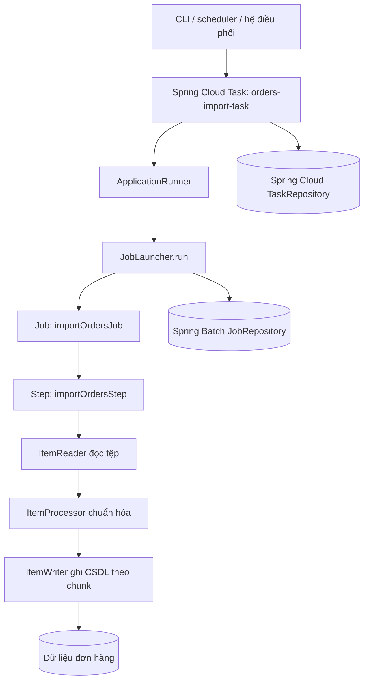
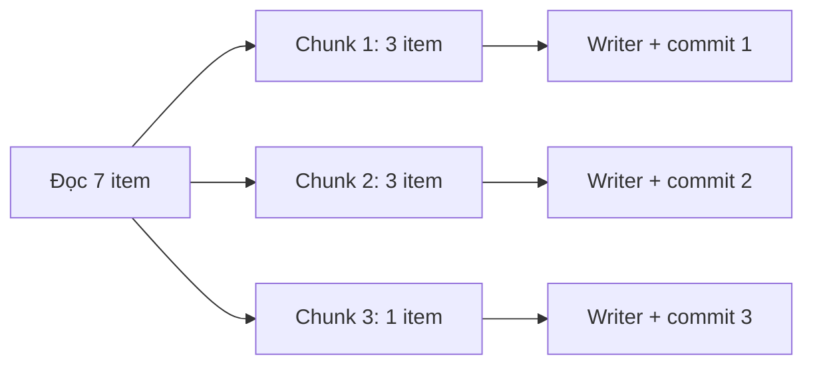

# Cấu hình tên Job, tên Step và kích thước chunk

## 1. Job một bước trong Spring Cloud Task là gì?

**Spring Cloud Task** được dùng để xây dựng một ứng dụng Spring Boot có thời gian chạy hữu hạn: khởi động, xử lý một công việc, ghi metadata thực thi qua `TaskRepository`, rồi kết thúc. Khi công việc phải đọc và ghi nhiều bản ghi, cần commit từng phần, thống kê tiến độ hoặc tiếp tục sau lỗi, có thể kết hợp **Spring Batch**.

Một **Spring Batch Job một bước (single-step job)** có đúng một `Step`. Trong bài này, Job có tên `importOrdersJob`, Step có tên `importOrdersStep`. Step đọc tệp đơn hàng, chuẩn hóa dữ liệu rồi ghi xuống CSDL theo từng **chunk**. Ứng dụng Spring Cloud Task bên ngoài khởi chạy Job và theo dõi vòng đời của tiến trình.



Hai repository phục vụ **hai cấp theo dõi khác nhau**. `TaskRepository` ghi thông tin lần chạy ứng dụng Spring Cloud Task; `JobRepository` của Spring Batch ghi job instance, job execution, step execution, thông số và checkpoint. Một lần chạy task có thể khởi động một Job, nhiều Job hoặc không chạy Batch Job nào; không được đồng nhất hai ID hoặc hai trạng thái.

| Khái niệm | Ví dụ | Ý nghĩa |
| --- | --- | --- |
| Task name | `orders-import-task` | Tên logic của chương trình Spring Cloud Task |
| `TASK_EXECUTION_ID` | `80` | Một lần khởi động task được framework theo dõi |
| Job name | `importOrdersJob` | Tên định nghĩa của một Spring Batch Job |
| Job instance | `importOrdersJob` + identifying `JobParameters` | Một yêu cầu Batch có danh tính xác định, có thể trải qua nhiều lần thử chạy |
| `JOB_EXECUTION_ID` | `201` | Một lần thực thi của Job instance, có thể thành công hoặc thất bại |
| Step name | `importOrdersStep` | Tên ổn định của một bước thuộc Job |
| `STEP_EXECUTION_ID` | `302` | Một lần thực thi Step, chứa số đọc/ghi, commit, rollback và trạng thái |
| Chunk size | `3` | Số item được gom trong một đơn vị xử lý/transaction, theo cơ chế chunk-oriented step |

Các giá trị ID ở bảng chỉ để minh họa; chúng do những repository tương ứng cấp và **không nhất thiết bằng nhau**.

## 2. Đặt tên Job đúng cách

Tên Job được khai báo khi dựng đối tượng `Job`, ví dụ:

```java
new JobBuilder("importOrdersJob", jobRepository)
        .start(importOrdersStep)
        .build();
```

`importOrdersJob` là **tên logic được Spring Batch lưu trong `BATCH_JOB_INSTANCE.JOB_NAME`**. Nó không nhất thiết trùng tên method `@Bean` hay tên Spring Boot application. Job instance được xác định bằng **tên Job cùng tập identifying job parameters**, không chỉ bởi tên Job.

Ví dụ:

| Job name | Identifying parameters | Ý nghĩa |
| --- | --- | --- |
| `importOrdersJob` | `businessDate=2026-11-24`, `inputFile=/data/orders-a.txt` | Một Job instance |
| `importOrdersJob` | Cùng hai giá trị trên | **Cùng Job instance**, có thể là lần thử chạy lại nếu trước đó thất bại |
| `importOrdersJob` | `businessDate=2026-11-25`, `inputFile=/data/orders-b.txt` | Job instance khác |
| `reconcileOrdersJob` | Cùng parameters với dòng đầu | Job instance khác vì tên Job khác |

Spring Batch dùng `JobParameters` để phân biệt các Job instance. Vì vậy, **đừng đổi tên Job để retry một lần chạy thất bại**, và cũng đừng tự thêm `run.id` ngẫu nhiên mỗi khi cần *restart*: thao tác đó thường tạo Job instance mới, làm mất ngữ cảnh checkpoint cũ.

Đối với Job đã `COMPLETED`, chạy lại với **cùng identifying parameters** thông thường bị Spring Batch từ chối bằng `JobInstanceAlreadyCompleteException`. Đây là cơ chế quản lý Job instance; muốn xử lý lại một yêu cầu nghiệp vụ đã hoàn tất phải thiết kế chiến lược rõ ràng, không tùy tiện đổi tên Job hoặc ID.

### Quy tắc đặt tên Job

- Dùng tên ngắn, ổn định và có ý nghĩa nghiệp vụ, chẳng hạn `importOrdersJob` hoặc `generateMonthlyInvoiceJob`.
- Không đưa ngày, timestamp, UUID, customer ID hay tên tệp tùy ý vào **tên Job**; đặt chúng trong `JobParameters` với quy định identifying phù hợp.
- Không dùng một tên Job cho hai luồng xử lý có ngữ nghĩa hoặc cách restart khác nhau.
- Nếu thay đổi tên Job đang vận hành, hãy coi đó là thay đổi danh tính Batch: truy vấn lịch sử, dashboard và khả năng restart của các Job instance cũ có thể bị ảnh hưởng.

## 3. Đặt tên Step và quan hệ với restart

Tên Step được khai báo qua `StepBuilder`:

```java
new StepBuilder("importOrdersStep", jobRepository)
        .<OrderRow, OrderRow>chunk(3, transactionManager)
        .reader(reader)
        .processor(processor)
        .writer(writer)
        .build();
```

`importOrdersStep` là **tên Step trong metadata `BATCH_STEP_EXECUTION.STEP_NAME`**. Khi Job được restart sau lỗi, Spring Batch dựa trên trạng thái và execution context của bước tương ứng để quyết định có chạy lại và tiếp tục từ đâu. Một Step đã hoàn thành thường không chạy lại trong cùng Job instance khi restart mặc định; Step thất bại có thể được thử lại từ checkpoint cuối đã commit nếu các reader/writer và dữ liệu đầu vào hỗ trợ.

> **Điểm dễ mắc lỗi:** Đổi `importOrdersStep` thành `importOrdersStepV2` giữa một lần chạy lỗi và lần restart khiến framework nhìn thấy một Step **có tên mới**. Trạng thái/checkpoint đã lưu theo tên cũ không được kế thừa như một Step tiếp tục bình thường. Hãy giữ tên Step ổn định với những Job instance cần restart; nếu phải thay đổi tên và hành vi, cần có kế hoạch migration hoặc chạy lại dữ liệu an toàn.

Trong một Job có nhiều Step, tên Step cần phân biệt được các bước. Trong **Job một bước**, vẫn phải đặt tên có nghĩa vì các bảng Batch, log và công cụ giám sát sử dụng tên này. Tên của method `@Bean importOrdersStep()` có thể trùng cho dễ đọc, nhưng giá trị **truyền vào `StepBuilder`** mới là tên trong metadata Batch.

## 4. Chunk size là gì và ảnh hưởng thế nào?

Trong Step kiểu chunk-oriented, Spring Batch đọc item qua `ItemReader`, có thể biến đổi/lọc qua `ItemProcessor`, rồi chuyển một nhóm item cho `ItemWriter`. Khi xử lý thành công, transaction được commit và trạng thái tiến độ được lưu theo cơ chế của Step.

Ví dụ `chunk(3, transactionManager)` với đầu vào **7 item hợp lệ** và không có skip/filter/retry:

| Chunk | Item đọc và xử lý | Writer nhận | Kết quả kỳ vọng |
| --- | --- | --- | --- |
| 1 | 1, 2, 3 | 3 item | Commit đợt 1 |
| 2 | 4, 5, 6 | 3 item | Commit đợt 2 |
| 3 | 7 và kết thúc input | 1 item | Commit đợt 3 |



`chunk(3, transactionManager)` thường được hiểu là **tối đa 3 lượt đọc item trong mỗi transaction** theo commit interval, chứ không bảo đảm mỗi lần `ItemWriter` luôn nhận đúng 3 bản ghi. Ví dụ `ItemProcessor` có thể trả `null` để lọc item; skip, retry, lỗi đọc hoặc kết thúc input cũng làm số lượng thực tế khác ví dụ đơn giản. Kích thước chunk khác với `pageSize` của paging reader, `fetchSize` của JDBC cursor, số thread chạy song song hoặc số lượng record trong toàn Job.

### Chọn chunk size bao nhiêu?

| Kích thước | Ưu điểm | Đánh đổi |
| --- | --- | --- |
| Nhỏ, ví dụ `1`–`10` | Ít dữ liệu cần xử lý lại sau rollback; transaction ngắn | Nhiều lần commit và ghi metadata, chi phí I/O cao hơn |
| Trung bình, ví dụ `50`–`500` | Có thể cân bằng throughput và chi phí transaction | Giữ thêm dữ liệu trong bộ nhớ, lock và transaction lâu hơn |
| Lớn, ví dụ `1000` hoặc hơn | Giảm số lần commit cho workload phù hợp | Transaction dài, tăng thời gian rollback và nguy cơ tranh chấp/tốn bộ nhớ |

Các con số chỉ là **điểm khởi đầu để thử tải**, không phải giá trị chuẩn. Chunk tốt phụ thuộc kích thước item, xử lý CPU, latency CSDL, chỉ mục, hiệu năng writer, khả năng rollback và yêu cầu phục hồi. Hãy đo throughput, thời gian commit, memory, lock wait và tỷ lệ lỗi để điều chỉnh.

Chunk size **không tự bảo đảm idempotency**. Một chunk có thể đã commit rồi JVM bị dừng trước khi cả Job hoàn tất. Khi restart, reader phải phục hồi từ checkpoint phù hợp, còn dữ liệu đích vẫn cần ràng buộc nghiệp vụ/khóa duy nhất để tránh ghi trùng trong các tình huống phục hồi bất thường.

## 5. Ví dụ đầy đủ: Job một Step đọc file, ghi H2

Ví dụ dùng các API dựng Job/Step phổ biến của **Spring Batch 5**: `JobBuilder(String, JobRepository)` và `StepBuilder(String, JobRepository)`, với transaction manager truyền tường minh vào `chunk`. Hãy chọn phiên bản Spring Boot, Spring Cloud Task và Spring Batch **tương thích nhau theo BOM**, rồi đối chiếu API nếu dùng dòng phiên bản khác.

Mục tiêu của ví dụ: một chương trình Spring Cloud Task tên `orders-import-task` **chủ động gọi một Job** tên `importOrdersJob`, có đúng một Step `importOrdersStep` và `chunk size = 3`. File nguồn có 7 dòng; mỗi dòng thành một hàng trong bảng `IMPORTED_ORDERS`.

### 5.1. Các dependency Maven cần thiết

```xml
<!-- Dự án phải cấu hình Spring Boot parent/BOM và Spring Cloud BOM tương thích. -->
<dependencies>
    <dependency>
        <groupId>org.springframework.cloud</groupId>
        <artifactId>spring-cloud-starter-task</artifactId>
    </dependency>
    <dependency>
        <groupId>org.springframework.boot</groupId>
        <artifactId>spring-boot-starter-batch</artifactId>
    </dependency>
    <dependency>
        <groupId>com.h2database</groupId>
        <artifactId>h2</artifactId>
        <scope>runtime</scope>
    </dependency>
</dependencies>
```

`spring-boot-starter-batch` cung cấp Spring Batch và hạ tầng JDBC cần cho ví dụ. `spring-cloud-starter-task` quản lý vòng đời ứng dụng Task. H2 được dùng để chạy thử độc lập; phần 8 sẽ giải thích chuyển sang kho bền vững để kiểm tra restart thật qua nhiều lần chạy.

### 5.2. Cấu hình `application.yml`

Đặt file `src/main/resources/application.yml`:

```yaml
spring:
  application:
    name: orders-import-app
  main:
    web-application-type: none
  datasource:
    driver-class-name: org.h2.Driver
    url: jdbc:h2:mem:orders_demo;DB_CLOSE_DELAY=-1
    username: sa
    password: ""
  sql:
    init:
      mode: always
  batch:
    job:
      enabled: false
    jdbc:
      initialize-schema: always
  cloud:
    task:
      name: orders-import-task
      initialize-enabled: true
```

`spring.batch.job.enabled: false` **tắt tự động chạy Job của Spring Boot**, vì `ApplicationRunner` trong ví dụ sẽ gọi `JobLauncher` chủ động. Nếu không làm rõ ai khởi chạy, một số cấu hình có thể dẫn đến cùng Job bị gọi hai lần hoặc nhận params ngoài ý muốn.

`spring.batch.jdbc.initialize-schema: always` khởi tạo metadata `BATCH_*` trong **H2 in-memory trống** cho mỗi lần chạy. `spring.cloud.task.initialize-enabled: true` phục vụ bảng `TASK_*` theo phiên bản framework. `spring.sql.init.mode: always` chạy schema SQL nghiệp vụ. Đây là **bộ cấu hình chỉ dành cho bài lab in-memory**: dữ liệu không tồn tại sau khi JVM dừng; không dùng nguyên trạng với một cơ sở dữ liệu đã có bảng khi khởi động lại nhiều lần.

Tạo `src/main/resources/schema.sql` để Spring Boot khởi tạo bảng dữ liệu nghiệp vụ:

```sql
CREATE TABLE IMPORTED_ORDERS (
    ORDER_ID VARCHAR(40) PRIMARY KEY,
    DESCRIPTION VARCHAR(200) NOT NULL
);
```

Script này chỉ quản lý bảng nghiệp vụ. Không tự tạo `BATCH_JOB_INSTANCE`, `BATCH_STEP_EXECUTION` hay `TASK_EXECUTION` với cấu trúc phỏng đoán: các bảng đó do schema chính thức tương ứng với **đúng phiên bản** Spring Batch/Spring Cloud Task quyết định.

### 5.3. Tạo file đầu vào

Tạo `orders.txt` tại **working directory** (nơi chạy lệnh `java -jar`):

```text
OD-001,Don hang A
OD-002,Don hang B
OD-003,Don hang C
OD-004,Don hang D
OD-005,Don hang E
OD-006,Don hang F
OD-007,Don hang G
```

Mỗi dòng có `orderId,description` và không có header. Ví dụ dùng dấu phẩy đầu tiên làm ký tự phân tách; tệp thật với CSV có dấu phẩy trong chuỗi cần parser CSV được cấu hình đúng quy tắc quote/escape. Giữ file **không thay đổi** giữa những lần restart của cùng Job instance để checkpoint theo số dòng không trỏ nhầm dữ liệu.

### 5.4. Định nghĩa dữ liệu và pipeline Batch

Các file Java bên dưới thuộc package `com.example.orders`; dùng **Java 17+** cho kiểu `record`. Đầu tiên tạo `OrderRow.java`:

```java
package com.example.orders;

public record OrderRow(String orderId, String description) {
}
```

Tiếp theo, tạo `OrdersBatchConfiguration.java`:

```java
package com.example.orders;

import javax.sql.DataSource;

import org.springframework.batch.core.Job;
import org.springframework.batch.core.Step;
import org.springframework.batch.core.configuration.annotation.StepScope;
import org.springframework.batch.core.job.builder.JobBuilder;
import org.springframework.batch.core.repository.JobRepository;
import org.springframework.batch.core.step.builder.StepBuilder;
import org.springframework.batch.item.ItemProcessor;
import org.springframework.batch.item.database.JdbcBatchItemWriter;
import org.springframework.batch.item.database.builder.JdbcBatchItemWriterBuilder;
import org.springframework.batch.item.file.FlatFileItemReader;
import org.springframework.batch.item.file.builder.FlatFileItemReaderBuilder;
import org.springframework.beans.factory.annotation.Value;
import org.springframework.context.annotation.Bean;
import org.springframework.context.annotation.Configuration;
import org.springframework.core.io.FileSystemResource;
import org.springframework.transaction.PlatformTransactionManager;

@Configuration(proxyBeanMethods = false)
public class OrdersBatchConfiguration {

    @Bean
    @StepScope
    FlatFileItemReader<OrderRow> ordersReader(
            @Value("#{jobParameters['inputFile']}") String inputFile) {

        return new FlatFileItemReaderBuilder<OrderRow>()
                .name("ordersFileReader")
                .resource(new FileSystemResource(inputFile))
                .encoding("UTF-8")
                .lineMapper((line, lineNumber) -> {
                    String[] columns = line.split(",", 2);
                    if (columns.length != 2 || columns[0].isBlank()) {
                        throw new IllegalArgumentException(
                                "Dòng dữ liệu không hợp lệ: " + lineNumber);
                    }
                    return new OrderRow(columns[0], columns[1]);
                })
                .saveState(true)
                .build();
    }

    @Bean
    ItemProcessor<OrderRow, OrderRow> ordersProcessor() {
        return row -> new OrderRow(
                row.orderId().trim(), row.description().trim());
    }

    @Bean
    JdbcBatchItemWriter<OrderRow> ordersWriter(DataSource dataSource) {
        return new JdbcBatchItemWriterBuilder<OrderRow>()
                .dataSource(dataSource)
                .sql("INSERT INTO IMPORTED_ORDERS " +
                     "(ORDER_ID, DESCRIPTION) VALUES (?, ?)")
                .itemPreparedStatementSetter((row, statement) -> {
                    statement.setString(1, row.orderId());
                    statement.setString(2, row.description());
                })
                .build();
    }

    @Bean
    Step importOrdersStep(
            JobRepository jobRepository,
            PlatformTransactionManager transactionManager,
            FlatFileItemReader<OrderRow> ordersReader,
            ItemProcessor<OrderRow, OrderRow> ordersProcessor,
            JdbcBatchItemWriter<OrderRow> ordersWriter) {

        return new StepBuilder("importOrdersStep", jobRepository)
                .<OrderRow, OrderRow>chunk(3, transactionManager)
                .reader(ordersReader)
                .processor(ordersProcessor)
                .writer(ordersWriter)
                .build();
    }

    @Bean
    Job importOrdersJob(JobRepository jobRepository, Step importOrdersStep) {
        return new JobBuilder("importOrdersJob", jobRepository)
                .start(importOrdersStep)
                .build();
    }
}
```

Ba điểm cần quan sát ngay trong code:

1. `new JobBuilder("importOrdersJob", ...)` đặt **tên Job** được lưu vào metadata. `new StepBuilder("importOrdersStep", ...)` đặt **tên Step**.
2. `.chunk(3, transactionManager)` tạo Step xử lý theo nhóm tối đa ba item. JDBC writer tham gia transaction của Step khi được cấp chung `DataSource` và transaction manager phù hợp.
3. Reader gắn `@StepScope` để lấy `inputFile` từ `JobParameters` **khi Step chạy**, và `.name("ordersFileReader").saveState(true)` để hỗ trợ lưu vị trí đọc trong `ExecutionContext` khi checkpoint. Đây là một phần điều kiện restart; không phải bảo đảm xử lý đúng một lần trong mọi tình huống.

Mã mẫu sử dụng một transaction manager JDBC quản lý thao tác ghi dữ liệu và metadata Batch trên cùng H2 DataSource. Trong hệ thống nhiều `DataSource`, cần chọn và kiểm tra transaction manager dành cho từng resource; không mặc định việc ghi dữ liệu và checkpoint có cùng tính nguyên tử khi nằm trên các CSDL khác nhau.

### 5.5. ApplicationRunner khởi chạy Job một lần

Tạo `OrdersTaskApplication.java`:

```java
package com.example.orders;

import java.time.LocalDate;
import java.util.List;

import org.springframework.batch.core.BatchStatus;
import org.springframework.batch.core.Job;
import org.springframework.batch.core.JobExecution;
import org.springframework.batch.core.JobParameters;
import org.springframework.batch.core.JobParametersBuilder;
import org.springframework.batch.core.launch.JobLauncher;
import org.springframework.boot.ApplicationArguments;
import org.springframework.boot.ApplicationRunner;
import org.springframework.boot.SpringApplication;
import org.springframework.boot.autoconfigure.SpringBootApplication;
import org.springframework.cloud.task.configuration.EnableTask;
import org.springframework.context.annotation.Bean;
import org.springframework.jdbc.core.JdbcTemplate;

@EnableTask
@SpringBootApplication
public class OrdersTaskApplication {

    public static void main(String[] args) {
        SpringApplication.run(OrdersTaskApplication.class, args);
    }

    @Bean
    ApplicationRunner runBatchJob(
            JobLauncher jobLauncher,
            Job importOrdersJob,
            JdbcTemplate jdbc) {

        return args -> {
            String businessDate = required(args, "business.date");
            LocalDate.parse(businessDate);  // validate ISO yyyy-MM-dd
            String inputFile = required(args, "input.file");

            JobParameters parameters = new JobParametersBuilder()
                    .addString("businessDate", businessDate, true)
                    .addString("inputFile", inputFile, true)
                    .toJobParameters();

            JobExecution execution = jobLauncher.run(importOrdersJob, parameters);
            if (execution.getStatus() != BatchStatus.COMPLETED) {
                throw new IllegalStateException(
                        "Batch Job chưa hoàn tất: " + execution.getStatus());
            }

            Long rows = jdbc.queryForObject(
                    "SELECT COUNT(*) FROM IMPORTED_ORDERS", Long.class);
            System.out.printf(
                    "Job=%s, status=%s, importedRows=%d%n",
                    execution.getJobInstance().getJobName(),
                    execution.getStatus(), rows);
        };
    }

    private static String required(ApplicationArguments args, String name) {
        List<String> values = args.getOptionValues(name);
        if (values == null || values.size() != 1 ||
                values.get(0) == null || values.get(0).isBlank()) {
            throw new IllegalArgumentException(
                    "Cần đúng một tham số --" + name);
        }
        return values.get(0);
    }
}
```

Trong ví dụ này, `JobLauncher` hoạt động **đồng bộ**: khi `run` trả về, Batch Job đã có trạng thái hoàn tất hoặc thất bại. Nếu dự án dùng `JobLauncher` bất đồng bộ, mã kiểm tra `BatchStatus` ngay sau `run` không còn phù hợp; cần chờ/đối soát kết quả qua `JobRepository` hoặc cơ chế điều phối tương ứng.

Một lỗi trong Step có thể khiến `JobLauncher.run(...)` **trả về `JobExecution` với trạng thái `FAILED` thay vì ném exception**. Runner kiểm tra `BatchStatus.COMPLETED` và ném ngoại lệ ở trường hợp còn lại để lần chạy Spring Cloud Task phản ánh thất bại. Khi dùng hệ thống lớn, cần thiết kế thêm ánh xạ exit code và log lỗi, không dựa duy nhất vào dòng `System.out`.

`businessDate` được dùng làm tham số định danh Job instance cho ví dụ; pipeline mẫu không lọc dữ liệu theo ngày vì file đã được chọn qua `inputFile`. Với dữ liệu thật, phải xác minh file đúng ngày/ngữ cảnh nghiệp vụ và dùng `sourceHash` hoặc manifest khi cần bảo đảm retry không đọc nội dung đã bị thay đổi.

### 5.6. Chạy thử

Sau khi dự án đã được build thành executable JAR, ví dụ `target/orders-task.jar`, từ thư mục chứa `orders.txt` chạy:

```bash
java -jar target/orders-task.jar \
  --business.date=2026-11-24 \
  --input.file=./orders.txt
```

Trong một lần chạy thành công với 7 dòng và chunk size `3`, kỳ vọng có **3 lần ghi chunk** (3 + 3 + 1) và log từ runner hiển thị `importedRows=7`. Mã demo **không chứng minh đã xử lý đủ bằng việc in dòng log**; giá trị 7 được truy vấn lại từ bảng nghiệp vụ, nhưng với ứng dụng thật còn phải đối chiếu ID, checksum và các quy tắc dữ liệu.

H2 `mem:` sẽ mất dữ liệu khi JVM thoát. Chạy lệnh `java -jar` lần hai tạo **một kho metadata Batch mới**, nên không được dùng profile lab này để suy luận khả năng restart xuyên các JVM. Phần 8 hướng dẫn các điều kiện cần cho lưu trữ bền vững.

## 6. Kiểm tra tên, trạng thái và chunk trong metadata

Khi Batch Job đang chạy hoặc khi giữ kết nối database trong cùng tiến trình (hoặc dùng CSDL bền vững), bạn có thể quan sát các bảng metadata Spring Batch:

```sql
SELECT ji.JOB_NAME,
       je.JOB_EXECUTION_ID,
       je.STATUS AS JOB_STATUS,
       je.EXIT_CODE AS JOB_EXIT_CODE,
       se.STEP_NAME,
       se.READ_COUNT,
       se.WRITE_COUNT,
       se.COMMIT_COUNT,
       se.ROLLBACK_COUNT
FROM BATCH_JOB_INSTANCE ji
JOIN BATCH_JOB_EXECUTION je
  ON je.JOB_INSTANCE_ID = ji.JOB_INSTANCE_ID
JOIN BATCH_STEP_EXECUTION se
  ON se.JOB_EXECUTION_ID = je.JOB_EXECUTION_ID
ORDER BY je.JOB_EXECUTION_ID DESC;
```

Trong ví dụ đơn giản, một `JobExecution` thành công có một `StepExecution` tên `importOrdersStep`, `READ_COUNT = 7`, `WRITE_COUNT = 7`; `COMMIT_COUNT` phản ánh số transaction chunk đã commit. Các con số chỉ đúng khi không có lỗi, skip, filter hay retry. `COMMIT_COUNT` cũng là một số đếm kỹ thuật, không phải số đơn hàng được ghi.

Bạn có thể kiểm tra dữ liệu nghiệp vụ:

```sql
SELECT ORDER_ID, DESCRIPTION
FROM IMPORTED_ORDERS
ORDER BY ORDER_ID;
```

Với Spring Cloud Task, phần metadata riêng của tiến trình nằm ở `TASK_EXECUTION`:

```sql
SELECT TASK_EXECUTION_ID, TASK_NAME, START_TIME,
       END_TIME, EXIT_CODE
FROM TASK_EXECUTION
ORDER BY TASK_EXECUTION_ID DESC;
```

Đừng suy luận `TASK_EXECUTION_ID = JOB_EXECUTION_ID`: đây là các chuỗi cấp ID riêng. Nếu hệ thống dùng tính năng liên kết metadata Task–Batch, có thể có bảng liên hệ như `TASK_TASK_BATCH`, nhưng cần đối chiếu cấu hình và phiên bản framework để biết bảng có được ghi hay không. **Không join hai bảng chỉ bằng thời gian gần nhau** khi nhiều task hoặc Batch Job chạy đồng thời.

### Phân biệt trạng thái Job và Step

| Nguồn | Thông tin cần xem | Ý nghĩa |
| --- | --- | --- |
| `BATCH_JOB_INSTANCE` | `JOB_NAME`, `JOB_KEY` | Danh tính Job cùng identifying parameters |
| `BATCH_JOB_EXECUTION` | `STATUS`, `EXIT_CODE`, `START_TIME`, `END_TIME` | Kết quả một lần chạy Job |
| `BATCH_STEP_EXECUTION` | `STEP_NAME`, `READ_COUNT`, `WRITE_COUNT`, `COMMIT_COUNT`, `ROLLBACK_COUNT` | Kết quả và tiến độ của Step |
| `BATCH_STEP_EXECUTION_CONTEXT` | Dữ liệu checkpoint | Vị trí reader/writer có thể được dùng khi restart |
| `TASK_EXECUTION` | `TASK_NAME`, `EXIT_CODE`, `END_TIME` | Kết quả của tiến trình Spring Cloud Task |
| Bảng `IMPORTED_ORDERS` | `ORDER_ID`, nội dung đã ghi | Kết quả nghiệp vụ thực tế |

Nếu task báo thành công mà Step lỗi, cần kiểm tra cách launcher và runner truyền lỗi; ví dụ ở mục 5 đã chủ động kiểm tra `BatchStatus`. Nếu Step thành công nhưng bảng nghiệp vụ sai số lượng hoặc sai nội dung, phải đối soát theo khóa nghiệp vụ và dữ liệu nguồn.

## 7. Thay đổi chunk size, checkpoint và restart

### 7.1. Thay kích thước chunk ở đâu?

Tham số chính là số truyền vào `.chunk(size, transactionManager)` khi tạo Step. Ví dụ đổi sang:

```java
return new StepBuilder("importOrdersStep", jobRepository)
        .<OrderRow, OrderRow>chunk(100, transactionManager)
        .reader(ordersReader)
        .processor(ordersProcessor)
        .writer(ordersWriter)
        .build();
```

Đây là **đoạn thay thế** cho phần dựng Step, không phải thêm một Step thứ hai. Bước vẫn mang tên `importOrdersStep`; chỉ khoảng commit được đổi sang 100. Một lựa chọn tốt là truyền số này qua cấu hình có kiểm soát và kiểm thử với khối lượng dữ liệu thực tế, thay vì luôn hard-code mọi nơi.

Ví dụ dùng `@Value` để đọc từ cấu hình:

```java
@Bean
Step importOrdersStep(
        JobRepository jobRepository,
        PlatformTransactionManager transactionManager,
        FlatFileItemReader<OrderRow> ordersReader,
        ItemProcessor<OrderRow, OrderRow> ordersProcessor,
        JdbcBatchItemWriter<OrderRow> ordersWriter,
        @Value("${app.batch.chunk-size:100}") int chunkSize) {

    if (chunkSize <= 0) {
        throw new IllegalArgumentException("chunk-size phải lớn hơn 0");
    }
    return new StepBuilder("importOrdersStep", jobRepository)
            .<OrderRow, OrderRow>chunk(chunkSize, transactionManager)
            .reader(ordersReader)
            .processor(ordersProcessor)
            .writer(ordersWriter)
            .build();
}
```

Và trong `application.yml` có thể thêm:

```yaml
app:
  batch:
    chunk-size: 100
```

Tham số chunk size là **thuộc tính cấu hình của Step**, không tự biến thành identifying JobParameter. Nếu thay kích thước chunk giữa các lần restart một Job instance đã thất bại, cần kiểm thử tương thích checkpoint và cách đọc/ghi; đôi khi nên giữ cấu hình cũ cho các instance còn dang dở.

### 7.2. Khi một chunk bị lỗi

Giả sử Step đã commit hai chunk đầu, mỗi chunk 3 item; chunk thứ ba bị lỗi khi ghi item thứ 7. Với writer dùng transaction manager phù hợp, **những ghi nhận đã commit ở hai chunk đầu vẫn tồn tại**, còn các thay đổi DB chưa commit của chunk thứ ba bị rollback. `JobRepository` lưu trạng thái Step lỗi và checkpoint theo các transaction đã commit.

Khi restart **cùng Job instance với cùng identifying parameters**, `FlatFileItemReader` có `saveState(true)` và tên reader ổn định có thể phục hồi vị trí đã lưu. Tuy nhiên, khả năng restart đúng còn phụ thuộc file đầu vào **không thay đổi**, trạng thái `ExecutionContext` bền vững và việc writer/side effect được thiết kế idempotent.

Không tự cho rằng "chunk=100" đồng nghĩa tất cả 100 item được commit riêng lẻ. Với JDBC writer dùng cùng transaction, nhóm 100 item thường được commit/rollback cùng nhau theo ranh giới chunk. Nếu writer gọi API ngoài, ghi file không được quản lý transaction hoặc dùng một DB khác, việc rollback ở Step **không tự hoàn tác** side effect đó.

### 7.3. Đổi tên Step khi restart gây tác động gì?

| Thay đổi giữa lần lỗi và lần restart | Hệ quả cần xem xét |
| --- | --- |
| Giữ Job name, Step name, identifying parameters | Có thể dùng lại metadata/checkpoint theo hợp đồng restart của Spring Batch |
| Đổi Job name | Tạo danh tính Job khác; không tiếp tục Job instance cũ |
| Giữ Job name nhưng đổi identifying parameters | Job instance khác; không tiếp tục checkpoint của instance cũ |
| Giữ Job và params nhưng đổi Step name | Bước cũ không còn được đối chiếu theo tên như trước; nguy cơ chạy lại từ đầu |
| Giữ tên nhưng thay cấu trúc file đầu vào | Reader có thể đọc từ vị trí cũ trên dữ liệu mới, gây thiếu/trùng/sai bản ghi |
| Giữ tên và params nhưng thay chunk size | Có thể ảnh hưởng ranh giới xử lý và hành vi restart; kiểm thử trước khi áp dụng |

`spring.cloud.task.single-instance-enabled=true` (nếu được bật với hạ tầng khóa phù hợp) giới hạn một **task theo tên** chạy đồng thời; nó không thay thế quy tắc Job instance/restart của Spring Batch và không bảo đảm mọi ghi dữ liệu nghiệp vụ chỉ xảy ra một lần.

## 8. Chạy theo lịch và dùng cơ sở dữ liệu bền vững

H2 in-memory giúp học cách Job/Step/chunk hoạt động, nhưng mỗi lần gọi `java -jar` có một database mới. Để **restart xuyên các lần chạy** và theo dõi lịch sử thực thi, cần lưu cả metadata Batch và Task trong database bền vững (ví dụ PostgreSQL), cùng với dữ liệu nghiệp vụ hoặc cơ chế lưu trữ phù hợp.

Ví dụ cấu hình production qua môi trường:

```yaml
spring:
  main:
    web-application-type: none
  datasource:
    url: ${TASK_DB_URL}
    username: ${TASK_DB_USER}
    password: ${TASK_DB_PASSWORD}
  sql:
    init:
      mode: never
  batch:
    job:
      enabled: false
    jdbc:
      initialize-schema: never
  cloud:
    task:
      name: orders-import-task
      initialize-enabled: false
```

Ở đây, **schema `TASK_*`, `BATCH_*` và bảng nghiệp vụ phải được tạo trước** bằng migration đúng phiên bản; ứng dụng còn cần JDBC driver PostgreSQL trong dependencies. `initialize-schema: never` và `initialize-enabled: false` không tự tạo bảng. Với H2 lưu tệp, cũng phải xử lý việc tạo schema **một lần** và tránh chạy script `CREATE TABLE` lặp lại khi đã có dữ liệu.

Trong hoạt động theo lịch hoặc theo yêu cầu:

1. Scheduler/orchestrator chọn **JobParameters ổn định** cho một yêu cầu nghiệp vụ và khởi động một tiến trình Spring Cloud Task.
2. `ApplicationRunner` gọi `JobLauncher` **một lần**, dùng đúng tên Job và Step đã cấu hình.
3. `JobRepository` lưu trạng thái Batch, checkpoint và kết quả; `TaskRepository` lưu trạng thái tiến trình.
4. Khi thất bại, xác nhận tiến trình cũ đã dừng, đầu vào không đổi, xác định trạng thái Step và dữ liệu đã commit; sau đó mới quyết định restart cùng Job instance.
5. Theo dõi kết quả bằng cả `TASK_EXECUTION`, `BATCH_JOB_EXECUTION`, `BATCH_STEP_EXECUTION` và dữ liệu nghiệp vụ; tránh kết luận thành công chỉ vì JVM thoát mã 0.

Nếu chạy Spring Batch Job từ một ứng dụng web luôn hoạt động, lời gọi `JobLauncher` **không tự tạo một TaskExecution mới**; đó là khác biệt giữa vòng đời Spring Cloud Task và vòng đời từng Batch Job. Thiết kế hệ thống theo dõi đúng cấp phù hợp với cách chạy thực tế.

### Quy tắc vận hành an toàn

- **Không đổi tên Job/Step tùy tiện** sau khi có dữ liệu thực thi và checkpoint cần restart.
- **Không dùng một `run.id` ngẫu nhiên để che lỗi restart** hoặc để chạy trùng đơn hàng đã commit.
- **Không đặt chunk quá lớn chỉ vì ít lần commit hơn**; cần đo latency, bộ nhớ, thời gian transaction và khả năng rollback.
- **Không đặt mật khẩu/token vào CLI hoặc JobParameters** có thể được lưu trong metadata hoặc log.
- **Không coi chunk transactional JDBC là bảo đảm exactly-once** cho API, email, message broker hay dữ liệu nằm ngoài transaction.
- **Luôn đối soát đầu ra**, đặc biệt khi một phần chunk đã commit trước lỗi hoặc khi scheduler tự động retry.

## 9. Lỗi thường gặp

| Triệu chứng | Nguyên nhân có thể | Hướng kiểm tra |
| --- | --- | --- |
| Job chạy hai lần khi ứng dụng khởi động | Spring Boot auto launch và `ApplicationRunner` đều gọi Job | Đặt `spring.batch.job.enabled=false` khi dùng runner chủ động |
| Không tìm thấy bảng `BATCH_JOB_INSTANCE` / `TASK_EXECUTION` | Chưa khởi tạo schema hoặc dùng sai DB/profile | Kiểm tra initializer, JDBC URL và migration đúng phiên bản |
| `JobInstanceAlreadyCompleteException` | Chạy lại Job đã `COMPLETED` với cùng identifying parameters | Xác minh đây là yêu cầu nghiệp vụ đã hoàn tất; không đổi `run.id` tùy ý |
| Lần restart đọc file từ đầu hoặc sai vị trí | Job/Step/reader name đổi, dữ liệu đầu vào thay đổi hoặc `ExecutionContext` không bền vững | Kiểm tra tên, identifying parameters, `@StepScope`, `.saveState(true)` và checkpoint |
| `WRITE_COUNT` khác `READ_COUNT` | Có processor filter (`null`), skip, lỗi hoặc các ràng buộc writer | Đọc `FILTER_COUNT`, `SKIP_COUNT`, trạng thái Step và dữ liệu thật |
| Task báo thành công nhưng Job thất bại | Runner bỏ qua `JobExecution.getStatus()` hoặc launcher bất đồng bộ | Kiểm tra kết quả Job, ném lỗi/ánh xạ exit code phù hợp |
| `Duplicate key` sau retry | Phần dữ liệu đã commit bị ghi lại hoặc Job instance mới chạy lại dữ liệu | Kiểm tra restart, business key, writer idempotency và dữ liệu nguồn |
| H2 file lỗi `table already exists` ở lần chạy sau | Dùng `initialize-schema: always` hoặc `schema.sql` tạo lại bảng trên DB đã có | Chạy migration một lần, tắt initializer khi schema đã tồn tại |
| Tăng chunk size nhưng job chậm hơn | Transaction/lock/bộ nhớ lớn, writer hay DB không chịu được tải | Đo throughput và thời gian commit; điều chỉnh theo kiểm thử tải |

## 10. Bài thực hành tự kiểm tra

1. Trong ví dụ, xác định chính xác ba tên: **Task name**, **Job name** và **Step name**. Chúng được khai báo ở đâu và lưu vào các bảng metadata nào?
2. Với `chunk(3)` và 7 dòng hợp lệ, giải thích vì sao có ba nhóm ghi (3 + 3 + 1). Nếu processor lọc hai dòng bằng cách trả `null`, liệu mỗi lần writer vẫn luôn nhận đúng ba item không?
3. Đổi chunk size từ `3` sang `2`, sau đó sang `5` trên bản H2 in-memory mới. Dự đoán số nhóm ghi trong trường hợp không skip/retry và so sánh commit count thực tế.
4. Tạo một lỗi ở item thứ 7 trong writer **chỉ ở môi trường lab**. Phân tích những dòng nào đã commit, chunk nào rollback và metadata `BATCH_STEP_EXECUTION` sẽ giúp chẩn đoán ra sao.
5. Phác thảo quy trình chạy lại **cùng Job instance** sau lỗi trên PostgreSQL: tên Job/Step, identifying parameters, trạng thái JobExecution, checkpoint, tính ổn định của file nguồn và ràng buộc business key.
6. Chạy lại Job đã hoàn thành với cùng identifying parameters trên một repository bền vững. Giải thích `JobInstanceAlreadyCompleteException` và vì sao không nên thêm `run.id` ngẫu nhiên để vượt qua lỗi này.
7. Xem SQL metadata: `READ_COUNT`, `WRITE_COUNT`, `COMMIT_COUNT` có thể khác số bản ghi nghiệp vụ thực tế trong những tình huống nào?
8. Nếu ứng dụng chạy theo lịch qua Kubernetes CronJob và có hai lần chạy trùng nhau, hãy nêu rõ vai trò của scheduler concurrency policy, khóa task theo tên, JobRepository và idempotency ở CSDL.

Sau bài học, bạn cần tự cấu hình được **một Spring Batch Job một Step** trong tiến trình Spring Cloud Task, xác định đúng tên Job/Step, giải thích cách `chunk(n, transactionManager)` tạo ranh giới commit, quan sát metadata và biết điều kiện cần có để **restart an toàn** khi chạy theo lịch hoặc theo yêu cầu.

## 11. Tài liệu tham khảo

- [Spring Batch — Configuring a Job](https://docs.spring.io/spring-batch/reference/job/configuring.html): tên Job, `JobBuilder`, tham số và cấu hình Job.
- [Spring Batch — Configuring a Step](https://docs.spring.io/spring-batch/reference/step/chunk-oriented-processing.html): `StepBuilder`, chunk-oriented processing và transaction manager.
- [Spring Batch — Job Parameters](https://docs.spring.io/spring-batch/reference/domain.html): quan hệ Job instance, Job execution, identifying parameters và Step execution.
- [Spring Batch — Controlling Step Flow](https://docs.spring.io/spring-batch/reference/step/controlling-flow.html): các quy tắc thực thi/restart Step.
- [Spring Cloud Task Reference](https://docs.spring.io/spring-cloud-task/reference/): TaskRepository, vòng đời task và tích hợp Spring Batch.

Các đoạn code và câu lệnh trong bài là ví dụ học tập. Khi vận hành, chọn **các phiên bản tương thích**, sử dụng schema/migration chuẩn của framework, kiểm thử checkpoint và xác minh dữ liệu đầu ra trước khi tự động retry.
