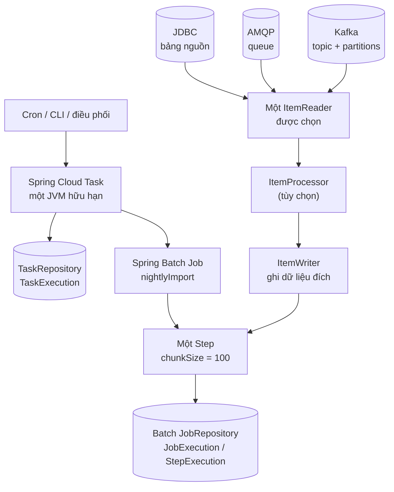
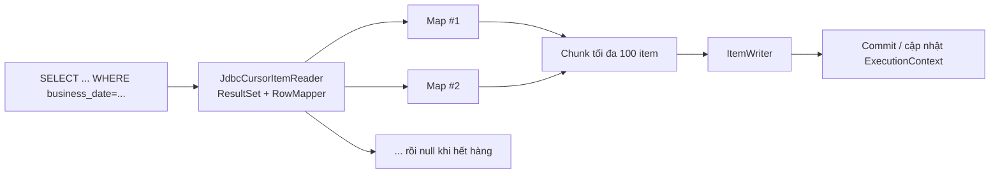
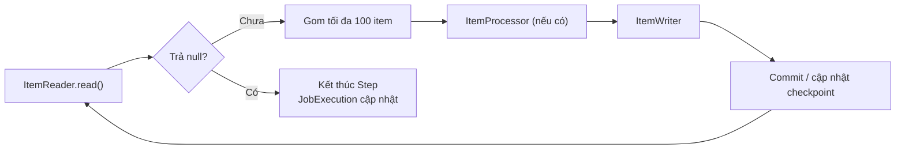

# Đọc dữ liệu bằng JDBC, AMQP hoặc Kafka

## Mục tiêu bài học

Trong chương **Job một bước** của mô-đun **Spring Cloud Task**, chúng ta xây dựng một tác vụ Spring Boot chạy hữu hạn, bên trong có **Spring Batch Job gồm một Step** để nhập dữ liệu từ cơ sở dữ liệu quan hệ, hàng đợi AMQP hoặc Kafka. Trọng tâm là **cấu hình ItemReader** bằng **Single Step Batch Job Starter** của Spring Cloud Task, kiểm tra kết quả và hiểu giới hạn vận hành của từng nguồn.

Học xong, bạn có thể:

- Giải thích vai trò của `ItemReader`, `ItemProcessor`, `ItemWriter`, `Job`, `Step`, `JobExecution` và `TaskExecution` trong một tiến trình hữu hạn.
- Dùng `spring-cloud-starter-single-step-batch-job` để khai báo Job một Step theo properties, phân biệt với việc tự xây Job bằng Java.
- Chọn và cấu hình `JdbcCursorItemReader`, `AmqpItemReader`, `KafkaItemReader` theo đặc điểm nguồn dữ liệu.
- Hiểu ý nghĩa `read() == null`, `chunkSize`, `ExecutionContext` và chính sách restart khác nhau giữa JDBC, AMQP, Kafka.
- Định nghĩa **ranh giới dữ liệu** để Task thật sự kết thúc, hạn chế xử lý lặp, mất thông điệp và trạng thái thành công giả.
- Đối chiếu trạng thái Spring Batch, Spring Cloud Task và mã thoát JVM/container khi vận hành theo lịch hoặc yêu cầu.

## 1. Tình huống: một tác vụ nhập sự kiện có ba nguồn

Hệ thống quản lý giao dịch cần đưa sự kiện thanh toán vào bảng tổng hợp. Tùy đối tác, dữ liệu đầu vào được cung cấp dưới một trong ba hình thức:

1. **JDBC:** các hàng trong bảng `inbound_event` của một cơ sở dữ liệu.
2. **AMQP:** các thông điệp trong RabbitMQ queue `payment-import`.
3. **Kafka:** bản ghi trong topic `payment-events`, có thể trải trên nhiều partition.

Yêu cầu chung: tiến trình được kích hoạt lúc 02:00 hoặc theo yêu cầu, đọc **một phạm vi dữ liệu xác định**, ghi kết quả, cập nhật metadata Batch/Task, trả mã thoát, rồi kết thúc.

Nếu viết một API service hoặc Kafka consumer chạy liên tục, đơn vị giám sát thường là **dịch vụ đang sống**. Với Spring Cloud Task, đơn vị giám sát là **một lần chạy hữu hạn**. Spring Batch giúp chia lần chạy thành các chunk, ghi `JobExecution`/`StepExecution` và có cơ sở để khôi phục khi lỗi.

**Lưu ý kiến trúc:** AMQP queue và Kafka topic thường là nguồn mở, tiếp tục xuất hiện thông điệp mới. Muốn dùng trong Task hữu hạn, cần chính sách kết thúc rõ ràng: đọc đến khi không còn thông điệp trong một khoảng chờ, giới hạn số lượng, đọc đến watermark/offset chụp trước, hoặc xử lý một phạm vi thời gian cụ thể. Những chính sách này **không tương đương nhau** về độ tin cậy.

## 2. Single Step Batch Job Starter làm được gì?

Spring Cloud Task cung cấp starter có tên Maven:

```xml
<dependency>
    <groupId>org.springframework.cloud</groupId>
    <artifactId>spring-cloud-starter-single-step-batch-job</artifactId>
</dependency>
```

Starter này hỗ trợ cấu hình **một Spring Batch Job có một chunk-oriented Step**, thay vì tự viết mọi bean `JobBuilder`, `StepBuilder`, reader và writer. Tài liệu chính thức liệt kê những reader có auto-configuration: `AmqpItemReader`, `FlatFileItemReader`, `JdbcCursorItemReader` và `KafkaItemReader`. Bài này tập trung vào ba loại được giao: **JDBC, AMQP và Kafka**.

Những properties nền tảng:

| Property | Ý nghĩa | Ví dụ |
| --- | --- | --- |
| `spring.batch.job.jobName` | Tên **Job được starter định nghĩa** | `nightlyImport` |
| `spring.batch.job.stepName` | Tên Step duy nhất | `readAndStore` |
| `spring.batch.job.chunkSize` | Số item tối đa trong một chunk trước khi writer/commit | `100` |

Các loại reader/writer do starter tự cấu hình dùng **`Map<String, Object>`** làm item đầu vào và đầu ra. Nếu bạn cung cấp custom `ItemProcessor`, kiểu mong đợi cũng là `ItemProcessor<Map<String, Object>, Map<String, Object>>`. Reader đọc được dữ liệu nhưng **không có writer** thì chưa hình thành đường xử lý dữ liệu hoàn chỉnh.



**Chọn đúng một reader cho một Step trong ví dụ này.** Đừng bật cả ba reader rồi kỳ vọng starter tự quyết định nên đọc nguồn nào. Nếu cần nhiều nguồn đồng thời, các bước nối tiếp, quy trình phức tạp hoặc custom partitioning, nên xây Job/Step bằng Java thay cho auto-configuration một Step.

### 2.1. Phân biệt hai nhóm properties có tên gần giống

| Property | Ai dùng? |
| --- | --- |
| `spring.batch.job.jobName` | **Single Step Batch Job Starter** định nghĩa tên Job |
| `spring.batch.job.stepName` | **Single Step Batch Job Starter** định nghĩa tên Step |
| `spring.batch.job.chunkSize` | **Single Step Batch Job Starter** chọn kích thước chunk |
| `spring.batch.job.name` | **Spring Boot Batch launcher**, dùng để chọn tên Job sẽ chạy khi trong context có nhiều Job |
| `spring.cloud.task.name` | **Spring Cloud Task**, đặt tên TaskExecution |

Trong ví dụ Job chỉ có một bean, Spring Boot thường có thể chạy Job khi ứng dụng khởi động. Khi có nhiều bean Job, cần chỉ định Job muốn chạy theo API và property của đúng phiên bản Spring Boot. Không nhầm việc **định nghĩa Job** với **chọn Job để khởi chạy**.

### 2.2. Chọn phiên bản trước khi sao chép YAML

Phần properties auto-configuration dưới đây đối chiếu với tài liệu **Spring Cloud Task 3.3.x / Single Step Batch Job Starter**, tương ứng hệ sinh thái Spring Boot 3.x, Spring Batch 5.x khi chọn đúng release train. Tài liệu của starter ở một số nhánh vẫn có ví dụ dependency đặt version `2.3.0` từ thời kỳ cũ: **không sao chép con số đó vào dự án mới**. Chọn BOM tương thích, kiểm tra dependency và tài liệu của chính phiên bản đang sử dụng.

Spring Batch 6.x thay đổi một số API/package. Các ví dụ Java `JdbcCursorItemReaderBuilder`, `AmqpItemReaderBuilder` và `KafkaItemReaderBuilder` trong bài dựa trên **API Spring Batch 5.2.x**; khi nâng lên nhánh 6 cần đối chiếu Javadoc và điều chỉnh imports.

## 3. Chuẩn bị dự án Task một bước

Sử dụng Spring Initializr hoặc dự án Maven với Spring Boot parent và Spring Cloud BOM tương thích. Starter Single Step Batch Job là phần chính; thêm driver hoặc các thư viện AMQP/Kafka khi cần:

```xml
<dependencies>
    <!-- Tạo Job một Step và cấu hình reader/writer theo properties -->
    <dependency>
        <groupId>org.springframework.cloud</groupId>
        <artifactId>spring-cloud-starter-single-step-batch-job</artifactId>
    </dependency>

    <!-- Demo JDBC, TaskRepository và Batch JobRepository trên H2 -->
    <dependency>
        <groupId>com.h2database</groupId>
        <artifactId>h2</artifactId>
        <scope>runtime</scope>
    </dependency>

    <!-- Chỉ thêm khi chọn nguồn AMQP -->
    <dependency>
        <groupId>org.springframework.boot</groupId>
        <artifactId>spring-boot-starter-amqp</artifactId>
    </dependency>

    <!-- Chỉ thêm khi chọn nguồn Kafka -->
    <dependency>
        <groupId>org.springframework.kafka</groupId>
        <artifactId>spring-kafka</artifactId>
    </dependency>
</dependencies>
```

Đây là **đoạn dependencies**, không phải `pom.xml` hoàn chỉnh. Trong hệ thống thật nên chia dependencies hoặc profile theo từng adapter cần dùng. Nếu starter phiên bản đã chọn chưa cung cấp đầy đủ thành phần Batch/Task tích hợp mong muốn, kiểm tra dependency tree và bổ sung đúng thư viện như `spring-cloud-task-batch`; tránh thêm chồng chéo nhiều phiên bản của cùng thư viện.

Lớp khởi động Spring Boot:

```java
package com.example.importtask;

import org.springframework.boot.SpringApplication;
import org.springframework.boot.autoconfigure.SpringBootApplication;
import org.springframework.cloud.task.configuration.EnableTask;

@SpringBootApplication
@EnableTask
public class ImportTaskApplication {

    public static void main(String[] args) {
        SpringApplication.run(ImportTaskApplication.class, args);
    }
}
```

**Không tự viết thêm `ApplicationRunner` gọi `JobLauncher` hoặc tự tạo Job/Step trùng tên khi sử dụng cơ chế auto-configure một Job**, vì như vậy có thể chạy cùng công việc hai lần.

### 3.1. Cấu hình chung

```yaml
spring:
  application:
    name: payment-import-task
  main:
    web-application-type: none
  datasource:
    url: jdbc:h2:file:./data/task-and-batch
    driver-class-name: org.h2.Driver
    username: sa
    password: ""
  batch:
    job:
      enabled: true
      jobName: nightlyImport
      stepName: readAndStore
      chunkSize: 100
    jdbc:
      initialize-schema: always
  cloud:
    task:
      initialize-enabled: true
      closecontext-enabled: true
      batch:
        fail-on-job-failure: true
```

Đây là cấu hình **học tại máy cá nhân**. H2 dạng file giữ các bảng metadata qua nhiều lần chạy nếu vẫn dùng cùng đường dẫn; production cần cơ sở dữ liệu bền vững và script migration phù hợp, sau đó tắt cơ chế tự khởi tạo schema. Nếu `Job` được tạo nhưng `DataSource` không hợp lệ hoặc thiếu các bảng `BATCH_`/`TASK_`, Task có thể lỗi trước khi xử lý item nào.

### 3.2. Writer thử nghiệm

Để tập trung vào reader, dùng một writer Spring Bean **chỉ in ID/payload**; đây là **demo**, chưa lưu kết quả nghiệp vụ:

```java
package com.example.importtask;

import java.util.Map;

import org.springframework.batch.item.ItemWriter;
import org.springframework.context.annotation.Bean;
import org.springframework.context.annotation.Configuration;

@Configuration(proxyBeanMethods = false)
public class DemoWriterConfiguration {

    @Bean
    ItemWriter<Map<String, Object>> demoWriter() {
        return chunk -> {
            for (Map<String, Object> item : chunk) {
                System.out.println("Imported: " + item);
            }
        };
    }
}
```

Trong một hệ thống thật, thay writer bằng `JdbcBatchItemWriter` hoặc service chuyên dụng có **unique constraint/idempotent upsert**, giao dịch và kiểm tra kết quả. Log thành công không phải bằng chứng đã commit dữ liệu. **Chỉ đăng ký một ItemWriter tương thích** với item `Map<String, Object>`, hoặc chọn rõ writer trong cấu hình thay vì để nhiều bean cùng cạnh tranh.

## 4. JDBC: đọc các hàng từ cơ sở dữ liệu

### 4.1. Reader hoạt động thế nào?

`JdbcCursorItemReader` mở một JDBC `ResultSet` và trả về từng hàng thông qua `read()`. Khi hết các hàng trong truy vấn, `read()` trả về `null`, Step kết thúc sau khi writer xử lý chunk cuối. Đây là trường hợp **hữu hạn tự nhiên** nếu truy vấn chỉ chọn một tập dữ liệu đã được xác định.



Ưu điểm của cursor: có thể đọc từng hàng mà không nhất thiết tải cả bảng vào `List`. Chi phí cần cân nhắc: giữ cursor/kết nối mở trong quá trình xử lý, mức cô lập giao dịch, bộ nhớ do driver dùng và tính ổn định của tập dữ liệu khi restart.

### 4.2. Chuẩn bị dữ liệu minh họa

Ví dụ schema H2 (có thể đưa vào `schema.sql` của dự án thực hành hoặc tạo trước khi chạy Job):

```sql
CREATE TABLE IF NOT EXISTS inbound_event (
    id BIGINT PRIMARY KEY,
    business_date DATE NOT NULL,
    payload VARCHAR(500) NOT NULL
);

MERGE INTO inbound_event (id, business_date, payload)
KEY (id)
VALUES (1, DATE '2026-11-23', '{"eventId":"p-1","amount":120000}');

MERGE INTO inbound_event (id, business_date, payload)
KEY (id)
VALUES (2, DATE '2026-11-23', '{"eventId":"p-2","amount":85000}');
```

`MERGE ... KEY` là **cú pháp H2 cho ví dụ**; khi dùng PostgreSQL/MySQL phải dùng DDL/upsert phù hợp hệ quản trị. Dữ liệu nguồn, `JobRepository` và `TaskRepository` có thể đặt ở các schema/database khác nhau; khi đó hãy cấu hình rõ datasource của reader.

### 4.3. Auto-configure `JdbcCursorItemReader` bằng YAML

Ghép phần sau vào `spring.batch.job` của cấu hình chung và dùng writer demo bên trên:

```yaml
spring:
  batch:
    job:
      jdbccursoritemreader:
        name: paymentJdbcReader
        sql: SELECT id, payload FROM inbound_event WHERE business_date = DATE '2026-11-23' ORDER BY id
        fetchSize: 100
        saveState: true
```

Các property của starter cho reader JDBC còn gồm `maxItemcount`, `currentItemCount`, `maxRows`, `queryTimeout`, `ignoreWarnings`, `verifyCursorPosition` và `driverSupportsAbsolute`. **Các tên property này thuộc Single Step Batch Job Starter**, không phải property chung cho mọi Spring Batch Job tự xây.

Trong ví dụ:

- `name` là khóa nhận diện state của reader trong `ExecutionContext`, hữu ích khi restart.
- `sql` xác định tập hàng; `ORDER BY id` cho thứ tự ổn định nếu nguồn không thay đổi.
- `fetchSize` chỉ là **hint cho JDBC driver**, không phải số item commit.
- `chunkSize=100` (cấu hình chung) là số item Step gom để writer xử lý trước một commit.
- `saveState=true` cho phép Batch lưu vị trí reader vào `ExecutionContext` khi commit.

SQL minh họa cố định một ngày để cấu hình đơn giản. Khi nhận `businessDate` từ yêu cầu thực, **không nối trực tiếp chuỗi đầu vào vào SQL**. Dùng `PreparedStatementSetter`, parameter binding và giới hạn tập dữ liệu theo JobParameters đã xác thực.

Ví dụ khai báo `RowMapper<Map<String, Object>>` nếu cần chủ động kiểm soát tên cột:

```java
@Bean
org.springframework.jdbc.core.RowMapper<Map<String, Object>> eventRowMapper() {
    return (rs, rowNum) -> Map.of(
        "id", rs.getLong("id"),
        "payload", rs.getString("payload")
    );
}
```

Đây là **phương thức bổ sung** trong một `@Configuration` có import `java.util.Map`; không phải lớp Java độc lập. Bảo đảm mapping trả đúng `Map<String, Object>` mà writer của starter chấp nhận.

### 4.4. Khi cần code Java thay cho properties

Với SQL phụ thuộc `JobParameter businessDate`, có thể khai báo reader trực tiếp bằng Java (API Spring Batch **5.2.x**):

```java
@Bean
@StepScope
JdbcCursorItemReader<Map<String, Object>> jdbcReader(
        DataSource dataSource,
        @Value("#{jobParameters['businessDate']}") String businessDate) {

    LocalDate parsedDate = LocalDate.parse(businessDate);

    return new JdbcCursorItemReaderBuilder<Map<String, Object>>()
            .name("paymentJdbcReader")
            .dataSource(dataSource)
            .sql("SELECT id, payload FROM inbound_event "
               + "WHERE business_date = ? ORDER BY id")
            .preparedStatementSetter(ps -> ps.setDate(
                    1, java.sql.Date.valueOf(parsedDate)))
            .rowMapper((rs, rowNum) -> Map.of(
                    "id", rs.getLong("id"),
                    "payload", rs.getString("payload")))
            .fetchSize(100)
            .saveState(true)
            .build();
}
```

Imports cần có:

```java
import java.time.LocalDate;
import java.util.Map;
import javax.sql.DataSource;
import org.springframework.batch.core.configuration.annotation.StepScope;
import org.springframework.batch.item.database.JdbcCursorItemReader;
import org.springframework.batch.item.database.builder.JdbcCursorItemReaderBuilder;
import org.springframework.beans.factory.annotation.Value;
import org.springframework.context.annotation.Bean;
```

**Phân biệt hai đường cấu hình:** đây là **bean reader tự định nghĩa**, có thể dùng trong Job/Step tự cấu hình hoặc thay reader được auto-configure khi starter và version cho phép. Khi chuyển sang đường tự khai báo, bỏ các property tạo reader trùng loại/bean cạnh tranh, bảo đảm đúng một reader được chọn.

### 4.5. Khi nào chọn `JdbcPagingItemReader`?

Nếu truy vấn lớn và muốn lấy dữ liệu qua nhiều truy vấn `LIMIT/OFFSET` hoặc keyset pagination thay vì giữ cursor lâu, cân nhắc `JdbcPagingItemReader` của Spring Batch. Nó cần `PagingQueryProvider` và **sort key duy nhất** (thường là khóa chính). Giá trị sort key được lưu giúp xác định trang tiếp theo khi restart.

| Tiêu chí | `JdbcCursorItemReader` | `JdbcPagingItemReader` |
| --- | --- | --- |
| Cách đọc | Một cursor/ResultSet | Nhiều truy vấn theo page |
| Kết nối | Có thể giữ cursor/kết nối mở lâu | Mỗi trang được truy vấn riêng |
| Restart | Vị trí đếm trong cursor và `ExecutionContext` | Thường dựa vào khóa sắp xếp đã lưu |
| Điều kiện quan trọng | Tập dữ liệu và thứ tự ổn định | **Sort key duy nhất**, truy vấn ổn định |
| Auto-configure bởi Single Step starter ở bài này | **Có** | **Không được liệt kê**; tự cấu hình Java |

**Không coi JDBC paging là tự động tránh trùng khi dữ liệu nguồn thay đổi.** Nếu các hàng được thêm, xóa hoặc đổi trong lúc chạy, phải thống nhất snapshot, watermark, khóa nghiệp vụ và độ cô lập giao dịch phù hợp.

## 5. AMQP: đọc thông điệp từ RabbitMQ queue

### 5.1. Đặc điểm nguồn

`AmqpItemReader` sử dụng `AmqpTemplate` để gọi receive/receive-and-convert và trả từng message đã chuyển đổi thành item. Khi không nhận được message trong thời gian chờ, `read()` có thể trả `null`, khiến Batch xem là **hết input của lần chạy**.

Điều này khác JDBC: **queue rỗng tại thời điểm T không có nghĩa queue sẽ không nhận thêm message ở T+1**. Nếu mục tiêu là “đọc hết các message hiện có trong một đợt”, phải định nghĩa rõ cửa sổ nhận dữ liệu và chấp nhận rằng thông điệp đến sau sẽ được xử lý bởi đợt kế tiếp.

### 5.2. Cấu hình auto-configuration

Ngoài dependency AMQP và cấu hình kết nối RabbitMQ của Spring Boot, bật reader trong `spring.batch.job`:

```yaml
spring:
  rabbitmq:
    host: localhost
    port: 5672
    username: guest
    password: guest
  batch:
    job:
      amqpitemreader:
        enabled: true
        jsonConverterEnabled: true
```

Tài liệu Single Step Batch Job Starter liệt kê hai thuộc tính:

| Property | Mặc định | Tác dụng |
| --- | --- | --- |
| `spring.batch.job.amqpitemreader.enabled` | `false` | Bật việc tự cấu hình `AmqpItemReader` |
| `spring.batch.job.amqpitemreader.jsonConverterEnabled` | `true` | Yêu cầu converter JSON được starter đăng ký khi phù hợp |

**Chưa đủ nếu không có queue.** Reader nhận dữ liệu qua `AmqpTemplate`, vì vậy phải bảo đảm template chọn **đúng queue** (AMQP exchange/routing key định tuyến message tới queue, còn thao tác receive đọc từ queue). Ví dụ tạo một `RabbitTemplate` dành cho batch:

```java
@Bean
RabbitTemplate batchRabbitTemplate(ConnectionFactory connectionFactory) {
    RabbitTemplate template = new RabbitTemplate(connectionFactory);
    template.setDefaultReceiveQueue("payment-import");
    template.setReceiveTimeout(2000);
    return template;
}
```

Imports cho phương thức cấu hình:

```java
import org.springframework.amqp.rabbit.connection.ConnectionFactory;
import org.springframework.amqp.rabbit.core.RabbitTemplate;
import org.springframework.context.annotation.Bean;
```

Các tham số timeout và queue cần phù hợp phiên bản Spring AMQP/RabbitMQ. `setReceiveTimeout(2000)` là khoảng chờ **tính bằng millisecond** trong API RabbitTemplate; queue phải có sẵn và producer gửi đúng dữ liệu. Để sử dụng JSON dạng `Map<String, Object>`, kiểm tra message converter, kiểu payload/header và chính sách trusted types. Không mặc định mọi JSON string sẽ được chuyển đúng kiểu chỉ vì bật `jsonConverterEnabled`.

### 5.3. Dùng Java nếu muốn kiểm soát reader

Trong Spring Batch 5.x, builder cơ bản có dạng:

```java
@Bean
AmqpItemReader<Map<String, Object>> amqpReader(
        AmqpTemplate amqpTemplate) {
    return new AmqpItemReaderBuilder<Map<String, Object>>()
            .amqpTemplate(amqpTemplate)
            .build();
}
```

Imports:

```java
import java.util.Map;
import org.springframework.amqp.core.AmqpTemplate;
import org.springframework.batch.item.amqp.AmqpItemReader;
import org.springframework.batch.item.amqp.builder.AmqpItemReaderBuilder;
import org.springframework.context.annotation.Bean;
```

Ví dụ này chỉ **khởi tạo bean reader**, chưa phải Job hoàn chỉnh. Nếu tự tạo reader, bỏ auto-configuration reader tương ứng hoặc chỉ định bean rõ ràng để tránh trùng. Cần `AmqpTemplate` có converter trả `Map<String,Object>`.

### 5.4. ACK, transaction và chạy lại

Một câu hỏi quan trọng: **message đã bị lấy khỏi queue nhưng writer chưa commit thì sao?**

`AmqpItemReader` là adapter dựa trên `AmqpTemplate`. Chính sách nhận/ACK phụ thuộc RabbitTemplate, channel transaction, broker và cách tích hợp với giao dịch Step. Không thể kết luận rằng `chunkSize=100` tự động gắn ACK AMQP và commit của database đầu ra thành một giao dịch nguyên tử.

Tình huống cần xét:

1. Reader nhận message có `eventId=p-1`.
2. Writer gọi database để ghi kết quả nhưng gặp lỗi.
3. Nếu message đã ACK, lần chạy sau có thể không nhận lại `p-1`; nếu broker redeliver, message có thể được xử lý hai lần.
4. Kết quả đúng phải dựa vào **cấu hình giao dịch nhận message** và **idempotency của writer**, ví dụ unique constraint theo `eventId`.

`AmqpItemReader` không phải một `ItemStreamReader` lưu offset/checkpoint kiểu Kafka. Với nguồn queue, muốn restart đáng tin cậy cần chính sách ACK, retry/dead-letter queue và dấu vết đã xử lý riêng, không chỉ bật `saveState` của một JDBC reader.

**Nguyên tắc kết thúc:** `receiveTimeout` là “không nhận message trong khoảng chờ”, không phải bằng chứng mọi message của ngày đã đến. Nếu phải đối chiếu một đợt dữ liệu hoàn chỉnh, dùng marker kết thúc đợt, manifest số lượng, hàng đợi riêng cho từng đợt hoặc metadata nguồn có thể xác minh.

## 6. Kafka: đọc các partition và quản lý offset

### 6.1. Khác gì so với queue?

Kafka topic thường **giữ lại bản ghi** theo retention, consumer đọc theo **offset** của từng partition. Việc đã đọc một record không có nghĩa Kafka xóa record đó. `KafkaItemReader` hỗ trợ đọc một hoặc nhiều partition **được gán rõ ràng** cho reader, và lưu offset vào Spring Batch `ExecutionContext` để restart.

| Khía cạnh | AMQP queue | Kafka topic |
| --- | --- | --- |
| Đơn vị đọc | Message từ queue | Record theo partition/offset |
| Cách theo dõi tiến độ | ACK/redelivery và kho đánh dấu nghiệp vụ | Offset cho từng partition, có thể lưu vào `ExecutionContext` |
| Dữ liệu sau khi đọc | Thường được ACK/xóa khỏi queue theo broker | Thường còn đến khi hết retention |
| Điều kiện hết dữ liệu hiện tại | Queue tạm rỗng/receive timeout | Poll không có record mới trong timeout |
| Rủi ro khi restart | Mất hoặc lặp message do ACK/transaction | Đọc lặp hoặc bỏ sót do chọn sai offset/checkpoint |

`KafkaItemReader` **không phải Kafka listener container chạy mãi**. Để dùng cho tác vụ hữu hạn, bạn phải xác định partition và **điểm kết thúc** của đợt đọc.

### 6.2. Cấu hình Single Step Batch Job Starter

Ví dụ Kafka producer gửi JSON object tương thích `Map<String, Object>`. Cấu hình reader:

```yaml
spring:
  kafka:
    bootstrap-servers: localhost:9092
    consumer:
      group-id: payment-import-batch
      key-deserializer: org.apache.kafka.common.serialization.StringDeserializer
      value-deserializer: org.springframework.kafka.support.serializer.JsonDeserializer
      enable-auto-commit: false
      properties:
        spring.json.value.default.type: java.util.HashMap
        spring.json.trusted.packages: java.util
  batch:
    job:
      kafkaitemreader:
        name: paymentKafkaReader
        topic: payment-events
        partitions: [0, 1]
        pollTimeOutInSeconds: 5
        saveState: true
```

Tài liệu starter mô tả:

| Property | Tác dụng |
| --- | --- |
| `spring.batch.job.kafkaitemreader.name` | Khóa state riêng của reader trong `ExecutionContext` |
| `spring.batch.job.kafkaitemreader.topic` | Topic cần đọc |
| `spring.batch.job.kafkaitemreader.partitions` | Danh sách **partition được gán thủ công** |
| `spring.batch.job.kafkaitemreader.pollTimeOutInSeconds` | Thời gian chờ poll, **tính bằng giây** trong property của starter |
| `spring.batch.job.kafkaitemreader.saveState` | Lưu offset vào `ExecutionContext` cho restart, mặc định `true` |

`JsonDeserializer` là lựa chọn minh họa để trả Map; trong thực tế cần cấu hình đúng schema serialization, type headers, trusted classes và cơ chế xử lý bản ghi không hợp lệ. Không mở `trusted.packages=*` bừa bãi. `enable-auto-commit: false` tránh phụ thuộc vào commit offset tự động của consumer group; dù vậy, **checkpoint Batch vẫn không tự tạo giao dịch chung với database đích**.

**`partitions: [0, 1]` chỉ đúng nếu topic thực sự có các partition này.** Reader được gán partition rõ ràng thay vì dựa hoàn toàn vào cơ chế phân chia của một Kafka listener container. Không chạy hai reader cùng xử lý một partition/offset mà không có thiết kế idempotency và điều phối.

### 6.3. Cấu hình reader bằng Java

Nếu không dùng property auto-configure, ví dụ cho API Spring Batch 5.2.x:

```java
@Bean
@StepScope
KafkaItemReader<String, String> kafkaReader() {
    Properties props = new Properties();
    props.put(ConsumerConfig.BOOTSTRAP_SERVERS_CONFIG, "localhost:9092");
    props.put(ConsumerConfig.GROUP_ID_CONFIG, "payment-batch-demo");
    props.put(ConsumerConfig.KEY_DESERIALIZER_CLASS_CONFIG,
            StringDeserializer.class);
    props.put(ConsumerConfig.VALUE_DESERIALIZER_CLASS_CONFIG,
            StringDeserializer.class);
    props.put(ConsumerConfig.ENABLE_AUTO_COMMIT_CONFIG, false);

    return new KafkaItemReaderBuilder<String, String>()
            .name("paymentKafkaReader")
            .consumerProperties(props)
            .topic("payment-events")
            .partitions(0, 1)
            .pollTimeout(Duration.ofSeconds(5))
            .saveState(true)
            .build();
}
```

Imports:

```java
import java.time.Duration;
import java.util.Properties;
import org.apache.kafka.clients.consumer.ConsumerConfig;
import org.apache.kafka.common.serialization.StringDeserializer;
import org.springframework.batch.core.configuration.annotation.StepScope;
import org.springframework.batch.item.kafka.KafkaItemReader;
import org.springframework.batch.item.kafka.builder.KafkaItemReaderBuilder;
import org.springframework.context.annotation.Bean;
```

Ở ví dụ Java, reader trả **`String`**, không phải `Map<String,Object>`. Vì vậy nó **không thể gắn thẳng vào Step/Writer dạng `Map`** của auto-configured Single Step Job. Muốn dùng nó, hãy **tự xây Step có `ItemReader<String>` và `ItemWriter<String>`**, hoặc thêm adapter chuyển đổi kiểu có chủ đích. Ví dụ này chỉ minh họa cách cấu hình Kafka ở cấp API; **không chạy song song** với reader Kafka mà starter tự tạo bằng properties.

### 6.4. Offset khởi đầu, checkpoint và restart

Theo Javadoc `KafkaItemReader` 5.2.x:

- Reader cần `bootstrap.servers`, `group.id`, key/value deserializer và danh sách partition.
- `partitionOffsets` có thể chỉ định offset bắt đầu cho mỗi `TopicPartition`.
- Khi không chỉ định, tài liệu API mô tả mặc định offset bắt đầu là `0` cho partition được gán; truyền **Map rỗng** để dùng offset lưu ở Kafka cho consumer group.
- Khi **restart cùng Spring Batch JobInstance**, offset lưu trong `ExecutionContext` **được ưu tiên** so với offset cấu hình bên ngoài.
- `saveState=true` bật checkpoint; `saveState=false` loại bỏ khả năng restart dựa vào state của reader. Kafka consumer **không thread-safe**, không chia sẻ một reader giữa nhiều thread xử lý.

Điều rất dễ nhầm là **committed offset của Kafka consumer group** và **offset trong Batch ExecutionContext** là hai nguồn trạng thái khác nhau. Không nên trộn chúng tùy tiện và suy ra rằng `enable-auto-commit=true` sẽ mang lại exactly-once.

### 6.5. Tác vụ hữu hạn cần điểm kết thúc rõ ràng

`pollTimeOutInSeconds: 5` **không có nghĩa “đọc hết mọi message của ngày”**; nó chỉ giới hạn thời gian chờ một lần poll. Nếu producer gửi đều đặn, Step có thể tiếp tục đọc nhiều giờ. Nếu producer tạm ngừng quá thời gian chờ, reader có thể xem như không còn dữ liệu và Job kết thúc khi đợt dữ liệu thực sự chưa hoàn chỉnh.

Với yêu cầu **nhập các event đã tồn tại tại thời điểm 02:00**, thiết kế chắc chắn hơn là:

1. Xác định topic, các partition, **starting offset** và **ending offset độc quyền** (offset kế tiếp sau bản ghi cuối cần lấy) tại thời điểm chụp.
2. Lưu danh sách `(topic, partition, startOffset, endOffset)` vào metadata nghiệp vụ của đợt import, kèm `businessDate`.
3. Sử dụng **reader có khả năng dừng theo ending offset**, tự viết/bao quanh `KafkaConsumer` hoặc chọn một công cụ batch phù hợp. `KafkaItemReader` mặc định nêu trên **không có property endOffsets** trong builder 5.2.x.
4. Ghi dữ liệu đích theo khóa duy nhất `(topic, partition, offset)` hoặc business event ID, cập nhật checkpoint khi commit và kiểm tra đã đạt watermark của **mọi partition** trước khi coi Job thành công.
5. Khi retry, dùng lại phạm vi offset và identifying JobParameters để restart, tránh thay đổi đợt dữ liệu trong lúc chạy.

Đây là sự khác biệt giữa **“đọc đến lúc tạm hết message”** và **“đọc chính xác snapshot đã xác định”**. Bài thực hành property-only dùng cách thứ nhất; hệ thống thanh toán/audit thường cần cách thứ hai.

## 7. So sánh và chọn reader

| Tiêu chí | JDBC | AMQP | Kafka |
| --- | --- | --- | --- |
| Reader chính | `JdbcCursorItemReader` | `AmqpItemReader` | `KafkaItemReader` |
| Nguồn dữ liệu | Bảng SQL | RabbitMQ queue | Topic/partition |
| Kết thúc đợt đọc dễ xác định? | **Có**, với truy vấn/snapshot ổn định | **Không mặc định**, queue có thể nhận thêm message | **Không mặc định**, topic có thể nhận liên tục |
| Trạng thái restart | Vị trí đọc trong `ExecutionContext` | Chủ yếu dựa cơ chế ACK/redelivery và idempotency | Offset theo partition trong `ExecutionContext` |
| Vấn đề chính | Cursor/driver, dữ liệu nguồn thay đổi | ACK, transaction, dead-letter và message đến muộn | Offset, partition, retention, end watermark |
| Auto-configure qua Single Step starter | Có | Có khi `enabled=true` | Có |
| Kiểu item trong starter | `Map<String,Object>` | `Map<String,Object>` | `Map<String,Object>` |
| Khi nên chọn | Dữ liệu theo ngày trong RDBMS | Hàng đợi công việc/đợt thông điệp | Sự kiện bất biến, phạm vi offset xác định |

Không có reader nào tự bảo đảm “xử lý chính xác một lần” chỉ vì Step có transaction. Các hệ thống bên ngoài và dữ liệu đã ghi cần chính sách lặp lại an toàn.

## 8. `chunkSize`, transaction và trạng thái Job

Một Step có `chunkSize=100` thường làm như sau:



Sơ đồ giản lược; Spring Batch thực hiện các callback, retry/skip và giao dịch theo cấu hình thật. **`chunkSize` không đồng nghĩa `fetchSize` của JDBC, `receiveTimeout` của AMQP hay `pollTimeout` của Kafka**.

| Thuộc tính | Đơn vị | Tác dụng |
| --- | --- | --- |
| `spring.batch.job.chunkSize` | Số item | Khoảng commit của Step |
| `jdbccursoritemreader.fetchSize` | Số hàng gợi ý | Driver JDBC tối ưu việc lấy rows |
| `RabbitTemplate.receiveTimeout` | Millisecond | Chờ message khi queue tạm rỗng |
| `kafkaitemreader.pollTimeOutInSeconds` | Giây | Chờ một lần poll Kafka |
| `spring.batch.job.kafkaitemreader.saveState` | Boolean | Lưu offset reader trong context |

### 8.1. Một ví dụ lỗi giữa chunk

Giả sử một Step:

1. Đã commit 300 bản ghi.
2. Đọc tiếp 50 bản ghi vào chunk mới.
3. Writer gặp lỗi mạng trước commit chunk đó.

Với writer JDBC cùng transaction phù hợp, chunk chưa commit có thể rollback, còn Batch restart từ checkpoint đã lưu. Với AMQP/Kafka, việc nhận/ACK/offset có thể nằm ở hệ thống khác; transaction DB **không tự rollback** ACK hoặc offset đã được gửi đi. Vì vậy retry có thể thấy **ít hơn hoặc nhiều hơn** 50 bản ghi nếu cấu hình không nhất quán.

Đối với dữ liệu đích có rủi ro ghi trùng, ưu tiên:

- **Unique key** như `eventId` hoặc `(topic, partition, offset)`.
- **Upsert/idempotent writer** thay vì insert không kiểm soát.
- **Ghi nhận phạm vi xử lý** `businessDate`, thời điểm snapshot hoặc offset watermark.
- **Giới hạn retry** và phân biệt lỗi dữ liệu (không retry nguyên input) với lỗi tạm thời (có thể retry).
- **Kiểm tra kết quả** bằng số lượng, checksum hoặc tổng tiền, thay vì chỉ đọc `BatchStatus.COMPLETED`.

### 8.2. Metadata của Batch và Cloud Task

Khi tích hợp đầy đủ:

| Thành phần | Chứa gì? |
| --- | --- |
| `TaskExecution` / `TASK_EXECUTION` | Một lần chạy JVM, thời điểm bắt đầu/kết thúc, exit code |
| `JobExecution` / `BATCH_JOB_EXECUTION` | Một lần thử Batch Job, `BatchStatus` và `ExitStatus` |
| `StepExecution` / `BATCH_STEP_EXECUTION` | Số bản ghi đọc/ghi/bỏ qua, commit/rollback, trạng thái Step |
| `ExecutionContext` | State/offset/vị trí reader để restart khi được cấu hình và lưu bền vững |
| `TASK_TASK_BATCH` | Liên kết `TaskExecution` với `JobExecution` nếu tích hợp `TaskBatchExecutionListener` hoạt động |

**Một lần retry của scheduler có thể tạo TaskExecution mới**. Nếu dùng lại tên Job và identifying JobParameters trong kho Batch bền vững, Batch có thể tạo **JobExecution mới cho cùng JobInstance**. Nếu vô tình thêm `run.id` identifying mới, bạn có thể tạo JobInstance mới và mất ý nghĩa restart.

Khi Batch Job thất bại, kiểm tra `spring.cloud.task.batch.fail-on-job-failure=true` và đo thực tế exit code JVM/container; mặc định không thể suy ra một Job `FAILED` luôn dẫn đến Task exit code khác `0` trong mọi cấu hình.

## 9. Chạy theo lịch/yêu cầu và kiểm chứng kết quả

### 9.1. Chạy local

Sau khi cấu hình **một reader duy nhất** và writer đúng kiểu, build:

```bash
./mvnw package
java -jar target/payment-import-task-0.0.1-SNAPSHOT.jar businessDate=2026-11-23
```

Tên JAR minh họa; thay bằng artifact thực tế. Với Spring Boot Batch launcher chuẩn, một số đối số **JobParameters** ở dạng `businessDate=2026-11-23` (không có `--`); còn `--spring.batch.job.name=...` là property để chọn Job. Nếu starter đang dùng reader JDBC có SQL ngày cố định, đối số `businessDate` chỉ phục vụ định danh Job ở bài demo, **không tự thay ngày SQL**.

Các ca kiểm chứng quan trọng:

1. JDBC có đúng 2 hàng trong phạm vi → writer demo in đúng 2 item, Step `COMPLETED`.
2. JDBC có 0 hàng → Job hoàn tất theo chính sách cho phép đầu vào rỗng; nếu nghiệp vụ không cho phép, phải tự thêm validation.
3. AMQP queue có 2 message JSON hợp lệ → converter trả Map phù hợp, writer nhận đủ; sau khi queue rỗng và timeout, Step có thể kết thúc.
4. Kafka có dữ liệu tại partition `0` và `1` → reader nhận dữ liệu, ghi checkpoint; thời điểm hoàn thành phụ thuộc producer và chính sách kết thúc.
5. Reader/converter lỗi → kiểm tra `JobExecution.status`, `StepExecution`, mã thoát Task và log; không chỉ tìm chuỗi “Completed”.

### 9.2. Tra cứu bằng SQL

Với schema mặc định, có thể đọc số liệu Step:

```sql
SELECT
    e.JOB_EXEC_ID,
    e.STATUS AS JOB_STATUS,
    e.EXIT_CODE AS JOB_EXIT_CODE,
    s.STEP_NAME,
    s.STATUS AS STEP_STATUS,
    s.READ_COUNT,
    s.WRITE_COUNT,
    s.COMMIT_COUNT,
    s.ROLLBACK_COUNT
FROM BATCH_JOB_EXECUTION e
JOIN BATCH_STEP_EXECUTION s
    ON s.JOB_EXEC_ID = e.JOB_EXEC_ID
ORDER BY e.JOB_EXEC_ID DESC, s.STEP_EXEC_ID DESC;
```

Để xem trạng thái tiến trình:

```sql
SELECT
    TASK_EXECUTION_ID,
    TASK_NAME,
    START_TIME,
    END_TIME,
    EXIT_CODE,
    ERROR_MESSAGE
FROM TASK_EXECUTION
ORDER BY TASK_EXECUTION_ID DESC;
```

Hai kết quả có **ID thuộc hai hệ metadata khác nhau**. Muốn liên kết qua `TASK_TASK_BATCH`, cần tích hợp `spring-cloud-task-batch` và `TaskBatchExecutionListener` phù hợp. Với Kafka/AMQP, **không coi `READ_COUNT` là bằng chứng tất cả message của đợt đã đến**; so sánh với manifest, số message nguồn, snapshot offset và watermark nghiệp vụ.

### 9.3. Khi chạy trong container

Trong Docker hoặc Kubernetes Job, tiến trình phải thoát khi Step/Job hoàn tất. Dùng Dockerfile exec-form `ENTRYPOINT ["java", "-jar", "/app/app.jar"]` và cấu hình kết thúc context của Task nếu phù hợp. Theo dõi **mã thoát của JVM/container**, trạng thái Job của Kubernetes và metadata Task/Batch.

Nếu RabbitMQ/Kafka/DB chưa sẵn sàng, cần xử lý lỗi khởi động và timeout. Một đợt thất bại không được trả `0` chỉ vì writer demo in log hoặc vì ứng dụng đã bắt exception rồi nuốt lỗi.

## 10. Troubleshooting

| Triệu chứng | Nguyên nhân khả dĩ | Cách kiểm tra |
| --- | --- | --- |
| Starter không tạo Job | Thiếu `jobName`/`stepName`/`chunkSize`, reader hoặc writer; dependency không đúng | Xem condition report, danh sách bean Job/Step |
| Có nhiều bean `ItemReader` hoặc `ItemWriter` | Bật hai nguồn hoặc đồng thời tự tạo và auto-configure | Chọn đúng một cấu hình cho Step, loại bean dư |
| JDBC báo thiếu bảng | Datasource sai, bảng nghiệp vụ/schema Batch chưa tồn tại | Xác minh `spring.datasource.*`, migration và câu SQL |
| JDBC chạy lại đọc sai tập hàng | Nguồn dữ liệu đổi hoặc query không ổn định | Snapshot dữ liệu, ORDER BY khóa duy nhất, checkpoint |
| JDBC cursor gây quá tải/giữ connection | Query lớn, thiếu index, transaction dài | Tối ưu SQL/index/fetchSize hoặc cân nhắc paging |
| AMQP reader trả `null` quá sớm | Queue tạm rỗng, receive timeout ngắn | Kiểm tra queue/template, window đợt và timeout |
| AMQP không convert được payload | JSON converter/type headers/trusted types sai | Kiểm tra message thực và kiểu Map mong đợi |
| AMQP có mất/lặp thông điệp | ACK/transaction/DB commit không đồng bộ | Idempotent writer, cấu hình transaction, DLQ và audit |
| Kafka không thấy bản ghi | Sai topic/partition, serializer, offset hoặc auth | Xem partition và offset nguồn, consumer config |
| Kafka đọc lại backlog từ đầu | Default/starting offset không như dự định | Kiểm tra `partitionOffsets` và `ExecutionContext` |
| Kafka Job chạy quá lâu | Producer liên tục gửi bản ghi, không có end watermark | Chụp end offsets và dùng reader có điều kiện dừng |
| Kafka Step dừng khi còn dữ liệu sắp tới | Poll timeout bị hiểu là hết dữ liệu toàn đợt | Dùng manifest/watermark thay vì chỉ chờ queue yên |
| Job `FAILED` nhưng Task exit `0` | Chưa ánh xạ trạng thái Batch sang Task | Kiểm tra `fail-on-job-failure` và exit code thực tế |
| Restart không dùng checkpoint cũ | Đổi identifying JobParameters hoặc mất Batch JobRepository | Giữ identity, dùng kho bền vững, `saveState=true` |
| Metadata chứa secret | Đưa password/token vào JobParameters hay CLI | Sử dụng secrets, hạn chế quyền và log |

## 11. Checklist thiết kế trước khi triển khai

1. **Phạm vi hữu hạn:** xác định SQL snapshot, AMQP batch window hoặc Kafka start/end offset; biết điều kiện nào làm Step kết thúc.
2. **Chọn reader đúng nguồn:** JDBC cho bảng quan hệ, AMQP cho queue có chính sách ACK, Kafka cho các partition có checkpoint.
3. **Đúng loại dữ liệu:** starter xử lý `Map<String,Object>`; reader, processor, writer và converter phải tương thích.
4. **Giao dịch và idempotency:** thiết kế rollback/retry, unique key, DLQ, offset và behavior khi writer lỗi giữa chunk.
5. **Restart có kiểm soát:** xác định identifying JobParameters, `saveState`, `ExecutionContext` và kho Batch bền vững.
6. **Vận hành Task:** đảm bảo không duy trì thread/consumer vô hạn, cấu hình timeout, readiness phụ thuộc và cơ chế đóng context.
7. **Quan sát đa tầng:** đối chiếu `TaskExecution`, `JobExecution`, `StepExecution`, mã thoát tiến trình/container và số liệu nghiệp vụ.
8. **Bảo mật:** không lưu secret trong arguments/JobParameters; giới hạn quyền truy cập DB, broker, topic, log và metadata.

## 12. Câu hỏi tự kiểm tra

**1. Dùng `JdbcCursorItemReader` với `chunkSize=100` và `fetchSize=1000` có nghĩa mỗi lần commit 1.000 item không?**

> Không. `chunkSize=100` quyết định quy mô chunk/commit của Step; `fetchSize` là hint để JDBC driver tải rows.

**2. Queue RabbitMQ đã rỗng lúc 02:03, reader trả `null`. Có thể khẳng định toàn bộ giao dịch ngày đã được nhập không?**

> Chưa. Queue có thể nhận thêm message sau đó. Cần chính sách kết thúc đợt, marker/manifest hoặc giới hạn thời gian được chấp nhận bởi nghiệp vụ.

**3. `KafkaItemReader` có `saveState=true` thì đã bảo đảm exactly-once với database đích chưa?**

> Chưa. Reader lưu offset vào Batch ExecutionContext để restart, nhưng Kafka offset và transaction database đích không mặc định là một giao dịch nguyên tử. Cần writer idempotent và kiểm chứng checkpoint.

**4. Vì sao một ví dụ `KafkaItemReader<String,String>` không ghép thẳng vào Single Step Batch Job Starter mặc định?**

> Vì starter xây đường xử lý bằng `Map<String,Object>`. Muốn đọc `String` phải tạo Step/Writer cùng kiểu hoặc chuyển đổi có chủ đích.

**5. Làm sao xử lý một Kafka topic liên tục mà vẫn có Task hữu hạn theo ngày?**

> Chụp phạm vi `startOffset/endOffset` từng partition, lưu metadata đợt và dùng reader hỗ trợ dừng tại ending offset. Chỉ tăng `pollTimeout` không tạo ra ranh giới ngày.

**6. Vì sao khi retry cùng ngày cần giữ identifying JobParameters?**

> Spring Batch dùng tên Job và các tham số identifying để xác định JobInstance. Đổi identity có thể tạo instance mới thay vì restart Job đã thất bại.

**7. Khi chọn adapter JDBC, AMQP, Kafka cùng lúc, starter tự ghép ba nguồn thành một Step không?**

> Không. Bài học sử dụng một reader được chọn cho một Step. Muốn hợp nhất nhiều nguồn cần thiết kế Job nhiều Step, composite/adapters có kiểu dữ liệu phù hợp hoặc kiến trúc dữ liệu riêng.

## Ghi nhớ

- **Single Step Batch Job Starter** cấu hình một chunk-based Job/Step; các reader tự cấu hình cho JDBC, AMQP và Kafka cùng sử dụng `Map<String,Object>`.
- **JDBC** có thể kết thúc theo tập hàng đã chọn; cần quản lý cursor, truy vấn ổn định và checkpoint.
- **AMQP** lấy message qua `AmqpTemplate`; queue tạm rỗng không chắc đợt đã kết thúc, và ACK không tự đồng bộ với commit dữ liệu đích.
- **Kafka** đọc partition theo offset; `ExecutionContext` hỗ trợ restart nhưng `pollTimeout` không phải end watermark.
- Mọi nguồn cần **giới hạn công việc hữu hạn, idempotency, JobRepository bền vững và kiểm chứng exit code** để vận hành một Spring Cloud Task an toàn.

## Tài liệu tham khảo

1. [Spring Cloud Task 3.3 — Single Step Batch Job Starter: Job/Step và auto-configured readers](https://docs.spring.io/spring-cloud-task/reference/3.3/batch-starter.html)
2. [Spring Cloud Task — Batch integration và fail-on-job-failure](https://docs.spring.io/spring-cloud-task/reference/batch.html)
3. [Spring Batch 5.2 — Database readers: JDBC cursor/paging](https://docs.spring.io/spring-batch/reference/5.2/readers-and-writers/database.html)
4. [Spring Batch 5.2 — Reader/Writer implementations: AMQP, Kafka](https://docs.spring.io/spring-batch/reference/5.2/readers-and-writers/item-reader-writer-implementations.html)
5. [Spring Batch 5.2 — Chunk-oriented Processing](https://docs.spring.io/spring-batch/reference/5.2/step/chunk-oriented-processing.html)
6. [Spring Batch 5.2 Javadoc — JdbcCursorItemReaderBuilder](https://docs.spring.io/spring-batch/docs/5.2.x/api/org/springframework/batch/item/database/builder/JdbcCursorItemReaderBuilder.html)
7. [Spring Batch 5.2 Javadoc — AmqpItemReaderBuilder](https://docs.spring.io/spring-batch/docs/5.2.2/api/org/springframework/batch/item/amqp/builder/AmqpItemReaderBuilder.html)
8. [Spring Batch 5.2 Javadoc — KafkaItemReaderBuilder](https://docs.spring.io/spring-batch/docs/5.2.x/api/org/springframework/batch/item/kafka/builder/KafkaItemReaderBuilder.html)
9. [Spring Batch 5.2 Javadoc — KafkaItemReader](https://docs.spring.io/spring-batch/docs/5.2.x/api/org/springframework/batch/item/kafka/KafkaItemReader.html)
