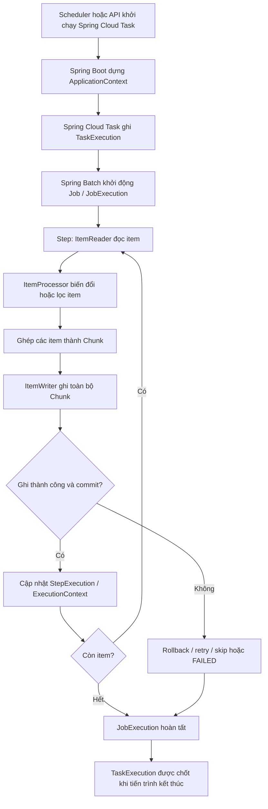

# Ghi dữ liệu bằng các `ItemWriter` được hỗ trợ

## Mục tiêu và phạm vi bài học

Một ứng dụng **Spring Cloud Task** chạy trong thời gian hữu hạn: khởi động, xử lý một yêu cầu, ghi kết quả vào cơ sở dữ liệu hoặc hệ thống đích, rồi kết thúc. Khi công việc có nhiều bản ghi, **Spring Batch** cung cấp Job gồm một Step theo mô hình `ItemReader → ItemProcessor → ItemWriter`. Trong mô hình này, `ItemWriter` là thành phần ghi dữ liệu đã đọc và xử lý ra **đích**: tệp, cơ sở dữ liệu hoặc hệ thống thông điệp.

Bài thuộc chương **Job một bước**, tập trung vào cách chọn, cấu hình và kiểm tra các `ItemWriter` được hỗ trợ khi xây dựng một single-step batch job trong ứng dụng Spring Cloud Task. Sau bài này, bạn có thể:

- Giải thích thời điểm một `ItemWriter` được gọi trong chunk và quan hệ với transaction, restart.
- Phân biệt **4 writer được Spring Cloud Task Single Step Batch Job Starter tự động cấu hình** với các writer khác có sẵn trong thư viện Spring Batch.
- Cấu hình `AmqpItemWriter`, `FlatFileItemWriter`, `JdbcBatchItemWriter` và `KafkaItemWriter` theo đúng hệ thống đích.
- Tạo một Job một Step xuất CSV hoặc ghi JDBC, phân biệt input `Map<String,Object>` trong starter với POJO/record của Job Java tự cấu hình.
- Đánh giá lỗi ghi trùng, tính nguyên tử, retry/skip, `TaskExecution` và `JobExecution` để vận hành an toàn.

> **Lưu ý về phiên bản:** Cú pháp property của **Spring Cloud Task Single Step Batch Job Starter 5.1** được đối chiếu với [tài liệu chính thức](https://docs.spring.io/spring-cloud-task/reference/batch-starter.html). Ví dụ tạo Job bằng Java theo **Spring Batch 6.x**; khi dùng Spring Batch 5.x, một số package/import và DSL khác, cần đối chiếu tài liệu của phiên bản đã chọn. Luôn sử dụng bộ Java, Spring Boot, Spring Cloud Task và Spring Batch tương thích thay vì ghép thư viện tùy ý.

## 1. `ItemWriter` hoạt động ở đâu trong Job một bước?



Spring Batch thường dùng **chunk-oriented processing**. `ItemReader.read()` lấy từng item; `ItemProcessor.process()` biến đổi item (có thể trả `null` để lọc); Step gom các item thành một `Chunk`. Khi đạt kích thước chunk hoặc hết dữ liệu, `ItemWriter.write(...)` được gọi để ghi **cả chunk**. Với một transaction manager hỗ trợ tài nguyên đích, framework commit sau khi write thành công. Xem [Spring Batch – Chunk-oriented Processing](https://docs.spring.io/spring-batch/reference/step/chunk-oriented-processing.html).

Ví dụ, `chunkSize = 3`, reader trả 7 bản ghi, processor không loại bản ghi nào:

| Lần gọi writer | Items nhận được | Kết quả dự kiến |
| --- | --- | --- |
| 1 | Bản ghi 1, 2, 3 | Ghi một chunk 3 item rồi commit |
| 2 | Bản ghi 4, 5, 6 | Ghi một chunk 3 item rồi commit |
| 3 | Bản ghi 7 | Ghi chunk cuối 1 item rồi commit |

**Kích thước chunk không nhất thiết bằng số dòng SQL vật lý.** `JdbcBatchItemWriter` tận dụng JDBC batching, còn `FlatFileItemWriter` có cơ chế buffer/flush; với AMQP hoặc Kafka, việc broker xác nhận thông điệp và transaction DB lại có quy tắc khác. Không suy rằng cả chunk luôn **atomic** đối với mọi loại đích.

### Hợp đồng `ItemWriter` và thay đổi API theo phiên bản

Trong Spring Batch 6.x, giao diện có dạng:

```java
// Spring Batch 6.x: import org.springframework.batch.infrastructure.item.ItemWriter;
// Spring Batch 6.x: import org.springframework.batch.infrastructure.item.Chunk;
@FunctionalInterface
public interface ItemWriter<T> {
    void write(Chunk<? extends T> items) throws Exception;
}
```

Đây là chữ ký rút gọn để giải thích; sử dụng class Spring Batch thật, không tự định nghĩa lại giao diện trong ứng dụng. Nếu bắt đầu từ ví dụ cũ sử dụng `write(List<? extends T>)` của Spring Batch 4, cần cập nhật theo API phiên bản hiện hành. Spring Batch 5 cũng dùng `Chunk`, nhưng package là `org.springframework.batch.item`, còn Spring Batch 6 chuyển các thành phần item sang `org.springframework.batch.infrastructure.item`.

Trong trường hợp cần tự viết writer, có thể dùng lambda:

```java
ItemWriter<String> auditWriter = chunk -> {
    for (String item : chunk) {
        // Chỉ ví dụ: không dùng stdout làm kho dữ liệu production.
        System.out.println("write: " + item);
    }
};
```

Tuy nhiên, **ưu tiên writer đã được framework hỗ trợ** khi ghi tới JDBC, file, message broker: chúng giải quyết nhiều vấn đề về chuyển đổi dữ liệu, stream state và hiệu năng.

## 2. Hai lớp “writer được hỗ trợ” cần phân biệt

Tên “Job một bước” có thể đề cập tới **starter tự động cấu hình** hoặc một Spring Batch Job do bạn tự khai báo. Hai phạm vi hỗ trợ này khác nhau.

### 2.1. Bốn writer được Single Step Batch Job Starter tự động cấu hình

Tài liệu Spring Cloud Task 5.1 liệt kê 4 nhóm autoconfiguration sau:

| Writer | Đích ghi | Nguồn cấu hình trong starter | Nhu cầu phù hợp |
| --- | --- | --- | --- |
| `AmqpItemWriter` | RabbitMQ/AMQP exchange | `spring.batch.job.amqpitemwriter.*` + `AmqpTemplate` | Phát thông điệp từ batch tới hàng đợi |
| `FlatFileItemWriter` | Tệp CSV, text, fixed-width | `spring.batch.job.flatfileitemwriter.*` | Xuất báo cáo/đối soát ra file |
| `JdbcBatchItemWriter` | RDBMS qua JDBC batching | `spring.batch.job.jdbcbatchitemwriter.*` + `DataSource` | Lưu dữ liệu đã xử lý theo nhóm |
| `KafkaItemWriter` | Kafka topic | `spring.batch.job.kafkaitemwriter.*` + Kafka client/template | Phát sự kiện theo từng item |

**Quan trọng:** tài liệu có lúc gọi khái quát là “`JdbcItemWriter`”, nhưng mục cấu hình cụ thể mang tên **`JdbcBatchItemWriter`**. Khi tìm thuộc tính, hãy dùng chính xác namespace `spring.batch.job.jdbcbatchitemwriter.*`.

Starter dựng một Job gồm một chunk-based Step và các thành phần mặc định xử lý kiểu **`Map<String,Object>`**. Nếu tự cung cấp writer, reader hoặc processor cho Job do starter dựng, phải giữ **kiểu đầu vào/đầu ra phù hợp**; không thể gắn `ItemWriter<InvoiceEntity>` vào Step đang truyền `Map<String,Object>` rồi kỳ vọng framework tự chuyển kiểu.

**Không nhầm** các property của *starter* `spring.batch.job.jobName`, `stepName`, `chunkSize` với property auto-launch của Spring Boot `spring.batch.job.name` hoặc `spring.batch.job.enabled`. Chúng có nhiệm vụ khác nhau.

### 2.2. Các writer Spring Batch khác dùng khi tự cấu hình Job

Spring Batch còn có nhiều `ItemWriter` **có sẵn trong thư viện** nhưng **không thuộc bốn loại được starter nói trên tự động cấu hình bằng property**:

| Writer | Nơi ghi / vai trò | Điều kiện bổ sung |
| --- | --- | --- |
| `JpaItemWriter` | JPA `EntityManager` | Entity mapping, transaction manager/JPA context |
| `RepositoryItemWriter` | Spring Data `CrudRepository` | Repository và phương thức ghi phù hợp |
| `MongoItemWriter` | MongoDB | `MongoOperations` / MongoDB transaction nếu cần |
| `JsonFileItemWriter` | Tệp JSON | JSON marshaller, chiến lược file output |
| `StaxEventItemWriter` | XML | OXM marshaller, tài nguyên file |
| `JmsItemWriter` | JMS | `JmsOperations`, broker/transaction |
| `CompositeItemWriter` | Ghi tới **tất cả** delegate theo thứ tự | Quản lý transaction đa đích và `ItemStream` của delegate |
| `ClassifierCompositeItemWriter` | Chọn writer dựa theo nội dung item | Classifier và nhiều delegate đúng kiểu |
| `MultiResourceItemWriter` | Tách output thành nhiều file | Resource suffix và giới hạn item/file |
| `ListItemWriter` | Gom item vào bộ nhớ | Chủ yếu thử nghiệm; không bền vững |

Đây là bảng **các lựa chọn tiêu biểu**, không phải bảo đảm mọi package được mang vào classpath chỉ nhờ một starter. Phải bổ sung dependency cho JPA, MongoDB, Kafka, JMS hoặc Jackson phù hợp. Tham khảo [Spring Batch – Item Reader and Writer Implementations](https://docs.spring.io/spring-batch/reference/readers-and-writers/item-reader-writer-implementations.html) và [Spring Batch – Readers and Writers](https://docs.spring.io/spring-batch/reference/readersAndWriters.html).

**Quy tắc chọn:** dùng starter single-step nếu luồng `Map<String,Object>` và các lựa chọn tự cấu hình đáp ứng yêu cầu; dùng Job/Step Java khi cần kiểu dữ liệu riêng, processing phức tạp, kết hợp nhiều writer, partition/restart đặc thù hoặc các tính năng vượt khỏi khả năng property của starter.

## 3. Cấu hình chung của Single Step Batch Job Starter

Dependency Maven có thể tham khảo theo tài liệu chính thức:

```xml
<!-- Chọn phiên bản artifact qua release train/BOM tương thích với dự án. -->
<dependency>
    <groupId>org.springframework.cloud</groupId>
    <artifactId>spring-cloud-starter-single-step-batch-job</artifactId>
</dependency>
```

**Kiểm tra artifact và phiên bản đã resolve** khi tạo dự án: một số ví dụ lịch sử trong tài liệu có ghi số phiên bản starter cụ thể hoặc cú pháp Gradle cũ; không sao chép chúng sang Boot/Cloud phiên bản khác mà bỏ qua dependency tree. Trong dự án Spring Cloud Task thực tế, còn cần cấu hình `DataSource`/metadata của Task và Batch, quyền truy cập và schema phù hợp.

Những thuộc tính cốt lõi của starter:

| Thuộc tính | Ý nghĩa | Giá trị ví dụ |
| --- | --- | --- |
| `spring.batch.job.jobName` | Tên Job một bước được starter tạo | `invoiceExportJob` |
| `spring.batch.job.stepName` | Tên Step của Job | `exportInvoicesStep` |
| `spring.batch.job.chunkSize` | Số item trong một chunk/commit interval | `100` |

Tên property trên theo **tài liệu Single Step Batch Job Starter**; khi dùng YAML có thể viết dạng camelCase đúng như tài liệu hoặc dùng tên canonical theo binding, nhưng phải xác minh thuộc tính đã bind thực tế. `chunkSize` lớn giúp giảm số transaction/call, nhưng tăng bộ nhớ và số item phải xử lý lại khi lỗi giữa chunk; không có một giá trị tối ưu cho mọi loại writer.

### 3.1. Một ví dụ hoàn chỉnh: file CSV đầu vào → file CSV đầu ra

Giả sử file `./input/invoices.csv` có nội dung:

```csv
invoiceId,customerId,amount
INV-001,CUS-01,150.50
INV-002,CUS-02,200.00
INV-003,CUS-03,175.25
```

File `application.yml` cho một Job có **một Step**, sử dụng `FlatFileItemReader` và `FlatFileItemWriter` do starter tự cấu hình:

```yaml
spring:
  application:
    name: invoice-export-task
  main:
    web-application-type: none
  batch:
    job:
      jobName: invoiceExportJob
      stepName: exportInvoicesStep
      chunkSize: 100

      flatfileitemreader:
        name: invoiceCsvReader
        resource: file:./input/invoices.csv
        linesToSkip: 1
        delimited: true
        delimiter: ","
        names: invoiceId,customerId,amount
        saveState: true

      flatfileitemwriter:
        name: invoiceCsvWriter
        resource: file:./output/invoices-export.csv
        delimited: true
        delimiter: ","
        names: invoiceId,customerId,amount
        encoding: UTF-8
        saveState: true
        shouldDeleteIfExists: true
```

Khi Spring Boot khởi chạy Job do starter tạo, reader biến mỗi dòng CSV thành một `Map<String,Object>`, processor tùy chọn biến đổi map, writer ghi các trường theo `names` ra file đích. Ví dụ không khai báo processor, nên dữ liệu đi thẳng từ reader tới writer. Kết quả mô phỏng là những dòng CSV **không có header** nếu chưa cấu hình `FlatFileHeaderCallback`:

```csv
INV-001,CUS-01,150.50
INV-002,CUS-02,200.00
INV-003,CUS-03,175.25
```

**Giới hạn của mẫu:** cần thư mục `./input` và `./output` thực sự tồn tại/mount có quyền; tên trường phải khớp giữa reader và writer. Với `names`, dữ liệu CSV ban đầu thường được đọc như **chuỗi**; nếu cần phép tính `BigDecimal` hay validate số tiền, phải bổ sung `ItemProcessor<Map<String,Object>,Map<String,Object>>` hoặc tự định nghĩa mapper. Header không tự sinh chỉ vì reader `linesToSkip: 1`; muốn output có header, cung cấp `FlatFileHeaderCallback` phù hợp.

**Vấn đề restart:** `FlatFileItemWriter` có state trong `ExecutionContext` và có xử lý buffering/transaction theo khả năng file. Nhưng **file không phải transaction database**. Nếu job bị dừng, khi khởi động lại cần kiểm soát đường dẫn, file đã tồn tại, `saveState`, chế độ append/delete và JobInstance. Không mặc định `shouldDeleteIfExists=true` sẽ xóa mọi dữ liệu trên một restart hợp lệ; hành vi còn tùy trạng thái mở stream. Kiểm thử cả tình huống tiến trình dừng sau khi đã ghi một phần.

## 4. `FlatFileItemWriter`: xuất dữ liệu ra file

Writer này thích hợp với CSV, pipe-delimited, fixed-width hoặc văn bản một dòng/item. Nó cần **`Resource`** đích, **`LineAggregator`** (trực tiếp hoặc qua bộ builder) để chuyển item thành dòng, và có thể khai báo header/footer, encoding, cách quản lý file.

### Những thuộc tính starter thường dùng

| Property dưới `spring.batch.job.flatfileitemwriter` | Tác dụng | Lưu ý |
| --- | --- | --- |
| `resource` | Đường dẫn output | Trong container phải là volume có thể ghi |
| `delimited` / `formatted` | Chọn kiểu dòng phân cách hoặc độ rộng cố định | Hai chế độ loại trừ nhau |
| `delimiter` / `names` | Dấu phân cách, thứ tự cột | Map key phải trùng names |
| `encoding` / `lineSeparator` | Mã hóa và xuống dòng | Phải thống nhất với hệ thống đọc |
| `append` | Cho ghi nối vào file cũ | Dễ gây dòng trùng khi retry nếu dùng sai |
| `shouldDeleteIfExists` | Xử lý file đầu ra đã tồn tại | Phải xét restart và bản chạy mới |
| `saveState` / `name` | Ghi trạng thái stream cho restart | Tên unique khi có nhiều stream |
| `shouldDeleteIfEmpty` | Xóa file trống khi hoàn tất | Thỏa thuận hợp đồng output |
| `forceSync` | Ép đồng bộ xuống đĩa theo hỗ trợ hệ thống | Có chi phí I/O, không thay cơ chế atomic publish |

Ví dụ tạo một writer bằng Java (dành cho Spring Batch 6.x, với item là bean có getter):

```java
@Bean
FlatFileItemWriter<InvoiceCsvRow> invoiceFileWriter() {
    return new FlatFileItemWriterBuilder<InvoiceCsvRow>()
            .name("invoiceCsvWriter")
            .resource(new FileSystemResource("./output/invoices-export.csv"))
            .encoding("UTF-8")
            .delimited()
            .delimiter(",")
            .names("invoiceId", "customerId", "amount")
            .build();
}
```

Đoạn ngắn trên giả định đã import `FlatFileItemWriter`, `FlatFileItemWriterBuilder`, `FileSystemResource` và `@Bean` tương ứng, cùng lớp `InvoiceCsvRow` với các property JavaBean phù hợp. Khi viết writer bằng Java, hãy gắn nó trực tiếp vào Step thay vì bật đồng thời nhiều writer tự cấu hình ngoài ý muốn.

Với output quan trọng, thường dùng đường dẫn gắn với **business key + lần xuất có kiểm soát**, ghi vào file tạm, kiểm tra tổng dòng/checksum rồi **publish** bằng rename/move nguyên tử ở filesystem hỗ trợ. `FlatFileItemWriter` không tự biến quy trình publish đa hệ thống thành một transaction.

## 5. `JdbcBatchItemWriter`: ghi dữ liệu quan hệ bằng JDBC batching

Writer JDBC sử dụng `NamedParameterJdbcTemplate`/JDBC batch để thực hiện nhiều câu SQL trong một lần gọi tương ứng chunk. Nó phù hợp với insert/update các bảng nghiệp vụ, đặc biệt khi SQL và schema đã rõ ràng. Muốn đảm bảo rollback của chunk, **writer và transaction manager phải phối hợp trên cùng tài nguyên JDBC**.

### 5.1. Ví dụ CSV → PostgreSQL bằng writer của starter

Ví dụ đặt bảng đích:

```sql
CREATE TABLE invoice_export (
    invoice_id   VARCHAR(80) PRIMARY KEY,
    customer_id  VARCHAR(80) NOT NULL,
    amount       NUMERIC(18, 2) NOT NULL CHECK (amount >= 0)
);
```

Giữ cấu hình `flatfileitemreader` từ mục 3 và **thay** `flatfileitemwriter` bằng `jdbcbatchitemwriter`:

```yaml
spring:
  batch:
    job:
      jobName: invoiceImportJob
      stepName: writeInvoicesStep
      chunkSize: 100

      flatfileitemreader:
        name: invoiceCsvReader
        resource: file:./input/invoices.csv
        linesToSkip: 1
        delimited: true
        names: invoiceId,customerId,amount

      jdbcbatchitemwriter:
        sql: >-
          INSERT INTO invoice_export (invoice_id, customer_id, amount)
          VALUES (:invoiceId, :customerId, CAST(:amount AS NUMERIC(18,2)))
        assertUpdates: true
```

Starter cho phép cung cấp `ItemSqlParameterSourceProvider` hoặc `ItemPreparedStatementSetter` nếu cần. Vì reader mặc định trả `Map<String,Object>`, ví dụ dùng provider biến map thành named SQL parameters:

```java
import java.util.Map;
import org.springframework.batch.infrastructure.item.database.ItemSqlParameterSourceProvider;
import org.springframework.context.annotation.Bean;
import org.springframework.jdbc.core.namedparam.MapSqlParameterSource;

@Bean
ItemSqlParameterSourceProvider<Map<String, Object>> csvSqlParameters() {
    return item -> new MapSqlParameterSource(item);
}
```

Lưu ý package `org.springframework.batch.infrastructure.item.database.ItemSqlParameterSourceProvider` ở Spring Batch 6.x; trong Batch 5.x, package thường có tiền tố `org.springframework.batch.item.database`. Để tránh nhiều provider bean cùng kiểu, cấu hình tường minh đúng một provider writer sẽ sử dụng và kiểm tra auto-configuration report nếu có xung đột.

Cấu hình `DataSource` cho PostgreSQL bằng biến môi trường, không lưu password trong code:

```yaml
spring:
  datasource:
    url: ${INVOICE_DB_URL}
    username: ${INVOICE_DB_USER}
    password: ${INVOICE_DB_PASSWORD}
  batch:
    jdbc:
      initialize-schema: never
  cloud:
    task:
      initialize-enabled: false
```

Giá trị `initialize-schema: never` và `initialize-enabled: false` ở đây giả định **schema Spring Batch, Spring Cloud Task và bảng nghiệp vụ đã được migration đúng phiên bản**. Nếu dự án dùng DataSource riêng cho `JobRepository`, `TaskRepository` và bảng `invoice_export`, hãy xác định rõ bean/transaction manager tương ứng, không coi một `@Transactional` trên datasource A sẽ bảo vệ cả B.

**`assertUpdates=true`** yêu cầu mỗi statement ghi ảnh hưởng ít nhất một dòng; phù hợp cho insert/update khi việc không thay đổi bản ghi được coi là lỗi. Nếu triển khai PostgreSQL `ON CONFLICT DO NOTHING` để biến duplicate thành no-op, một item trùng có thể có update count bằng 0; khi đó cần chủ động xét `assertUpdates=false` **và so sánh payload của bản ghi cũ**. Không tắt assert chỉ để che lỗi mà chưa xác minh ý nghĩa nghiệp vụ.

### 5.2. Không đánh đồng batch JDBC với `chunkSize`

- `chunkSize` điều khiển số item/transaction logic của Spring Batch.
- `JdbcBatchItemWriter` có thể gửi nhiều câu lệnh qua JDBC batch cho một chunk.
- Khả năng batch hiệu quả phụ thuộc driver, SQL, index, transaction và cấu hình database.
- Một chunk 1.000 item quá lớn có thể tăng lock, memory hoặc log transaction; chunk 1 item giảm áp lực nhưng tăng số commit.

Khi xử lý tiếp sau lỗi, dùng khóa duy nhất của nghiệp vụ (ví dụ `invoice_id`). Nếu lần chạy đã commit 4 chunk rồi crash trong chunk thứ 5, restart có thể đọc lại một số item theo checkpoint; writer nên chịu được replay hoặc từ chối duplicate theo hợp đồng đã định.

## 6. `AmqpItemWriter` và `KafkaItemWriter`: phát sự kiện

Hai writer này ghi vào **broker**, khác với JDBC và file: thành công của lệnh send không tự chứng minh subscriber đã xử lý xong. Khi có timeout ở network, bên gửi có thể không biết broker đã nhận message hay chưa; retry cần key dedup phù hợp.

### 6.1. Gửi thông điệp qua AMQP/RabbitMQ

Starter cung cấp hai property chính:

```yaml
spring:
  batch:
    job:
      amqpitemwriter:
        enabled: true
        jsonConverterEnabled: true
```

- `enabled=true` bật auto-config writer AMQP của starter; mặc định là `false`.
- `jsonConverterEnabled=true` (mặc định theo docs) hỗ trợ đăng ký converter JSON; vẫn cần thư viện và cấu hình AMQP phù hợp với phiên bản Boot, message converter và payload.
- Cần một `AmqpTemplate`. Spring Boot có thể tạo từ cấu hình RabbitMQ khi dependency tương ứng có trên classpath.
- Nếu dữ liệu có thông tin nhạy cảm, thiết kế exchange/routing key, ACL và retention phù hợp; không log toàn bộ payload.

Sử dụng AMQP khi muốn đẩy công việc hoặc thông báo sang consumer bất đồng bộ. Không coi `ItemWriter.write` thành công là bảo đảm *exactly once processing* ở consumer; consumer vẫn cần dedup/idempotency.

### 6.2. Gửi dữ liệu lên Kafka

Starter định nghĩa:

```yaml
spring:
  batch:
    job:
      kafkaitemwriter:
        topic: invoice-events
        delete: false
```

- `topic` chỉ tên topic output.
- `delete` được hỗ trợ theo semantics của writer (các bản ghi được gửi như delete/tombstone khi bật, tùy key/value mapping). Không bật tùy tiện nếu nghiệp vụ đang phát event bình thường.
- Cần Kafka client/template do Spring Boot hoặc ứng dụng cấu hình, serializer và cơ chế chọn key để đảm bảo consumer hiểu đúng dữ liệu.
- `KafkaItemWriter` là một writer Spring Batch, nhưng **không tự tạo transaction phân tán** giữa database của JobRepository và Kafka.

Nếu batch vừa cập nhật bảng hóa đơn vừa phát Kafka event, cân nhắc **transactional outbox**: commit dữ liệu + outbox trong cùng DB transaction, sau đó một publisher riêng phát event. Khi publisher retry, dùng `eventId` ổn định để consumer dedup. Dùng `CompositeItemWriter` gọi JDBC rồi Kafka lần lượt **không** tự tạo atomic commit giữa hai hệ thống.

### 6.3. So sánh về lỗi và khả năng chạy lại

| Đích | Ranh giới transaction thực tế | Rủi ro restart/retry |
| --- | --- | --- |
| PostgreSQL JDBC | Có thể rollback chunk nếu writer cùng `DataSource`/transaction manager | Duplicate khi checkpoint và DB không đồng bộ, cần `UNIQUE` |
| File CSV | Quản lý buffer/stream; không có transaction DB xuyên filesystem | File bị ghi dở, append hoặc xóa nhầm output |
| RabbitMQ AMQP | Phụ thuộc publisher confirm, broker và cấu hình riêng | Gửi trùng, mất ACK, consumer xử lý lặp |
| Kafka | Phụ thuộc producer, broker, transaction/idempotence được cấu hình | Publish lặp; DB + Kafka không commit nguyên tử chỉ nhờ writer |


## 7. Tự cấu hình Job một Step bằng Java khi starter chưa đủ

Single Step Batch Job Starter dùng kiểu `Map<String,Object>` và một tập writer tự cấu hình. Nếu cần domain type riêng, quy tắc idempotency hoặc writer ngoài bốn nhóm, hãy tạo `Job`, `Step` và `ItemWriter` bằng Java. Mẫu dưới đây dùng **Spring Batch 6.x**, JDBC PostgreSQL và Java 21.

### 7.1. Dependency và bảng đích

Đối với dự án có Spring Boot parent + Spring Cloud BOM tương thích, những dependency sau thường cần cho ví dụ:

```xml
<dependencies>
    <dependency>
        <groupId>org.springframework.boot</groupId>
        <artifactId>spring-boot-starter-batch</artifactId>
    </dependency>
    <dependency>
        <groupId>org.springframework.boot</groupId>
        <artifactId>spring-boot-starter-jdbc</artifactId>
    </dependency>
    <dependency>
        <groupId>org.springframework.cloud</groupId>
        <artifactId>spring-cloud-starter-task</artifactId>
    </dependency>
    <dependency>
        <groupId>org.springframework.cloud</groupId>
        <artifactId>spring-cloud-task-batch</artifactId>
    </dependency>
    <dependency>
        <groupId>org.postgresql</groupId>
        <artifactId>postgresql</artifactId>
        <scope>runtime</scope>
    </dependency>
</dependencies>
```

`spring-cloud-task-batch` cung cấp tích hợp để liên kết `JobExecution` với `TaskExecution`. Khi classpath có Job Bean và thư viện tích hợp, `TaskBatchExecutionListener` có thể được tự cấu hình theo tài liệu Spring Cloud Task. Trong ví dụ Java này, **không thêm đồng thời single-step starter nếu không dùng nó**, nhằm tránh có hai cơ chế cùng tạo Job ngoài ý muốn.

Bảng nghiệp vụ:

```sql
CREATE TABLE invoice_export (
    invoice_id VARCHAR(80) PRIMARY KEY,
    customer_id VARCHAR(80) NOT NULL,
    amount NUMERIC(18, 2) NOT NULL CHECK (amount >= 0)
);
```

Khóa `PRIMARY KEY(invoice_id)` giúp chống insert trùng khi scheduler chạy lại cùng yêu cầu hoặc Spring Batch restart sau lỗi. Nếu một `invoice_id` đã tồn tại nhưng thông tin mới khác, hệ thống phải có quy tắc xử lý xung đột; ví dụ bên dưới chỉ minh họa **bỏ qua insert trùng**.

### 7.2. Lớp ứng dụng Spring Boot

Tạo `src/main/java/com/example/task/InvoiceExportTaskApplication.java`:

```java
package com.example.task;

import org.springframework.boot.SpringApplication;
import org.springframework.boot.autoconfigure.SpringBootApplication;

@SpringBootApplication
public class InvoiceExportTaskApplication {
    public static void main(String[] args) {
        SpringApplication.run(InvoiceExportTaskApplication.class, args);
    }
}
```

### 7.3. Job, Step và `JdbcBatchItemWriter`

Tạo `src/main/java/com/example/task/InvoiceExportJobConfig.java`:

```java
package com.example.task;

import java.math.BigDecimal;
import java.util.List;

import javax.sql.DataSource;

import org.springframework.batch.core.job.Job;
import org.springframework.batch.core.job.builder.JobBuilder;
import org.springframework.batch.core.repository.JobRepository;
import org.springframework.batch.core.step.Step;
import org.springframework.batch.core.step.builder.StepBuilder;
import org.springframework.batch.infrastructure.item.ItemReader;
import org.springframework.batch.infrastructure.item.database.JdbcBatchItemWriter;
import org.springframework.batch.infrastructure.item.database.builder.JdbcBatchItemWriterBuilder;
import org.springframework.batch.infrastructure.item.support.ListItemReader;
import org.springframework.context.annotation.Bean;
import org.springframework.context.annotation.Configuration;
import org.springframework.jdbc.core.namedparam.MapSqlParameterSource;
import org.springframework.transaction.PlatformTransactionManager;

@Configuration
public class InvoiceExportJobConfig {

    record InvoiceRow(
            String invoiceId, String customerId, BigDecimal amount) {
    }

    @Bean
    ItemReader<InvoiceRow> invoiceReader() {
        // Dữ liệu tĩnh chỉ phục vụ bài học, không có checkpoint để restart.
        return new ListItemReader<>(List.of(
                new InvoiceRow("INV-001", "CUS-01",
                        new BigDecimal("150.50")),
                new InvoiceRow("INV-002", "CUS-02",
                        new BigDecimal("200.00")),
                new InvoiceRow("INV-003", "CUS-03",
                        new BigDecimal("175.25"))
        ));
    }

    @Bean
    JdbcBatchItemWriter<InvoiceRow> invoiceWriter(DataSource dataSource) {
        return new JdbcBatchItemWriterBuilder<InvoiceRow>()
                .dataSource(dataSource)
                .sql("""
                    INSERT INTO invoice_export (
                        invoice_id, customer_id, amount
                    ) VALUES (:invoiceId, :customerId, :amount)
                    ON CONFLICT (invoice_id) DO NOTHING
                    """)
                .itemSqlParameterSourceProvider(row ->
                        new MapSqlParameterSource()
                                .addValue("invoiceId", row.invoiceId())
                                .addValue("customerId", row.customerId())
                                .addValue("amount", row.amount()))
                // DO NOTHING có thể làm affected rows = 0 trên replay.
                .assertUpdates(false)
                .build();
    }

    @Bean
    Step writeInvoicesStep(
            JobRepository jobRepository,
            PlatformTransactionManager transactionManager,
            ItemReader<InvoiceRow> invoiceReader,
            JdbcBatchItemWriter<InvoiceRow> invoiceWriter) {

        return new StepBuilder("writeInvoicesStep", jobRepository)
                .<InvoiceRow, InvoiceRow>chunk(2)
                .transactionManager(transactionManager)
                .reader(invoiceReader)
                .writer(invoiceWriter)
                .build();
    }

    @Bean
    Job invoiceExportJob(
            JobRepository jobRepository, Step writeInvoicesStep) {

        return new JobBuilder("invoiceExportJob", jobRepository)
                .start(writeInvoicesStep)
                .build();
    }
}
```

**Vì sao code này minh họa được một Job một Step?**

- `invoiceExportJob()` có đúng một `Step`.
- `ListItemReader` trả lần lượt ba `InvoiceRow`.
- `chunk(2)` tạo hai lần gọi writer: lần thứ nhất ghi hai bản ghi, lần thứ hai ghi một bản ghi.
- `JdbcBatchItemWriter` nhận object kiểu `InvoiceRow`, chuyển sang named SQL parameters và thực hiện JDBC batch.
- `ON CONFLICT DO NOTHING` cùng `PRIMARY KEY` ngăn số dòng trùng khi chạy lại. `assertUpdates(false)` là lựa chọn có chủ đích vì statement lặp có thể ghi **0 dòng**.
- `transactionManager` được gắn rõ cho chunk; trong trường hợp dùng chung `DataSource` cho nghiệp vụ và Batch repository, transaction manager phải thực sự quản lý đúng các thao tác JDBC.

Với Spring Batch 6, `StepBuilder` hỗ trợ `.<I,O>chunk(size).transactionManager(txManager)`. Tránh sao chép cú pháp cũ `chunk(size, txManager)` từ tài liệu Batch 5 mà không kiểm tra deprecation. Ở các phiên bản khác, package `ItemReader`, `JdbcBatchItemWriter`, `Step` và `Job` có thể khác.

**Giới hạn cần nhớ:** `ListItemReader` là reader đơn giản cho bài tập, **không hỗ trợ restart có checkpoint như reader chuyên dụng dạng `ItemStream`**. Nếu một Job thất bại sau một chunk đã commit và được restart, reader mới có thể đọc lại từ đầu; unique key/`ON CONFLICT` giúp ví dụ không tạo thêm dòng. Với dữ liệu lớn, dùng `JdbcPagingItemReader`, `JdbcCursorItemReader`, `FlatFileItemReader` hoặc reader stateful phù hợp và kiểm thử vị trí restart.

### 7.4. Cấu hình và cách chạy

Giả sử PostgreSQL đã có bảng nghiệp vụ và schema cho JobRepository/TaskRepository được migration:

```yaml
spring:
  application:
    name: invoice-export-task
  main:
    web-application-type: none
  datasource:
    url: ${TASK_DB_URL}
    username: ${TASK_DB_USER}
    password: ${TASK_DB_PASSWORD}
  batch:
    job:
      enabled: true
      name: invoiceExportJob
    jdbc:
      initialize-schema: never
  cloud:
    task:
      initialize-enabled: false
      batch:
        fail-on-job-failure: true
```

Đối với **một Job bean**, Spring Boot có thể tự khởi chạy Job khi application khởi động. Nếu có nhiều Job bean, dùng `spring.batch.job.name` để chọn. Với một Job tự tạo bằng Java, **không cần** `spring.batch.job.jobName`, `stepName`, `chunkSize` của single-step starter.

Nếu ứng dụng có cả Spring Cloud Task và Spring Batch, `spring.cloud.task.batch.fail-on-job-failure=true` giúp đưa kết quả `BatchStatus.FAILED` lên trạng thái/mã thoát Task theo cơ chế tích hợp. Không giả định Job thất bại luôn làm process thoát khác `0` nếu chưa bật/kiểm thử thuộc tính này.

Sau khi đóng gói JAR bằng Maven/Gradle của dự án:

```bash
java -jar target/invoice-export-task.jar
```

Mỗi lần chạy với dữ liệu thử, kiểm tra bảng:

```sql
SELECT invoice_id, customer_id, amount
FROM invoice_export
ORDER BY invoice_id;
```

Kết quả mong đợi: ba hàng cho `INV-001`, `INV-002`, `INV-003`. Việc chạy lại cần có **một JobInstance hợp lệ** theo `JobParameters`; một JobInstance đã `COMPLETED` thường không được khởi chạy lại như một JobInstance mới nếu giữ nguyên identifying parameters. Với môi trường thử nghiệm, hãy truyền JobParameters phù hợp khi tạo một lần chạy mới, đồng thời giữ nguyên `invoice_id` để kiểm tra chống trùng **ở bảng nghiệp vụ**. Không tự dùng timestamp ngẫu nhiên làm khóa chống trùng của hóa đơn; nó chỉ là cách phân biệt JobInstance.

## 8. Writer thất bại: transaction, retry, skip và restart

`ItemWriter` nhận cả chunk. Khi ghi một item lỗi, Spring Batch có thể **rollback transaction của chunk**, sau đó tùy cấu hình mà fail ngay, retry hoặc skip item lỗi. Mức độ rollback phụ thuộc tài nguyên đích và transaction manager; một writer gửi email hoặc event ra broker không tự thu hồi thông điệp nếu đã phát.

### Các cơ chế xử lý lỗi

| Cơ chế | Tác dụng | Khi nào phù hợp |
| --- | --- | --- |
| Fail mặc định | Ngoại lệ từ writer khiến Step thất bại; transaction bị rollback nếu được quản lý | Dữ liệu sai nghiêm trọng, không được bỏ sót |
| Retry có giới hạn | Thử lại lỗi tạm thời | DB deadlock/network transient; writer idempotent |
| Skip có giới hạn | Bỏ một số item lỗi theo chính sách | Dữ liệu có bản ghi bẩn nhưng nghiệp vụ cho phép loại bỏ và ghi log |
| Restart | Chạy tiếp `JobInstance` thất bại theo trạng thái lưu trong `JobRepository` | Nguồn/đích có checkpoint và side effect được kiểm soát |
| Bảng idempotency/unique key | Ngăn hiệu ứng lặp khi một chunk được thử lại | Tích hợp data pipeline và external systems |

Trong Batch 6, ví dụ cấu hình retry/skip theo API phiên bản đang dùng; không nên sao chép trực tiếp `.retryLimit(3)`/`.skipLimit(10)` từ Batch 5 mà không kiểm tra vì cơ chế fault tolerance đã được tái cấu trúc ở một số bản 6.x. Hãy xem [Spring Batch – Configuring Skip Logic](https://docs.spring.io/spring-batch/reference/step/chunk-oriented-processing/configuring-skip.html) và [Spring Batch – Fault Tolerance](https://docs.spring.io/spring-batch/reference/step/chunk-oriented-processing/configuring.html).

**Chẩn đoán một chunk write lỗi**: Spring Batch có thể thử ghi từng item khi cấu hình skip cho lỗi writer nhằm tìm item gây lỗi. Vì `ItemWriter` thường nhận cả chunk, không thể mặc định biết được bản ghi gây lỗi chỉ từ exception tổng quát. Khi retry, processor có thể được chạy lại. Với `JpaItemWriter`, một `flush` thất bại có thể làm entity/persistence context không còn an toàn để dùng lại; chính sách processor caching hoặc retry phải được kiểm chứng.

### Quản lý `ItemStream` với writer có trạng thái

`FlatFileItemWriter` và một số writer file là `ItemStream`: có các callback `open`, `update`, `close` để quản lý offset và lưu trạng thái trong `ExecutionContext`. Khi writer được **gắn trực tiếp** vào Step và triển khai `ItemStream`, framework có thể tự đăng ký stream. Nếu writer là **delegate bên trong `CompositeItemWriter`** hoặc một wrapper khác, phải kiểm tra liệu delegate stream được đăng ký tự động hay cần gọi `.stream(delegate)` trên Step builder. Bỏ sót stream registration sẽ dẫn tới không mở/không cập nhật trạng thái, gây lỗi khi restart.

### Phân biệt hai repository

- **`JobRepository` của Spring Batch** lưu `JobExecution`, `StepExecution`, `ExecutionContext` và các chỉ số read/write/skip/commit.
- **`TaskRepository` của Spring Cloud Task** lưu `TaskExecution`, thời điểm, exit code và metadata tiến trình.

Nếu writer ghi ra một datasource khác với transaction manager của Step/JobRepository, việc commit dữ liệu và cập nhật checkpoint **có thể không nguyên tử**. Khi restart có thể ghi lại chunk đã commit vào DB đích dù JobRepository chưa cập nhật. **Thiết kế writer idempotent** là tuyến phòng thủ bắt buộc khi có tình huống như vậy. Xem [Spring Batch – Configuring a Step](https://docs.spring.io/spring-batch/reference/step/chunk-oriented-processing/configuring.html).

## 9. Theo dõi kết quả ghi: `writeCount` và metadata Task

Một writer trả về từ `write(...)` không cung cấp trực tiếp số bản ghi vật lý thực sự đã được ghi vào đích; Spring Batch cập nhật **`writeCount`** theo số item mà Step coi là đã ghi thành công. Với `INSERT ... ON CONFLICT DO NOTHING`, một chunk có ba item vẫn có thể làm `writeCount` tăng ba dù có item không chèn hàng mới. Vì vậy `writeCount` và số hàng `INSERT` của database **không phải luôn bằng nhau**.

Các chỉ số cần theo dõi:

| Chỉ số | Mô tả | Lưu ý khi đánh giá |
| --- | --- | --- |
| `readCount` | Số item reader đã đọc trong Step | Có thể khác số item đầu vào sau khi lọc |
| `filterCount` | Số item processor loại vì trả `null` | Cần phân biệt với skip lỗi |
| `writeCount` | Số item được Step coi là đã ghi thành công | Không bảo đảm số dòng DB mới nếu upsert/no-op |
| `readSkipCount`, `processSkipCount`, `writeSkipCount` | Số item bị bỏ qua do lỗi ở từng pha | Phải nằm trong chính sách nghiệp vụ |
| `commitCount`, `rollbackCount` | Số lần commit/rollback | Dấu hiệu performance và retry |
| `BatchStatus`/`ExitStatus` | Kết quả Job/Step | Khác với `TaskExecution.exitCode` |
| `TaskExecution.exitCode` | Mã kết thúc ứng dụng Task | Cần cấu hình fail-on-job-failure khi tích hợp Batch |

Ví dụ khi dùng JDBC JobRepository, bảng `BATCH_STEP_EXECUTION` lưu các số đếm:

```sql
SELECT
    STEP_EXECUTION_ID,
    STEP_NAME,
    STATUS,
    READ_COUNT,
    WRITE_COUNT,
    FILTER_COUNT,
    READ_SKIP_COUNT,
    PROCESS_SKIP_COUNT,
    WRITE_SKIP_COUNT,
    COMMIT_COUNT,
    ROLLBACK_COUNT
FROM BATCH_STEP_EXECUTION
ORDER BY STEP_EXECUTION_ID DESC;
```

Để kiểm tra dữ liệu nghiệp vụ thật, đối chiếu `invoice_export` theo business key:

```sql
SELECT COUNT(*) AS total_exported_rows
FROM invoice_export;
```

Nếu Job chạy thành công nhưng không xuất đủ hoặc xuất trùng, `writeCount` một mình không chứng minh tính đúng. Kết hợp checksum, số dòng/record đích, quyền truy vấn và business totals. Nếu dùng file, kiểm tra checksum, kích thước, header và số record; nếu dùng Kafka/AMQP, giám sát producer error và consumer-side dedup/trạng thái xử lý.

## 10. Bảo mật, hiệu năng và vận hành

### Vấn đề thường gặp

| Triệu chứng | Nguyên nhân có thể | Cách giải quyết |
| --- | --- | --- |
| Job không tạo writer | Chưa đưa starter lên classpath, property sai tên, thiếu resource/template | Kiểm tra dependency tree, namespace property và auto-config |
| `FlatFileItemWriter` báo không mở được file | Chưa có thư mục, permission/volume sai, path tương đối trỏ sai `WORKDIR` | Tạo/mount đúng thư mục, dùng path cấu hình theo môi trường |
| CSV ra sai thứ tự cột | `names` không khớp hoặc chưa có processor mapping | Căn chỉnh key/trường, xác minh header và dữ liệu mẫu |
| JDBC writer thiếu named parameter | Reader trả map không có key, provider chưa đúng kiểu | Kiểm tra `names` và `ItemSqlParameterSourceProvider` |
| JDBC `EmptyResultDataAccessException` / item không update | `assertUpdates=true` với SQL trả updateCount 0 | Kiểm tra SQL, constraint và quyết định có cho phép no-op hay không |
| Job dùng database A, TaskRepository dùng B | Nhiều `DataSource` nhưng wiring không tường minh | Khai báo rõ `DataSource` và transaction manager cho từng repository/writer |
| Ghi trùng sau retry | Thiếu unique business key hoặc writer non-idempotent | Ràng buộc database, downstream idempotency key, quản lý checkpoint |
| Kafka/AMQP gửi được nhưng consumer chưa xử lý | Gửi message và xử lý message là hai bước bất đồng bộ | Theo dõi trạng thái consumer/ack và event key |
| `TaskExecution.exitCode=0` nhưng Job FAILED | Chưa truyền mã lỗi Batch lên Task | Kiểm tra `fail-on-job-failure` và event/log thật |
| Job quá chậm khi chunk lớn | DB lock contention, memory, driver batch không tối ưu | Đo throughput/latency, điều chỉnh chunk và pool/SQL/index |

### Những nguyên tắc để chọn writer an toàn

1. **Phân quyền input và output**: data source chỉ cho quyền đọc cần thiết; writer chỉ có quyền ghi trong phạm vi bảng/topic/đường dẫn được phép.
2. **Giữ bí mật ra khỏi CLI**: không dùng `--spring.datasource.password=...` hay token broker trong arguments; Spring Cloud Task có thể lưu arguments của lần thực thi.
3. **Dùng cấu hình theo môi trường**: URL DB, path output, topic và exchange phải do deployment quản lý. JobParameters mô tả phạm vi nghiệp vụ như ngày/tenant, không cấp quyền thay đổi hạ tầng tùy ý.
4. **Đặt business key ổn định**: Job restart hoặc scheduler retry phải dùng lại key nhận diện cùng ý định nghiệp vụ.
5. **Kiểm tra tệp trước khi publish**: không để consumer đọc file đang ghi dở; có quy trình publish khi Job/Step đã thành công.
6. **Kiểm tra external writes**: với broker và API bên ngoài, transaction DB không bao trùm mọi hiệu ứng.
7. **Giám sát cả hai lớp thực thi**: JobExecution/StepExecution cho số đếm và trạng thái chunk; TaskExecution cho lifecycle của tiến trình.

## 11. Bài tập tình huống

**Tình huống A:** Một tác vụ xuất CSV có reader và writer `Map<String,Object>`; cần tự tạo `JpaItemWriter<Customer>` qua một property cùng namespace `spring.batch.job.jpa...`. Starter sẽ tự tạo writer này không?

**Gợi ý:** Không theo danh sách autoconfiguration được tài liệu Single Step Batch Job Starter công bố. `JpaItemWriter` là writer của Spring Batch; muốn dùng cần tự tạo bean và Step phù hợp, có `EntityManagerFactory` và transaction manager, đồng thời bảo đảm kiểu item đúng.

**Tình huống B:** Job nhận 1.000 item, `chunkSize=100`. Reader không lọc item và writer không ném lỗi. Dự kiến writer được gọi bao nhiêu lần?

**Gợi ý:** Khoảng 10 lần, mỗi lần một chunk 100 item. Nếu processor lọc item, chunk được hình thành theo quy trình đọc/xử lý của framework; không suy số lần write chỉ bằng số item đầu ra chia chunk size trong mọi tình huống.

**Tình huống C:** JDBC writer dùng `ON CONFLICT DO NOTHING` và có một hóa đơn đã tồn tại. Với `assertUpdates=true` có thể phát sinh điều gì?

**Gợi ý:** Writer có thể coi statement có updateCount 0 là lỗi. Chỉ đặt `assertUpdates=false` nếu đã chủ động định nghĩa duplicate thành no-op và có cách phát hiện payload khác, tránh bỏ qua lỗi dữ liệu.

**Tình huống D:** Một `CompositeItemWriter` ghi dữ liệu PostgreSQL rồi phát Kafka event. DB commit thành công nhưng Kafka send thất bại. Có tự động rollback cả hai hệ thống không?

**Gợi ý:** Không. Không có transaction phân tán mặc định giữa DB và Kafka chỉ nhờ Composite. Cân nhắc outbox/consumer dedup và kiểm tra trạng thái bên nhận.

**Tình huống E:** Job viết file xuất báo cáo bị kill sau khi viết một nửa. Lần restart tự tạo file mới và ghi từ dòng đầu, làm hai file cùng chứa một phần dữ liệu. Cần kiểm tra gì?

**Gợi ý:** Xem JobInstance/ExecutionContext, tên writer, `saveState`, `append`, `shouldDeleteIfExists` và thiết kế temp file/atomic publish; kiểm tra cơ chế checkpoint của reader và writer.

**Tình huống F:** Spring Cloud Task ghi exit code 0, nhưng bảng `BATCH_JOB_EXECUTION` ghi Job FAILED. Có mâu thuẫn không?

**Gợi ý:** Đây là hai tầng kết quả khác nhau. Kiểm tra cơ chế tích hợp `spring-cloud-task-batch` và `spring.cloud.task.batch.fail-on-job-failure`; không mặc định Job FAILED luôn tạo ngoại lệ làm Task nhận mã khác 0.

## 12. Checklist trước khi đưa vào production

- [ ] Xác định writer nằm trong **4 loại auto-config của Single Step Batch Job Starter**, hay là Spring Batch writer phải tự đăng ký bằng Java.
- [ ] Nếu dùng starter, bảo đảm reader/processor/writer có cùng contract `Map<String,Object>`; nếu dùng Job Java, các generic type đồng nhất.
- [ ] Chọn `chunkSize` và transaction manager phù hợp với tài nguyên ghi; đo thời gian commit/rollback.
- [ ] Với JDBC: có named params đúng, index/constraint, chiến lược upsert/idempotency và schema migration.
- [ ] Với file: cấu hình đúng `resource`, encoding, line format, writer name, `saveState`, đường dẫn và quy trình publish.
- [ ] Với Kafka/AMQP: broker/template, serializer/converter, topic/exchange, xác nhận gửi, retry và dedup phía nhận.
- [ ] Với writer có state, kiểm tra `ItemStream` được đăng ký đúng cả khi nằm trong composite/delegate.
- [ ] Kiểm thử lỗi giữa chunk, retry, skip, restart, chạy lại cùng business key và dừng tiến trình bất thường.
- [ ] Quan sát `writeCount`/`skipCount`/`rollbackCount` và so với dữ liệu đích thực tế.
- [ ] Khi tích hợp Cloud Task, đối chiếu `TaskExecution` với `JobExecution` và cấu hình trả mã khi Batch Job thất bại.
- [ ] Bảo vệ secret, tránh thông tin nhạy cảm trong command-line arguments, CSV public và message payload.
- [ ] Có cách giải quyết xung đột dữ liệu, phục hồi Job treo và đối soát external side effects.

## 13. Tài liệu tham khảo chính thức

1. [Spring Cloud Task 5.1 – Single Step Batch Job Starter](https://docs.spring.io/spring-cloud-task/reference/batch-starter.html): bốn loại `ItemWriter` được starter autoconfigure và các namespace property.
2. [Spring Batch – Item Reader and Writer Implementations](https://docs.spring.io/spring-batch/reference/readers-and-writers/item-reader-writer-implementations.html): writers cho database, file, broker và composite.
3. [Spring Batch – Chunk-oriented Processing](https://docs.spring.io/spring-batch/reference/step/chunk-oriented-processing.html): reader/processor/writer theo chunk, transaction boundary.
4. [Spring Batch – Configuring a Step](https://docs.spring.io/spring-batch/reference/step/chunk-oriented-processing/configuring.html): Job/Step builders, transaction manager và lưu ý khi JobRepository khác transaction writer.
5. [Spring Batch – FlatFileItemWriter](https://docs.spring.io/spring-batch/reference/readers-and-writers/flat-files/file-item-writer.html): `LineAggregator`, CSV/fixed-width, stream state.
6. [Spring Batch – Database](https://docs.spring.io/spring-batch/reference/readers-and-writers/database.html): JDBC batching, JPA và lưu ý rollback/performance.
7. [Spring Cloud Task – Batch](https://docs.spring.io/spring-cloud-task/reference/batch.html): liên kết TaskExecution với JobExecution và `fail-on-job-failure`.
8. [Spring Boot – Spring Batch](https://docs.spring.io/spring-boot/reference/io/spring-batch.html): tự chạy Job lúc khởi động, `spring.batch.job.name`/`enabled` và schema repository.

**Nguyên tắc ghi nhớ:** **`ItemWriter` quyết định đích và cách ghi dữ liệu của một chunk; transaction, restart và idempotency quyết định việc ghi đó có an toàn khi gặp lỗi hay không.** Với Spring Cloud Task Single Step Batch Job Starter, bốn writer được tự cấu hình là AMQP, FlatFile, JDBC Batch và Kafka; các writer Spring Batch khác cần cấu hình/kiểm chứng theo loại Job đã chọn.
