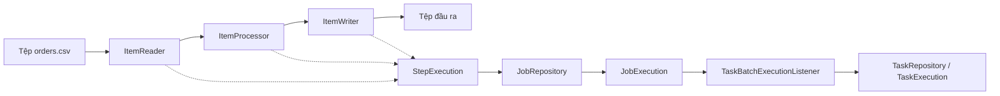

# Bổ sung ItemProcessor và thay thế bean tự cấu hình

## 1. Vì sao cần tùy biến Job một bước?

**Spring Cloud Task** giúp xây dựng ứng dụng Spring Boot chạy hữu hạn và lưu lịch sử thực thi vào **`TaskRepository`**: thời điểm bắt đầu, kết thúc, mã thoát và tham số. Khi công việc xử lý dữ liệu theo lô, ứng dụng có thể dùng **Spring Batch** để đọc, biến đổi, ghi dữ liệu theo chunk, quản lý giao dịch và theo dõi `JobExecution`/`StepExecution`. Một Job có thể chỉ cần **một Step** nếu mọi bản ghi đều đi qua cùng một luồng xử lý.

Thư viện **`spring-cloud-starter-single-step-batch-job`** của Spring Cloud Task hỗ trợ tạo Job một bước thông qua cấu hình. Starter tạo khung `Job` và `Step`, cho phép cấu hình sẵn `ItemReader`, `ItemWriter`; còn **`ItemProcessor`** là thành phần tùy chọn do ứng dụng cung cấp dưới dạng Spring bean. Khi các thành phần mặc định chưa đáp ứng yêu cầu nghiệp vụ, bạn có thể **thay bằng bean tự khai báo**.

Ví dụ: nhập tệp CSV đơn hàng, chuẩn hóa tên khách hàng, tính số tiền sau thuế, loại bỏ bản ghi không hợp lệ, rồi ghi kết quả ra tệp khác. Bài học tập trung vào hai thay đổi:

1. **Bổ sung `ItemProcessor<Map<String, Object>, Map<String, Object>>`** vào Job một bước để xử lý dữ liệu giữa reader và writer.
2. **Thay thế `ItemReader` hoặc `ItemWriter` do starter tự cấu hình** bằng bean viết bằng Java khi cần thêm logic đặc thù.

Sau khi học, bạn có thể nhận diện ranh giới của auto-configuration, khai báo processor đúng kiểu, chọn một bean reader/writer rõ ràng, thử các trường hợp thành công/lọc/lỗi, và hiểu tác động lên lịch sử Spring Cloud Task, tính restartable và an toàn khi chạy theo lịch.

> Trong bài này, **thay thế bean tự cấu hình** nghĩa là chủ động cung cấp bean cùng vai trò và ngừng yêu cầu starter tạo bean mặc định không còn cần thiết. Đây là thao tác thay cấu hình thành phần của Job; không phải bật cờ cho phép ghi đè bean trùng tên của toàn Spring Boot.

## 2. Luồng một Job có một Step

Một Step dạng **chunk-oriented processing** lấy nhiều item, xử lý từng item rồi gửi cả chunk tới writer. Trong trường hợp của starter, các reader và writer được hỗ trợ theo cấu hình thường trao đổi item ở dạng **`Map<String, Object>`**.



| Thành phần | Nhiệm vụ | Kết quả |
| --- | --- | --- |
| `ItemReader<Map<String, Object>>` | Đọc từng bản ghi từ CSV/JDBC/queue | Một map hoặc `null` khi hết dữ liệu |
| `ItemProcessor<Map<String, Object>, Map<String, Object>>` | Kiểm tra, làm sạch, tính toán, lọc | Map đã biến đổi hoặc `null` để bỏ qua item |
| `ItemWriter<Map<String, Object>>` | Ghi một chunk các item đã qua xử lý | Ghi file, database, message… |
| `Step` | Điều phối đọc → xử lý → ghi; giao dịch theo chunk | `StepExecution` và các bộ đếm |
| `Job` | Bao Step và một lần chạy Job | `JobExecution` |
| `TaskRepository` | Theo dõi lần chạy ứng dụng Spring Cloud Task | `TaskExecution` |

**Quan trọng:** `ItemProcessor.process()` trả `null` nghĩa là **lọc bỏ item**, không có dữ liệu gửi tới writer cho item ấy. Điều đó khác với ném ngoại lệ, vốn có thể làm Step thất bại nếu không có chính sách skip/retry phù hợp.

### 2.1. Job một bước không phải Task chỉ có một lần chạy

Một Job có một Step vẫn có thể được chạy nhiều lần; mỗi lần chạy lại tạo `JobExecution` phù hợp với `JobParameters` và trạng thái JobInstance. Tương tự, mỗi lần mở ứng dụng Spring Cloud Task là một lần `TaskExecution` riêng. Số lượng Step không quyết định số lần thực thi.

### 2.2. Phạm vi của cấu hình tự động

Tài liệu **Single Step Batch Job Starter** liệt kê các thuộc tính nền tảng:

| Thuộc tính trong starter | Ý nghĩa |
| --- | --- |
| `spring.batch.job.jobName` | Tên Job do starter dựng |
| `spring.batch.job.stepName` | Tên Step duy nhất |
| `spring.batch.job.chunkSize` | Số item trong mỗi chunk |

Các reader được starter hỗ trợ cấu hình gồm **`AmqpItemReader`, `FlatFileItemReader`, `JdbcCursorItemReader` và `KafkaItemReader`**. Writer được hỗ trợ gồm **`AmqpItemWriter`, `FlatFileItemWriter`, `JdbcBatchItemWriter` và `KafkaItemWriter`**. Reader/writer có thể cấu hình qua properties hoặc bean Java.

Thuộc tính `spring.batch.job.jobName` của **starter** khác với `spring.batch.job.name` của **Spring Boot**, vốn dùng để chọn Job cần tự khởi chạy khi có nhiều Job bean. Tên gần giống nhưng chức năng khác nhau.

## 3. Quy tắc nối `ItemProcessor` với starter

Theo tài liệu Spring Cloud Task 3.2, starter sẽ tìm một Spring bean có kiểu phù hợp:

```java
ItemProcessor<Map<String, Object>, Map<String, Object>>
```

Nếu tìm được bean đúng kiểu, starter sẽ sử dụng nó trong Step. Không cần tự dựng `JobBuilder`/`StepBuilder` chỉ để thêm một phép biến đổi.

Ví dụ processor chuẩn hóa tên khách hàng và tính tiền sau thuế:

```java
@Bean
public ItemProcessor<Map<String, Object>, Map<String, Object>>
        normalizeOrdersProcessor() {
    return item -> {
        String orderId = item.get("order_id").toString().trim();
        String customer = item.get("customer").toString().trim();
        if (customer.isBlank()) {
            return null;  // Lọc bỏ bản ghi thiếu tên khách hàng
        }

        BigDecimal amount = new BigDecimal(
                item.get("amount").toString().trim());

        Map<String, Object> output = new LinkedHashMap<>(item);
        output.put("order_id", orderId);
        output.put("customer", customer);
        output.put("amount", amount);
        output.put("amount_with_tax",
                amount.multiply(new BigDecimal("1.10"))
                      .setScale(2, RoundingMode.HALF_UP));
        return output;
    };
}
```

Chữ ký generic chính xác giúp starter tìm bean và bảo đảm writer nhận được `Map`. Nếu khai báo `ItemProcessor<Order, Invoice>` trong khi starter đang cấu hình `ItemReader<Map<String, Object>>` và `ItemWriter<Map<String, Object>>`, các kiểu sẽ không khớp. Khi đó cần tự xây dựng Step với mô hình kiểu `Order`/`Invoice`, hoặc chuyển reader/writer tương ứng.

**Không sửa trực tiếp map đầu vào nếu chưa chắc reader khác không dùng lại đối tượng đó.** Sao chép bằng `new LinkedHashMap<>(item)` rồi thay đổi dữ liệu đầu ra giúp tránh side effect và dễ kiểm thử hơn.

## 4. Dự án Spring Boot và Spring Cloud Task mẫu

Ví dụ dùng **Java 17**, **Spring Boot 3.4.5** và **Spring Cloud 2024.0.2**. Với các phiên bản này, hãy để BOM Spring Cloud quản lý phiên bản module Task và để Spring Boot quản lý Spring Batch. Tài liệu chính thức của starter vẫn có một số snippet cũ dùng bản `2.3.0`; **không cố định phiên bản starter cũ ấy** vào một ứng dụng Boot 3.x.

Cấu trúc file:

```text
single-step-demo/
├── pom.xml
├── input/
│   └── orders.csv
├── output/
└── src/main/
    ├── java/com/example/singlestep/
    │   ├── SingleStepApplication.java
    │   └── OrderProcessorConfiguration.java
    └── resources/
        ├── application.yml
        └── application-init.yml
```

### 4.1. `pom.xml`

```xml
<?xml version="1.0" encoding="UTF-8"?>
<project xmlns="http://maven.apache.org/POM/4.0.0"
         xmlns:xsi="http://www.w3.org/2001/XMLSchema-instance"
         xsi:schemaLocation="http://maven.apache.org/POM/4.0.0 https://maven.apache.org/xsd/maven-4.0.0.xsd">
    <modelVersion>4.0.0</modelVersion>

    <parent>
        <groupId>org.springframework.boot</groupId>
        <artifactId>spring-boot-starter-parent</artifactId>
        <version>3.4.5</version>
        <relativePath/>
    </parent>

    <groupId>com.example</groupId>
    <artifactId>single-step-demo</artifactId>
    <version>0.0.1-SNAPSHOT</version>

    <properties>
        <java.version>17</java.version>
        <spring-cloud.version>2024.0.2</spring-cloud.version>
    </properties>

    <dependencyManagement>
        <dependencies>
            <dependency>
                <groupId>org.springframework.cloud</groupId>
                <artifactId>spring-cloud-dependencies</artifactId>
                <version>${spring-cloud.version}</version>
                <type>pom</type>
                <scope>import</scope>
            </dependency>
        </dependencies>
    </dependencyManagement>

    <dependencies>
        <dependency>
            <groupId>org.springframework.cloud</groupId>
            <artifactId>spring-cloud-starter-task</artifactId>
        </dependency>
        <dependency>
            <groupId>org.springframework.cloud</groupId>
            <artifactId>spring-cloud-starter-single-step-batch-job</artifactId>
        </dependency>
        <dependency>
            <groupId>org.springframework.boot</groupId>
            <artifactId>spring-boot-starter-batch</artifactId>
        </dependency>
        <dependency>
            <groupId>com.h2database</groupId>
            <artifactId>h2</artifactId>
            <scope>runtime</scope>
        </dependency>
    </dependencies>

    <build>
        <plugins>
            <plugin>
                <groupId>org.springframework.boot</groupId>
                <artifactId>spring-boot-maven-plugin</artifactId>
            </plugin>
        </plugins>
    </build>
</project>
```

`spring-cloud-starter-single-step-batch-job` cung cấp phần cấu hình Job/Step và các reader/writer hỗ trợ sẵn. `spring-boot-starter-batch` cung cấp Batch infrastructure, `JobRepository` và cơ chế tự chạy Job khi khởi động; `spring-cloud-starter-task` lưu vòng đời Task trong database.

### 4.2. Cấu hình `application.yml`

```yaml
spring:
  application:
    name: single-step-demo
  main:
    web-application-type: none
  datasource:
    url: jdbc:h2:file:./data/single-step-db;DB_CLOSE_ON_EXIT=FALSE
    driver-class-name: org.h2.Driver
    username: sa
    password: ""
  cloud:
    task:
      name: single-step-demo
      initialize-enabled: false
      closecontext-enabled: true
  batch:
    jdbc:
      initialize-schema: never
    job:
      enabled: true
      name: normalizeOrdersJob
      jobName: normalizeOrdersJob
      stepName: normalizeOrdersStep
      chunkSize: 2
      flatfileitemreader:
        name: ordersCsvReader
        resource: file:./input/orders.csv
        linesToSkip: 1
        delimited: true
        names: order_id,customer,amount
      flatfileitemwriter:
        name: ordersCsvWriter
        resource: file:./output/orders-normalized.csv
        delimited: true
        names: order_id,customer,amount,amount_with_tax
```

Phân biệt hai nhóm:

- `spring.batch.job.jobName`, `stepName`, `chunkSize` là cấu hình dựng Job một bước của starter.
- `spring.batch.job.flatfileitemreader.*` và `flatfileitemwriter.*` mô tả reader/writer tự cấu hình.
- `spring.batch.job.name` và `enabled` liên quan việc Spring Boot chọn và tự launch Job.
- `spring.cloud.task.*` theo dõi lần chạy ở cấp ứng dụng. H2 file giúp lưu `TaskExecution` và `JobExecution` giữa nhiều lần chạy.

Tên item ở reader và writer phải tương ứng với các key mà processor trả ra. Ví dụ writer kỳ vọng `amount_with_tax`, nên processor phải tạo key đó trước khi writer nhận dữ liệu.

### 4.3. Profile khởi tạo schema lần đầu

Tạo `src/main/resources/application-init.yml`:

```yaml
spring:
  cloud:
    task:
      initialize-enabled: true
  batch:
    jdbc:
      initialize-schema: always
```

Chỉ dùng profile `init` với **database thực hành mới**. Những lần sau dùng `application.yml` mặc định để không cố thực thi lại DDL. Với production, nên quản lý schema Task và Batch bằng migration đúng phiên bản, có backup và phân quyền.

### 4.4. Spring Boot application

Tạo `SingleStepApplication.java`:

```java
package com.example.singlestep;

import org.springframework.boot.SpringApplication;
import org.springframework.boot.autoconfigure.SpringBootApplication;
import org.springframework.cloud.task.configuration.EnableTask;

@SpringBootApplication
@EnableTask
public class SingleStepApplication {

    public static void main(String[] args) {
        SpringApplication.run(SingleStepApplication.class, args);
    }
}
```

Không cần khai báo `@EnableBatchProcessing` trong ví dụ dựa trên Spring Boot auto-configuration. Khi tự bật `@EnableBatchProcessing`, cấu hình Batch của Boot có thể back off và bạn phải tự đảm bảo JobRepository, transaction manager, schema và Job launcher.

## 5. Bổ sung `ItemProcessor` vào Job một bước

Tạo `OrderProcessorConfiguration.java`:

```java
package com.example.singlestep;

import java.math.BigDecimal;
import java.math.RoundingMode;
import java.util.LinkedHashMap;
import java.util.Map;

import org.springframework.batch.item.ItemProcessor;
import org.springframework.context.annotation.Bean;
import org.springframework.context.annotation.Configuration;

@Configuration(proxyBeanMethods = false)
public class OrderProcessorConfiguration {

    @Bean
    public ItemProcessor<Map<String, Object>, Map<String, Object>>
            normalizeOrdersProcessor() {

        return input -> {
            String orderId = String.valueOf(input.get("order_id")).trim();
            String customer = String.valueOf(input.get("customer")).trim();
            String rawAmount = String.valueOf(input.get("amount")).trim();

            if (orderId.isBlank() || customer.isBlank()) {
                // Spring Batch đếm item này là đã bị lọc.
                return null;
            }

            BigDecimal amount = new BigDecimal(rawAmount);
            if (amount.signum() < 0) {
                throw new IllegalArgumentException(
                        "Số tiền âm ở đơn hàng " + orderId);
            }

            Map<String, Object> output = new LinkedHashMap<>(input);
            output.put("order_id", orderId);
            output.put("customer", customer);
            output.put("amount", amount.setScale(2, RoundingMode.HALF_UP));
            output.put("amount_with_tax",
                    amount.multiply(new BigDecimal("1.10"))
                            .setScale(2, RoundingMode.HALF_UP));
            return output;
        };
    }
}
```

Spring context có một bean `ItemProcessor<Map<String, Object>, Map<String, Object>>`. Starter sẽ sử dụng bean đó giữa reader và writer, trong khi **Job, Step, reader và writer vẫn do starter tự cấu hình**.

Trong mẫu này:

1. Trường `customer` và `order_id` được trim.
2. Bản ghi thiếu `customer` hoặc ID được **lọc bằng `return null`**.
3. `amount` được parse từ chuỗi sang `BigDecimal` để tránh sai lệch số thực kiểu `double` trong phép tính tiền.
4. Giá trị âm phát sinh ngoại lệ và sẽ làm Step lỗi nếu chưa cấu hình skip/retry.
5. Map đầu ra có thêm `amount_with_tax` dùng để ghi CSV.

### 5.1. Tệp input thử nghiệm

Tạo `input/orders.csv`:

```csv
order_id,customer,amount
ORD-001, Lan ,100.00
ORD-002,Minh,250.00
ORD-003, ,50.00
ORD-004,Hoa,25.50
```

Bản ghi `ORD-003` bị lọc vì tên khách hàng rỗng sau khi trim. Các bản ghi khác được ghi ra file `output/orders-normalized.csv` theo các cột cấu hình trong writer. Một phần nội dung minh họa:

```csv
ORD-001,Lan,100.00,110.00
ORD-002,Minh,250.00,275.00
ORD-004,Hoa,25.50,28.05
```

Đầu ra thực tế phụ thuộc cấu hình `FlatFileItemWriter` (dấu phân cách, quote, encoding, định dạng giá trị và thứ tự field). Dòng tiêu đề không tự xuất hiện chỉ vì writer có danh sách `names`; nếu muốn xuất header cần cấu hình `FlatFileHeaderCallback`.

### 5.2. Mỗi chunk gồm những gì?

Với `chunkSize: 2`, Spring Batch xử lý nhiều nhất hai item được đọc cho một chu kỳ chunk, gọi processor trên từng item và gửi các item **không bị lọc** tới writer. Nếu một item trả `null`, số item writer nhận có thể nhỏ hơn số item đọc.

Các số liệu trong `StepExecution` giúp kiểm tra kết quả:

| Bộ đếm | Ý nghĩa |
| --- | --- |
| `READ_COUNT` | Số item reader đã trả về |
| `FILTER_COUNT` | Số item bị `ItemProcessor` lọc qua `return null` |
| `WRITE_COUNT` | Số item được ghi thành công |
| `PROCESS_SKIP_COUNT` | Số item bỏ qua do lỗi xử lý theo chính sách skip, nếu được cấu hình |
| `ROLLBACK_COUNT` | Số lần giao dịch chunk bị rollback |

Trong ví dụ bốn dòng dữ liệu và không có lỗi khác, kỳ vọng `READ_COUNT = 4`, `FILTER_COUNT = 1` và `WRITE_COUNT = 3`. `FILTER_COUNT` khác `PROCESS_SKIP_COUNT`: lọc bằng `null` là hành vi thông thường, còn skip liên quan chính sách chịu lỗi.

## 6. Thay bean `ItemWriter` tự cấu hình bằng writer riêng

Giả sử yêu cầu thay đổi: thay vì xuất CSV, cần gửi dữ liệu đã chuẩn hóa tới một hệ thống nội bộ hoặc lưu bảng dữ liệu với nghiệp vụ kiểm tra trùng. Đây là lúc nên tự tạo bean writer.

### 6.1. Bước 1: bỏ cấu hình writer cũ

Xóa phần `spring.batch.job.flatfileitemwriter` khỏi `application.yml`, giữ lại reader và các cấu hình Job/Step. Sau khi bỏ, Spring Cloud starter không còn được yêu cầu tạo `FlatFileItemWriter` từ các thuộc tính ấy.

Không giữ một writer tự cấu hình **và** một writer tự khai báo cùng lúc mà không chỉ rõ cách chọn. Nếu có nhiều bean `ItemWriter` phù hợp, dependency injection có thể mơ hồ hoặc starter chọn khác mong đợi.

### 6.2. Bước 2: tự khai báo `@Bean ItemWriter`

Thêm vào một file `CustomWriterConfiguration.java` mới **trong dự án ví dụ** (đây là nội dung thực hành, không phải tệp được tạo trong repository bài học):

```java
package com.example.singlestep;

import java.math.BigDecimal;
import java.util.Map;

import org.springframework.batch.item.ItemWriter;
import org.springframework.context.annotation.Bean;
import org.springframework.context.annotation.Configuration;

@Configuration(proxyBeanMethods = false)
public class CustomWriterConfiguration {

    @Bean
    public ItemWriter<Map<String, Object>> ordersAuditWriter() {
        return chunk -> {
            for (Map<String, Object> item : chunk) {
                String orderId = item.get("order_id").toString();
                BigDecimal total = (BigDecimal) item.get("amount_with_tax");
                System.out.println("[AUDIT] " + orderId + " => " + total);
            }
        };
    }
}
```

Trong Spring Batch 5, `ItemWriter.write(Chunk<? extends T>)` nhận một `Chunk`. Lambda phía trên đi qua các item trong chunk và in log. Đây là ví dụ minh họa lựa chọn bean; **writer production không nên chỉ in log thay cho việc lưu kết quả nghiệp vụ**.

Với writer mới, luồng trở thành:


Trong starter, reader tự cấu hình tiếp tục được dùng, processor vẫn do ứng dụng cung cấp và writer giờ là bean tự viết. Chú ý việc “thay thế” thường dựa trên các điều kiện auto-configuration và bean đang có; **đừng dùng `spring.main.allow-bean-definition-overriding=true` như cách xử lý mặc định** nếu hai bean cùng tên va chạm. Cách an toàn là loại cấu hình không cần và xác nhận trong `ApplicationContext` chỉ còn một candidate phù hợp.

### 6.3. Bước 3: chạy lại và kiểm chứng

Với input cũ, phần log nghiệp vụ có thể là:

```text
[AUDIT] ORD-001 => 110.00
[AUDIT] ORD-002 => 275.00
[AUDIT] ORD-004 => 28.05
```

Không còn kỳ vọng ứng dụng tạo file `orders-normalized.csv` vì writer đã thay đổi. Nếu file từ lần chạy cũ vẫn còn trên đĩa, đừng dùng sự tồn tại của nó để kết luận writer cũ vẫn được chạy; hãy kiểm tra **timestamp mới, log và bean thực tế**.

## 7. Thay `ItemReader` tự cấu hình khi cần dữ liệu tùy biến

Khi dữ liệu đầu vào không đến từ một định dạng reader hỗ trợ sẵn hoặc cần quy tắc truy vấn riêng, bạn có thể tự cấp bean reader cùng kiểu `Map<String, Object>`.

Trước hết bỏ nhóm `spring.batch.job.flatfileitemreader` khỏi YAML để không còn yêu cầu starter tự tạo reader cũ. Sau đó khai báo ví dụ dùng `ListItemReader`:

```java
package com.example.singlestep;

import java.util.List;
import java.util.Map;

import org.springframework.batch.item.ItemReader;
import org.springframework.batch.item.support.ListItemReader;
import org.springframework.context.annotation.Bean;
import org.springframework.context.annotation.Configuration;

@Configuration(proxyBeanMethods = false)
public class CustomReaderConfiguration {

    @Bean
    public ItemReader<Map<String, Object>> ordersReader() {
        return new ListItemReader<>(List.of(
                Map.of("order_id", "ORD-011",
                       "customer", "Mai", "amount", "12.50"),
                Map.of("order_id", "ORD-012",
                       "customer", "An", "amount", "18.00")
        ));
    }
}
```

Lúc này starter vẫn tạo Job và Step một bước; `ordersReader` là đầu vào mới, `normalizeOrdersProcessor` vẫn biến đổi bản ghi, và một writer có kiểu `ItemWriter<Map<String, Object>>` sẽ nhận kết quả.

`ListItemReader` phù hợp minh họa nhưng **không cung cấp checkpoint bền vững** như một `ItemStreamReader` được cấu hình lưu trạng thái. Với tập dữ liệu lớn hoặc yêu cầu restart chính xác, nên chọn reader có lưu vị trí xử lý trong `ExecutionContext` và thiết kế đọc lại an toàn.

### 7.1. Chỉ thay một thành phần tại một thời điểm

| Cấu hình | Reader | Processor | Writer |
| --- | --- | --- | --- |
| Cơ bản | Auto `FlatFileItemReader` | Không có hoặc chuyển dữ liệu nguyên trạng | Auto `FlatFileItemWriter` |
| Thêm processor | Auto `FlatFileItemReader` | Custom bean `normalizeOrdersProcessor` | Auto `FlatFileItemWriter` |
| Thay writer | Auto `FlatFileItemReader` | Custom bean | Custom bean `ordersAuditWriter` |
| Thay cả reader và writer | Custom bean `ordersReader` | Custom bean | Custom bean `ordersAuditWriter` |

Một cách xây dựng theo từng bước như bảng giúp xác định lỗi thuộc cấu hình bean, xử lý dữ liệu hay IO. Khi dùng bean riêng, **đảm bảo chỉ có một candidate phù hợp** nếu starter mong đợi một reader và một writer cho Step.

## 8. Điều kiện auto-configuration và chọn bean chính xác

Trong Spring Boot, nhiều cấu hình tự động dùng `@ConditionalOnMissingBean`: khi một bean phù hợp đã được khai báo, auto-configuration có thể không đăng ký bean mặc định. Tuy nhiên điều kiện cụ thể phụ thuộc starter/phiên bản và loại reader/writer; **không nên mặc định mọi bean tùy biến luôn tự làm cấu hình cũ biến mất**.

Quy trình kiểm tra cấu hình hiệu lực:

1. Xem lại các thuộc tính `spring.batch.job.flatfileitemreader.*`, `flatfileitemwriter.*` hoặc `jdbcbatchitemwriter.*` còn được bật hay không.
2. Kiểm tra class `@Configuration` đã nằm trong phạm vi component scan của `@SpringBootApplication` chưa.
3. Đảm bảo generic `Map<String, Object>` khớp giữa reader, processor và writer.
4. Khởi chạy với `--debug` để xem **Condition Evaluation Report** và lý do auto-configuration được áp dụng hoặc bị loại.
5. Nếu có nhiều bean cùng kiểu, xác định bean nào được dùng qua tên, `@Qualifier` hoặc cấu hình Job/Step tường minh. `@Primary` có thể giải quyết một điểm injection, nhưng không tự xóa các bean còn lại hay bảo đảm starter sẽ chọn đúng nếu nó tra danh sách bean.
6. Nếu starter không thể biểu đạt cấu hình phức tạp, **tự dựng Job và Step bằng `JobBuilder`/`StepBuilder`** là lựa chọn rõ ràng hơn việc ép cơ chế tự động.

Ví dụ kiểm tra các bean trong context mà không xử lý nghiệp vụ:

```java
@Bean
ApplicationRunner inspectBatchBeans(ApplicationContext context) {
    return args -> {
        System.out.println("Readers: "
                + context.getBeansOfType(ItemReader.class).keySet());
        System.out.println("Processors: "
                + context.getBeansOfType(ItemProcessor.class).keySet());
        System.out.println("Writers: "
                + context.getBeansOfType(ItemWriter.class).keySet());
    };
}
```

Đây là **snippet chẩn đoán**; nếu đưa vào ứng dụng, cần import `ApplicationRunner`, `ApplicationContext`, `ItemReader`, `ItemProcessor` và `ItemWriter`. Không nên giữ log tên bean và thông tin cấu hình không cần thiết trong production.

### 8.1. Trường hợp processor có nhiều bean

Giả sử ứng dụng có cả `normalizeOrdersProcessor` và `maskPersonalDataProcessor` với cùng chữ ký generic. Auto-configuration một Step có thể không biết nên dùng bean nào. Có ba cách giải quyết:

- Gộp các phép biến đổi thành **một processor** theo thứ tự rõ ràng.
- Tạo một `CompositeItemProcessor` duy nhất có chuỗi delegates và để Step sử dụng bean đó.
- Tự khai báo Step với processor cụ thể, sử dụng `@Qualifier` để chọn đúng bean.

Ví dụ nguyên lý về composite:

```java
@Bean
ItemProcessor<Map<String, Object>, Map<String, Object>>
        businessProcessor(
            ItemProcessor<Map<String, Object>, Map<String, Object>>
                    normalizeOrdersProcessor) {
    return normalizeOrdersProcessor;
}
```

Đây **chưa** phải chuỗi composite đầy đủ; nếu đăng ký đồng thời cả bean `businessProcessor` và `normalizeOrdersProcessor` như trên mà không chọn rõ trong Step, bạn vẫn có **hai bean cùng kiểu**. Khi cần chuỗi thực sự, hãy tạo `CompositeItemProcessor` với `delegates` phù hợp và tránh để các delegate riêng bị starter chọn nhầm.

## 9. Chạy thử, dữ liệu metadata và kiểm tra kết quả

### 9.1. Chuẩn bị lần đầu

Từ thư mục `single-step-demo`, chuẩn bị tệp và database thực hành:

```bash
mkdir -p input output data
mvn clean package
```

Đảm bảo đã tạo `input/orders.csv` như phần trước. Trên Windows PowerShell có thể dùng `New-Item -ItemType Directory -Force input,output,data` để tạo các thư mục.

Lần đầu chạy với profile `init`:

```bash
java -jar target/single-step-demo-0.0.1-SNAPSHOT.jar --spring.profiles.active=init run.id=1
```

Kỳ vọng: framework tạo metadata schema Task và Batch trong H2 file, chạy Job một bước `normalizeOrdersJob`, sinh file CSV kết quả nếu dùng writer tự cấu hình, và kết thúc. `run.id=1` được dùng làm tham số định danh cho lần chạy; lần chạy tiếp theo nên dùng giá trị mới nếu muốn tạo một JobInstance mới.

Những lần sau bỏ profile `init`:

```bash
java -jar target/single-step-demo-0.0.1-SNAPSHOT.jar run.id=2
```

**Lưu ý:** `spring.batch.job.jobName` đặt tên Job do starter tạo; `spring.batch.job.name` chỉ ra tên Job mà Boot cần tự launch. Nếu ứng dụng tự định nghĩa thêm Job bean khác, xác định đúng Job được chọn trước khi chạy.

### 9.2. Đọc trạng thái Job và Step qua SQL

Sau khi tiến trình Java kết thúc, kết nối tới `jdbc:h2:file:./data/single-step-db` với user `sa` và mật khẩu trống, từ cùng thư mục làm việc hoặc dùng đường dẫn tuyệt đối.

```sql
SELECT e.JOB_EXECUTION_ID,
       i.JOB_NAME,
       e.STATUS,
       e.EXIT_CODE,
       e.START_TIME,
       e.END_TIME
FROM BATCH_JOB_EXECUTION e
JOIN BATCH_JOB_INSTANCE i
  ON i.JOB_INSTANCE_ID = e.JOB_INSTANCE_ID
ORDER BY e.JOB_EXECUTION_ID DESC;
```

Kiểm tra số bản ghi đã đọc, lọc và ghi:

```sql
SELECT JOB_EXECUTION_ID,
       STEP_NAME,
       STATUS,
       READ_COUNT,
       FILTER_COUNT,
       WRITE_COUNT,
       PROCESS_SKIP_COUNT,
       ROLLBACK_COUNT
FROM BATCH_STEP_EXECUTION
ORDER BY STEP_EXECUTION_ID DESC;
```

Để đối chiếu lịch sử Spring Cloud Task:

```sql
SELECT TASK_EXECUTION_ID,
       TASK_NAME,
       START_TIME,
       END_TIME,
       EXIT_CODE
FROM TASK_EXECUTION
ORDER BY TASK_EXECUTION_ID DESC;
```

Nếu dự án có **`spring-cloud-task-batch`** trên classpath và listener tích hợp được kích hoạt, bảng `TASK_TASK_BATCH` có thể chứa liên kết `TASK_EXECUTION_ID` ↔ `JOB_EXECUTION_ID`. Không mặc định việc có cả hai repository luôn đồng nghĩa bảng liên kết đã có dữ liệu; điều đó phụ thuộc module tích hợp và listener.

### 9.3. Kiểm tra lọc và lỗi

Thử ba trường hợp:

- **Dữ liệu hợp lệ:** processor trả map, writer ghi item.
- **Tên khách hàng rỗng:** processor trả `null`, `FILTER_COUNT` tăng, `WRITE_COUNT` không tăng cho item ấy.
- **`amount = -10` hoặc không phải số:** processor ném ngoại lệ; mặc định Step có thể `FAILED` nếu không có chính sách skip/retry. Khi chạy lỗi, không coi dữ liệu đầu ra trước lỗi là đã hoàn tất toàn bộ batch.

**Mã thoát của Spring Cloud Task** và trạng thái Spring Batch không phải một khái niệm. Có những cấu hình mà Batch Job thất bại nhưng tiến trình Java chưa trả mã thoát như kỳ vọng của scheduler. Hãy cấu hình và kiểm tra cách lan truyền trạng thái Batch lên Task, ví dụ `spring.cloud.task.batch.fail-on-job-failure=true` khi dùng cơ chế tích hợp phù hợp.

## 10. Khi không nên dựa vào starter một Step

Starter hữu ích cho luồng chuẩn **đọc → xử lý → ghi** với các kiểu dữ liệu mà nó hỗ trợ. Nếu nghiệp vụ yêu cầu nhiều Step, rẽ nhánh, partitioning, retry phức tạp hoặc nhiều chuỗi item khác kiểu, khai báo Job và Step tường minh thường dễ hiểu hơn.

Ví dụ khung cấu hình một Step tự dựng với `JobBuilder`, `StepBuilder` và processor kiểu rõ ràng:

```java
@Bean
Step explicitStep(
        JobRepository jobRepository,
        PlatformTransactionManager transactionManager,
        ItemReader<Map<String, Object>> reader,
        ItemProcessor<Map<String, Object>, Map<String, Object>> processor,
        ItemWriter<Map<String, Object>> writer) {

    return new StepBuilder("explicitStep", jobRepository)
            .<Map<String, Object>, Map<String, Object>>chunk(
                    100, transactionManager)
            .reader(reader)
            .processor(processor)
            .writer(writer)
            .build();
}
```

Đoạn trên là **khung minh họa**; cần các import phù hợp và một `Job` có `start(explicitStep)`. Khi tự tạo Job/Step, đừng đồng thời để starter tạo một Job có cùng tên, vì có thể gây xung đột bean hoặc làm cơ chế auto-launch chọn nhầm. Chỉ chuyển sang cấu hình tự dựng khi yêu cầu rõ ràng vượt quá starter, và kiểm tra các điều kiện auto-configuration tương ứng.

## 11. Lưu ý vận hành và độ an toàn của dữ liệu

Một Spring Cloud Task chạy theo lịch, API hoặc yêu cầu thủ công vẫn cần đảm bảo trạng thái thực thi chính xác. Khi thêm processor hoặc thay reader/writer, cần xét các điểm sau:

| Rủi ro | Biện pháp |
| --- | --- |
| Lỗi parse dữ liệu khiến cả Job thất bại | Phân loại lỗi hợp lệ để lọc, lỗi dữ liệu cần skip, lỗi hạ tầng cần fail; cấu hình chính sách có chủ đích. |
| Lọc dữ liệu quan trọng quá âm thầm | Theo dõi `FILTER_COUNT` và ghi metric/lý do lọc theo quy định dữ liệu; không đưa dữ liệu nhạy cảm vào log. |
| Reader không hỗ trợ restart | Dùng reader có checkpoint và `ExecutionContext` khi thực tế cần restart ở giữa dữ liệu. |
| Writer gây tác động trùng khi retry | Dùng unique constraint, upsert, idempotency key và transaction phù hợp. |
| Hai tiến trình cùng xuất một file | Scheduler chống chạy chồng, tách đường dẫn output theo lần chạy hoặc dùng khóa thích hợp. |
| Tên Job hoặc tham số thay đổi bất ngờ | Quản lý `JobParameters` định danh, `JobInstance` và lịch sử restart; phân biệt lần chạy mới với retry. |
| Task kết thúc trước khi công việc phụ xong | Chờ hoàn tất công việc bắt buộc trước khi runner/Job trả về, xử lý timeout và ngoại lệ. |
| Schema Task/Batch thiếu hoặc sai phiên bản | Quản lý DDL bằng migration, không để nhiều instance tự tạo bảng cùng lúc. |
| Secret lộ trong tham số | Không truyền mật khẩu/token qua đối số vì metadata Task/Batch có thể ghi lại. |

Với một processor tính toán tiền, xác định rõ **quy tắc làm tròn, tỷ lệ thuế, đơn vị tiền tệ và thời điểm hiệu lực**. `BigDecimal` giúp tính chính xác về số học thập phân, nhưng không thay thế quy tắc nghiệp vụ hoặc kiểm tra dữ liệu đầu vào.

Khi chạy theo lịch qua cron/Kubernetes Job/CronJob, `TaskRepository` theo dõi vòng đời toàn ứng dụng và `JobRepository` theo dõi Job/Step. Quan sát cả hai cấp độ khi phân tích lỗi; không dùng việc task có `END_TIME` làm bằng chứng rằng mọi dữ liệu đã được writer ghi thành công.

## 12. Lỗi thường gặp và cách khắc phục

| Triệu chứng | Nguyên nhân khả dĩ | Hướng xử lý |
| --- | --- | --- |
| Processor không được gọi | Không phải Spring bean, sai generic hoặc starter không chọn bean | Kiểm tra `@Configuration`/`@Bean`, chữ ký `Map → Map`, log và bean context. |
| `No qualifying bean of type ItemWriter` | Không có writer tự cấu hình hoặc bean custom | Bật reader/writer phù hợp hoặc khai báo writer duy nhất. |
| `NoUniqueBeanDefinitionException` | Có nhiều reader/processor/writer cùng kiểu | Loại cấu hình trùng hoặc chọn tường minh trong Step. |
| Reader lỗi vì thiếu file | `FlatFileItemReader` strict và resource không tồn tại | Xem đường dẫn `file:./input/orders.csv` và working directory. |
| Writer không thấy trường `amount_with_tax` | Processor không thêm key hoặc dùng tên khác | Đồng bộ `output.put(...)` với `flatfileitemwriter.names`. |
| `NumberFormatException` ở processor | Dữ liệu `amount` không hợp lệ | Kiểm tra dữ liệu; quyết định fail/skip theo yêu cầu. |
| Ghi ra số lượng ít hơn đọc | Processor lọc item | Kiểm tra `FILTER_COUNT` trước khi kết luận mất dữ liệu. |
| Không tìm thấy bảng `BATCH_*` | Batch schema chưa khởi tạo | Chạy profile init lần đầu hoặc migration đúng version. |
| Job chạy lại với tham số cũ bị từ chối | JobInstance đã hoàn tất với cùng identifying parameters | Dùng tham số định danh mới cho lần xử lý mới. |
| File output vẫn tồn tại sau khi thay writer | Là file cũ từ lần chạy trước | Kiểm tra log, thời gian sửa file và bean được chọn. |
| Task báo thành công nhưng Batch `FAILED` | Chưa cấu hình lan truyền mã thoát | Kiểm tra Batch execution và cơ chế `fail-on-job-failure`. |

## 13. Bài tập tự kiểm tra

1. Tạo project có `spring-cloud-starter-single-step-batch-job`, reader/writer CSV tự cấu hình và một processor Java.
2. Với bốn bản ghi mẫu, chạy Job và đối chiếu `READ_COUNT`, `FILTER_COUNT`, `WRITE_COUNT`.
3. Đổi một `amount` thành `-10`, xác định Step báo lỗi ở giai đoạn nào.
4. Bỏ cấu hình `flatfileitemwriter`, cung cấp `@Bean ItemWriter<Map<String, Object>>` ghi log, rồi xác minh writer mới thực thi.
5. Bỏ `flatfileitemreader`, cung cấp `ListItemReader` bằng `@Bean` và giải thích hạn chế restart.
6. Tạo hai processor cùng generic `Map → Map`, quan sát khó khăn trong chọn bean rồi sửa bằng một processor thống nhất hoặc Step tự cấu hình.
7. Giải thích khác biệt giữa `spring.batch.job.jobName`, `spring.batch.job.name` và `spring.cloud.task.name`.
8. Giải thích vì sao cấu hình `spring.main.allow-bean-definition-overriding=true` không phải cách giải quyết đúng mặc định khi muốn thay reader/writer.
9. Phân biệt `TaskExecution`, `JobExecution`, `StepExecution` và bộ đếm `FILTER_COUNT`.

**Ghi nhớ:** Job một bước có thể được dựng bằng cấu hình starter, trong khi một bean `ItemProcessor<Map<String, Object>, Map<String, Object>>` bổ sung logic xử lý dữ liệu ngay trong Step. Khi cần thay reader hoặc writer mặc định, hãy cung cấp bean riêng cùng kiểu dữ liệu, ngừng yêu cầu auto-configuration cũ và xác minh ứng dụng chỉ sử dụng **một thành phần mong muốn**. Giữ trách nhiệm ghi lịch sử Task/Batch, xử lý lỗi và khả năng chạy lại rõ ràng.

## Tài liệu tham khảo

- [Spring Cloud Task 3.2 — Single Step Batch Job Starter](https://docs.spring.io/spring-cloud-task/reference/3.2/batch-starter.html): cấu hình Job/Step, `ItemProcessor<Map<String, Object>, Map<String, Object>>` và reader/writer tự cấu hình.
- [Spring Batch — Chunk-Oriented Processing](https://docs.spring.io/spring-batch/reference/step/chunk-oriented-processing.html): nguyên tắc đọc, xử lý, ghi và transaction chunk.
- [Spring Batch — ItemProcessor](https://docs.spring.io/spring-batch/reference/processor.html): lọc bằng `null`, phép biến đổi và composite processor.
- [Spring Boot 3.4 — Batch Applications](https://docs.spring.io/spring-boot/3.4/how-to/batch.html): auto-launch Job, cấu hình Batch và ảnh hưởng của `@EnableBatchProcessing`.
