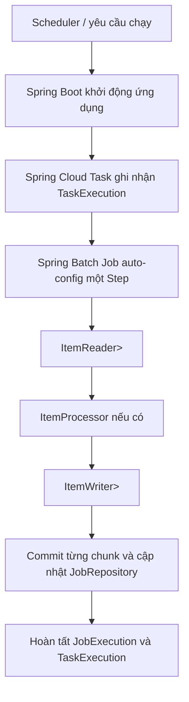
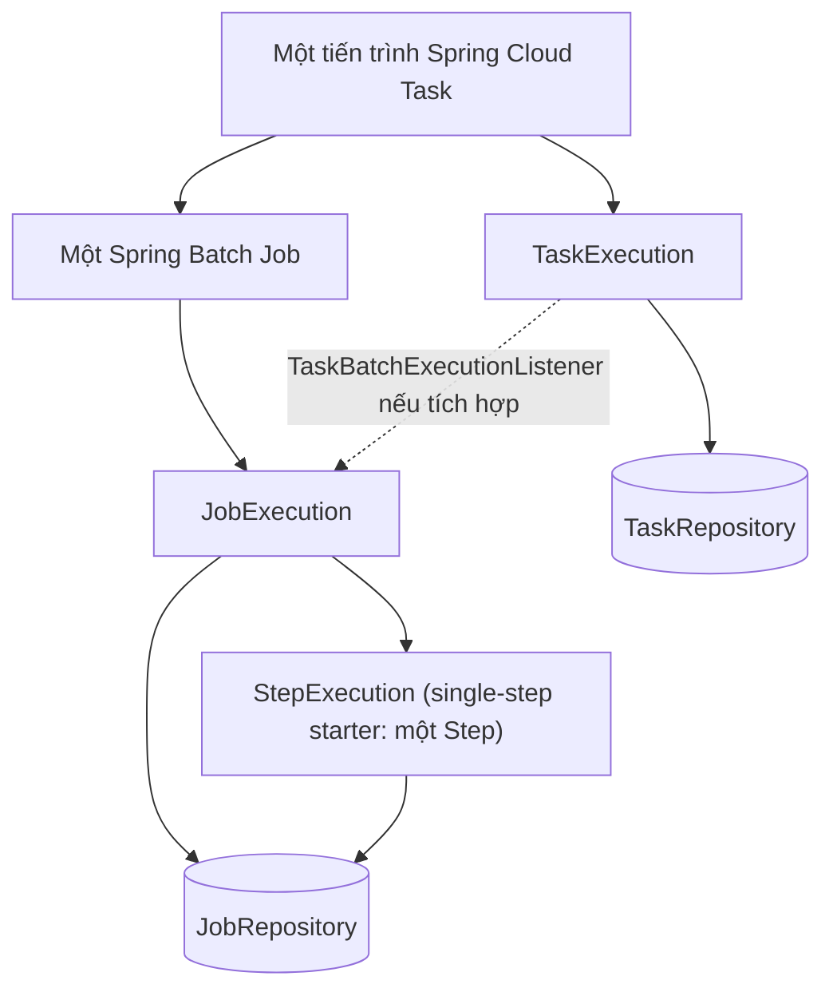

# Giới hạn cấu hình và đối chiếu starter theo phiên bản

## Mục tiêu bài học

Trong **SPRING_CLOUD_TASK (Spring Cloud Task)**, một ứng dụng Spring Boot có thể được chạy theo lịch hoặc theo yêu cầu, thực hiện công việc trong một khoảng thời gian hữu hạn rồi kết thúc. Spring Cloud Task lưu thông tin mỗi lần chạy trong `TaskRepository` để tra cứu thời điểm, mã thoát và lỗi. Nếu công việc gồm đọc, xử lý và ghi dữ liệu theo lô, ứng dụng có thể tích hợp **Spring Batch** để dùng `Job`, `Step`, chunk, checkpoint và restart.

Chương **Job một bước** giới thiệu `spring-cloud-starter-single-step-batch-job`, một starter giúp tạo **Spring Batch Job có một Step dạng chunk** chủ yếu bằng cấu hình. Bài này tập trung vào hai việc dễ bị bỏ sót: **starter có giới hạn cấu hình cụ thể** và **ví dụ trên tài liệu không thay thế cho việc kiểm tra phiên bản dependency thực tế**.

Sau bài học, bạn có thể:

- Hiểu starter tạo Job/Step như thế nào và ba property `jobName`, `stepName`, `chunkSize`.
- Nhận biết giới hạn **một Step** và kiểu item thống nhất `Map<String, Object>` khi tự cung cấp reader, processor hoặc writer.
- Chọn reader/writer được auto-configuration hỗ trợ, đồng thời xác định thành phần nào phải khai báo bằng bean Java.
- Đối chiếu bản Spring Cloud Task, Spring Boot, Spring Batch và artifact starter trước khi triển khai.
- Hiểu vì sao quy trình Spring AOT/native cần lựa chọn reader/writer ngay tại **build time** trong những trường hợp dựa vào property.
- Chuyển sang cấu hình `Job` và `Step` tường minh khi bài toán vượt khả năng starter.
- Kiểm chứng metadata Task, metadata Batch, retry, restart và mã thoát trước khi đưa Job lên scheduler.

## 1. Single Step Batch Job Starter là gì?

`spring-cloud-starter-single-step-batch-job` là module được tài liệu Spring Cloud Task giới thiệu nhằm dựng một `Job` với **một `Step` theo mô hình chunk**. Thay vì luôn tự viết `JobBuilder` và `StepBuilder`, bạn có thể khai báo tên Job, tên Step, kích thước chunk và lựa chọn một số loại reader/writer bằng property.

Luồng xử lý điển hình:



| Thành phần | Vai trò | Không nên nhầm với |
| --- | --- | --- |
| `TaskExecution` | Một lần chạy ứng dụng hữu hạn, được Spring Cloud Task theo dõi. | `JobExecution` của Spring Batch. |
| `Job` | Luồng xử lý dữ liệu theo lô, ở starter này được tổ chức theo một Step. | Tiến trình JVM hoặc lịch chạy của scheduler. |
| `Step` | Một đơn vị xử lý chunk: đọc, xử lý tùy chọn, ghi. | Từng record trong file. |
| `ItemReader` | Trả về item kế tiếp, thường cho đến khi hết dữ liệu. | Thành phần tự bảo đảm mọi nguồn đọc đều transactional. |
| `ItemProcessor` | Chuyển đổi/lọc item, là **tùy chọn**. | Bước thay thế để tạo thêm Job hoặc Step. |
| `ItemWriter` | Ghi một nhóm item trong chunk. | Cơ chế chống lặp bên ngoài hệ thống. |
| `JobRepository` | Lưu lịch sử Job/Step, execution context để hỗ trợ restart. | `TaskRepository` và metadata của toàn bộ ứng dụng. |

Starter **không phải** một bộ lập lịch, không tự tạo cấu trúc pipeline nhiều nhánh và không thay thế các quy tắc restart/idempotency của Spring Batch. Nó giải quyết nhu cầu tạo Job một Step nhanh khi dữ liệu phù hợp với các thành phần được hỗ trợ.

## 2. Ba property nền tảng và giới hạn một Step

Theo phần **Single Step Batch Job Starter** của tài liệu Spring Cloud Task, các property cấu hình lõi gồm:

| Property | Kiểu | Mặc định trong bảng tài liệu | Chức năng |
| --- | --- | --- | --- |
| `spring.batch.job.jobName` | `String` | `null` | Tên Job được starter tạo. |
| `spring.batch.job.stepName` | `String` | `null` | Tên Step duy nhất. |
| `spring.batch.job.chunkSize` | `Integer` | `null` | Số item dự kiến xử lý trong một đơn vị giao dịch chunk. |

Ví dụ **cấu hình cơ sở**, chưa làm công việc có ích:

```yaml
spring:
  batch:
    job:
      jobName: copyCustomersJob
      stepName: copyCustomersStep
      chunkSize: 100
```

Ba giá trị trên giúp starter tạo **khung Job/Step**. Muốn thực sự xử lý dữ liệu, phải có `ItemReader`, `ItemWriter` và `ItemProcessor` nếu cần biến đổi. Một số reader/writer có thể tạo từ property, số khác phải được định nghĩa thành bean.

### “Một Step” có nghĩa là gì?

Một `Step` dạng chunk lặp qua nhiều item và nhiều lần commit cho đến khi dữ liệu hết. **Một Step không phải một item**, và `chunkSize: 100` không có nghĩa Job sẽ chỉ chạy 100 record. Với 250 item và không có filtering, hệ thống thường xử lý các nhóm 100, 100, 50; chi tiết đọc/commit còn phụ thuộc reader, skip, retry và transaction manager.

Tuy nhiên, starter không cung cấp cấu hình DSL để xây dựng tùy ý:

- Job có nhiều Step nối tiếp, phân nhánh theo `ExitStatus` hoặc có step kiểm tra dữ liệu trước khi ghi.
- Partitioning, remote chunking, flow/split, sub-job hoặc workflow điều kiện phức tạp.
- Nhiều reader/writer có kiểu dữ liệu không tương thích hoặc pipeline generic mạnh như `Customer → ValidatedCustomer → CsvRow` mà không tự thiết kế bean/Step.
- Policy retry/skip/chunk transaction chuyên biệt vượt các property được starter tài liệu hóa.

Khi phát sinh các yêu cầu này, giải pháp rõ ràng hơn là khai báo `Job`/`Step` bằng Spring Batch Java configuration tương thích phiên bản đang dùng, và vẫn dùng Spring Cloud Task để theo dõi vòng đời toàn ứng dụng.

## 3. Giới hạn kiểu dữ liệu: Map<String, Object>

Tài liệu starter nêu rõ các `ItemReader`/`ItemWriter` auto-configured cung cấp item dạng `Map<String, Object>`. `ItemProcessor` được tự gắn khi context có bean đúng kiểu `ItemProcessor<Map<String, Object>, Map<String, Object>>`.

Điều này có ảnh hưởng trực tiếp đến mã Java:

```java
import java.util.LinkedHashMap;
import java.util.Locale;
import java.util.Map;
import org.springframework.batch.item.ItemProcessor;
import org.springframework.context.annotation.Bean;
import org.springframework.context.annotation.Configuration;

@Configuration(proxyBeanMethods = false)
public class CustomerProcessorConfiguration {

    @Bean
    ItemProcessor<Map<String, Object>, Map<String, Object>>
            normalizeEmailProcessor() {
        return item -> {
            Map<String, Object> copy = new LinkedHashMap<>(item);
            Object email = copy.get("email");
            if (email != null) {
                copy.put("email",
                        email.toString().strip().toLowerCase(Locale.ROOT));
            }
            return copy;
        };
    }
}
```

Đoạn mã trên chỉ minh họa processor tự định nghĩa; cần thêm processor này vào ứng dụng có starter **đúng phiên bản**. Nếu dùng reader trả về `Customer` trong khi writer chấp nhận `Map`, không thể chỉ đặt tên property rồi mặc định các generic type sẽ được chuyển đổi. Phải tự xây mapper/processor và bảo đảm type của cả chuỗi tương thích.

### Những giới hạn dễ gặp với Map

| Tình huống | Hệ quả |
| --- | --- |
| Đổi tên cột CSV từ `email` thành `emailAddress` | `Map.get("email")` trả về `null`; lỗi có thể âm thầm nếu không validate. |
| Value được đọc như `String` nhưng phép tính cần `BigDecimal` | Phải chuyển kiểu và xử lý dữ liệu sai định dạng tường minh. |
| Một phần pipeline dùng `Map`, phần khác dùng record Java | Generic type không tự khớp; cần chuyển đổi hoặc viết Step riêng. |
| Nhiều bean `ItemProcessor<Map, Map>` đủ điều kiện | Auto-wiring có thể không rõ lựa chọn tùy cơ chế cấu hình; nên xác định bean cần dùng và kiểm tra context. |
| Kết quả nghiệp vụ cần validation/schema chặt | Khó phát hiện lỗi compile-time khi dùng key chuỗi; cân nhắc Java record và Spring Batch configuration tường minh. |

`Map<String, Object>` phù hợp cho chuyển dữ liệu giữa các nguồn có schema tương đối động và đơn giản. Với dữ liệu quan trọng cần type safety hoặc nghiệp vụ phức tạp, hãy dùng đối tượng miền và `ItemReader<T>`/`ItemProcessor<T, R>`/`ItemWriter<R>` do dự án định nghĩa.

## 4. Reader/writer nào được starter auto-configure?

Theo tài liệu starter, các reader được hỗ trợ gồm:

| Reader | Nguồn dữ liệu | Điểm cần tự chuẩn bị |
| --- | --- | --- |
| `AmqpItemReader` | RabbitMQ/AMQP | `AmqpTemplate` và kết nối broker, converter nếu dùng JSON. |
| `FlatFileItemReader` | CSV hoặc file dòng cố định | `Resource`, delimiter/ranges, field names, cách parse và xử lý record lỗi. |
| `JdbcCursorItemReader` | Câu SQL và cursor JDBC | `DataSource`, SQL, `RowMapper`/`PreparedStatementSetter` khi cần. |
| `KafkaItemReader` | Partition Kafka | Cấu hình Kafka, topic và danh sách partition cần đọc. |

Các writer được tài liệu liệt kê gồm:

| Writer | Đích dữ liệu | Điểm cần tự chuẩn bị |
| --- | --- | --- |
| `AmqpItemWriter` | AMQP exchange/queue | `AmqpTemplate`, converter và bảo đảm xử lý trùng phía nhận. |
| `FlatFileItemWriter` | File văn bản/CSV | Đường dẫn ghi, field names, formatter, chiến lược ghi đè/append. |
| `JdbcBatchItemWriter` | Database quan hệ | SQL, `DataSource`, mapping tham số, quyền ghi và khóa nghiệp vụ. |
| `KafkaItemWriter` | Kafka topic | Topic, producer, handling retry và idempotency theo luồng sự kiện. |

**Các tên property rất cụ thể**, ví dụ:

- `spring.batch.job.amqpitemreader.enabled` và `spring.batch.job.amqpitemwriter.enabled`.
- `spring.batch.job.flatfileitemreader.resource`, `...delimited`, `...names`.
- `spring.batch.job.jdbccursoritemreader.sql`, `...fetchSize`.
- `spring.batch.job.kafkaitemreader.topic` và `...partitions`.
- `spring.batch.job.flatfileitemwriter.resource`, `...delimited`, `...names`.
- `spring.batch.job.jdbcbatchitemwriter.sql`.
- `spring.batch.job.kafkaitemwriter.topic`.

Những key nằm dưới `spring.batch.job.*` này thuộc **single-step starter** được tài liệu hóa; **không** có nghĩa Spring Boot Batch thông thường tự nhận tất cả chúng khi chỉ thêm `spring-boot-starter-batch`. Khi bỏ starter chuyên biệt và khai báo Job tường minh, các property đó phải được code ứng dụng tự bind nếu vẫn muốn dùng.

### Cấu hình một phần không đồng nghĩa pipeline hợp lệ

Khởi tạo bean Reader/Writer có thể cần các thành phần khác ngoài property. Ví dụ `JdbcCursorItemReader` dùng `sql` nhưng cũng cần DataSource và RowMapper tương thích. `KafkaItemReader` không đọc được nếu thiếu client/broker/topic/partition. `FlatFileItemWriter` có thể ghi file rỗng hoặc sai cột nếu không có names/formatter đúng.

Với mọi lựa chọn, cần kiểm tra:

1. Dependency của nguồn/đích (JDBC driver, AMQP hoặc Kafka).
2. Cấu hình kết nối của môi trường.
3. Type của item qua reader, processor và writer.
4. Khả năng restart và cách lưu `ExecutionContext`.
5. Đầu ra nghiệp vụ thật, thay vì chỉ tin rằng Job có `BatchStatus.COMPLETED`.

## 5. Ví dụ cấu hình: sao chép CSV trong một Step

Giả sử file đầu vào `/data/input/customers.csv` có header và hai trường:

```csv
id,email
C001,ALICE@EXAMPLE.COM
C002,BOB@EXAMPLE.COM
```

Một cấu hình theo **hệ property được mô tả trong single-step starter**:

```yaml
spring:
  application:
    name: customer-file-task
  main:
    web-application-type: none
  batch:
    job:
      jobName: copyCustomersJob
      stepName: copyCustomersStep
      chunkSize: 100
      flatfileitemreader:
        name: customerFileReader
        resource: file:/data/input/customers.csv
        strict: true
        linesToSkip: 1
        delimited: true
        delimiter: ","
        names: [id, email]
      flatfileitemwriter:
        name: customerFileWriter
        resource: file:/data/output/customers.csv
        delimited: true
        delimiter: ","
        names: [id, email]
        shouldDeleteIfExists: true
```

Nếu thêm bean `normalizeEmailProcessor()` ở mục 3 và starter gắn processor đúng như mong đợi, email sẽ được chuyển về chữ thường trước khi ghi. Kết quả file đầu ra **không mặc định có dòng header** chỉ vì file đầu vào có header; nếu cần header đầu ra, cấu hình writer callback hoặc tự xây writer.

Đây là **ví dụ định dạng cấu hình**, không phải cam kết có thể chạy nguyên trạng trên mọi phiên bản Spring Cloud Task/Spring Batch. Trước khi thử:

- Chốt bộ dependency tương thích và kiểm tra `spring-cloud-starter-single-step-batch-job` hiện diện trong artifact.
- Chuẩn bị thư mục đầu ra có quyền ghi, và file đầu vào đúng định dạng.
- Đảm bảo `JobRepository` và `TaskRepository` có schema/driver phù hợp nếu dùng metadata JDBC.
- Chạy trên profile thử nghiệm, so sánh file đầu ra với dữ liệu mong đợi và kiểm tra hai repository.

**Hành vi restart:** `shouldDeleteIfExists: true` phù hợp khi muốn tạo lại toàn bộ file, nhưng có thể gây mất dữ liệu hoặc ghi đè thành quả của lần chạy trước. Với quy trình sản xuất, đặt tên file tạm theo execution hoặc khóa nghiệp vụ, tạo file nguyên tử và thiết kế chính sách xuất bản kết quả rõ ràng.

## 6. Giới hạn cấu hình và lúc nào cần rời starter

| Yêu cầu | Single-step starter | Nên làm gì nếu vượt giới hạn |
| --- | --- | --- |
| Sao chép/chuyển đổi dữ liệu qua một Step | Phù hợp nếu reader/writer được hỗ trợ và item type là `Map`. | Dùng cấu hình property, kiểm tra type và file/kết nối. |
| Chuyển đổi nhẹ các key/value | Có thể khai báo bean `ItemProcessor<Map, Map>`. | Viết processor có validation, test mapping và lỗi dữ liệu. |
| Một Step cần `Customer → ValidatedCustomer` với generic type cụ thể | Không phải kiểu item mặc định của starter. | Khai báo Step bằng Java với generic type phù hợp. |
| Job có nhiều Step, điều kiện hoặc job flow | Starter được thiết kế cho **một** Step chunk. | Dùng `JobBuilder`/`StepBuilder` và flow API Spring Batch. |
| Tùy chỉnh skip/retry/backoff/transaction chuyên sâu | Chưa có nghĩa được hỗ trợ qua các property starter. | Kiểm tra API của phiên bản; cấu hình Step trực tiếp nếu cần. |
| Nhiều reader/writer động theo người dùng | Phụ thuộc cách auto-config chọn bean; runtime selection có giới hạn, đặc biệt AOT. | Chốt selection rõ ràng, cân nhắc nhiều Job hoặc cấu hình bean riêng. |
| Audit nghiệp vụ hoặc xuất bản sự kiện đúng một lần | Không được starter bảo đảm. | Idempotency key, unique constraint, outbox và kiểm tra phía nhận. |
| Phân tách Batch metadata, Task metadata và database nghiệp vụ | Cần cấu hình nguồn kết nối/transaction manager rõ ràng ngoài job properties. | Dùng `TaskConfigurer` và cấu hình Spring Batch phù hợp phiên bản. |

**Một file cấu hình dài không làm tăng khả năng của starter**. Nó chỉ có thể bind những property được lớp auto-configuration và phiên bản thực tế hỗ trợ. Nếu không tìm thấy bean Reader/Writer tương thích, phải sửa dependency, khai báo bean hoặc chuyển sang Java config; việc tự đặt thêm các key YAML không tạo ra tính năng mới.

## 7. Đối chiếu starter theo phiên bản: bước bắt buộc

Một chi tiết dễ gây nhầm là **tài liệu tham khảo hiện hành của Spring Cloud Task vẫn có ví dụ Maven gắn cứng phiên bản `2.3.0`**:

```xml
<!-- Ví dụ có trong tài liệu; KHÔNG sao chép nguyên version cho mọi dự án -->
<dependency>
    <groupId>org.springframework.cloud</groupId>
    <artifactId>spring-cloud-starter-single-step-batch-job</artifactId>
    <version>2.3.0</version>
</dependency>
```

Trong khi đó, artifact `org.springframework.cloud:spring-cloud-starter-single-step-batch-job` cũng có các bản phát hành **mới hơn** (ví dụ `5.0.2` trên Maven Central). Vì vậy, số `2.3.0` trong đoạn mẫu **không phải một quy tắc tương thích chung** với Spring Boot/Spring Cloud hiện tại. Tương tự, tài liệu cũ có cú pháp Gradle `compile`; trong Gradle hiện đại, cấu hình dependency thường dùng `implementation`.

### Ma trận kiểm tra trước khi chọn dependency

| Câu hỏi | Điều cần xác minh |
| --- | --- |
| Spring Boot đang chạy phiên bản nào? | Tên phiên bản và Java baseline, không dựa vào cảm giác “mới”. |
| Spring Cloud release train/BOM là gì? | Dùng bảng tương thích Boot–Cloud của Spring để chọn release train phù hợp. |
| Spring Cloud Task nằm ở dòng phiên bản nào? | Đối chiếu với release train và release notes; không tự gán version theo tên module. |
| Artifact single-step starter có phiên bản tương ứng không? | Kiểm tra Maven Central/repository được phép và POM dependency của artifact. |
| Spring Batch đi kèm là major version nào? | Kiểm tra API của `JobBuilder`, `StepBuilder`, reader/writer và thay đổi breaking giữa Batch 4/5/6. |
| JAR/Native image có đúng bean và auto-configuration không? | Dùng dependency report, startup condition report và smoke test Job thật. |
| Ví dụ có property hay cú pháp Gradle cũ không? | Phân biệt mô tả ý tưởng với snippet copy-paste đã được kiểm chứng. |

**Không nên** ghép `spring-cloud-starter-single-step-batch-job:2.3.0` vào một ứng dụng Spring Boot mới chỉ vì trang reference hiển thị số này. Một artifact thuộc dòng Spring Cloud Task cũ có thể kéo theo API hoặc auto-configuration không tương thích với Spring Boot, Spring Batch và Spring Framework hiện tại.

### Mẫu dependency Maven để chốt theo BOM

Khi release train quản lý được các module phù hợp, ưu tiên đặt **BOM ở một nơi** và khai báo dependency không ghi lại các version rời:

```xml
<!-- POM minh họa: cần khai báo spring-cloud.version
     tương thích với Spring Boot version của dự án. -->
<dependencyManagement>
    <dependencies>
        <dependency>
            <groupId>org.springframework.cloud</groupId>
            <artifactId>spring-cloud-dependencies</artifactId>
            <version>${spring-cloud.version}</version>
            <type>pom</type>
            <scope>import</scope>
        </dependency>
    </dependencies>
</dependencyManagement>

<dependencies>
    <dependency>
        <groupId>org.springframework.cloud</groupId>
        <artifactId>spring-cloud-starter-task</artifactId>
    </dependency>
    <dependency>
        <groupId>org.springframework.cloud</groupId>
        <artifactId>spring-cloud-starter-single-step-batch-job</artifactId>
    </dependency>
</dependencies>
```

**Điều kiện cần kiểm chứng:** BOM thực tế **có quản lý phiên bản** của `spring-cloud-starter-single-step-batch-job` hay không. Nếu không có, Maven sẽ báo thiếu version; khi đó phải chốt version bằng chứng cứ tương thích từ POM/release notes của module, không đoán. Một vài artifact phụ không nhất thiết nằm trong mọi BOM. `spring-cloud-starter-task` dùng để theo dõi vòng đời Task; single-step starter cung cấp cấu hình Batch Job, và dependency transitives cũng phải được xác minh.

Kiểm tra phiên bản đã resolve:

```bash
mvn dependency:tree -Dincludes=org.springframework.cloud,org.springframework.batch,org.springframework.boot
```

Để xem lý do một version được chọn hoặc có override từ nơi khác:

```bash
mvn help:effective-pom
```

Nếu dùng Gradle, xem `dependencyInsight` cho chính artifact và `runtimeClasspath`. Trong môi trường build, cần xác nhận **phiên bản cuối cùng được resolve**, vì dependency transitives hoặc constraint khác có thể thay đổi kết quả.

### Phân loại theo dòng dự án

| Dòng ứng dụng | Phương án đánh giá |
| --- | --- |
| Dự án cũ sử dụng Spring Cloud Task 2.x/Spring Batch 4 | Có thể tham khảo ví dụ starter `2.3.0` nếu **cùng thế hệ** thư viện và JDK; không nâng cấp một dependency riêng lẻ khi chưa kiểm chứng. |
| Dự án dùng Spring Boot 3.x/Spring Batch 5 | Dùng release train tương thích và chọn starter đồng thế hệ; kiểm tra Java/Jakarta namespace, metadata schema và condition auto-config. |
| Dự án dùng Spring Boot 4.x/Spring Batch 6 | Xác minh artifact starter dòng phù hợp và các thay đổi API/BOM; không sao chép code ví dụ Spring Batch 5 mà chưa biên dịch/test. |
| Ứng dụng yêu cầu native image/AOT | Kiểm tra lựa chọn bean tại build time và cơ chế hints; không coi runtime property selection trên JVM là bằng chứng native sẽ hoạt động. |

Mục tiêu của bảng là một **quy trình kiểm tra**, không phải khẳng định mọi tổ hợp trong cùng một dòng đều được hỗ trợ. Ngay cả bản starter phát hành mới cũng cần đối chiếu POM và release notes trước khi chuyển đổi.

## 8. Giới hạn đặc biệt với Spring AOT / native compilation

Một ưu điểm của single-step starter khi chạy JVM là có thể chọn reader và writer thông qua các property khác nhau tại thời điểm chạy. Với **Spring AOT hoặc native compilation**, tập bean được xử lý lúc build có thể bị đóng băng trước khi ứng dụng chạy; các cấu hình bean bị loại trong quá trình AOT sẽ không thể xuất hiện chỉ vì lúc chạy đổi property.

Tài liệu Spring Cloud Task nêu rõ rằng **tên reader/writer cần có tại build time** nếu bạn dựa vào cơ chế tạo bean bằng property; ngoại lệ là khi bạn chủ động tạo các bean Reader/Writer tường minh phù hợp.

Ví dụ hướng dẫn Maven ở bản tài liệu sử dụng `process-aot`:

```xml
<!-- Chỉ là ví dụ khái niệm build-time cho starter hỗ trợ AOT.
     Kiểm tra cấu trúc plugin theo bản Spring Boot đang dùng. -->
<plugin>
    <groupId>org.springframework.boot</groupId>
    <artifactId>spring-boot-maven-plugin</artifactId>
    <executions>
        <execution>
            <id>process-aot</id>
            <goals>
                <goal>process-aot</goal>
            </goals>
            <configuration>
                <jvmArguments>
                    -Dspring.batch.job.flatfileitemreader.name=customerFileReader
                    -Dspring.batch.job.flatfileitemwriter.name=customerFileWriter
                </jvmArguments>
            </configuration>
        </execution>
    </executions>
</plugin>
```

Một số trang/nhánh tài liệu dùng cấu hình plugin `arguments` thay cho `jvmArguments`. Không áp dụng hai mẫu đồng thời một cách máy móc: cần kiểm tra **chính xác** cách plugin Spring Boot phiên bản đã chọn truyền property vào bước AOT. Bằng chứng cần là **native image được build và chạy thử**, có bean Reader/Writer thật và xử lý dữ liệu thành công.

Một quy trình test AOT hợp lý:

1. Chốt cố định loại reader/writer và cấu hình tại giai đoạn build.
2. Build native image với tham số/hints phù hợp phiên bản.
3. Kiểm tra startup context và các bean thực sự xuất hiện trong image.
4. Chạy một Job thử có dữ liệu đầu vào và đầu ra thực.
5. Thử thay runtime property để xác định những lựa chọn nào **không còn động**, rồi ghi lại giới hạn triển khai.

Không dùng “ứng dụng chạy được trên JVM” để kết luận native image sẽ tự hỗ trợ các lựa chọn reader/writer mới tại runtime.

## 9. Khi cần linh hoạt hơn: xây Job và Step bằng Java

Khi phải dùng nhiều Step hoặc item type cụ thể, Spring Batch Java configuration giúp kiểm soát thiết kế rõ ràng hơn. Ví dụ tối thiểu sau là **phương án thay thế** cho single-step starter, viết theo phong cách **Spring Batch 5 / Spring Boot 3**:

```java
package com.example.report;

import org.springframework.batch.core.Job;
import org.springframework.batch.core.Step;
import org.springframework.batch.core.job.builder.JobBuilder;
import org.springframework.batch.core.repository.JobRepository;
import org.springframework.batch.core.step.builder.StepBuilder;
import org.springframework.batch.repeat.RepeatStatus;
import org.springframework.context.annotation.Bean;
import org.springframework.context.annotation.Configuration;
import org.springframework.transaction.PlatformTransactionManager;

@Configuration(proxyBeanMethods = false)
public class ExplicitJobConfiguration {

    @Bean
    Step validateInputStep(JobRepository repository,
                           PlatformTransactionManager transactionManager) {
        return new StepBuilder("validateInputStep", repository)
                .tasklet((contribution, context) -> {
                    // Kiểm tra nguồn dữ liệu và tham số nghiệp vụ.
                    return RepeatStatus.FINISHED;
                }, transactionManager)
                .build();
    }

    @Bean
    Step exportDataStep(JobRepository repository,
                        PlatformTransactionManager transactionManager) {
        return new StepBuilder("exportDataStep", repository)
                .tasklet((contribution, context) -> {
                    // Gọi service xử lý nghiệp vụ có idempotency.
                    return RepeatStatus.FINISHED;
                }, transactionManager)
                .build();
    }

    @Bean
    Job reportJob(JobRepository repository,
                  Step validateInputStep,
                  Step exportDataStep) {
        return new JobBuilder("reportJob", repository)
                .start(validateInputStep)
                .next(exportDataStep)
                .build();
    }
}
```

Code trên minh họa **hai Step** để nêu khác biệt thiết kế, chưa chứa logic đọc/ghi dữ liệu thật; Step `Tasklet` chỉ trả `RepeatStatus.FINISHED`. Phải cấu hình `JobRepository`, transaction manager, Spring Cloud Task và phương thức launch Job phù hợp trước khi chạy. Với Spring Batch 6 hoặc release khác, chữ ký builder/configuration có thể đổi; cần kiểm tra Javadoc và biên dịch thực tế.

Trong ứng dụng chỉ muốn dùng Job tường minh, không cần giữ single-step starter nếu nó tự tạo thêm Job cạnh tranh. Dùng `spring-boot-starter-batch` cùng Spring Cloud Task phù hợp; nếu muốn tra cứu mối quan hệ giữa `TaskExecution` và `JobExecution`, bổ sung tích hợp `spring-cloud-task-batch` theo bản tương thích.

## 10. Metadata, exit code và khởi chạy không bị trùng

Spring Cloud Task và Spring Batch theo dõi các đối tượng khác nhau:



Nếu có `spring-cloud-task-batch` và bean `Job` phù hợp, `TaskBatchExecutionListener` có thể liên kết một `TaskExecution` với các `JobExecution` qua bảng `TASK_TASK_BATCH`. Tuy nhiên, **có liên kết không chứng minh Job thành công**.

Trong một số cấu hình Batch/Boot mặc định, Batch Job thất bại nhưng tiến trình Task vẫn có thể trả exit code `0` nếu lỗi không được lan truyền lên tầng Task. Spring Cloud Task có property:

```yaml
spring:
  cloud:
    task:
      batch:
        fail-on-job-failure: true
```

Property này được tài liệu mô tả để chuyển thất bại của Batch Job thành mã thoát Task phù hợp trên đường khởi chạy được tích hợp. Với runner tùy chỉnh hoặc xử lý bất đồng bộ, phải kiểm chứng thực tế. Tách ba lớp kết quả: `JobExecution/StepExecution`, `TaskExecution` và mã thoát Job/Pod ở scheduler.

**Tránh khởi chạy hai lần:** nếu Spring Boot đã tự chạy bean `Job` lúc startup, không tạo thêm `ApplicationRunner` gọi `JobLauncher` cho cùng Job trừ khi bạn đã tắt auto-run và quyết định rõ cách truyền `JobParameters`. Đặc biệt, một starter được thêm vào có thể tạo Job bean ngoài ý định của bạn.

## 11. Restart, checkpoint và an toàn dữ liệu

Một Step chunk có thể commit nhiều lần. Khi lỗi xảy ra giữa chừng, Spring Batch lưu metadata để có thể restart nếu reader/writer và Job được thiết kế đúng. Việc bật `saveState` trên một reader chỉ là **một phần** của bài toán:

- File đầu vào phải ổn định hoặc có phiên bản xác định trong suốt các lần restart.
- Writer phải idempotent hoặc có cơ chế xác định bản ghi đã ghi, nhất là khi database và nguồn dữ liệu không chung transaction.
- Các nguồn AMQP/Kafka có ngữ nghĩa nhận/phát lại riêng; không tự bảo đảm exactly-once chỉ vì dùng Spring Batch.
- File writer phải có chính sách tên tệp, append/overwrite, tạo file tạm và publish nguyên tử.
- `JobParameters` cần phân biệt tham số identifying để restart đúng `JobInstance`; một timestamp mới ở mỗi lần chạy có thể tạo instance mới.
- Khi có scheduler chạy song song, bảo vệ khóa nghiệp vụ hoặc dùng cơ chế concurrency thích hợp.

Ví dụ một Job xử lý `businessDate=2026-11-23` thất bại sau 2 chunk: chạy lại phải xác định có xử lý từ checkpoint hay tái xử lý dữ liệu, và output trước đó có bị nhân đôi không. Không dùng một dòng `TaskExecution.EXIT_CODE=0` để kết luận mọi record đều đã được ghi chính xác.

### Phân biệt ba loại thất bại

| Lỗi | Nơi thường phát hiện | Cách giải quyết |
| --- | --- | --- |
| Starter chưa resolve, không có bean reader/writer | Build hoặc khởi động context. | Kiểm tra artifact/version, auto-configuration và property. |
| Job chạy rồi Step thất bại | `JobRepository`, `BATCH_STEP_EXECUTION` và log Step. | Sửa dữ liệu/logic, quyết định restart hay tạo instance mới. |
| Task hỏng khi ghi metadata hoặc bị kill | `TaskRepository`, exit code và hệ điều phối. | Kiểm tra database, timeout, trạng thái tiến trình; đối chiếu đầu ra trước khi retry. |

## 12. Checklist kiểm tra starter trước khi triển khai

| Kiểm tra | Cách xác minh | Dấu hiệu đạt |
| --- | --- | --- |
| Compatibility | Bảng Spring Boot–Spring Cloud, POM và release notes. | Bộ version đã chốt, không có override ngoài ý muốn. |
| Dependency resolution | `mvn dependency:tree` hoặc `gradle dependencies`/`dependencyInsight`. | Starter và các transitive dependencies đúng phiên bản dự kiến. |
| Auto-configuration | Log startup/condition report, bean list phù hợp. | Chỉ có Job/Step/reader/writer cần thiết. |
| Property binding | Kiểm tra `jobName`, `stepName`, `chunkSize`, reader/writer options. | Những property cần thiết được sử dụng; không có key viết sai chính tả. |
| Input/output type | Kiểm tra generic type và dữ liệu mẫu. | `Map<String, Object>` nhất quán hoặc có bean tùy chỉnh rõ ràng. |
| Metadata schema | Migration đúng bản Task/Batch và quyền DB. | Đọc được cả TaskExecution và JobExecution. |
| Kết quả nghiệp vụ | So sánh file/database/queue đích. | Đúng số record, đúng mapping, không mất/trùng. |
| Failure/restart | Tạo lỗi có kiểm soát sau vài chunk, khởi chạy lại. | Restart đúng JobInstance, output không bị ghi trùng. |
| Scheduler/exit code | Chạy một lượt lỗi và một lượt thành công. | Mã thoát Task/Job phản ánh đúng kết quả và chính sách retry. |
| Native/AOT nếu có | Build và chạy native image thật. | Bean reader/writer đúng và dữ liệu chạy xong; giới hạn runtime selection được ghi rõ. |

Đối với code thay đổi nhẹ chỉ ở mapping, cần test đơn vị processor và một test tích hợp đọc/ghi mẫu. Với thay đổi version hay starter, nên kiểm thử **end-to-end** bằng cơ sở dữ liệu metadata cùng loại production và một bộ dữ liệu đại diện.

## 13. Bài thực hành có hướng dẫn

**Tình huống:** cần xây dựng `customer-file-task` đọc CSV khách hàng, chuẩn hóa email và ghi CSV đầu ra. Ứng dụng chạy mỗi đêm, có thể chạy lại khi file lỗi, đồng thời phải lưu lịch sử Task/Batch.

1. Ghi rõ version Spring Boot, Spring Cloud release train, Spring Cloud Task, Spring Batch và JDK đã chọn. Xác minh phiên bản starter được resolve bằng công cụ build.
2. Tạo cấu hình `jobName`, `stepName`, `chunkSize` và reader/writer như mục 5 theo tài liệu đúng release.
3. Bổ sung `ItemProcessor<Map<String, Object>, Map<String, Object>>` từ ví dụ mục 3; tạo file CSV mẫu có email chữ hoa.
4. Khởi chạy bằng JVM và kiểm tra số dòng kết quả, email chuẩn hóa, tên Job/Step trong metadata.
5. Thử thiếu file, cột sai, giá trị email null, output directory không có quyền và lỗi database; ghi rõ lỗi xảy ra ở bước nào.
6. Chạy hai lần cùng input và kiểm tra chính sách ghi đè hoặc chống trùng; sau đó cố ý lỗi ở chunk thứ hai để thử restart.
7. Bật tích hợp Spring Cloud Task–Batch và đối chiếu `TaskExecution`, `JobExecution`, `StepExecution`, mã thoát Task và trạng thái scheduler.
8. Thay yêu cầu thành Job có bước kiểm tra nguồn trước rồi mới xử lý chính; nhận diện lúc nào phải chuyển sang cấu hình `JobBuilder`/`StepBuilder` tường minh.
9. Nếu dùng native compilation, chốt reader/writer tại build time và kiểm chứng image thay vì chỉ chạy JAR.

**Tiêu chí hoàn thành:** biết chọn/kiểm chứng đúng version starter; Job một Step xử lý dữ liệu thực; hiểu khi nào `Map<String, Object>` và property không còn đáp ứng; metadata có thể tra cứu; thất bại/restart không làm hỏng đầu ra; và có bằng chứng tính năng hoạt động trên kiểu đóng gói triển khai thật.

## 14. Tài liệu tham khảo

- [Spring Cloud Task — Single Step Batch Job Starter](https://docs.spring.io/spring-cloud-task/reference/batch-starter.html): bảng property Job, reader/writer, kiểu item, Spring AOT và ví dụ dependency.
- [Spring Cloud Task — Single Step Batch Job Starter (nhánh 3.3)](https://docs.spring.io/spring-cloud-task/reference/3.3/batch-starter.html): đối chiếu tài liệu theo release thay vì chỉ đọc một URL “current”.
- [Spring Cloud Task — Batch Integration](https://docs.spring.io/spring-cloud-task/reference/batch.html): liên kết Task–Batch và `fail-on-job-failure`.
- [Spring Cloud — Release Train Compatibility](https://spring.io/projects/spring-cloud/): bảng tương thích Spring Cloud với Spring Boot.
- [Spring Batch — Reference](https://docs.spring.io/spring-batch/reference/): cấu hình Job/Step, chunk, JobRepository, restart, fault tolerance.
- [Maven Central — spring-cloud-starter-single-step-batch-job](https://central.sonatype.com/artifact/org.springframework.cloud/spring-cloud-starter-single-step-batch-job): xem artifact/version/POM đã phát hành.

## Ghi nhớ

- Single-step starter tạo **Job có một Step chunk**; `jobName`, `stepName`, `chunkSize` chỉ tạo khung, vẫn cần Reader/Writer và processor khi cần.
- Reader/Writer của starter tài liệu hóa dùng item `Map<String, Object>`; không tự ép kiểu sang Java record hoặc entity nghiệp vụ.
- **Property `spring.batch.job.*` của starter không phải toàn bộ property Spring Boot Batch chuẩn**. Chỉ áp dụng khi module/auto-configuration phù hợp có mặt.
- **Không sao chép số `2.3.0` từ ví dụ trong tài liệu “current”** cho mọi dự án. Đối chiếu release train, BOM, resolved dependency và major version Spring Batch trước khi chạy.
- Với AOT/native, lựa chọn reader/writer qua property có thể phải được xác định **lúc build**, khác với JVM chạy thông thường.
- Khi Job phức tạp, dùng Java configuration tường minh; vẫn giám sát riêng `TaskExecution`, `JobExecution`, kết quả nghiệp vụ và mã thoát từ scheduler.
