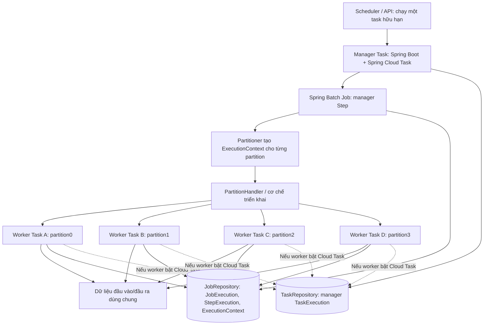
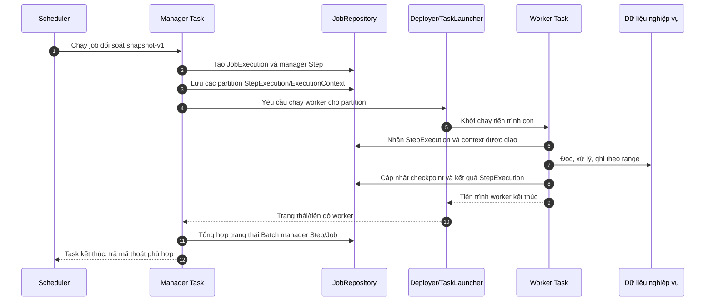

# Bài toán chia dữ liệu và mô hình quản lý công việc với tiến trình con

## 1. Bối cảnh: khi một Task không thể xử lý kịp toàn bộ dữ liệu

Trong chương **Phân vùng từ xa**, chúng ta xét một ứng dụng **Spring Cloud Task** được kích hoạt theo lịch hoặc theo yêu cầu để đối soát đơn hàng. Task phải đọc nhiều triệu bản ghi, tính toán và ghi kết quả vào database trước thời hạn. Khi chạy trong một tiến trình đơn lẻ, công việc có thể mất nhiều giờ; tăng số luồng trong cùng JVM cũng bị giới hạn bởi CPU, bộ nhớ và số kết nối database của một máy.

Một lựa chọn là **chia tập dữ liệu thành các partition độc lập**, đưa những phần đó tới nhiều **tiến trình con (worker process)** chạy song song. Spring Batch cung cấp mô hình *partitioning*; Spring Cloud Task có thể cung cấp vòng đời hữu hạn cho các ứng dụng worker, và cơ chế tích hợp với Spring Cloud Deployer hỗ trợ khởi chạy worker ở những môi trường thích hợp.

Trong mô hình này có hai cấp cần quan sát:

- **Ứng dụng quản lý (manager):** lập kế hoạch phân vùng, khởi chạy/điều phối worker và tổng hợp trạng thái của Batch Job.
- **Ứng dụng worker:** khởi chạy trong tiến trình/JVM/container riêng, xử lý phần dữ liệu đã giao rồi kết thúc; có thể tự được ghi nhận bằng một `TaskExecution` của Spring Cloud Task khi được cấu hình.

Không nên hiểu rằng chỉ cần thêm Spring Cloud Task là framework tự phân phối dữ liệu. **Việc chia, giao và tổng hợp công việc là mô hình của Spring Batch và bộ điều phối**; Spring Cloud Task theo dõi vòng đời ứng dụng hữu hạn và hỗ trợ thành phần triển khai khi tích hợp đúng.

### Mục tiêu học tập

Sau bài học, bạn có thể:

1. Nhận biết bài toán phù hợp với **remote partitioning** và phân biệt nó với đa luồng, local partitioning, remote chunking.
2. Giải thích vai trò của **manager**, **partitioner**, **partition handler**, **worker**, `TaskRepository` và `JobRepository`.
3. Thiết kế các khoảng dữ liệu không chồng lấn, không bỏ sót, có thể xác nhận và chạy lại.
4. Mô tả vòng đời manager/worker và cách truyền định danh công việc cho tiến trình con.
5. Đọc metadata `JobExecution`, `StepExecution`, `ExecutionContext` và `TaskExecution` mà không lẫn chúng với nhau.
6. Đánh giá giới hạn tài nguyên, tính idempotent, sự cố worker, retry và vận hành an toàn trong production.

## 2. Bài toán cụ thể: đối soát 10 triệu đơn hàng

Giả sử hệ thống cần đối soát **10.000.000 đơn hàng** của một snapshot dữ liệu. Một tiến trình đọc lần lượt tất cả bản ghi mất quá nhiều thời gian. Nếu dữ liệu cho phép xử lý các đơn hàng độc lập, manager có thể tách thành nhiều phần.

Ví dụ chia theo khoảng ID nửa mở, tức **`[startId, endIdExclusive)`**:

| Partition | Điều kiện lựa chọn dữ liệu | Worker được giao |
| --- | --- | --- |
| `partition0` | `1 <= order_id < 2_500_001` | Worker A |
| `partition1` | `2_500_001 <= order_id < 5_000_001` | Worker B |
| `partition2` | `5_000_001 <= order_id < 7_500_001` | Worker C |
| `partition3` | `7_500_001 <= order_id < 10_000_001` | Worker D |

Các khoảng không giao nhau và phủ toàn bộ miền `[1, 10_000_001)`. Nhưng **đếm ID không phải luôn bằng đếm bản ghi**: ID có thể bị khuyết, dữ liệu có thể phân bố lệch hoặc có các điều kiện lọc khác. Cách chia theo ID chỉ phù hợp khi các worker có thể đọc đúng tập dữ liệu qua điều kiện `WHERE` và độ lệch tải chấp nhận được.

Trong production, phải xác định rõ:

- **Phạm vi công việc:** ngày nghiệp vụ, tenant, snapshot/version dữ liệu, bộ lọc trạng thái.
- **Quy tắc chia:** mỗi bản ghi thuộc đúng một partition logic, kể cả ở ranh giới.
- **Tính ổn định:** input không thay đổi ngoài ý muốn giữa các lần retry; nếu thay đổi, cần chiến lược version hoặc high-water mark.
- **Tính độc lập:** worker này không phải đợi worker khác cập nhật cùng dữ liệu theo thứ tự.
- **Khả năng chạy lại:** một partition thất bại có thể thực hiện lại mà không nhân đôi tác dụng phụ.

**Chia nhiều tiến trình không bảo đảm nhanh hơn**: worker có thể cùng tranh chấp database, network hoặc khóa dữ liệu. Nếu bottleneck là một bảng ghi duy nhất, tăng worker đôi khi làm chậm hơn.

## 3. Kiến trúc manager và worker



### 3.1. Manager chịu trách nhiệm điều phối

Manager sở hữu luồng **Batch Job** và một **manager Step** được cấu hình để phân vùng một **worker Step**. `Partitioner` tạo nhiều `ExecutionContext`, mỗi context chứa tham số của một partition như `startId` và `endIdExclusive`. Spring Batch lưu metadata step/partition trong `JobRepository`.

`PartitionHandler` chịu trách nhiệm đưa các phân vùng đi xử lý. Với remote partitioning sử dụng Spring Cloud Task/Deployer, thành phần thường gặp là **`DeployerPartitionHandler`** kết hợp với **`TaskLauncher`** của Spring Cloud Deployer. Handler có thể yêu cầu nền tảng tạo các tiến trình worker, theo dõi trạng thái hoàn tất và tập hợp kết quả. Constructor, bean và property cụ thể cần đối chiếu tài liệu đúng phiên bản.

Manager **không nên chỉ fire-and-forget** rồi tự kết thúc thành công. Nó cần có chính sách chờ và xác định kết quả của mọi partition trong Batch Job, cùng timeout nếu worker mất liên lạc hoặc không hoàn tất.

### 3.2. Worker xử lý một phần dữ liệu

Worker là ứng dụng Spring Boot chạy trong **tiến trình con riêng** hoặc container riêng. Nó nhận định danh `StepExecution`/thông tin do cơ chế partition handler truyền, tải `ExecutionContext` từ `JobRepository` dùng chung và thực thi **worker Step** tương ứng. Worker đọc, xử lý, ghi dữ liệu trong phạm vi partition, cập nhật `StepExecution` và kết thúc.

Đường giao thông tin **không nên tùy tiện tự định nghĩa** nếu đang dùng Deployer integration có sẵn: cơ chế đó truyền những tham số khởi chạy cần thiết để worker nhận diện Step Execution. Tên option CLI nội bộ, cấu hình handler và worker bootstrap khác nhau theo phiên bản, vì vậy cần dựa vào ví dụ/tài liệu của chính bản Spring Cloud Task đang chạy.

Một worker **không nhận nguyên một danh sách hàng triệu bản ghi thông qua command line**. Manager truyền **metadata định danh** hoặc giới hạn partition; worker truy vấn nguồn dữ liệu với bộ lọc được giao.

### 3.3. Hai repository lưu hai loại lịch sử

| Thành phần | Dữ liệu lưu | Câu hỏi trả lời |
| --- | --- | --- |
| `TaskRepository` | `TaskExecution` của manager và của worker nếu có tích hợp Cloud Task | Tiến trình nào bắt đầu, kết thúc, mã thoát và external execution ID là gì? |
| `JobRepository` | `JobInstance`, `JobExecution`, `StepExecution`, `ExecutionContext` | Partition/step nào đã hoàn thành, thất bại, đã commit bao nhiêu và restart thế nào? |
| Bộ điều phối hạ tầng | ID Job/Pod/container, trạng thái runtime, retry, nguyên nhân kill/OOM | Worker còn sống không, bị kill hay mất tài nguyên? |
| Hệ thống nghiệp vụ | Khóa dữ liệu, kết quả thực tế, idempotency/audit | Công việc đã ghi đúng và đủ chưa? |

**Một worker TaskExecution không đồng nghĩa một Batch JobExecution.** Worker thường xử lý một `StepExecution` thuộc cùng Batch Job do manager điều phối. Đừng giả định mỗi worker phải tạo một JobInstance mới hoặc quan hệ trong bảng `TASK_TASK_BATCH` tự động bao phủ mọi Worker Step. Việc nối các ID cần dựa trên khả năng tích hợp và dữ liệu audit thực tế.

## 4. Phân biệt bốn mô hình song song

| Mô hình | Ai chia công việc? | Worker chạy ở đâu? | Phù hợp khi |
| --- | --- | --- | --- |
| **Single-thread Batch Step** | Không phân vùng | Một thread/tiến trình | Dữ liệu nhỏ, logic có thứ tự |
| **Multi-threaded Step** | Executor trong step | Nhiều thread trong một JVM | Xử lý song song nhưng tài nguyên một máy còn đủ |
| **Local partitioning** | `Partitioner` + `TaskExecutorPartitionHandler` | Nhiều worker Step trong **cùng JVM** | Cần metadata từng partition, không cần nhiều container |
| **Remote partitioning** | Manager Step + remote `PartitionHandler` | Nhiều **JVM/container** độc lập | Cần phân phối tải theo partition, worker tự đọc/ghi dữ liệu |
| **Remote chunking** | Manager đọc/chia chunk, gửi message | Worker từ xa xử lý chunk do manager gửi | Muốn giữ reader phía manager, phân phối xử lý chunk qua messaging |

Điểm khác biệt quyết định giữa **remote partitioning** và **remote chunking**:

- Remote partitioning phân phối **quyền sở hữu một miền dữ liệu/StepExecution**. Worker thường tự đọc và ghi dữ liệu thuộc miền của mình.
- Remote chunking phân phối **các chunk đã đọc**; manager thường giữ reader và gửi item/chunk đến các worker qua middleware.

Không dùng tên “remote partitioning” cho mọi hệ thống có nhiều worker. Phải phân biệt nơi **tạo partition**, nơi **đọc dữ liệu** và nơi **quản lý checkpoint**.

## 5. Thiết kế `Partitioner` cho các khoảng ID không chồng lấn

Một `Partitioner` nhận tham số `gridSize` (số partition gợi ý) rồi trả về ánh xạ từ **tên partition** đến **`ExecutionContext`**. Với bài toán tập ID liên tiếp trong đoạn nửa mở, có thể tạo những khoảng gần đều.

Ví dụ Java theo API `Partitioner` của Spring Batch 5.x:

```java
package com.example.partitioning;

import java.util.LinkedHashMap;
import java.util.Map;

import org.springframework.batch.core.partition.support.Partitioner;
import org.springframework.batch.item.ExecutionContext;

public final class OrderIdRangePartitioner implements Partitioner {
    private final long fromInclusive;
    private final long toExclusive;

    public OrderIdRangePartitioner(long fromInclusive, long toExclusive) {
        if (fromInclusive < 0 || toExclusive < fromInclusive) {
            throw new IllegalArgumentException("Khoảng ID không hợp lệ");
        }
        this.fromInclusive = fromInclusive;
        this.toExclusive = toExclusive;
    }

    @Override
    public Map<String, ExecutionContext> partition(int gridSize) {
        if (gridSize <= 0) {
            throw new IllegalArgumentException("gridSize phải dương");
        }

        long total = Math.subtractExact(toExclusive, fromInclusive);
        long each = total / gridSize;
        long extra = total % gridSize;
        long cursor = fromInclusive;

        Map<String, ExecutionContext> partitions = new LinkedHashMap<>();
        for (int i = 0; i < gridSize; i++) {
            long size = each + (i < extra ? 1 : 0);
            if (size == 0) {
                break; // Không tạo partition rỗng.
            }

            long end = Math.addExact(cursor, size);
            ExecutionContext context = new ExecutionContext();
            context.putLong("startId", cursor);
            context.putLong("endIdExclusive", end);
            partitions.put("partition" + i, context);
            cursor = end;
        }
        return partitions;
    }
}
```

Ví dụ `new OrderIdRangePartitioner(1, 1001).partition(4)` tạo:

| Tên partition | startId | endIdExclusive | Tập ID |
| --- | ---: | ---: | --- |
| `partition0` | 1 | 251 | `[1,251)` |
| `partition1` | 251 | 501 | `[251,501)` |
| `partition2` | 501 | 751 | `[501,751)` |
| `partition3` | 751 | 1001 | `[751,1001)` |

**Tính chất cần kiểm chứng:** ranh giới liên tiếp, không có giao, tổng độ dài bằng `toExclusive - fromInclusive`; khoảng trống không tạo partition. `gridSize` là **gợi ý số partition logic**, không bảo đảm hệ thống có chính xác ngần ấy container cùng chạy một thời điểm. Số process đồng thời còn phụ thuộc handler, giới hạn deployer và tài nguyên nền tảng.

### 5.1. Query của worker phải dùng đúng ranh giới

Worker Step lấy `startId`, `endIdExclusive` từ `stepExecutionContext` và lọc dữ liệu:

```sql
SELECT order_id, customer_id, amount
FROM orders_snapshot
WHERE snapshot_version = :snapshotVersion
  AND order_id >= :startId
  AND order_id < :endIdExclusive
ORDER BY order_id;
```

`:startId`, `:endIdExclusive` và `:snapshotVersion` là các **named parameter minh họa** của công cụ JDBC có binding, không phải chuỗi để nối trực tiếp từ input. Hai worker xử lý `[1,251)` và `[251,501)` sẽ không cùng chọn `order_id=251` vì ranh giới thứ nhất là **`< 251`**, ranh giới thứ hai là **`>= 251`**.

Khi cấu hình `JdbcPagingItemReader` hoặc reader khác, cần bảo đảm sort key ổn định, partition filter đúng, `@StepScope` đọc context của từng StepExecution và reader/writer lưu checkpoint nếu muốn restart. Đừng giả định một câu query đúng đã đủ bảo đảm restart khi source thay đổi.

### 5.2. Khi chia theo ID không phù hợp

Khoảng ID 0–1 triệu có thể có 900.000 bản ghi trong khi khoảng 1–2 triệu chỉ có 500 bản ghi. Nếu dữ liệu phân bố lệch, worker đầu quá tải. Những chiến lược khác:

- **Chia theo nhóm khóa nghiệp vụ:** tenant, vùng, cửa hàng hoặc shard đã có.
- **Chia theo danh sách range được đo từ snapshot:** chọn ranh giới theo số bản ghi thực tế, không chỉ khoảng ID.
- **Chia theo modulo/hash:** chỉ khi truy vấn có thể sử dụng index/phân vùng hiệu quả và cần chính sách cố định cho retry.
- **Tạo nhiều partition nhỏ hơn số worker:** handler điều phối các partition theo khả năng; cần kiểm soát overhead và giới hạn số lượng StepExecution.

Mỗi lựa chọn phải chứng minh **coverage**, **disjointness**, tính ổn định và hiệu suất truy vấn. Chia theo một điều kiện thay đổi theo thời gian như “status hiện tại” có thể làm bản ghi di chuyển từ partition này sang partition khác trong cùng Job; cần snapshot hoặc quy tắc khóa dữ liệu rõ ràng.

## 6. Manager Step dùng `PartitionHandler` như thế nào?

Spring Batch cho phép cấu hình một **partitioned manager Step** với tên worker Step, `Partitioner` và `PartitionHandler`. Ví dụ **khung cấu hình** theo mô hình API Spring Batch 5.x:

```java
import org.springframework.batch.core.Step;
import org.springframework.batch.core.repository.JobRepository;
import org.springframework.batch.core.partition.support.PartitionHandler;
import org.springframework.batch.core.partition.support.Partitioner;
import org.springframework.batch.core.step.builder.StepBuilder;
import org.springframework.context.annotation.Bean;
import org.springframework.context.annotation.Configuration;

@Configuration(proxyBeanMethods = false)
class ManagerStepConfiguration {
    @Bean
    Step managerStep(
            JobRepository jobRepository,
            Partitioner orderRangePartitioner,
            PartitionHandler remotePartitionHandler) {
        return new StepBuilder("remotePartitionManager", jobRepository)
                .partitioner("workerStep", orderRangePartitioner)
                .partitionHandler(remotePartitionHandler)
                .build();
    }
}
```

Đây là **một phần cấu hình**, chưa phải ứng dụng chạy được: còn cần `Job` chứa manager Step, bean `Partitioner`, worker Step, repository, launcher và **remotePartitionHandler** thật. `StepBuilder`, `PartitionHandler` và các package/chữ ký có thể thay đổi theo Spring Batch 6; phải đối chiếu bản được khóa phiên bản trước khi biên dịch.

Với mô hình Spring Cloud Task + Spring Cloud Deployer, `DeployerPartitionHandler` là một implementation liên quan: nó sử dụng `TaskLauncher` để yêu cầu nền tảng chạy **các tiến trình worker hữu hạn** thay vì thực thi tất cả partition trong JVM manager. Cách tạo handler và cấp cấu hình (artifact worker, tên step, grid size, timeout, môi trường triển khai, JobExplorer/TaskExplorer...) cần lấy từ tài liệu đúng version. Không tự suy đoán constructor hoặc tên property để dựng một chương trình có vẻ biên dịch được nhưng thực tế không khởi chạy worker.

### Bộ hợp đồng tối thiểu giữa manager và worker

1. **Worker artifact đúng version:** cùng hợp đồng Step, schema metadata và thư viện Spring Batch tương thích.
2. **Định danh chính xác:** mỗi worker phải nhận đúng Job/Step Execution mà manager đã tạo; không tự tạo Batch JobInstance độc lập.
3. **Cùng JobRepository:** manager và worker thấy cùng metadata, checkpoint và trạng thái các StepExecution được phân vùng.
4. **Cùng không gian dữ liệu đầu vào:** worker đọc đúng snapshot/version và partition được giao.
5. **Kết quả được ghi lại:** step hoàn thành/thất bại phải được repository ghi nhận để manager tổng hợp.
6. **Timeout và giới hạn tài nguyên:** handler và nền tảng phải có chính sách khi worker không khởi động, chạy quá lâu, chết giữa chừng hoặc hoàn thành nhưng mất tín hiệu.

Đối với mã triển khai, hãy phân biệt `TaskLauncher` (khởi chạy một ứng dụng task trên nền tảng) với `JobLauncher` (khởi chạy một Spring Batch Job). Chúng không thay thế nhau. Manager dùng các thành phần này ở **những tầng trách nhiệm khác nhau**.

## 7. Vòng đời một lần chạy với tiến trình con



Đây là **dòng sự kiện logic**, không khẳng định các callback hoặc commit ở mọi phiên bản diễn ra đúng từng dòng như sơ đồ. Khi đồng thời nhiều worker, các thao tác đọc/ghi repository đan xen nhau. Không suy từ việc tiến trình worker kết thúc mã 0 rằng metadata của `StepExecution` đã commit thành công, hoặc suy từ `TaskExecution.END_TIME` rằng toàn Job đã hoàn tất.

### Tác vụ manager được kích hoạt từ đâu?

Manager có thể được khởi chạy qua `java -jar`, Kubernetes CronJob, scheduler hoặc một API orchestration. Đó là **một lần chạy Spring Cloud Task hữu hạn**. Trách nhiệm lập lịch thuộc về hệ thống ngoài; Spring Cloud Task không tự tạo cron schedule.

```bash
# Lệnh minh họa: artifact và tham số phụ thuộc ứng dụng của bạn.
java -jar reconciliation-manager.jar \
  --business-date=2026-11-24 \
  --snapshot-version=snapshot-v1
```

Manager tạo JobParameters định danh ổn định cho `business-date` và `snapshot-version` để một lần retry hợp lệ có thể tiếp tục đúng `JobInstance`. Worker không được tự chọn một ngày nghiệp vụ khác hoặc bỏ bộ lọc snapshot.

### Vai trò metadata của Spring Cloud Task

Manager có thể tạo một `TaskExecution` của riêng mình; mỗi worker cũng có thể tạo `TaskExecution` riêng nếu ứng dụng worker bật Cloud Task và có datasource TaskRepository. Không nên coi `parentExecutionId` hoặc `externalExecutionId` tự động phản ánh quan hệ partition khi chưa cấu hình luồng truyền ID đúng. Trong vận hành, nên gắn các khóa tương quan như `requestId`, `jobExecutionId`, `stepExecutionId`, `partitionName`, `externalExecutionId` vào log/audit theo khả năng của framework và nền tảng.

## 8. Chạy lại partition thất bại khác với chạy lại toàn Task

Nếu worker B thất bại sau khi đã commit các chunk thuộc `partition1`, một lần retry manager có thể kích hoạt các phần xử lý còn chưa hoàn tất. Nhưng **có thể restart từ đâu** là quyết định của **Spring Batch JobRepository**, không phải chỉ vì manager tạo một TaskExecution mới.

| Tình huống | Đơn vị metadata | Hướng xử lý |
| --- | --- | --- |
| Manager Task kết thúc lỗi; scheduler tạo tiến trình mới | `TaskExecution` mới của manager | Kiểm tra JobInstance, JobExecution trước khi phát lại |
| Batch Job đã `FAILED` và restartable | `JobExecution` mới của **cùng JobInstance** khi identifying parameters giữ nguyên | Cho Spring Batch xác định step/partition cần chạy lại |
| `partition0` đã `COMPLETED` | `StepExecution` của partition | Thường bỏ qua nếu không cấu hình phải chạy lại |
| `partition1` đã `FAILED`, có checkpoint hợp lệ | `StepExecution`/`ExecutionContext` | Có thể tiếp tục theo cơ chế reader/writer và transaction |
| Worker bị kill, StepExecution còn `STARTED` | Metadata Batch chưa phản ánh kết thúc | Xác minh worker thật đã dừng, xử lý trạng thái treo theo quy trình |
| Batch đã `COMPLETED` nhưng manager Task lỗi khi gửi báo cáo | `JobInstance` đã hoàn thành | Tách hậu xử lý/bù trừ; không ép Batch chạy lại toàn bộ |
| Hai manager cùng khởi chạy một JobInstance | Cạnh tranh tại `JobRepository` | Giới hạn concurrency, điều phối và xử lý lỗi trùng execution |

**Khóa tham số là điểm quyết định:** thêm `run.id` hoặc timestamp **định danh** mới vào JobParameters ở mỗi lần retry có thể tạo **JobInstance mới**, làm mất khả năng tiếp tục từ checkpoint của lần trước. Giữ nguyên job name và các `JobParameters` định danh khi muốn restart đúng việc cũ.

### Partition name và ranh giới phải ổn định

Giả sử lần đầu tạo `partition0=[1,251)` và `partition1=[251,501)`. Khi restart, nếu code chia lại dữ liệu bằng 3 partition với tên và range khác, việc khớp trạng thái cũ có thể trở nên không đúng ý định. Duy trì quy tắc chia xác định và input snapshot ổn định; đọc lại `ExecutionContext` đã lưu thay vì tự suy luận rằng tất cả worker phải bắt đầu lại với cấu hình mới.

Nếu thay đổi quy tắc partition, cần chính sách **chạy lại từ đầu thành JobInstance mới** và bảo đảm dữ liệu đã ghi có thể xử lý lại an toàn, hoặc thực hiện migration/khôi phục có kiểm soát. Không sửa thủ công trạng thái `BATCH_STEP_EXECUTION` để ép Batch bỏ qua sự không nhất quán.

## 9. Chống trùng dữ liệu khi worker chạy đồng thời hoặc retry

Remote partitioning chỉ chứng minh được phạm vi đọc **không chồng lấn trong kế hoạch ban đầu**. Worker vẫn có thể xử lý trùng khi retry, khi dữ liệu nguồn thay đổi hoặc khi gửi dữ liệu tới hệ thống ngoài trước lúc checkpoint commit.

### 9.1. Khóa nghiệp vụ và upsert

Ví dụ bảng kết quả đối soát PostgreSQL:

```sql
CREATE TABLE reconciled_order (
    snapshot_version VARCHAR(80) NOT NULL,
    order_id BIGINT NOT NULL,
    reconciled_amount NUMERIC(18, 2) NOT NULL,
    PRIMARY KEY (snapshot_version, order_id)
);

INSERT INTO reconciled_order (
    snapshot_version, order_id, reconciled_amount
) VALUES (
    'snapshot-v1', 251, 120000.00
)
ON CONFLICT (snapshot_version, order_id)
DO NOTHING;
```

Đây là **một chiến lược minh họa**, chỉ đúng khi cùng khóa luôn biểu thị cùng nội dung. Nếu payload thay đổi nhưng vẫn dùng `DO NOTHING`, sai lệch bị che giấu; cần kiểm tra checksum, dùng update có điều kiện hoặc báo lỗi theo hợp đồng nghiệp vụ.

### 9.2. Hệ thống ngoài không tham gia transaction

Worker có thể gửi một HTTP request thành công nhưng mất kết nối JobRepository trước khi lưu checkpoint. Lần restart sẽ đọc lại item và có thể gửi yêu cầu lần hai. Giải pháp có thể gồm:

- Truyền **idempotency key** ổn định theo `snapshotVersion + orderId + operation` khi provider hỗ trợ.
- Dùng outbox/inbox, bảng trạng thái gửi hoặc cơ chế deduplication ở hệ thống nhận.
- Thiết kế bù trừ khi đã phát sinh tác dụng phụ không thể rollback.
- Giới hạn retry và phân biệt lỗi tạm thời với lỗi dữ liệu không hợp lệ.

Không dùng `TaskExecutionId` của worker mới làm idempotency key nghiệp vụ: ID thay đổi khi retry, trong khi thao tác nghiệp vụ cần nhận diện cùng một yêu cầu.

### 9.3. Dữ liệu nguồn phải được cố định

Nếu worker query theo `WHERE status='NEW'` trong khi worker khác đang cập nhật status, tập bản ghi có thể dịch chuyển giữa các lần quét hoặc retry. Ưu tiên snapshot cố định, khoảng ID ổn định, timestamp cutoff hoặc bảng phân công công việc được lưu bền vững. Nếu cần dữ liệu thay đổi liên tục, phải thiết kế xử lý trùng/chậm/đến muộn độc lập với logic partition.

## 10. Khả năng mở rộng và giới hạn tài nguyên

### Không phải càng nhiều worker càng nhanh

Giả sử có `N` worker, mỗi worker dùng tối đa `C` kết nối database. Tổng kết nối tiêu thụ có thể xấp xỉ `N × C`, cộng kết nối của manager và các dịch vụ khác. Nếu database chỉ cho phép một số kết nối nhất định, mở rộng từ 4 lên 40 worker có thể làm hệ thống chậm hoặc ngắt kết nối.

| Rủi ro | Dấu hiệu | Cách điều chỉnh |
| --- | --- | --- |
| Quá nhiều kết nối DB | Pool timeout, DB từ chối connection | Giới hạn worker đồng thời, pool per-worker, tối ưu query |
| Partition không cân | Một worker chạy rất lâu, các worker khác đã xong | Phân vùng theo số bản ghi, tăng số partition hợp lý |
| Tắc nghẽn ghi | Lock contention, deadlock, throughput giảm | Phân tách khóa đích, batch write, index và transaction phù hợp |
| Overhead khởi tạo container | Manager tốn thời gian launch, worker xử lý ít dữ liệu | Gộp partition nhỏ, giảm số launch khi không cần thiết |
| Memory/OOM | Pod bị OOMKilled, dữ liệu checkpoint chưa lưu | Giảm page/chunk size, cấp resource hợp lý, giảm dữ liệu giữ trong RAM |
| Hệ thống ngoài bị rate limit | HTTP 429, timeout | Giới hạn concurrency, backoff, circuit breaker theo chính sách |
| Manager chờ vô hạn | Worker mất tín hiệu hoặc bị treo | Timeout/polling phù hợp, kiểm tra cả runtime và JobRepository |

**Grid size không bằng số worker tối đa.** Partition count, số process triển khai và concurrency limit là các tham số cần lựa chọn độc lập. Đo thực tế thời gian chạy, độ lệch tải, thời gian startup và chi phí hạ tầng trước khi tăng quy mô.

## 11. Giám sát và truy vết nhiều tiến trình

Một màn hình vận hành nên thể hiện **tổng thể một lần chạy**:

| Cấp theo dõi | Khóa đối chiếu | Nội dung cần xem |
| --- | --- | --- |
| Yêu cầu từ scheduler | `requestId`, `businessDate`, `snapshotVersion` | Ai kích hoạt, chính sách retry, deadline |
| Manager Task | `TASK_EXECUTION_ID`, external execution ID | START_TIME, END_TIME, EXIT_CODE, log và container |
| Batch Job | `JOB_INSTANCE_ID`, `JOB_EXECUTION_ID` | `BatchStatus`, `ExitStatus`, số lần restart |
| Partition / Step | `STEP_EXECUTION_ID`, step/partition name | `READ_COUNT`, `WRITE_COUNT`, `COMMIT_COUNT`, `ROLLBACK_COUNT`, `ExecutionContext` |
| Worker Task / Pod | Worker Task ID, Pod/Job UID | Trạng thái tiến trình, tài nguyên, timeout, lý do kill |
| Kết quả nghiệp vụ | `snapshotVersion`, `orderId` | Số bản ghi đúng, thiếu, trùng, thất bại |

### SQL để xem phân vùng từ JobRepository

Với schema JDBC mặc định của Spring Batch, tìm các StepExecution thuộc một JobExecution:

```sql
SELECT JOB_EXECUTION_ID,
       STEP_EXECUTION_ID,
       STEP_NAME,
       STATUS,
       READ_COUNT,
       WRITE_COUNT,
       COMMIT_COUNT,
       ROLLBACK_COUNT,
       START_TIME,
       END_TIME
FROM BATCH_STEP_EXECUTION
WHERE JOB_EXECUTION_ID = :jobExecutionId
ORDER BY STEP_EXECUTION_ID;
```

`:jobExecutionId` là named parameter minh họa; sử dụng cách bind của thư viện SQL tương ứng. Tên step của partition thường chứa tên worker Step và tên partition (ví dụ `workerStep:partition0`), nhưng hãy xác nhận tên thực tế theo cấu hình và version. Trường `STATUS` phản ánh **StepExecution Batch**, không phải mã thoát container worker.

### SQL để xem lịch sử Task

```sql
SELECT TASK_EXECUTION_ID,
       TASK_NAME,
       START_TIME,
       END_TIME,
       EXIT_CODE,
       EXTERNAL_EXECUTION_ID
FROM TASK_EXECUTION
ORDER BY TASK_EXECUTION_ID DESC
LIMIT 30;
```

Chỉ nhìn hai bảng trên chưa nhất thiết tạo được ánh xạ **worker Task → partition Step**. Nên ghi thêm các ID tương quan vào log hoặc bảng audit khi kiến trúc tích hợp không cung cấp mapping tự động. Đừng dùng bảng `TASK_TASK_BATCH` để giả định một quan hệ một-một giữa TaskExecution worker và StepExecution: bảng đó liên kết **TaskExecution với Batch JobExecution**, và việc có liên kết phụ thuộc phạm vi chạy Job/listener.

## 12. Các tình huống lỗi và cách phản ứng

### Worker không khởi động được

Nền tảng có thể từ chối image, thiếu quota, lỗi secret hoặc kết nối mạng. Khi đó manager có thể đã tạo `StepExecution` nhưng worker chưa xử lý dữ liệu. Cần đọc log triển khai, trạng thái TaskLauncher/runtime, giới hạn retry và cách partition handler ghi nhận lỗi; không khẳng định Step đã thất bại chỉ bằng việc không có TaskExecution worker.

### Worker đã ghi dữ liệu rồi bị kill

Metadata Batch có thể chỉ phản ánh các chunk đã commit. Khi retry, reader có thể đọc lại phần chưa checkpoint, bao gồm item đã gây side effect bên ngoài. Xác minh dữ liệu thật, idempotency key và trạng thái `ExecutionContext` trước khi chạy lại.

### Manager chết khi worker còn chạy

Worker có thể tiếp tục xử lý trong một khoảng thời gian dù tiến trình manager biến mất, tùy nền tảng và cấu hình handler. Một scheduler vội retry manager có thể tạo hai luồng cùng xử lý một snapshot. Cần có **khóa điều phối theo yêu cầu**, giới hạn đồng thời, khả năng phát hiện JobInstance đang chạy và quy trình dừng/khôi phục worker.

### Metadata Batch còn `STARTED` sau crash

Nếu JVM bị dừng cưỡng bức, `JobRepository` có thể không nhận được callback hoàn tất. Batch có thể từ chối restart vì vẫn thấy execution đang chạy. **Không tự cập nhật trực tiếp cột `STATUS`** để ép retry; trước hết xác nhận worker/container đã dừng, các transaction đã kết thúc và dữ liệu đã commit. Sau đó dùng quy trình quản trị Batch phù hợp với version và chính sách vận hành.

### Một partition rất chậm

Manager chỉ hoàn tất khi chính sách tổng hợp các partition cho phép. Một worker chậm kéo dài thời gian tổng thể, kể cả các worker còn lại đã xong. Kiểm tra số bản ghi, query plan, khóa DB, I/O, network, kích thước chunk và phân bố công việc trước khi đơn giản tăng timeout.

## 13. Lộ trình triển khai từ local đến remote

Một cách tiếp cận an toàn là xây dựng theo từng mức:

1. **Một Step tuần tự:** xác nhận nghiệp vụ đọc/ghi đúng và có khóa chống trùng.
2. **Local partitioning:** dùng cùng `Partitioner` và worker Step trong một JVM để kiểm thử ranh giới, checkpoint và cách Spring Batch ghi metadata.
3. **Remote worker artifact:** đóng gói ứng dụng worker có cùng schema/version và khả năng tải StepExecution từ JobRepository chung.
4. **Remote handler/deployer:** cấu hình `DeployerPartitionHandler`, `TaskLauncher`, artifact worker, timeout và môi trường triển khai theo tài liệu bản đang dùng.
5. **Chạy ít partition:** xác nhận worker thực sự được tạo, nhận đúng context và không xử lý chồng lấn.
6. **Thử lỗi có kiểm soát:** worker crash, manager crash, timeout, DB outage, một partition thất bại giữa chunk.
7. **Kiểm tra restart:** dùng lại JobParameters định danh khi muốn tiếp tục JobInstance cũ; xác nhận partition đã hoàn thành không bị chạy trùng.
8. **Mở rộng dần:** đo throughput, độ lệch tải, số kết nối, tài nguyên Pod và chi phí khởi tạo để chọn concurrency phù hợp.
9. **Hoàn thiện vận hành:** alert, correlation ID, log, dashboard JobRepository/TaskRepository và chính sách retention.

Ví dụ checklist trước khi đánh dấu hoàn thành:

| Câu hỏi | Bằng chứng cần có |
| --- | --- |
| Mỗi dữ liệu thuộc đúng một partition? | Kiểm tra query theo range, kết quả không thiếu/trùng |
| Worker truy cập đúng snapshot? | Cùng `snapshotVersion`/cùng source và JobParameters ổn định |
| Manager biết worker nào lỗi? | `StepExecution.STATUS`, Job status, log triển khai |
| Worker bị kill có retry an toàn? | Checkpoint, khóa idempotency và kết quả nghiệp vụ |
| Worker mới không làm nghẽn DB? | Connection pool, query/DB metrics, concurrency limit |
| Có thể nối log Task, Batch, container? | Request ID, job/step execution ID, external ID |
| Đã kiểm tra mã thoát cuối? | BatchStatus, TaskExecution.EXIT_CODE và process exit status |

## 14. Bài tập thực hành

**Bài tập A — kiểm tra `Partitioner`:** dùng `OrderIdRangePartitioner(1, 1001)` và `gridSize=4`. Viết ra bốn khoảng `[startId, endIdExclusive)`; chứng minh không có ID nào thuộc hai khoảng và tổng số ID bằng 1000.

**Bài tập B — xác định tải lệch:** giả sử có 90% đơn hàng nằm trong 20% đầu của miền ID. Vì sao chia đều khoảng số có thể dẫn tới một worker chậm? Đề xuất cách xác định ranh giới bằng thống kê snapshot.

**Bài tập C — phân biệt remote partitioning và remote chunking:** manager tự đọc 100 item rồi gửi từng nhóm item qua RabbitMQ cho worker. Đây là mô hình nào? Worker có tự query dữ liệu nguồn theo `ExecutionContext` không?

**Bài tập D — restart partition:** `partition1` đã commit 3 chunk rồi crash ở chunk thứ tư. Mô tả điều kiện để Batch tiếp tục từ checkpoint, và lý do một HTTP call đã thành công vẫn có nguy cơ bị gọi lại.

**Bài tập E — manager bị kill:** worker A và B còn hoạt động, Kubernetes CronJob tạo manager mới với cùng JobParameters. Cần kiểm tra và kiểm soát những gì trước khi cho manager mới launch worker?

**Bài tập F — truy vết:** từ `JOB_EXECUTION_ID`, truy vấn `BATCH_STEP_EXECUTION` để tìm partition thất bại. Dùng `TaskRepository` và runtime logs để xác định Task/Pod liên quan; giải thích vì sao một StepExecution không tự có cùng ID với TaskExecution.

### Câu hỏi tự kiểm tra

1. Trong remote partitioning, thành phần nào tạo `ExecutionContext` và thành phần nào khởi chạy worker?
2. Vì sao `gridSize=8` không đồng nghĩa có đúng tám JVM đồng thời?
3. Worker Step khác với Batch JobInstance như thế nào?
4. Vì sao manager và worker phải dùng cùng `JobRepository`?
5. Một worker xử lý xong nghiệp vụ nhưng không ghi được metadata: manager có thể gặp trạng thái nào?
6. Khi restart, tại sao cần giữ identifying `JobParameters` và các ranh giới partition ổn định?
7. Những rủi ro nào xuất hiện nếu nhiều worker cùng ghi vào một bảng không có unique key nghiệp vụ?
8. Khi TaskExecution.END_TIME rỗng, có thể khẳng định worker còn chạy không?
9. Khi nào nên ưu tiên local partitioning thay vì remote partitioning?
10. Cần bằng chứng gì để nói hệ thống đã hoàn tất **đúng nghiệp vụ** thay vì chỉ “mọi worker đã thoát mã 0”?

## 15. Tài liệu tham khảo

- [Spring Batch — Scaling and Parallel Processing](https://docs.spring.io/spring-batch/reference/scalability.html).
- [Spring Batch — Partitioning](https://docs.spring.io/spring-batch/reference/scalability.html#partitioning).
- [Spring Batch — Restarting a Step](https://docs.spring.io/spring-batch/reference/step/chunk-oriented-processing/restart.html).
- [Spring Cloud Task — Batch and Remote Partitioning](https://docs.spring.io/spring-cloud-task/reference/batch.html).
- [Spring Cloud Deployer — TaskLauncher](https://docs.spring.io/spring-cloud-deployer/docs/current/reference/html5/).

**Ghi nhớ:** Remote partitioning giải quyết bài toán **chia dữ liệu thành những phần độc lập để nhiều tiến trình con cùng xử lý**. Spring Batch quản lý `Partitioner`, `PartitionHandler`, `StepExecution` và checkpoint trong `JobRepository`; Spring Cloud Task giúp ứng dụng manager/worker có vòng đời hữu hạn và có thể ghi nhận `TaskExecution`. Tốc độ không đủ để đánh giá thành công: cần **không thiếu dữ liệu, không trùng tác dụng phụ, restart an toàn và truy vết được từng tiến trình**.
