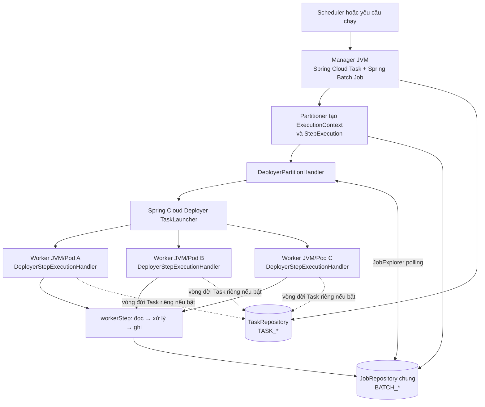
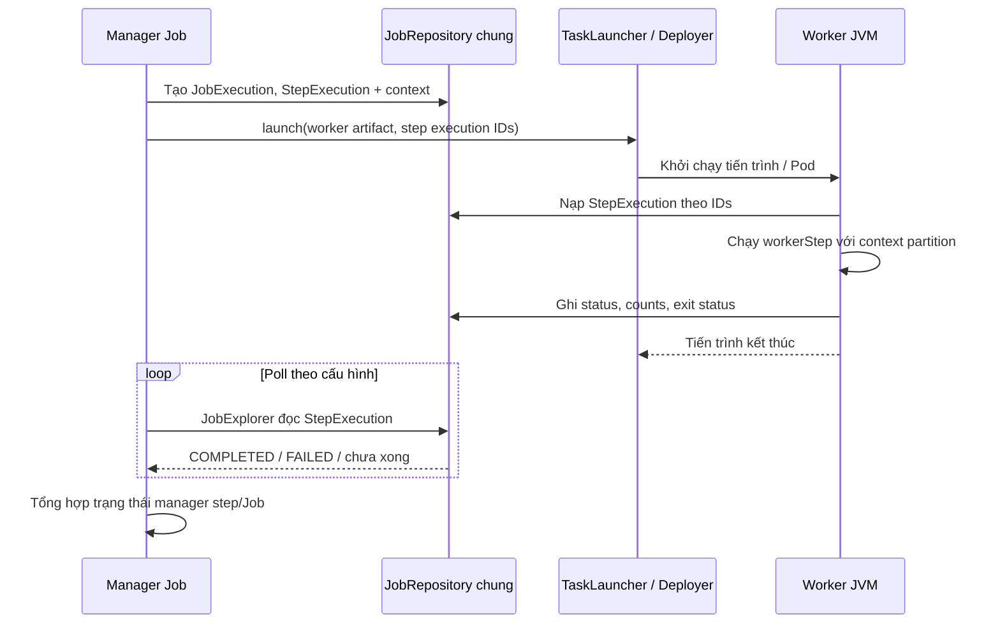

# `DeployerPartitionHandler` và Spring Cloud Deployer trong nhánh hỗ trợ

## Mục tiêu học tập

Sau bài học, bạn có thể:

- Giải thích **remote partitioning** của Spring Batch: một *manager step* phân chia công việc thành nhiều `StepExecution`, mỗi worker thực thi một phân vùng trên tiến trình khác.
- Phân biệt vai trò của `Partitioner`, `DeployerPartitionHandler`, `TaskLauncher` thuộc Spring Cloud Deployer, `DeployerStepExecutionHandler`, `JobRepository` và `TaskRepository`.
- Mô tả cách manager khởi chạy worker qua Spring Cloud Deployer, truyền định danh StepExecution, chờ trạng thái từ repository chung và tổng hợp kết quả.
- Đọc được cách cấu hình theo **nhánh Spring Cloud Task có cung cấp API này** và tránh sao chép constructor/tùy chọn cũ vào release không còn xác nhận hỗ trợ.
- Cân nhắc `gridSize`, `maxWorkers`, worker artifact, môi trường triển khai, giao dịch, lỗi, restart và khả năng xử lý lặp.
- Kiểm chứng Job/Step/Task metadata, log, mã thoát và tình trạng worker trên nền tảng chạy để triển khai an toàn.

> **Phạm vi:** Bài thuộc chương **Phân vùng từ xa** của module **SPRING_CLOUD_TASK**. Spring Cloud Task theo dõi các tiến trình Spring Boot chạy hữu hạn và ghi kết quả vào cơ sở dữ liệu; Spring Batch quản lý Job/Step và dữ liệu phục vụ restart. Bài tập trung vào cách kết hợp **Spring Cloud Deployer** để khởi chạy worker cho remote partitioning **trong nhánh đã xác minh còn hỗ trợ các API liên quan**.

## 1. Lưu ý phiên bản: thế nào là “trong nhánh hỗ trợ”?

Không được mặc định mọi phiên bản Spring Cloud Task đều có cùng cơ chế remote partitioning.

- **Tài liệu Spring Cloud Task 3.0.4** có mục *Remote Partitioning*, mô tả `DeployerPartitionHandler` và `DeployerStepExecutionHandler`. Javadoc 3.0.4 có constructor `DeployerPartitionHandler(TaskLauncher, JobExplorer, Resource, String, TaskRepository)` và overload nhận thêm `TaskExecutor`.
- **Các tài liệu cũ hơn** như Spring Cloud Task 2.x có ví dụ constructor **bốn tham số**. Không thể dùng nguyên xi ví dụ đó để biên dịch với API 3.0.4.
- **Tài liệu Spring Cloud Task 5.1.0 hiện hành** tập trung vào liên kết JobExecution–TaskExecution và không còn trình bày phần remote partitioning bằng Deployer trong trang Batch. Sự vắng mặt trong tài liệu **chưa đủ để kết luận mọi class đã bị xóa**, nhưng cũng không đủ để khẳng định khả năng tương thích.
- Vì vậy, trước khi dùng tính năng này, phải chốt một **bộ phiên bản Spring Boot, Spring Batch, Spring Cloud Task và Spring Cloud Deployer tương thích**, xác minh class thật trên dependency tree/Javadoc của chính artifact đã chọn và thử deploy trên nền tảng đích.

Bài dùng API minh họa theo **nhánh 3.0.x, cụ thể tài liệu/Javadoc 3.0.4**. Nếu bạn dùng nhánh mới, hãy đối chiếu lại khả năng hỗ trợ hoặc chọn mô hình remote partitioning khác do hệ sinh thái Spring Batch và nền tảng của bạn cung cấp. Không hạ/nâng một dependency đơn lẻ chỉ để lấy lại class mà bỏ qua sự tương thích của toàn bộ stack.

| Nguồn tham chiếu | Điều có thể dựa vào | Giới hạn |
| --- | --- | --- |
| Spring Cloud Task 3.0.4 Reference | Kiến trúc manager/worker, Spring Cloud Deployer, yêu cầu repository chung và ví dụ cấu hình. | Có thể có snippet cũ chưa đồng bộ constructor với Javadoc. |
| Spring Cloud Task 3.0.4 Javadoc | Constructor năm/sáu tham số, các setter, contract của `DeployerStepExecutionHandler`. | Chỉ khẳng định API ở version đó. |
| Spring Cloud Task 5.1.0 Reference | Những tính năng được tài liệu mới công bố. | Không dùng để suy ra API remote partitioning cũ vẫn hiện diện. |
| Spring Batch Reference | `Partitioner`, `PartitionHandler`, `JobRepository`, retry/restart và partitioned Step. | Không tự cung cấp hạ tầng tạo Pod hoặc khởi chạy tiến trình qua Deployer. |

## 2. Remote partitioning là gì và khi nào cần?

Giả sử có 40 triệu giao dịch cần đối soát. Nếu một Step xử lý tất cả dữ liệu trên một JVM, thời gian chạy có thể quá dài. Một chiến lược là chia dữ liệu theo khoảng ID, theo tenant, khu vực hoặc shard và cho nhiều tiến trình xử lý song song.

Trong Spring Batch, **partitioning** tách một Step logic thành nhiều `StepExecution`. `Partitioner` tạo các `ExecutionContext` khác nhau, ví dụ:

| Partition | `fromId` | `toId` | Worker dự kiến |
| --- | ---: | ---: | --- |
| `partition0` | 1 | 250000 | Worker A |
| `partition1` | 250001 | 500000 | Worker B |
| `partition2` | 500001 | 750000 | Worker C |
| `partition3` | 750001 | 1000000 | Worker D |

Mỗi worker đọc phạm vi riêng và thực thi cùng một `workerStep`. Trong ví dụ, khoảng ID được chia sao cho không chồng lấn. Nếu dữ liệu có ID thưa, phân vùng theo số lượng bản ghi hoặc shard phù hợp có thể cân bằng tải tốt hơn.

Phân biệt các hình thức mở rộng:

| Cách triển khai | Nơi thực thi | Cơ chế chính | Khi cân nhắc |
| --- | --- | --- | --- |
| Step thông thường | Một tiến trình, một luồng xử lý chính. | Job/Step chuẩn. | Khối lượng vừa phải. |
| Local partitioning | Một JVM, nhiều thread. | `TaskExecutorPartitionHandler`. | Muốn tận dụng CPU/thread của một máy. |
| **Deployer remote partitioning** | Nhiều tiến trình Spring Boot, có thể ở các máy/Pod khác nhau. | `DeployerPartitionHandler` + `TaskLauncher`. | Muốn phân phối xử lý và cấp phát worker theo hạ tầng. |
| Spring Batch Integration remote partitioning | Nhiều tiến trình qua hạ tầng messaging. | `MessageChannelPartitionHandler` hoặc các thành phần tích hợp tương ứng. | Hệ thống có message broker phù hợp; cần thiết kế giao tiếp qua message. |
| Remote chunking | Manager đọc/chia *chunk* rồi gửi cho worker xử lý. | Messaging và remote chunking components. | Muốn phân phối xử lý từng chunk theo cơ chế này. |

**Remote partitioning khác remote chunking.** Trong remote partitioning, mỗi worker chạy **một Step hoàn chỉnh** với reader/processor/writer hay Tasklet của chính nó; manager chủ yếu chia việc và tổng hợp trạng thái. Trong remote chunking, ranh giới đọc và gửi dữ liệu khác đi.

## 3. Kiến trúc manager, worker và repository chung



Các vai trò:

- **Manager:** chứa `Job` và *manager step*, quyết định số lượng/phạm vi partition, gọi `PartitionHandler` và đợi tổng hợp kết quả.
- **`Partitioner`:** trả về `Map<String, ExecutionContext>`; khóa map đại diện tên partition, value chứa dữ liệu điều khiển để worker biết phải xử lý phần nào.
- **`DeployerPartitionHandler`:** hiện thực `PartitionHandler`, dùng `TaskLauncher` để khởi chạy một ứng dụng worker cho các `StepExecution`; sau đó theo dõi trạng thái của chúng từ `JobRepository` qua `JobExplorer`.
- **`TaskLauncher`:** SPI thuộc **Spring Cloud Deployer**, thực thi việc tạo tiến trình/Pod theo hạ tầng cụ thể. Chính implementation của TaskLauncher quyết định cách triển khai.
- **`DeployerStepExecutionHandler`:** `CommandLineRunner` trong ứng dụng worker. Nó đọc các định danh do manager cung cấp, nạp `StepExecution` từ repository chung, tìm bean Step và thực thi Step.
- **`JobRepository`:** nguồn sự thật về `JobExecution`, `StepExecution`, `ExecutionContext` và trạng thái hoàn tất/FAILED/restart.
- **`TaskRepository`:** theo dõi vòng đời Spring Cloud Task của tiến trình manager và có thể cả worker. Nó **không thay thế JobRepository**.

**Điều kiện bắt buộc:** manager và tất cả worker phải truy cập được **cùng một kho JobRepository** để nạp đúng `StepExecution` và ghi kết quả. Tài liệu nhánh 3.0.4 còn kỳ vọng manager và worker có khả năng truy cập kho TaskRepository chung trong ví dụ này. Không dùng H2 in-memory riêng ở từng Pod vì dữ liệu StepExecution sẽ không được chia sẻ.

Nếu dùng hai database khác nhau cho TaskRepository và JobRepository, hãy cấu hình cả hai nguồn một cách tường minh trên mọi tiến trình và kiểm chứng đường kết nối. Không tự giả định một giao dịch JDBC bao trùm hai database hoặc bảng liên kết Task–Batch có foreign key xuyên database.

## 4. Vòng đời một lần remote partitioning

Dòng xử lý điển hình:

1. Scheduler khởi chạy **manager Task**; Spring Cloud Task bắt đầu ghi một `TaskExecution` của manager khi context khởi tạo thành công.
2. Spring Batch mở `JobExecution` và chạy *manager step*.
3. `Partitioner.partition(gridSize)` sinh các entry như `partition0`, `partition1`; mỗi entry có `ExecutionContext` chứa phạm vi xử lý.
4. `StepExecutionSplitter` và `JobRepository` quản lý các `StepExecution` tương ứng, có ID và trạng thái của từng partition.
5. `DeployerPartitionHandler` yêu cầu `TaskLauncher` khởi động worker artifact với thông tin định danh `JobExecution`, `StepExecution` và tên bean Step.
6. Một worker Spring Boot khởi động với profile/thiết lập thích hợp; `DeployerStepExecutionHandler` tìm `StepExecution` có sẵn bằng `JobExplorer`/`JobRepository` và chạy `workerStep`.
7. Worker cập nhật metadata Batch và kết thúc tiến trình. Manager **poll JobRepository** để xem Step nào đã kết thúc và tổng hợp trạng thái.
8. Manager quyết định kết quả *manager step* và Job. Khi Job kết thúc, Task cập nhật metadata vòng đời của mình nếu repository còn hoạt động.
9. Nếu một partition thất bại, chính sách restart của Spring Batch có thể chạy lại những Step chưa hoàn tất ở một `JobExecution` tiếp theo theo rules/configuration; không được hiểu là mọi lần lỗi đều tự retry vô hạn ngay lập tức.



### Tại sao worker không nhận “toàn bộ dữ liệu” qua lời gọi Deployer?

`TaskLauncher` chủ yếu nhận **artifact**, thuộc tính triển khai, đối số và biến môi trường để khởi chạy tiến trình. Worker nhận **định danh thực thi** rồi nạp `ExecutionContext` từ JobRepository chung. Dữ liệu nghiệp vụ lớn nên được worker truy cập trực tiếp từ nguồn dữ liệu hoặc kho lưu trữ cần thiết, thay vì nhồi vào command line.

Trong Javadoc 3.0.4, worker handler cần thông tin `JOB_EXECUTION_ID`, `STEP_EXECUTION_ID` và **tên bean Step**; framework định nghĩa các biến môi trường liên quan bằng hằng số trong `DeployerPartitionHandler`. Không tự đặt lại tên biến hoặc đoán cách serialize ID; hãy để cơ chế `DeployerPartitionHandler` truyền đúng contract của release.

## 5. Kiểm tra dependency theo nhánh tương thích

Ví dụ các dependency **mang tính định hướng** cho một dự án trong nhánh còn hỗ trợ API:

```xml
<dependencies>
    <dependency>
        <groupId>org.springframework.cloud</groupId>
        <artifactId>spring-cloud-starter-task</artifactId>
    </dependency>
    <dependency>
        <groupId>org.springframework.boot</groupId>
        <artifactId>spring-boot-starter-batch</artifactId>
    </dependency>
    <dependency>
        <groupId>org.postgresql</groupId>
        <artifactId>postgresql</artifactId>
        <scope>runtime</scope>
    </dependency>

    <!-- Chỉ chọn implementation phù hợp với nền tảng thật:
         local deployer cho local; Kubernetes deployer cho Kubernetes. -->
</dependencies>
```

Không viết cứng phiên bản cho từng artifact ở đây. Dự án phải quản lý bằng **Spring Boot BOM và Spring Cloud release train phù hợp**; Spring Cloud Deployer có thể có nhịp phát hành riêng, nên kiểm tra bảng tương thích và các release thực sự được phát hành.

Ở môi trường local, nhà phát triển có thể cần module `spring-cloud-deployer-local`; khi chạy Kubernetes, các tài liệu nhánh cũ nêu `spring-cloud-starter-deployer-kubernetes`. **Chỉ thêm implementation thực sự cần thiết**, tránh vô tình đưa cả local và Kubernetes TaskLauncher vào cùng một context rồi khiến Spring không chọn được bean.

Kiểm tra runtime classpath:

```bash
./mvnw dependency:tree -Dincludes=org.springframework.cloud
```

Hoặc với Gradle:

```bash
./gradlew dependencies --configuration runtimeClasspath
```

Cần thấy tối thiểu class phù hợp của:

- `org.springframework.cloud.task.batch.partition.DeployerPartitionHandler`.
- `org.springframework.cloud.task.batch.partition.DeployerStepExecutionHandler`.
- `org.springframework.cloud.deployer.spi.task.TaskLauncher` và một implementation có thể hoạt động trên nền tảng đích.
- Các API Spring Batch `JobRepository`, `JobExplorer`, `Partitioner` và `PartitionHandler` tương thích với dependency thực tế.

Không trộn ví dụ Spring Batch 4/Boot 2 (`JobBuilderFactory`, `StepBuilderFactory` theo API cũ) vào dự án Spring Batch 5/Boot 3 mà không chuyển đổi. Cũng không suy ra constructor của Spring Cloud Task 3.0.4 từ một bài viết cũ dùng bốn tham số.

## 6. Cấu hình manager: `DeployerPartitionHandler`

Theo Javadoc 3.0.4, constructor chuẩn cần:

```java
new DeployerPartitionHandler(
    taskLauncher,
    jobExplorer,
    workerResource,
    "workerStep",
    taskRepository
);
```

Trong đó:

| Tham số | Vai trò |
| --- | --- |
| `taskLauncher` | SPI thực hiện khởi chạy worker Task trên môi trường chọn. |
| `jobExplorer` | Đọc trạng thái `StepExecution` từ JobRepository chung. |
| `workerResource` | `Resource` đại diện ứng dụng worker có thể deploy được. |
| `"workerStep"` | **Tên bean Step** mà worker handler sẽ tìm trong context worker. |
| `taskRepository` | Repository Task theo contract constructor của nhánh 3.0.4. |

Overload sáu tham số thêm `TaskExecutor`, được sử dụng khi muốn điều khiển việc **gửi các lệnh launch worker bất đồng bộ**.

### Ví dụ cấu hình Java trên nhánh 3.0.4

Đoạn sau cố ý tách phần tạo `TaskLauncher` vì implementation và cách lấy worker artifact phụ thuộc local/Kubernetes/cloud platform. Giả định hệ thống đã có bean `TaskLauncher` và `Resource` thích hợp.

```java
package com.example.partition;

import java.util.List;

import org.springframework.batch.core.explore.JobExplorer;
import org.springframework.batch.core.partition.PartitionHandler;
import org.springframework.cloud.deployer.spi.task.TaskLauncher;
import org.springframework.cloud.task.batch.partition.DeployerPartitionHandler;
import org.springframework.cloud.task.batch.partition.NoOpEnvironmentVariablesProvider;
import org.springframework.cloud.task.batch.partition.PassThroughCommandLineArgsProvider;
import org.springframework.cloud.task.repository.TaskRepository;
import org.springframework.beans.factory.annotation.Qualifier;
import org.springframework.context.annotation.Bean;
import org.springframework.context.annotation.Configuration;
import org.springframework.context.annotation.Profile;
import org.springframework.core.io.Resource;

@Configuration(proxyBeanMethods = false)
public class ManagerDeployerConfiguration {

    @Bean
    @Profile("manager")
    PartitionHandler deployerPartitionHandler(
            TaskLauncher taskLauncher,
            JobExplorer jobExplorer,
            TaskRepository taskRepository,
            @Qualifier("workerArtifact") Resource workerArtifact) {

        DeployerPartitionHandler handler =
                new DeployerPartitionHandler(
                        taskLauncher,
                        jobExplorer,
                        workerArtifact,
                        "workerStep",
                        taskRepository);

        handler.setApplicationName("partition-worker");
        handler.setGridSize(4);
        handler.setMaxWorkers(2);
        handler.setCommandLineArgsProvider(
                new PassThroughCommandLineArgsProvider(
                        List.of(
                                "--spring.profiles.active=worker",
                                "--spring.batch.job.enabled=false")));
        handler.setEnvironmentVariablesProvider(
                new NoOpEnvironmentVariablesProvider());

        // Tùy nhu cầu và đơn vị thời gian của API thuộc release:
        // handler.setPollInterval(...);
        // handler.setTimeout(...);
        // handler.setDeploymentProperties(...);

        return handler;
    }
}
```

**Điểm cần chú ý:** các giá trị trong ví dụ là `gridSize=4` và `maxWorkers=2`; điều này không có nghĩa chỉ có hai partition. Có thể có bốn phân vùng nhưng tối đa hai worker chạy đồng thời. Phạm vi thực tế còn tùy `Partitioner`, cách triển khai `TaskLauncher` và hạn mức môi trường.

### Tạo `workerArtifact` và `TaskLauncher`

Một bean `Resource` có thể được đăng ký riêng từ URI hoặc artifact đã xuất bản:

```java
@Bean("workerArtifact")
@Profile("manager")
Resource workerArtifact(
        @Value("${app.worker.resource-uri}") String uri,
        ResourceLoader resourceLoader) {
    return resourceLoader.getResource(uri);
}
```

Đây là **mảnh cấu hình** đặt bên trong một lớp `@Configuration`; cần import `@Bean`, `@Profile`, `@Value`, `Resource`, `ResourceLoader`. Ví dụ property:

```yaml
app:
  worker:
    resource-uri: file:/opt/tasks/partition-worker.jar
```

`file:` phù hợp với một số thiết lập local khi worker artifact đã nằm ở đường dẫn mà `TaskLauncher` có thể sử dụng. Trên Kubernetes hoặc nền tảng khác, format `Resource` phải được implementation Deployer hỗ trợ (ví dụ resource theo registry/artifact repository). Không dùng `file:/opt/...` chỉ vì file tồn tại trên máy manager rồi giả định một Pod từ xa cũng nhìn thấy nó.

Nếu dùng Maven artifact resource, có thể cần cơ chế tải `maven://...` và cấu hình kho artifact, thông tin xác thực hoặc registry riêng. Nhà phát triển cần đảm bảo **worker artifact có thể truy cập bởi hạ tầng deploy**, có version xác định và đúng phiên bản ứng dụng, tránh trỏ tới bản SNAPSHOT có thể thay đổi giữa các lượt chạy.

`TaskLauncher` là **điểm kết nối hạ tầng**. Cần tạo bean từ implementation Deployer phù hợp môi trường, cấp cấu hình truy cập nền tảng và quyền khởi chạy tiến trình/Pod. `DeployerPartitionHandler` không tự tạo Kubernetes Cluster, không tự đăng nhập cloud và không tự đưa JAR vào Docker image.

## 7. Tạo `Partitioner` chia dữ liệu có ranh giới rõ ràng

`Partitioner` tạo `Map<String, ExecutionContext>`. Mỗi context phải chứa dữ liệu đủ để worker xử lý **một phạm vi xác định**, đồng thời phục vụ restart ổn định.

Ví dụ chia khoảng ID nguyên từ 1 đến 1.000.000 thành số phân vùng theo `gridSize`:

```java
package com.example.partition;

import java.util.LinkedHashMap;
import java.util.Map;

import org.springframework.batch.core.partition.support.Partitioner;
import org.springframework.batch.item.ExecutionContext;
import org.springframework.context.annotation.Bean;
import org.springframework.context.annotation.Configuration;
import org.springframework.context.annotation.Profile;

@Configuration(proxyBeanMethods = false)
public class PartitionRangeConfiguration {

    @Bean
    @Profile("manager")
    Partitioner transactionRangePartitioner() {
        return gridSize -> {
            int parts = Math.max(1, gridSize);
            long total = 1_000_000L;
            long chunk = (total + parts - 1) / parts;
            Map<String, ExecutionContext> result = new LinkedHashMap<>();

            for (int i = 0; i < parts; i++) {
                long from = 1L + i * chunk;
                long to = Math.min(total, from + chunk - 1);
                if (from > to) {
                    break;
                }

                ExecutionContext context = new ExecutionContext();
                context.putLong("fromId", from);
                context.putLong("toId", to);
                result.put("partition" + i, context);
            }
            return result;
        };
    }
}
```

Ví dụ dùng các khoảng **đóng** `[fromId, toId]` không chồng nhau. Trong dữ liệu thật, không nên giả định ID từ 1 đến 1.000.000 đều tồn tại hoặc phân bố tải đều. Có thể chia theo tháng, tenant, shard, khoảng timestamp hoặc một danh sách work item bền vững.

Khi dùng `gridSize`, kết quả thật phụ thuộc implementation của `Partitioner`; tham số này là **gợi ý về số phân vùng**, không phải cam kết cơ sở dữ liệu sẽ có đúng `gridSize` hàng hay số worker đang chạy. Tránh thiết kế worker phải biết tổng số tiến trình đang hoạt động mới có thể xác định phạm vi.

### Tiêu chí thiết kế partition tốt

- Phạm vi dữ liệu **không chồng lấn** hoặc có cơ chế dedup rõ ràng.
- Phạm vi đủ nhỏ để có thể retry/restart mà không tốn chi phí quá lớn.
- Mỗi partition có khóa nhận dạng ổn định; dữ liệu `ExecutionContext` vừa đủ và có thể serialize vào JobRepository.
- Nếu dữ liệu nguồn có thể thay đổi trong lúc chạy, phải xác định snapshot, mốc thời gian hoặc phiên bản để tránh thiếu/trùng bản ghi.
- Nếu worker có side effect ngoài database, cần idempotency key theo **công việc nghiệp vụ**, không theo PID/Pod hoặc TaskExecution ID.
- Không đặt secret, dữ liệu cá nhân lớn hoặc payload nghiệp vụ vào `ExecutionContext` vì metadata sẽ được lưu trong database và có thể bị lộ qua công cụ quản trị.

## 8. Kết nối `Partitioner` với manager step và Job

Với Spring Batch 5 và cú pháp `StepBuilder` tương ứng, manager tạo một Step partitioned:

```java
package com.example.partition;

import org.springframework.batch.core.Job;
import org.springframework.batch.core.Step;
import org.springframework.batch.core.job.builder.JobBuilder;
import org.springframework.batch.core.partition.PartitionHandler;
import org.springframework.batch.core.partition.support.Partitioner;
import org.springframework.batch.core.repository.JobRepository;
import org.springframework.batch.core.step.builder.StepBuilder;
import org.springframework.beans.factory.annotation.Qualifier;
import org.springframework.context.annotation.Bean;
import org.springframework.context.annotation.Configuration;
import org.springframework.context.annotation.Profile;

@Configuration(proxyBeanMethods = false)
public class ManagerJobConfiguration {

    @Bean("managerStep")
    @Profile("manager")
    Step managerStep(
            JobRepository jobRepository,
            Partitioner transactionRangePartitioner,
            PartitionHandler deployerPartitionHandler) {

        return new StepBuilder("managerStep", jobRepository)
                .partitioner("workerStep", transactionRangePartitioner)
                .partitionHandler(deployerPartitionHandler)
                .build();
    }

    @Bean("partitionedSettlementJob")
    @Profile("manager")
    Job partitionedSettlementJob(
            JobRepository jobRepository,
            @Qualifier("managerStep") Step managerStep) {

        return new JobBuilder("partitionedSettlementJob", jobRepository)
                .start(managerStep)
                .build();
    }
}
```

Tên `"workerStep"` tại `partitioner(...)` phải đồng nhất với tên Step thực sự mà worker handler tìm. `JobRepository` được dùng ở manager phải truy cập cùng cơ sở dữ liệu với worker. `Job` được khai báo với `@Profile("manager")` để ngăn worker tự chạy toàn bộ Job manager khi nó khởi động.

### Phân biệt manager step và worker step

`managerStep` chủ yếu chia công việc và chờ kết quả; nó không tự chạy logic đối soát của mọi partition trong cùng JVM. `workerStep` mới là Step thực thi nghiệp vụ trên tiến trình worker.

Một worker có thể được cấp cấu hình để nhận **một** `StepExecution` của một partition nhất định. Không thiết kế `workerStep` tự chọn ngẫu nhiên partition từ database; nó phải dùng `ExecutionContext` gắn với StepExecution của mình để biết chính xác phạm vi.

## 9. Worker: `DeployerStepExecutionHandler` và `workerStep`

Theo Javadoc 3.0.4, `DeployerStepExecutionHandler` hiện thực `CommandLineRunner`. Constructor nhận:

```java
new DeployerStepExecutionHandler(
    beanFactory,
    jobExplorer,
    jobRepository
);
```

Handler dùng các thông tin do manager truyền để tìm `StepExecution` và bean Step rồi chạy Step đó. Worker **không cần tạo một JobExecution mới** chỉ để chạy partition, cũng không nên tự khởi chạy `partitionedSettlementJob` của manager.

### Đăng ký worker handler

```java
package com.example.partition;

import org.springframework.batch.core.explore.JobExplorer;
import org.springframework.batch.core.repository.JobRepository;
import org.springframework.beans.factory.BeanFactory;
import org.springframework.cloud.task.batch.partition.DeployerStepExecutionHandler;
import org.springframework.context.annotation.Bean;
import org.springframework.context.annotation.Configuration;
import org.springframework.context.annotation.Profile;

@Configuration(proxyBeanMethods = false)
public class WorkerHandlerConfiguration {

    @Bean
    @Profile("worker")
    DeployerStepExecutionHandler stepExecutionHandler(
            BeanFactory beanFactory,
            JobExplorer jobExplorer,
            JobRepository jobRepository) {

        return new DeployerStepExecutionHandler(
                beanFactory, jobExplorer, jobRepository);
    }
}
```

### Đăng ký Step để worker thực thi

```java
package com.example.partition;

import org.springframework.batch.core.Step;
import org.springframework.batch.core.configuration.annotation.StepScope;
import org.springframework.batch.core.repository.JobRepository;
import org.springframework.batch.core.step.builder.StepBuilder;
import org.springframework.batch.core.step.tasklet.Tasklet;
import org.springframework.batch.repeat.RepeatStatus;
import org.springframework.beans.factory.annotation.Value;
import org.springframework.context.annotation.Bean;
import org.springframework.context.annotation.Configuration;
import org.springframework.transaction.PlatformTransactionManager;

@Configuration(proxyBeanMethods = false)
public class WorkerStepConfiguration {

    @Bean("workerStep")
    Step workerStep(
            JobRepository jobRepository,
            PlatformTransactionManager transactionManager,
            Tasklet partitionTasklet) {

        return new StepBuilder("workerStep", jobRepository)
                .tasklet(partitionTasklet, transactionManager)
                .build();
    }

    @Bean
    @StepScope
    Tasklet partitionTasklet(
            @Value("#{stepExecutionContext['fromId']}") Long fromId,
            @Value("#{stepExecutionContext['toId']}") Long toId) {

        return (contribution, chunkContext) -> {
            if (fromId == null || toId == null || fromId > toId) {
                throw new IllegalArgumentException("Khoảng partition không hợp lệ");
            }

            System.out.printf(
                    "Processing IDs from %d to %d%n", fromId, toId);

            // Thực tế: service đọc/ghi dữ liệu theo [fromId, toId].
            // Thực hiện transaction, checkpoint và idempotency phù hợp.
            return RepeatStatus.FINISHED;
        };
    }
}
```

`@StepScope` giúp tham số đến từ `stepExecutionContext` chỉ được resolve khi StepExecution của partition bắt đầu. Nếu bỏ `@StepScope` và cố đọc `stepExecutionContext` khi dựng singleton bean, thường không có context Step phù hợp.

`workerStep` cần tồn tại trong Spring container của worker với **bean ID được handler yêu cầu**. Thực tế có thể dùng chung một JAR và chọn profile `manager`/`worker`; hoặc đóng gói hai ứng dụng khác nhau nhưng phải giữ đồng bộ kiểu Step và metadata. Ví dụ trên sử dụng cùng mã nguồn cho dễ học.

### Entry point ứng dụng

```java
package com.example.partition;

import org.springframework.boot.SpringApplication;
import org.springframework.boot.autoconfigure.SpringBootApplication;
import org.springframework.cloud.task.configuration.EnableTask;

@SpringBootApplication
@EnableTask
public class PartitionedSettlementApplication {

    public static void main(String[] args) {
        SpringApplication.run(PartitionedSettlementApplication.class, args);
    }
}
```

Với worker, `DeployerStepExecutionHandler` là runner xử lý Step. Với manager, Spring Batch Job được chọn/khởi chạy theo cơ chế cấu hình tương thích (hoặc dùng runner riêng). Không đặt thêm một runner nghiệp vụ chung chạy ở cả hai profile nếu nó có thể ghi dữ liệu lần thứ hai.

## 10. Cấu hình profile và database chia sẻ

Ví dụ dưới đây giả định database PostgreSQL đã được khởi tạo **cả bảng metadata Spring Batch và Spring Cloud Task** bằng migration phù hợp:

```yaml
spring:
  application:
    name: partitioned-settlement
  main:
    web-application-type: none
  datasource:
    url: jdbc:postgresql://metadata-db:5432/batchdb
    username: ${BATCH_DB_USER}
    password: ${BATCH_DB_PASSWORD}
  cloud:
    task:
      initialize-enabled: false
      closecontext-enabled: true
  batch:
    jdbc:
      initialize-schema: never

---
spring:
  config:
    activate:
      on-profile: manager
  batch:
    job:
      enabled: true
      name: partitionedSettlementJob

---
spring:
  config:
    activate:
      on-profile: worker
  batch:
    job:
      enabled: false
```

Phần YAML giả định các thuộc tính có trong **bộ Spring Boot/Spring Cloud tương thích với ví dụ**; phải kiểm tra binding và API của release cụ thể. Trong môi trường Kubernetes, `metadata-db` phải phân giải và truy cập được từ cả manager lẫn worker. Thường nên cấp credential qua Secret/secret manager của nền tảng, không đóng vào Docker image hoặc command line.

**Cần chú ý:**

1. `spring.batch.job.enabled=false` ở worker giúp tránh cơ chế tự khởi chạy các Job bean không mong muốn.
2. `spring.cloud.task.initialize-enabled=false` và `spring.batch.jdbc.initialize-schema=never` đòi hỏi các bảng metadata đã tồn tại trước khi chạy; không dùng để tự migration.
3. `closecontext-enabled` có ích để đóng Spring context sau khi runners hoàn tất, nhất là khi có executor/thread giữ tiến trình sống; kiểm tra đúng tên property và hành vi của nhánh.
4. Nếu worker cần nguồn dữ liệu nghiệp vụ **khác** database metadata, cấu hình datasource/transaction manager và batch repository tường minh, tránh dùng nhầm `@Primary`.
5. Nếu manager và worker cần những quyền khác nhau, vẫn phải đảm bảo cả hai có quyền phù hợp với các bảng `BATCH_*` dùng chung để đọc/cập nhật StepExecution.

Không dùng `spring.batch.job.enabled=true` ở worker và chỉ hy vọng việc có `DeployerStepExecutionHandler` sẽ ngăn Job chạy. Cần kiểm thử việc **mỗi worker chỉ thực thi phân vùng được chỉ định**.

## 11. `gridSize`, `maxWorkers`, polling, timeout và executor

Các thuộc tính cấu hình của `DeployerPartitionHandler` điều khiển nhiều khía cạnh khác nhau:

| API | Mục đích | Cạm bẫy |
| --- | --- | --- |
| `setGridSize(int)` | Gợi ý quy mô phân vùng; `Partitioner` quyết định số partition cuối cùng. | Không đồng nhất trực tiếp với số Pod chạy cùng lúc. |
| `setMaxWorkers(int)` | Giới hạn số worker đang thực thi đồng thời. | Không chứng minh Job chỉ có bấy nhiêu partition. |
| `setPollInterval(long)` | Khoảng đợi giữa các lượt kiểm tra trạng thái trong JobRepository. | Poll quá dày tăng tải DB; poll quá thưa làm chậm phát hiện kết thúc. |
| `setTimeout(long)` | Giới hạn thời gian chờ của manager step theo API. | Timeout không tự hoàn tác thay đổi đã commit ở worker. |
| `setDeploymentProperties(Map<...>)` | Thông số triển khai truyền cho TaskLauncher, tùy nền tảng. | Thuộc tính của local deployer khác Kubernetes deployer. |
| `setCommandLineArgsProvider(...)` | Cung cấp đối số worker, ví dụ chọn profile. | Không đưa secret vào đối số; không làm mất định danh nội bộ do framework truyền. |
| `setEnvironmentVariablesProvider(...)` | Cung cấp biến môi trường bổ sung cho từng worker. | Không phát tán toàn bộ environment của manager khi không cần. |
| `setDefaultArgsAsEnvironmentVars(boolean)` | Chuyển các đối số mặc định nội bộ sang biến môi trường trong nhánh hỗ trợ. | Phải kiểm thử worker nhận và đọc đúng ID. |

Tài liệu 3.0.4 nhắc giá trị polling mặc định khoảng **10 giây** và timeout mặc định **không giới hạn** trong mô tả tham chiếu. Đơn vị tham số `long`, giá trị sentinel và hành vi hủy worker cần kiểm tra ở implementation/Javadoc của release mà dự án thực sự biên dịch. Không chép tùy tiện `setTimeout(10)` rồi suy ra là 10 giây.

### Khởi chạy worker bất đồng bộ

Tài liệu ghi nhận việc launch worker có thể chặn trong lúc hạ tầng tạo Pod/tiến trình. Với nhiều partition, khởi chạy tuần tự có thể làm chậm đáng kể trước khi worker bắt đầu xử lý. Một giải pháp ở nhánh hỗ trợ là dùng overload constructor có `TaskExecutor`:

```java
DeployerPartitionHandler handler = new DeployerPartitionHandler(
        taskLauncher,
        jobExplorer,
        workerArtifact,
        "workerStep",
        taskRepository,
        partitionLaunchExecutor
);
```

Ví dụ executor:

```java
@Bean("partitionLaunchExecutor")
@Profile("manager")
ThreadPoolTaskExecutor partitionLaunchExecutor() {
    ThreadPoolTaskExecutor executor = new ThreadPoolTaskExecutor();
    executor.setCorePoolSize(2);
    executor.setMaxPoolSize(4);
    executor.setThreadNamePrefix("partition-launch-");
    executor.setWaitForTasksToCompleteOnShutdown(true);
    executor.initialize();
    return executor;
}
```

Đây là một bean Spring, cần import `org.springframework.scheduling.concurrent.ThreadPoolTaskExecutor`, `@Bean` và `@Profile`. Nếu dùng overload này, inject executor vào bean `PartitionHandler` phù hợp; **không tạo cả hai PartitionHandler** một cách vô ý.

**Phân biệt hai mức song song:**

- Executor trên manager giúp **gửi lệnh launch** nhiều worker đồng thời, giảm thời gian chờ provisioning.
- `setMaxWorkers` giới hạn số worker **đang thực thi** theo logic handler.
- Kubernetes quota, CPU/memory, số kết nối database, cấu hình task launcher và giới hạn hệ thống vẫn có thể làm số worker thực tế thấp hơn.

`ThreadPoolTaskExecutor` có thể giữ thread còn sống. Với Task hữu hạn, cần đóng context/executor đúng lúc để JVM kết thúc. Tuy nhiên đừng đóng context khi manager còn đang đợi partition hoặc worker vẫn thực thi. Dùng timeout, shutdown policy và log để xử lý phiên làm việc dài bất thường.

## 12. Spring Cloud Deployer làm những việc nào?

`Spring Cloud Deployer` cung cấp SPI để deploy/chạy ứng dụng theo môi trường. Với remote partitioning dựa trên TaskLauncher:

| Công việc | Thành phần chịu trách nhiệm |
| --- | --- |
| Xác định khoảng dữ liệu cho mỗi partition. | `Partitioner`. |
| Tạo/quản lý metadata Job/Step và quyết định restart. | `JobRepository`/Spring Batch. |
| Chuẩn bị yêu cầu launch worker artifact và định danh thực thi. | `DeployerPartitionHandler`. |
| Tạo tiến trình local, Kubernetes workload hoặc resource nền tảng tương ứng. | Implementation của `TaskLauncher`. |
| Đọc metadata StepExecution và chạy workerStep. | `DeployerStepExecutionHandler`. |
| Cập nhật StepExecution hoàn tất/thất bại. | Worker + Spring Batch repository. |
| Truy vấn kết quả từng partition để manager tổng hợp. | `DeployerPartitionHandler` qua `JobExplorer`. |

Nếu triển khai Kubernetes, cần cấu hình đúng namespace, service account, quyền tạo Job/Pod theo implementation, container image/artifact, registry credentials, Secret, resource requests/limits và network tới database. Tài liệu nhánh cũ nhắc yêu cầu **tên ứng dụng Kubernetes hợp lệ**, thông thường theo dạng chữ thường/chữ số/dấu gạch ngang; ví dụ đặt `partition-worker`.

Nếu chạy local, TaskLauncher có thể tạo các process trên cùng host nhưng vẫn là **những JVM khác nhau**. Đừng nhầm với `TaskExecutorPartitionHandler`, vốn chia việc trong các thread của cùng JVM.

### Truyền môi trường: chỉ chia sẻ những gì worker cần

Một worker có thể cần:

- URL tới metadata DB chung, user/password thông qua secret.
- URL và quyền truy cập datasource nghiệp vụ.
- Profile `worker`.
- Tên artifact/version và các cấu hình timeout phù hợp.
- Thông tin quan sát như trace ID/correlation ID, không chứa secret.

Tránh gửi toàn bộ environment của manager sang worker vì có thể chứa token, mật khẩu hoặc quyền vượt mức cần thiết. Nếu dùng `SimpleEnvironmentVariablesProvider`, kiểm tra tùy chọn có sao chép toàn bộ môi trường hay không. `NoOpEnvironmentVariablesProvider` chỉ không thêm biến tùy chỉnh từ provider; worker vẫn phải được nền tảng cấp **các biến môi trường bắt buộc để kết nối database**, còn những định danh Step do handler truyền theo contract.

## 13. Metadata, trạng thái và truy vấn kiểm chứng

`JobRepository` quản lý các bảng như:

- `BATCH_JOB_INSTANCE`: Job logic và identifying `JobParameters`.
- `BATCH_JOB_EXECUTION`: mỗi lần thực thi Job.
- `BATCH_STEP_EXECUTION`: các lần chạy manager/worker Step, bao gồm trạng thái, thời gian, counts, exit message.
- `BATCH_STEP_EXECUTION_CONTEXT`: context của partition; có thể lưu phạm vi `fromId`/`toId`.
- Các bảng tham số Job và metadata khác của Spring Batch.

Trong ví dụ, manager step tên `managerStep`, các worker StepExecution thường mang tên gồm `workerStep` và hậu tố partition, theo quy tắc đặt tên của Spring Batch. Không mặc định một Step tên `workerStep` chỉ có duy nhất một StepExecution.

### Truy vấn trạng thái Job và từng partition

Ví dụ PostgreSQL, dùng ID thật của Job:

```sql
SELECT
    j.JOB_EXECUTION_ID,
    j.STATUS AS JOB_STATUS,
    s.STEP_EXECUTION_ID,
    s.STEP_NAME,
    s.STATUS AS STEP_STATUS,
    s.READ_COUNT,
    s.WRITE_COUNT,
    s.COMMIT_COUNT,
    s.ROLLBACK_COUNT,
    s.START_TIME,
    s.END_TIME
FROM BATCH_JOB_EXECUTION j
JOIN BATCH_STEP_EXECUTION s
  ON s.JOB_EXECUTION_ID = j.JOB_EXECUTION_ID
WHERE j.JOB_EXECUTION_ID = 5701
ORDER BY s.STEP_EXECUTION_ID;
```

Lần chạy `5701` chỉ là số minh họa. Khi phân tích lỗi, lọc riêng `STEP_STATUS <> 'COMPLETED'` và đọc `EXIT_MESSAGE`/`BATCH_STEP_EXECUTION_CONTEXT` tương ứng. Truy vấn kiểu này cho biết partition nào chưa hoàn tất, chứ không khẳng định worker Pod hiện vẫn còn chạy.

### Đối chiếu metadata Task

```sql
SELECT
    TASK_EXECUTION_ID,
    TASK_NAME,
    START_TIME,
    END_TIME,
    EXIT_CODE,
    ERROR_MESSAGE
FROM TASK_EXECUTION
WHERE TASK_NAME LIKE 'partition%'
ORDER BY START_TIME DESC, TASK_EXECUTION_ID DESC;
```

Với cơ chế tích hợp Task–Batch được cấu hình, `TASK_TASK_BATCH` có thể liên kết TaskExecution với JobExecution. **Mối liên kết cha–con giữa manager Task và các worker Task**, nếu được thiết lập, khác với mối liên kết JobExecution–TaskExecution. Không tự join `TASK_EXECUTION_ID = JOB_EXECUTION_ID`: hai hệ thống cấp ID riêng.

Nếu một worker không ghi được TaskRepository, các Step metadata của Batch vẫn có thể tồn tại hoặc lỗi trước khi cập nhật; cần kiểm tra log, exit status của worker và trạng thái nền tảng. Nếu manager không có `END_TIME` do crash, đó cũng không có nghĩa mọi worker đều đã dừng.

## 14. Khôi phục lỗi và restart: không được hiểu là exactly-once tuyệt đối

Các lỗi thường thấy:

| Sự cố | Hệ quả có thể gặp | Hướng xử lý |
| --- | --- | --- |
| Không tìm thấy artifact worker | `TaskLauncher` không tạo được worker. | Kiểm tra `Resource`, địa chỉ registry/repository và quyền truy cập. |
| Không có quyền tạo Pod/Job | Manager không khởi chạy được partition. | Kiểm tra TaskLauncher, RBAC, namespace/quota và service account. |
| Worker không thấy JobRepository | Không nạp được `StepExecution`, manager chờ hoặc thấy lỗi. | Đảm bảo chung datasource, schema, quyền DB và network. |
| Worker thiếu bean `workerStep` | `DeployerStepExecutionHandler` không tìm được Step theo tên. | Đồng bộ tên bean/Step, profile và artifact version. |
| Worker tự chạy lại Job manager | Job auto-run chưa được tắt ở profile worker. | Kiểm tra `spring.batch.job.enabled=false` và `@Profile("manager")` trên Job. |
| Worker crash sau khi commit nghiệp vụ | Metadata Step có thể chưa kịp cập nhật. | Retry idempotent, đối soát tác động đã xảy ra. |
| Một partition thất bại | Job/manager step có thể FAILED; các partition khác có thể đã COMPLETED. | Đọc `JobRepository`, thiết kế restart theo status Step. |
| Polling quá dày hoặc timeout quá ngắn | Tăng tải DB hoặc báo lỗi trong lúc worker vẫn xử lý. | Điều chỉnh polling/timeout phù hợp hạ tầng, quan sát thực tế. |
| Worker chạy lâu dù manager đã timeout | Manager mất khả năng theo dõi; tiến trình ngoài có thể vẫn còn. | Kiểm tra/cancel workload qua nền tảng, áp timeout worker và quy trình cleanup. |
| Hai manager chạy cùng khóa nghiệp vụ | Dữ liệu có thể bị xử lý trùng dù StepExecution ID khác. | Giới hạn lịch chạy, khóa nghiệp vụ và idempotency. |

### Restart Spring Batch xử lý partition như thế nào?

Spring Batch có metadata trạng thái của từng `StepExecution`. Khi Job được restart đúng contract và có `JobParameters` phù hợp, các Step partition đã hoàn tất có thể được bỏ qua, còn phần chưa hoàn tất có thể được chạy lại, tùy cấu hình Step và quy tắc restart.

Nhưng một công việc đã gọi API ngân hàng rồi crash **trước khi ghi COMPLETED** có thể được gọi lại dù API phía ngoài đã thực hiện thành công. Do đó:

- Dùng khóa idempotency **ổn định theo nghiệp vụ**, không theo PID hoặc TaskExecution ID của worker.
- Giữ ranh giới transaction và checkpoint ở reader/writer.
- Khi timeout từ API ngoài, tra trạng thái hoặc dùng idempotency key phía nhận.
- Đảm bảo thời gian giữ khóa, lease và chính sách chạy song song của scheduler không khiến hai manager xử lý trùng.
- Không hiểu “restart được” là “không bao giờ có bản ghi bị xử lý lại”.

## 15. Mã thoát của worker và kết quả của manager

Một worker có thể gặp `Exception` và dừng với mã khác `0`, nhưng manager chủ yếu tổng hợp trạng thái `StepExecution` được lưu trong JobRepository. Nếu worker bị kill trước khi cập nhật repository, manager có thể phải chờ đến timeout hoặc đối chiếu thông tin launcher/platform để xác định lỗi.

Vì vậy cần giám sát ba lớp:

1. **Worker process/container:** trạng thái Pod, mã thoát, nguyên nhân termination, log.
2. **Spring Batch:** `StepExecution.status`, `JobExecution.status`, counts và exit message trong JobRepository.
3. **Spring Cloud Task:** `TaskExecution.exitCode`/`endTime` cho manager và worker khi được ghi thành công.

Nếu Job Batch thất bại nhưng Task bao ngoài vẫn kết thúc bình thường, có thể cần cơ chế phản ánh trạng thái Batch lên mã thoát của Task, chẳng hạn thuộc tính `spring.cloud.task.batch.fail-on-job-failure=true` khi được release hỗ trợ. Tuy nhiên, không chỉ dựa vào thuộc tính này trong luồng remote partitioning tùy biến: phải kiểm tra JobExecution cuối cùng và exit code thật của tiến trình manager.

Một `TASK_EXECUTION` có `EXIT_CODE=0` không chứng minh tất cả partition đã hoàn tất: kết quả nghiệp vụ phải được đối chiếu với Batch Job/Step và dữ liệu đã ghi.

## 16. Vận hành theo lịch và theo yêu cầu

Spring Cloud Task ghi lịch sử tiến trình, **không tự cung cấp lịch CronJob**. Hệ thống có thể dùng:

- Lệnh `java -jar` để chạy manager theo yêu cầu.
- Kubernetes Job/CronJob, Spring Cloud Data Flow hoặc bộ điều phối khác để kích hoạt manager.
- Một TaskLauncher nội bộ do ứng dụng quản lý để tạo worker sau khi manager Job bắt đầu.

Một lần kích hoạt manager có thể tạo **nhiều tiến trình worker** và nhiều `TaskExecution` tương ứng. Hãy thiết kế:

- `concurrencyPolicy` hoặc khóa nghiệp vụ tránh hai manager chạy chồng nhau cho cùng dữ liệu.
- Giới hạn số worker và tài nguyên Pod/CPU/memory theo ngân sách.
- Connection pool đủ nhỏ để không vượt giới hạn database khi nhân với số worker.
- Timeout ở cả manager, worker và nền tảng; không chỉ timeout polling.
- Cleanup workload bị treo, orphaned Pod/Job và metadata chưa có `END_TIME`.
- Log có `jobExecutionId`, `stepExecutionId`, tên partition và correlation ID để nối các tầng.
- Retention cho metadata Task/Batch, tránh xóa `BATCH_STEP_EXECUTION_CONTEXT` trước khi hết khả năng restart cần thiết.

### Bảo mật

Không đưa mật khẩu, bearer token hay dữ liệu cá nhân vào `ExecutionContext`/JobParameters/CLI arguments nếu có thể tránh; các dữ liệu này có thể được lưu metadata hoặc hiện ra trong thông tin process. Dùng Secret và quyền đọc tối thiểu của từng worker, mã hóa kết nối DB, giới hạn quyền tạo Pod/Job của manager, giới hạn mạng và ghi log an toàn.

## 17. Checklist triển khai trong nhánh hỗ trợ

1. **Khóa phiên bản:** chọn một bộ Spring Boot, Spring Batch, Spring Cloud Task, Spring Cloud Deployer tương thích; đối chiếu API `DeployerPartitionHandler` ở đúng JAR, không dùng constructor từ bài viết cũ.
2. **Artifact worker:** được đóng gói theo nền tảng, có `DeployerStepExecutionHandler` và bean `workerStep`, có profile `worker`.
3. **TaskLauncher:** có implementation phù hợp local/Kubernetes và quyền launch worker; resource đúng format của Deployer.
4. **Repository:** manager và tất cả worker thấy cùng `JobRepository`, schema Batch đã migration; TaskRepository cấu hình đúng nếu dùng để theo dõi Task.
5. **Partitioner:** tạo context ổn định, phạm vi không chồng lấn, có idempotency và restart policy rõ ràng.
6. **Concurrency:** phân biệt `gridSize`, `maxWorkers`, executor cấp phát worker và quota nền tảng.
7. **Luồng kết thúc:** worker chạy Step và kết thúc; manager poll/đánh giá kết quả; process trả mã thoát đúng.
8. **Quan sát:** query JobExecution/StepExecution, TaskExecution và trạng thái Pod/tiến trình; cảnh báo partition treo/lỗi.
9. **Thử lỗi:** worker crash, manager crash, DB mất kết nối, artifact thiếu, quota cạn, retry cùng dữ liệu.
10. **Retention và bảo mật:** quản lý schema, quyền DB, log, Secret, thời gian lưu metadata và cleanup workload.

## 18. Bài tập thực hành

**Bài tập 1 — Phân vùng và giới hạn:** Tạo `Partitioner` chia 1.000.000 ID thành bốn partition, `gridSize=4` và `maxWorkers=2`. Vẽ timeline mô tả hai worker cùng lúc; giải thích vì sao không đồng nhất số partition với số worker đang chạy.

**Bài tập 2 — Manager/worker profile:** Sử dụng mã ví dụ để tạo một Job chỉ tồn tại ở profile `manager` và một `DeployerStepExecutionHandler` chỉ tồn tại ở profile `worker`. Xác minh khi khởi động worker không tự chạy lại toàn bộ Job manager.

**Bài tập 3 — Chia sẻ repository:** Cho manager và worker cố ý trỏ tới hai database metadata khác nhau trên môi trường test. Mô tả triệu chứng khi worker không tìm thấy `StepExecution`, sau đó sửa cấu hình về một JobRepository chung.

**Bài tập 4 — Lỗi phân vùng:** Cho partition `partition2` ném exception sau khi một số bản ghi đã commit; kiểm tra `BATCH_STEP_EXECUTION`, restart Job với cùng identifying JobParameters theo chính sách Spring Batch và chứng minh phần đã hoàn tất không bị xử lý trùng không kiểm soát.

**Bài tập 5 — Thử Deployer:** Chạy bằng local TaskLauncher trên môi trường test, sau đó thử một implementation Kubernetes đã được chứng minh tương thích với nhánh. Đối chiếu cách truyền worker artifact, deploy properties, secrets, giới hạn worker và việc cleanup.

**Bài tập 6 — Đối chiếu API:** Mở Javadoc cho Spring Cloud Task 3.0.4 và trang Batch của release đang dùng. So sánh sự hiện diện của `DeployerPartitionHandler`, constructor năm tham số, `setMaxWorkers` và `DeployerStepExecutionHandler`. Giải thích vì sao không thể sao chép ví dụ constructor bốn tham số từ tài liệu cũ mà không kiểm tra.

## Ghi nhớ

- **`DeployerPartitionHandler`** là cầu nối giữa **Spring Batch partitioning** và **Spring Cloud Deployer TaskLauncher** để chạy các partition trên nhiều tiến trình Spring Boot.
- **`DeployerStepExecutionHandler`** trong worker tải StepExecution theo thông tin được truyền, chạy đúng bean Step và ghi trạng thái vào **JobRepository chung**; manager poll repository để tổng hợp.
- **`gridSize` là gợi ý phân vùng**, `maxWorkers` là giới hạn concurrency; `TaskExecutor` bổ sung giúp gửi lệnh launch bất đồng bộ khi cần.
- Manager và worker cần truy cập cùng kho metadata Batch; metadata Task hỗ trợ theo dõi vòng đời các tiến trình nhưng không thay thế Job/Step repository.
- Việc restart phụ thuộc trạng thái Step và JobParameters; **idempotency nghiệp vụ** vẫn bắt buộc khi có side effect hoặc lỗi giữa lúc commit và cập nhật metadata.
- Chỉ áp dụng các API Deployer partitioning sau khi kiểm chứng **nhánh/version thực sự hỗ trợ**; tài liệu mới và tài liệu cũ có thể khác nhau đáng kể.

## Tài liệu tham khảo

- [Spring Cloud Task 3.0.4 — Remote Partitioning](https://docs.spring.io/spring-cloud-task/docs/3.0.4/reference/html/#_remote_partitioning)
- [Spring Cloud Task 3.0.4 — DeployerPartitionHandler Javadoc](https://docs.spring.io/spring-cloud-task/docs/3.0.4/apidocs/org/springframework/cloud/task/batch/partition/DeployerPartitionHandler.html)
- [Spring Cloud Task 3.0.4 — DeployerStepExecutionHandler Javadoc](https://docs.spring.io/spring-cloud-task/docs/3.0.4/apidocs/org/springframework/cloud/task/batch/partition/DeployerStepExecutionHandler.html)
- [Spring Cloud Task 5.1.0 — Batch](https://docs.spring.io/spring-cloud-task/reference/batch.html)
- [Spring Batch — Scaling and Parallel Processing](https://docs.spring.io/spring-batch/reference/scalability.html)
- [Spring Batch Integration — Remote Partitioning](https://docs.spring.io/spring-batch/reference/spring-batch-integration/externalizing-execution.html)
- [Spring Cloud Data Flow — Remote Partitioned Batch Job Guide](https://dataflow.spring.io/docs/feature-guides/batch/partitioning/)
