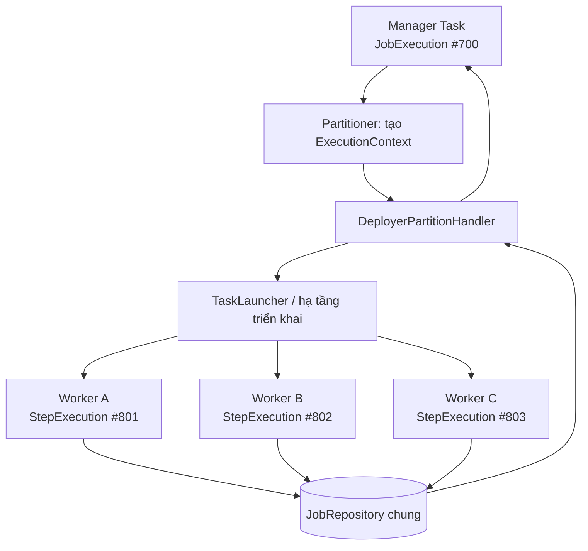
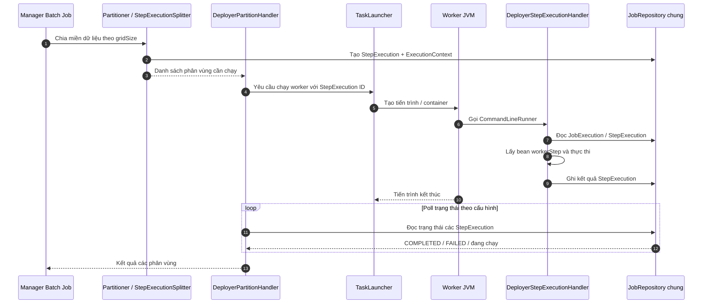
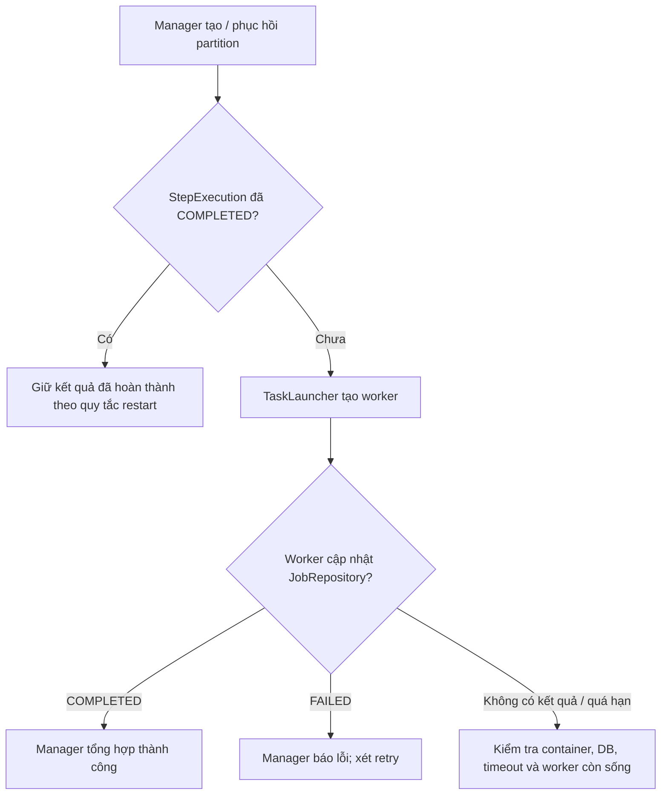

# DeployerStepExecutionHandler và thực thi Step ở tiến trình con

Trong chương **Phân vùng từ xa** của **Spring Cloud Task**, mục tiêu là chạy một công việc Spring Batch lớn trên nhiều tiến trình hoặc container độc lập. Chẳng hạn, quy trình đối soát cần xử lý 12 triệu giao dịch: một tiến trình **manager** chia miền dữ liệu thành các phân vùng, còn các tiến trình **worker** xử lý những phân vùng đó. Mỗi worker là một ứng dụng Spring Boot chạy hữu hạn, có thể ghi vòng đời của mình bằng Spring Cloud Task. Spring Batch vẫn giữ trạng thái Job và Step trong `JobRepository`.

**`DeployerStepExecutionHandler`** là cầu nối quan trọng ở **phía worker**: nó nhận thông tin xác định một `StepExecution` đã được manager chuẩn bị, truy xuất bản ghi từ `JobRepository` dùng chung và **thực thi bean `Step` tương ứng trong tiến trình con**. Ở phía manager, **`DeployerPartitionHandler`** yêu cầu **Spring Cloud Deployer `TaskLauncher`** khởi chạy các worker và theo dõi kết quả qua metadata Batch.

Bài này giúp bạn hiểu đầy đủ đường đi từ **partition → tạo tiến trình → phục hồi StepExecution → chạy Step → cập nhật trạng thái → tổng hợp kết quả**, đồng thời nắm cách cấu hình, xử lý lỗi, giới hạn concurrency và chạy lại an toàn.

## 1. Ba lớp cần phân biệt: Task, Job và Step

Spring Cloud Task, Spring Batch và Spring Cloud Deployer cùng tham gia nhưng giải quyết các vấn đề khác nhau:

| Thành phần | Đơn vị quản lý | Vai trò trong phân vùng từ xa |
| --- | --- | --- |
| **Spring Cloud Task** | `TaskExecution` của **một lần chạy ứng dụng** | Ghi thời điểm bắt đầu, kết thúc và mã thoát của manager/worker nếu ứng dụng tích hợp Task. |
| **Spring Batch** | `JobExecution` và `StepExecution` | Lưu trạng thái Job, phân vùng Step, checkpoint, số bản ghi và kết quả để restart. |
| **Spring Cloud Deployer** | Tiến trình/container triển khai | `TaskLauncher` tạo các worker trên local runtime, Kubernetes hoặc nền tảng được hỗ trợ. |
| **`DeployerPartitionHandler`** | Phía manager | Nhận các phân vùng, yêu cầu launcher tạo worker và thăm dò `JobRepository` để tổng hợp kết quả. |
| **`DeployerStepExecutionHandler`** | Phía worker | Chạy **một StepExecution được chỉ định**, với `Step` lấy từ Spring context của worker. |

Một worker không nhất thiết sở hữu một Job mới. Trong cơ chế remote partitioning, **nhiều StepExecution của các worker cùng thuộc một JobExecution đã được manager tạo**. Mỗi worker có thể có **TaskExecution riêng** vì nó chạy bằng JVM/container riêng. Không dùng ba ID này thay cho nhau.

### Ví dụ chia miền giao dịch

Giả sử `revenueJob` có `JobExecution #700` và 12 nhóm dữ liệu. Trong bài thực hành rút gọn, ta chia khoảng ID **1–12** thành ba partition:

| Partition | `ExecutionContext` | Worker | Batch metadata |
| --- | --- | --- | --- |
| `range-0` | `minId=1`, `maxId=4` | Worker A | `StepExecution #801` |
| `range-1` | `minId=5`, `maxId=8` | Worker B | `StepExecution #802` |
| `range-2` | `minId=9`, `maxId=12` | Worker C | `StepExecution #803` |

Nếu cấu hình `maxWorkers=2`, tại một thời điểm có tối đa **hai worker được phép chạy đồng thời** theo giới hạn của handler. Worker C có thể được triển khai khi một worker trước đã hoàn tất. Ba `StepExecution` vẫn thuộc **`JobExecution #700`**.



Đây là **remote partitioning**: manager chia và phân phối **StepExecution**. Nó khác **remote chunking**, nơi manager thường đọc các item rồi chuyển chunk tới worker qua middleware; trong remote partitioning, worker tự đọc và xử lý dữ liệu của phân vùng được giao.

## 2. `DeployerStepExecutionHandler` là gì?

Trong Spring Cloud Task, lớp `org.springframework.cloud.task.batch.partition.DeployerStepExecutionHandler` triển khai giao diện **`CommandLineRunner`** của Spring Boot. Nó được đăng ký thành bean trong **application context của worker**.

Khi worker khởi động, handler làm những việc cốt lõi:

1. Nhận thông tin xác định `JobExecution`, `StepExecution` và **tên bean `Step`** mà manager gửi qua cơ chế của `DeployerPartitionHandler`.
2. Dùng **`JobExplorer`** truy xuất `StepExecution` được ghi trong **`JobRepository` dùng chung**, bao gồm `ExecutionContext` của phân vùng.
3. Dùng **`BeanFactory`** tìm đúng bean `Step` theo tên đã được truyền, chẳng hạn `workerStep`.
4. Điều khiển việc chạy Step trên `StepExecution` đó và ghi nhận kết quả theo cơ chế Spring Batch/`JobRepository`.
5. Cho tiến trình worker kết thúc sau khi xử lý; manager thăm dò repository để tổng hợp trạng thái.

Handler **không phải** một `JobLauncher` khác và **không tự tạo `JobInstance` mới** cho mỗi phân vùng. Nếu muốn Step dùng được tham số riêng của partition, hãy đọc **`stepExecutionContext`** bằng bean `@StepScope` hoặc trong logic Step phù hợp.

### Bộ định danh được truyền sang worker

API `DeployerPartitionHandler` công bố các hằng số để truyền dữ liệu cần thiết, bao gồm:

| Hằng số | Ý nghĩa |
| --- | --- |
| `SPRING_CLOUD_TASK_JOB_EXECUTION_ID` | ID JobExecution chứa Step phân vùng. |
| `SPRING_CLOUD_TASK_STEP_EXECUTION_ID` | ID StepExecution cụ thể worker phải chạy. |
| `SPRING_CLOUD_TASK_STEP_NAME` | **Tên bean** của Step cần tìm trong worker. |
| `SPRING_CLOUD_TASK_PARENT_EXECUTION_ID` | ID TaskExecution cha khi cơ chế liên kết Task cha–con được sử dụng. |
| `SPRING_CLOUD_TASK_EXECUTION_ID` | ID TaskExecution phục vụ truy vết thực thi Task khi có. |

Theo phiên bản và cấu hình, dữ liệu nội bộ có thể được truyền qua **biến môi trường** hoặc đối số khởi động. `DeployerPartitionHandler#setDefaultArgsAsEnvironmentVars(true)` cho phép chuyển các đối số mặc định nội bộ sang biến môi trường nếu nền tảng yêu cầu. **Không tự bịa ID và gọi worker bằng tay** như một Batch Job thông thường: StepExecution phải đã tồn tại trong `JobRepository` đúng của manager.

**Ba điều kiện bắt buộc để handler chạy được:**

- Worker có bean `DeployerStepExecutionHandler` thực sự được Spring Boot gọi.
- Worker có bean `Step` mang **tên trùng chính xác** tên mà manager khai báo.
- Worker và manager kết nối được tới **cùng kho `JobRepository`**, với schema, quyền, tên bảng và cấu hình serialization `ExecutionContext` tương thích.

## 3. Luồng thực thi từ manager đến tiến trình con



Thứ tự tương đối của các worker có thể khác nhau; worker thường xử lý đồng thời và thông tin trạng thái được cập nhật không đồng bộ. Sơ đồ thể hiện trách nhiệm chính, không ngụ ý manager phải nhận một “result object” trả trực tiếp từ `DeployerStepExecutionHandler`. Kết quả thực thi **được manager đọc từ repository chung**.

### Vì sao không chỉ dựa vào mã thoát container?

`TaskLauncher` biết yêu cầu triển khai được chấp nhận hoặc trạng thái hạ tầng; `DeployerPartitionHandler` còn cần kiểm tra `StepExecution` đã hoàn thành hay chưa. Container tạo thành công không chứng minh Step đã xử lý thành công. Ngược lại, nếu worker bị `SIGKILL` hoặc mất kết nối database, `StepExecution` có thể không kịp cập nhật kết thúc; manager phải có timeout, giám sát và chính sách phục hồi thích hợp.

## 4. Các thành phần và dependency cần chuẩn bị

Trong bài thực hành, chọn một bộ **Spring Boot, Spring Batch và Spring Cloud Task tương thích**. Ví dụ cấu hình Java bên dưới minh họa cách dùng API của **Spring Cloud Task 3.0.x với Spring Batch 5.x**; phiên bản khác có thể đổi constructor hoặc cách tự cấu hình. Hãy kiểm tra [API của DeployerStepExecutionHandler](https://docs.spring.io/spring-cloud-task/docs/current/apidocs/org/springframework/cloud/task/batch/partition/DeployerStepExecutionHandler.html) và [DeployerPartitionHandler](https://docs.spring.io/spring-cloud-task/docs/current/apidocs/org/springframework/cloud/task/batch/partition/DeployerPartitionHandler.html) của đúng phiên bản dự án.

Trong Maven project đã có Spring Boot parent, Spring Cloud BOM và plugin đóng gói, các dependency cần cân nhắc:

```xml
<dependencies>
    <dependency>
        <groupId>org.springframework.cloud</groupId>
        <artifactId>spring-cloud-starter-task</artifactId>
    </dependency>
    <dependency>
        <groupId>org.springframework.cloud</groupId>
        <artifactId>spring-cloud-task-batch</artifactId>
    </dependency>
    <dependency>
        <groupId>org.springframework.boot</groupId>
        <artifactId>spring-boot-starter-batch</artifactId>
    </dependency>
    <dependency>
        <groupId>org.postgresql</groupId>
        <artifactId>postgresql</artifactId>
        <scope>runtime</scope>
    </dependency>
</dependencies>
```

Ngoài các dependency trên, **phía manager** cần một bean **`TaskLauncher` của Spring Cloud Deployer** phù hợp môi trường, ví dụ local deployer hoặc Kubernetes deployer, cùng các artifact/provider cần thiết. Không phải cứ thêm Spring Cloud Task là tự có một `TaskLauncher` dùng được cho mọi nền tảng.

### Schema và kết nối chung

Ví dụ `application.yml` khi cả manager và worker kết nối tới PostgreSQL metadata dùng chung:

```yaml
spring:
  application:
    name: revenue-partition-app
  main:
    web-application-type: none
  datasource:
    url: jdbc:postgresql://db.internal:5432/batch_metadata
    username: batch_worker
    password: ${BATCH_DB_PASSWORD}
  batch:
    job:
      enabled: false
    jdbc:
      initialize-schema: never
  cloud:
    task:
      name: revenuePartitionTask
      initialize-enabled: false
      closecontextEnabled: true
```

- `spring.batch.job.enabled: false` ngăn Spring Boot **tự chạy Batch Job** trong mọi worker. **Manager** cần chủ động gọi Job bằng một runner hoặc bởi cơ chế được chọn; riêng worker chỉ chạy Step do `DeployerStepExecutionHandler` điều khiển.
- `initialize-schema: never` và `initialize-enabled: false` giả định schema Spring Batch và Spring Cloud Task đã được tạo **bằng migration tương thích**, không cho nhiều pod tranh nhau tạo bảng.
- `closecontextEnabled: true` giúp ứng dụng Task đóng `ApplicationContext` khi các runner đã hoàn thành theo cơ chế hỗ trợ; điều này hữu ích nếu ứng dụng có executor/đối tượng nền giữ JVM sống.
- Cùng URL database **chưa đủ** nếu worker dùng schema, prefix bảng hoặc quyền khác manager. Cần đồng nhất cấu hình repository thực tế.

Các địa chỉ, tên database và biến môi trường trên là **minh họa**. Worker ở máy khác phải truy cập được database qua mạng và nhận secret an toàn từ nền tảng, không truyền mật khẩu trên lệnh `java -jar`.

## 5. Phía worker: khai báo `workerStep` và `DeployerStepExecutionHandler`

Trong cấu hình theo profile, worker chỉ đăng ký logic thực thi Step; tránh đưa Job điều phối của manager vào profile này để không khởi chạy toàn bộ Job lần thứ hai.

Tạo `src/main/java/com/example/partition/WorkerConfig.java`:

```java
package com.example.partition;

import org.springframework.batch.core.Step;
import org.springframework.batch.core.configuration.annotation.StepScope;
import org.springframework.batch.core.explore.JobExplorer;
import org.springframework.batch.core.repository.JobRepository;
import org.springframework.batch.core.step.builder.StepBuilder;
import org.springframework.batch.core.step.tasklet.Tasklet;
import org.springframework.batch.repeat.RepeatStatus;
import org.springframework.beans.factory.BeanFactory;
import org.springframework.beans.factory.annotation.Value;
import org.springframework.cloud.task.batch.partition.DeployerStepExecutionHandler;
import org.springframework.context.annotation.Bean;
import org.springframework.context.annotation.Configuration;
import org.springframework.context.annotation.Profile;
import org.springframework.jdbc.core.JdbcTemplate;
import org.springframework.transaction.PlatformTransactionManager;

@Configuration(proxyBeanMethods = false)
@Profile("worker")
public class WorkerConfig {

    @Bean
    DeployerStepExecutionHandler stepExecutionHandler(
            BeanFactory beanFactory,
            JobExplorer jobExplorer,
            JobRepository jobRepository) {
        return new DeployerStepExecutionHandler(
            beanFactory, jobExplorer, jobRepository
        );
    }

    @Bean("workerStep")
    Step workerStep(
            JobRepository jobRepository,
            PlatformTransactionManager transactionManager,
            Tasklet reconcileRangeTasklet) {
        return new StepBuilder("workerStep", jobRepository)
            .tasklet(reconcileRangeTasklet, transactionManager)
            .build();
    }

    @Bean
    @StepScope
    Tasklet reconcileRangeTasklet(
            @Value("#{stepExecutionContext['minId']}") Long minId,
            @Value("#{stepExecutionContext['maxId']}") Long maxId,
            JdbcTemplate jdbc) {
        return (contribution, chunkContext) -> {
            int updated = jdbc.update(
                "UPDATE sale_transaction " +
                "SET reconciled = TRUE " +
                "WHERE id BETWEEN ? AND ? " +
                "AND reconciled = FALSE",
                minId, maxId
            );
            System.out.printf(
                "Worker xu ly id %d..%d, so dong = %d%n",
                minId, maxId, updated
            );
            return RepeatStatus.FINISHED;
        };
    }
}
```

**Giải thích cơ chế:**

1. Bean `stepExecutionHandler` triển khai `CommandLineRunner`, nên Spring Boot gọi nó trong worker khi ứng dụng khởi động.
2. `BeanFactory` để handler tìm đúng bean có tên `workerStep`. Chuỗi tên đó phải khớp với `stepName` truyền vào `DeployerPartitionHandler` phía manager.
3. `JobExplorer` và `JobRepository` truy vấn/cập nhật **StepExecution đã được tạo**; worker không chạy một `JobLauncher` mới.
4. `@StepScope` khiến các biểu thức `stepExecutionContext['minId']` và `stepExecutionContext['maxId']` được giải khi Step thực thi, lấy giá trị riêng của từng partition.
5. `JdbcTemplate` cập nhật miền ID được giao; điều kiện `reconciled = FALSE` làm ví dụ **không cập nhật lại bản ghi đã được đánh dấu** khi cùng partition chạy lại.

Để đoạn SQL hoạt động, bảng nghiệp vụ giả định có `sale_transaction(id BIGINT PRIMARY KEY, reconciled BOOLEAN NOT NULL)` và phải tồn tại trước khi chạy. Trong ứng dụng đối soát thật, việc tính tổng, chuyển tiền hoặc gọi API bên ngoài cần idempotency theo khóa nghiệp vụ và transaction phù hợp; chỉ điều kiện `reconciled = FALSE` chưa đủ cho mọi loại tác động.

**Chú ý với `@StepScope`:** Nếu đăng ký `@StepScope` nhưng dùng dữ liệu trước khi `StepExecution` được phục hồi, giá trị chưa sẵn sàng. Không lấy `minId`/`maxId` từ biến toàn cục tĩnh rồi tái sử dụng cho tất cả worker.

### Worker có cần `@EnableTask` không?

Tùy phiên bản và cách cấu hình Spring Cloud Task, ứng dụng có thể kích hoạt cơ chế Task qua auto-configuration hoặc `@EnableTask`. Trong kiến trúc này worker nên được cấu hình như **một task hữu hạn**, để có `TaskExecution` riêng phục vụ giám sát khi cần. Nhưng **TaskExecution của worker không thay thế StepExecution**: điều kiện thành công của remote partitioning vẫn phải được đánh giá từ **Spring Batch `JobRepository`**.

## 6. Phía manager: phân vùng, khởi chạy worker, tổng hợp kết quả

Phía manager phải có bean `Job`, manager `Step`, `Partitioner` và `PartitionHandler`. Để dễ hiểu, ví dụ chia miền ID **1–12** thành ba partition. Dữ liệu thực tế cần dùng biên/snapshot ổn định của nguồn, không hardcode phạm vi.

Tạo `src/main/java/com/example/partition/ManagerConfig.java`:

```java
package com.example.partition;

import java.util.LinkedHashMap;
import java.util.List;
import java.util.Map;

import org.springframework.batch.core.Job;
import org.springframework.batch.core.Step;
import org.springframework.batch.core.explore.JobExplorer;
import org.springframework.batch.core.job.builder.JobBuilder;
import org.springframework.batch.core.partition.PartitionHandler;
import org.springframework.batch.core.partition.support.Partitioner;
import org.springframework.batch.core.repository.JobRepository;
import org.springframework.batch.core.step.builder.StepBuilder;
import org.springframework.batch.item.ExecutionContext;
import org.springframework.cloud.deployer.spi.task.TaskLauncher;
import org.springframework.cloud.task.batch.partition.DeployerPartitionHandler;
import org.springframework.cloud.task.batch.partition.PassThroughCommandLineArgsProvider;
import org.springframework.cloud.task.repository.TaskRepository;
import org.springframework.context.annotation.Bean;
import org.springframework.context.annotation.Configuration;
import org.springframework.context.annotation.Profile;
import org.springframework.core.io.Resource;
import org.springframework.core.io.ResourceLoader;

@Configuration(proxyBeanMethods = false)
@Profile("manager")
public class ManagerConfig {

    @Bean
    Partitioner idRangePartitioner() {
        return gridSize -> {
            Map<String, ExecutionContext> result = new LinkedHashMap<>();
            int count = Math.max(1, Math.min(gridSize, 12));
            long width = (12L + count - 1) / count;

            for (int i = 0; i < count; i++) {
                long minId = 1L + i * width;
                if (minId > 12L) break;
                long maxId = Math.min(12L, minId + width - 1);

                ExecutionContext context = new ExecutionContext();
                context.putLong("minId", minId);
                context.putLong("maxId", maxId);
                result.put("range-" + i, context);
            }
            return result;
        };
    }

    @Bean
    PartitionHandler partitionHandler(
            TaskLauncher taskLauncher,
            JobExplorer jobExplorer,
            TaskRepository taskRepository,
            ResourceLoader resourceLoader) {

        Resource workerJar = resourceLoader.getResource(
            "file:/opt/tasks/revenue-worker.jar"
        );
        DeployerPartitionHandler handler = new DeployerPartitionHandler(
            taskLauncher,
            jobExplorer,
            workerJar,
            "workerStep",
            taskRepository
        );

        handler.setApplicationName("revenue-worker");
        handler.setGridSize(3);
        handler.setMaxWorkers(2);
        handler.setPollInterval(10_000L);
        handler.setTimeout(600_000L);
        handler.setCommandLineArgsProvider(
            new PassThroughCommandLineArgsProvider(
                List.of(
                    "--spring.profiles.active=worker",
                    "--spring.batch.job.enabled=false"
                )
            )
        );
        return handler;
    }

    @Bean
    Step managerStep(
            JobRepository jobRepository,
            Partitioner idRangePartitioner,
            PartitionHandler partitionHandler) {
        return new StepBuilder("managerStep", jobRepository)
            .partitioner("workerStep", idRangePartitioner)
            .partitionHandler(partitionHandler)
            .build();
    }

    @Bean
    Job revenueJob(JobRepository jobRepository, Step managerStep) {
        return new JobBuilder("revenueJob", jobRepository)
            .start(managerStep)
            .build();
    }
}
```

Trong ví dụ trên, `TaskRepository` trong chữ ký `partitionHandler` thuộc package **Spring Cloud Task**; `JobRepository` thuộc package **Spring Batch**. Tránh nhầm hai import vì chúng quản lý hai tập metadata khác nhau.

### Các lựa chọn cấu hình cần hiểu

| Cấu hình | Ý nghĩa |
| --- | --- |
| `new DeployerPartitionHandler(taskLauncher, jobExplorer, resource, "workerStep", taskRepository)` | Tạo handler phía manager với launcher, kho Batch, artifact worker, **tên Step con** và kho Task. |
| `setGridSize(3)` | Gợi ý số phân vùng cho `Partitioner`; partitioner quyết định tập dữ liệu thực tế. |
| `setMaxWorkers(2)` | Giới hạn số worker chạy đồng thời, dù có ba phân vùng. |
| `setPollInterval(10_000L)` | Khoảng thăm dò `JobRepository`, trong ví dụ là 10 giây. |
| `setTimeout(600_000L)` | Giới hạn chờ kết quả các worker của manager step, trong ví dụ là 10 phút. |
| `setApplicationName("revenue-worker")` | Tên ứng dụng được trình deployer sử dụng khi khởi chạy worker. |
| `PassThroughCommandLineArgsProvider` | Truyền profile worker và các tham số cần thiết khác vào worker. |

**`Resource` phải phù hợp nền tảng.** `file:/opt/tasks/revenue-worker.jar` chỉ là đường dẫn ví dụ cho môi trường có thể truy cập file. Nếu dùng Kubernetes hoặc Cloud Foundry, manager/launcher thường phải sử dụng loại resource được deployer tương ứng hỗ trợ, chẳng hạn artifact trong repository hoặc image đã được xuất bản. Không giả định một đường dẫn file trên máy manager sẽ xuất hiện trong container worker.

**Manager vẫn cần lệnh chạy Job.** Vì cấu hình đã đặt `spring.batch.job.enabled=false`, bean `revenueJob` sẽ **không tự chạy**. Có thể thêm `ApplicationRunner` phía manager gọi `JobLauncher.run(revenueJob, jobParameters)`, chờ trạng thái cuối và báo lỗi nếu không `COMPLETED`:

```java
@Bean
@Profile("manager")
ApplicationRunner launchRevenueJob(
        JobLauncher jobLauncher,
        @Qualifier("revenueJob") Job revenueJob) {
    return args -> {
        JobParameters parameters = new JobParametersBuilder()
            .addString("businessDate", "2026-11-24")
            .toJobParameters();

        JobExecution execution = jobLauncher.run(revenueJob, parameters);
        if (execution.getStatus() != BatchStatus.COMPLETED) {
            throw new IllegalStateException(
                "revenueJob chua hoan thanh: " + execution.getStatus()
            );
        }
    };
}
```

Đoạn trên minh họa **phần cần thêm trong class cấu hình**, với các import tương ứng `ApplicationRunner`, `JobLauncher`, `JobParameters`, `JobParametersBuilder`, `JobExecution`, `BatchStatus`, `@Bean`, `@Profile` và `@Qualifier`. Ngày nghiệp vụ là giá trị giả định để trình bày; thực tế phải đọc và kiểm tra `ApplicationArguments` rồi đưa vào `JobParameters` nhận dạng phù hợp.

**Lưu ý:** `JobLauncher` ở ví dụ được kỳ vọng **đồng bộ**. Với launcher bất đồng bộ, `run` có thể trả về khi Job vẫn đang chạy; cần chờ trạng thái cuối một cách an toàn trước khi cho Task kết thúc.

## 7. `DeployerStepExecutionHandler` không dùng để khởi chạy nguyên Job

Vì worker chỉ phải thực hiện `workerStep` do manager phân công, cần tránh ba lỗi thiết kế:

1. **Không dùng `JobLauncher` ở worker để tạo một JobExecution mới** khi `DeployerStepExecutionHandler` đã nhận một `StepExecution` cụ thể. Như vậy sẽ tách sai JobInstance/StepExecution và làm mất liên kết với Job manager.
2. **Không bật Spring Boot tự chạy Job** trên worker bằng cách giữ `spring.batch.job.enabled=true` khi đã cấu hình bean Job trong cùng artifact; nó có thể chạy trùng pipeline.
3. **Không dùng `TaskExecution ID` để truy vấn `BATCH_STEP_EXECUTION`.** Worker có thể có TaskExecution riêng, nhưng StepExecution ID nằm trong metadata **Spring Batch**.

### Một hay hai JAR?

Có thể tổ chức theo một trong hai cách:

- **Cùng một executable JAR, hai profile** `manager` và `worker`: tái sử dụng mã và cấu hình, nhưng cần giới hạn bean chỉ khởi tạo đúng profile. Đừng để worker cấu hình `ApplicationRunner` của manager.
- **JAR manager và JAR worker riêng**: giảm code và dependency không cần thiết trong mỗi tiến trình; phù hợp khi worker được scale và triển khai độc lập.

Với cả hai cách, `Resource` được handler phía manager chỉ tới phải thực sự chứa bean `DeployerStepExecutionHandler` và bean Step có tên mà manager truyền sang.

## 8. Trạng thái, lỗi và hành vi restart

### Worker hoàn thành

Một worker truy xuất `StepExecution` đã được tạo, chạy dữ liệu trong khoảng ID, cập nhật các thông tin như `STATUS`, `EXIT_CODE`, `READ_COUNT`, `WRITE_COUNT` vào `BATCH_STEP_EXECUTION`. Manager tiếp tục đọc repository và tổng hợp kết quả các partition vào manager step.

### Worker ném ngoại lệ

Khi worker thất bại:

- Spring Batch cố cập nhật `StepExecution` của worker thành trạng thái lỗi.
- Spring Cloud Task có thể ghi `TaskExecution` của tiến trình worker là thất bại nếu context/metadata còn hoạt động.
- Manager thăm dò `JobRepository`, phát hiện partition không thành công và có thể đánh dấu manager Step/Job lỗi theo cơ chế Batch.
- Bộ điều phối bên ngoài quan sát mã thoát của tiến trình manager và quyết định có retry hay không.

**Nếu container bị kill/OOM**, callback có thể không chạy, `StepExecution` có thể còn `STARTED`. `setTimeout` chỉ giới hạn thời gian chờ mà handler dùng để kết luận công việc chưa hoàn tất; **không nên giả định nó tự kill mọi worker hoặc tự rollback dữ liệu đã commit**. Cần quy trình giám sát/cleanup cụ thể trên hạ tầng.

### Retry và phục hồi từng partition

Spring Batch lưu lịch sử `JobExecution` và `StepExecution` trong `JobRepository`. Khi chạy lại **cùng JobInstance** theo quy tắc restart, các Step/partition đã `COMPLETED` thường không cần làm lại, còn những Step bị lỗi có thể được xử lý lại tùy cấu hình, ngữ nghĩa checkpoint và logic nghiệp vụ.

Tuy nhiên, cần lưu ý:

- Retry có thể tạo **JobExecution mới**, và mỗi worker được khởi chạy có thể tạo **TaskExecution mới**.
- Nếu `Partitioner` tạo biên dữ liệu khác khi restart, một partition tên cũ có thể trỏ tới dữ liệu khác. Cần giữ **khóa partition và biên dữ liệu ổn định** cho cùng JobInstance, hoặc thiết kế lại logic restart rõ ràng.
- Một Step thành công trong repository không chứng minh API ngoài hoặc file được phát **chính xác một lần**. Các hiệu ứng ngoại vi cần khóa idempotency/outbox/deduplication.
- Nếu worker cũ vẫn sống khi manager retry, có nguy cơ **hai worker cùng xử lý một partition**. Cần xác minh trạng thái hạ tầng, có timeout/lease/fencing thích hợp và ràng buộc dữ liệu.



Sơ đồ mô tả nguyên tắc vận hành; cách Spring Batch chọn lại các partition cụ thể phụ thuộc `StepExecutionSplitter`, lịch sử Job và cấu hình restart.

## 9. Quan sát metadata và lần theo một partition

Trong database dùng chung, có thể truy vấn các `StepExecution` của một JobExecution:

```sql
SELECT
    STEP_EXECUTION_ID,
    JOB_EXECUTION_ID,
    STEP_NAME,
    STATUS,
    EXIT_CODE,
    START_TIME,
    END_TIME,
    READ_COUNT,
    WRITE_COUNT
FROM BATCH_STEP_EXECUTION
WHERE JOB_EXECUTION_ID = 700
ORDER BY STEP_EXECUTION_ID;
```

Thay `700` bằng JobExecution ID thật. Với ba partition, thông thường có các bản ghi Step con mang tên dạng `workerStep:range-0`, `workerStep:range-1`, `workerStep:range-2` (cách đặt tên phụ thuộc `Partitioner` và cấu hình Step). Có thể có thêm bản ghi **manager step** của Job.

Để xem tham số riêng của Step, dùng `BATCH_STEP_EXECUTION_CONTEXT` theo schema Spring Batch đang chạy hoặc API `JobExplorer`. Tránh tự giải mã/ghi trực tiếp các cột serialization của `ExecutionContext` khi không chắc format ở phiên bản hiện tại.

Để xem metadata tiến trình Spring Cloud Task:

```sql
SELECT
    TASK_EXECUTION_ID,
    TASK_NAME,
    PARENT_EXECUTION_ID,
    START_TIME,
    END_TIME,
    EXIT_CODE
FROM TASK_EXECUTION
ORDER BY TASK_EXECUTION_ID DESC;
```

**`TASK_EXECUTION_ID` và `STEP_EXECUTION_ID` là hai không gian ID khác nhau.** Một worker có thể có bản ghi Task riêng, nhưng **không mặc định có bảng nối từ mỗi TaskExecution đến mỗi StepExecution**. Hãy chủ động ghi correlation ID hoặc dùng thông tin launcher/log để liên kết khi cần.

| Triệu chứng | Nguồn cần kiểm tra | Gợi ý chẩn đoán |
| --- | --- | --- |
| Launcher báo tạo worker thành công nhưng Step không chạy | Log worker, profile, tên bean Step, `JobExplorer` | Kiểm tra bean `DeployerStepExecutionHandler` có được gọi và ID/Step name có đúng. |
| Worker báo không tìm thấy `StepExecution` | `JobRepository` và cấu hình datasource | Kiểm tra manager/worker trỏ cùng DB/schema và StepExecution tồn tại. |
| Worker đọc sai `minId`/`maxId` | `ExecutionContext`, `@StepScope` | Kiểm tra partitioner lưu đúng keys, dữ liệu không bị tạo lại sai. |
| Manager chờ rất lâu dù worker đã chết | `BATCH_STEP_EXECUTION`, launcher, timeout | Điều tra bản ghi `STARTED` bỏ dở và tình trạng container. |
| Có nhiều worker chạy hơn dự kiến | `maxWorkers`, cách cấu hình launcher, job đồng thời | Giới hạn concurrency cấp ứng dụng và hạ tầng. |
| Retry tạo dữ liệu trùng | Database nghiệp vụ và log partition | Thiết kế idempotency, unique constraint, transaction ngắn. |
| Worker chạy nguyên `revenueJob` | `spring.batch.job.enabled`, profile bean | Tắt auto-run trên worker và không đăng ký runner manager tại đó. |
| Mã OS của worker khác metadata Batch | Process/container, `TaskRepository`, `JobRepository` | Xác định điểm crash hoặc lỗi kết nối; không dựa vào một nguồn duy nhất. |

## 10. Vận hành và bảo mật khi worker chạy ở máy khác

**Một nguồn metadata tin cậy.** Manager và worker phải truy cập được **cùng `JobRepository`**; đây là điều kiện để handler phục hồi StepExecution. Nếu còn dùng `TaskRepository` cho lifecycle/correlation, các tiến trình cũng phải được cấu hình phù hợp với phạm vi metadata Task.

**Truyền cấu hình tối thiểu.** Worker chỉ cần thông tin repository, profile, tham số liên quan và quyền thích hợp. Không truyền secret dưới dạng CLI argument vì dễ xuất hiện trong process list/log; dùng Kubernetes Secret, secret manager hoặc cơ chế an toàn của nền tảng.

**Giới hạn concurrency ở hai lớp.** `maxWorkers` là giới hạn cấp handler; Kubernetes/quota/CPU/memory và số Job manager đang chạy đồng thời vẫn ảnh hưởng tổng tải. `setGridSize` là gợi ý số partition, không đồng nghĩa số container chạy cùng lúc.

**Phân biệt timeout và kill.** Manager hết thời gian chờ không có nghĩa worker đã dừng. Trước khi retry, kiểm tra worker cũ, JobRepository và các giao dịch nghiệp vụ đã commit.

**Không giữ giao dịch dài.** Worker nên commit theo chunk hoặc đơn vị nghiệp vụ ngắn với checkpoint phù hợp. Phân vùng dữ liệu không chồng lấn và thao tác ghi idempotent giúp giảm rủi ro khi retry.

**Bảo đảm kết thúc Task.** Không để executor non-daemon, web server hoặc thread nền giữ tiến trình sau khi Step đã hoàn thành; kiểm tra chế độ đóng context và mã thoát OS.

**Triển khai đúng artifact và tên ứng dụng.** Worker JAR/image phải có đúng bean Step tương ứng. Trên Kubernetes, tên ứng dụng/tài nguyên phải đáp ứng quy tắc đặt tên DNS của nền tảng (thường chữ thường, số và dấu gạch ngang); ví dụ `revenue-worker` là tên phù hợp.

## 11. Bài thực hành và tự kiểm tra

Để có bài thử có thể kiểm chứng, chuẩn bị một PostgreSQL test với các bảng metadata Spring Batch/Task đúng phiên bản và bảng `sale_transaction` chứa 12 dòng có ID 1–12 và `reconciled=FALSE`.

1. Đóng gói worker JAR có `DeployerStepExecutionHandler` và bean `workerStep`, kiểm tra profile `worker`. Đóng gói/cấu hình manager có `DeployerPartitionHandler` và `TaskLauncher` dùng được trên môi trường thử nghiệm.
2. Đặt `gridSize=3`, `maxWorkers=2`. Khởi chạy Job và quan sát các vùng ID 1–4, 5–8, 9–12. Xác minh có **ba partition** nhưng không quá **hai worker đồng thời** theo giới hạn handler.
3. Truy vấn `BATCH_STEP_EXECUTION` và so sánh JobExecution ID giữa các partition. Vì sao cả ba cùng thuộc một JobExecution?
4. Đọc `ExecutionContext` của từng Step để kiểm tra biên `minId`/`maxId` và đối chiếu với log worker.
5. Cố ý đổi `stepName` ở manager thành một tên **không có bean** bên worker. Quan sát log và metadata; phân biệt lỗi tìm bean với lỗi không kết nối được JobRepository.
6. Cấu hình worker dùng một database metadata khác rồi chạy thử trong môi trường kiểm thử. Xác minh lý do không thể phục hồi StepExecution.
7. Mô phỏng worker lỗi giữa chừng sau một commit nghiệp vụ. Xem JobExecution/StepExecution và xác định những phần cần retry, những phần không nên ghi lại.
8. Thử để worker cũ vẫn hoạt động khi manager hết timeout. Đề xuất cơ chế phát hiện tiến trình đang chạy và khóa nghiệp vụ để không xử lý trùng.
9. Bật cơ chế triển khai partition bất đồng bộ phía manager bằng một `TaskExecutor` có quản lý và kiểm tra việc đóng context đúng cách; giải thích khác biệt giữa **launch bất đồng bộ** và **số worker được chạy đồng thời**.

**Câu hỏi ôn tập:**

- `DeployerStepExecutionHandler` chạy ở manager hay worker? Nó thực thi một Job mới hay một StepExecution đã có?
- Vì sao worker cần `JobExplorer`, `JobRepository` và bean `workerStep` mang tên khớp chính xác?
- `DeployerPartitionHandler` dùng `TaskLauncher` để làm gì và lấy kết quả Step ở đâu?
- `gridSize` khác `maxWorkers` như thế nào?
- Khi worker bị `SIGKILL`, vì sao `StepExecution` có thể vẫn `STARTED` dù container không còn chạy?
- Khi retry, tại sao chỉ nhìn `TaskExecution.exitCode` của worker chưa đủ để quyết định partition đã hoàn thành?
- Khi chạy remote partitioning cùng Spring Batch, metadata nào phục vụ checkpoint/restart và metadata nào phục vụ truy vết tiến trình hữu hạn?

**Kết quả cần đạt:** Bạn hiểu rằng **`DeployerStepExecutionHandler` phục hồi và chạy đúng `StepExecution` bên trong một worker Spring Cloud Task**, trong khi **`DeployerPartitionHandler` khởi chạy và theo dõi các worker ở phía manager**. Mọi tiến trình dùng chung `JobRepository`, còn `TaskRepository` bổ sung lịch sử vòng đời ứng dụng. Thiết kế partition ổn định, truy cập metadata nhất quán, xử lý lỗi và idempotency là các điều kiện để chạy từ xa và retry an toàn.

**Tài liệu tham khảo:** [Spring Cloud Task — Remote Partitioning](https://docs.spring.io/spring-cloud-task/docs/current/reference/htmlsingle/#_remote_partitioning), [API DeployerStepExecutionHandler](https://docs.spring.io/spring-cloud-task/docs/current/apidocs/org/springframework/cloud/task/batch/partition/DeployerStepExecutionHandler.html), [API DeployerPartitionHandler](https://docs.spring.io/spring-cloud-task/docs/current/apidocs/org/springframework/cloud/task/batch/partition/DeployerPartitionHandler.html). Ví dụ dùng API Spring Cloud Task 3.0.x và cần điều chỉnh theo phiên bản Spring Boot/Batch/Deployer đang triển khai.
