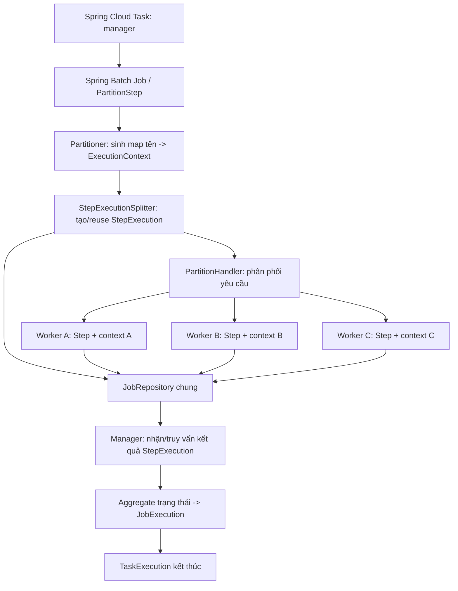

# Chia phân vùng bằng Partitioner và ExecutionContext

## 1. Bài toán: Một Task xử lý quá nhiều dữ liệu

Một ứng dụng **Spring Cloud Task** chạy trong thời gian hữu hạn: bắt đầu, làm việc rồi kết thúc. `TaskRepository` theo dõi lần chạy ở cấp tiến trình (`TaskExecution`), giúp truy vấn thời điểm, mã thoát và kết quả. Khi tác vụ cần nhập hàng triệu hóa đơn, một tiến trình xử lý tuần tự có thể không đáp ứng thời hạn hoàn tất. Ta có thể kết hợp **Spring Batch** với **remote partitioning**: chia dữ liệu thành nhiều phần, giao mỗi phần cho một worker chạy một `Step`.

Ví dụ Job `importInvoices` cần xử lý hóa đơn có ID từ 1 đến 1.000. Manager chia thành bốn dải ID, mỗi worker chịu trách nhiệm một dải:

| Phân vùng | `fromId` (bao gồm) | `toIdExclusive` (không bao gồm) | ID được xử lý |
| --- | ---: | ---: | --- |
| `partition0` | 1 | 251 | 1–250 |
| `partition1` | 251 | 501 | 251–500 |
| `partition2` | 501 | 751 | 501–750 |
| `partition3` | 751 | 1001 | 751–1000 |

Mỗi worker chạy cùng cấu hình `invoiceWorkerStep` nhưng nhận **`ExecutionContext` khác nhau**. Worker không cần biết dữ liệu của phân vùng khác. Spring Batch lưu metadata Step/Job vào `JobRepository` để tổng hợp trạng thái và hỗ trợ restart.

Mục tiêu của bài thuộc chương **Phân vùng từ xa**:

1. Hiểu vai trò của `Partitioner`, `ExecutionContext`, `PartitionStep`, `StepExecutionSplitter` và `PartitionHandler`.
2. Tạo các phân vùng **đầy đủ, không chồng lấn, có tên ổn định**; tránh lỗi off-by-one.
3. Dùng `@StepScope` và `stepExecutionContext` để bind tham số riêng của từng worker.
4. Phân biệt mô hình chạy nhiều thread trên một JVM với mô hình worker **từ xa** qua broker hoặc Spring Cloud Task launcher.
5. Thiết kế tính nhất quán, restart, idempotency, giám sát và vận hành an toàn.

## 2. Partitioner và ExecutionContext giữ vai trò gì?

### Partitioner — người lập kế hoạch chia dữ liệu

Trong Spring Batch, `org.springframework.batch.core.partition.Partitioner` là functional interface có một phương thức:

```java
Map<String, ExecutionContext> partition(int gridSize);
```

Kết quả là một map. **Key** là tên phân vùng duy nhất trong phạm vi các `StepExecution` được tạo cho Job; **value** là các tham số dành riêng cho phân vùng đó. Spring Batch sẽ tạo `StepExecution` cho các partition và lưu `ExecutionContext` tương ứng vào `JobRepository`.

`gridSize` là **gợi ý số lượng phân vùng**, không phải bảo đảm số worker vật lý và cũng không phải số thread hay số container được tự động triển khai. `Partitioner` có thể dùng gợi ý này để tạo tối đa N phần hoặc có thể tự quyết định số phần theo tập dữ liệu thực tế. Tại môi trường từ xa, `PartitionHandler` và cơ chế triển khai worker mới quyết định việc thực thi/phân phối.

### ExecutionContext — dữ liệu cho một lần thực thi

`ExecutionContext` là vùng chứa các cặp key–value mà Spring Batch dùng ở cấp `JobExecution` hoặc `StepExecution`. Với partitioning, **mỗi partition có StepExecutionContext riêng**. Nó thường chứa thông tin nhỏ và ổn định như:

```text
partition0:
  fromId         = 1
  toIdExclusive  = 251
  businessDate   = 2026-11-24

partition1:
  fromId         = 251
  toIdExclusive  = 501
  businessDate   = 2026-11-24
```

Spring Batch có thể serialize context vào bảng metadata, ví dụ `BATCH_STEP_EXECUTION_CONTEXT` với JobRepository JDBC. Vì vậy **chỉ nên lưu giá trị nhỏ, được framework/serializer hỗ trợ**, như `String`, `Long`, `Integer` và định danh file hoặc vùng ID; không đưa toàn bộ dataset, connection, bean, token hoặc password vào đó. Tránh sửa các khóa xác định phạm vi giữa một lần restart.

### Phân biệt với các dạng tham số khác

| Loại | Phạm vi | Ví dụ |
| --- | --- | --- |
| `JobParameters` | Định danh/cấu hình một lần chạy Batch Job | `businessDate=2026-11-24`, `tenant=acme` |
| `JobExecutionContext` | Dữ liệu chia sẻ trong JobExecution (theo chính sách lưu trạng thái) | Snapshot cutoff, manifest tổng thể |
| `StepExecutionContext` của partition | Dữ liệu riêng từng worker step | `fromId=251`, `toIdExclusive=501` |
| `TaskExecution.arguments` | Đối số khởi chạy tiến trình Spring Cloud Task | `--spring.cloud.task.name=...` |

**TaskRepository và JobRepository là hai tầng khác nhau**: TaskRepository ghi quá trình JVM/Task, còn JobRepository giữ JobExecution, StepExecution và ExecutionContext phục vụ xử lý Batch. Nếu manager tạo nhiều Spring Cloud Task worker, có thể có nhiều TaskExecution tương ứng với các tiến trình; mỗi worker vẫn phải đọc đúng **StepExecution** của nó từ JobRepository chung.

## 3. Luồng manager–worker của remote partitioning



Thành phần và trách nhiệm:

| Thành phần | Trách nhiệm |
| --- | --- |
| `PartitionStep` (manager step) | Điều phối việc chia phân vùng và tổng hợp kết quả các worker |
| `Partitioner` | Tạo tập tên partition và `ExecutionContext` đầu vào |
| `StepExecutionSplitter` | Xây dựng `StepExecution` cho các partition; phối hợp metadata để restart |
| `PartitionHandler` | Gửi/chạy các `StepExecution` trên thread, broker hoặc nền tảng từ xa |
| Worker `Step` | Đọc context riêng và xử lý phần dữ liệu được giao |
| `JobRepository` | Lưu Job, Step, context, status/checkpoint để theo dõi và restart |
| `TaskRepository` | Ghi metadata vòng đời các tiến trình Spring Cloud Task |

Đừng đồng nhất **remote partitioning** với **remote chunking**:

- **Remote partitioning:** mỗi worker thực hiện một **Step hoàn chỉnh**, có ItemReader, ItemProcessor, ItemWriter riêng (hoặc một Tasklet) và StepExecution riêng.
- **Remote chunking:** manager thường đọc item rồi gửi **chunk** qua middleware cho worker xử lý/ghi; việc phân chia không dựa trên map `Partitioner -> ExecutionContext` giống remote partitioning.

Một Job có thể thử partitioning cục bộ trước bằng `TaskExecutorPartitionHandler`, sau đó thay handler bằng cơ chế từ xa. **Logic phân chia dữ liệu của `Partitioner` có thể giữ nguyên**, còn kênh dispatch, worker deployment, kết nối JobRepository và tính an toàn vận hành cần thiết kế riêng.

## 4. Quy tắc chia dải dữ liệu: nửa mở [from, to)

Khi chia dải ID, hãy thống nhất **bao gồm cận dưới, loại trừ cận trên**:

```sql
SELECT id, customer_id, amount
FROM invoice
WHERE id >= :fromId
  AND id <  :toIdExclusive
ORDER BY id;
```

Các phân vùng như `[1, 251)` và `[251, 501)` chạm biên nhưng **không cùng lấy ID 251**. Nếu cả hai dùng `<= upper`, ID tại biên sẽ bị xử lý hai lần.

Ba bất biến quan trọng cho một bộ partition:

1. **Coverage:** hợp các dải phủ đúng tập ID cần xử lý, không thiếu đầu/cuối.
2. **Disjointness:** hai dải không giao nhau.
3. **Stability:** tên và ý nghĩa dải được dùng trong restart phải ổn định, có thể đối chiếu lại với metadata đã lưu.

Đừng giả sử ID liên tục hoặc mọi dải có số bản ghi tương đương. Bảng có lỗ ID lớn có thể khiến nhiều worker gần như không có gì làm. Khi dữ liệu phân bố lệch, cân nhắc partition theo manifest file, khoảng thời gian, phân vị khóa hoặc danh sách bucket được tính từ snapshot.

## 5. Ví dụ Java 17+: viết RangePartitioner

Ví dụ theo **Spring Batch 6.x** (thế hệ Spring Boot 4.x): `ExecutionContext` nằm ở package `org.springframework.batch.infrastructure.item`. Với Spring Batch 5.x, package thường là `org.springframework.batch.item.ExecutionContext`; hãy theo đúng phiên bản BOM dự án.

Tệp `RangePartitioner.java`:

```java
package com.example.invoice;

import java.util.LinkedHashMap;
import java.util.Locale;
import java.util.Map;
import org.springframework.batch.core.partition.Partitioner;
import org.springframework.batch.infrastructure.item.ExecutionContext;

public final class RangePartitioner implements Partitioner {
    private final long minInclusive;
    private final long maxExclusive;

    public RangePartitioner(long minInclusive, long maxExclusive) {
        if (minInclusive < 0 || maxExclusive <= minInclusive) {
            throw new IllegalArgumentException("Khoảng ID phải khác rỗng");
        }
        this.minInclusive = minInclusive;
        this.maxExclusive = maxExclusive;
    }

    @Override
    public Map<String, ExecutionContext> partition(int gridSize) {
        if (gridSize <= 0) {
            throw new IllegalArgumentException("gridSize phải > 0");
        }

        long total = Math.subtractExact(maxExclusive, minInclusive);
        int parts = (int) Math.min((long) gridSize, total);
        long width = total / parts + (total % parts == 0 ? 0 : 1);
        Map<String, ExecutionContext> result = new LinkedHashMap<>();

        long from = minInclusive;
        for (int i = 0; i < parts && from < maxExclusive; i++) {
            long toExclusive = from
                + Math.min(width, maxExclusive - from);

            ExecutionContext context = new ExecutionContext();
            context.putLong("fromId", from);
            context.putLong("toIdExclusive", toExclusive);

            String name = String.format(Locale.ROOT, "partition%04d", i);
            result.put(name, context);
            from = toExclusive;
        }
        return result;
    }
}
```

**Tại sao thiết kế như vậy?**

- Constructor từ chối khoảng rỗng; tác vụ không có dữ liệu nên được xử lý bằng nhánh “no work” riêng, thay vì âm thầm tạo Job partition không rõ kết quả.
- `gridSize` phải dương; nếu tổng dải chỉ có hai ID mà gridSize là mười, chỉ tạo tối đa hai partition không rỗng.
- `width` là phép chia làm tròn lên; vòng lặp dùng `Math.min(...)` để cận cuối không vượt `maxExclusive`.
- `LinkedHashMap` giúp xem kết quả theo thứ tự rõ ràng; **tên** `partition0000`, `partition0001` là khóa định danh, không nên dùng vị trí map làm nguồn sự thật cho restart.
- `Math.subtractExact` phát hiện tràn số. Ví dụ giả định cận ID có thể biểu diễn trong `long` và không làm tràn phép tính.

Ví dụ với `new RangePartitioner(1, 1001).partition(4)`:

```text
partition0000 -> {fromId=1,   toIdExclusive=251}
partition0001 -> {fromId=251, toIdExclusive=501}
partition0002 -> {fromId=501, toIdExclusive=751}
partition0003 -> {fromId=751, toIdExclusive=1001}
```

**Lưu ý với dữ liệu thực:** `minInclusive` và `maxExclusive` không nên truy vấn lại tùy tiện từ bảng đang thay đổi trên mỗi restart. Một Job có thể chụp snapshot hoặc ghi manifest/cutoff ổn định theo JobParameters để tập dữ liệu của lần chạy không dịch chuyển. Các StepExecution đã tạo giữ context trong JobRepository, nhưng việc tái tính partition name với cách chia khác vẫn có thể gây kết quả khó dự đoán khi restart.

### Kiểm tra phân vùng bằng một đoạn mã nhỏ

```java
var partitions = new RangePartitioner(1, 1001).partition(4);
if (partitions.size() != 4) {
    throw new AssertionError("Phải tạo 4 partition");
}

long expectedStart = 1;
for (var entry : partitions.entrySet()) {
    var context = entry.getValue();
    long start = context.getLong("fromId");
    long end = context.getLong("toIdExclusive");

    if (start != expectedStart || end <= start) {
        throw new AssertionError("Dải trùng hoặc thiếu: " + entry.getKey());
    }
    expectedStart = end;
}
if (expectedStart != 1001) {
    throw new AssertionError("Chưa phủ hết dải ID");
}
```

Đây là đoạn kiểm tra logic Partitioner, không cần khởi chạy Job hay database. Với production, nên kiểm thêm trường hợp `gridSize=1`, `gridSize > total`, ID rất lớn và tên partition không đổi khi dữ liệu/snapshot không đổi.

## 6. Worker đọc ExecutionContext bằng @StepScope

Manager lưu `fromId` và `toIdExclusive` vào **StepExecutionContext**. Worker đọc chúng khi **StepExecution đang chạy**, tức là cần *late binding*. `@StepScope` tạo bean theo từng StepExecution, giúp mỗi partition có giá trị riêng; nếu bind context vào singleton tại thời điểm khởi tạo ứng dụng, dữ liệu có thể chưa sẵn sàng hoặc bị dùng sai giữa các worker.

Ví dụ worker dùng `Tasklet` để **đếm bản ghi** trong dải (an toàn để học; khi triển khai thực tế thay bằng chunk reader/processor/writer):

```java
package com.example.invoice;

import org.springframework.batch.core.step.tasklet.Tasklet;
import org.springframework.batch.infrastructure.repeat.RepeatStatus;
import org.springframework.jdbc.core.JdbcTemplate;

public class RangeCountTasklet implements Tasklet {
    private final JdbcTemplate jdbc;
    private final long fromId;
    private final long toIdExclusive;

    public RangeCountTasklet(
            JdbcTemplate jdbc, long fromId, long toIdExclusive) {
        if (fromId >= toIdExclusive) {
            throw new IllegalArgumentException("Dải ID không hợp lệ");
        }
        this.jdbc = jdbc;
        this.fromId = fromId;
        this.toIdExclusive = toIdExclusive;
    }

    @Override
    public RepeatStatus execute(
            org.springframework.batch.core.step.StepContribution contribution,
            org.springframework.batch.core.scope.context.ChunkContext context) {

        Long count = jdbc.queryForObject(
            "SELECT COUNT(*) FROM invoice WHERE id >= ? AND id < ?",
            Long.class, fromId, toIdExclusive
        );
        System.out.printf("Dải [%d,%d): %d hóa đơn%n",
            fromId, toIdExclusive, count);
        return RepeatStatus.FINISHED;
    }
}
```

Tạo bean step-scoped và Step trong cấu hình:

```java
package com.example.invoice;

import org.springframework.batch.core.configuration.annotation.StepScope;
import org.springframework.batch.core.repository.JobRepository;
import org.springframework.batch.core.step.Step;
import org.springframework.batch.core.step.builder.StepBuilder;
import org.springframework.context.annotation.Bean;
import org.springframework.context.annotation.Configuration;
import org.springframework.beans.factory.annotation.Qualifier;
import org.springframework.beans.factory.annotation.Value;
import org.springframework.jdbc.core.JdbcTemplate;
import org.springframework.transaction.PlatformTransactionManager;

@Configuration
public class WorkerStepConfig {
    @Bean
    @StepScope
    RangeCountTasklet rangeCountTasklet(
            JdbcTemplate jdbc,
            @Value("#{stepExecutionContext['fromId']}") Long fromId,
            @Value("#{stepExecutionContext['toIdExclusive']}") Long toId) {
        if (fromId == null || toId == null) {
            throw new IllegalArgumentException("Thiếu context của partition");
        }
        return new RangeCountTasklet(jdbc, fromId, toId);
    }

    @Bean
    Step invoiceWorkerStep(
            JobRepository repository,
            PlatformTransactionManager transactionManager,
            @Qualifier("rangeCountTasklet") RangeCountTasklet tasklet) {
        return new StepBuilder("invoiceWorkerStep", repository)
            .tasklet(tasklet, transactionManager)
            .build();
    }
}
```

Mỗi worker nhận hai `Long` từ context **của chính StepExecution**, không đọc `fromId` từ một biến static/global hoặc chỉ từ `JobParameters`. Nếu Step bắt đầu mà thiếu key, báo lỗi rõ ràng để metadata ghi Step thất bại thay vì xử lý toàn bảng.

Đoạn trên là cấu hình minh họa cho bảng `invoice` và cấu hình JDBC/Batch đã có; chưa phải ứng dụng hoàn chỉnh. Khi xử lý dữ liệu thật, dùng `JdbcPagingItemReader` hoặc reader tương đương với các điều kiện:

```sql
SELECT id, customer_id, amount
FROM invoice
WHERE id >= :fromId
  AND id < :toIdExclusive
ORDER BY id;
```

Với `JdbcPagingItemReader`, nên có sort key ổn định, duy nhất (ví dụ `id`), cấu hình page size và khả năng lưu trạng thái restart. Reader/processor/writer phải được tạo đúng scope. Đối với các nguồn đang thay đổi, cần snapshot hoặc chiến lược consistency để lần restart đọc cùng tập dữ liệu mong muốn.

## 7. Thử partitioning cục bộ trước khi triển khai từ xa

Một cách giảm rủi ro là dùng **cùng `RangePartitioner`** và worker Step nhưng tạm chạy các partition trong một JVM. Spring Batch cung cấp `TaskExecutorPartitionHandler` và builder `taskExecutor(...)` để kiểm thử mapping context, xử lý lỗi và tổng hợp trạng thái trước khi tích hợp broker hoặc launcher.

Ví dụ cấu hình **manager cục bộ** với `gridSize=4`:

```java
package com.example.invoice;

import org.springframework.batch.core.job.Job;
import org.springframework.batch.core.job.builder.JobBuilder;
import org.springframework.batch.core.partition.Partitioner;
import org.springframework.batch.core.repository.JobRepository;
import org.springframework.batch.core.step.Step;
import org.springframework.batch.core.step.builder.StepBuilder;
import org.springframework.context.annotation.Bean;
import org.springframework.context.annotation.Configuration;
import org.springframework.core.task.SimpleAsyncTaskExecutor;
import org.springframework.beans.factory.annotation.Qualifier;

@Configuration
public class LocalPartitionManagerConfig {
    @Bean
    Partitioner invoicePartitioner() {
        // Snapshot ví dụ: hóa đơn có ID trong [1,1001).
        return new RangePartitioner(1, 1001);
    }

    @Bean
    Step invoiceManagerStep(
            JobRepository repository,
            Partitioner invoicePartitioner,
            @Qualifier("invoiceWorkerStep") Step workerStep) {
        SimpleAsyncTaskExecutor executor =
            new SimpleAsyncTaskExecutor("invoice-partition-");
        executor.setConcurrencyLimit(4);

        return new StepBuilder("invoiceManagerStep", repository)
            .partitioner("invoiceWorkerStep", invoicePartitioner)
            .step(workerStep)
            .gridSize(4)
            .taskExecutor(executor)
            .build();
    }

    @Bean
    Job invoicePartitionJob(
            JobRepository repository,
            @Qualifier("invoiceManagerStep") Step managerStep) {
        return new JobBuilder("invoicePartitionJob", repository)
            .start(managerStep)
            .build();
    }
}
```

Đây là **bài thử cục bộ**, chưa phải remote partitioning. Các bean `invoiceWorkerStep`, `rangeCountTasklet` và `invoicePartitioner` phải cùng có mặt trong context; cần database và bảng `invoice`. Phần `SimpleAsyncTaskExecutor` với giới hạn concurrency chỉ để học; production nên dùng executor được quản lý và kiểm soát thread/connection pool.

Khi chạy, bạn kỳ vọng bốn `StepExecution` con như `invoiceWorkerStep:partition0000` đến `...partition0003`. Mỗi Step xử lý một context và JobRepository có thể tổng hợp kết quả. `gridSize=4` không làm xuất hiện bốn **Spring Cloud Task** mới trong mô hình này, vì mọi Step vẫn ở trong JVM manager.

## 8. Chuyển sang remote partitioning thật

Có **hai hướng phổ biến**, cùng dùng Partitioner và các StepExecutionContext:

| Hướng | `PartitionHandler` / cơ chế | Worker nhận gì? |
| --- | --- | --- |
| Spring Batch Integration qua message broker | `MessageChannelPartitionHandler`, request/reply qua Spring Integration (JMS, AMQP, ... theo adapter đã cấu hình) | Thông tin định danh `StepExecutionRequest` để worker tìm và chạy Step |
| Spring Cloud Task + platform launcher | `DeployerPartitionHandler` dùng `TaskLauncher` để khởi chạy các worker Task trên nền tảng triển khai | ID của `StepExecution` được chuyển cho worker (ví dụ qua biến môi trường); worker dùng `DeployerStepExecutionHandler` tải metadata từ JobRepository |

Ở cả hai hướng, **manager** có `Partitioner` và phân phối các StepExecution, còn **worker** có định nghĩa `invoiceWorkerStep` và logic xử lý. Worker **không tự chia lại dải ID**. Khi worker được giao `StepExecutionId`, nó đọc context đã lưu từ JobRepository rồi mới bind `fromId`/`toIdExclusive`.

### 8.1. Phác thảo cấu hình manager dùng handler từ xa

Thay `.taskExecutor(...)` / `.step(...)` trong manager cục bộ bằng `PartitionHandler` được cấu hình cho môi trường thật:

```java
// Bên trong lớp @Configuration của manager.
@Bean
Step remoteInvoiceManagerStep(
        JobRepository repository,
        Partitioner invoicePartitioner,
        PartitionHandler remotePartitionHandler) {
    return new StepBuilder("remoteInvoiceManagerStep", repository)
        .partitioner("invoiceWorkerStep", invoicePartitioner)
        .gridSize(4)
        .partitionHandler(remotePartitionHandler)
        .build();
}
```

Đây là **đoạn minh họa cấu trúc**, cần các import `Step`, `Partitioner`, `PartitionHandler`, `StepBuilder`, `JobRepository` và bean `remotePartitionHandler` cụ thể. Nó không thể chạy chỉ bằng việc thêm một annotation. Với broker cần thiết lập kênh gửi yêu cầu, kênh nhận kết quả hoặc cơ chế polling JobRepository, serialization, xác thực và durability. Với deployer cần `TaskLauncher`, artifact worker, deployment properties, số worker đồng thời, polling/timeout và môi trường truy cập kho JobRepository.

### 8.2. Hai ứng dụng có trách nhiệm khác nhau

**Manager Task:**

1. Nhận và kiểm tra tham số (ngày báo cáo, tenant, phạm vi dữ liệu).
2. Xác định snapshot hoặc manifest để chia việc ổn định.
3. Khởi chạy Batch Job chứa partition manager Step.
4. Tạo StepExecutionContext, phân phối công việc, chờ/tổng hợp kết quả.
5. Chuyển trạng thái Batch thất bại thành kết quả Task và mã thoát phù hợp để scheduler nhận biết.

**Worker Task/process:**

1. Nhận định danh StepExecution qua cơ chế dispatch **đã cấu hình**.
2. Truy cập đúng JobRepository chung, lấy context của phân vùng được giao.
3. Chạy `invoiceWorkerStep` với `@StepScope`, ghi tiến độ/trạng thái Batch.
4. Kết thúc và trả tín hiệu cho manager qua repository/broker/handler.

Nếu dùng `DeployerPartitionHandler`, một worker thường là một Spring Cloud Task riêng và có thể có `TaskExecution` riêng; nhưng **metadata Batch của các partition vẫn phải được phối hợp qua JobRepository chung**. Đừng nhầm ID `TaskExecution` với ID `StepExecution`.

**Chú ý về lifecycle:** ứng dụng worker phải được cấu hình để **không tự khởi chạy toàn bộ Job manager** khi startup. Ví dụ có thể tách profile manager/worker và vô hiệu hóa Batch Job auto-run trên worker, tùy cơ chế bootstrap của handler. Nếu cả manager và worker đều tự khởi chạy Job giống nhau, công việc có thể bị chạy trùng hoặc phát sinh lỗi JobInstance.

## 9. Những lỗi chia phân vùng cần tránh

### 9.1. Off-by-one, chồng lấn và bỏ sót

Không trộn `BETWEEN lower AND upper` (bao gồm cả hai đầu) với quy ước `toIdExclusive`. Nếu dùng:

```sql
-- Sai với quy ước nửa mở khi hai dải chạm nhau:
WHERE id BETWEEN :fromId AND :toIdExclusive
```

thì ID `251` có thể thuộc cả partition `[1,251)` và `[251,501)`. Sử dụng `id >= :fromId AND id < :toIdExclusive`.

### 9.2. Dữ liệu nguồn thay đổi trong lúc xử lý

Chia dải theo `MIN(id)`/`MAX(id)` hiện tại nhưng trong lúc chạy có thêm hoặc sửa bản ghi có thể khiến kết quả không còn là một snapshot thống nhất. Với hóa đơn, cần quy tắc rõ ràng như `businessDate`, `createdAt < cutoff` cố định hoặc manifest ID đã chốt. Một partition không nên dựa vào dữ liệu chưa xác định được phạm vi khi restart.

### 9.3. Các partition phân bố quá lệch

Với ID từ 1 đến 1.000.000 nhưng 90% bản ghi nằm trong dải cuối, chia ID bằng nhau sẽ khiến một worker chịu gần như toàn bộ tải. Có thể chia theo file, khoảng thời gian, phân vị dữ liệu hoặc nhiều partition nhỏ hơn số worker để cân bằng tải. **GridSize không tự cân bằng dữ liệu nghiệp vụ**.

### 9.4. Tên không ổn định khi restart

Tên partition phải duy nhất và ổn định trong JobInstance. Nếu bạn tạo tên theo timestamp hoặc UUID ngẫu nhiên trên mỗi lần lập kế hoạch, Spring Batch khó đối chiếu lần chạy lại với các StepExecution đã hoàn tất. `PartitionNameProvider` là tùy chọn hỗ trợ cung cấp tên ổn định riêng, đặc biệt khi việc tính lại partition rất tốn kém; nếu dùng nó, tên phải khớp với tên từ `Partitioner`.

### 9.5. Đưa quá nhiều dữ liệu hoặc bí mật vào ExecutionContext

`ExecutionContext` là metadata có thể được serialize và lưu trong database. Không đặt danh sách hàng triệu ID, payload hóa đơn, access token, password hoặc dữ liệu khách hàng không cần thiết vào đó. Hãy dùng vùng ID, đường dẫn manifest hoặc định danh công việc có kiểm soát quyền truy cập; worker tải dữ liệu từ nguồn thích hợp.

## 10. Restart, retry và kết quả tổng hợp

Spring Batch có cơ chế restart dựa trên metadata `JobRepository`. Với một **JobInstance** bị thất bại, các StepExecution của partition đã hoàn tất có thể được giữ lại, còn partition thất bại được thực thi lại theo quy tắc restart; manager tổng hợp cả kết quả từ partition đã hoàn tất trước đó. Điều này đòi hỏi **partition name và phạm vi dữ liệu ổn định**, và JobParameters xác định đúng JobInstance.

Ví dụ:

| Partition | Lần chạy đầu | Khi restart cùng JobInstance |
| --- | --- | --- |
| `partition0000` | `COMPLETED` | Thường không chạy lại |
| `partition0001` | `COMPLETED` | Thường không chạy lại |
| `partition0002` | `FAILED` | Được chạy lại theo chính sách restart |
| `partition0003` | `COMPLETED` | Thường không chạy lại |

Đây là mô hình kỳ vọng khi dùng splitter/repository chuẩn; việc thực tế còn phụ thuộc Step, JobParameters, `allowStartIfComplete`, giới hạn restart, cách dispatch và trạng thái persisted. Retry của broker hoặc launcher **không tự đảm bảo exactly-once ở tầng nghiệp vụ**. Một worker có thể ghi xong dữ liệu nhưng chết trước khi metadata `COMPLETED` được lưu; lúc chạy lại cần idempotency hoặc transaction/checkpoint phù hợp để không ghi trùng.

**Không nên đổi `gridSize`, thuật toán chia hay snapshot trong lúc restart một JobInstance đã có partition metadata** trừ khi bạn đã hiểu chính xác ảnh hưởng đến các StepExecution cũ. Nếu phạm vi nghiệp vụ thay đổi, hãy thiết kế một JobInstance mới có chủ đích thay vì cố sửa context đang dùng.

### Khác nhau giữa retry của Task và restart của Job

| Hành động | Có thể tạo gì? | Nguy cơ nếu không có idempotency |
| --- | --- | --- |
| Scheduler gọi lại manager Task | `TaskExecution` mới | Có thể khởi động lại Job ngoài chủ đích |
| Spring Batch restart Job bị lỗi | `JobExecution` mới trong cùng `JobInstance`, tái sử dụng thông tin partition thích hợp | Partition thất bại có thể ghi lại một phần dữ liệu |
| Broker redeliver request | Có thể giao lại cùng `StepExecutionRequest` theo cơ chế middleware | Cần kiểm soát xử lý trùng và tính nhất quán trạng thái |
| Worker Task được launch lại | Tiến trình/`TaskExecution` mới | Phải biết StepExecution nào được phép xử lý lại |

Với Spring Cloud Task, đừng mặc định Job Batch thất bại sẽ luôn làm process manager trả exit code khác 0. Cần kiểm tra cầu nối kết quả (ví dụ `spring.cloud.task.batch.fail-on-job-failure` trong cấu hình Batch phù hợp hoặc logic manager tường minh), rồi kiểm chứng **JobExecution.status**, **TaskExecution.exitCode** và process exit code mà scheduler thấy.

## 11. Quan sát dữ liệu thực thi trong database

Khi dùng JDBC JobRepository chuẩn, người vận hành có thể xem trạng thái từng partition:

```sql
SELECT
    STEP_EXECUTION_ID,
    JOB_EXECUTION_ID,
    STEP_NAME,
    STATUS,
    EXIT_CODE,
    START_TIME,
    END_TIME,
    READ_COUNT,
    WRITE_COUNT
FROM BATCH_STEP_EXECUTION
WHERE JOB_EXECUTION_ID = :jobExecutionId
ORDER BY STEP_NAME, STEP_EXECUTION_ID;
```

Tên `STEP_NAME` thường có dạng `invoiceWorkerStep:partition0000`. Để xem context từng partition, dùng API `JobExplorer`/`JobRepository` hoặc query bảng `BATCH_STEP_EXECUTION_CONTEXT` theo `STEP_EXECUTION_ID` sau khi xác minh DDL. Context có thể được serialize nên **không giả định có thể đọc JSON trực tiếp** hay sửa bằng SQL thủ công.

Nếu worker là các tiến trình Spring Cloud Task, dùng thêm bảng `TASK_EXECUTION` để truy vết thời điểm start/end và mã thoát ở cấp process. Quan hệ giữa TaskExecution và JobExecution tùy cách tích hợp Batch/Task; liên kết như `TASK_TASK_BATCH` chỉ có khi component tương ứng được cấu hình. Không tự giả định `TASK_EXECUTION_ID = STEP_EXECUTION_ID`.

Các tín hiệu nên thu thập:

- Tổng số partition, số `COMPLETED`/`FAILED`/`STARTED` và thời gian xử lý từng partition.
- Phân phối số bản ghi đọc/ghi, số skip, lỗi và partition bị chậm nhất.
- Số worker đang chạy so với `maxWorkers`/tài nguyên được cấp.
- Thời gian manager chờ phản hồi, timeout của handler, độ trễ broker hoặc JobRepository.
- Số lần retry, dấu hiệu duplicate delivery, trạng thái Task ở scheduler.

`END_TIME IS NULL` không chứng minh worker còn sống; tiến trình có thể bị kill trước khi metadata cập nhật. Khi một partition treo, đối chiếu JobRepository, log worker, container và heartbeat/timeout của hạ tầng.

## 12. An toàn vận hành và hiệu năng

| Vấn đề | Biện pháp |
| --- | --- |
| Nhiều partition hơn khả năng database | Giới hạn concurrency/maxWorkers, theo dõi pool JDBC và lock |
| Một partition quá lớn | Chia nhỏ hơn hoặc chuyển sang phân phối theo dữ liệu thực |
| Dữ liệu đầu vào thay đổi | Cố định snapshot/cutoff và identifying JobParameters |
| Phân vùng trùng | Dùng dải nửa mở, kiểm tra overlap và coverage |
| Worker xử lý xong nhưng manager chưa thấy | Kiểm tra JobRepository, broker replies/polling, timeout; có idempotency |
| Thông tin nhạy cảm trong context | Chỉ lưu ID/phạm vi cần thiết, phân quyền DB và log |
| Worker tự chạy toàn bộ manager Job | Tách profile/entrypoint, vô hiệu hóa auto-run không phù hợp |
| Restart sai bộ tham số | Dùng JobInstance/JobParameters đúng ngữ nghĩa, giữ tên partition ổn định |
| Task/Batch cùng ghi metadata vào database | Cấu hình schema, connection pool, transaction và migration phù hợp |
| Đầu ra của partition không giao dịch | Dùng unique constraint, outbox, idempotent write hoặc cơ chế bù phù hợp |

**Đừng dùng remote partitioning chỉ vì muốn có nhiều JVM.** Nếu bottleneck nằm ở database có một khóa nóng, tạo 20 worker có thể làm chậm hơn một worker. Trước khi tăng `gridSize`, đo thời gian đọc/ghi, độ trễ mạng, IO và mức cạnh tranh transaction.

## 13. Bài tập thực hành

### Bài 1 — Kiểm tra Partitioner

Dùng `RangePartitioner` tạo partition cho dải `[1,1001)` với gridSize `1`, `4`, `8`, `1200`. Với mỗi kết quả, tự xác minh:

1. Không có dải rỗng hoặc giao nhau.
2. Dải đầu bắt đầu tại `1` và dải cuối kết thúc ở `1001`.
3. Số partition không vượt số ID trong dải.
4. Tên partition không đổi giữa hai lần chạy cùng dữ liệu.

### Bài 2 — Chạy cục bộ

Tạo bảng `invoice(id, customer_id, amount)` với ID từ 1 đến 1.000. Chạy `invoicePartitionJob` với bốn partition trên một JVM. So sánh số bản ghi mà mỗi `RangeCountTasklet` in ra với tổng số dòng trong bảng. Kiểm tra `BATCH_STEP_EXECUTION` và context của mỗi StepExecution.

### Bài 3 — Mô phỏng lỗi và restart

Cho worker của `partition0002` ném ngoại lệ sau khi bắt đầu; giữ ba partition còn lại thành công. Restart JobInstance theo cơ chế Batch. Xác nhận partition nào chạy lại, partition nào được tái sử dụng và trạng thái Job tổng hợp. Nếu chuyển ví dụ từ đếm sang ghi dữ liệu, thêm unique constraint để kiểm chứng không ghi trùng.

### Bài 4 — Đổi sang phân phối từ xa

Chọn **một** hướng: message broker qua Spring Batch Integration hoặc `DeployerPartitionHandler` cùng TaskLauncher. Vẽ sơ đồ đường đi của `StepExecutionId`, JobRepository, ExecutionContext và kết quả từ worker về manager. Nêu rõ công đoạn cấu hình kết nối chung, xác thực, timeout, số worker và chống worker tự khởi chạy manager Job.

### Bài 5 — Thiết kế snapshot cho dữ liệu thay đổi

Trong lúc xử lý ngày `2026-11-24`, có 5.000 hóa đơn mới được tạo. Hãy quyết định liệu chúng có thuộc Job hiện tại không. Đề xuất một cách cố định cutoff/manifest trong `JobParameters` hoặc metadata và giải thích cách giữ kết quả restart nhất quán.

### Tự đánh giá

- `gridSize=8` có đồng nghĩa chắc chắn có tám container worker không?
- Tại sao `ExecutionContext` nên lưu phạm vi hoặc manifest thay vì toàn bộ dữ liệu?
- Vì sao worker phải dùng `@StepScope` để nhận `stepExecutionContext`?
- Tại sao dải `[1,251)` và `[251,501)` không xử lý trùng ID?
- Khác nhau giữa remote partitioning và remote chunking là gì?
- Nếu một worker hoàn tất ghi dữ liệu rồi chết trước khi lưu trạng thái, điều gì bảo vệ dữ liệu khi restart?
- TaskRepository và JobRepository ghi nhận các đơn vị thực thi khác nhau thế nào?

**Tiêu chí hoàn thành:** Bạn có thể viết `Partitioner` tạo tên/dải ổn định, kiểm tra coverage và overlap, bind context ở worker, phân biệt manager/worker cục bộ với từ xa, đọc trạng thái trong JobRepository và thiết kế phương án restart, bảo mật, idempotency có kiểm chứng.

## Tài liệu tham khảo chính thức

- [Spring Batch — Scaling and Parallel Processing / Partitioning](https://docs.spring.io/spring-batch/reference/scalability.html): `Partitioner`, `PartitionHandler`, `gridSize`, restart và vai trò `ExecutionContext`.
- [Spring Batch — Remote Partitioning](https://docs.spring.io/spring-batch/reference/spring-batch-integration/externalizing-execution.html): manager/worker và các cách giao tiếp qua Spring Integration.
- [Spring Batch 6 — Partitioner API](https://docs.spring.io/spring-batch/reference/api/org/springframework/batch/core/partition/Partitioner.html).
- [Spring Batch 6 — ExecutionContext API](https://docs.spring.io/spring-batch/reference/api/org/springframework/batch/infrastructure/item/ExecutionContext.html).
- [Spring Batch 6 — StepScope API](https://docs.spring.io/spring-batch/reference/api/org/springframework/batch/core/configuration/annotation/StepScope.html).
- [Spring Cloud Task — DeployerPartitionHandler API](https://docs.spring.io/spring-cloud-task/docs/current/apidocs/org/springframework/cloud/task/batch/partition/DeployerPartitionHandler.html): khởi chạy các worker Task và định danh `StepExecution`.
- [Spring Batch Samples — Remote Partitioning Sample](https://github.com/spring-projects/spring-batch/tree/main/spring-batch-samples): cấu hình manager/worker minh họa và đối chiếu với remote chunking.
