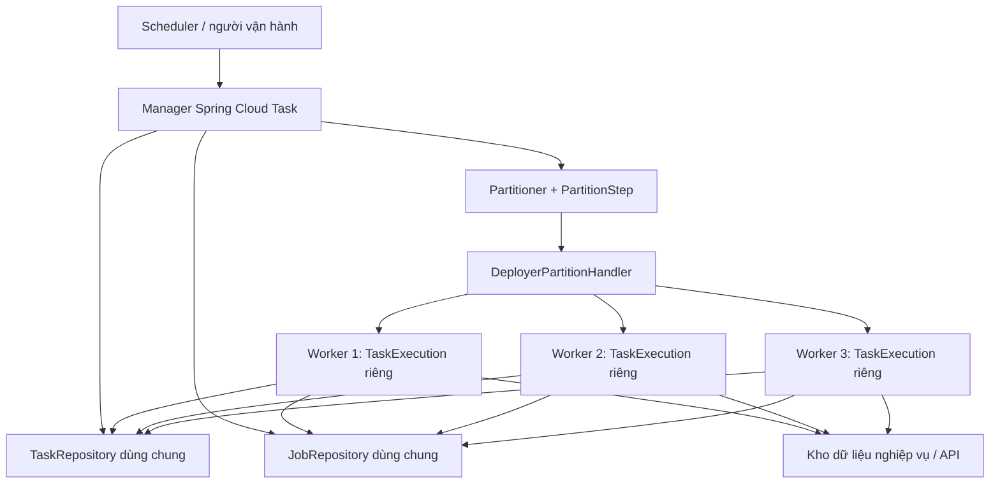
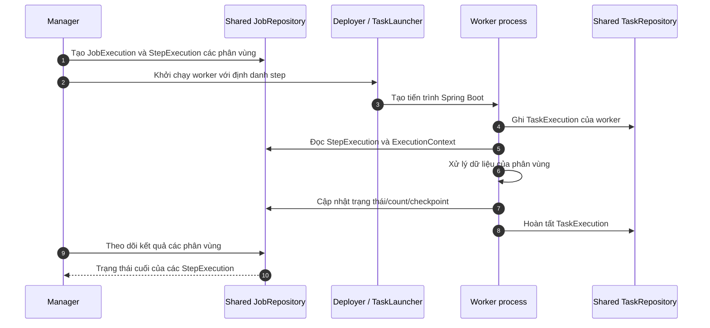
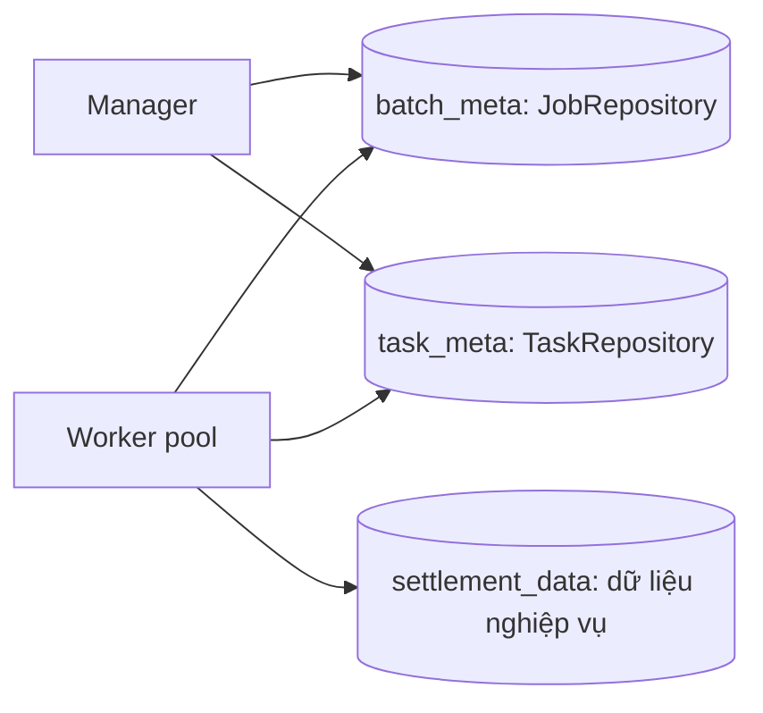

# Kho Job và kho Task dùng chung giữa các tiến trình trong remote partitioning

## 1. Bài toán: manager và worker chạy ở những JVM khác nhau

Trong hệ thống **Spring Cloud Task**, một chương trình Spring Boot có thể thực hiện một công việc hữu hạn rồi kết thúc. Khi kết hợp với **Spring Batch**, chúng ta có thể dùng **remote partitioning** để chia dữ liệu thành nhiều phần và xử lý trên các worker chạy ở những tiến trình, Pod hoặc máy chủ khác nhau.

Ví dụ một tác vụ đối soát cần xử lý 10.000 giao dịch. Một tiến trình **manager** chia công việc thành bốn phân vùng; các **worker** đảm nhiệm từng khoảng ID rồi trả kết quả. Để hệ thống khôi phục sau lỗi, manager và worker phải cùng hiểu: job nào đang chạy, phân vùng nào đã được giao, step nào đã hoàn tất và đâu là lần chạy của từng tiến trình.

Đây là lý do cần phân biệt hai kho metadata:

- **`JobRepository` của Spring Batch**: quản lý `JobInstance`, `JobExecution`, `StepExecution`, `ExecutionContext` và khả năng restart từng phân vùng.
- **`TaskRepository` của Spring Cloud Task**: quản lý `TaskExecution`, tức các lần chạy ứng dụng manager/worker với thời điểm bắt đầu, kết thúc, mã thoát và thông tin lỗi.

Chủ đề của chương **Phân vùng từ xa** là **kho Job và kho Task dùng chung giữa các tiến trình**. Mục tiêu không phải gom hai repository thành một bảng, mà bảo đảm các tiến trình tham gia cùng một lần xử lý đều kết nối đến **đúng kho metadata dùng chung của từng framework**.

Sau bài này, bạn có thể thiết kế sơ đồ lưu trữ, giải thích vì sao không dùng database in-memory riêng từng worker, cấu hình kết nối phù hợp, truy vấn kết quả, xử lý lỗi mất worker và xây chiến lược restart an toàn.

## 2. Kiến trúc manager – worker và hai repository

`Partitioner` trên manager quyết định cách chia công việc. Spring Batch tạo metadata `StepExecution` cho các phân vùng; `PartitionHandler` điều phối việc thực thi. Trong mô hình tích hợp **Spring Cloud Task + Spring Cloud Deployer**, `DeployerPartitionHandler` dùng `TaskLauncher` khởi chạy những worker Spring Boot riêng biệt, còn `DeployerStepExecutionHandler` phía worker nhận thông tin phân vùng để tra cứu và chạy step tương ứng.



Đọc sơ đồ theo hai chiều:

1. Manager và worker là **các tiến trình độc lập**, có cấu hình môi trường, vòng đời và mã thoát riêng.
2. Manager ghi và theo dõi metadata Batch; worker phải lấy được `StepExecution` mà manager đã tạo và cập nhật kết quả của phân vùng.
3. Nếu mỗi tiến trình được cấu hình như Spring Cloud Task, từng tiến trình tạo **`TaskExecution` riêng** trong kho Task.
4. Kho dữ liệu nghiệp vụ có thể là database thứ ba hoặc API ngoài; không mặc nhiên trùng với hai kho metadata.
5. `TaskRepository` và `JobRepository` có thể nằm trong **cùng một database vật lý**, nhưng vẫn có **mô hình và bảng khác nhau**.

Điều kiện then chốt của `DeployerPartitionHandler` là **manager và toàn bộ worker phải nhìn thấy cùng kho dữ liệu `JobRepository`**. Hướng dẫn remote partitioning của Spring Cloud Task cũng yêu cầu các tiến trình có khả năng truy cập kho dữ liệu dùng cho cả Job và Task trong mô hình triển khai này.

## 3. Kho nào lưu thông tin gì?

| Thông tin cần theo dõi | Spring Batch `JobRepository` | Spring Cloud Task `TaskRepository` |
| --- | --- | --- |
| Job nghiệp vụ nào đang chạy? | `JobInstance`, `JobExecution` | Tên tác vụ và lần chạy ứng dụng, không thay Job metadata |
| Phân vùng `workerStep:partition0` xử lý đến đâu? | `StepExecution` và `ExecutionContext` | Không chứa checkpoint xử lý item của Batch |
| Step đọc/ghi bao nhiêu bản ghi? | `READ_COUNT`, `WRITE_COUNT`, `ROLLBACK_COUNT`, trạng thái step | Không trực tiếp lưu số item đã xử lý |
| Worker JVM khởi động/kết thúc khi nào? | Không phải chức năng chính | `TaskExecution`, thời gian, mã thoát, lỗi |
| Khởi động lại một phân vùng đã lỗi | Cơ chế restart và metadata Batch | Không thay thế cơ chế restart phân vùng |
| Một Pod mới có phải lần chạy khác không? | Có thể là attempt của một job/step đang được khôi phục | Thường tạo một `TaskExecution` mới nếu context khởi tạo được |

Trong schema JDBC phổ biến:

- Nhóm Batch: `BATCH_JOB_INSTANCE`, `BATCH_JOB_EXECUTION`, `BATCH_STEP_EXECUTION`, `BATCH_JOB_EXECUTION_CONTEXT`, `BATCH_STEP_EXECUTION_CONTEXT` và các đối tượng cấp ID.
- Nhóm Task: `TASK_EXECUTION`, `TASK_EXECUTION_PARAMS`, `TASK_TASK_BATCH` (liên kết Task với Batch khi tích hợp và listener tương ứng hoạt động) và các đối tượng hỗ trợ khác tùy phiên bản.

**Ba định danh khác nhau** cần được giữ riêng:

| Định danh | Ví dụ minh họa | Mô tả |
| --- | --- | --- |
| `TaskExecution.executionId` | `310` | Một lần chạy tiến trình manager hoặc worker |
| `JobExecution.id` | `80` | Một lần thực thi Batch job |
| `StepExecution.id` | `805` | Một lần thực thi Batch step/phân vùng |

Không được suy luận rằng `310 = 80 = 805` hay dùng các ID này thay cho khóa nghiệp vụ. Việc manager tạo bốn phân vùng **không có nghĩa** Batch sẽ tạo bốn `JobExecution`: thông thường chúng là các `StepExecution` riêng trong một `JobExecution`.

## 4. Vì sao phải chia sẻ `JobRepository`?

Manager sử dụng `Partitioner` để sinh tên phân vùng và `ExecutionContext` của từng phân vùng. Ví dụ:

| Step phân vùng | `minIdInclusive` | `maxIdExclusive` | Phạm vi xử lý |
| --- | ---: | ---: | --- |
| `workerStep:partition0` | 0 | 2500 | ID từ 0 đến dưới 2500 |
| `workerStep:partition1` | 2500 | 5000 | ID từ 2500 đến dưới 5000 |
| `workerStep:partition2` | 5000 | 7500 | ID từ 5000 đến dưới 7500 |
| `workerStep:partition3` | 7500 | 10000 | ID từ 7500 đến dưới 10000 |

Khi dùng `DeployerPartitionHandler`, manager khởi chạy worker và truyền các **định danh thực thi cần thiết** qua cơ chế triển khai của framework. Worker dùng `DeployerStepExecutionHandler` và `JobExplorer`/`JobRepository` để **đọc bản ghi `StepExecution` đã có**, lấy `ExecutionContext`, chạy đúng step và cập nhật kết quả.



Nếu worker kết nối **một `JobRepository` riêng**, nó sẽ không tìm thấy `StepExecution` do manager tạo, hoặc tạo metadata ở chỗ khác khiến manager không thể tổng hợp kết quả. Đây không phải lỗi có thể sửa bằng việc đặt trùng tên step hay job.

**Vì thế “dùng chung” nghĩa là cùng một kho logic và schema metadata Batch phù hợp, không chỉ cùng loại cơ sở dữ liệu.** Hai PostgreSQL ở hai địa chỉ khác nhau vẫn là hai kho khác nhau dù đều có bảng tên `BATCH_STEP_EXECUTION`.

### 4.1. `JobRepository` không phải hàng đợi phân phát công việc nghiệp vụ

Trong cơ chế dùng Spring Cloud Deployer, `TaskLauncher` tạo tiến trình worker; repository lưu metadata để phối hợp và tra cứu kết quả. Còn ở mô hình remote partitioning qua Spring Integration/JMS/AMQP, manager có thể gửi yêu cầu step qua middleware; worker vẫn phải truy cập kho metadata tương ứng.

Đừng nhầm **remote partitioning** với **remote chunking**: remote chunking thường để manager đọc dữ liệu và gửi các chunk đã đọc cho worker xử lý; remote partitioning để mỗi worker xử lý **một step/phân vùng với reader/processor/writer của chính nó**. Việc chọn kiến trúc ảnh hưởng đến vị trí đọc dữ liệu và cách cấu hình metadata.

## 5. Vai trò của `TaskRepository` dùng chung

Mỗi tiến trình Spring Cloud Task được khởi động thành công thường tạo một `TaskExecution`. Nếu manager khởi chạy bốn worker, bạn có thể quan sát **một `TaskExecution` của manager và bốn `TaskExecution` của worker**, tùy số worker và số lần khởi chạy thực tế.

Ví dụ minh họa:

| Tiến trình | `taskName` | `executionId` | Kết quả |
| --- | --- | ---: | --- |
| Manager | `settlement-manager` | 310 | Đang chờ các phân vùng |
| Worker A | `settlement-worker` | 311 | Thành công |
| Worker B | `settlement-worker` | 312 | Thành công |
| Worker C | `settlement-worker` | 313 | Thất bại |
| Worker D | `settlement-worker` | 314 | Thành công |

`executionId` được kho Task cấp phát cho **mỗi lần thực thi ứng dụng**, không phải ID phân vùng. Một worker được khởi chạy lại có thể có `executionId` mới, trong khi nó đang tham gia xử lý lại một phần việc thuộc cùng `JobInstance` của Batch.

### 5.1. Khi nào cần kho Task dùng chung?

- **Mô hình `DeployerPartitionHandler` của Spring Cloud Task**: manager/worker được thiết kế cùng truy cập Task metadata để khởi chạy, liên kết và truy vết tiến trình.
- **Mô hình thuần Spring Batch remote partitioning bằng message broker**: `JobRepository` dùng chung là trọng tâm phối hợp `StepExecution`. Nếu worker không phải ứng dụng Spring Cloud Task, nó **không bắt buộc** phải sinh `TaskExecution`. Đừng tự áp một ràng buộc của tích hợp Cloud Task lên kiến trúc chỉ dùng Batch.
- **Hệ thống có lịch sử/monitoring tập trung**: chia sẻ kho Task giúp truy vấn tất cả lần chạy manager và worker từ một nơi.

Không nên tạo một database Task riêng cho mỗi Pod nếu mục tiêu là tra cứu và liên kết lịch sử của cả cụm. Database H2 **in-memory** theo từng JVM sẽ mất dữ liệu khi tiến trình kết thúc và không cho manager/worker chia sẻ cùng trạng thái bền vững.

### 5.2. Quan hệ cha–con của Task

Một số cấu hình Spring Cloud Task cho phép dùng thông tin **parent task execution** khi một task khởi chạy task khác, chẳng hạn `spring.cloud.task.parent-execution-id`. Trong tích hợp với Deployer, framework có thể truyền metadata liên quan tới lần chạy manager.

Khi truy vết, hãy đối chiếu trường parent/external execution có trong schema **đúng phiên bản**, thay vì tự giả định mọi worker đều có một quan hệ cha–con được gắn tự động trong mọi cơ chế triển khai.

`TASK_TASK_BATCH` có thể hỗ trợ liên kết `TaskExecution` với `JobExecution` khi module `spring-cloud-task-batch` và `TaskBatchExecutionListener` hoạt động. **Không nên kỳ vọng bảng này luôn có một dòng cho mọi worker phân vùng**, vì mỗi worker có thể chỉ thực thi một `StepExecution` chứ không khởi chạy toàn bộ Batch job.

## 6. Phương án đơn giản: một database vật lý, hai nhóm bảng metadata

Đối với môi trường học và mô hình vừa, một PostgreSQL bền vững có thể chứa **cả schema Batch và Task**. Tất cả tiến trình dùng **cùng URL JDBC, database/schema và phiên bản schema tương thích**, trong khi tên ứng dụng và vai trò khác nhau.

```text
PostgreSQL: batch_control
├── BATCH_JOB_INSTANCE
├── BATCH_JOB_EXECUTION
├── BATCH_STEP_EXECUTION
├── BATCH_STEP_EXECUTION_CONTEXT
├── ... các bảng/sequence Batch
├── TASK_EXECUTION
├── TASK_EXECUTION_PARAMS
├── TASK_TASK_BATCH
└── ... các bảng/sequence Task
```

### 6.1. Cấu hình kết nối dùng chung

Ví dụ `application.yml` áp dụng cho **cả manager và worker** khi cùng chạy trong một môi trường:

```yaml
spring:
  main:
    web-application-type: none
  datasource:
    url: ${METADATA_DB_URL}
    username: ${METADATA_DB_USER}
    password: ${METADATA_DB_PASSWORD}
```

Những biến này phải được cấp cho **cả tiến trình manager lẫn mỗi worker**. Ví dụ một giá trị URL có thể là `jdbc:postgresql://postgres.internal:5432/batch_control`. Đây là hostname minh họa; cấu hình thực phải trỏ tới database có thể truy cập từ tất cả Pod/máy chủ.

Manager có thể đặt tên task và cho phép khởi chạy job:

```yaml
spring:
  cloud:
    task:
      name: settlement-manager
  batch:
    job:
      enabled: true
```

Worker có thể dùng cấu hình vai trò riêng:

```yaml
spring:
  cloud:
    task:
      name: settlement-worker
  batch:
    job:
      enabled: false
```

`spring.batch.job.enabled=false` giúp tránh **tự khởi chạy toàn bộ Batch job** khi worker Boot context bắt đầu; worker cần chạy **step được chỉ định bởi cơ chế remote partitioning**. Cấu hình thực tế phải tương thích với cách bạn đăng ký `DeployerStepExecutionHandler`/`JobLauncher` và dòng Spring Boot đang dùng.

**Các file YAML ở đây là những mảnh cấu hình để ghép theo profile hoặc triển khai**, không phải ba file độc lập tự động kết hợp. Hãy dùng `application.yml` chung và profile `manager`/`worker`, hoặc các cấu hình tương đương do scheduler truyền.

### 6.2. Những điều bắt buộc giống nhau và những điều nên khác nhau

| Hạng mục | Manager và worker cần giống nhau? | Lý do |
| --- | --- | --- |
| JDBC endpoint/schema của Batch repository | **Có**, cùng kho logic | Worker cần đọc `StepExecution` do manager tạo |
| JDBC endpoint/schema của Task repository trong mô hình Deployer Task | **Có**, cùng kho Task được chia sẻ | Truy vết các lần khởi chạy Task |
| Version schema / mapping Batch | **Phải tương thích** | Tránh lỗi SQL hoặc lỗi deserialize `ExecutionContext` |
| Tài khoản database | **Không nhất thiết** | Có thể dùng tài khoản riêng, nhưng quyền truy cập phải đủ |
| `spring.cloud.task.name` | **Có thể khác** | Giúp tách lịch sử manager và worker |
| Role/profile | **Khác** | Manager phân vùng; worker thực thi một step được giao |
| Tham số `JobExecution`/`StepExecution` cụ thể | **Khác theo phân vùng** | Worker nhận đúng ID/ExecutionContext do manager quản lý |
| Connection pool | **Điều chỉnh theo vai trò** | Số kết nối và tải truy vấn khác nhau |

Không nên truyền mật khẩu database hoặc token bằng command-line nếu có thể lọt vào log, lịch sử process hoặc `TASK_EXECUTION_PARAMS`. Ưu tiên secret manager, quyền tối thiểu, TLS và cơ chế cấp bí mật riêng cho từng môi trường.

## 7. Phương án nâng cao: tách Job, Task và dữ liệu nghiệp vụ

Khi tải lớn hoặc cần phân quyền sâu, có thể tách:

| Kho | Ví dụ | Ai cần truy cập? |
| --- | --- | --- |
| **Batch metadata DB** | `batch_meta` | Manager và mọi worker phải dùng cùng một kho `JobRepository` |
| **Task metadata DB** | `task_meta` | Manager và worker Spring Cloud Task dùng cùng một kho `TaskRepository` |
| **Business DB** | `settlement_data` | Worker cần quyền trên phần dữ liệu đúng phân vùng; manager tùy thiết kế |



Khi ứng dụng có nhiều `DataSource`, **không nên chỉ tạo hai bean rồi hy vọng auto-configuration tự chọn đúng**. Cần cấu hình rõ nguồn dành cho Spring Cloud Task (ví dụ `@TaskDataSource` ở các phiên bản hỗ trợ) và nguồn metadata Spring Batch (có thể dùng cơ chế `@BatchDataSource` của Spring Boot khi phù hợp). Với mã tự cấu hình `JobRepository`/`TaskConfigurer`, phải bảo đảm chính các bean đó dùng nguồn dữ liệu đã dự kiến.

**Cảnh báo transaction:** dùng nhiều database không tự tạo một transaction xuyên kho Job, kho Task và dữ liệu nghiệp vụ. Một worker có thể ghi dữ liệu nghiệp vụ thành công nhưng thất bại khi cập nhật `StepExecution` do mất kết nối. Vì thế cần idempotency, đối soát trạng thái và khả năng phục hồi; không tuyên bố “exactly once” chỉ nhờ dùng chung repository.

Ngoài ra, `TASK_TASK_BATCH` nằm trong schema Task, còn `BATCH_JOB_EXECUTION` nằm trong schema Batch. Khi hai kho ở hai database không hỗ trợ cross-database query, **không thể giả định JOIN trực tiếp** giữa chúng: hãy dùng API, truy vấn riêng và ID liên kết được lưu một cách có kiểm soát.

## 8. Ví dụ `Partitioner` tạo phạm vi xử lý không chồng lấn

Dưới đây là một `Partitioner` minh họa của Spring Batch 5. Nó chia dải ID `[0, 10000)` thành nhiều khoảng [cận dưới bao gồm, cận trên không bao gồm]. Phần phân vùng này **chạy trong manager**; Spring Batch lưu các `ExecutionContext` để worker có thể đọc khi nhận `StepExecution` tương ứng.

```java
import java.util.LinkedHashMap;
import java.util.Map;

import org.springframework.batch.core.partition.support.Partitioner;
import org.springframework.batch.item.ExecutionContext;
import org.springframework.context.annotation.Bean;
import org.springframework.context.annotation.Configuration;

@Configuration(proxyBeanMethods = false)
public class SettlementPartitionConfiguration {

    @Bean
    Partitioner settlementPartitioner() {
        return gridSize -> {
            if (gridSize <= 0) {
                throw new IllegalArgumentException("gridSize phải lớn hơn 0");
            }

            int total = 10_000;
            int block = (total + gridSize - 1) / gridSize;
            Map<String, ExecutionContext> partitions = new LinkedHashMap<>();

            for (int i = 0; i < gridSize; i++) {
                int min = i * block;
                if (min >= total) {
                    break;
                }

                int max = Math.min(total, min + block);
                ExecutionContext context = new ExecutionContext();
                context.putInt("minIdInclusive", min);
                context.putInt("maxIdExclusive", max);

                partitions.put("workerStep:partition" + i, context);
            }
            return partitions;
        };
    }
}
```

Với `gridSize=4`, kết quả là bốn phân vùng như bảng ở mục 4. Trong bài toán thực tế, bạn nên tính ranh giới từ **dữ liệu hoặc snapshot ổn định**, tránh chia khoảng dựa trên `MAX(id)` rồi đọc tập dữ liệu đang thay đổi liên tục mà không có quy tắc nhất quán.

Phần reader/query của worker sẽ sử dụng các giá trị trong context, ví dụ:

```sql
SELECT id, merchant_id, amount
FROM settlement_source
WHERE id >= :minIdInclusive
  AND id < :maxIdExclusive
ORDER BY id;
```

Các `:minIdInclusive` và `:maxIdExclusive` là **tham số bind của JDBC layer**, không phải cú pháp SQL dùng trực tiếp trong mọi công cụ. Trong ứng dụng Spring Batch, có thể khai báo reader `@StepScope` và lấy cận qua biểu thức như `@Value("#{stepExecutionContext['minIdInclusive']}")`.

Lưu ý: `gridSize` mô tả cách chia số phân vùng theo thuật toán của bạn, còn số worker chạy đồng thời chịu ảnh hưởng của `PartitionHandler`, giới hạn `TaskLauncher`, quota hạ tầng và tài nguyên database. **Bốn partition không bắt buộc có bốn Pod chạy cùng một thời điểm.**

## 9. Phối hợp với `DeployerPartitionHandler` và `DeployerStepExecutionHandler`

Nếu dùng **Spring Cloud Task remote partitioning qua Spring Cloud Deployer**, manager cần một `PartitionHandler` để khởi chạy worker. Hai lớp chính của tích hợp là:

- `DeployerPartitionHandler`: nhận `TaskLauncher`, `JobExplorer`, thông tin artifact worker và `TaskRepository`; triển khai khởi chạy worker và theo dõi kết quả `StepExecution` trong `JobRepository`.
- `DeployerStepExecutionHandler`: phía worker lấy ID step được truyền lúc khởi chạy, dùng `JobExplorer`/`JobRepository` để tìm và chạy đúng step.

Ví dụ cấu trúc bean **rút gọn** trên các dòng phiên bản có các API tương ứng:

```java
import org.springframework.batch.core.explore.JobExplorer;
import org.springframework.batch.core.partition.PartitionHandler;
import org.springframework.cloud.deployer.spi.task.TaskLauncher;
import org.springframework.cloud.task.batch.partition.DeployerPartitionHandler;
import org.springframework.cloud.task.repository.TaskRepository;
import org.springframework.context.annotation.Bean;
import org.springframework.context.annotation.Configuration;
import org.springframework.context.annotation.Profile;
import org.springframework.core.io.Resource;

@Configuration(proxyBeanMethods = false)
public class RemoteManagerConfiguration {

    @Bean
    @Profile("manager")
    PartitionHandler deployerPartitionHandler(
            TaskLauncher taskLauncher,
            JobExplorer jobExplorer,
            TaskRepository taskRepository,
            Resource workerArtifact) {

        DeployerPartitionHandler handler =
            new DeployerPartitionHandler(
                taskLauncher, jobExplorer, workerArtifact,
                "workerStep", taskRepository);

        handler.setMaxWorkers(4);
        return handler;
    }
}
```

`workerArtifact` ở đây là bean `Resource` **phải do cấu hình triển khai của dự án cung cấp**, chỉ tới JAR/OCI artifact có thể được `TaskLauncher` thực thi; ví dụ trên chỉ minh họa các dependency chính, **chưa phải ứng dụng đầy đủ có thể chạy ngay**. Cần cấu hình thêm platform deployer, job/step/partitioner, timeout, parameter/environment provider và cơ chế đóng ứng dụng khi dùng executor tùy chỉnh. API và constructor có thể thay đổi theo dòng phiên bản nên hãy đối chiếu với tài liệu và BOM đang sử dụng.

Ví dụ cấu hình worker **rút gọn** theo mẫu API Spring Cloud Task:

```java
import org.springframework.batch.core.explore.JobExplorer;
import org.springframework.batch.core.repository.JobRepository;
import org.springframework.cloud.task.batch.partition.DeployerStepExecutionHandler;
import org.springframework.context.ApplicationContext;
import org.springframework.context.annotation.Bean;
import org.springframework.context.annotation.Configuration;
import org.springframework.context.annotation.Profile;

@Configuration(proxyBeanMethods = false)
public class RemoteWorkerConfiguration {

    @Bean
    @Profile("worker")
    DeployerStepExecutionHandler workerStepExecutionHandler(
            ApplicationContext context,
            JobExplorer jobExplorer,
            JobRepository jobRepository) {

        return new DeployerStepExecutionHandler(
            context, jobExplorer, jobRepository);
    }
}
```

Ở worker thật, phải có bean `Step` mang đúng tên `workerStep` và logic xử lý `ExecutionContext`. Việc trùng tên step **không đủ** nếu hai tiến trình không dùng cùng `JobRepository`. Nếu chọn remote partitioning qua **Spring Batch Integration và message broker** thay vì Deployer, các lớp điều phối, inbound/outbound channel sẽ khác; nguyên tắc shared metadata Batch vẫn giữ nguyên.

## 10. Quản lý schema và migration trước khi khởi chạy worker

Dùng chung database **không có nghĩa cho mọi Pod cùng chạy DDL**. Trong production, nên dùng Flyway, Liquibase hoặc quy trình DBA độc lập để triển khai các schema Batch/Task **trước khi** manager và worker bắt đầu.

Một thứ tự triển khai hợp lý:

1. Chọn phiên bản Spring Boot, Spring Batch và Spring Cloud Task tương thích; khóa phiên bản trong BOM.
2. Tạo database/schema metadata Batch và Task theo script dành cho **đúng phiên bản và loại database**.
3. Bảo đảm các sequence/bảng cấp ID có cơ chế đồng thời và quyền truy cập phù hợp.
4. Cấp quyền **runtime** tối thiểu cho manager/worker; tách tài khoản migration có quyền DDL.
5. Triển khai các biến môi trường kết nối thống nhất lên manager và worker.
6. Chạy thử một job có ít phân vùng, xác nhận metadata ở cả hai repository trước khi tăng số worker.

Nếu một Pod chạy schema phiên bản cũ còn Pod khác dùng thư viện mới, có thể gặp lỗi SQL hoặc lỗi deserialize `ExecutionContext`. Không giải quyết bằng cách để mỗi Pod tự tạo các bảng của riêng mình.

Với schema cơ sở dữ liệu dùng chung, cần quyết định ai sở hữu việc **dọn lịch sử** và chính sách retention. Không xóa `BATCH_STEP_EXECUTION`, `BATCH_JOB_EXECUTION` hay các execution context theo cách phá vỡ khả năng restart của job vẫn cần khôi phục.

## 11. Truy vấn để kiểm tra hai kho dùng chung

Khi khởi chạy job, hãy kết nối **trực tiếp đến kho metadata được cấu hình**, không chỉ dựa vào log “kết nối thành công”. Các câu lệnh dưới đây mô tả schema JDBC thông dụng; tên cột cần đối chiếu với version cụ thể.

### 11.1. Kiểm tra các lần thực thi Batch job

```sql
SELECT JOB_EXECUTION_ID,
       STATUS,
       EXIT_CODE,
       START_TIME,
       END_TIME
FROM BATCH_JOB_EXECUTION
ORDER BY JOB_EXECUTION_ID DESC;
```

### 11.2. Kiểm tra từng phân vùng

```sql
SELECT STEP_EXECUTION_ID,
       JOB_EXECUTION_ID,
       STEP_NAME,
       STATUS,
       READ_COUNT,
       WRITE_COUNT,
       ROLLBACK_COUNT,
       START_TIME,
       END_TIME
FROM BATCH_STEP_EXECUTION
WHERE STEP_NAME LIKE 'workerStep:%'
ORDER BY JOB_EXECUTION_ID DESC, STEP_NAME;
```

Nếu manager ghi `workerStep:partition0` nhưng worker không nhìn thấy ID tương ứng, cần kiểm tra:

- Manager và worker có cùng JDBC endpoint, schema và quyền Batch metadata?
- Worker có nhận đúng ID `JobExecution`/`StepExecution` từ hệ thống triển khai?
- Worker có bean `Step` đúng tên mà `DeployerStepExecutionHandler` cần tìm?
- Có phiên bản schema/`ExecutionContext` không tương thích?
- Job có thật sự tạo partition, hay lỗi xảy ra trước bước phân vùng?

### 11.3. Kiểm tra Task của manager và worker

```sql
SELECT TASK_EXECUTION_ID,
       TASK_NAME,
       START_TIME,
       END_TIME,
       EXIT_CODE
FROM TASK_EXECUTION
WHERE TASK_NAME IN ('settlement-manager', 'settlement-worker')
ORDER BY TASK_EXECUTION_ID DESC;
```

### 11.4. Liên kết Job và Task khi có metadata tích hợp

Nếu `spring-cloud-task-batch`, `TaskBatchExecutionListener` và bảng `TASK_TASK_BATCH` được cấu hình phù hợp trong **cùng database**, có thể kiểm tra các liên kết đã ghi:

```sql
SELECT t.TASK_EXECUTION_ID,
       t.TASK_NAME,
       l.JOB_EXECUTION_ID,
       j.STATUS AS JOB_STATUS
FROM TASK_EXECUTION t
JOIN TASK_TASK_BATCH l
  ON l.TASK_EXECUTION_ID = t.TASK_EXECUTION_ID
JOIN BATCH_JOB_EXECUTION j
  ON j.JOB_EXECUTION_ID = l.JOB_EXECUTION_ID
ORDER BY t.TASK_EXECUTION_ID DESC;
```

Bảng này là **metadata liên kết khi integration tương ứng thực sự ghi nhận**, không phải một bảng phân vùng thay cho `BATCH_STEP_EXECUTION`. Nếu Job/Task ở hai database, việc JOIN trực tiếp như trên có thể không được hỗ trợ. Nếu không có dòng liên kết cho worker, đừng vội kết luận worker chưa chạy: đối chiếu `TASK_EXECUTION`, `BATCH_STEP_EXECUTION` và log trước.

## 12. Điều gì xảy ra khi một worker mất kết nối hoặc bị dừng?

Remote partitioning mang lại khả năng phân tán tải, đồng thời thêm các tình huống lỗi mới:

| Sự cố | Metadata có thể quan sát | Hành động an toàn |
| --- | --- | --- |
| Worker không tìm được `StepExecution` | Manager đã tạo step nhưng worker báo lỗi tra cứu | Kiểm tra JDBC, schema, ID được truyền và cấu hình profile |
| Worker xử lý xong dữ liệu nhưng chết trước khi cập nhật Batch | Step còn `STARTED` hoặc chưa có `END_TIME` | Đối chiếu đầu ra nghiệp vụ và tình trạng worker trước khi restart |
| Worker ghi Batch thành công nhưng không cập nhật được Task | Step có thể `COMPLETED`, `TaskExecution` thiếu end/exit | Phân biệt lỗi metadata Task với kết quả Batch thực |
| Manager chết sau khi đã tạo worker | Worker có thể còn chạy, manager Task có thể chưa hoàn tất | Đọc `JobRepository`, trạng thái hệ thống deploy và hạn chế chạy trùng |
| Một phân vùng thất bại, phần còn lại thành công | Một `StepExecution` là `FAILED` | Khôi phục/restart đúng `JobInstance` và chỉ các phần cần xử lý lại |
| Database metadata ngừng hoạt động | Lỗi đọc/ghi `JobRepository` hoặc `TaskRepository` | Không coi thiếu metadata là bằng chứng chưa xử lý nghiệp vụ |

Spring Batch sử dụng metadata để hỗ trợ **restart các phân vùng thất bại** trong những điều kiện phù hợp. Các phân vùng đã `COMPLETED` thường không cần chạy lại khi restart cùng `JobInstance`. Nhưng điều đó **không phải bảo đảm exactly-once cho giao dịch ngoài database**: một API bên ngoài có thể đã tạo bản ghi dù worker chưa kịp đánh dấu step thành công.

Cần có **idempotency key** dựa trên đơn vị công việc ổn định, ví dụ `settlement:{businessDate}:{merchantId}`, thay vì tạo khóa mới từ `TaskExecution.executionId` hoặc ID Pod mỗi lần chạy lại. Với giao dịch ra ngoài, cần tra cứu trạng thái và xử lý kết quả không chắc chắn trước khi gửi lại.

### 12.1. Restart cùng `JobInstance` hay tạo job mới?

`JobInstance` được phân biệt bởi tên job và **identifying `JobParameters`**. Khi retry một job đã thất bại, việc sử dụng lại đúng định danh nghiệp vụ có thể cho phép Spring Batch áp cơ chế restart và metadata checkpoint. Nếu scheduler tự thêm UUID vào identifying parameters mỗi lần, nó có thể tạo **`JobInstance` mới** và xử lý lại tất cả phân vùng.

Không phải mọi job đều restartable; quyết định phụ thuộc cấu hình job, reader/writer và trạng thái cuối. Cần xác định chính sách khôi phục, không chỉ thay tham số để tránh lỗi.

### 12.2. Timeout và poll interval không phải chính sách restart

`DeployerPartitionHandler` có thể kiểm tra kết quả worker thông qua `JobExplorer`/`JobRepository` theo chu kỳ được cấu hình. **Poll interval** là khoảng chờ giữa các lần kiểm tra; **timeout** là giới hạn thời gian chờ; cả hai khác với giới hạn số lần retry toàn task hoặc chính sách restart Batch.

Nếu worker treo, cần deadline/timeout của hạ tầng chạy worker và quy trình kết luận trạng thái. Tăng số worker mà không đặt giới hạn sẽ làm cạn database connection pool hoặc quota của Kubernetes.

## 13. Đồng thời, transaction và bảo mật

### 13.1. Nhiều worker cùng ghi metadata

Mỗi worker có thể mở nhiều kết nối: một số cho `JobRepository`, một số cho `TaskRepository` và những kết nối khác cho dữ liệu nghiệp vụ. Tổng số kết nối phải nằm trong giới hạn database và connection pool.

Với `N` worker, đừng chỉ nhân `N` với một pool duy nhất rồi kết luận đủ: Batch step có thể mở transaction riêng, manager cũng poll metadata, và hạ tầng deploy có thể chạy các worker mới trước khi worker cũ đóng hết kết nối.

`JobRepository` hỗ trợ versioning/kiểm soát cập nhật metadata theo cơ chế của Batch, nhưng **không thay thế khóa nghiệp vụ hoặc ranh giới transaction hợp lý**. Tránh dùng chung một `StepExecution` cho hai tiến trình tùy tiện hoặc gửi lại cùng thông điệp theo cách phá vỡ cơ chế điều phối.

### 13.2. Không dùng repository làm nơi lưu bí mật

Task arguments và Batch job parameters có thể được lưu trong metadata hoặc log. Không truyền mật khẩu, token, dữ liệu cá nhân nhạy cảm qua tham số CLI hoặc `ExecutionContext` nếu không có cơ chế bảo vệ phù hợp.

Chỉ cấp quyền đọc/ghi metadata cho tiến trình cần thiết. Worker cần truy cập schema Batch và Task theo chính sách, nhưng không nhất thiết có quyền DDL. Nếu không cần xem bảng nghiệp vụ toàn hệ thống, giới hạn quyền truy cập của worker theo nguyên tắc tối thiểu.

### 13.3. Không dùng chung repository qua môi trường sai

`dev`, `staging` và `prod` không nên ghi chung metadata vào một database nếu thiếu chính sách cách ly và định danh rõ ràng. Khi manager `prod` vô tình trỏ đến repository `staging`, worker có thể không tìm được step hoặc ghi sai lịch sử.

Hãy kiểm tra **database URL, schema, tên instance, secret, namespace và profile** ở cả manager lẫn worker trước khi chạy job thật. Một giá trị `spring.cloud.task.name` đúng không thể bù cho việc trỏ sai database.

## 14. Kịch bản kiểm thử tích hợp

Một bài kiểm thử tối thiểu có thể dùng **10.000 bản ghi giả lập** và bốn phân vùng. Thực hiện theo trình tự:

1. Dùng PostgreSQL có sẵn schema Task và Batch đúng phiên bản.
2. Chạy manager với cấu hình chung `METADATA_DB_URL` và profile manager.
3. Quan sát manager tạo `JobExecution`, `StepExecution` cho các partition trong `JobRepository`.
4. Kiểm tra các worker được khởi chạy với **cùng kho metadata** nhưng có TaskExecution riêng.
5. Xác nhận bốn phân vùng xử lý **không chồng lấn và không thiếu dữ liệu**.
6. Gây lỗi giả lập ở một partition, kiểm tra `BatchStatus.FAILED` và Task metadata.
7. Restart theo cùng `JobInstance` và xác minh chỉ phần cần xử lý lại được thực thi theo cơ chế Batch.
8. Cố ý cấu hình một worker trỏ nhầm repository thử nghiệm và xác minh hệ thống **báo lỗi rõ ràng**, không âm thầm tạo dữ liệu sai.
9. Kiểm tra tình huống worker bị kill sau khi ghi dữ liệu nhưng trước khi cập nhật metadata; đối chiếu idempotency.
10. Đọc log, `BATCH_JOB_EXECUTION`, `BATCH_STEP_EXECUTION` và `TASK_EXECUTION` sau mỗi kịch bản.

| Kịch bản | Điều cần thấy ở kho Job | Điều cần thấy ở kho Task |
| --- | --- | --- |
| Toàn bộ worker thành công | Các step phân vùng hoàn tất; job có thể `COMPLETED` | Các lần chạy worker/manager hoàn tất, nếu được ghi thành công |
| Một worker lỗi | Phân vùng tương ứng `FAILED` hoặc chưa được cập nhật đầy đủ | Worker lỗi có thể có mã thoát khác 0; không suy luận thay cho Batch |
| Worker kết nối sai Job DB | Không tìm được step do manager tạo | Có thể vẫn có `TaskExecution` báo lỗi hoặc lỗi trước khi ghi được |
| Restart cùng instance | Dựa vào metadata để phân biệt phân vùng hoàn tất và cần chạy lại | Các tiến trình được khởi chạy lại có `TaskExecution` mới |
| Mất DB Task sau khi step xong | Batch có thể còn metadata hợp lệ | Task có thể không được hoàn tất đầy đủ |

**Đừng lấy riêng một mã thoát bằng 0 làm chứng cứ rằng 10.000 giao dịch đã đúng**. Cần đối soát tổng số bản ghi, số lượng giao dịch thành công, dữ liệu trùng, khoản chưa rõ trạng thái và log lỗi.

## 15. Những nhầm lẫn thường gặp

**Nhầm lẫn 1 — “Manager và worker dùng chung JAR nên đã dùng chung repository.”** Cùng JAR nhưng `spring.datasource.url` hoặc schema khác nhau sẽ tạo các kho metadata tách biệt. Cần xác minh cấu hình hiệu lực ở từng tiến trình.

**Nhầm lẫn 2 — “Dùng chung một PostgreSQL đồng nghĩa TaskRepository và JobRepository là một.”** Chúng vẫn là hai loại repository và hai nhóm bảng, có định danh, transaction và mục đích khác nhau.

**Nhầm lẫn 3 — “Một worker là một `JobExecution`.”** Remote partitioning thông thường tạo các `StepExecution` phân vùng dưới một lần thực thi job. `TaskExecution` có thể được tạo theo từng tiến trình worker nếu dùng Spring Cloud Task.

**Nhầm lẫn 4 — “`TaskExecution.executionId` cho biết worker phải xử lý phân vùng nào.”** Thông tin phân vùng nằm trong `StepExecution`/`ExecutionContext` và thông điệp/ID mà handler cung cấp. Task ID phục vụ truy vết lần chạy tiến trình.

**Nhầm lẫn 5 — “JobRepository bảo đảm mỗi tác dụng phụ bên ngoài chỉ xảy ra một lần.”** Repository hỗ trợ theo dõi và restart step, không phải transaction phân tán với mọi API ngoài. Cần idempotency và đối soát.

**Nhầm lẫn 6 — “Worker kết thúc JVM là manager đã biết mọi kết quả.”** Manager dựa trên metadata Batch và cơ chế giám sát; nếu worker chết trước khi ghi kết quả, cần xử lý trạng thái chưa rõ.

**Nhầm lẫn 7 — “Có thể tự tạo schema trong mọi Pod.”** DDL nên được chạy trước theo migration có kiểm soát. Tạo bảng đồng thời hoặc khác phiên bản có thể gây lỗi bootstrap.

## 16. Checklist trước khi triển khai

- [ ] Manager và worker truy cập **cùng `JobRepository` logic** và cùng schema tương thích.
- [ ] Nếu dùng Spring Cloud Task Deployer partitioning, manager/worker cùng truy cập kho `TaskRepository` được chỉ định.
- [ ] Dữ liệu metadata nằm trên database **bền vững**, không phải H2 in-memory độc lập từng JVM.
- [ ] Role/profile của manager khác worker; worker không tự chạy toàn bộ Batch job.
- [ ] `StepExecution` và `ExecutionContext` có định danh và phạm vi dữ liệu không chồng lấn.
- [ ] Dùng đúng phiên bản schema Batch/Task, migration và quyền cấp ID.
- [ ] Config/secret của DB được cấp cho mọi worker, không lộ qua command-line hoặc log.
- [ ] `PartitionHandler`, `JobExplorer`, `JobRepository` và `TaskRepository` đã chọn đúng datasource.
- [ ] Connection pool, số worker đồng thời, timeout và poll interval phù hợp năng lực database.
- [ ] Có idempotency cho các thao tác tạo tác dụng phụ, nhất là khi worker bị kill hoặc retry.
- [ ] Có thể truy vấn `BATCH_STEP_EXECUTION`, `BATCH_JOB_EXECUTION`, `TASK_EXECUTION` để đối chiếu kết quả.
- [ ] Đã kiểm thử worker thất bại, manager thất bại, DB mất kết nối và restart cùng `JobInstance`.

## 17. Câu hỏi tự kiểm tra

**Câu 1.** Tại sao manager và worker phải cùng truy cập `JobRepository` trong mô hình `DeployerPartitionHandler`?

**Câu 2.** Manager chạy một job với bốn partition, còn bốn worker chạy ở bốn JVM. Có bắt buộc phải tạo bốn `JobExecution` và bốn `TaskExecution` không?

**Câu 3.** Một worker cập nhật dữ liệu nghiệp vụ thành công rồi bị dừng trước khi cập nhật `StepExecution`. Tại sao cần idempotency khi restart?

**Câu 4.** Một ứng dụng dùng riêng database `batch_meta` và `task_meta`. Cần bảo đảm những tiến trình nào truy cập được từng kho? Có thể JOIN hai bảng ở hai database trực tiếp bằng SQL không?

**Câu 5.** Trong schema chung, bảng nào phù hợp hơn để xem số bản ghi một phân vùng đã ghi: `TASK_EXECUTION` hay `BATCH_STEP_EXECUTION`?

**Câu 6.** Vì sao `gridSize = 8` không có nghĩa chắc chắn đang chạy tám Pod worker cùng lúc?

**Gợi ý trả lời:** (1) worker cần tìm `StepExecution` và `ExecutionContext` do manager lưu và ghi lại kết quả cho manager; (2) không, thường có một job execution với nhiều step execution; số TaskExecution phụ thuộc những tiến trình thật sự được khởi chạy; (3) metadata chưa hoàn tất không chứng minh tác dụng phụ chưa xảy ra; (4) các tiến trình liên quan phải dùng cùng kho logic của từng framework; JOIN cross-database phụ thuộc hạ tầng hoặc truy vấn API; (5) `BATCH_STEP_EXECUTION`; (6) do giới hạn worker, TaskLauncher, quota và lịch điều phối.

## 18. Tổng kết và tài liệu tham khảo

Trong **remote partitioning**, **`JobRepository` dùng chung là nơi phối hợp trạng thái của các phân vùng Batch**. Manager tạo `StepExecution`; worker truy cập đúng bản ghi và `ExecutionContext` để xử lý, rồi cập nhật kết quả. Khi sử dụng **Spring Cloud Task + Spring Cloud Deployer**, manager và worker còn cần truy cập cùng **`TaskRepository`** để theo dõi các lần chạy tiến trình hữu hạn.

Hai repository có thể dùng **một database vật lý hoặc các database riêng**; điều bắt buộc là mọi tiến trình cùng chỉ tới **kho logic tương ứng**, có schema đúng phiên bản, quyền phù hợp và khả năng truy cập bền vững. Không nhầm `TaskExecution` với `JobExecution`/`StepExecution`, không coi metadata là transaction bảo đảm exactly-once, và luôn thiết kế retry/restart dựa trên **định danh nghiệp vụ và idempotency**.

**Tài liệu chính thức:**

- [Spring Cloud Task — Remote Partitioning và Spring Cloud Deployer](https://docs.spring.io/spring-cloud-task/docs/current/reference/html/)
- [Spring Cloud Task — `DeployerPartitionHandler` API và yêu cầu shared `JobRepository`](https://docs.spring.io/spring-cloud-task/docs/current/apidocs/org/springframework/cloud/task/batch/partition/DeployerPartitionHandler.html)
- [Spring Cloud Task — Task Repository Schema](https://docs.spring.io/spring-cloud-task/docs/current/reference/html/appendix-task-repository-schema.html)
- [Spring Cloud Task — Batch integration và `TaskBatchExecutionListener`](https://docs.spring.io/spring-cloud-task/reference/batch.html)
- [Spring Batch — Scaling and Partitioning](https://docs.spring.io/spring-batch/reference/scalability.html)
- [Spring Batch — Configuring a `JobRepository`](https://docs.spring.io/spring-batch/reference/job/configuring-repository.html)
