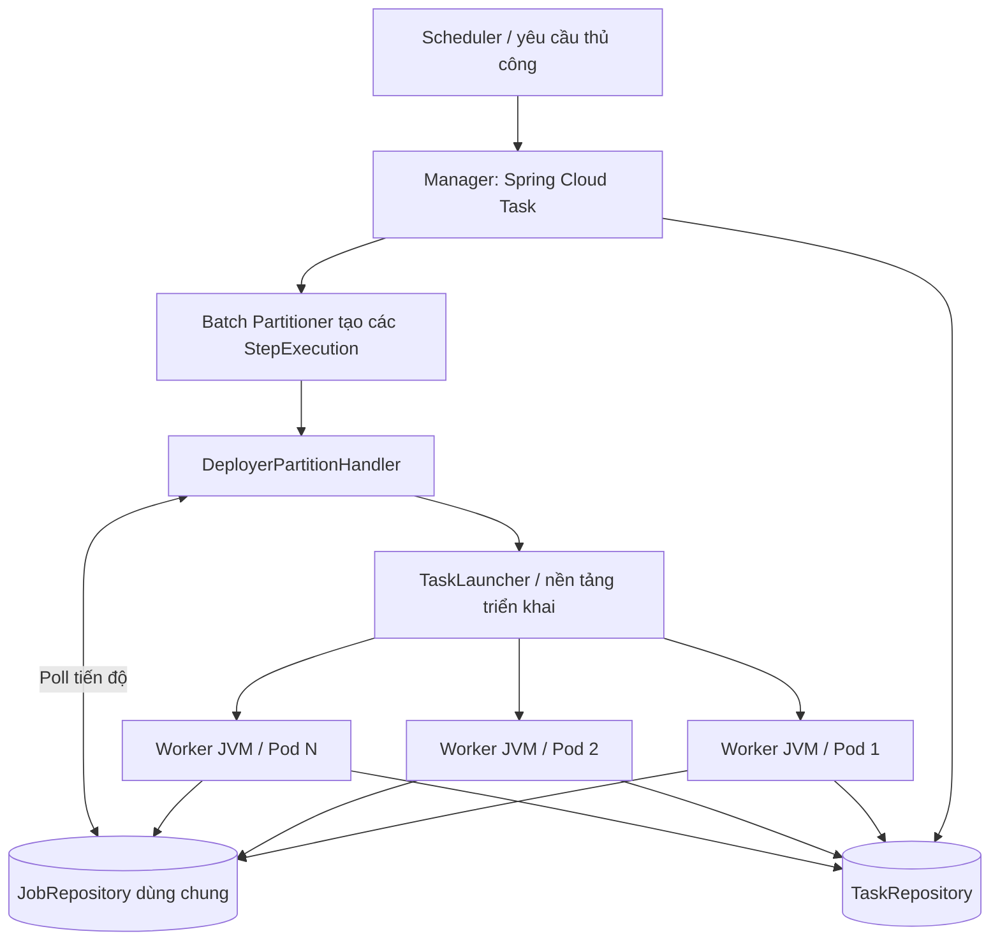

# Giới hạn số tiến trình con, chu kỳ kiểm tra và thời gian chờ

## 1. Bối cảnh: điều phối phân vùng từ xa trong Spring Cloud Task

**Spring Cloud Task** phù hợp với ứng dụng Spring Boot thực hiện công việc hữu hạn rồi kết thúc. Khi phối hợp với **Spring Batch**, một công việc lớn như nhập dữ liệu, đối soát giao dịch hoặc tổng hợp đơn hàng có thể được chia thành các **partition** độc lập để xử lý song song trên nhiều tiến trình con (*worker*).

Trong mô hình **remote partitioning** dùng Spring Cloud Deployer, ứng dụng **manager** định nghĩa Job và Step phân vùng, tạo `StepExecution` cho từng partition, rồi dùng `DeployerPartitionHandler` để yêu cầu `TaskLauncher` khởi chạy các worker JVM/container. Mỗi worker dùng `DeployerStepExecutionHandler` tìm `StepExecution` tương ứng trong **JobRepository** rồi chạy Step nghiệp vụ. Manager định kỳ truy vấn JobRepository để xem partition nào đã hoàn thành. Cả manager và worker cũng có thể ghi lịch sử riêng ở **TaskRepository** của Spring Cloud Task.



Chỉ tăng số phân vùng không đồng nghĩa hệ thống sẽ xử lý nhanh hơn. Mỗi worker cần CPU/RAM, kết nối CSDL, thời gian khởi động và tài nguyên từ nền tảng triển khai. Ba núm điều chỉnh quan trọng của `DeployerPartitionHandler` là:

1. **`setMaxWorkers(int)`**: giới hạn số worker đang thực thi đồng thời.
2. **`setPollInterval(long)`**: chu kỳ manager kiểm tra JobRepository để biết những Step đã hoàn thành.
3. **`setTimeout(long)`**: giới hạn thời gian manager chờ toàn bộ worker của partitioned master step hoàn tất.

Mục tiêu bài học là cấu hình ba giá trị đúng cách, hiểu tương tác với `gridSize`, quan sát thực thi và xử lý lỗi/timeout để chạy tác vụ phân vùng theo lịch hoặc yêu cầu một cách an toàn.

## 2. Phân biệt partition, worker, JobExecution và TaskExecution

| Khái niệm | Ý nghĩa trong remote partitioning |
| --- | --- |
| **Partition** | Một phần dữ liệu/đầu việc được mô tả bởi `ExecutionContext`, ví dụ khoảng ID `1..1000` |
| **Worker** | Tiến trình Spring Boot được `TaskLauncher` khởi chạy để xử lý một partition; số worker đồng thời có thể bị giới hạn |
| **`gridSize`** | Gợi ý cho `Partitioner`/`StepExecutionSplitter` về số partition nên tạo; không phải mức đồng thời bắt buộc |
| **`maxWorkers`** | Số worker tối đa được handler cho chạy tại một thời điểm |
| **`JobExecution`** | Một lần chạy của Spring Batch Job, được quản lý trong `BATCH_JOB_EXECUTION` |
| **`StepExecution`** | Lần thực thi của master step hoặc worker partition, có `STATUS`, `READ_COUNT`, `WRITE_COUNT`, v.v. |
| **`TaskExecution`** | Một lần khởi động ứng dụng Spring Cloud Task; manager và các worker có thể có bản ghi riêng |

Giả sử `Partitioner` tạo **8 partition** từ tám khoảng ID không giao nhau, còn `maxWorkers = 3`. Khi đó có thể có nhiều nhất ba worker đang hoạt động cùng lúc; các partition còn lại chờ tới khi có chỗ. Nếu các worker chạy gần bằng nhau, có thể hình dung ba đợt: `3 + 3 + 2`. **Đây là mô hình lý tưởng để giải thích**, không phải lịch chạy cố định: tốc độ provisioning, thời gian xử lý, lỗi, retry và đặc tính `TaskLauncher` làm lịch thực tế thay đổi.

`gridSize` và `maxWorkers` giải quyết **hai vấn đề khác nhau**. `gridSize = 8` không bắt buộc `Partitioner` trả về đúng tám phân vùng; `maxWorkers = 3` không tự tạo ba phân vùng và cũng không giới hạn toàn bộ hệ thống nếu **nhiều manager Job khác nhau** cùng chạy. Nếu mỗi manager được phép chạy tối đa ba worker và có bốn manager đang hoạt động, giới hạn tổng phải được kiểm soát thêm bằng scheduler, quota nền tảng hoặc cơ chế điều phối khác.

## 3. Các phương thức điều chỉnh và giá trị mặc định

`DeployerPartitionHandler` thuộc package `org.springframework.cloud.task.batch.partition`. Các API và giá trị mặc định được tài liệu Spring Cloud Task mô tả như sau:

| API | Giá trị mặc định trong tài liệu | Diễn giải |
| --- | --- | --- |
| `setGridSize(int)` | `1` | Gợi ý kích thước lưới phân vùng cho splitter/partitioner |
| `setMaxWorkers(int)` | `-1` (không giới hạn) | Số tiến trình worker tối đa đang thực thi |
| `setPollInterval(long)` | 10 giây | Chu kỳ kiểm tra kết quả Step trong JobRepository |
| `setTimeout(long)` | `-1` (không giới hạn chờ) | Thời hạn master step chờ **toàn bộ** worker hoàn tất |

Trong ví dụ của bài này, khoảng thời gian được truyền bằng **mili giây**, nên dùng `Duration.toMillis()` để tránh nhầm đơn vị. Cần đối chiếu chữ ký/API và đơn vị trên đúng phiên bản Spring Cloud Task mà dự án sử dụng.

### 3.1. `maxWorkers`: giới hạn tải lên hạ tầng

Ví dụ `setMaxWorkers(3)` yêu cầu handler không duy trì hơn ba worker cùng lúc trong phạm vi lần chạy nó quản lý. Giá trị này ảnh hưởng trực tiếp đến số pod/JVM cần cấp phát, số kết nối CSDL, CPU/RAM và băng thông. Giới hạn quá thấp có thể làm Job kéo dài; giới hạn quá cao dễ gây quá tải database, hàng đợi triển khai hoặc nền tảng cloud.

**Không mặc định dùng `-1` ở production.** Không giới hạn ở phía handler không có nghĩa nền tảng có đủ tài nguyên. Hãy bắt đầu từ khả năng chịu tải của DB và quota môi trường, rồi tăng theo số liệu đo được.

### 3.2. `pollInterval`: độ trễ quan sát và chi phí truy vấn

Handler hỏi JobRepository định kỳ để phát hiện worker đã kết thúc. Khoảng `pollInterval` ngắn giúp manager nhận biết kết quả sớm hơn, nhưng làm số lần truy vấn trạng thái tăng. Khoảng quá dài giảm truy vấn nhưng có thể làm việc thu thập kết quả và điều phối worker tiếp theo chậm.

Ví dụ nếu mỗi lượt kiểm tra cách nhau 5 giây, manager có thể phát hiện một Step đã hoàn thành sau độ trễ xấp xỉ tối đa một chu kỳ trong điều kiện bình thường. Đây chỉ là ước lượng về **nhận biết trạng thái**, không phải cam kết kết thúc Job đúng sau 5 giây: DB latency, lịch thread, provisioning và tiến trình lỗi đều ảnh hưởng.

### 3.3. `timeout`: giới hạn thời gian chờ của master

`setTimeout(...)` áp dụng cho thời gian **master partition step chờ tất cả worker**, không phải timeout của riêng từng dòng SQL, một HTTP request hay từng worker. Chẳng hạn, `setTimeout(Duration.ofMinutes(20).toMillis())` đặt một ngưỡng chờ tổng thể trong ví dụ.

Điểm quan trọng: **manager hết thời gian chờ không tự chứng minh các worker đã bị hủy**. Một số worker có thể tiếp tục chạy, đã commit dữ liệu hoặc đang chờ hệ điều phối dừng chúng. Khi timeout, cần kiểm tra trạng thái worker trên nền tảng triển khai và metadata `JobRepository`/`TaskRepository`; áp dụng chính sách dừng/cleanup và retry riêng. Không chạy lại toàn bộ Job tức thì chỉ vì manager đã báo timeout.

`-1` (không timeout) giúp tránh lỗi thời hạn khi workload kéo dài nhưng cũng khiến manager có thể đợi rất lâu nếu một worker treo hoặc không bao giờ cập nhật trạng thái. Trong môi trường thực tế, nên chọn một thời hạn có cơ sở và có cảnh báo phát hiện trạng thái bất thường.

## 4. Cách chọn ba giá trị theo tải thực tế

Không có một tổ hợp cố định phù hợp mọi hệ thống. Giả sử công việc có **12 partition**, mỗi worker xử lý trung bình 4 phút **sau khi khởi động**, còn khởi tạo pod mất khoảng 30 giây.

| Cấu hình minh họa | Số đợt tối thiểu khi mọi worker có tốc độ tương tự | Nhận xét |
| --- | --- | --- |
| `maxWorkers=2` | 6 đợt | Ít áp lực hơn lên DB nhưng tổng thời gian dài hơn |
| `maxWorkers=3` | 4 đợt | Điểm khởi đầu cân bằng nếu DB chịu được ba worker |
| `maxWorkers=6` | 2 đợt | Nhanh hơn về lý thuyết nhưng tiêu thụ nhiều kết nối/tài nguyên |
| `maxWorkers=12` | 1 đợt | Tải đỉnh lớn, dễ vượt giới hạn hạ tầng |

Các con số chỉ mô tả số **lượt xử lý lý tưởng**, không phải phép đo hiệu năng. Partition mất thời gian khác nhau, provisioning có thể chờ quota, hoặc writer tranh chấp bảng khiến tăng worker **không** tăng throughput tuyến tính.

Khi định cỡ, nên quan sát:

- Số partition thực tế, độ lệch số bản ghi và thời gian xử lý giữa các partition.
- Thời gian `TaskLauncher` tạo worker tới khi worker bắt đầu làm việc; pod startup/image pull có thể đáng kể.
- Số kết nối DB đang hoạt động, thời gian chờ pool, deadlock/lock wait, CPU/IO, số transaction/giây.
- Số truy vấn JobRepository do polling, latency của từng lượt đọc và kích thước metadata.
- Thời gian Job ở các percentile (`p50`, `p95`, `p99`), số lần timeout và thời gian phục hồi sau lỗi.

Ví dụ cách ra quyết định: nếu mỗi worker mở tối đa 5 kết nối, đặt `maxWorkers=6` có thể tạo áp lực tới khoảng 30 kết nối **chỉ từ các worker**, chưa tính manager và các dịch vụ khác. Đây là phép ước lượng để lập ngân sách kết nối; số kết nối thật tùy cấu hình pool, loại reader/writer và độ đồng thời trong một worker.

### Chu kỳ kiểm tra và timeout nên được chọn cùng nhau

Một cấu hình ban đầu có thể là `maxWorkers=3`, `pollInterval=5 giây`, `timeout=20 phút`. Nếu worker thông thường cần 15 phút ở tải cao, timeout 5 phút sẽ gây lỗi giả. Nếu không có worker nào bình thường kéo dài quá 2 phút, timeout 60 phút có thể làm phát hiện treo quá chậm. Hãy dựa vào thống kê thực tế và biên độ cho khởi động container, retry có kiểm soát, độ trễ DB và tác vụ cuối cùng còn chạy.

Timeout ở manager, timeout ở scheduler, timeout của pod và timeout ở JDBC/API là **các tầng khác nhau**. Chúng phải được phối hợp. Ví dụ scheduler không nên hủy manager quá sớm trong khi worker vẫn đang xử lý và chưa có quy trình cleanup; ngược lại, worker không nên được phép chạy vô hạn khi master đã từ bỏ việc chờ kết quả.

## 5. Điều kiện trước khi bật remote partitioning

Để một manager giám sát đúng các worker từ xa, cần chuẩn bị:

1. **Spring Boot, Spring Cloud Task, Spring Batch và Spring Cloud Deployer tương thích** theo BOM/phiên bản của dự án. Các API dưới đây minh họa dòng Spring Cloud Task 3.x cùng Spring Batch 5.x; kiểm tra lại nếu dùng dòng khác.
2. **Một `TaskLauncher` có implementation cho nền tảng thực tế** (local, Kubernetes hoặc môi trường khác). `TaskLauncher` là SPI; chỉ thêm starter vào classpath không tự tạo một nền tảng triển khai worker.
3. **Artifact worker có thể truy cập được** từ `TaskLauncher`, ví dụ executable JAR hoặc resource phù hợp với deployer. Worker phải khởi động với profile/cấu hình đúng.
4. **Cùng JobRepository bền vững** cho manager và mọi worker. Đây là điều kiện bắt buộc để worker tìm `StepExecution` và manager poll được kết quả; H2 `mem:` riêng cho mỗi JVM không đáp ứng.
5. **TaskRepository và kết nối nghiệp vụ phù hợp**, cùng quyền/driver/schema chính thức. Nếu muốn truy vết quan hệ cha–con giữa các `TaskExecution`, manager/worker cần dùng cơ chế liên kết metadata tương ứng phiên bản.
6. **Dữ liệu chia không trùng phạm vi**, cùng với khóa nghiệp vụ/idempotency và quy tắc retry. Nhiều worker song song không tự đảm bảo một bản ghi chỉ được xử lý một lần.

### Dependency Maven định hướng

```xml
<!-- Version của Spring Boot, Spring Cloud và Spring Batch
     được quản lý qua BOM tương thích của dự án. -->
<dependencies>
    <dependency>
        <groupId>org.springframework.cloud</groupId>
        <artifactId>spring-cloud-starter-task</artifactId>
    </dependency>
    <dependency>
        <groupId>org.springframework.cloud</groupId>
        <artifactId>spring-cloud-task-batch</artifactId>
    </dependency>
    <dependency>
        <groupId>org.springframework.boot</groupId>
        <artifactId>spring-boot-starter-batch</artifactId>
    </dependency>
    <dependency>
        <groupId>org.postgresql</groupId>
        <artifactId>postgresql</artifactId>
        <scope>runtime</scope>
    </dependency>
</dependencies>
```

Bạn còn phải cấu hình/khai báo **implementation của Spring Cloud Deployer** và `TaskLauncher` phù hợp hệ thống; mã nguồn bên dưới chỉ minh họa phần điều phối và tuning, **chưa phải một ứng dụng tự triển khai worker ở bất kỳ cloud nào**.

## 6. Ví dụ: cấu hình manager với ba giới hạn

Ví dụ dùng một artifact có hai profile: `manager` tạo Job phân vùng, còn `worker` cung cấp Step thực thi. Dữ liệu nguồn nằm trong bảng PostgreSQL `source_orders` có ID từ 1 tới 80; kết quả được ghi vào `processed_orders` có khóa duy nhất trên `id`. Tám partition mẫu tương ứng tám khoảng ID không trùng nhau. Trong thực tế, số lượng và dải dữ liệu nên được suy ra từ snapshot/manifest của lần chạy, thay vì hard-code.

### 6.1. Cấu hình chung và profile

`src/main/resources/application.yml`:

```yaml
spring:
  application:
    name: remote-partition-demo
  main:
    web-application-type: none
  datasource:
    url: ${TASK_DB_URL}
    username: ${TASK_DB_USER}
    password: ${TASK_DB_PASSWORD}
  batch:
    job:
      enabled: false
    jdbc:
      initialize-schema: never
  cloud:
    task:
      initialize-enabled: false
```

`src/main/resources/application-manager.yml`:

```yaml
spring:
  cloud:
    task:
      name: orders-partition-manager
app:
  partition:
    grid-size: 8
    max-workers: 3
    poll-interval: PT5S
    timeout: PT20M
    worker-resource: file:/opt/tasks/remote-worker.jar
```

`src/main/resources/application-worker.yml`:

```yaml
spring:
  cloud:
    task:
      name: orders-partition-worker
```

`app.partition.*` là **thuộc tính tùy chỉnh của ví dụ**, không phải bộ thuộc tính tự cấu hình có sẵn của Spring Cloud Task. Chúng chỉ có tác dụng khi code bên dưới đọc và truyền vào `DeployerPartitionHandler`. Chuỗi `PT5S` và `PT20M` là cú pháp ISO-8601 `Duration`. Đường dẫn `worker-resource` phải được thay bằng resource mà **implementation `TaskLauncher` đang sử dụng** truy cập được; trên cloud có thể cần cơ chế resource/deployer khác đường dẫn file trong ví dụ.

`initialize-schema: never` và `initialize-enabled: false` nghĩa là cả **schema Spring Batch (`BATCH_*`) và Spring Cloud Task (`TASK_*`) phải được tạo trước** bằng migration đúng phiên bản. Với bài thử nhiều JVM, không để hai tiến trình đồng thời tự khởi tạo cùng bộ bảng. Tài khoản kết nối cần quyền ghi metadata cho worker và manager, cùng quyền phù hợp đối với bảng nghiệp vụ.

### 6.2. Manager: tạo partition và giới hạn worker

Tạo `ManagerPartitionConfiguration.java` trong package được Spring Boot quét:

```java
package com.example.partition;

import java.time.Duration;
import java.util.LinkedHashMap;
import java.util.List;
import java.util.Map;

import org.springframework.batch.core.Job;
import org.springframework.batch.core.BatchStatus;
import org.springframework.batch.core.JobExecution;
import org.springframework.batch.core.Step;
import org.springframework.batch.core.explore.JobExplorer;
import org.springframework.batch.core.job.builder.JobBuilder;
import org.springframework.batch.core.JobParametersBuilder;
import org.springframework.batch.core.launch.JobLauncher;
import org.springframework.batch.core.partition.support.Partitioner;
import org.springframework.batch.core.repository.JobRepository;
import org.springframework.batch.core.step.builder.StepBuilder;
import org.springframework.batch.item.ExecutionContext;
import org.springframework.beans.factory.annotation.Value;
import org.springframework.boot.ApplicationRunner;
import org.springframework.cloud.deployer.spi.task.TaskLauncher;
import org.springframework.cloud.task.batch.partition.DeployerPartitionHandler;
import org.springframework.cloud.task.batch.partition.PassThroughCommandLineArgsProvider;
import org.springframework.cloud.task.repository.TaskRepository;
import org.springframework.context.annotation.Bean;
import org.springframework.context.annotation.Configuration;
import org.springframework.context.annotation.Profile;
import org.springframework.core.io.Resource;

@Configuration(proxyBeanMethods = false)
@Profile("manager")
public class ManagerPartitionConfiguration {

    @Bean
    Partitioner orderIdPartitioner() {
        return gridSize -> {
            int totalIds = 80; // Chỉ dùng cho dữ liệu mẫu cố định.
            int partitions = Math.max(1, gridSize);
            int width = (totalIds + partitions - 1) / partitions;
            Map<String, ExecutionContext> result = new LinkedHashMap<>();

            for (int index = 0; index < partitions; index++) {
                int first = 1 + index * width;
                if (first > totalIds) {
                    break;
                }
                int last = Math.min(totalIds, first + width - 1);
                ExecutionContext context = new ExecutionContext();
                context.putLong("minId", first);
                context.putLong("maxId", last);
                result.put("partition" + index, context);
            }
            return result;
        };
    }

    @Bean
    DeployerPartitionHandler partitionHandler(
            TaskLauncher taskLauncher,
            JobExplorer jobExplorer,
            TaskRepository taskRepository,
            @Value("${app.partition.worker-resource}") Resource workerResource,
            @Value("${app.partition.grid-size:8}") int gridSize,
            @Value("${app.partition.max-workers:3}") int maxWorkers,
            @Value("${app.partition.poll-interval:PT5S}") Duration pollInterval,
            @Value("${app.partition.timeout:PT20M}") Duration timeout) {

        if (gridSize <= 0 || maxWorkers <= 0 ||
                pollInterval.isZero() || pollInterval.isNegative() ||
                timeout.isZero() || timeout.isNegative()) {
            throw new IllegalArgumentException("Cấu hình partition không hợp lệ");
        }

        DeployerPartitionHandler handler = new DeployerPartitionHandler(
                taskLauncher, jobExplorer, workerResource,
                "workerStep", taskRepository);

        handler.setGridSize(gridSize);
        handler.setMaxWorkers(maxWorkers);
        handler.setPollInterval(pollInterval.toMillis());
        handler.setTimeout(timeout.toMillis());
        handler.setCommandLineArgsProvider(
                new PassThroughCommandLineArgsProvider(List.of(
                        "--spring.profiles.active=worker",
                        "--spring.batch.job.enabled=false")));
        return handler;
    }

    @Bean
    Step managerStep(JobRepository jobRepository,
                     Partitioner orderIdPartitioner,
                     DeployerPartitionHandler partitionHandler,
                     @Value("${app.partition.grid-size:8}") int gridSize) {
        return new StepBuilder("managerStep", jobRepository)
                .partitioner("workerStep", orderIdPartitioner)
                .gridSize(gridSize)
                .partitionHandler(partitionHandler)
                .build();
    }

    @Bean
    Job partitionedOrdersJob(JobRepository jobRepository, Step managerStep) {
        return new JobBuilder("partitionedOrdersJob", jobRepository)
                .start(managerStep)
                .build();
    }

    @Bean
    ApplicationRunner launchManagerJob(
            JobLauncher jobLauncher,
            Job partitionedOrdersJob,
            @Value("${app.partition.request-key:demo-001}") String requestKey) {
        return args -> {
            JobExecution execution = jobLauncher.run(
                    partitionedOrdersJob,
                    new JobParametersBuilder()
                            .addString("requestKey", requestKey, true)
                            .toJobParameters());

            if (execution.getStatus() != BatchStatus.COMPLETED) {
                throw new IllegalStateException(
                        "Remote partition Job chưa hoàn tất: " + execution.getStatus());
            }
        };
    }
}
```

Đây là **mã cấu hình thành phần**, cần dự án cung cấp bean `TaskLauncher` thực tế, resource worker có thể triển khai và các bảng nghiệp vụ. `ApplicationRunner` gọi `JobLauncher` một lần trong profile `manager` với một `requestKey` xác định; nếu Job chưa hoàn tất, runner ném lỗi để Spring Cloud Task phản ánh trạng thái thất bại. Ví dụ giả định launcher chạy đồng bộ và đợi trạng thái cuối; nếu cấu hình `JobLauncher` bất đồng bộ, phải theo dõi trạng thái Job qua `JobRepository` thay vì kết luận ngay từ `run()`. Constructor của `DeployerPartitionHandler` ở dòng Spring Cloud Task 3.x nhận `TaskLauncher`, `JobExplorer`, `Resource`, **tên Step worker** và `TaskRepository`; các ví dụ cũ hơn trên Internet có thể dùng constructor khác.

Giá trị `requestKey` mặc định `demo-001` chỉ dành cho lab. Khi chạy lại trên cùng JobRepository với tên Job và identifying parameters không đổi, một Job instance đã hoàn tất thường gây `JobInstanceAlreadyCompleteException`; muốn xử lý yêu cầu mới phải cấp mã yêu cầu nghiệp vụ mới, còn nếu muốn restart sau lỗi thì cần giữ identifying parameters và checkpoint phù hợp.

Trong `managerStep`, `.gridSize(gridSize)` là gợi ý cho partitioner; `.partitionHandler(partitionHandler)` chọn cơ chế thực thi từ xa. `handler.setMaxWorkers(maxWorkers)` mới là mức đồng thời của các worker do handler quản lý. Việc gọi hai setter với cùng `gridSize` nhằm giữ cấu hình rõ ràng; không suy luận chúng tạo hai tập partition riêng.

Mỗi `ExecutionContext` chứa `minId`, `maxId` để worker xử lý một khoảng ID. Trong ví dụ dữ liệu từ 1 đến 80, `gridSize=8` tạo tám khoảng mười ID; với dữ liệu lớn hoặc phân bố không đều cần `Partitioner` tính vùng theo khóa, phân phối kích thước và giữ tính quyết định khi restart.

### 6.3. Worker: đọc đúng partition của mình

Ví dụ `WorkerPartitionConfiguration.java` có Step tên **chính xác** `workerStep` (khớp tham số truyền cho handler):

```java
package com.example.partition;

import org.springframework.batch.core.Step;
import org.springframework.batch.core.configuration.annotation.StepScope;
import org.springframework.batch.core.explore.JobExplorer;
import org.springframework.batch.core.repository.JobRepository;
import org.springframework.batch.core.step.builder.StepBuilder;
import org.springframework.batch.core.step.tasklet.Tasklet;
import org.springframework.batch.repeat.RepeatStatus;
import org.springframework.beans.factory.BeanFactory;
import org.springframework.beans.factory.annotation.Value;
import org.springframework.cloud.task.batch.partition.DeployerStepExecutionHandler;
import org.springframework.context.annotation.Bean;
import org.springframework.context.annotation.Configuration;
import org.springframework.context.annotation.Profile;
import org.springframework.jdbc.core.JdbcTemplate;
import org.springframework.transaction.PlatformTransactionManager;

@Configuration(proxyBeanMethods = false)
@Profile("worker")
public class WorkerPartitionConfiguration {

    @Bean
    @StepScope
    Tasklet processRangeTasklet(
            @Value("#{stepExecutionContext['minId']}") Long minId,
            @Value("#{stepExecutionContext['maxId']}") Long maxId,
            JdbcTemplate jdbc) {

        return (contribution, chunkContext) -> {
            if (minId == null || maxId == null || minId > maxId) {
                throw new IllegalArgumentException("Khoảng partition không hợp lệ");
            }

            int inserted = jdbc.update("""
                    INSERT INTO processed_orders (id, payload)
                    SELECT id, payload
                    FROM source_orders
                    WHERE id BETWEEN ? AND ?
                    ON CONFLICT (id) DO NOTHING
                    """, minId, maxId);

            System.out.printf("WORKER range=[%d,%d] inserted=%d%n",
                    minId, maxId, inserted);
            return RepeatStatus.FINISHED;
        };
    }

    @Bean
    Step workerStep(JobRepository jobRepository,
                    PlatformTransactionManager transactionManager,
                    Tasklet processRangeTasklet) {
        return new StepBuilder("workerStep", jobRepository)
                .tasklet(processRangeTasklet, transactionManager)
                .build();
    }

    @Bean
    DeployerStepExecutionHandler stepExecutionHandler(
            BeanFactory beanFactory,
            JobExplorer jobExplorer,
            JobRepository jobRepository) {
        return new DeployerStepExecutionHandler(
                beanFactory, jobExplorer, jobRepository);
    }
}
```

Worker nhận định danh `StepExecution` từ các tham số/biến môi trường mà `DeployerPartitionHandler` cấp qua `TaskLauncher`. `DeployerStepExecutionHandler` tìm `StepExecution` trong JobRepository **dùng chung** rồi thực thi `workerStep`; `@StepScope` lấy `minId`/`maxId` từ `StepExecutionContext`. Worker không tự tạo một Job instance mới với tham số khác.

SQL sử dụng cú pháp **PostgreSQL** `ON CONFLICT (id) DO NOTHING` để tránh trùng khóa khi worker chạy lại. Đây là minh họa cơ bản về idempotency; nó **không tự xác nhận payload cũ có đúng giá trị mới**. Khi triển khai thật, phải định nghĩa chính sách khi bản ghi đã có nhưng nội dung khác, xử lý dữ liệu nguồn thay đổi, khóa nghiệp vụ và nhật ký đối soát. Nếu reader/writer dùng nhiều nguồn dữ liệu hoặc gọi API bên ngoài, ranh giới transaction của tasklet không tự bao trùm mọi side effect.

### 6.4. DDL nghiệp vụ và cách khởi động

Ví dụ bảng PostgreSQL, tạo qua migration **trước** khi manager và worker chạy:

```sql
CREATE TABLE source_orders (
    id BIGINT PRIMARY KEY,
    payload VARCHAR(200) NOT NULL
);

CREATE TABLE processed_orders (
    id BIGINT PRIMARY KEY,
    payload VARCHAR(200) NOT NULL
);
```

Để thử đúng tám khoảng ID, điền dữ liệu mẫu từ `1..80` vào `source_orders`, đảm bảo không đổi tập dữ liệu giữa lúc chạy hoặc khi restart. Nếu muốn dùng PostgreSQL để sinh mẫu:

```sql
INSERT INTO source_orders (id, payload)
SELECT n, 'order-' || n
FROM generate_series(1, 80) AS n;
```

Tạo một `@SpringBootApplication` cùng package `com.example.partition` để quét cả hai lớp cấu hình; profile `manager` và `worker` quyết định bean nào được kích hoạt:

```java
package com.example.partition;

import org.springframework.boot.SpringApplication;
import org.springframework.boot.autoconfigure.SpringBootApplication;
import org.springframework.cloud.task.configuration.EnableTask;

@EnableTask
@SpringBootApplication
public class RemotePartitionApplication {
    public static void main(String[] args) {
        SpringApplication.run(RemotePartitionApplication.class, args);
    }
}
```

Manager khởi Job bằng `ApplicationRunner` **một lần** với identifying `JobParameters` ổn định, còn worker dùng `DeployerStepExecutionHandler`. Giữ `spring.batch.job.enabled=false` như ví dụ để tránh cơ chế tự launch Batch Job mặc định gọi Job trùng lần.

```bash
# Ví dụ lệnh khởi manager; worker do TaskLauncher triển khai từ resource.
java -jar target/remote-partition-demo.jar \
  --spring.profiles.active=manager
```

Phần `TaskLauncher` (local, Kubernetes, v.v.), artifact worker và cách cấp biến môi trường kết nối DB cần được cấu hình theo hạ tầng. Lệnh trên **khởi động manager và gọi Job qua runner trong ví dụ**; các worker chỉ được tạo khi `TaskLauncher` thực tế đã đăng ký và có thể triển khai resource tương ứng. Cũng không nên truyền mật khẩu DB trực tiếp qua tham số CLI cho mọi worker.

## 7. Worker launch bất đồng bộ khác với `maxWorkers`

Theo tài liệu Spring Cloud Task, mặc định việc yêu cầu triển khai các partition có thể diễn ra **tuần tự**. Nếu việc cấp phát pod/JVM của `TaskLauncher` bị chặn cho đến khi tài nguyên sẵn sàng, thời gian khởi tạo nhiều worker có thể đáng kể ngay cả khi `maxWorkers` cao.

`DeployerPartitionHandler` có constructor nhận thêm `TaskExecutor` (chẳng hạn `ThreadPoolTaskExecutor`) để xử lý **các lời gọi launch bất đồng bộ**:

```java
// Đoạn minh họa lựa chọn constructor khác; dùng thay constructor
// năm tham số trong Bean manager nếu muốn launch bất đồng bộ.
DeployerPartitionHandler handler = new DeployerPartitionHandler(
        taskLauncher, jobExplorer, workerResource,
        "workerStep", taskRepository, launchExecutor);

handler.setMaxWorkers(3);
handler.setPollInterval(Duration.ofSeconds(5).toMillis());
handler.setTimeout(Duration.ofMinutes(20).toMillis());
```

Trong đó `launchExecutor` là bean `ThreadPoolTaskExecutor` đã cấu hình, khởi tạo và quản lý vòng đời bởi Spring. `TaskExecutor` giúp nhiều **lệnh launch** được gửi song song; nó **không thay** hạn mức worker đang chạy. `maxWorkers` và pool dùng để gửi lệnh launch có thể cần tuning riêng, đồng thời phải tôn trọng quota pod, giới hạn TaskLauncher và giới hạn kết nối DB.

Ví dụ chỉ tăng pool launch từ 2 lên 8 thread mà giữ `maxWorkers=3` không có nghĩa tám worker sẽ chạy nghiệp vụ đồng thời. Ngược lại, đặt `maxWorkers=8` nhưng pool launch nhỏ, TaskLauncher chậm hoặc nền tảng thiếu quota cũng có thể chỉ thấy rất ít worker thực tế hoạt động.

## 8. Quan sát JobRepository, TaskRepository và hạ tầng

Đối với một lần chạy phân vùng từ xa, theo dõi đồng thời **ba lớp**: trạng thái Batch, lịch sử Task và trạng thái tiến trình/pod do nền tảng triển khai quản lý.

### 8.1. Truy vấn các StepExecution

```sql
SELECT ji.JOB_NAME,
       je.JOB_EXECUTION_ID,
       je.STATUS AS JOB_STATUS,
       se.STEP_EXECUTION_ID,
       se.STEP_NAME,
       se.STATUS AS STEP_STATUS,
       se.START_TIME,
       se.END_TIME,
       se.READ_COUNT,
       se.WRITE_COUNT,
       se.COMMIT_COUNT
FROM BATCH_JOB_INSTANCE AS ji
JOIN BATCH_JOB_EXECUTION AS je
  ON je.JOB_INSTANCE_ID = ji.JOB_INSTANCE_ID
JOIN BATCH_STEP_EXECUTION AS se
  ON se.JOB_EXECUTION_ID = je.JOB_EXECUTION_ID
WHERE ji.JOB_NAME = 'partitionedOrdersJob'
ORDER BY je.JOB_EXECUTION_ID DESC, se.STEP_EXECUTION_ID;
```

Tên các Step phân vùng có thể có hậu tố phân biệt partition; xem thêm `BATCH_STEP_EXECUTION_CONTEXT` để đối chiếu các khoảng `minId`, `maxId` theo schema/serializer của phiên bản Batch. Không suy ra worker thành công chỉ từ việc `TaskLauncher` đã tạo pod; Step phải đạt trạng thái hoàn tất và đầu ra nghiệp vụ cần được kiểm tra.

### 8.2. Truy vấn lịch sử task cha và worker

```sql
SELECT TASK_EXECUTION_ID,
       PARENT_TASK_EXECUTION_ID,
       TASK_NAME,
       START_TIME,
       END_TIME,
       EXIT_CODE
FROM TASK_EXECUTION
WHERE TASK_NAME IN ('orders-partition-manager', 'orders-partition-worker')
ORDER BY TASK_EXECUTION_ID DESC;
```

`PARENT_TASK_EXECUTION_ID` có ý nghĩa khi hệ thống truyền và lưu **parent task execution ID** theo luồng tích hợp tương ứng. Không nên giả định mọi worker đều có cột này khác `NULL` nếu cấu hình/nền tảng không tạo liên kết cha–con. ID trong `TASK_EXECUTION` khác với `JOB_EXECUTION_ID` và `STEP_EXECUTION_ID` của Spring Batch.

### 8.3. Đối soát kết quả thực tế

```sql
SELECT COUNT(*) AS processed_count,
       MIN(id) AS min_id,
       MAX(id) AS max_id
FROM processed_orders;

SELECT s.id
FROM source_orders AS s
LEFT JOIN processed_orders AS p ON p.id = s.id
WHERE p.id IS NULL
ORDER BY s.id;
```

Trong bài lab với 80 ID nguồn hợp lệ, `processed_count=80` và truy vấn thứ hai không có hàng là hai tín hiệu kiểm tra cơ bản. Với dữ liệu thật, cần so sánh **toàn bộ tập ID, payload/checksum và điều kiện nghiệp vụ**, vì đếm tổng không phát hiện mọi sai khác. Một worker có thể thành công về mặt Step nhưng dữ liệu được ghi sai hoặc bị thay đổi sau đó.

### 8.4. Tín hiệu vận hành nên thu thập

| Tín hiệu | Khi nào cần quan tâm |
| --- | --- |
| Số partition `STARTING`/`STARTED`/`COMPLETED`/`FAILED` | Theo dõi tiến độ và nơi công việc bị kẹt |
| Số worker đang chạy so với `maxWorkers` | Phát hiện thiếu quota hoặc cấu hình không hiệu quả |
| Thời gian từ yêu cầu launch đến worker thực thi | Phát hiện kéo dài provisioning/image pull |
| Thời gian query JobRepository, tần suất polling | Phát hiện quá tải metadata DB khi poll quá dày |
| Timeout manager và các worker còn chạy sau timeout | Cảnh báo cần điều tra và cleanup |
| Số connection/CPU/IO/deadlock ở DB | Quyết định có tăng/giảm worker hợp lý không |
| Khoảng ID đã xử lý, dữ liệu thiếu/trùng, retry theo partition | Phát hiện xung đột hoặc lỗi idempotency |

## 9. Timeout và lỗi: đừng chạy lại ngay khi manager hết chờ

Giả sử manager chờ tối đa 20 phút, nhưng worker xử lý partition `61..70` mất 25 phút do API ngoài chậm. Sau 20 phút, manager có thể báo timeout; tuy nhiên worker đó vẫn có thể **đang hoạt động** và đã commit một phần dữ liệu.

Quy trình xử lý an toàn:

1. **Kiểm tra hạ tầng:** tìm tất cả pod/JVM worker của Job/Task, xác nhận cái nào còn chạy và request nào đã được gửi.
2. **Đọc JobRepository:** xác định `JobExecution`, từng `StepExecution` đã `COMPLETED`, `FAILED`, `STARTED` hay ở trạng thái bất thường; kiểm tra checkpoint trong `ExecutionContext`.
3. **Đối soát dữ liệu nghiệp vụ:** phần ID nào đã commit, phần nào thiếu, có side effect ngoài CSDL hoặc transaction đang chờ không.
4. **Xử lý worker mồ côi:** dùng cơ chế dừng/thu hồi của nền tảng khi xác minh phù hợp, thay vì chỉ hủy manager rồi giả định worker tự biến mất.
5. **Quyết định restart:** giữ tên Job và identifying parameters nếu cần tiếp tục đúng Job instance theo quy tắc Spring Batch; tránh tạo Job instance mới chỉ để bỏ qua checkpoint.
6. **Rà soát cấu hình:** tăng timeout nếu workload hợp lệ thường vượt ngưỡng, giảm `maxWorkers` nếu DB quá tải, hoặc tối ưu partition/worker nếu một phân vùng kéo dài bất thường.

Nếu Job đang ở trạng thái `STARTED` do sự cố, quy trình khôi phục Spring Batch có thể yêu cầu xác minh worker cũ đã dừng và điều chỉnh trạng thái qua API/biện pháp quản trị được hỗ trợ trước khi restart. Không trực tiếp `UPDATE BATCH_STEP_EXECUTION SET STATUS='COMPLETED'` hoặc xóa hàng metadata để làm báo cáo có vẻ thành công.

### Timeout và retry ở nhiều tầng

| Tầng | Ví dụ | Không nên nhầm với |
| --- | --- | --- |
| Manager partition handler | `setTimeout(20 phút)` | Không bảo đảm `TaskLauncher` đã terminate worker |
| Chu kỳ kiểm tra | `setPollInterval(5 giây)` | Không phải timeout của SQL query hoặc HTTP request |
| Worker transaction | JDBC/transaction timeout | Không phải timeout của toàn bộ Job |
| Hạ tầng triển khai | Deadline pod, quota, stop/cleanup policy | Không phải Spring Batch checkpoint |
| Scheduler | Giới hạn toàn workflow, retry/backoff | Không tự phục hồi dữ liệu đã commit một phần |

Đặt timeout ở các tầng này phù hợp nhau và định nghĩa **chủ sở hữu của việc hủy worker**, nếu không có thể tạo nhiều tiến trình xử lý cùng dữ liệu khi scheduler tự retry.

## 10. Các lỗi cấu hình thường gặp

| Triệu chứng | Khả năng nguyên nhân | Hướng xử lý |
| --- | --- | --- |
| Nhiều worker hơn dự kiến khi chạy nhiều Job | `maxWorkers` áp dụng theo handler/lần chạy; không có quota tổng | Giới hạn cả số manager đồng thời, worker quota hoặc scheduler |
| `gridSize=8` nhưng chỉ có 3 worker hoạt động | `maxWorkers=3`, quota nền tảng hoặc TaskLauncher provisioning | Xác nhận số partition thực tế và giới hạn hoạt động |
| `maxWorkers=8` nhưng chỉ tạo 2 partition | Partitioner chỉ tạo hai `ExecutionContext` hoặc dữ liệu chỉ có hai phần | Kiểm tra partitioner và `gridSize`; không ép thêm worker vô ích |
| Manager cập nhật tiến độ chậm | `pollInterval` quá lớn hoặc JobRepository/query chậm | Đo polling latency rồi giảm vừa đủ, tránh poll dày gây quá tải |
| Manager liên tục truy vấn DB | `pollInterval` quá nhỏ | Tăng khoảng poll, theo dõi DB I/O/connection |
| Timeout khi worker vẫn đang chạy | Thời hạn quá ngắn, startup chậm, partition lệch tải | Đối chiếu pod, StepExecution và dữ liệu trước khi retry |
| Manager chờ mãi không thoát | Timeout `-1`, worker treo hoặc không cập nhật JobRepository | Có timeout hợp lý, cảnh báo và cleanup policy |
| Worker không tìm thấy StepExecution | Manager và worker dùng khác JobRepository/schema hoặc sai ID truyền vào | Kiểm tra connection/profile, biến môi trường, step name và schema |
| Worker xử lý sai khoảng ID | `ExecutionContext` sai, worker không dùng `@StepScope` hoặc dùng tên key khác | Kiểm tra `minId`, `maxId`, step name, phân vùng không giao nhau |
| Step thành công nhưng Task báo lỗi | Sự cố cập nhật metadata Task sau xử lý hoặc các callback/hậu xử lý lỗi | Kiểm tra riêng Batch/Task status và đầu ra nghiệp vụ |
| Worker task chạy lại tạo dữ liệu trùng | Không có business key/idempotency, dùng Job instance mới thay restart | Dùng unique key/checkpoint, kiểm tra dữ liệu đã commit |
| Worker không chạy dù `TaskLauncher` thành công | Sai resource, profile, startup config, quyền DB hoặc quota | Kiểm tra log deployer, log worker và trạng thái JobRepository |

## 11. Bài thực hành

1. Với `gridSize=8`, `maxWorkers=3` và 80 ID từ `1..80`, xác định các khoảng ID mà partitioner mẫu tạo. Giải thích vì sao ba worker đồng thời không đồng nghĩa chỉ có ba partition.
2. Đổi `maxWorkers` từ 3 thành 2, rồi thành 5 trong môi trường lab có quota đủ. Đo số worker thực tế đồng thời, thời gian chạy, kết nối DB và thời gian chờ triển khai.
3. Giữ cùng workload, so sánh `pollInterval=PT1S`, `PT5S`, `PT15S`. Quan sát tần suất đọc JobRepository và độ trễ manager nhận biết partition đã xong.
4. Đặt `timeout=PT1M` khi worker mô phỏng mất hơn một phút; kiểm tra trạng thái JobExecution/StepExecution, pod/JVM và dữ liệu nghiệp vụ. Vì sao không retry ngay khi timeout?
5. Thử `gridSize=4` và `gridSize=12` với cùng 80 ID. Giải thích số partition thực tế do `Partitioner` quyết định và ảnh hưởng đến mức độ lệch tải.
6. Mô phỏng worker lỗi sau khi commit một phần dữ liệu. Thiết kế retry theo đúng Job instance/partition đã lỗi và kiểm tra khả năng ghi lại an toàn theo business key.
7. Cho manager và worker trỏ nhầm hai database khác nhau. Nêu dấu hiệu nhận biết ở log và JobRepository; vì sao H2 `mem:` không phù hợp bài test giữa các JVM?
8. Nếu scheduler kích hoạt hai manager cùng lúc, mỗi manager đặt `maxWorkers=3`, tổng số worker có thể lên bao nhiêu? Bạn sẽ giới hạn toàn hệ thống ở tầng nào?
9. Tạo bảng kết quả thực nghiệm gồm số partition, `maxWorkers`, polling interval, timeout, tổng thời gian, DB connections và số lần timeout; chọn một cấu hình có căn cứ cho workload hiện tại.

Sau bài này, bạn cần phân biệt rõ **số phân vùng** và **số worker đồng thời**, cấu hình `setMaxWorkers`, `setPollInterval`, `setTimeout` trên `DeployerPartitionHandler`, hiểu vì sao manager/worker cần **JobRepository dùng chung**, và có quy trình xử lý timeout, retry, checkpoint và đối soát kết quả đáng tin cậy khi vận hành Spring Cloud Task kết hợp Spring Batch.

## 12. Tài liệu tham khảo

- [Spring Cloud Task Reference — Remote Partitioning](https://docs.spring.io/spring-cloud-task/docs/current/reference/htmlsingle/#_remote_partitioning): kiến trúc `DeployerPartitionHandler` và worker, giá trị mặc định của polling/timeout, cách launch bất đồng bộ.
- [Javadoc `DeployerPartitionHandler` (Spring Cloud Task 3.0.4)](https://docs.spring.io/spring-cloud-task/docs/current/apidocs/org/springframework/cloud/task/batch/partition/DeployerPartitionHandler.html): constructor, `setGridSize`, `setMaxWorkers`, `setPollInterval`, `setTimeout`.
- [Javadoc `DeployerStepExecutionHandler`](https://docs.spring.io/spring-cloud-task/docs/current/apidocs/org/springframework/cloud/task/batch/partition/DeployerStepExecutionHandler.html): worker tìm và thực thi `StepExecution` trong JobRepository.
- [Spring Batch Reference — Partitioning](https://docs.spring.io/spring-batch/reference/scalability.html): partitioner, manager/worker, `StepExecution` và restart.
- [Spring Batch Javadoc `PartitionStepBuilder`](https://docs.spring.io/spring-batch/docs/5.2.6/api/org/springframework/batch/core/step/builder/PartitionStepBuilder.html): phân biệt `gridSize` và `partitionHandler`.

Các ví dụ chỉ minh họa cơ chế và núm điều chỉnh. Khi triển khai thật, sử dụng **phiên bản Spring Cloud Task/Spring Batch tương thích**, implementation TaskLauncher đã cấu hình, schema/migration chính xác và dữ liệu đo từ môi trường chạy để điều chỉnh số worker, polling và timeout.
