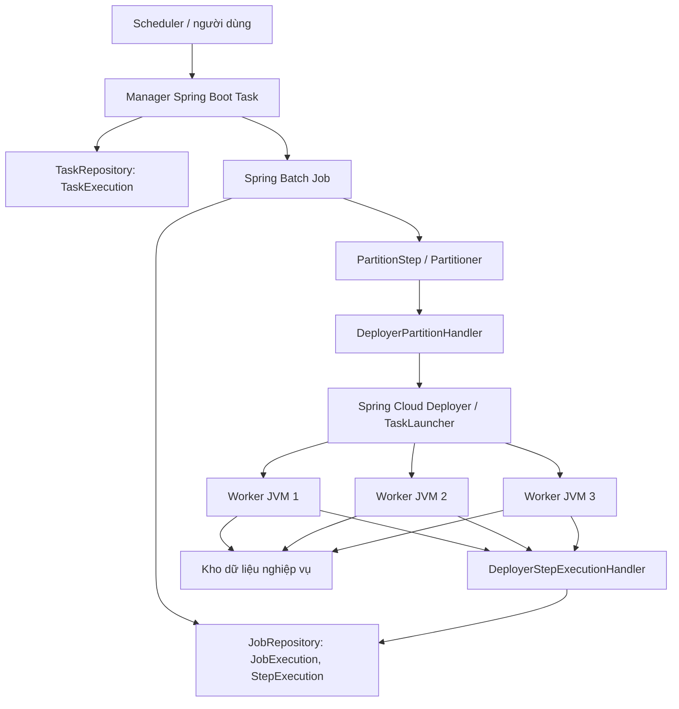
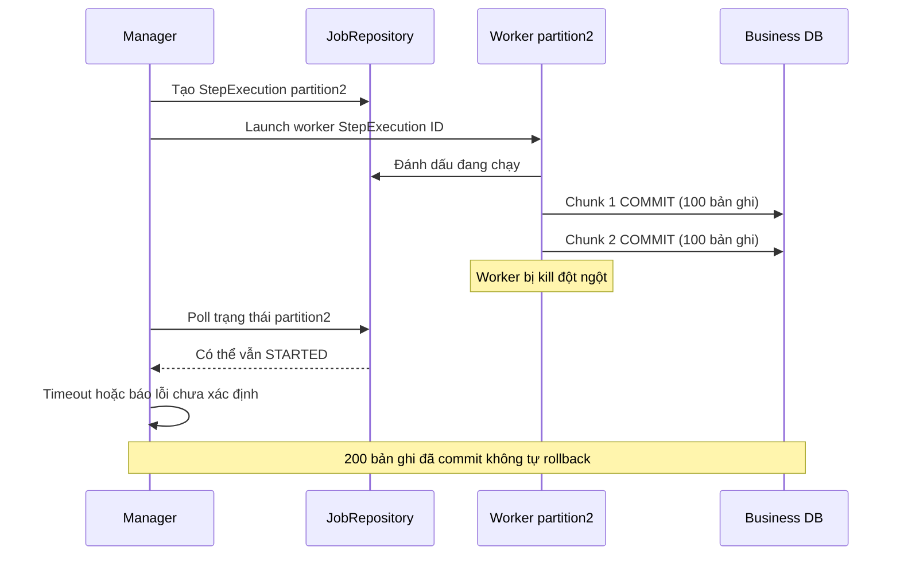
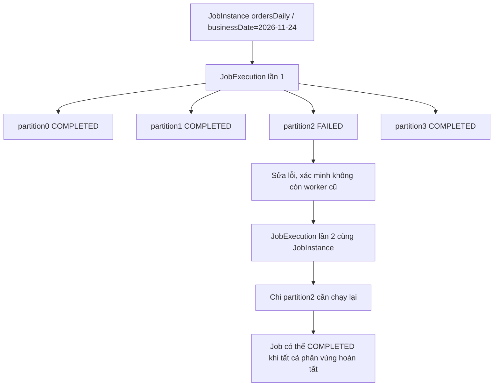
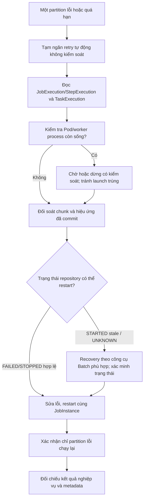

# Xử lý phân vùng lỗi, chạy lại và tương thích phiên bản

## 1. Vì sao remote partitioning cần cơ chế khôi phục riêng?

**Spring Cloud Task** xây dựng các ứng dụng Spring Boot có thời gian chạy hữu hạn: khởi động, thực hiện công việc, lưu thông tin thực thi qua `TaskRepository` và kết thúc. Khi kết hợp **Spring Batch**, một công việc xử lý dữ liệu lớn có thể được chia thành nhiều **phân vùng (partition)** và phân phối sang những tiến trình worker riêng. Cách này phù hợp khi một JVM không đủ tài nguyên hoặc công việc có thể chia thành nhiều miền dữ liệu độc lập.

Ví dụ, một tác vụ đối soát 4 triệu đơn hàng được chia thành bốn khoảng ID, mỗi worker xử lý một khoảng. Nếu ba worker hoàn tất nhưng worker thứ tư bị dừng giữa chừng, vấn đề không chỉ là khởi chạy lại một process. Hệ thống phải xác định **phân vùng nào thành công, phân vùng nào chưa chắc chắn, dữ liệu nào đã commit**, và có được phép chạy lại mà không tạo kết quả trùng hay không.

Đây là chủ đề của bài học **“Xử lý phân vùng lỗi, chạy lại và tương thích phiên bản”**, thuộc chương **Phân vùng từ xa**:

- Hiểu cách manager, worker, `DeployerPartitionHandler`, `DeployerStepExecutionHandler` và `JobRepository` phối hợp.
- Phân loại lỗi worker, lỗi triển khai, timeout, mất kết nối và lỗi manager.
- Phân biệt **retry trong Step** với **restart Job** và **khởi chạy lại toàn bộ Spring Cloud Task**.
- Thiết kế khóa phân vùng ổn định, checkpoint, idempotency và xử lý trạng thái chưa rõ.
- Kiểm tra tương thích Spring Boot, Spring Batch, Spring Cloud Task, Spring Cloud Deployer, schema và artefact worker trước khi nâng cấp.

## 2. Kiến trúc manager–worker và nguồn dữ liệu trạng thái

### 2.1. Hai lớp thực thi: Task và Batch



Trong mô hình Spring Cloud Task sử dụng Spring Cloud Deployer:

1. **Manager** chạy một Batch `Job` chứa `PartitionStep`.
2. `Partitioner` tạo các `ExecutionContext`, mỗi context mô tả một miền dữ liệu, chẳng hạn `fromId` và `toIdExclusive`.
3. `StepExecutionSplitter` tạo hoặc tái sử dụng metadata `StepExecution` cho các phân vùng.
4. `DeployerPartitionHandler` dùng `TaskLauncher` triển khai các tiến trình worker. Nó có thể truyền ID StepExecution và tham số cần thiết cho worker.
5. Trong worker, `DeployerStepExecutionHandler` đọc `StepExecution` tương ứng từ **cùng `JobRepository`**, chạy Step rồi cập nhật kết quả.
6. Manager đọc lại trạng thái các phân vùng từ `JobRepository` qua `JobExplorer`, tổng hợp kết quả và kết thúc Job.

Theo tài liệu API của `DeployerPartitionHandler`, manager và mọi worker **phải nhìn thấy cùng dữ liệu `JobRepository`**. Tài liệu ví dụ Spring Cloud Task cũng đặt `TaskRepository` của manager/worker tại datastore có thể truy cập chung để liên kết TaskExecution, quản lý lịch sử và thông tin parent. Nếu tách hai repository hoặc đặt trên hai nguồn dữ liệu, cần cấu hình các thành phần tương ứng có chủ đích.

### 2.2. Vai trò từng repository

| Nguồn | Đối tượng quan trọng | Trả lời câu hỏi nào? |
| --- | --- | --- |
| `TaskRepository` | `TaskExecution`, bảng `TASK_*` | Manager và từng worker Task được khởi chạy, kết thúc, lỗi như thế nào? |
| `JobRepository` | `JobInstance`, `JobExecution`, `StepExecution`, `ExecutionContext`, bảng `BATCH_*` | Phân vùng nào hoàn tất, lỗi, đã commit bao nhiêu và có thể restart không? |
| Database nghiệp vụ | Đơn hàng, checkpoint, idempotency key | Những thay đổi **thực tế** nào đã được lưu? |
| Hạ tầng triển khai | Pod/Job/container/process ID, exit code, log | Worker đã được tạo, còn chạy hay bị kill? |

Một `TaskExecution` có thể tương ứng với tiến trình worker, nhưng **trạng thái Task không thay thế trạng thái Step**. Ví dụ, worker có thể ghi dữ liệu và commit nhiều chunk rồi mất điện trước khi cập nhật StepExecution thành `COMPLETED`.

### 2.3. Remote partitioning khác remote chunking

| Cơ chế | Bên manager làm gì? | Bên worker làm gì? | Đơn vị phục hồi |
| --- | --- | --- | --- |
| **Remote partitioning** | Chia dữ liệu thành các vùng, giao `StepExecution` cho worker | Chạy **một Step đầy đủ**, tự reader/processor/writer cho vùng của mình | `StepExecution` của từng partition |
| **Remote chunking** | Reader tạo các chunk và gửi qua middleware | Xử lý/ghi từng chunk nhận được | Phụ thuộc protocol, checkpoint, delivery và cấu hình |

Remote partitioning dựa nhiều vào metadata `JobRepository` và `ExecutionContext`. Không áp dụng hướng dẫn retry message của remote chunking mà bỏ qua trạng thái Batch partition.

## 3. Điều kiện tiên quyết để restart phân vùng đáng tin cậy

### 3.1. Partition phải có tên và phạm vi ổn định

Giả sử cần xử lý các đơn hàng có ID từ 1 đến 400. Thay vì phát sinh khoảng ngẫu nhiên mỗi lần chạy, có thể chia:

| Tên partition | Miền dữ liệu | Trạng thái lần đầu giả định |
| --- | --- | --- |
| `orders.worker:partition0` | `[1, 101)` | `COMPLETED` |
| `orders.worker:partition1` | `[101, 201)` | `COMPLETED` |
| `orders.worker:partition2` | `[201, 301)` | `FAILED` |
| `orders.worker:partition3` | `[301, 401)` | `COMPLETED` |

Ký hiệu `[a, b)` nghĩa là `a <= id < b`. Các khoảng **không chồng lặp**, dễ đối soát và tránh lỗi biên. Cần bảo đảm mọi ID dự kiến thuộc đúng một khoảng.

Khi restart **cùng JobInstance**, nên giữ:

- **Tên Job** và các **JobParameters định danh** nhất quán.
- **Tên partition** ổn định để Spring Batch tìm đúng StepExecution cũ.
- **ExecutionContext** đủ thông tin để worker biết lại phạm vi cần xử lý.
- Snapshot hoặc quy tắc chọn dữ liệu phù hợp; không thay đổi âm thầm tập đầu vào.

Theo Spring Batch, `PartitionNameProvider` có thể cung cấp riêng tên partition khi restart; nếu dùng cơ chế này, các tên phải **khớp** với tên do `Partitioner` đã sinh. Không nên tính lại tập phân vùng theo số pod sẵn có rồi đổi hoàn toàn tên của cùng một JobInstance.

### 3.2. Partitioner minh họa bằng Java

Ví dụ Java 17+ dưới đây tạo bốn partition theo khoảng ID; có thể dùng trong cấu hình Spring Batch hỗ trợ giao diện `Partitioner`:

```java
import java.util.LinkedHashMap;
import java.util.Map;
import org.springframework.batch.core.partition.support.Partitioner;
import org.springframework.batch.item.ExecutionContext;

public class OrderRangePartitioner implements Partitioner {
    private final long firstIdInclusive;
    private final long lastIdExclusive;

    public OrderRangePartitioner(long firstIdInclusive, long lastIdExclusive) {
        if (firstIdInclusive >= lastIdExclusive) {
            throw new IllegalArgumentException("Khoảng ID không hợp lệ");
        }
        this.firstIdInclusive = firstIdInclusive;
        this.lastIdExclusive = lastIdExclusive;
    }

    @Override
    public Map<String, ExecutionContext> partition(int gridSize) {
        if (gridSize <= 0) {
            throw new IllegalArgumentException("gridSize phải > 0");
        }
        Map<String, ExecutionContext> partitions = new LinkedHashMap<>();
        long size = lastIdExclusive - firstIdInclusive;
        long chunk = (size + gridSize - 1L) / gridSize;

        long from = firstIdInclusive;
        int index = 0;
        while (from < lastIdExclusive) {
            long to = Math.min(from + chunk, lastIdExclusive);
            ExecutionContext context = new ExecutionContext();
            context.putLong("fromId", from);
            context.putLong("toIdExclusive", to);
            partitions.put("partition" + index++, context);
            from = to;
        }
        return partitions;
    }
}
```

Với `new OrderRangePartitioner(1, 401)` và `gridSize=4`, kết quả gồm bốn miền ID như bảng trên. Mã sử dụng ví dụ nhỏ để dễ đọc; với khoảng ID cực lớn cần tránh tràn số trong phép tính `size + gridSize - 1` và tính toán partition từ một snapshot đầu vào ổn định.

**Giới hạn ví dụ:** `gridSize` là thông số phân chia công việc; nó không tự bảo đảm đúng bốn JVM chạy đồng thời. Số tiến trình thực tế phụ thuộc `maxWorkers`, tài nguyên cluster và cách `PartitionHandler` triển khai.

### 3.3. Worker phải nhận đúng miền dữ liệu

Ví dụ một reader sử dụng `@StepScope` để lấy giới hạn từ `ExecutionContext`:

```java
@Bean
@StepScope
JdbcPagingItemReader<OrderRow> orderReader(
        DataSource dataSource,
        @Value("#{stepExecutionContext['fromId']}") long fromId,
        @Value("#{stepExecutionContext['toIdExclusive']}") long toIdExclusive) {
    // Tạo reader với điều kiện id >= :fromId AND id < :toIdExclusive.
    // Đặt sort key duy nhất và ổn định, ví dụ id.
    // Trả về reader đã cấu hình theo Spring Batch version.
    throw new UnsupportedOperationException("Minh họa cấu hình StepScope");
}
```

Đoạn trên là **khung chỉ ra cách bind phạm vi**, không phải bean có thể chạy ngay. `JdbcPagingItemReader` thật cần `PagingQueryProvider`, page size, parameters, row mapper và tên reader; import API phải khớp Spring Batch đang dùng. Có thể dùng `JdbcCursorItemReader` hoặc một reader tùy chỉnh phù hợp.

**Không chỉ chia bằng tên partition:** SQL/reader phải thực sự lọc đúng khoảng; nếu cả bốn worker cùng `SELECT * FROM orders` mà không ràng buộc miền, phân vùng có tên khác nhau vẫn sẽ **xử lý trùng**.

## 4. Đọc trạng thái thành công, lỗi và “không rõ kết quả”

### 4.1. Các trạng thái Spring Batch cần nhận diện

| Trạng thái `BatchStatus` | Ý nghĩa thường gặp | Hành động |
| --- | --- | --- |
| `COMPLETED` | Step đã hoàn tất theo quy tắc Batch | Khi restart cùng JobInstance thường **không chạy lại** partition này |
| `FAILED` | Step kết thúc lỗi và đã ghi nhận được | Có thể restart nếu Job/Step cho phép và nguyên nhân đã xử lý |
| `STOPPED` | Step dừng có kiểm soát | Cần đánh giá có thể tiếp tục/restart không |
| `STARTED` / `STARTING` | Metadata cho thấy đang hoặc chuẩn bị chạy | Kiểm tra process; nếu đã chết có thể là trạng thái stale |
| `UNKNOWN` | Không xác định được chính xác kết quả | Đối soát cẩn thận; không tự suy đoán đã rollback mọi thứ |
| `ABANDONED` | Không được chọn để restart theo cơ chế Batch | Chỉ dùng sau quyết định vận hành có chủ đích |

Ngoài `BatchStatus`, Batch còn có `ExitStatus` và `ExitCode` mô tả kết quả của Step/Job. **Không đồng nhất** exit code của worker process, `TaskExecution.exitCode`, `StepExecution.getExitStatus()` và trạng thái `JobExecution`.

### 4.2. Bốn tình huống lỗi phổ biến

| Tình huống | Trên worker | Trên `JobRepository` | Điều manager có thể thấy |
| --- | --- | --- | --- |
| Worker chạy xong và cập nhật thành công | Process kết thúc bình thường | Partition `COMPLETED` | Tổng hợp thành công |
| Writer ném exception, framework còn hoạt động | Process lỗi | Partition thường `FAILED` | Job/manager Step thất bại |
| Worker bị `SIGKILL` giữa chunk | Process không chạy cleanup | Step có thể còn `STARTED`; chunk cũ đã commit | Chờ polling, có thể timeout |
| Deployer không tạo được worker | Không có process nghiệp vụ | Step có thể chưa chuyển trạng thái cuối | Lỗi triển khai hoặc timeout, cần tra hạ tầng |

**Đừng coi tất cả lỗi là `FAILED` trong repository.** Crash đột ngột xảy ra ở thời điểm xấu có thể để lại `STARTED` hoặc làm trạng thái metadata chưa được flush/commit. Cũng đừng kết luận dữ liệu nghiệp vụ chưa thay đổi chỉ vì Job chưa hoàn tất.

### 4.3. Trạng thái cả Job là kết quả tổng hợp

`PartitionStep` là Step của manager. Nếu một trong bốn worker partition lỗi, Job thường không thể `COMPLETED` theo luồng mặc định. Tuy vậy, các partition đã hoàn tất và những chunk đã commit **không bị rollback chung** chỉ vì worker khác lỗi: chúng có transaction độc lập.

Giả sử:

```text
Manager JobExecution #520
  orders.worker:partition0 -> COMPLETED (100 item)
  orders.worker:partition1 -> COMPLETED (100 item)
  orders.worker:partition2 -> FAILED    (60 item đã commit trước lỗi)
  orders.worker:partition3 -> COMPLETED (100 item)

Kết quả: Job FAILED (giả định không cấu hình luồng chấp nhận lỗi).
Dữ liệu: có thể đã commit ít nhất 360 item theo từng chunk.
```

Khi chạy lại, partition2 phải tiếp tục an toàn từ phần còn dang dở. Metadata Batch giúp xác định Step cần chạy lại, nhưng **không tự đảo ngược** 60 item đã commit hay các hiệu ứng gửi ra API/Kafka.

## 5. Remote partitioning theo Spring Cloud Task và Deployer

### 5.1. Những thành phần chính

Theo tài liệu Spring Cloud Task về remote partitioning qua Spring Cloud Deployer:

| Thành phần | Trách nhiệm |
| --- | --- |
| `PartitionStep` | Step trên manager điều phối các partition |
| `Partitioner` | Tạo tên partition và `ExecutionContext` chứa tham số |
| `DeployerPartitionHandler` | Khởi chạy worker ứng với `StepExecution`, giới hạn số worker, polling kết quả |
| `TaskLauncher` | Gọi hạ tầng triển khai task thành tiến trình hoặc container |
| `DeployerStepExecutionHandler` | Ở worker, nhận định danh StepExecution, đọc từ `JobRepository` và chạy Step |
| `JobExplorer` | Đọc trạng thái Job/Step từ `JobRepository` |
| `TaskRepository` / `TaskExplorer` | Theo dõi vòng đời Task manager/worker khi tích hợp được cấu hình |

Theo tài liệu API của dòng **Spring Cloud Task 3.0.4**, `DeployerPartitionHandler` truyền ID `StepExecution` cho worker (thông qua environment variable trong implementation đó), sau đó polling `JobRepository` để nhận kết quả. Điều này cho phép manager theo dõi kết quả ngay cả khi worker không có kết nối phản hồi trực tiếp qua HTTP.

### 5.2. Cấu hình manager: ví dụ định hướng

Phần khung sau mô tả cách nối các thành phần của Spring Batch. Đây **không phải cấu hình đầy đủ có thể biên dịch độc lập**; constructor `DeployerPartitionHandler` và những bean phụ thuộc khác có thể thay đổi giữa các phiên bản:

```java
// Spring Batch manager configuration (minh họa)
@Bean
Step managerStep(JobRepository jobRepository,
                 Partitioner partitioner,
                 PartitionHandler deployerPartitionHandler) {
    return new StepBuilder("orders.manager", jobRepository)
            .partitioner("orders.worker", partitioner)
            .partitionHandler(deployerPartitionHandler)
            .build();
}
```

`deployerPartitionHandler` phải được cấu hình thêm với `TaskLauncher`, `JobExplorer`, artifact worker, tên worker Step và `TaskRepository` nếu API version yêu cầu. Các tham số vận hành:

- **`gridSize`** quyết định cách chia thành StepExecution/partition.
- **`maxWorkers`** giới hạn số tiến trình worker hoạt động đồng thời.
- **`pollInterval`** là khoảng manager đọc trạng thái từ repository; không phải thời gian chờ retry nghiệp vụ.
- **`timeout`** giới hạn chờ ở cấp manager/handler; trong tài liệu 3.0.x ví dụ có `-1` là không timeout, nên production cần chọn thời hạn rõ ràng.
- **`TaskExecutor` khởi chạy bất đồng bộ** có thể giảm thời gian tạo nhiều pod nếu thao tác deploy mỗi worker tốn thời gian; nó không thay đổi cách Spring Batch quản lý kết quả partition.

Đừng hiểu `pollInterval = 10 giây` là worker chỉ được cập nhật `StepExecution` sau mỗi 10 giây; đó là nhịp **manager kiểm tra** kết quả, trong khi worker cập nhật repository theo vòng đời Step.

### 5.3. Worker: chạy đúng Step, tránh tự chạy Job khác

Trong ứng dụng worker, `DeployerStepExecutionHandler` được cấu hình theo API version sử dụng; handler tra `StepExecution` trong `JobRepository` rồi kích hoạt đúng worker Step. Điều kiện tối thiểu:

1. Worker nhận đúng **StepExecution ID** và các thông tin do manager/deployer truyền.
2. Worker có kết nối tới **cùng JobRepository** và schema compatible.
3. Worker có bean Step với **đúng tên** mà manager đã chia partition.
4. Worker **không tự chạy lại toàn bộ manager Job** do Spring Boot auto-launch hoặc profile cấu hình sai.
5. Worker có quyền truy cập đúng dữ liệu/snapshot thuộc partition; đường dẫn file nếu có phải tồn tại trong môi trường worker.

Ví dụ cấu hình runtime cơ bản, giả định database đã được migrate:

```yaml
spring:
  application:
    name: orders-remote-worker
  main:
    web-application-type: none
  datasource:
    url: ${JOB_DB_URL:jdbc:postgresql://localhost:5432/batchdb}
    username: ${JOB_DB_USER:batch_worker}
    password: ${JOB_DB_PASSWORD}
  cloud:
    task:
      initialize-enabled: false
      closecontextEnabled: true
  batch:
    jdbc:
      initialize-schema: never
    job:
      enabled: false
```

`spring.batch.job.enabled=false` giúp tránh Boot tự kích hoạt các `Job` trong worker khi ứng dụng thực sự cần **`DeployerStepExecutionHandler`** điều khiển Step. Chỉ dùng khi kiến trúc worker đúng như mô tả và phải kiểm tra hành vi của phiên bản Spring Boot/Task hiện tại.

**Lưu ý an toàn:** Các property trên dùng biến môi trường; không truyền mật khẩu qua đối số lệnh vì đối số có thể xuất hiện trong log, command line của process và metadata Task. Nếu TaskRepository và JobRepository nằm ở database khác nhau, cần cấu hình rõ từng `DataSource` và `TaskConfigurer`/Batch infrastructure; không giả định một `spring.datasource` duy nhất đủ cho mọi kiến trúc.

## 6. Ba loại chạy lại thường bị nhầm

### 6.1. Retry bên trong worker Step

Spring Batch có thể retry lỗi tạm thời **trong một Step** bằng cấu hình fault tolerance, ví dụ retry lỗi gọi API mạng có giới hạn. Nó thường diễn ra trước khi Step tuyên bố thất bại cuối cùng.

```java
// Fragment cấu hình Spring Batch Step kiểu chunk (không phải class hoàn chỉnh).
return new StepBuilder("orders.worker", jobRepository)
    .<OrderRow, OrderRow>chunk(100, transactionManager)
    .reader(reader)
    .processor(processor)
    .writer(writer)
    .faultTolerant()
    .retry(TransientDependencyException.class)
    .retryLimit(3)
    .build();
```

Ví dụ giả định `reader`, `processor`, `writer`, `jobRepository`, `transactionManager` và exception của dự án đã được khai báo, API builder phải phù hợp Spring Batch version. `retryLimit` có semantics chính xác theo phiên bản nên cần kiểm thử số lần thử thực tế. Retry trong Step không giải quyết worker bị `SIGKILL`; process đã chết không còn thực thi retry.

### 6.2. Retry khởi chạy worker ở cấp deployer

Nếu Kubernetes không tạo được pod, pull image thất bại hoặc quota quá thấp, vấn đề nằm ở **triển khai worker**. Có thể điều tra và lặp lại yêu cầu khởi chạy sau khi đã biết Step nào chưa chạy; nhưng không được tạo **hai worker cùng xử lý một StepExecution** chỉ vì manager chưa nhận kết quả.

Một cấu hình Job/Pod tự retry process không nhất thiết hiểu toàn bộ metadata Batch và có thể tạo thêm process xử lý cùng phạm vi. Mọi retry cấp hạ tầng cần được thiết kế tương thích với quyền sở hữu Step, timeout, trạng thái worker cũ và idempotency.

### 6.3. Restart Spring Batch Job

Khi Job đã ghi trạng thái `FAILED` hoặc `STOPPED` theo quy tắc cho phép restart, cách khôi phục chính thức thường là **restart cùng JobInstance**: giữ nguyên tên Job và **identifying JobParameters**, để Spring Batch dùng `JobRepository` quyết định Step nào cần thực thi lại.

Ví dụ logic:

```text
Lần chạy 1:
  partition0 COMPLETED
  partition1 COMPLETED
  partition2 FAILED
  partition3 COMPLETED

Restart cùng JobInstance:
  partition0 không chạy lại
  partition1 không chạy lại
  partition2 được thực thi lại nếu Step restartable
  partition3 không chạy lại
```

Đây là hành vi được tài liệu Spring Batch mô tả cho partitioned Step. Nó phụ thuộc metadata còn nguyên, partition names ổn định, trạng thái cuối hợp lệ và job/step có quyền restart. **Không dùng timestamp ngẫu nhiên để tạo JobParameters mới** nếu mục tiêu thật sự là resume: làm vậy có thể tạo `JobInstance` mới và xử lý lại toàn bộ dữ liệu.

### 6.4. Khởi chạy lại toàn bộ Spring Cloud Task

Mỗi lần chạy lại JAR manager có thể tạo `TaskExecution` **mới**. Nhưng có hai trường hợp Batch khác nhau:

| Trường hợp | `TaskExecution` | `JobInstance` | Kết quả kỳ vọng |
| --- | --- | --- | --- |
| Manager process mới, **cùng** identifying JobParameters | Mới | Cũ nếu JobInstance tồn tại | Batch có thể restart đúng partition lỗi |
| Manager process mới, **JobParameters định danh khác** | Mới | Mới | Các partition có thể chạy lại từ đầu |

Chính vì vậy, scheduler, launcher và ứng dụng cần thống nhất cách tạo `JobParameters` theo khóa nghiệp vụ, ví dụ `businessDate=2026-11-24` và `source=orders`. Không tự ý thêm ID tiến trình hoặc timestamp vào tập **identifying parameters** nếu yêu cầu là restart cùng JobInstance.

## 7. Khi worker chết giữa chừng: trạng thái nào là đáng tin?

### 7.1. Timeline mất điện sau khi commit



Nếu chỉ xem `StepExecution.STATUS=STARTED`, bạn không biết worker còn sống, chết hay mất kết nối tạm thời. Nếu chỉ xem pod đã chết, bạn cũng chưa biết những chunk nào đã commit. Cần dùng **cả metadata và dữ liệu nghiệp vụ**, cùng log triển khai.

### 7.2. Ba kết quả cần ghi nhận khi xảy ra lỗi

| Dữ liệu | Cần xác minh | Cảnh báo |
| --- | --- | --- |
| Trạng thái `JobExecution`/`StepExecution` | `COMPLETED`, `FAILED`, `STARTED`, `STOPPED`, `UNKNOWN` | `STARTED` lâu không chứng minh process còn chạy |
| Trạng thái worker process/Pod | Đã tạo? Pending? Running? Terminated? Exit code? | Pod Terminating không luôn có nghĩa đã ngừng mọi thao tác |
| Dữ liệu nghiệp vụ | Chunk đã commit, khóa duy nhất, checkpoint, external side effect | Transaction của chunk mới không rollback chunk đã commit |

Nếu worker bị kill và StepExecution kẹt `STARTED`, thao tác restart bình thường **có thể bị Spring Batch từ chối** vì JobRepository vẫn cho rằng một execution đang chạy. Cần xác minh **không còn worker cũ**, xác định trạng thái thực tế và khôi phục qua API/công cụ vận hành **được phiên bản Spring Batch hỗ trợ**. Không cập nhật bừa `STATUS='FAILED'` bằng SQL để ép chạy lại.

### 7.3. Khi manager chết nhưng worker vẫn còn chạy

Một tình huống khác: manager process bị kill, còn các worker đã được triển khai và vẫn ghi dữ liệu. Nếu scheduler lập tức chạy manager mới và gửi lại tất cả partition, có thể có **hai nhóm worker cùng xử lý**.

Trước khi restart manager:

1. Kiểm tra các worker cũ còn hoạt động trong Kubernetes hoặc hệ triển khai không.
2. Đối chiếu `JobExecutionId` và `StepExecutionId` của chúng.
3. Quyết định chờ worker hoàn tất hay dừng chúng theo quy trình có kiểm soát.
4. Kiểm tra metadata `JobRepository` và phần dữ liệu đã commit.
5. Chỉ restart cùng JobInstance khi trạng thái đã rõ và các Step đủ điều kiện.

Khi cần hạn chế hai manager cùng điều phối một JobInstance, sử dụng thêm cơ chế kiểm soát chạy đồng thời ở scheduler/ứng dụng và quy tắc restart của Batch. **Remote partitioning tự nó không thay thế mọi cơ chế chống chạy trùng.**

## 8. Bảo vệ dữ liệu khi partition được thực thi lại

### 8.1. Ranh giới transaction theo chunk

Trong chunk-oriented Step, thường mỗi chunk được bao bởi một transaction cho những tài nguyên tham gia. Giả sử partition đọc 250 dòng, `chunkSize=100` và lỗi ở dòng 230:

```text
Chunk 1: các dòng 1..100   -> commit
Chunk 2: các dòng 101..200 -> commit
Chunk 3: các dòng 201..250 -> rollback khi lỗi trước commit
```

Khi restart, Batch có thể dùng `ExecutionContext` và trạng thái reader/writer để tiếp tục từ checkpoint, **nếu các thành phần hỗ trợ restart và dữ liệu nguồn ổn định**. Một số thao tác bên ngoài (gửi email, gọi HTTP, publish Kafka) có thể đã thành công trước khi transaction DB commit; việc chạy lại vẫn có thể lặp side effect.

### 8.2. Khóa nghiệp vụ và upsert

Trong PostgreSQL, ràng buộc unique giúp biến các lần ghi trùng thành thao tác an toàn hơn:

```sql
CREATE TABLE reconciled_orders (
    source_system VARCHAR(40) NOT NULL,
    order_id BIGINT NOT NULL,
    total NUMERIC(18, 2) NOT NULL,
    reconciled_at TIMESTAMPTZ NOT NULL DEFAULT CURRENT_TIMESTAMP,
    PRIMARY KEY (source_system, order_id)
);
```

Ví dụ writer idempotent khi **chỉ muốn tạo lần đầu**:

```sql
INSERT INTO reconciled_orders (source_system, order_id, total)
VALUES (:sourceSystem, :orderId, :total)
ON CONFLICT (source_system, order_id) DO NOTHING;
```

Các tham số có tên được bind bằng `NamedParameterJdbcTemplate` hoặc writer hỗ trợ tương ứng. Câu SQL chỉ phù hợp PostgreSQL; các database khác dùng cú pháp riêng. Nếu dữ liệu `total` có thể thay đổi hợp lệ giữa các lần chạy, `DO NOTHING` có thể **che giấu dữ liệu mới**: lúc đó cần quy tắc version/checksum và chiến lược update phù hợp.

### 8.3. Đánh dấu nhận việc có điều kiện

Một lựa chọn khác cho từng đơn hàng:

```sql
UPDATE orders
SET state = 'PROCESSING'
WHERE id = :orderId
  AND state = 'PENDING';
```

Worker phải kiểm tra **số dòng cập nhật**; nếu bằng `0`, có thể đơn hàng đã được worker khác xử lý, hoặc trạng thái không còn hợp lệ. Không mặc định bỏ qua mọi trường hợp `0` mà không kiểm tra nguyên nhân. Nếu tiến trình chết sau khi commit `PROCESSING`, cần cơ chế lease/timeout và recovery cho bản ghi bị bỏ dở.

### 8.4. Fencing và nguồn dữ liệu thay đổi

Khi có khả năng worker cũ tiếp tục sau timeout, dùng **fencing token** hoặc version tăng đơn điệu được kiểm tra tại tài nguyên đích:

```sql
UPDATE partition_progress
SET status = 'DONE'
WHERE partition_key = :partitionKey
  AND owner_token = :ownerToken
  AND status = 'PROCESSING';
```

Ví dụ giả định bảng `partition_progress` đã có cột `owner_token` và cơ chế cấp token nguyên tử. Đây là **mẫu thiết kế**, không phải cơ chế Spring Cloud Task tự sinh. Nếu token không khớp, worker cũ phải ngừng tạo thêm hiệu ứng nghiệp vụ. Đối với API bên ngoài không kiểm tra token, cần idempotency key/outbox hoặc biện pháp tương đương.

**Phân vùng theo ID còn gặp một vấn đề khác:** nếu tập ID thay đổi trong lúc chạy, các khoảng cố định vẫn không chồng nhau nhưng nội dung công việc có thể khác snapshot ban đầu. Hãy dùng mốc thời gian/snapshot ID, watermark hoặc danh sách khóa đã chốt theo yêu cầu dữ liệu.

## 9. Chạy lại đúng partition bằng JobRepository

### 9.1. Trạng thái “COMPLETED” được tái sử dụng như thế nào?

Theo tài liệu Spring Batch về partitioning, khi restart một Job lỗi, **những partition đã hoàn tất được bỏ qua** và vẫn tham gia vào kết quả tổng hợp của manager. Những Step cần chạy lại được Batch xác định dựa trên `JobRepository`.

Ví dụ:



Điều kiện quan trọng:

- Job được khai báo restartable; Step không bị đánh dấu ngăn restart.
- Lần thực thi trước đã ở trạng thái phù hợp để restart, không còn execution đang chạy.
- Tên partition và định danh JobInstance không thay đổi.
- Reader/writer và `ExecutionContext` hỗ trợ phục hồi chính xác.
- Mọi side effect nghiệp vụ có cơ chế chống trùng phù hợp.

### 9.2. Không tự tăng identifying JobParameters mỗi lần retry

Giả sử Job có:

```text
jobName = reconcileOrdersJob
businessDate = 2026-11-24 (identifying)
source = marketplace-A (identifying)
```

Đó là **một JobInstance**. Khi restart lỗi, phải giữ nguyên các identifying parameters. Nếu scheduler luôn truyền `run.id=<timestamp-mới>` làm identifying parameter, Spring Batch có thể tạo JobInstance **mới**, khiến những partition đã `COMPLETED` cũng xử lý lại.

Nếu hệ thống cần cho phép **chạy lại chủ động một đợt đã hoàn tất**, hãy định nghĩa đó là JobInstance mới có version nghiệp vụ riêng và kế hoạch xử lý trùng. Không dùng “restart” để gọi cả hai trường hợp mà không phân biệt.

### 9.3. Bảng khuyến nghị theo trạng thái

| Kết quả kiểm tra | Quyết định |
| --- | --- |
| `FAILED`, worker chắc chắn đã dừng, dữ liệu có thể restart | Khắc phục lỗi, restart cùng JobInstance |
| `STOPPED` sau dừng có kiểm soát | Kiểm tra quy tắc restart và checkpoint |
| `STARTED` nhưng process còn chạy | Chờ hoặc dừng có kiểm soát; **không** tạo worker thứ hai |
| `STARTED` nhưng process đã chết | Đối soát; dùng công cụ quản trị Batch được hỗ trợ xử lý execution stale |
| `COMPLETED` của cả Job | Không restart cùng JobInstance; muốn xử lý lại cần kế hoạch JobInstance mới |
| `UNKNOWN` hoặc DB metadata bị lỗi | Dừng tự động retry, điều tra và quyết định recovery |

`ABANDONED` có ý nghĩa đặc biệt: một StepExecution bị abandon thường **không được restart**. Không đánh dấu trạng thái này chỉ để xóa cảnh báo; đây là quyết định nghiệp vụ/vận hành cần kiểm chứng.

## 10. Chẩn đoán bằng SQL và log

### 10.1. Danh sách JobExecution gần nhất

SQL sau minh họa schema JDBC phổ biến của Spring Batch trên PostgreSQL; kiểm tra DDL của đúng version:

```sql
SELECT ji.JOB_NAME,
       je.JOB_EXECUTION_ID,
       je.STATUS,
       je.EXIT_CODE,
       je.CREATE_TIME,
       je.END_TIME
FROM BATCH_JOB_EXECUTION je
JOIN BATCH_JOB_INSTANCE ji
  ON ji.JOB_INSTANCE_ID = je.JOB_INSTANCE_ID
WHERE ji.JOB_NAME = 'reconcileOrdersJob'
ORDER BY je.JOB_EXECUTION_ID DESC;
```

### 10.2. Trạng thái từng partition

```sql
SELECT JOB_EXECUTION_ID,
       STEP_EXECUTION_ID,
       STEP_NAME,
       STATUS,
       EXIT_CODE,
       START_TIME,
       END_TIME,
       READ_COUNT,
       WRITE_COUNT,
       COMMIT_COUNT,
       ROLLBACK_COUNT
FROM BATCH_STEP_EXECUTION
WHERE STEP_NAME LIKE 'orders.worker:%'
ORDER BY JOB_EXECUTION_ID DESC, STEP_NAME;
```

Các tên partition được ghép theo ví dụ; nếu framework/dự án dùng tên khác, thay điều kiện `LIKE` tương ứng. Một Step có `WRITE_COUNT=200` **không chứng minh** tất cả 200 hiệu ứng ngoài database đã thành công; cần đối chiếu bảng nghiệp vụ hoặc hệ thống đích.

### 10.3. Context chứa ranh giới phân vùng

Spring Batch lưu `ExecutionContext` trong bảng như `BATCH_STEP_EXECUTION_CONTEXT`, nhưng cách **serialize context** có thể là dữ liệu nhị phân hoặc chuỗi theo phiên bản và cấu hình. Không viết SQL tự giải mã `SERIALIZED_CONTEXT` rồi sửa tay để ép partition chạy lại.

Thông tin cần xuất ra log có kiểm soát khi worker bắt đầu:

```text
jobExecutionId=520
stepExecutionId=1842
stepName=orders.worker:partition2
partition=partition2
fromId=201
toIdExclusive=301
imageDigest=sha256:<digest>
workerProcessId=<platform-id>
```

Các giá trị là ví dụ. Không log token, password, JDBC URL có credentials hoặc đối số nhạy cảm. Kết hợp `StepExecutionId` với ID Job/Pod giúp truy vết một phân vùng khi manager và worker chạy ở các máy khác nhau.

## 11. Timeout và giới hạn số worker

### 11.1. Các loại timeout khác nhau

| Giới hạn | Thuộc lớp nào? | Khi vượt hạn |
| --- | --- | --- |
| `DeployerPartitionHandler.timeout` | Manager chờ trạng thái partition | Manager có thể ngừng chờ/báo timeout; worker **không chắc đã bị kill** |
| `pollInterval` | Manager đọc repository | Chỉ thay độ trễ quan sát |
| Timeout Step/chunk/I/O | Worker và dịch vụ phụ thuộc | Có thể rollback chunk, phát exception |
| Deadline của Pod/Job | Kubernetes hoặc hệ triển khai | Có thể gửi SIGTERM rồi kill |
| `maxWorkers` | DeployerPartitionHandler | Giới hạn số worker chạy đồng thời |
| DB pool/connection limit | Hệ quản trị dữ liệu | Có thể gây chờ hoặc lỗi kết nối |

**Timeout của manager không phải quyền xác nhận worker cũ đã chết.** Nếu manager kết thúc vì timeout nhưng pod vẫn đang ghi dữ liệu, restart manager ngay có thể tạo worker mới xử lý cùng partition.

### 11.2. Ước lượng công suất

Giả sử có 16 partition, `maxWorkers=4`, mỗi worker tiêu thụ 3 kết nối JDBC và `JobRepository` cũng nhận polling/cập nhật. Môi trường phải có đủ kết nối database cho tối đa **12 kết nối nghiệp vụ cộng thêm kết nối hạ tầng**, chưa kể manager và các workload khác. Không đặt `maxWorkers=20` khi cluster chỉ có quota cho 4 pod hoặc DB chỉ chịu được vài connection.

Tăng `gridSize` có thể tạo partition nhỏ hơn nhưng cũng tăng `StepExecution`, số lần launch, metadata và chi phí polling. Cần đo thời gian triển khai pod, thời gian xử lý từng partition và độ lệch kích thước phân vùng trước khi tối ưu.

### 11.3. Đảm bảo completion và failure lan tới manager

Khi worker kết thúc, kết quả phải được ghi vào **đúng JobRepository**. Nếu worker thất bại trước khi khởi tạo được datasource, `StepExecution` có thể không cập nhật. Manager cần timeout, log và quan sát hạ tầng để phát hiện trường hợp này.

Ngoài ra, khi manager chạy dưới Spring Cloud Task, cần kiểm tra khả năng phát tín hiệu thất bại Batch ra exit code Task/process. Với phiên bản hỗ trợ, property `spring.cloud.task.batch.fail-on-job-failure=true` có thể giúp Task không báo thành công khi Job thất bại; luôn xác minh hành vi bằng kiểm thử tích hợp với phiên bản thật.

## 12. Tương thích phiên bản: lớp nào cần kiểm tra?

Remote partitioning liên quan nhiều thư viện và giao thức hơn một Spring Batch Job đơn tiến trình. Không chỉ kiểm tra “cùng Java” hoặc “cùng version Spring Cloud”.

| Lớp | Những thứ phải tương thích |
| --- | --- |
| **Java/JDK** | Phiên bản runtime tối thiểu của Spring Boot, Batch, Cloud Task và worker image |
| **Spring Boot / Spring Framework** | API autoconfiguration, lifecycle, property và dependency versions |
| **Spring Batch** | `JobRepository` DDL, `JobExecution`/`StepExecution`, builder API, serializer `ExecutionContext`, semantics restart |
| **Spring Cloud Task** | `TaskRepository` schema, `DeployerPartitionHandler` và `DeployerStepExecutionHandler` API, ánh xạ Task–Batch |
| **Spring Cloud Deployer** | `TaskLauncher`, resource artifact, deployment properties, backend launcher |
| **Hạ tầng** | Kubernetes API/permissions/quotas, image pull, network, secrets, database/driver |
| **Ứng dụng worker** | Tên Step, định dạng `ExecutionContext`, kiểu dữ liệu, JobParameters, mã build và reader/writer |

**Điểm rất dễ sai:** Tài liệu Spring Cloud Task `3.0.4` về remote partitioning vẫn chứa ví dụ dùng artifact `1.1.0.RELEASE` và property cũ như `spring.cloud.task.initialize.enable`, `spring.batch.initializer.enabled`. Đây là ví dụ lịch sử, **không phải đoạn mã nên copy nguyên** vào Spring Boot/Spring Batch mới. Thậm chí constructor `DeployerPartitionHandler` trong ví dụ cũ không giống tất cả chữ ký ở API 3.0.4.

Ở tài liệu tham khảo của Spring Cloud Task phiên bản mới hơn, phần Batch có thể được tổ chức khác hoặc không lặp lại toàn bộ ví dụ remote partitioning cũ. Trước khi kết luận tính năng/API có sẵn ở bản mục tiêu, kiểm tra **JavaDoc, classpath và mã nguồn đúng release** của dự án.

### 12.1. Dùng BOM, đừng tự pha trộn version

Spring Cloud có **release train** tương thích theo thế hệ Spring Boot. Dự án nên khai báo Spring Boot và Spring Cloud BOM tương ứng, kiểm tra phiên bản Spring Batch và Deployer mà chúng đưa vào, và chỉ override có chủ đích.

Ví dụ thông tin cần chốt trong tài liệu phát hành:

```text
Java runtime:         <đúng JDK mục tiêu>
Spring Boot:          <phiên bản đã kiểm chứng>
Spring Cloud train:   <release train tương thích>
Spring Cloud Task:    <bản được quản lý>
Spring Batch:         <bản được quản lý>
Spring Cloud Deployer:<bản triển khai thực tế>
Manager artifact:     <version và image digest>
Worker artifact:      <version và image digest>
JobRepository DDL:    <phiên bản migration>
TaskRepository DDL:   <phiên bản migration>
ExecutionContext:     <serializer và định dạng đã kiểm chứng>
```

Không viết bảng khẳng định mọi cặp version đều tương thích lâu dài. Dùng trang **Spring Cloud Release Train / Spring Projects Generations** và release notes tại thời điểm phát hành để lựa chọn đúng, rồi thử end-to-end.

### 12.2. Manager và worker có thể dùng version khác nhau không?

Về mặt lý thuyết, hai tiến trình không bắt buộc cùng một JAR, nhưng chúng **chia sẻ JobRepository, StepExecution và hợp đồng ExecutionContext**. Nếu dùng những bản khác nhau:

- Worker mới có thể không đọc được context do manager cũ serialize.
- Manager cũ có thể gọi constructor hoặc truyền environment variable không còn hợp lệ với handler worker mới.
- Cùng tên Step nhưng logic xử lý/SQL đã thay đổi, làm restart trên dữ liệu cũ không an toàn.
- Migration schema mới có thể khiến runtime cũ lỗi truy vấn/cập nhật.

**Lựa chọn an toàn cho một đợt thực thi:** dùng manager và worker từ **cùng bộ build tương thích đã kiểm thử**, ghim image bằng digest và không cập nhật worker image giữa một JobInstance đang chạy hoặc đang chờ restart nếu chưa có bài thử tương thích cụ thể.

### 12.3. ExecutionContext và schema là giao thức chia sẻ

`ExecutionContext` có thể chứa `Long`, `String`, thông tin checkpoint reader/writer hoặc đối tượng tùy chỉnh. Nếu nhét một Java object tùy chỉnh vào context, việc đổi package/class/serializer giữa các phiên bản có thể khiến worker hoặc lần restart không đọc lại được. Nên ưu tiên các giá trị đơn giản, ổn định như `String`, `Long` và khóa dữ liệu nghiệp vụ.

`BATCH_*` và `TASK_*` phải được migrate bằng DDL **đúng phiên bản framework và DB vendor**. Không để mỗi worker đồng thời tự tạo/chỉnh schema khi khởi động. Production nên có bước Flyway/Liquibase riêng trước khi chạy manager/worker.

## 13. Nâng cấp khi còn partition đang chạy

### 13.1. Quy trình an toàn theo giai đoạn

1. **Khóa kế hoạch:** chốt danh sách version, image digest, DDL, serializer và tên Step/partition; lưu điểm quay lui.
2. **Tạm dừng tạo JobInstance mới:** dừng lịch hoặc khóa yêu cầu chạy mới trong lúc triển khai.
3. **Drain hoặc dừng có kiểm soát:** theo dõi manager và các worker đến khi kết thúc; xác minh không còn worker cũ tác động dữ liệu.
4. **Backup metadata và dữ liệu quan trọng:** lưu bản sao có thể phục hồi của `JobRepository`, `TaskRepository` và checkpoint nghiệp vụ.
5. **Chạy migration:** áp dụng DDL bằng Flyway/Liquibase đúng thứ tự, kiểm tra checksum và tương thích với cả manager/worker mục tiêu.
6. **Triển khai manager/worker cùng release:** kiểm tra Step name, môi trường và artifact mà `TaskLauncher` thực sự chạy.
7. **Smoke test thành công:** chạy một Job nhỏ, xác minh tất cả partition `COMPLETED`, exit code và metadata.
8. **Smoke test lỗi và restart:** làm lỗi một partition, restart cùng JobInstance và kiểm tra partition đã hoàn tất không bị ghi trùng.
9. **Bật lại lịch và theo dõi:** số worker hoạt động, độ trễ polling, JobExecution `FAILED`/`STARTED`, lỗi Deployer và dữ liệu bị xử lý trùng.

Một cấu trúc DB mới không nhất thiết cho phép ứng dụng cũ tiếp tục chạy. Nếu không thể đảm bảo tương thích hai chiều, cần bảo đảm **không còn worker cũ** trước khi migrate/triển khai thay đổi phá vỡ tương thích.

### 13.2. Khi nào có thể làm rolling upgrade?

Rolling upgrade chỉ an toàn nếu các phiên bản cùng lúc còn chạy có **giao thức và schema tương thích**, đồng thời Job đang chạy không đổi partition names, checkpoint format và logic nghiệp vụ. Nếu không có kết quả kiểm thử chứng minh điều đó, nên chọn **quiesce/drain rồi cutover** thay vì thay image từng pod trong một JobInstance chưa kết thúc.

Không dùng nút “restart” của Kubernetes như bằng chứng Batch sẽ restart đúng partition; Kubernetes quản lý process còn Spring Batch quản lý `JobExecution`/`StepExecution`.

### 13.3. Kế hoạch rollback release

Nếu phát hiện lỗi phiên bản mới:

- Xác định Job/Step nào đã chạy với code/schema mới và đã ghi dữ liệu gì.
- Kiểm tra schema có **backward compatible** với runtime cũ không.
- Nếu context mới không đọc được bởi bản cũ, không đơn giản hạ image rồi restart Job.
- Khôi phục từ backup hoặc viết migration sửa đổi có review, không tùy tiện sửa/xóa `BATCH_*`.
- Thử restart trên clone môi trường trước khi phục hồi workload production.

Rollback **image** và rollback **schema/dữ liệu** là hai việc khác nhau. Những commit nghiệp vụ và thông điệp đã gửi ra ngoài không tự trở về trạng thái cũ khi đổi image.

## 14. Runbook xử lý một partition lỗi trong production

### 14.1. Các bước quyết định



**Bước 1 — Ghi nhận định danh.** Thu thập JobName, identifying JobParameters, JobExecutionId, StepExecutionId, partition name, TaskExecutionId, worker Pod/process ID và image digest.

**Bước 2 — Phân loại lỗi.** Lỗi ứng dụng/SQL, lỗi hạ tầng, timeout manager, không tạo được worker, mất kết nối repository hay version mismatch? Ghi lại stack trace, trạng thái exit code của process, sự kiện Kubernetes và metric DB.

**Bước 3 — Kiểm tra worker cũ.** Nếu còn chạy, tránh khởi tạo worker mới cho cùng StepExecution. Nếu đã chết, xác nhận chính xác thời điểm và các thao tác đã commit.

**Bước 4 — Đối soát.** Kiểm tra `BATCH_STEP_EXECUTION`, `ExecutionContext`, dữ liệu nghiệp vụ, checkpoint, outbox/message và quyền sở hữu bản ghi.

**Bước 5 — Khôi phục metadata bằng cách được hỗ trợ.** Nếu Batch coi execution vẫn đang chạy, dùng cơ chế `JobOperator`/quy trình vận hành tương ứng với phiên bản để điều tra và đưa về trạng thái restartable khi có căn cứ. Tránh sửa SQL trực tiếp vào `BATCH_JOB_EXECUTION` hoặc `BATCH_STEP_EXECUTION` khi chưa hiểu hệ quả.

**Bước 6 — Restart có kiểm soát.** Giữ nguyên identifying JobParameters và tên partition; theo dõi manager chỉ giao lại phần cần chạy, tránh để scheduler đồng thời tạo một JobInstance khác.

**Bước 7 — Xác minh hoàn tất.** Job/Step `COMPLETED`, dữ liệu nghiệp vụ đúng, không có ghi trùng và tất cả worker process đã kết thúc/được giải phóng.

### 14.2. Những thao tác rủi ro cần tránh

| Hành động | Rủi ro |
| --- | --- |
| Tạo JobParameters timestamp mới để “restart” | Tạo JobInstance mới; mọi partition có thể chạy lại |
| Xóa `BATCH_STEP_EXECUTION` bị lỗi | Mất checkpoint và metadata restart |
| Chuyển trực tiếp `STARTED → COMPLETED` bằng SQL | Che dấu chunk chưa chạy, tạo dữ liệu thiếu |
| Tăng `maxWorkers` vô hạn khi worker lỗi | Cạn DB pool/quota, tăng contention |
| Đổi tên partition trong một JobInstance | Metadata cũ không còn khớp, có thể chạy trùng |
| Timeout manager rồi lập tức launch lại | Worker cũ có thể vẫn sống và ghi dữ liệu |
| Dùng image `latest` cho worker | Cùng Job có thể chạy nhiều version không tương thích |
| Cho mọi worker tự migrate schema | Race DDL, lock migration, lỗi khởi động |

## 15. Ma trận kiểm thử trước khi phát hành

| Kịch bản | Cách thực hiện ở môi trường thử nghiệm | Tiêu chí đạt |
| --- | --- | --- |
| Thành công bình thường | Chạy 4 partition khác phạm vi | Cả 4 Step `COMPLETED`, không ghi trùng |
| Một worker lỗi có kiểm soát | Ném exception ở partition2 | Job báo lỗi, partition khác vẫn có metadata hoàn tất |
| Restart cùng JobInstance | Sửa lỗi rồi restart, giữ parameters | Chỉ phần chưa hoàn tất chạy lại |
| Crash giữa chunk | Kill worker giữa xử lý | Biết trạng thái stale; recovery không tạo trùng dữ liệu |
| Manager crash | Kill manager, giữ worker sống | Không launch lại trùng khi worker cũ chưa kết thúc |
| Worker không khởi chạy | Dùng image sai/quota nhỏ | Deployer báo lỗi; không kẹt vô hạn |
| DB mất kết nối | Ngắt kết nối ngắn có kiểm soát | Log rõ, không đoán kết quả commit |
| Timeout manager | Timeout nhỏ hơn thời lượng worker | Không tự động suy ra worker đã chết |
| Tăng `maxWorkers` | Chạy với giới hạn 1, 2, 4 | Không vượt DB/cluster capacity |
| Mismatch manager–worker | Thử image cũ với context/schema mới trên clone | Thất bại được phát hiện trước production |
| Mismatch DDL | Dùng schema chưa migrate trong test | Phát hiện lỗi startup hoặc truy cập repository |
| Restart sau nâng cấp | Dùng bản sao metadata `FAILED` thực tế | Đọc context và resume chính xác |
| External API bị gọi trùng | Mô phỏng retry sau commit | Idempotency key/fencing ngăn hiệu ứng trùng |

Những thử nghiệm kill process, sửa schema hoặc ngắt DB chỉ thực hiện trong **môi trường test tách biệt**, không áp dụng lên tiến trình hoặc dữ liệu production.

## 16. Bài tập vận dụng

**Bài tập 1 — Phân loại lỗi.** Worker partition2 chết sau khi commit hai chunk, `StepExecution` vẫn `STARTED`. Nêu ít nhất bốn nguồn thông tin cần kiểm tra và giải thích vì sao không thể restart ngay chỉ từ `STARTED`.

**Bài tập 2 — JobInstance.** Một Job `ordersDaily` chạy với `businessDate=2026-11-24`. Partition0/1/3 `COMPLETED`, partition2 `FAILED`. Hãy mô tả cách restart đúng partition2 và điều gì sẽ xảy ra nếu thêm identifying parameter `run.id` mới.

**Bài tập 3 — Phạm vi phân vùng.** Viết `Partitioner` chia 1.000 ID thành năm khoảng không chồng lặp. Kiểm tra trường hợp không chia hết và ranh giới cuối.

**Bài tập 4 — Idempotency.** Dùng PostgreSQL viết câu `INSERT ... ON CONFLICT` để không tạo trùng `(source_system, order_id)` khi partition được thử lại. Giải thích giới hạn của `DO NOTHING` khi dữ liệu nguồn thay đổi.

**Bài tập 5 — Timeout.** Manager timeout sau 10 phút, nhưng Pod worker còn chạy ở phút thứ 12. Phân tích rủi ro khi scheduler khởi chạy manager mới và đề xuất quy trình tránh xử lý đồng thời.

**Bài tập 6 — Nâng cấp.** Manager phiên bản A tạo `ExecutionContext` chứa class `com.example.Range`; worker phiên bản B đổi tên class này. Dự đoán lỗi khi deserialize và đề xuất cách thiết kế context ổn định hơn.

**Bài tập 7 — Ma trận tương thích.** Lập bảng phiên bản Java, Boot, Spring Cloud Task, Batch, Deployer, schema và image. Chọn một release train cụ thể từ tài liệu chính thức và giải thích các bước xác minh trước khi triển khai.

**Bài tập 8 — Spring Batch và Task.** Vẽ quan hệ `TaskExecution` (manager/worker), `JobExecution` và `StepExecution`. Với một worker bị lỗi trước khi khởi tạo context, hãy chỉ ra metadata có thể thiếu và cách điều tra.

## 17. Các nguyên tắc cần nhớ

1. **Remote partitioning chia Step theo vùng dữ liệu; worker tự chạy một Step đầy đủ.** `JobRepository` chia sẻ là nền tảng theo dõi partition.
2. **Restart đúng nghĩa giữ nguyên JobInstance, identifying JobParameters và tên partition.** Partition đã `COMPLETED` thường không chạy lại.
3. **Worker chết có thể để lại trạng thái `STARTED` và dữ liệu đã commit.** Không tự cho rằng thất bại làm rollback mọi chunk.
4. **Timeout manager không đồng nghĩa worker đã chết**; hạ tầng và repository phải được đối chiếu trước khi launch lại.
5. **Idempotency, checkpoint và transaction** vẫn bắt buộc cho nghiệp vụ, kể cả khi Spring Batch quản lý restart.
6. **Manager và worker cần cùng giao thức/ExecutionContext/schema tương thích.** Ghim artifact và dùng BOM phù hợp, không pha trộn ví dụ API nhiều thế hệ.
7. **Triển khai production cần migration riêng, test restart sau sự cố, giám sát và runbook** để phục hồi an toàn.

## Tài liệu tham khảo

- [Spring Batch — Scaling and Parallel Processing](https://docs.spring.io/spring-batch/reference/scalability.html): `PartitionStep`, `PartitionHandler`, `Partitioner`, restart chỉ phân vùng lỗi và `PartitionNameProvider`.
- [Spring Cloud Task — Remote Partitioning (tài liệu bản 3.0.4)](https://docs.spring.io/spring-cloud-task/docs/current/reference/html/#remote-partitioning): manager/worker qua Spring Cloud Deployer, cấu hình tham số launch và polling. Khi dùng bản mới, đối chiếu JavaDoc release tương ứng.
- [Spring Cloud Task API — DeployerPartitionHandler (3.0.4)](https://docs.spring.io/spring-cloud-task/docs/current/apidocs/org/springframework/cloud/task/batch/partition/DeployerPartitionHandler.html): vai trò repository, khởi chạy worker và các phương thức `setMaxWorkers`, `setPollInterval`, `setTimeout`.
- [Spring Cloud Task — Features](https://docs.spring.io/spring-cloud-task/reference/features.html): `TaskExecution`, `TaskRepository` và vòng đời ứng dụng hữu hạn.
- [Spring Cloud Task — Batch](https://docs.spring.io/spring-cloud-task/reference/batch.html): liên kết `JobExecution` với Task và mã kết thúc.
- [Spring Batch — Job](https://docs.spring.io/spring-batch/reference/job.html): `JobInstance`, `JobExecution`, JobParameters và khả năng restart.
- [Spring Batch — Configuring a Step](https://docs.spring.io/spring-batch/reference/step/chunk-oriented-processing.html): giao dịch theo chunk và quản lý item.
- [Spring Cloud — Release Train Compatibility](https://spring.io/projects/spring-cloud/): chọn release train theo thế hệ Spring Boot.
- [Spring Projects — Generations](https://spring.io/projects/generations/): ma trận thế hệ Boot, Batch, Cloud và các dự án Spring.
