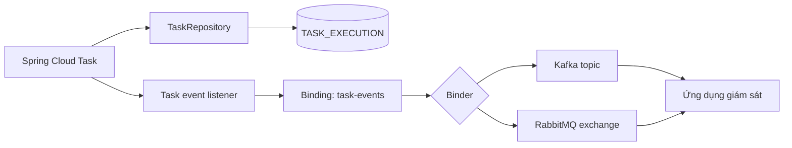
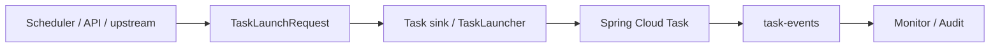
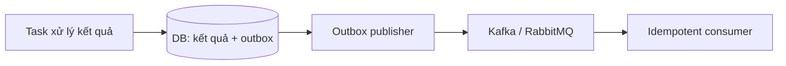

# Tích hợp Spring Cloud Stream và lựa chọn binder

## 1. Vì sao Spring Cloud Task cần phát sự kiện?

**Spring Cloud Task** giúp xây dựng ứng dụng Spring Boot có thời gian chạy hữu hạn: khởi động, thực hiện một tác vụ rồi kết thúc. Mỗi lần chạy được theo dõi bằng `TaskExecution` và lưu trong cơ sở dữ liệu qua **`TaskRepository`**. Hệ thống có thể biết thời điểm bắt đầu, kết thúc, mã thoát và thông tin lỗi ngay cả khi tiến trình Java đã dừng.

Tuy nhiên, không phải mọi hệ thống quan tâm đến kết quả đều nên truy vấn bảng `TASK_EXECUTION` liên tục. Ví dụ:

- Dịch vụ giám sát cần nhận thông báo khi task bắt đầu hoặc hoàn tất.
- Hệ thống kiểm toán cần biết một đợt đồng bộ dữ liệu đã chạy và kết thúc thế nào.
- Dịch vụ điều phối cần tiếp tục workflow sau khi nhận kết quả thực thi.
- Hệ thống báo cáo muốn tổng hợp sự kiện từ nhiều task chạy trên nhiều máy.

**Spring Cloud Stream** đưa ra abstraction **binder** để kết nối ứng dụng với một hệ thống messaging như **Apache Kafka** hoặc **RabbitMQ**. Spring Cloud Task có khả năng sử dụng Spring Cloud Stream để phát dữ liệu `TaskExecution` thành **sự kiện** trên một binding có tên `task-events`.

Sau bài học, bạn có thể:

1. Phân biệt **TaskRepository lưu trạng thái** và **Spring Cloud Stream phát sự kiện**.
2. Thêm dependency `spring-cloud-stream` cùng binder Kafka hoặc RabbitMQ.
3. Cấu hình binding `task-events`, destination, nội dung JSON và địa chỉ message broker.
4. Hiểu khi nào chọn Kafka, khi nào chọn RabbitMQ, và cách cấu hình khi có **nhiều binder**.
5. Xây dựng một ứng dụng task phát sự kiện và một consumer nhận sự kiện.
6. Phân biệt **phát sự kiện vòng đời task** với **nhận thông điệp để khởi chạy task**, cũng như các sự kiện Spring Batch.
7. Xử lý vấn đề kết nối broker, bảo mật, bản tin trùng/mất, retry và tác vụ hữu hạn thoát quá sớm.

## 2. Kiến trúc TaskRepository – Stream – binder

Đối tượng **`TaskExecution`** mô tả một lần chạy Spring Cloud Task; `TaskRepository` là nơi ghi nhận có tính bền vững theo cấu hình database. Khi tính năng sự kiện được kích hoạt và môi trường có các dependency cần thiết, một **task listener** xuất bản thông tin `TaskExecution` lên kênh logic `task-events` tại **thời điểm bắt đầu** và **thời điểm kết thúc**.



| Khái niệm | Vai trò |
| --- | --- |
| `TaskExecution` | Dữ liệu về một lần chạy: ID, tên task, thời điểm, mã thoát, thông tin lỗi… |
| `TaskRepository` | Ghi/cập nhật metadata thực thi vào bảng trong database. |
| **Task event listener** | Tạo thông điệp vòng đời dựa trên `TaskExecution`. |
| `task-events` | **Tên binding/kênh logic** được Spring Cloud Task dùng để phát thông điệp. |
| `destination` | Tên đích bên ngoài, ví dụ topic `training.task-events`. |
| **Binder** | Adapter Spring Cloud Stream kết nối binding với Kafka, RabbitMQ hoặc middleware tương ứng. |
| **Consumer** | Ứng dụng nhận thông điệp để ghi audit, hiển thị dashboard hoặc cập nhật trạng thái workflow. |

**Phân biệt binding và destination:** `task-events` là tên binding được code/framework tham chiếu. Bạn có thể ánh xạ nó đến một destination có tên khác:

```yaml
spring:
  cloud:
    stream:
      bindings:
        task-events:
          destination: training.task-events
```

Ở môi trường Kafka, destination tương ứng một **topic**; ở môi trường RabbitMQ, nó thường tương ứng một **exchange** được binder quản lý. Đổi destination không buộc bạn đổi tên binding `task-events` trong Spring Cloud Task.

### 2.1. Phân biệt các thời điểm sự kiện

| Thời điểm | Dữ liệu thường quan sát | Giới hạn |
| --- | --- | --- |
| Bắt đầu | Tên task, mốc bắt đầu, thông tin lần thực thi đã có tại thời điểm phát | `endTime` và kết quả cuối chưa có. |
| Kết thúc | Mốc kết thúc, mã thoát và thông tin lỗi nếu có | Chỉ có nếu ứng dụng đi qua vòng đời kết thúc và sự kiện được phát thành công. |

Tài liệu Spring Cloud Task mô tả **hai sự kiện** ở lúc bắt đầu và kết thúc, không phải chỉ một thông điệp duy nhất cho cả lần chạy. Các trường cụ thể cần được kiểm tra theo **phiên bản `TaskExecution`** và nội dung đã serialization. Không giả định mọi thuộc tính như `executionId` hoặc `exitCode` đều đã có ở sự kiện bắt đầu.

> Không nhầm **có bản ghi trong TaskRepository** với **đã gửi thành công tới message broker**. Đây là hai hoạt động khác nhau; chúng không tự tạo thành một transaction nguyên tử giữa database và Kafka/RabbitMQ.

## 3. Điều kiện tự động phát sự kiện

Theo tài liệu Spring Cloud Task 3.2, để cơ chế phát `TaskExecution` qua Stream hoạt động, ứng dụng cần:

1. **Spring Cloud Task** được cấu hình và có một tác vụ hữu hạn (ví dụ `ApplicationRunner`).
2. **`spring-cloud-stream`** trên classpath.
3. **Ít nhất một binder implementation**, chẳng hạn `spring-cloud-stream-binder-kafka` hoặc `spring-cloud-stream-binder-rabbit`.
4. Cấu hình kết nối đến **broker thực tế** và destination/binding phù hợp.

Thuộc tính điều khiển listener:

```yaml
spring:
  cloud:
    task:
      events:
        enabled: true
```

Khi muốn **tắt phát sự kiện Task** mà vẫn tiếp tục ghi metadata:

```yaml
spring:
  cloud:
    task:
      events:
        enabled: false
```

`spring.cloud.task.events.enabled=false` chỉ tắt listener phát sự kiện vòng đời **Task**. Nó **không** tắt `TaskRepository`, không ngừng thực thi `ApplicationRunner`, và cũng không mặc nhiên vô hiệu hóa mọi sự kiện **Spring Batch**.

**Điểm dễ bỏ sót:** Chỉ thêm `spring-cloud-stream` mà thiếu binder không cung cấp một hệ thống truyền nhận thật sự; chỉ có binder trong classpath mà broker không truy cập được cũng không đồng nghĩa sự kiện đã được chuyển thành công.

## 4. Lựa chọn binder: Kafka hay RabbitMQ?

Spring Cloud Stream dùng cùng abstraction nhưng hai middleware có cách phân phối thông điệp khác nhau.

| Tiêu chí | Kafka binder | RabbitMQ binder |
| --- | --- | --- |
| Dependency | `spring-cloud-stream-binder-kafka` | `spring-cloud-stream-binder-rabbit` |
| Destination điển hình | Kafka **topic** | RabbitMQ **exchange** |
| Cách tiêu thụ | Consumer group với offsets, có thể đọc lại dữ liệu còn trong topic theo retention và chính sách offset | Exchange định tuyến tới queue, consumer lấy từ queue; phát lại đòi hỏi thiết kế lưu giữ/republish phù hợp |
| Phù hợp hơn khi | Cần log sự kiện, nhiều nhóm consumer độc lập, khả năng replay và lượng sự kiện lớn | Cần routing theo queue/exchange, tích hợp AMQP, kiểm soát hàng đợi và worker |
| Thứ tự | Có thứ tự **trong từng partition**, không mặc nhiên toàn topic | Phụ thuộc queue, mức concurrency và chế độ phân phối; không mặc định thứ tự tuyệt đối |
| Vận hành | Quản lý topic, partition, retention, offset, bảo mật Kafka | Quản lý exchange, queue, binding, DLQ, TTL và quyền AMQP |

**Chọn Kafka** khi cùng một luồng `TaskExecution` cần phục vụ nhiều nhóm hệ thống (audit, monitoring, analytics), muốn đọc lại sự kiện trong thời gian retention hoặc cần xử lý khối lượng lớn. **Chọn RabbitMQ** khi tổ chức đang vận hành AMQP, cần routing theo exchange/queue, hoặc tiêu thụ dạng worker queue là chủ đạo.

Không có binder “tốt nhất” cho mọi trường hợp. Khi chọn, hãy xét hạ tầng đang có, quyền vận hành, SLA phát sự kiện, retry/retention, chi phí và nhu cầu replay. Nếu chỉ cần xem trạng thái của vài task, truy vấn `TaskRepository` có thể đơn giản hơn việc xây dựng hẳn hệ thống messaging.

### 4.1. Chọn binder trong Maven

Cho **Kafka**:

```xml
<dependency>
    <groupId>org.springframework.cloud</groupId>
    <artifactId>spring-cloud-stream</artifactId>
</dependency>
<dependency>
    <groupId>org.springframework.cloud</groupId>
    <artifactId>spring-cloud-stream-binder-kafka</artifactId>
</dependency>
```

Cho **RabbitMQ**, thay dependency binder Kafka bằng:

```xml
<dependency>
    <groupId>org.springframework.cloud</groupId>
    <artifactId>spring-cloud-stream-binder-rabbit</artifactId>
</dependency>
```

Hai binder không cần cùng xuất hiện nếu ứng dụng chỉ kết nối một middleware. Dùng **Spring Cloud BOM tương thích** để quản lý version; tránh tự ép một bản Kafka/Rabbit binder thuộc thế hệ Spring Cloud Stream khác với phần core.

## 5. Dự án Spring Cloud Task phát sự kiện lên Kafka

Ví dụ dùng **Java 17**, **Spring Boot 3.4.5**, **Spring Cloud 2024.0.2** và một **Kafka broker** đang hoạt động ở `localhost:9092`. Cặp Boot–Cloud là ví dụ cùng thế hệ tương thích; hãy chọn bản tương ứng nếu dự án của bạn khác thế hệ.

H2 lưu metadata Task trên ổ đĩa để có thể đối chiếu với message. Kafka dùng để nhận sự kiện từ task. Hai kho này **độc lập**.

```text
task-events-demo/
├── pom.xml
└── src/main/
    ├── java/com/example/taskevents/
    │   ├── TaskEventsApplication.java
    │   └── ImportTaskRunner.java
    └── resources/
        └── application.yml
```

### 5.1. `pom.xml`

```xml
<?xml version="1.0" encoding="UTF-8"?>
<project xmlns="http://maven.apache.org/POM/4.0.0"
         xmlns:xsi="http://www.w3.org/2001/XMLSchema-instance"
         xsi:schemaLocation="http://maven.apache.org/POM/4.0.0 https://maven.apache.org/xsd/maven-4.0.0.xsd">
    <modelVersion>4.0.0</modelVersion>

    <parent>
        <groupId>org.springframework.boot</groupId>
        <artifactId>spring-boot-starter-parent</artifactId>
        <version>3.4.5</version>
        <relativePath/>
    </parent>

    <groupId>com.example</groupId>
    <artifactId>task-events-demo</artifactId>
    <version>0.0.1-SNAPSHOT</version>

    <properties>
        <java.version>17</java.version>
    </properties>

    <dependencyManagement>
        <dependencies>
            <dependency>
                <groupId>org.springframework.cloud</groupId>
                <artifactId>spring-cloud-dependencies</artifactId>
                <version>2024.0.2</version>
                <type>pom</type>
                <scope>import</scope>
            </dependency>
        </dependencies>
    </dependencyManagement>

    <dependencies>
        <dependency>
            <groupId>org.springframework.cloud</groupId>
            <artifactId>spring-cloud-starter-task</artifactId>
        </dependency>
        <dependency>
            <groupId>org.springframework.boot</groupId>
            <artifactId>spring-boot-starter-jdbc</artifactId>
        </dependency>
        <dependency>
            <groupId>com.h2database</groupId>
            <artifactId>h2</artifactId>
            <scope>runtime</scope>
        </dependency>
        <dependency>
            <groupId>org.springframework.cloud</groupId>
            <artifactId>spring-cloud-stream</artifactId>
        </dependency>
        <dependency>
            <groupId>org.springframework.cloud</groupId>
            <artifactId>spring-cloud-stream-binder-kafka</artifactId>
        </dependency>
    </dependencies>

    <build>
        <plugins>
            <plugin>
                <groupId>org.springframework.boot</groupId>
                <artifactId>spring-boot-maven-plugin</artifactId>
            </plugin>
        </plugins>
    </build>
</project>
```

Ở đây **không cần tự viết Kafka producer**. Spring Cloud Task cung cấp task event listener; Spring Cloud Stream/binder thực hiện ánh xạ kênh `task-events` ra broker.

### 5.2. `application.yml`

```yaml
spring:
  application:
    name: task-events-demo
  main:
    web-application-type: none
  datasource:
    url: jdbc:h2:file:./data/task-events-db;DB_CLOSE_ON_EXIT=FALSE
    driver-class-name: org.h2.Driver
    username: sa
    password: ""
  cloud:
    task:
      name: import-orders-task
      initialize-enabled: true
      closecontext-enabled: true
      events:
        enabled: true
    stream:
      bindings:
        task-events:
          destination: training.task-events
          content-type: application/json
          binder: kafka
      kafka:
        binder:
          brokers: localhost:9092
```

Giải thích từng phần:

| Cấu hình | Ý nghĩa |
| --- | --- |
| `spring.cloud.task.name` | Định danh task; các lần chạy cùng tên vẫn có `TaskExecution` riêng. |
| `spring.cloud.task.events.enabled` | Cho phép listener phát sự kiện vòng đời. |
| `spring.cloud.stream.bindings.task-events.destination` | Tên Kafka topic mà binding `task-events` ánh xạ đến. |
| `spring.cloud.stream.bindings.task-events.content-type` | Đặt kiểu payload để các consumer JSON dễ tích hợp. |
| `spring.cloud.stream.bindings.task-events.binder` | Chọn binder `kafka` cho binding này. |
| `spring.cloud.stream.kafka.binder.brokers` | Địa chỉ bootstrap broker Kafka. |
| `spring.cloud.task.initialize-enabled` | Khởi tạo schema Task trên H2 khi thực hành với DB mới. |

`web-application-type: none` giúp ứng dụng không mở máy chủ HTTP. H2 dùng dạng file để giữ metadata sau khi JVM thoát; cần tạo thư mục `data` trước khi chạy. Trong production hãy dùng database bền vững và quản lý schema bằng migration thay vì để nhiều instance tự chạy DDL.

Tùy broker, cần **tạo topic trước** hoặc cho phép binder provision. Trong môi trường kiểm soát chặt, administrator thường tạo topic và cấp quyền gửi/đọc trước; ứng dụng không nên mặc nhiên có quyền quản trị broker.

### 5.3. Lớp ứng dụng

Tạo `TaskEventsApplication.java`:

```java
package com.example.taskevents;

import org.springframework.boot.SpringApplication;
import org.springframework.boot.autoconfigure.SpringBootApplication;
import org.springframework.cloud.task.configuration.EnableTask;

@SpringBootApplication
@EnableTask
public class TaskEventsApplication {

    public static void main(String[] args) {
        SpringApplication.run(TaskEventsApplication.class, args);
    }
}
```

### 5.4. Runner với hai kịch bản thành công và lỗi

Tạo `ImportTaskRunner.java`:

```java
package com.example.taskevents;

import org.springframework.boot.ApplicationArguments;
import org.springframework.boot.ApplicationRunner;
import org.springframework.stereotype.Component;

@Component
public class ImportTaskRunner implements ApplicationRunner {

    @Override
    public void run(ApplicationArguments args) throws Exception {
        System.out.println("[TASK] Bắt đầu đồng bộ đơn hàng");

        try {
            Thread.sleep(1_000);
        } catch (InterruptedException interrupted) {
            Thread.currentThread().interrupt();
            throw interrupted;
        }

        if (args.containsOption("fail")) {
            throw new IllegalStateException("Giả lập lỗi đồng bộ đơn hàng");
        }

        System.out.println("[TASK] Đồng bộ hoàn tất");
    }
}
```

Task chạy khoảng một giây cho dễ quan sát. Khi dùng `--fail`, runner phát sinh ngoại lệ **chưa được xử lý** để Spring Cloud Task có thể ghi kết quả thất bại. Không bắt lỗi rồi chỉ in log, vì đó là cách dễ khiến metadata và sự kiện thông báo thành công sai.

### 5.5. Điều gì được phát?

Khi môi trường Stream/binder sẵn sàng, một lần khởi chạy bình thường có thể xuất bản hai thông điệp mang trạng thái `TaskExecution`:

```text
Task khởi động
  -> TaskExecution lúc bắt đầu -> task-events -> Kafka
Runner chạy
Task hoàn tất
  -> TaskExecution lúc kết thúc -> task-events -> Kafka
```

Thông điệp **không mặc định là một event tùy biến** có trường `eventType = STARTED` hoặc `FINISHED`. Spring Cloud Task phát **`TaskExecution`**; consumer cần diễn giải các trường thực có của payload, ví dụ kiểm tra thời điểm `endTime` có hay chưa và mã thoát. Nếu hệ thống downstream cần schema sự kiện nghiệp vụ ổn định, hãy định nghĩa một contract riêng và chuyển đổi dữ liệu tại tầng tích hợp.

## 6. Chạy thử và quan sát sự kiện trên Kafka

### 6.1. Chuẩn bị hạ tầng

Bạn cần một Kafka broker kết nối được tại `localhost:9092`. Đảm bảo topic `training.task-events` tồn tại hoặc binder có đủ quyền tạo topic trong môi trường thử nghiệm.

Đứng tại thư mục dự án:

```bash
mkdir -p data
mvn clean package
```

Trên PowerShell có thể dùng `New-Item -ItemType Directory -Force data` thay cho `mkdir -p data`.

### 6.2. Bắt đầu quan sát Kafka topic

Nếu môi trường có Kafka CLI, mở một terminal riêng:

```bash
kafka-console-consumer.sh \
  --bootstrap-server localhost:9092 \
  --topic training.task-events \
  --from-beginning
```

Tên executable và đường dẫn có thể khác giữa Kafka cài trực tiếp, container và hệ điều hành. `--from-beginning` dùng để đọc các record còn được giữ lại theo retention, không bảo đảm mọi sự kiện trong lịch sử vô hạn.

### 6.3. Chạy task thành công

Ở terminal khác:

```bash
java -jar target/task-events-demo-0.0.1-SNAPSHOT.jar
```

Log nghiệp vụ:

```text
[TASK] Bắt đầu đồng bộ đơn hàng
[TASK] Đồng bộ hoàn tất
```

Consumer Kafka kỳ vọng nhận **hai record cho một lần chạy bình thường**: một ở đầu và một ở cuối. Nội dung JSON cụ thể phụ thuộc phiên bản Task và cách message conversion; các trường thường phản ánh `taskName`, `executionId`, `startTime`, `endTime` hoặc `exitCode` tại thời điểm phát.

Ví dụ **giản lược minh họa ý nghĩa** (không phải schema JSON cam kết của mọi phiên bản):

```json
{"taskName":"import-orders-task","executionId":42,"startTime":"...","endTime":null}
{"taskName":"import-orders-task","executionId":42,"startTime":"...","endTime":"...","exitCode":0}
```

**Không dùng JSON minh họa làm chuẩn kiểm tra chính xác từng field.** Hãy xem payload thực tế qua Kafka consumer và so sánh với `TaskExecution` được đọc từ `TaskRepository`. Cùng một lần chạy nên có định danh tương ứng khi định danh đó đã được cấp.

### 6.4. Chạy kịch bản lỗi

```bash
java -jar target/task-events-demo-0.0.1-SNAPSHOT.jar --fail
```

Kỳ vọng về mặt nghiệp vụ: runner ném `IllegalStateException`, framework ghi nhận lần chạy thất bại, và khi quá trình xử lý lỗi đi qua callback kết thúc thì sự kiện cuối mô tả kết quả thất bại. Tuy nhiên **không cam kết luôn có event cuối** nếu JVM bị kill, lỗi khởi động quá sớm hoặc không gửi được tới broker.

**Quan trọng:** Có thể xuất hiện bản ghi bắt đầu nhưng không có bản ghi kết thúc. Đừng để consumer ngầm coi trường hợp này là thành công; hãy dùng cơ chế timeout và đối chiếu TaskRepository/scheduler khi cần xác nhận.

## 7. Xây dựng consumer nhận `TaskExecution`

Producer Task có thể tồn tại rất ngắn. Consumer nên chạy dưới dạng **dịch vụ riêng, sống lâu hơn**, không để một consumer Kafka thường trực giữ JVM của chính task hữu hạn sống mãi.

Giả sử ứng dụng consumer cũng dùng `spring-cloud-stream` và `spring-cloud-stream-binder-kafka` tương thích. Định nghĩa một Spring Cloud Function:

```java
package com.example.taskmonitor;

import java.util.Map;
import java.util.function.Consumer;

import org.springframework.context.annotation.Bean;
import org.springframework.context.annotation.Configuration;

@Configuration
public class TaskMonitorConfiguration {

    @Bean
    public Consumer<Map<String, Object>> taskEventConsumer() {
        return event -> {
            Object taskName = event.get("taskName");
            Object executionId = event.get("executionId");
            Object endTime = event.get("endTime");

            String phase = (endTime == null) ? "START_OR_UNKNOWN" : "END";
            System.out.println("[EVENT] task=" + taskName
                    + ", execution=" + executionId
                    + ", phase=" + phase);
        };
    }
}
```

Cấu hình consumer:

```yaml
spring:
  application:
    name: task-event-monitor
  cloud:
    function:
      definition: taskEventConsumer
    stream:
      bindings:
        taskEventConsumer-in-0:
          destination: training.task-events
          group: task-audit-service
          content-type: application/json
          binder: kafka
      kafka:
        binder:
          brokers: localhost:9092
```

`taskEventConsumer-in-0` là **tên binding input** được tạo theo mô hình functional của Spring Cloud Stream. Nó **khác với** `task-events` — binding output do Spring Cloud Task sử dụng. Hai ứng dụng phối hợp vì **cùng destination** `training.task-events`, không phải vì tên binding giống nhau.

**Lưu ý an toàn về contract:** Ví dụ consumer xử lý `Map<String,Object>` để không yêu cầu class `TaskExecution` trên classpath phía nhận, nhưng cách chuyển JSON thành Map phụ thuộc cấu hình content type và converter. Trong một hệ thống thật, hãy kiểm tra giá trị `content-type`, serialization thực tế, cấu trúc timestamp, tên field, khả năng dữ liệu `null` và xử lý thông điệp lỗi. Nếu cần contract chặt chẽ, chuyển message thành một DTO được version hóa.

### 7.1. Consumer group và nhiều ứng dụng nhận

Với Kafka:

- Hai instance của **cùng consumer group** thường chia nhau các partition: dùng để scale một loại xử lý.
- Hai **consumer group khác nhau** có thể nhận cùng topic độc lập, ví dụ `task-audit-service` và `task-dashboard-service`.
- Offset, retention và số partition ảnh hưởng khả năng đọc lại, song bản thân consumer group **không bảo đảm** xử lý đúng một lần.

Với RabbitMQ, các consumer cùng group thường chia sẻ queue theo cách binder thiết lập; các group khác nhau thường có queue khác nhau trên exchange. Đừng áp dụng trực tiếp khái niệm Kafka offset cho RabbitMQ.

## 8. Đổi từ Kafka sang RabbitMQ

Để dùng RabbitMQ, thay dependency binder Kafka bằng:

```xml
<dependency>
    <groupId>org.springframework.cloud</groupId>
    <artifactId>spring-cloud-stream-binder-rabbit</artifactId>
</dependency>
```

Và dùng cấu hình:

```yaml
spring:
  rabbitmq:
    host: localhost
    port: 5672
    username: guest
    password: guest
  cloud:
    task:
      events:
        enabled: true
    stream:
      bindings:
        task-events:
          destination: training.task-events
          binder: rabbit
          content-type: application/json
```

Ví dụ `guest/guest` chỉ thích hợp cho **RabbitMQ cục bộ dùng để thực hành**; nhiều triển khai RabbitMQ giới hạn tài khoản `guest` chỉ được đăng nhập từ localhost. Production phải dùng credential riêng, TLS và phân quyền exchange/queue.

Trong RabbitMQ, destination được binder ánh xạ tới exchange/binding theo cơ chế binder Rabbit. Consumer có `group` có thể được binder cung cấp queue bền vững tùy cấu hình. Việc **chỉ đổi YAML mà vẫn giữ binder Kafka** hoặc broker RabbitMQ chưa chạy sẽ không tạo ra luồng event hợp lệ.

### 8.1. So sánh cách cấu hình hai binder

| Thành phần | Kafka | RabbitMQ |
| --- | --- | --- |
| Maven dependency | `spring-cloud-stream-binder-kafka` | `spring-cloud-stream-binder-rabbit` |
| Chỉ định binder | `binder: kafka` | `binder: rabbit` |
| Broker | `spring.cloud.stream.kafka.binder.brokers` | `spring.rabbitmq.host` và các thuộc tính AMQP |
| Destination | Topic | Exchange/queue binding tùy chiều dữ liệu |
| Consumer checkpoint | Offset theo group | Ack/queue delivery theo cơ chế AMQP |

Nếu thay binder, cần kiểm tra lại các tham số vận hành: retry, consumer group, DLQ, giới hạn kích thước thông điệp, provisioning và mức bảo đảm delivery. Abstraction giúp tái sử dụng code, **không làm hai broker trở thành tương đương hoàn toàn**.

## 9. Khi có nhiều binder trên classpath

Nếu một ứng dụng cần cả Kafka và RabbitMQ, hãy chọn binder **tường minh** cho từng binding:

```yaml
spring:
  cloud:
    stream:
      bindings:
        task-events:
          destination: training.task-events
          binder: kafka
        notifications-out-0:
          destination: notifications
          binder: rabbit
      kafka:
        binder:
          brokers: kafka.internal:9092
  rabbitmq:
    host: rabbit.internal
    port: 5672
```

Phần `notifications-out-0` chỉ minh họa **một output binding khác** nếu ứng dụng có chức năng thực sự sử dụng nó; khai báo YAML không tự tạo luồng phát thông báo nếu không có producer tương ứng.

Bạn có thể chọn binder mặc định cho các binding chưa chỉ rõ:

```properties
spring.cloud.stream.defaultBinder=kafka
```

Tuy nhiên, với ứng dụng có nhiều middleware, cấu hình `binder` ở từng binding thường dễ kiểm tra hơn. Nếu cần kết nối **hai cụm Kafka** hoặc **hai RabbitMQ broker khác nhau**, phải khai báo **binder configuration được đặt tên** trong `spring.cloud.stream.binders.*` cùng phần `environment` riêng. Đó là một tình huống khác với việc chỉ thêm hai binder loại khác nhau vào classpath.

**Lỗi thường gặp:** Có cả hai binder nhưng không khai báo binder mặc định hoặc binder riêng cho `task-events`; khi đó Spring Cloud Stream có thể không biết chọn binder nào và báo lỗi lúc khởi tạo binding.

## 10. Phân biệt phát sự kiện với khởi chạy Task từ message

Spring Cloud Task hỗ trợ hai kiểu tích hợp Stream có mục tiêu khác nhau:

| Kiểu tích hợp | Đầu vào | Đầu ra | Tác dụng |
| --- | --- | --- | --- |
| **Task events** | Ứng dụng Task đang chạy | `TaskExecution` phát lên `task-events` | Thông báo **trạng thái thực thi** ra ngoài. |
| **Launching a task from a stream** | Message có payload `TaskLaunchRequest` | Một task được khởi chạy bằng TaskLauncher | Dùng message để **ra lệnh khởi chạy** task. |

`TaskLaunchRequest` có thể mô tả artifact `uri`, `applicationName`, `commandLineArguments`, `environmentProperties` và `deploymentProperties`. Một **task sink** có `@EnableTaskLauncher` có thể nhận yêu cầu rồi triển khai/khởi chạy task theo cấu hình deployer.



Trong mô hình này, một dòng message dùng để **khởi động task**, còn dòng khác dùng để **báo task đã bắt đầu/kết thúc**. Hai dòng nên được thiết kế thành các destination rõ ràng, có quyền truy cập và schema message riêng. Không đưa message `TaskLaunchRequest` vào topic `task-events` rồi mong task event listener tự khởi chạy task.

## 11. Khi Task đồng thời chạy Spring Batch

Khi ứng dụng Spring Cloud Task thực hiện một **Spring Batch Job**, ngoài sự kiện của toàn Task còn có thể phát sự kiện ở cấp Batch:

| Listener Spring Batch | Binding/destination mặc định được tài liệu Task mô tả |
| --- | --- |
| `JobExecutionListener` | `job-execution-events` |
| `StepExecutionListener` | `step-execution-events` |
| `ChunkListener` | `chunk-events` |
| `ItemReadListener` | `item-read-events` |
| `ItemProcessListener` | `item-process-events` |
| `ItemWriteListener` | `item-write-events` |
| `SkipListener` | `skip-events` |

Các sự kiện Batch cần **hạ tầng tích hợp Batch** và listener phù hợp; chỉ thêm một task runner bình thường không làm xuất hiện `job-execution-events` hay `chunk-events`.

Cấu hình ví dụ đổi destination sự kiện Step:

```yaml
spring:
  cloud:
    task:
      batch:
        events:
          step-execution-events-binding-name: my-step-execution-events
    stream:
      bindings:
        my-step-execution-events:
          destination: training.batch-step-events
          binder: kafka
```

Mẫu trên thể hiện việc thay **binding name** mà listener Step dùng, rồi ánh xạ binding đó đến destination thực. Các thuộc tính/kiểu listener hỗ trợ thay đổi theo phiên bản, nên cần đối chiếu tài liệu của phiên bản Spring Cloud Task và Stream đang triển khai.

Tắt **toàn bộ** sự kiện Batch nếu không cần:

```properties
spring.cloud.task.batch.events.enabled=false
```

Chỉ tắt một loại sự kiện, ví dụ `chunk`:

```properties
spring.cloud.task.batch.events.chunk.enabled=false
```

Tắt event Batch không nhất thiết tắt `TaskExecution` event; hai nhóm được cấu hình riêng. Các event cấp item/chunk có thể có **số lượng rất lớn**, nên phải cân nhắc chi phí broker, kích thước payload, thông tin nhạy cảm và rủi ro phát chậm làm ảnh hưởng throughput của Job.

## 12. Đối chiếu sự kiện với `TaskRepository`

Sau khi ứng dụng Task kết thúc, kết nối H2 file:

```text
JDBC URL: jdbc:h2:file:./data/task-events-db
User: sa
Password: (để trống)
```

URL tương đối cần được giải quyết theo đúng working directory lúc task đã chạy; nếu SQL client mở từ thư mục khác, hãy dùng đường dẫn tuyệt đối.

Truy vấn:

```sql
SELECT TASK_EXECUTION_ID,
       TASK_NAME,
       START_TIME,
       END_TIME,
       EXIT_CODE,
       ERROR_MESSAGE
FROM TASK_EXECUTION
ORDER BY TASK_EXECUTION_ID DESC;
```

So sánh sự kiện với bản ghi:

| Kiểm tra | Ý nghĩa |
| --- | --- |
| Có bản ghi `TaskExecution` nhưng không thấy event | Kiểm tra dependency/binder, broker, listener, destination, serialization và log lỗi. |
| Có event bắt đầu nhưng không có event kết thúc | Có thể task đang chạy, bị kill, lỗi kết thúc hoặc phát event thất bại; cần đối chiếu DB và trạng thái process. |
| Hai event cùng mô tả một execution | Có thể là cặp bắt đầu/kết thúc hợp lệ, không nên coi mặc định là thông điệp bị gửi trùng. |
| Hai event kết thúc cho cùng execution | Có thể liên quan retry/re-delivery/producer; consumer phải xử lý idempotent. |
| `EXIT_CODE` khác `0` | Task thất bại theo báo cáo của framework, dù event vẫn có thể được phát ra. |

Một hệ thống giám sát thường cần **state machine** theo `executionId` và các trường trạng thái, ví dụ `STARTED` → `COMPLETED`/`FAILED`. Nếu event đến lại, nên dùng idempotency key kết hợp `taskName`, ID thực thi và loại mốc được suy ra từ payload, tránh tạo thêm một lần chạy giả.

## 13. Độ tin cậy khi phát event từ task hữu hạn

Điểm cần quan tâm nhất không phải chỉ là viết đúng YAML. **Task có thể kết thúc nhanh**, còn việc gửi qua broker có buffering, retry, flush, reconnect và xác nhận không đồng bộ. Một số rủi ro thực tế:

1. **Broker không truy cập được** khi Task khởi động hoặc kết thúc.
2. **JVM thoát quá sớm** trước khi producer hoàn tất việc gửi bản tin.
3. **Listener gửi event thất bại** nhưng trạng thái Task đã được lưu DB, hoặc ngược lại.
4. **Consumer nhận lặp** do cơ chế retry/re-delivery.
5. **Event nhận không đúng thứ tự** khi nhiều partition hoặc luồng thực thi cùng tồn tại.
6. **Bản tin đầu có `endTime = null`**, vì đây là trạng thái đang chạy, không phải sự cố serialization.

Vì vậy, **đừng xem phát event và ghi `TaskRepository` là một giao dịch atomically committed**. Nếu sản phẩm yêu cầu mọi thay đổi nghiệp vụ phải có sự kiện tương ứng, hãy cân nhắc **transactional outbox**:



Trong mô hình outbox, ứng dụng ghi kết quả nghiệp vụ và bản ghi outbox trong **cùng transaction ở một database** (khi nghiệp vụ cho phép), rồi một publisher riêng gửi và đánh dấu trạng thái. Phương án này cần thêm hạ tầng nhưng tránh phụ thuộc vào việc task sống đủ lâu để tự giao event cuối. **Outbox không tự động có sẵn** chỉ bằng cách bật `spring.cloud.task.events.enabled`.

### 13.1. Kiểm soát contract và bảo mật

- Định nghĩa event schema/phiên bản, các trường bắt buộc và cách biểu diễn timestamp (ưu tiên chuẩn UTC rõ ràng).
- Không cho consumer kết luận thành công từ **sự tồn tại của thông điệp**; phải kiểm tra trạng thái cuối.
- Không truyền mật khẩu, API token hoặc dữ liệu cá nhân vào tham số task vì metadata có thể được serialize ra event và truy cập bởi nhiều consumer.
- Bật TLS/SASL cho Kafka hoặc TLS/xác thực AMQP cho RabbitMQ theo hạ tầng.
- Cấp quyền producer chỉ **publish** lên destination cần thiết; consumer chỉ đọc đúng group/queue.
- Đặt timeout/retry của producer và giới hạn độ lớn message; theo dõi lỗi publisher và lag của consumer.
- Cân nhắc giữ **TaskRepository là nguồn kiểm tra trạng thái chính thức** khi event mất, chậm hoặc không có event cuối.

### 13.2. Kiểm thử trong môi trường phát triển

Khi viết integration test, có thể dùng **Spring Cloud Stream test binder** để xác nhận binding/payload hoặc sử dụng Kafka/RabbitMQ test container để kiểm tra đường đi end-to-end. Test binder không mô phỏng đầy đủ retention, ack, security, network timeout hay offset của broker thật.

Với bài thực hành này, bước kiểm tra có ý nghĩa nhất là chạy JAR, quan sát hai event ở broker, truy vấn `TASK_EXECUTION` và so sánh cùng lần chạy.

## 14. Sự cố thường gặp và cách xử lý

| Hiện tượng | Nguyên nhân có thể | Hướng khắc phục |
| --- | --- | --- |
| Không có message nào trên topic | Thiếu binder, events bị tắt hoặc sai destination | Kiểm tra dependency, `events.enabled`, `task-events` binding và log khởi động. |
| `No binder available` hoặc không tìm thấy binder | Không có `spring-cloud-stream-binder-...` hợp lệ | Thêm dependency binder đúng loại và version qua BOM. |
| Có cả Kafka và Rabbit, ứng dụng không biết chọn | Chưa khai báo binder mặc định hoặc trên binding | Đặt `binder: kafka/rabbit` hay `spring.cloud.stream.defaultBinder`. |
| Không kết nối được Kafka | Sai `brokers`, listener advertised address hoặc ACL | Kiểm tra bootstrap, mạng, advertised listeners, SASL/TLS và quyền topic. |
| Không kết nối được RabbitMQ | Sai host, port, credential hoặc vhost | Kiểm tra AMQP, TLS, quyền exchange/queue và firewall. |
| Topic có sự kiện nhưng consumer không nhận | Sai group, destination, offset hoặc consumer không chạy | Xác nhận binding `taskEventConsumer-in-0`, Kafka group và offset. |
| Consumer lỗi JSON conversion | Không khớp content type hoặc DTO/payload | Quan sát payload thực tế, cấu hình `content-type` và message converter. |
| Có event bắt đầu, thiếu event cuối | Task vẫn chạy, bị kill hoặc sự kiện cuối không gửi được | Kiểm tra DB, process, scheduler, log producer và thiết kế timeout/reconcile. |
| Có nhiều event cho cùng execution | Hai mốc vòng đời hoặc redelivery | Phân biệt start/end; tiêu thụ idempotent theo execution + trạng thái. |
| Event Batch quá nhiều làm tăng tải | Bật listener item/chunk trong job lớn | Chỉ bật các nhóm sự kiện thực sự cần và giám sát throughput. |
| Task giữ JVM sống lâu bất thường | Consumer hoặc thread producer được cấu hình sống lâu trong chính Task | Chạy consumer riêng, quản lý vòng đời sender và đảm bảo kết thúc task hữu hạn. |

Khi chẩn đoán, kiểm tra theo chuỗi: **Task có `TaskExecution` → listener event có bật → binding `task-events` tồn tại → binder được chọn → broker nhận message → consumer đọc đúng destination/group**. Cách này giúp tìm lỗi ở đúng lớp thay vì chỉ sửa dữ liệu trong repository.

## 15. Thực hành và câu hỏi tự kiểm tra

### Bài tập 1: Phát Task event qua Kafka

1. Tạo project `task-events-demo` với Maven và cấu hình như trên.
2. Đảm bảo Kafka broker chạy và topic `training.task-events` tồn tại.
3. Chạy task thành công và quan sát các thông điệp ở đầu/cuối.
4. Truy vấn `TASK_EXECUTION` để so sánh kết quả.
5. Chạy thêm `--fail` và kiểm tra sự kiện/metadata lỗi.

### Bài tập 2: Thay binder

Thay dependency Kafka bằng Rabbit binder và cấu hình kết nối RabbitMQ. Giữ tên binding `task-events`, nhưng quan sát destination bên ngoài theo mô hình RabbitMQ exchange/queue. Giải thích tại sao code `ImportTaskRunner` không cần thay đổi.

### Bài tập 3: Nhiều consumer và xử lý trùng

Tạo hai consumer group Kafka độc lập: một nhóm ghi audit và một nhóm cập nhật dashboard. Thiết kế khóa idempotency để cùng một bản tin kết thúc được gửi lại không tạo hai lần hoàn tất giả.

### Bài tập 4: Broker gián đoạn

Giả lập broker tạm thời không truy cập được khi task chạy. Kiểm tra cách ứng dụng phản ứng, bản ghi `TaskExecution` còn lại trong DB, log lỗi và việc hệ thống consumer khôi phục trạng thái. Đề xuất khi nào cần outbox hoặc một tiến trình reconcile.

### Câu hỏi ôn tập

1. `TaskRepository` và Spring Cloud Stream giải quyết hai bài toán khác nhau như thế nào?
2. `task-events` là tên binding hay tên topic bắt buộc? Muốn đổi tên topic thì cấu hình ở đâu?
3. Vì sao thêm `spring-cloud-stream` nhưng không thêm binder chưa đủ?
4. Khi nào chọn Kafka, khi nào chọn RabbitMQ cho luồng `TaskExecution`?
5. Cấu hình nào chọn binder nếu có nhiều binder trên classpath?
6. Vì sao consumer phải phân biệt event bắt đầu và event kết thúc?
7. `spring.cloud.task.events.enabled=false` có tắt TaskRepository không?
8. `TaskLaunchRequest` khác với `TaskExecution` event ở mục đích nào?
9. Vì sao event đã phát không chứng minh task thành công hoặc bảo đảm exactly-once?
10. Khi tích hợp Spring Batch, `job-execution-events` khác `task-events` như thế nào?

**Ghi nhớ:** **Spring Cloud Task** quản lý vòng đời và metadata; **Spring Cloud Stream** truyền sự kiện qua binding `task-events`; **binder** quyết định cách kết nối đến Kafka, RabbitMQ hay một middleware cụ thể. Hãy chọn binder theo nhu cầu vận hành, phân biệt binding với destination, kiểm tra payload thực tế và thiết kế consumer idempotent. Khi cần độ tin cậy cao, coi `TaskRepository` là nguồn đối chiếu và bổ sung cơ chế reconcile hoặc outbox thay vì chỉ tin rằng mọi event sẽ luôn đến nơi.

## Tài liệu tham khảo

- [Spring Cloud Task 3.2 — Spring Cloud Stream Integration](https://docs.spring.io/spring-cloud-task/reference/3.2/stream.html): `task-events`, yêu cầu có binder, `TaskExecution` event lúc bắt đầu/kết thúc, TaskLaunchRequest và Batch events.
- [Spring Cloud Stream 4.2 — Binder Detection](https://docs.spring.io/spring-cloud-stream/reference/4.2/spring-cloud-stream/binder-detection.html): cách Stream phát hiện binder từ classpath.
- [Spring Cloud Stream 4.2 — Multiple Binders](https://docs.spring.io/spring-cloud-stream/reference/4.2/spring-cloud-stream/multiple-binders.html): chọn binder mặc định hoặc riêng cho từng binding.
- [Spring Cloud Stream — Kafka Binder Usage](https://docs.spring.io/spring-cloud-stream/reference/kafka/kafka-binder/usage.html): dependency Kafka và khái niệm topic/consumer group.
- [Spring Cloud Stream — RabbitMQ Binder](https://docs.spring.io/spring-cloud-stream-binder-rabbit/docs/current/reference/html/spring-cloud-stream-binder-rabbit.html): kết nối AMQP và mô hình exchange/queue.
