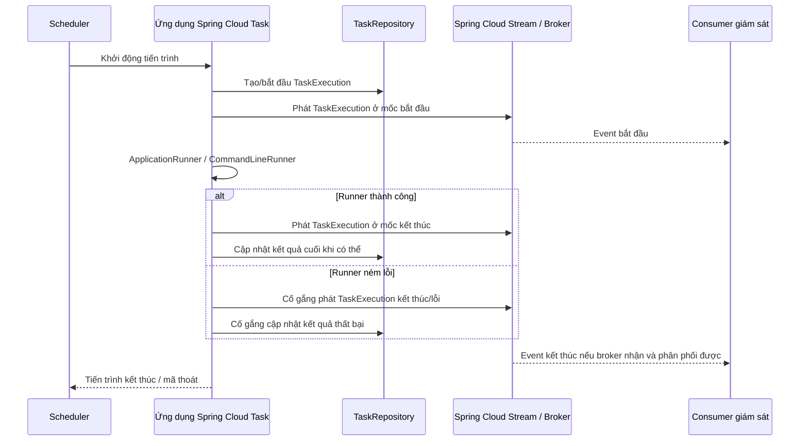

# Phát TaskExecution khi bắt đầu và kết thúc

## Mục tiêu bài học

Trong **SPRING_CLOUD_TASK (Spring Cloud Task)**, ứng dụng Spring Boot thực hiện một công việc **hữu hạn**, sau đó kết thúc. Framework lưu lịch sử mỗi lần chạy vào `TaskRepository` dưới dạng `TaskExecution`: tên tác vụ, ID, thời gian bắt đầu và kết thúc, mã thoát và thông tin lỗi. Điều này giúp vận hành tác vụ theo lịch hoặc theo yêu cầu, xử lý sự cố và phối hợp với Spring Batch.

Tuy nhiên, một dashboard hay hệ thống giám sát ở tiến trình khác không nhất thiết muốn liên tục truy vấn database để biết một tác vụ vừa bắt đầu hoặc vừa kết thúc. **Spring Cloud Task Events** giải quyết nhu cầu thông báo đó bằng cách **phát đối tượng `TaskExecution` qua Spring Cloud Stream khi Task bắt đầu và khi Task kết thúc**.

Bài thuộc chương **Sự kiện** giúp bạn:

- Phân biệt bản ghi trong `TaskRepository` với message `TaskExecution` gửi qua broker.
- Giải thích hai mốc phát event, cùng channel `task-events` và dữ liệu có thể quan sát ở mỗi mốc.
- Bổ sung dependency Spring Cloud Stream, binder và cấu hình output binding tương thích với phiên bản.
- Viết ứng dụng Task hữu hạn phát event và consumer độc lập nhận event.
- Bật/tắt phát event bằng `spring.cloud.task.events.enabled`.
- Đối chiếu thông tin từ broker, database và hệ điều phối; xử lý event trùng, thiếu, đến muộn hoặc thất bại khi publish.
- Phân biệt Task events với Spring Boot `ApplicationEvent` và các Spring Batch events.

## 1. Sự kiện Task dùng để làm gì?

Một Task có thể chạy trên máy cá nhân, container hoặc Kubernetes Job. Nhiều hệ thống liên quan cần được thông báo gần thời gian thực:

- Màn hình theo dõi hiển thị “đang chạy”, “đã kết thúc” hoặc “có lỗi”.
- Bộ thu log/metrics ghi lại thời lượng và số lần lỗi.
- Dịch vụ điều phối theo dõi những lượt vừa bắt đầu, vừa kết thúc hoặc quá hạn.
- Hệ thống downstream nhận tín hiệu để kiểm tra điều kiện tiếp tục xử lý.

Không nên coi việc phát event là một lời gọi thay thế cho `TaskRepository`. Hai thành phần phục vụ mục đích khác nhau:

| Thành phần | Câu hỏi nó trả lời | Độ bền và giới hạn |
| --- | --- | --- |
| `TaskRepository` | “Lượt chạy này có ID gì, trạng thái cuối và thông tin lỗi được lưu như thế nào?” | Lưu metadata vào database được cấu hình; cần schema và kết nối hoạt động. |
| Event `TaskExecution` | “Vừa có thay đổi liên quan đến vòng đời Task nào?” | Message qua Spring Cloud Stream/broker; có thể đến muộn, đến lặp hoặc thiếu khi hạ tầng sự kiện lỗi. |
| Scheduler / Kubernetes Job | “Tiến trình có thật sự được tạo, bị retry, timeout hay bị kill không?” | Theo dõi tiến trình và tài nguyên của nền tảng triển khai. |
| Kết quả nghiệp vụ | “Báo cáo/file/dữ liệu đã đúng chưa?” | Cần kiểm tra riêng; exit code hoặc event thành công không tự xác minh nghiệp vụ. |

Ví dụ `daily-report-task` tạo báo cáo ngày `2026-11-23`: dashboard có thể chuyển sang “đang xử lý” khi nhận event đầu, chuyển sang “đã kết thúc” khi nhận event cuối, rồi đọc `TaskRepository` hoặc API quản trị để xác nhận trạng thái đã được lưu. Nếu event cuối không đến, dashboard vẫn phải có cách đối chiếu trạng thái từ database và scheduler.

## 2. Hai mốc phát TaskExecution

Tài liệu Spring Cloud Task mô tả listener phát `TaskExecution` vào channel tên **`task-events`** tại **đầu** và **cuối** mỗi lần thực thi Task, khi các điều kiện tích hợp với Spring Cloud Stream được đáp ứng.



**Sơ đồ thể hiện thứ tự logic, không cam kết thứ tự commit chính xác của từng thao tác.** Event được phát qua listener vòng đời. Trong một số đường xử lý, listener ở mốc kết thúc được gọi **trước** khi cập nhật cuối cùng vào `TaskRepository`; consumer nhận được event có thể tra database ngay và chưa thấy `END_TIME` hoặc kết quả cuối đã commit. Cần xác minh hành vi thực tế của phiên bản sử dụng nếu điều này ảnh hưởng đến hệ thống.

### So sánh dữ liệu ở hai thời điểm

| Thuộc tính của `TaskExecution` | Event bắt đầu | Event kết thúc |
| --- | --- | --- |
| `executionId` | Đã nhận diện lượt chạy khi việc khởi tạo Task thành công. | **Cùng ID** với event đầu. |
| `taskName` | Tên công việc, ví dụ `daily-report-task`. | Thường không đổi. |
| `startTime` | Thời điểm bắt đầu đã được xác định. | Vẫn là thời điểm của lượt chạy này. |
| `endTime` | Thường chưa có (`null`). | Có thể đã được điền khi đi qua đường hoàn tất thông thường. |
| `exitCode` | Chưa có kết luận cuối hoặc đang dùng giá trị khởi tạo. | Phản ánh kết quả kỹ thuật dự kiến; phải kiểm chứng lưu metadata và mã thoát thực. |
| `exitMessage` / `errorMessage` | Thường chưa có thông tin kết thúc. | Có thể có ngữ cảnh kết thúc/lỗi nếu framework xử lý tới mốc tương ứng. |

Không coi bảng này là hợp đồng serialization cứng cho mọi release. `TaskExecution` là **cùng loại đối tượng** được gửi ở hai thời điểm, không phải hai class `TaskStartedEvent` và `TaskCompletedEvent` riêng trong API được tài liệu hóa. Các giá trị có thể là `null`, cách serialize có thể khác theo converter và phiên bản.

**Ví dụ diễn giải**, ID và JSON dưới đây là mô phỏng để dễ hình dung:

```json
{
  "executionId": 8421,
  "taskName": "daily-report-task",
  "startTime": "2026-11-23T02:00:00",
  "endTime": null,
  "exitCode": null
}
```

Sau khi hoàn thành, có thể nhận một message cho cùng ID:

```json
{
  "executionId": 8421,
  "taskName": "daily-report-task",
  "startTime": "2026-11-23T02:00:00",
  "endTime": "2026-11-23T02:00:08",
  "exitCode": 0
}
```

Payload thực tế còn có thể có arguments, thông báo lỗi, external execution ID và các field khác của `TaskExecution`. Đây là **mẫu tối giản để giải thích**, không phải schema JSON chuẩn bắt buộc. Hãy thu một message thực từ broker để kiểm tra field name, định dạng thời gian, content type và chính sách che dữ liệu nhạy cảm.

## 3. Điều kiện để event được phát tự động

Cơ chế phát Task events chỉ hoạt động khi ứng dụng có **tích hợp Spring Cloud Stream thực sự**. Việc khai báo `spring.cloud.task.events.enabled=true` một mình không tạo kết nối broker.

Thông thường cần:

1. Một ứng dụng Spring Boot có Spring Cloud Task hoạt động và một runner hữu hạn.
2. Module tích hợp `spring-cloud-task-stream` tương thích với dòng Spring Cloud Task đang dùng.
3. Spring Cloud Stream và một **binder triển khai được** cho broker chọn, chẳng hạn Kafka hoặc RabbitMQ.
4. Cấu hình broker/binding hợp lệ, quyền publish và network đến broker.
5. Một consumer độc lập nếu cần hiển thị hoặc xử lý event; bản thân producer không tự tạo dashboard.

Tài liệu Spring Cloud Task nhấn mạnh classpath gồm `spring-cloud-stream`, `spring-cloud-stream-<binder>` và định nghĩa Task; tài liệu Spring Cloud Data Flow cũng hướng dẫn dùng `spring-cloud-task-stream`. Với mỗi version, kiểm tra dependency tree và điều kiện auto-configuration thực tế để bảo đảm **module phát sự kiện** được nạp.

### Maven ví dụ với Kafka

Trong một dự án đã quản lý **Spring Boot và Spring Cloud BOM tương thích**:

```xml
<dependencies>
    <dependency>
        <groupId>org.springframework.cloud</groupId>
        <artifactId>spring-cloud-starter-task</artifactId>
    </dependency>
    <dependency>
        <groupId>org.springframework.cloud</groupId>
        <artifactId>spring-cloud-task-stream</artifactId>
    </dependency>
    <dependency>
        <groupId>org.springframework.cloud</groupId>
        <artifactId>spring-cloud-stream-binder-kafka</artifactId>
    </dependency>
    <dependency>
        <groupId>org.springframework.boot</groupId>
        <artifactId>spring-boot-starter-jdbc</artifactId>
    </dependency>
    <dependency>
        <groupId>org.postgresql</groupId>
        <artifactId>postgresql</artifactId>
        <scope>runtime</scope>
    </dependency>
</dependencies>
```

Đây là **danh sách phụ thuộc tham khảo**, chưa phải một POM hoàn chỉnh: BOM phải quản lý được đúng version của từng artifact, trong đó có module `spring-cloud-task-stream`. Nếu một artifact không được BOM quản lý, cần chốt version từ release metadata/POM tương thích, không suy đoán số version. Các artifact và auto-configuration có thể khác theo dòng Spring Cloud Task/Stream đang dùng.

Kafka chỉ là lựa chọn minh họa. Nếu dùng RabbitMQ, thay bằng binder tương thích với RabbitMQ và cấu hình kết nối tương ứng. Thêm đồng thời nhiều binder có thể cần chỉ định binder cụ thể cho binding; không để việc chọn broker phụ thuộc vào auto-detection khó kiểm soát.

## 4. Cấu hình channel task-events

Ví dụ cho producer với **Spring Cloud Stream Kafka binder**:

```yaml
# application.yml
spring:
  application:
    name: daily-report-task
  main:
    web-application-type: none
  cloud:
    task:
      name: daily-report-task
      events:
        enabled: true
    stream:
      bindings:
        task-events:
          destination: task-events
          content-type: application/json
      kafka:
        binder:
          brokers: "${KAFKA_BROKERS:localhost:9092}"
```

`task-events` ở phần `bindings` là **tên binding/channel dùng cho Task events**; `destination` là tên topic/đích trên broker. Trùng tên chỉ để dễ hiểu, không phải quy tắc bắt buộc. Khi cần publish tới `ops-task-events`, cấu hình:

```yaml
spring:
  cloud:
    stream:
      bindings:
        task-events:
          destination: ops-task-events
```

Đây là tên binding theo cách tích hợp Task event của tài liệu Spring Cloud Task. Không tự đổi sang `taskEvents-out-0` chỉ vì ứng dụng Spring Cloud Stream hiện đại thường dùng functional bindings; việc thay tên phải dựa trên **module publisher thực tế**. Consumer dùng mô hình functional có thể dùng binding `<functionName>-in-0` riêng.

Tại production, thông tin Kafka bootstrap servers, TLS/SASL và quyền broker phải được cấp ngoài source code. Không truyền password vào `spring.cloud.task.*` hoặc command line khiến nó xuất hiện trong arguments metadata của Task.

### Tắt event khi không cần phát

```yaml
spring:
  cloud:
    task:
      events:
        enabled: false
```

Thuộc tính `spring.cloud.task.events.enabled` được tài liệu hóa, mặc định là `true` khi cơ chế sự kiện phù hợp có mặt. Đặt `false` để vô hiệu **listener phát TaskExecution**. Nó không ngừng tác vụ nghiệp vụ, không xóa `TaskExecution` trong database và không tắt mặc nhiên tất cả Spring Batch event listeners hoặc `ApplicationEvent` của Spring Boot.

Việc **không có binder** hoặc sai cấu hình broker không tương đương với `enabled=false`: khi yêu cầu phát event nhưng binder không hoạt động, ứng dụng có thể thất bại khi khởi động hoặc khi phát message tùy phiên bản/đường thực thi. Phải kiểm tra log và hành vi của cấu hình đã triển khai.

## 5. Ứng dụng Task mẫu phát event ở hai mốc

Với dependencies và binding hoạt động, một Task có `ApplicationRunner` thông thường đã đủ để framework phát event; không cần tự thêm mã `streamBridge.send(…)` trong runner chỉ để sao chép event mặc định.

```java
package com.example.taskevents;

import java.time.LocalDate;
import java.util.List;

import org.slf4j.Logger;
import org.slf4j.LoggerFactory;
import org.springframework.boot.ApplicationRunner;
import org.springframework.boot.SpringApplication;
import org.springframework.boot.autoconfigure.SpringBootApplication;
import org.springframework.cloud.task.configuration.EnableTask;
import org.springframework.context.annotation.Bean;

@SpringBootApplication
@EnableTask
public class DailyReportTaskApplication {

    private static final Logger log =
            LoggerFactory.getLogger(DailyReportTaskApplication.class);

    public static void main(String[] args) {
        SpringApplication.run(DailyReportTaskApplication.class, args);
    }

    @Bean
    ApplicationRunner reportRunner() {
        return args -> {
            List<String> days = args.getOptionValues("businessDate");
            if (days == null || days.size() != 1) {
                throw new IllegalArgumentException(
                        "Cần đúng một --businessDate=yyyy-MM-dd");
            }

            LocalDate day = LocalDate.parse(days.get(0));
            log.info("Bắt đầu phần nghiệp vụ cho {}", day);

            // Minh họa: thay bằng ReportService.generate(day).
            log.info("Hoàn tất phần nghiệp vụ cho {}", day);
        };
    }
}
```

Ví dụ dùng logger thay cho thao tác nghiệp vụ. Khi ứng dụng thực thi trong điều kiện cơ sở dữ liệu và binder đã cấu hình đúng, tiến trình Task sẽ:

1. Khởi tạo Spring Boot và `ApplicationContext`.
2. Bắt đầu quản lý `TaskExecution` và gọi listener phát event ở mốc bắt đầu.
3. Chạy `reportRunner` với ngày nghiệp vụ.
4. Đi qua mốc kết thúc, cố gắng phát event cuối và ghi kết quả vào metadata.
5. Kết thúc tiến trình khi không còn tài nguyên/thread giữ JVM.

Không sử dụng `@Scheduled` để tiến trình chờ vô hạn nếu đây là tác vụ hữu hạn: cron, Kubernetes CronJob hoặc nền tảng điều phối nên kích hoạt **một tiến trình mới cho mỗi lượt**. Mỗi lượt sẽ có `executionId` riêng, kể cả khi `taskName` giống nhau.

### Chạy thử

```bash
java -jar target/daily-report-task.jar \
  --spring.profiles.active=local \
  --businessDate=2026-11-23
```

Tên JAR và profile là ví dụ; profile `local` phải được cấu hình phù hợp với database metadata và broker thử nghiệm. Hãy kiểm tra kết quả của chính tiến trình này và topic `task-events`. Đối với lần chạy thành công, mong đợi **hai message có cùng execution ID** nhưng dữ liệu ở hai thời điểm khác nhau.

Thử ngoại lệ ở runner để quan sát event kết thúc/lỗi:

```java
// Dòng minh họa đặt bên trong runner, chỉ bật ở test:
throw new IllegalStateException("Simulated report failure");
```

Khi runner ném lỗi chưa được xử lý, Spring Boot và Spring Cloud Task sẽ đi qua đường thất bại. Framework **cố gắng** phát event ở mốc kết thúc và lưu lỗi vào `TaskRepository`. Không nên diễn đạt điều này là “luôn phát đủ hai event”: lỗi khởi tạo sớm, mất broker, JVM bị kill hoặc lỗi listener có thể ngăn việc publish.

## 6. Xây consumer độc lập để nhận task-events

Một ứng dụng nhận event nên được triển khai **riêng** với Task producer; nếu đặt HTTP listener hoặc message consumer chạy vô hạn trong cùng Task, tiến trình có thể không tự thoát sau khi phần nghiệp vụ kết thúc.

Ví dụ một dịch vụ Spring Cloud Stream theo **functional programming model**:

```java
package com.example.taskmonitor;

import java.util.Map;
import java.util.function.Consumer;

import org.slf4j.Logger;
import org.slf4j.LoggerFactory;
import org.springframework.context.annotation.Bean;
import org.springframework.context.annotation.Configuration;
import org.springframework.messaging.Message;

@Configuration(proxyBeanMethods = false)
class TaskEventConsumerConfiguration {

    private static final Logger log =
            LoggerFactory.getLogger(TaskEventConsumerConfiguration.class);

    @Bean
    Consumer<Message<Map<String, Object>>> taskEventSink() {
        return message -> {
            Map<String, Object> payload = message.getPayload();
            Object id = payload.get("executionId");
            Object endTime = payload.get("endTime");
            Object exitCode = payload.get("exitCode");

            if (id == null) {
                log.warn("Event không có executionId; cần kiểm tra schema");
                return;
            }

            String phase = endTime == null ? "START" : "END";
            log.info("Nhận Task event: executionId={}, phase={}, exitCode={}",
                    id, phase, exitCode);
        };
    }
}
```

Và cấu hình **ở ứng dụng consumer**, sử dụng cùng broker nhưng một binding đầu vào riêng:

```yaml
spring:
  cloud:
    function:
      definition: taskEventSink
    stream:
      bindings:
        taskEventSink-in-0:
          destination: task-events
          group: task-monitoring
          content-type: application/json
      kafka:
        binder:
          brokers: "${KAFKA_BROKERS:localhost:9092}"
```

Consumer này minh họa việc ánh xạ JSON thành `Map`. **Schema và conversion thực tế phải được kiểm thử**: một phiên bản producer hoặc binder khác có thể dùng tên trường/kiểu thời gian khác, header đặc biệt hoặc payload serialized dưới dạng khác. Nếu payload là byte array/string thay vì Map, cần khai báo content type và message converter phù hợp; không nên đoán dựa trên tên class `TaskExecution`.

Ví dụ `phase` suy ra từ `endTime` chỉ là cách **minh họa**. Đối với hệ thống vận hành cần trạng thái chính xác, hãy chuẩn hóa event thành một DTO có trường `eventType`/`phase` rõ ràng ở tầng xử lý/relay, lưu schema version, và chỉ cập nhật trạng thái sau khi đã đối chiếu với nguồn đáng tin cậy.

### Khi không cần viết consumer Java

Có thể dùng công cụ broker, một sink ứng dụng có sẵn hoặc nền tảng giám sát để thu topic. Với Kafka môi trường thử nghiệm, một cách kiểm tra nhanh là đọc các bản ghi từ topic `task-events` bằng công cụ Kafka tương ứng phiên bản broker. Nếu nhận được dữ liệu nhị phân hoặc JSON không khớp dự đoán, kiểm tra cấu hình content type và serializer thay vì sửa schema production theo dữ liệu đoán trước.

## 7. Phân biệt Task events với các loại event khác

Trong hệ sinh thái Spring có nhiều cơ chế cùng gọi là “event”:

| Loại | Ví dụ | Phạm vi | Có bắt buộc đi qua broker không? |
| --- | --- | --- | --- |
| **Spring Cloud Task event** | Payload `TaskExecution` trên `task-events` | Thông báo vòng đời Task cho ứng dụng khác. | **Có**, nếu sử dụng tích hợp Spring Cloud Stream/binder được trình bày ở đây. |
| **Spring Boot application event** | `ApplicationReadyEvent`, `ApplicationFailedEvent` | Sự kiện khởi động/thất bại của `ApplicationContext`. | **Không**; mặc định là `ApplicationEvent` trong tiến trình. |
| **TaskExecutionListener callback** | `onTaskStartup`, `onTaskEnd`, `onTaskFailed` | Hook chạy trong tiến trình Task. | **Không bắt buộc**; listener phát Stream event là một cách triển khai. |
| **Spring Batch event** | `job-execution-events`, `step-execution-events`, `chunk-events` | Thông báo chi tiết về Job/Step/chunk của Batch. | Phụ thuộc tích hợp Stream và các listener Batch. |
| **Nghiệp vụ event** | `ReportReady`, `InvoiceIssued` | Sự kiện miền do ứng dụng định nghĩa. | Phụ thuộc kiến trúc, thường có schema và cơ chế độ tin cậy riêng. |

Một lần Task thất bại có thể tạo một `ApplicationFailedEvent` trong tiến trình, kích hoạt callback `onTaskFailed`, cập nhật `TaskExecution` và cố gắng publish một event cuối lên `task-events`. **Đó là nhiều biểu hiện của cùng sự cố**, không phải một cơ chế duy nhất có bảo đảm giao dịch xuyên các hệ thống.

### Khi có Spring Batch

Nếu Task chạy Batch Job, có thể bật thêm các channel được tài liệu mô tả như:

- `job-execution-events`: callback cấp Job.
- `step-execution-events`: callback cấp Step.
- `chunk-events`: các mốc chunk.
- `item-read-events`, `item-process-events`, `item-write-events` và `skip-events`.

Cấu hình `spring.cloud.task.batch.events.enabled` điều khiển nhóm **Batch events** trong các phiên bản hỗ trợ, khác với `spring.cloud.task.events.enabled` dành cho **Task events**. Không dùng event Step làm bằng chứng toàn bộ Task đã kết thúc: một Task có thể có nhiều Job hoặc các Step khác sau Step vừa gửi event.

## 8. Tính nhất quán, thứ tự và khả năng mất event

**TaskRepository và broker không mặc nhiên dùng chung một transaction.** Việc cập nhật database và publish event thường là hai thao tác lên hai tài nguyên khác nhau. Các tình huống dưới đây phải được dự kiến:

| Tình huống | Điều có thể quan sát | Cách xử lý |
| --- | --- | --- |
| Consumer nhận event bắt đầu rất nhanh | Đọc DB ngay có thể chưa thấy mọi field hoặc transaction commit. | Retry truy vấn với backoff ngắn; không kết luận không tồn tại sau lần đọc đầu. |
| Event kết thúc đến trước khi DB cập nhật cuối | Event nói kết thúc nhưng `END_TIME` hoặc exit code trong DB chưa phản ánh. | Đối chiếu lại metadata và trạng thái scheduler; không đánh dấu cuối chỉ từ event. |
| Broker mất kết nối khi Task phát event | Message có thể không được gửi hoặc ứng dụng báo lỗi publish. | Theo dõi log/binder errors; thiết kế retry và reconciliation riêng. |
| JVM bị `SIGKILL`/node chết | Event kết thúc có thể không bao giờ phát. | Sử dụng timeout, trạng thái Job/Pod và đối chiếu `TaskRepository`. |
| Consumer xử lý xong nhưng chưa commit offset/ack | Cùng message có thể được giao lại. | Consumer xử lý idempotent theo khóa event. |
| Nhiều lần chạy cùng Task name | Các message cùng tên nhưng `executionId` khác. | Theo dõi theo execution ID, không theo tên Task đơn lẻ. |
| Hai message cùng execution đến ngoài thứ tự | Dashboard có thể bị cập nhật “đang chạy” sau “đã kết thúc”. | Dùng quy tắc chuyển trạng thái đơn điệu và đối chiếu nguồn cuối. |
| Lỗi khởi tạo `ApplicationContext` trước Task lifecycle | Có thể không có metadata và cũng không có event bắt đầu. | Giám sát trạng thái khởi chạy của scheduler, không chỉ topic. |

**Đặc biệt:** Trong Kafka, thứ tự chỉ được bảo đảm **trong cùng partition**. Nếu producer không dùng cùng message key cho hai event của một execution hoặc binder chọn partition khác nhau, consumer không thể mặc định event START luôn được xử lý trước END ở mọi tình huống. Dù thứ tự broker ổn định, consumer song song hoặc replay cũng cần quy tắc chống cập nhật lùi trạng thái.

### Mô hình trạng thái consumer nên dùng

Giả sử consumer lưu bảng `task_event_status` để phục vụ dashboard:

```text
UNKNOWN --> START_OBSERVED --> END_OBSERVED
        \--------------------> END_OBSERVED
```

- Nhận START khi chưa có gì: ghi “đã quan sát bắt đầu”.
- Nhận END khi chưa từng nhận START: vẫn ghi “đã quan sát kết thúc”, sau đó đối chiếu DB.
- Nhận START sau END: không đưa trạng thái từ END trở lại START.
- Nhận trùng cùng một mốc: chấp nhận mà không tạo thêm thông báo hoặc side effect.

Nếu event cuối có `exitCode` khác 0, hiển thị là **kết quả được quan sát từ event** trước khi xác minh. Cần tách “event nhận được” và “metadata đã xác nhận”; một trạng thái duy nhất “success” thiếu nguồn xác thực sẽ khó điều tra khi database hoặc broker lỗi.

## 9. Idempotency và mẫu lưu event phía consumer

Một consumer nhận Task events không nên gửi email hoặc kích hoạt pipeline mới ngay từ mỗi message mà không có khóa chống trùng. Một khóa tham khảo là:

```text
task-event:<executionId>:<phase>
```

Ví dụ `task-event:8421:END` giúp xử lý **một lần theo lượt thực thi**. Nếu mục tiêu là “chỉ thông báo một báo cáo cho ngày nghiệp vụ dù chạy lại nhiều lần”, phải dùng khóa **nghiệp vụ** như `report:2026-11-23:ready`; execution ID khác nhau qua các lần chạy lại.

Ví dụ PostgreSQL lưu nhận diện event:

```sql
CREATE TABLE observed_task_event (
    event_key VARCHAR(160) PRIMARY KEY,
    task_execution_id BIGINT NOT NULL,
    event_phase VARCHAR(12) NOT NULL,
    observed_at TIMESTAMP NOT NULL DEFAULT CURRENT_TIMESTAMP
);

INSERT INTO observed_task_event (
    event_key, task_execution_id, event_phase
) VALUES (
    'task-event:8421:END', 8421, 'END'
) ON CONFLICT (event_key) DO NOTHING;
```

`ON CONFLICT` là cú pháp PostgreSQL; database khác có upsert/unique handling khác. Cần đảm bảo việc ghi dấu đã nhận và xử lý side effect quan trọng được thiết kế thành transaction hoặc quy trình outbox đúng phạm vi. Nếu ghi “đã xử lý” rồi crash trước khi gửi thông báo, event có thể bị bỏ sót; nếu gửi thông báo rồi crash trước khi đánh dấu, event có thể gửi trùng.

**Không có bảo đảm exactly-once end-to-end chỉ vì Spring Cloud Task phát event hai lần.** Nếu việc xuất bản event mang tính nghiệp vụ bắt buộc, cân nhắc transactional outbox phát từ dữ liệu nghiệp vụ hoặc cơ chế relay sau khi kiểm chứng metadata; bên nhận vẫn phải idempotent.

## 10. Bảo mật và giới hạn dữ liệu trong TaskExecution

`TaskExecution` không chỉ chứa thời gian và mã thoát. Nó còn có thể có `arguments`, `errorMessage` và `exitMessage`. Các trường này có thể tiết lộ:

- Token hoặc mật khẩu nếu truyền sai cách qua command line.
- URL nội bộ hoặc đường dẫn tài nguyên có thông tin nhạy cảm.
- Stack trace chi tiết khi Task thất bại.
- Thông tin nghiệp vụ bị đưa nguyên văn vào exit message.

Khi phát ra broker, dữ liệu có thể được nhiều consumer đọc hơn so với bảng metadata do tài khoản DB quản lý. Vì vậy:

1. Không truyền bí mật trong arguments của Task; dùng secret manager/biến môi trường phù hợp.
2. Cấp quyền publish và consume cho topic `task-events` theo nguyên tắc tối thiểu.
3. Cấu hình TLS/authentication và chính sách lưu giữ dữ liệu phù hợp ở broker.
4. Không in nguyên payload vào log production nếu payload chứa stack trace hoặc tham số người dùng.
5. Cân nhắc một sự kiện **DTO đã chuẩn hóa và lọc trường nhạy cảm** nếu cần tích hợp với nhiều đối tác; đừng công khai raw `TaskExecution` mà không kiểm tra.

## 11. Cách kiểm tra phát event và trạng thái thực tế

Với Task dùng database JDBC mặc định, có thể đọc bản ghi sau khi chạy:

```sql
SELECT TASK_EXECUTION_ID,
       TASK_NAME,
       START_TIME,
       END_TIME,
       EXIT_CODE,
       EXIT_MESSAGE
FROM TASK_EXECUTION
WHERE TASK_NAME = 'daily-report-task'
ORDER BY TASK_EXECUTION_ID DESC;
```

Đây là SQL minh họa cho tên bảng/cột phổ biến. Khi dùng table prefix, schema khác hoặc phiên bản metadata khác, cần điều chỉnh truy vấn cho đúng DDL thực tế.

### Ma trận kiểm thử

| Bài thử | Thao tác | Kết quả cần xác minh |
| --- | --- | --- |
| Khởi chạy thành công | Bật event, chạy một Task hợp lệ. | Nhận event mốc bắt đầu và kết thúc có **cùng `executionId`**; Task DB có kết quả cuối. |
| Tắt event | Đặt `spring.cloud.task.events.enabled=false` và chạy lại. | Không có hai Task events từ listener của lượt mới; metadata Task vẫn được ghi. |
| Lỗi nghiệp vụ | Runner ném exception chưa xử lý. | Có log/exit code thất bại; event cuối có thể chứa lỗi nếu publish thành công. |
| Broker không truy cập được | Dùng broker test lỗi kết nối. | Xác định hành vi startup/publish thật; phát hiện lỗi qua log và giám sát. |
| Thiếu binder | Bỏ dependency binder trong môi trường test. | Không giả định có channel phát hoạt động; kiểm tra auto-configuration. |
| Lỗi khởi tạo context | Cố ý cấu hình sai bean hoặc DB. | Có thể không có event và TaskExecution; scheduler vẫn ghi nhận tiến trình lỗi. |
| Tiến trình chết đột ngột | Dừng cưỡng bức trong môi trường cô lập. | Event kết thúc có thể thiếu; công cụ đối chiếu phát hiện timeout. |
| Consumer nhận message lặp | Gửi lại payload đã nhận trong môi trường test. | Trạng thái không nhảy lùi, side effect không bị nhân đôi. |
| Hai Task chạy gần nhau | Khởi chạy hai lượt với cùng tên Task nhưng ID khác. | Không trộn event của hai lượt; màn hình nhóm theo `executionId`. |
| Có Spring Batch | Chạy một Batch Job trong Task và bật Batch events riêng. | Phân biệt `task-events` với `job-execution-events` và `step-execution-events`. |

Đừng kết luận thành công chỉ vì đọc được hai message: một lần Task có thể phát thông báo nhưng bước cuối ghi metadata bị lỗi, hoặc business output bị sai mà runner không ném exception.

### Các lỗi cấu hình thường gặp

| Triệu chứng | Nguyên nhân có thể | Hướng kiểm tra |
| --- | --- | --- |
| Không thấy event, nhưng Task chạy xong | Thiếu `spring-cloud-task-stream`, binder hoặc auto-configuration chưa kích hoạt. | Kiểm tra dependency tree, condition report, `events.enabled` và log publisher. |
| Event gửi tới topic không mong đợi | `destination` của binding `task-events` bị ghi đè theo profile. | In thông tin binding an toàn và kiểm tra cấu hình cuối từ environment. |
| Consumer không giải mã được JSON | Content type, converter hoặc schema giữa hai phiên bản khác nhau. | Lấy payload thật, so sánh headers, JSON fields và message converter. |
| Có event START, không có END | Task crash, publish cuối bị lỗi hoặc process bị kill. | Đối chiếu scheduler và `TaskRepository`; không chờ vô hạn. |
| Dashboard nhận END rồi START | Delivery/replay/consumer song song tạo thứ tự không mong đợi. | Lưu trạng thái đơn điệu theo `executionId`, kèm event key idempotent. |
| Phát cùng event hai lần | Consumer retry hoặc Task gửi lại ngoài ý muốn. | Phân biệt lần chạy theo execution ID; chống trùng trên consumer. |
| Consumer xử lý Task và Batch chung một schema | Nhầm message `TaskExecution` với `JobExecution`. | Tách topic/binding/DTO, xác thực schema và version. |

## 12. Bài thực hành tổng hợp

**Tình huống:** xây dựng `daily-report-task` chạy mỗi ngày lúc 02:00. Một ứng dụng `task-monitor` nhận thông báo START/END để hiển thị dashboard; nếu Task không kết thúc trong 10 phút, bộ phận vận hành cần thấy cảnh báo, kể cả khi broker làm mất event cuối.

1. Tạo ứng dụng Spring Cloud Task có runner nhận `--businessDate=yyyy-MM-dd`, chạy hữu hạn và lưu metadata JDBC vào database thử nghiệm.
2. Thêm `spring-cloud-task-stream` và Kafka binder đúng release; bật `spring.cloud.task.events.enabled=true`.
3. Cấu hình binding `task-events` và broker, chạy Task một lần thành công.
4. Đọc topic và so sánh hai payload cùng execution ID; xác định field nào thay đổi giữa mốc bắt đầu và kết thúc.
5. Tạo ứng dụng consumer `task-monitor` với bean `Consumer<Message<Map<String,Object>>>` và binding `taskEventSink-in-0`.
6. Lưu trạng thái theo `executionId`, cập nhật theo quy tắc không lùi từ END về START, thêm unique event key để xử lý lặp.
7. Cho runner ném ngoại lệ có chủ đích, quan sát log, event kết thúc, `TASK_EXECUTION.EXIT_CODE` và mã thoát scheduler.
8. Thử `events.enabled=false`, thiếu binder và broker mất kết nối trong môi trường test; ghi nhận khác biệt giữa “Task thành công” và “event gửi được”.
9. Mô phỏng Task bị kill hoặc không có event cuối, dùng scheduler và `TaskRepository` để phát hiện lượt quá thời gian.
10. Tùy chọn: thêm Spring Batch và phân biệt event Job/Step với event Task; không kích hoạt workflow chỉ từ một event chưa được xác minh.

**Tiêu chí đạt:** một lần Task bình thường phát hai thông báo cùng execution ID; consumer không nhân đôi side effect khi event lặp, không cập nhật trạng thái lùi khi event đến muộn; các lỗi broker/process được phát hiện nhờ đối chiếu metadata và scheduler; dữ liệu nhạy cảm không bị đẩy vào message.

## 13. Tài liệu tham khảo

- [Spring Cloud Task — Spring Cloud Stream Integration: Task Events](https://docs.spring.io/spring-cloud-task/reference/stream.html): phát `TaskExecution` lên `task-events` ở đầu và cuối, dependency/binder và `spring.cloud.task.events.enabled`.
- [Spring Cloud Task — Features](https://docs.spring.io/spring-cloud-task/reference/features.html): vòng đời `TaskExecution`, `TaskRepository` và các Task listener.
- [Spring Cloud Task — TaskExecution API](https://docs.spring.io/spring-cloud-task/docs/current/apidocs/org/springframework/cloud/task/repository/TaskExecution.html): các trường metadata và phương thức đọc ID/thời gian/mã thoát.
- [Spring Cloud Stream — Reference](https://docs.spring.io/spring-cloud-stream/reference/): binder, producer/consumer, functional binding, content type và xử lý message.
- [Spring Cloud Data Flow — Subscribing to Task and Batch Events](https://docs.spring.io/spring-cloud-dataflow/docs/current/reference/htmlsingle/index.html): ví dụ `spring-cloud-task-stream`, các destination mặc định và cách consumer nhận events.

Các ví dụ áp dụng cho mô hình chung của Spring Cloud Task/Stream được tài liệu hóa. **Phải đối chiếu phiên bản Spring Boot, Spring Cloud Task, Stream binder và cơ chế serialization** trong dự án trước khi áp dụng vào production.

## Ghi nhớ

- Khi có tích hợp Stream và binder hợp lệ, Spring Cloud Task có thể phát **`TaskExecution` hai lần** trên `task-events`: lúc bắt đầu và lúc kết thúc.
- Hai message thuộc một lượt Task có **cùng `executionId`**, nhưng khác thông tin trạng thái; payload thực tế phụ thuộc phiên bản và message converter.
- `spring.cloud.task.events.enabled=false` tắt phát Task events, **không tắt** việc lưu `TaskExecution` trong `TaskRepository`.
- Event là **tín hiệu quan sát**, không phải chứng cứ chắc chắn database đã commit hoặc nghiệp vụ đã đúng. Nếu mất event, vẫn phải đối chiếu Task metadata và scheduler.
- Consumer phải xử lý **trùng, thiếu và sai thứ tự**, dùng khóa idempotency và trạng thái không lùi. Đặt cơ chế bảo đảm dữ liệu nghiệp vụ quan trọng ở nơi có transaction/outbox phù hợp.
- Task events khác Spring Boot `ApplicationEvent`, `TaskExecutionListener` cục bộ và Spring Batch Job/Step events. Phân biệt đúng loại sự kiện trước khi điều phối các bước tiếp theo.
