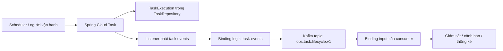
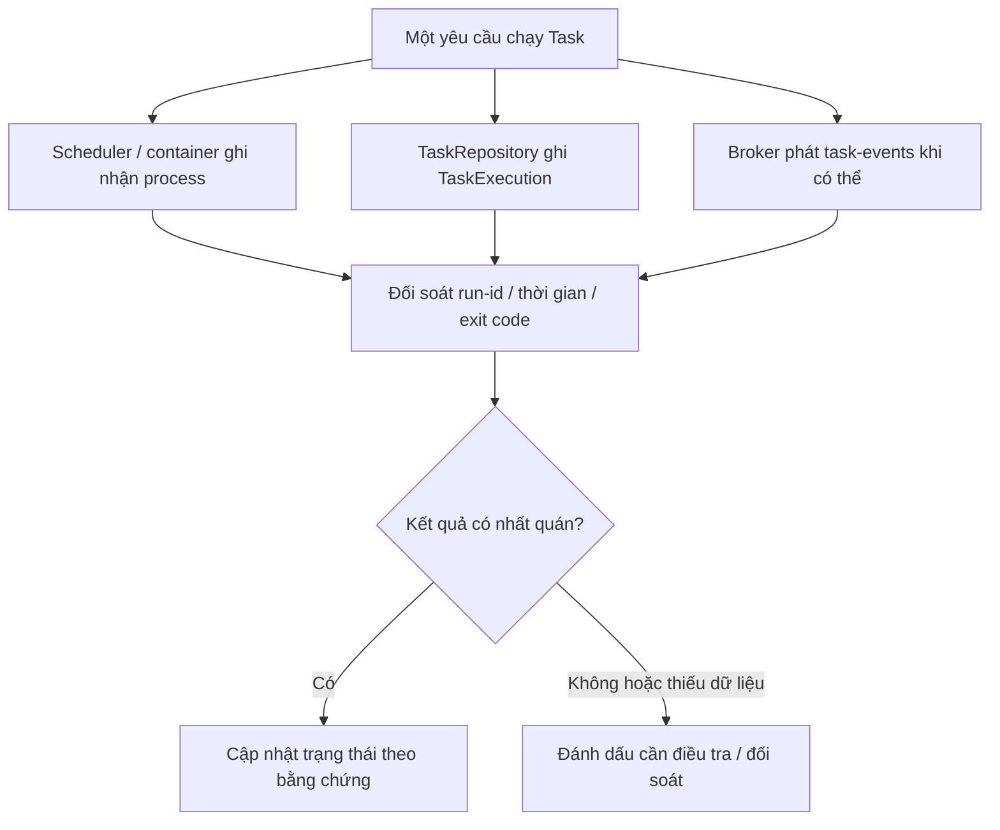

# Cấu hình đích nhận task-events

Trong chương **Sự kiện** của module **SPRING_CLOUD_TASK**, chúng ta tìm hiểu cách đưa thông tin vòng đời của một ứng dụng Spring Cloud Task ra hệ thống thông điệp. Thay vì chỉ xem lịch sử trong cơ sở dữ liệu thông qua `TaskRepository`, các hệ thống khác có thể theo dõi việc tác vụ **bắt đầu** và **kết thúc** bằng cách nhận sự kiện từ Spring Cloud Stream.

Spring Cloud Task hỗ trợ phát thông tin `TaskExecution` qua binding có tên **`task-events`**. Tên này thường đồng thời là destination mặc định trên broker, nhưng bạn có thể đổi destination để đưa sự kiện đến một Kafka topic hoặc RabbitMQ destination được quản trị tập trung. Cơ chế quan trọng nhất là:

```properties
spring.cloud.stream.bindings.task-events.destination=ops.task.lifecycle.v1
```

Trong ví dụ, **`task-events` là tên binding phía ứng dụng phát**, còn **`ops.task.lifecycle.v1` là đích thực tế** trên broker. Dịch vụ nhận sự kiện cần trỏ input binding của chính nó đến cùng destination. Nếu hai phía dùng hai tên khác nhau, application vẫn có thể chạy nhưng sự kiện sẽ không đến consumer mong muốn.

## 1. Mục tiêu học tập

Sau bài này, bạn có thể:

- Giải thích sự khác nhau giữa task event, `TaskExecution`, binding và destination.
- Bật phát sự kiện Spring Cloud Task khi có Spring Cloud Stream và binder tương thích.
- Giữ destination mặc định `task-events` hoặc đặt tên mới bằng `spring.cloud.stream.bindings.task-events.destination`.
- Cấu hình một consumer dùng Spring Cloud Stream nhận sự kiện từ đúng Kafka topic.
- Hiểu vai trò của `group` ở consumer, `contentType`, broker và các thuộc tính kết nối.
- Phân biệt task event với các sự kiện chi tiết của Spring Batch.
- Chẩn đoán các nguyên nhân không nhận sự kiện: thiếu binder, sai destination, sai broker, sai kiểu payload hoặc tiến trình bị dừng sớm.
- Thiết kế khả năng giám sát, tránh xử lý trùng và phương án đối soát an toàn với `TaskRepository`.

## 2. Task event là gì?

Một **task event** là thông điệp chứa dữ liệu `TaskExecution` được listener của Spring Cloud Task phát ra qua Spring Cloud Stream. Theo tài liệu, khi cấu hình tích hợp phù hợp, có thể phát sự kiện tại **hai mốc chính** của lần chạy:

1. **Bắt đầu:** framework đã tạo thông tin thực thi và gửi một sự kiện phản ánh lần chạy được ghi nhận bắt đầu.
2. **Kết thúc:** khi tác vụ hoàn tất hoặc kết thúc lỗi và listener còn hoạt động, framework gửi một sự kiện phản ánh kết quả cuối.

Ví dụ ứng dụng chạy lúc 01:00 và hoàn thành sau 5 giây. Một hệ thống giám sát có thể nhận hai thông điệp liên quan cùng `executionId`, nhưng dữ liệu tại thời điểm bắt đầu và kết thúc không giống nhau. Thông điệp bắt đầu thường chưa có `endTime`; thông điệp kết thúc có thể đã có `endTime`, `exitCode` và thông tin kết quả.

**Đây không phải sự kiện nghiệp vụ** như `OrderCreated` hoặc `InvoicePaid`. Task event cung cấp metadata về **lần thực thi ứng dụng hữu hạn**. Nó không thay thế file kết quả, bảng nghiệp vụ hay việc kiểm tra xem báo cáo thực tế đã đúng và đủ hay chưa.

### Các thành phần trong luồng

| Thành phần | Vai trò |
| --- | --- |
| Spring Cloud Task | Quản lý vòng đời, tạo/cập nhật `TaskExecution`, cung cấp listener phát sự kiện |
| Spring Cloud Stream | Trừu tượng hóa các input/output binding giữa ứng dụng và middleware |
| Binding `task-events` | Tên logic của output do tích hợp Spring Cloud Task sử dụng |
| Destination | Topic/exchange/đích trên broker, ví dụ `ops.task.lifecycle.v1` |
| Binder | Cầu nối cụ thể đến Kafka, RabbitMQ hoặc middleware tương thích |
| Consumer | Ứng dụng nhận event để ghi log, dựng dashboard, cảnh báo hoặc đưa vào workflow |
| `TaskRepository` | Nguồn metadata về thực thi, có thể lưu bền vững trong database JDBC |



Đường đi qua message broker giúp các ứng dụng khác nhận cập nhật gần thời gian thực, trong khi `TaskRepository` hỗ trợ tra cứu các lần thực thi đã lưu. Không giả định hai nguồn này luôn có dữ liệu hoàn toàn giống nhau vào mọi thời điểm.

## 3. Phân biệt binding name với destination

Trong Spring Cloud Stream, mỗi binding có một **tên dùng trong ứng dụng**. Thuộc tính `destination` quyết định binding đó nối đến đích nào trên middleware.

Ví dụ:

```yaml
spring:
  cloud:
    stream:
      bindings:
        task-events:
          destination: ops.task.lifecycle.v1
```

Diễn giải:

- `task-events` dưới `bindings` là **tên binding phía producer** mà Spring Cloud Task sử dụng.
- `ops.task.lifecycle.v1` là **đích broker** do bạn chọn. Với Kafka, đây là tên topic.
- Consumer có thể đặt tên binding tùy mô hình lập trình; **không cần** gọi binding của consumer là `task-events`. Nó chỉ cần trỏ đến cùng destination và dùng đúng broker.

Ví dụ một consumer hiện đại sử dụng function bean `receiveTaskEvent` sẽ có binding input mặc định là `receiveTaskEvent-in-0`:

```yaml
spring:
  cloud:
    function:
      definition: receiveTaskEvent
    stream:
      bindings:
        receiveTaskEvent-in-0:
          destination: ops.task.lifecycle.v1
          group: task-monitoring
```

Hai tên binding khác nhau nhưng cùng một destination.

| Khái niệm | Ví dụ | Nơi cấu hình |
| --- | --- | --- |
| Output binding của Task | `task-events` | Phía ứng dụng Spring Cloud Task |
| Kafka topic được chọn | `ops.task.lifecycle.v1` | Cả producer và consumer cùng trỏ đến |
| Input binding của consumer | `receiveTaskEvent-in-0` | Phía ứng dụng nhận |
| Consumer group | `task-monitoring` | Phía consumer; quản lý cách các instance chia sẻ thông điệp |

Không tự đổi khóa `task-events` thành `ops.task.lifecycle.v1` bên dưới `bindings` vì như vậy bạn đã tạo cấu hình cho **một binding tên khác** và binding thật có thể tiếp tục gửi vào destination mặc định.

## 4. Điều kiện để Spring Cloud Task phát sự kiện

Không phải cứ thêm `spring-cloud-starter-task` là đã có luồng sự kiện đến Kafka.

Theo tài liệu Spring Cloud Task, tích hợp events cần các thành phần Spring Cloud Stream trên classpath, một **binder thực tế**, và một ứng dụng task được cấu hình phù hợp. Các dependency Maven tiêu biểu phía producer là:

```xml
<dependencies>
    <dependency>
        <groupId>org.springframework.boot</groupId>
        <artifactId>spring-boot-starter</artifactId>
    </dependency>

    <dependency>
        <groupId>org.springframework.cloud</groupId>
        <artifactId>spring-cloud-starter-task</artifactId>
    </dependency>

    <dependency>
        <groupId>org.springframework.cloud</groupId>
        <artifactId>spring-cloud-task-stream</artifactId>
    </dependency>

    <dependency>
        <groupId>org.springframework.cloud</groupId>
        <artifactId>spring-cloud-stream-binder-kafka</artifactId>
    </dependency>

    <dependency>
        <groupId>org.springframework.boot</groupId>
        <artifactId>spring-boot-starter-jdbc</artifactId>
    </dependency>

    <dependency>
        <groupId>com.h2database</groupId>
        <artifactId>h2</artifactId>
        <scope>runtime</scope>
    </dependency>
</dependencies>
```

Ở các dòng phát hành khác nhau, phụ thuộc transitives và cách auto-configuration có thể khác. Hãy dùng **Spring Boot BOM/parent** và **Spring Cloud BOM** tương thích để quản lý phiên bản của Task/Stream/binder; đừng sao chép version từ hai release train bất kỳ rồi mong chúng tương thích.

`spring-cloud-task-stream` là module tích hợp Task–Stream được dự án Spring Cloud Task công bố. Phần JDBC/H2 trong ví dụ phục vụ ghi metadata và thử nghiệm, **không phải điều kiện để Kafka nhận thông điệp**. Ở production, dùng JDBC database bền vững và schema đúng phiên bản, thay cho H2 trong bộ nhớ.

### Kiểm soát bật/tắt event listener

Thuộc tính:

```yaml
spring:
  cloud:
    task:
      events:
        enabled: true
```

Spring Cloud Task hỗ trợ `spring.cloud.task.events.enabled`; đặt `false` để vô hiệu hóa việc phát Task events:

```properties
spring.cloud.task.events.enabled=false
```

**Đừng nhầm** công tắc này với `spring.cloud.task.autoconfiguration.enabled`. Tắt **Task event listener** có mục đích ngừng phát message; nó không tương đương với tắt toàn bộ hạ tầng ghi `TaskExecution`.

## 5. Ví dụ producer Spring Cloud Task

Giả sử muốn mỗi lần chạy ứng dụng `daily-summary-task` phát sự kiện đến Kafka topic `ops.task.lifecycle.v1`.

Tạo `src/main/java/com/example/task/TaskEventProducerApplication.java`:

```java
package com.example.task;

import java.time.LocalDate;
import java.util.List;

import org.springframework.boot.ApplicationRunner;
import org.springframework.boot.SpringApplication;
import org.springframework.boot.autoconfigure.SpringBootApplication;
import org.springframework.cloud.task.configuration.EnableTask;
import org.springframework.context.annotation.Bean;

@SpringBootApplication
@EnableTask
public class TaskEventProducerApplication {

    public static void main(String[] args) {
        SpringApplication.run(TaskEventProducerApplication.class, args);
    }

    @Bean
    ApplicationRunner dailySummary() {
        return arguments -> {
            List<String> values = arguments.getOptionValues("businessDate");
            if (values == null || values.size() != 1
                    || values.get(0).isBlank()) {
                throw new IllegalArgumentException(
                        "Cần truyền --businessDate=YYYY-MM-DD");
            }

            LocalDate date = LocalDate.parse(values.get(0));
            System.out.println("Đã hoàn thành tổng hợp ngày " + date);
        };
    }
}
```

Điểm cần chú ý:

- `ApplicationRunner` thực hiện một công việc hữu hạn.
- `@EnableTask` kích hoạt cấu hình lifecycle theo mẫu phổ biến; ứng dụng dùng các bản Spring Cloud Task có auto-configuration có thể không cần khai báo thủ công annotation này. Không thêm nhiều cấu hình lifecycle trùng nhau.
- Không cần gọi `StreamBridge.send(...)` trong runner để phát các sự kiện vòng đời **nếu listener Task–Stream đã được cấu hình thành công**.
- Khi task chạy, listener phát `TaskExecution` tại các mốc do framework hỗ trợ; code runner chỉ tập trung vào nghiệp vụ.
- Không đặt vòng lặp giữ ứng dụng chạy mãi để “đợi consumer”. Task có thời gian chạy hữu hạn; việc tiêu thụ message thuộc một ứng dụng hoặc hệ thống riêng.

### application.yml của producer

```yaml
spring:
  application:
    name: daily-summary-task
  main:
    web-application-type: none

  datasource:
    url: jdbc:h2:mem:taskdb
    driver-class-name: org.h2.Driver
    username: sa
    password: ""

  cloud:
    task:
      name: daily-summary-task
      initialize-enabled: true
      events:
        enabled: true

    stream:
      bindings:
        task-events:
          destination: ops.task.lifecycle.v1
          contentType: application/json

      kafka:
        binder:
          brokers: localhost:9092
```

Trong file YAML này:

1. `task-events.destination` đổi đích phát sự kiện từ tên mặc định sang topic `ops.task.lifecycle.v1`.
2. `contentType: application/json` làm rõ định dạng trao đổi dự kiến; consumer cần dùng converter tương thích với payload của phiên bản Task đang chạy.
3. `kafka.binder.brokers` trỏ đến một Kafka broker đang chạy trên máy phát triển; trong môi trường thật hãy thay bằng broker endpoint/cluster và cấu hình bảo mật tương ứng.
4. `spring.cloud.task.events.enabled` bật tính năng phát event khi đầy đủ điều kiện.
5. H2 `mem:` chỉ giúp ví dụ có JDBC, **không giữ lịch sử qua lần khởi chạy JVM tiếp theo**.

Với Kafka topic do đơn vị vận hành quản lý, hãy chủ động tạo topic trước, thiết lập số partition/replica, ACL và chính sách retention phù hợp. Tránh phụ thuộc vào việc binder tự tạo topic trong production.

### Chạy producer

Đóng gói JAR bằng Spring Boot Maven Plugin, với version dependencies tương thích:

```bash
./mvnw clean package
java -jar target/daily-summary-task-0.0.1-SNAPSHOT.jar \
  --businessDate=2026-11-24
```

Trên Windows PowerShell, dùng `mvnw.cmd clean package` và nhập lệnh `java -jar` trên một dòng hoặc dùng cách xuống dòng của PowerShell. Tên JAR phụ thuộc cấu hình `artifactId` và `version` thực tế.

Log nghiệp vụ có thể in:

```text
Đã hoàn thành tổng hợp ngày 2026-11-24
```

**Điều kiện xác nhận phát sự kiện** là có message ở đúng topic và consumer nhận được payload có thông tin lần chạy. Chỉ thấy dòng log nghiệp vụ **không chứng minh** event đã được gửi thành công.

## 6. Cấu hình ứng dụng nhận task-events

Ứng dụng nhận có thể là hệ thống giám sát chạy liên tục. Khác với producer Spring Cloud Task, consumer thường cần duy trì kết nối để nhận nhiều sự kiện từ nhiều lần khởi chạy task.

Ví dụ Java dùng **mô hình function** của Spring Cloud Stream:

```java
package com.example.monitoring;

import java.util.Map;
import java.util.function.Consumer;

import org.springframework.boot.SpringApplication;
import org.springframework.boot.autoconfigure.SpringBootApplication;
import org.springframework.context.annotation.Bean;

@SpringBootApplication
public class TaskEventConsumerApplication {

    public static void main(String[] args) {
        SpringApplication.run(TaskEventConsumerApplication.class, args);
    }

    @Bean
    Consumer<Map<String, Object>> receiveTaskEvent() {
        return event -> {
            Object id = event.get("executionId");
            Object name = event.get("taskName");
            Object exitCode = event.get("exitCode");
            Object endTime = event.get("endTime");

            System.out.printf(
                    "taskId=%s task=%s exit=%s ended=%s%n",
                    id, name, exitCode, endTime);
        };
    }
}
```

Ví dụ dùng `Map<String, Object>` để không yêu cầu phía consumer có class `TaskExecution` cùng version. Tên trường `executionId`, `taskName`... ở ví dụ thể hiện cách một `TaskExecution` **có thể được biểu diễn** thành JSON; cần đối chiếu với payload thực tế và serializer của phiên bản framework. Khi hệ thống nhận có contract rõ, bạn có thể chuyển sang DTO riêng với validate và version hóa.

**Dependency phía consumer** không cần `spring-cloud-task-stream` nếu chỉ đọc message JSON; cần Spring Cloud Stream và Kafka binder tương thích. Ví dụ Maven:

```xml
<dependencies>
    <dependency>
        <groupId>org.springframework.boot</groupId>
        <artifactId>spring-boot-starter</artifactId>
    </dependency>
    <dependency>
        <groupId>org.springframework.cloud</groupId>
        <artifactId>spring-cloud-stream-binder-kafka</artifactId>
    </dependency>
</dependencies>
```

### application.yml của consumer

```yaml
spring:
  application:
    name: task-event-monitor

  cloud:
    function:
      definition: receiveTaskEvent

    stream:
      bindings:
        receiveTaskEvent-in-0:
          destination: ops.task.lifecycle.v1
          group: task-monitoring
          contentType: application/json

      kafka:
        binder:
          brokers: localhost:9092
```

Cần để ý:

- `receiveTaskEvent-in-0` là **input binding** được tạo từ function bean `receiveTaskEvent` trong mô hình Spring Cloud Stream hiện đại.
- `destination: ops.task.lifecycle.v1` phải khớp **chính xác** destination của producer, bao gồm chữ hoa, chữ thường và các ký tự phân tách.
- `group: task-monitoring` là nhóm consumer. Trong Kafka, nhiều instance **cùng group** chia nhau các bản ghi của topic; nếu cần hai dịch vụ độc lập đều nhận sự kiện, mỗi dịch vụ thường dùng group riêng.
- Consumer cần kết nối được **cùng Kafka cluster** mà producer gửi, không chỉ cùng tên topic.
- Tùy cấu hình và converter, payload có thể không tự chuyển thành `Map`; khi đó cần kiểm tra header content type, serializer và lựa chọn DTO/byte array phù hợp.

### Consumer nhận ở thời điểm nào?

Giả sử monitor đã chạy và đăng ký consumer group trước khi task phát event. Khi đó monitor có thể thấy sự kiện khởi đầu, sau đó sự kiện kết thúc của cùng lần chạy. Nếu monitor chỉ khởi động **sau** khi task hoàn thành, khả năng đọc lại phụ thuộc **Kafka retention, offset/consumer group và chính sách đọc**; không thể suy luận chắc chắn chỉ từ việc topic đang tồn tại.

Với RabbitMQ binder, destination thường tương ứng exchange/binding theo mô hình Rabbit. Consumer group và cách cấp phát hàng đợi có ý nghĩa riêng; cần xem tài liệu binder Rabbit theo version.

## 7. Kiểm tra trực tiếp với Kafka

Để phân biệt lỗi producer với lỗi consumer, có thể kiểm tra topic trước bằng công cụ Kafka CLI (đường dẫn đến script phụ thuộc bản cài đặt).

Ví dụ với Kafka broker cục bộ:

```bash
kafka-topics.sh \
  --bootstrap-server localhost:9092 \
  --list
```

Tìm topic `ops.task.lifecycle.v1`. Nếu đang ở môi trường thử nghiệm và được phép tạo topic, có thể dùng công cụ quản trị tương ứng để cấu hình số partition và replication factor phù hợp. Không nên tự chạy lệnh tạo topic trên production nếu không thuộc quyền quản trị.

Để quan sát trực tiếp event từ topic:

```bash
kafka-console-consumer.sh \
  --bootstrap-server localhost:9092 \
  --topic ops.task.lifecycle.v1 \
  --from-beginning
```

Lệnh trên có thể đọc các message còn trong retention, sau đó tiếp tục chờ. Đây là công cụ kiểm tra độc lập, giúp biết **broker thực sự có message hay không** trước khi xử lý logic consumer Java.

Một message có thể có dạng JSON tương tự:

```json
{
  "executionId": 1042,
  "taskName": "daily-summary-task",
  "startTime": "2026-11-24T01:00:00",
  "endTime": "2026-11-24T01:00:04",
  "exitCode": 0
}
```

Đây chỉ là **payload minh họa cấu trúc logic**, không phải cam kết định dạng/field/type cụ thể của mọi phiên bản. Hãy kiểm tra message thật vì serializer, cách biểu diễn thời gian, enum, các trường bổ sung và header có thể khác.

Trong môi trường dùng Kafka bảo mật bằng TLS/SASL, các lệnh CLI cần client configuration phù hợp và quyền đọc topic. Không dùng ví dụ `localhost:9092` như cấu hình production mặc định.

## 8. Đổi tên đích nhận mà không sửa mã Java

Một lợi ích của Spring Cloud Stream là đích broker có thể được chọn từ cấu hình, không gắn cứng trong code runner hay listener.

Ví dụ chuyển sang topic `ops.task.lifecycle.prod.v1`:

**Producer:**

```properties
spring.cloud.stream.bindings.task-events.destination=ops.task.lifecycle.prod.v1
```

**Consumer:**

```properties
spring.cloud.stream.bindings.receiveTaskEvent-in-0.destination=ops.task.lifecycle.prod.v1
```

Tất cả ứng dụng liên quan cần được triển khai với cấu hình nhất quán. Nếu chỉ thay producer, consumer cũ vẫn nghe topic cũ và không nhận sự kiện mới.

Có thể truyền thuộc tính từ dòng lệnh khi chạy task:

```bash
java -jar daily-summary-task.jar \
  --spring.cloud.stream.bindings.task-events.destination=ops.task.lifecycle.prod.v1 \
  --businessDate=2026-11-24
```

**Không nhầm `task-events` trong khóa thuộc tính với tên topic mới.** Ngay cả sau khi đổi destination, binding logic của tích hợp Spring Cloud Task vẫn là `task-events` theo hợp đồng được tài liệu mô tả.

Nếu dùng **Spring Cloud Data Flow** để điều phối task, tài liệu Data Flow mô tả cách chuyển thuộc tính ứng dụng khi launch task. Cần chú ý tiền tố `app.<taskName>.` của tham số launch trong phiên bản Data Flow đang dùng; đó là quy tắc **truyền thuộc tính qua bộ điều phối**, không phải tên property bên trong ứng dụng Spring Cloud Task.

## 9. Đặt tên destination sao cho dễ vận hành

Một quy ước destination nhất quán giúp tránh trộn sự kiện từ dev, staging và production hoặc từ những phiên bản payload khác nhau.

Ví dụ:

| Môi trường | Destination | Mục đích |
| --- | --- | --- |
| Local | `dev.task.lifecycle.v1` | Kiểm tra trên broker phát triển |
| Staging | `staging.task.lifecycle.v1` | Kiểm thử tích hợp và cảnh báo |
| Production | `ops.task.lifecycle.v1` | Theo dõi vận hành chung |
| Luồng thử phiên bản mới | `ops.task.lifecycle.v2` | Chuyển đổi hợp đồng payload khi có thay đổi phá vỡ |

Đây là **quy ước đặt tên gợi ý**, không phải các tên bắt buộc của Spring Cloud Task.

Nên xác định thêm:

- **Chủ sở hữu topic:** ai được tạo, đổi retention, phân quyền producer/consumer.
- **Hợp đồng dữ liệu:** schema, version và các trường bắt buộc.
- **Retention:** thời gian message còn trên broker; có đáp ứng nhu cầu đọc lại sau sự cố hay không.
- **Khối lượng:** số lần chạy và số event phát mỗi ngày, kích thước payload, giới hạn broker.
- **Phân quyền:** producer chỉ được ghi topic, consumer chỉ được đọc các topic được phép.
- **Môi trường và tên task:** có trùng tên giữa các môi trường không, có cần namespace riêng không.

Không dùng event topic như kho lưu trữ lâu dài duy nhất cho lịch sử thực thi nếu yêu cầu nghiệp vụ đòi hỏi tra cứu bền vững. `TaskRepository` JDBC, logs và hệ thống giám sát có vai trò bổ sung.

## 10. Task events khác với Spring Batch events

Khi một Spring Cloud Task chạy **Spring Batch Job**, framework có thể phát thêm các sự kiện ở mức Job, Step và item tùy module, listener và cấu hình.

| Loại sự kiện | Destination mặc định trong tài liệu | Ý nghĩa |
| --- | --- | --- |
| Task lifecycle | `task-events` | Bắt đầu/kết thúc một lần chạy ứng dụng |
| JobExecution | `job-execution-events` | Sự kiện của một Spring Batch Job |
| StepExecution | `step-execution-events` | Sự kiện của một Step |
| Chunk | `chunk-events` | Sự kiện liên quan đến chunk |
| Item read/process/write | `item-read-events`, `item-process-events`, `item-write-events` | Các thao tác theo item |
| Skip | `skip-events` | Thông tin item bị skip theo listener |

Đừng gửi `task-events` và `job-execution-events` đến cùng destination chỉ để “gom cho tiện” nếu consumer chưa biết phân biệt payload. Điều này có thể làm sai schema, sai cảnh báo và tăng lượng thông điệp không cần thiết.

Đổi destination của Batch event có thể dùng cấu hình binding tương ứng và các thuộc tính dành riêng cho Batch events theo version. Thuộc tính `spring.cloud.task.batch.events.enabled=false` tắt hệ listener Batch event; nó **không tương đương** với `spring.cloud.task.events.enabled=false`.

Spring Batch có `JobRepository` lưu `JobExecution` và `StepExecution`; Spring Cloud Task có `TaskRepository` lưu `TaskExecution`. Broker event là một kênh thông báo khác. Cả ba nguồn có thể cần đối chiếu khi điều tra sự cố.

## 11. Các lỗi thường gặp khi cấu hình đích nhận

| Biểu hiện | Nguyên nhân có thể | Cách kiểm tra |
| --- | --- | --- |
| Task chạy nhưng Kafka topic trống | Chưa thêm module Task–Stream hoặc Kafka binder; listener bị tắt | Kiểm tra dependency, `spring.cloud.task.events.enabled`, condition log |
| Topic mặc định `task-events` có event nhưng topic mới không có | Thuộc tính destination gõ sai binding name hoặc cấu hình chưa được nạp | Kiểm tra `spring.cloud.stream.bindings.task-events.destination` thực tế |
| Producer có event nhưng consumer Java không in | Consumer trỏ sai destination/group/cluster hoặc xử lý JSON lỗi | Dùng Kafka CLI đọc topic, đối chiếu config consumer và log |
| Không kết nối được Kafka | Host/port, DNS, broker ACL, TLS/SASL hoặc network policy sai | Kiểm tra endpoint, client auth, log binder |
| Consumer nhận event rồi lỗi `ClassNotFoundException` | Deserializer/converter cố ép payload về class không có trên classpath | Dùng JSON/DTO phù hợp, xem headers và content type |
| Chỉ thấy event lúc bắt đầu | Task bị kill đột ngột, listener kết thúc không chạy hoặc producer không gửi được | Kiểm tra Job/Pod, exit code, log và TaskRepository |
| Có event kết thúc nhưng không có event bắt đầu | Consumer bắt đầu trễ, retention/offset hoặc mất message | Kiểm tra offset/group và log producer |
| Nhiều consumer instance chỉ một instance nhận mỗi message | Các instance cùng consumer group Kafka | Dùng group khác nhau khi muốn mỗi dịch vụ độc lập nhận đầy đủ |
| Cùng event được xử lý nhiều lần | Broker/client redelivery, retry, consumer restart | Thiết kế deduplication và xử lý idempotent |
| Event bị gửi sai môi trường | Cùng topic name nhưng broker cluster khác/hoặc profile sai | Kiểm tra broker endpoint, profile, env và ACL |

**Các quy tắc để tìm lỗi nhanh:** trước tiên xem producer có bật listener và kết nối đúng broker không; sau đó kiểm tra topic có event; cuối cùng mới kiểm tra converter và logic consumer. Không sửa code xử lý JSON trước khi xác minh message thực sự đã đến broker.

## 12. Sự kiện không thay thế TaskRepository và kiểm tra tiến trình

Spring Cloud Task được thiết kế để ghi nhận kết quả thực thi trong `TaskRepository` khi cấu hình nguồn dữ liệu phù hợp. Event chỉ giúp **đẩy** thông tin tới hệ thống khác.

Các tình huống cần lưu ý:

- **Lỗi tạo ApplicationContext quá sớm:** task có thể chưa tạo `TaskExecution`, chưa kết nối broker và chưa phát event.
- **JVM bị `SIGKILL` hoặc hết bộ nhớ:** event cuối có thể không được phát, dù một số phần nghiệp vụ đã chạy.
- **Database metadata bị lỗi:** bản ghi Task có thể thiếu hoặc chưa cập nhật; event cũng có thể bị ảnh hưởng tùy thời điểm.
- **Broker mất kết nối:** runner có thể thành công nhưng sự kiện chưa đến consumer; cần xác minh chính sách lỗi của producer và cơ chế gửi.
- **Consumer ngừng hoạt động:** Kafka có thể giữ message theo retention/offset đã cấu hình, nhưng không đồng nghĩa đã có dashboard cập nhật ngay.
- **Mã thoát thành công nhưng nghiệp vụ sai:** event kết thúc không đủ chứng minh dữ liệu báo cáo đã đúng.

Có thể dùng ba nguồn quan sát:



Tạo `run-id` ở bộ điều phối trước khi khởi chạy ứng dụng để liên kết log, container event, `TaskExecution` và dữ liệu nghiệp vụ. `TASK_EXECUTION_ID` có thể chỉ được cấp sau khi Spring Cloud Task khởi tạo nên không đủ để xác định mọi lần **cố gắng** khởi chạy.

## 13. Bảo mật và độ tin cậy khi phát event

Trong production, cần đánh giá cả dữ liệu và đường truyền.

### 13.1. Nội dung thông điệp

Một `TaskExecution` có thể chứa tên task, tham số, kết quả và thông tin lỗi. Tùy cấu hình/schema, dữ liệu này có thể bao gồm thông tin nhạy cảm nếu ứng dụng đưa secret vào tham số dòng lệnh hoặc error message.

- Tránh đặt token/mật khẩu/PII vào tham số lệnh hoặc `exitMessage`.
- Kiểm tra payload thực tế rồi mới cấp quyền consumer rộng.
- Áp dụng schema/version rõ ràng cho ứng dụng nhận không cùng codebase.
- Không log nguyên payload chưa được làm sạch ở production.

### 13.2. Kết nối và phân quyền Kafka

- Cấu hình TLS/SASL khi broker yêu cầu; không hard-code secret vào repository nguồn.
- Tách ACL producer chỉ ghi và consumer chỉ đọc theo các topic đã định.
- Thiết lập retention và partition phù hợp với lưu lượng.
- Theo dõi lỗi publish, timeout, consumer lag và các cảnh báo permission denied.

Ví dụ broker endpoint cho local là `localhost:9092`; không thể tự suy ra cấu hình bảo mật production từ ví dụ này.

### 13.3. Tránh xử lý trùng

Một task thường phát **hơn một sự kiện trong cùng lần chạy**, ít nhất là mốc bắt đầu và kết thúc khi tích hợp hoạt động đầy đủ. Nếu consumer chỉ deduplicate theo `executionId`, nó có thể vô tình bỏ mất event kết thúc sau khi đã lưu event bắt đầu.

Có thể chọn khóa xử lý tổng hợp như **(taskExecutionId, mốc vòng đời)**, trong đó mốc được phân loại từ payload thực tế, hoặc lưu trạng thái cập nhật có kiểm soát theo `executionId` và so sánh `startTime`/`endTime`. Phải kiểm tra logic khi event đến lại hoặc đến không đúng thứ tự; không nên giả định exactly-once hoặc thứ tự tuyệt đối cho toàn hệ thống.

### 13.4. Không bảo đảm event cuối nếu tiến trình chết

Cơ chế phát trực tiếp sự kiện vòng đời không mặc nhiên là một transactional outbox. Khi task bị dừng giữa cập nhật metadata hoặc trước khi broker xác nhận publish, event có thể thiếu. Nếu yêu cầu bắt buộc phát đầy đủ event nghiệp vụ, cần một cơ chế đáng tin cậy hơn, chẳng hạn outbox hoặc dịch vụ đối soát độc lập từ repository và trạng thái điều phối.

## 14. Kịch bản thực hành: đổi destination và kiểm chứng

Thực hiện trong môi trường phát triển có Kafka đang chạy và topic được quản lý phù hợp.

1. **Khởi chạy consumer** với `destination=ops.task.lifecycle.v1`, `group=task-monitoring`; kiểm tra nó kết nối Kafka thành công.
2. **Khởi chạy producer** với cùng destination và `--businessDate=2026-11-24`.
3. **Quan sát broker/consumer:** tìm event bắt đầu và event kết thúc của cùng lần thực thi nếu chương trình kết thúc bình thường.
4. **Đổi destination producer** thành `ops.task.lifecycle.test.v1`, giữ nguyên consumer đang nghe topic cũ. Ghi nhận việc consumer không còn nhận event mới như mong đợi.
5. **Đổi destination consumer** sang topic mới, hoặc khởi chạy một consumer riêng với group mới, rồi chạy lại task để kiểm tra.
6. **Tắt task events** bằng `--spring.cloud.task.events.enabled=false`. Xác minh chương trình nghiệp vụ vẫn chạy nhưng không phát event Task theo cơ chế listener.
7. **Đối chiếu metadata JDBC:** với database bền vững, xem `TASK_EXECUTION` để phân biệt việc task đã chạy và việc event có đến broker hay không.

Trong ví dụ H2 `mem:` của mục 5, không thể tra cứu lịch sử giữa các JVM đã thoát. Nếu muốn thực hiện bước 7, hãy chuyển sang PostgreSQL hoặc H2 file với schema phù hợp.

### Truy vấn SQL mẫu

```sql
SELECT TASK_EXECUTION_ID,
       TASK_NAME,
       START_TIME,
       END_TIME,
       EXIT_CODE
FROM TASK_EXECUTION
ORDER BY TASK_EXECUTION_ID DESC;
```

Cần kiểm tra cùng database/schema mà ứng dụng Task thực sự ghi metadata. Mỗi lần khởi chạy mới có thể tạo một `TaskExecution` mới, kể cả khi business key của công việc giống nhau.

## 15. Câu hỏi tự kiểm tra

**Câu hỏi 1.** Trong cấu hình `spring.cloud.stream.bindings.task-events.destination=ops.task.lifecycle.v1`, phần nào là binding name và phần nào là destination? Vì sao không nên thay luôn `task-events` trong khóa property?

**Câu hỏi 2.** Producer gửi đến Kafka topic `ops.task.lifecycle.v1`, consumer khai báo `receiveTaskEvent-in-0.destination=task-events`. Consumer có nhất thiết nhận được event không? Cần chỉnh gì?

**Câu hỏi 3.** Tại sao có `spring-cloud-starter-task` nhưng chưa có binder tương thích thì không thể mặc định ứng dụng phát event đến Kafka?

**Câu hỏi 4.** Consumer nhận được một event có `executionId=1042` nhưng chưa có `endTime`. Có nên đánh dấu tác vụ đã thành công không? Vì sao?

**Câu hỏi 5.** Nếu producer đang gửi event mà JVM bị kill, dữ liệu trong `TaskRepository`, broker và scheduler có thể khác nhau như thế nào?

**Câu hỏi 6.** Trong Spring Cloud Stream function model, tại sao consumer dùng binding `receiveTaskEvent-in-0` thay vì tên output `task-events`?

### Bài tập vận dụng

**Bài tập A — Đổi destination theo môi trường.** Cấu hình `application-dev.yml` dùng `dev.task.lifecycle.v1`, `application-prod.yml` dùng `ops.task.lifecycle.v1`. Xác minh cả producer và consumer đọc đúng profile.

**Bài tập B — Giám sát trạng thái.** Viết consumer ghi bảng `task_observation` có khóa theo execution ID và mốc vòng đời. Thiết kế xử lý event lặp lại, đến trễ và event kết thúc không có event bắt đầu.

**Bài tập C — Tách Batch events.** Nếu một task chạy Spring Batch Job, cấu hình topic riêng cho `task-events` và `job-execution-events`; giải thích vì sao payload và mục đích theo dõi của chúng khác nhau.

**Bài tập D — Sự cố broker.** Mô phỏng consumer ngừng chạy trong môi trường test, sau đó khởi động lại. Quan sát offset/group/retention và so sánh với lịch sử `TaskRepository`; không mặc định mọi message đều được phục hồi nếu retention đã hết.

## 16. Ghi nhớ

- Spring Cloud Task có thể phát **`TaskExecution` lúc bắt đầu và kết thúc** qua Spring Cloud Stream khi dependency, listener và binder phù hợp.
- **`task-events` là tên binding logic mặc định** của output; thay destination bằng **`spring.cloud.stream.bindings.task-events.destination`**.
- Producer và consumer phải trỏ đến **cùng broker và destination**. Tên input binding của consumer có thể khác `task-events`; với function `receiveTaskEvent`, binding thường là `receiveTaskEvent-in-0`.
- `spring.cloud.task.events.enabled=false` tắt listener phát task events, không đồng nghĩa tắt toàn bộ Spring Cloud Task hoặc xóa metadata đã lưu.
- Kafka consumer group, schema JSON, quyền broker và retention ảnh hưởng trực tiếp đến khả năng nhận và xử lý sự kiện.
- Task events là **kênh thông báo**, không thay thế `TaskRepository`, trạng thái tiến trình từ scheduler/container hoặc điều kiện thành công của nghiệp vụ.
- Luôn kiểm tra trường hợp thiếu event cuối, nhận lặp, nhận trễ và phát thất bại khi task là tiến trình ngắn hạn.

## Tài liệu tham khảo

- [Spring Cloud Task Reference — Spring Cloud Stream Integration](https://docs.spring.io/spring-cloud-task/reference/stream.html): phát `TaskExecution` qua `task-events`, bật/tắt listener và Batch events.
- [Spring Cloud Stream Reference — Binding Properties](https://docs.spring.io/spring-cloud-stream/reference/spring-cloud-stream/binding-properties.html): `destination`, `group`, `contentType` và cấu hình producer/consumer.
- [Spring Cloud Stream Reference — Binding Names](https://docs.spring.io/spring-cloud-stream/reference/spring-cloud-stream/binding-names.html): naming convention cho function binding `<functionName>-in-0`.
- [Spring Cloud Stream Reference — Kafka Binder Configuration](https://docs.spring.io/spring-cloud-stream/reference/kafka/kafka-binder/config-options.html): cấu hình brokers và thuộc tính Kafka binder.
- [Spring Cloud Data Flow — Subscribing to Task and Batch Events](https://docs.spring.io/spring-cloud-dataflow/docs/2.11.3/reference/htmlsingle/): ví dụ subscribing và thay destination qua thuộc tính launch của task.

Khi triển khai, hãy đối chiếu phiên bản Spring Boot, Spring Cloud Task, Spring Cloud Stream và binder đang dùng. Tên binding `task-events` và các thuộc tính nêu trên được dùng theo tài liệu tham khảo, còn chi tiết module/dependency, JSON conversion, phương thức shutdown và chính sách broker cần được kiểm chứng trên môi trường thực tế.
