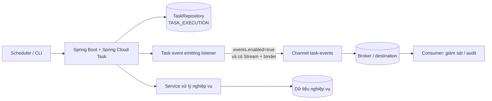
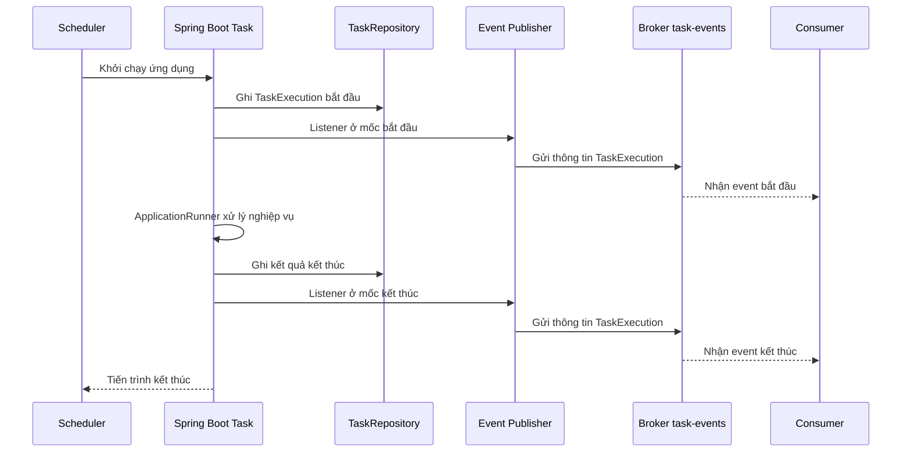

# Bật tắt sự kiện Task bằng `spring.cloud.task.events.enabled`

## 1. Bài toán: cần lịch sử thực thi hay cần thông báo theo thời gian gần thực?

Trong chương **Sự kiện** của **Spring Cloud Task**, ta xét một ứng dụng **Spring Boot chạy hữu hạn**: nhận tham số, thực hiện công việc, cập nhật `TaskExecution` trong cơ sở dữ liệu rồi kết thúc. `TaskRepository` giúp truy vấn lịch sử sau này, nhưng một hệ thống giám sát có thể còn muốn nhận **thông báo khi Task bắt đầu và khi Task kết thúc** mà không phải liên tục truy vấn database.

Khi tích hợp với **Spring Cloud Stream**, Spring Cloud Task có thể phát bản tin mang thông tin `TaskExecution` qua kênh `task-events`. Thuộc tính:

```properties
spring.cloud.task.events.enabled=true
```

điều khiển việc bật hoặc tắt **listener phát những sự kiện Task này**. Giá trị mặc định được tài liệu cấu hình Spring Cloud ghi nhận là `true` ở các phiên bản có hỗ trợ property. Tuy nhiên, **`true` không tự tạo broker hoặc luồng sự kiện**: ứng dụng vẫn cần dependency Spring Cloud Stream, một binder phù hợp và cấu hình kết nối hợp lệ.

Sau bài học, bạn sẽ có thể:

1. Phân biệt bản tin sự kiện Task với bản ghi `TaskRepository`, callback `TaskExecutionListener` và Spring Application Events.
2. Cấu hình `spring.cloud.task.events.enabled` qua YAML, dòng lệnh và biến môi trường.
3. Xác định điều kiện để `TaskExecution` thực sự được phát trên `task-events`.
4. Kiểm thử hai chế độ bật/tắt và kết luận đúng khi không thấy message.
5. Tách cấu hình sự kiện Task khỏi sự kiện Spring Batch, liên kết Task–Batch và trạng thái tiến trình.
6. Thiết kế consumer, retry, giám sát và bảo mật phù hợp với ứng dụng Task có thời gian chạy hữu hạn.

> **Ý chính:** Property này bật/tắt **phát sự kiện Task qua Spring Cloud Stream**. Nó **không** phải nút tắt toàn bộ Spring Cloud Task, không xóa bảng metadata, không ngăn `ApplicationRunner` chạy và không có nghĩa toàn bộ listener Java do bạn tự viết đều bị vô hiệu hóa.

## 2. Ba cơ chế thường bị nhầm với nhau

| Cơ chế | Nơi dữ liệu xuất hiện | Chức năng | Bị điều khiển trực tiếp bởi `spring.cloud.task.events.enabled`? |
| --- | --- | --- | --- |
| **TaskRepository** | Database metadata như `TASK_EXECUTION` | Tạo/cập nhật/tra cứu lịch sử mỗi lượt chạy | **Không** |
| **TaskExecutionListener** do ứng dụng tự viết | Callback trong tiến trình Java | Log, audit, thực thi xử lý phụ ở mốc Task | **Không**, ngoại trừ listener **phát Stream events** do framework cấu hình |
| **Task events qua Spring Cloud Stream** | Message channel/broker, thường `task-events` | Thông báo về `TaskExecution` tới ứng dụng khác | **Có** |
| **Spring Application Events** | Event multicaster trong ApplicationContext | Sự kiện vòng đời framework hoặc sự kiện Java tự publish | **Không** |
| **Batch events** | Các channel như `job-execution-events`, `step-execution-events` | Thông báo về Job/Step/chunk/item của Spring Batch | **Không dùng property này** |

Ví dụ: khi cấu hình `spring.cloud.task.events.enabled=false`, một task đối soát vẫn có thể tạo `TASK_EXECUTION_ID=3201`, ghi `START_TIME`, chạy service đối soát và cập nhật `END_TIME`/`EXIT_CODE`. Chỉ listener dùng để **phát các thông báo TaskExecution ra Stream** bị tắt theo property, trong điều kiện framework hỗ trợ.

### `TaskExecution` không phải một “lệnh điều khiển”

Sự kiện mà Spring Cloud Task phát ra là **thông tin về trạng thái thực thi**, không phải yêu cầu tự động chạy lại Task. Consumer nhận bản tin có thể hiển thị dashboard, đưa metric hoặc tạo cảnh báo, nhưng không nên mặc định “nhận sự kiện kết thúc với mã lỗi thì cứ launch lại” khi chưa kiểm tra tình trạng thực tế và tính idempotent của nghiệp vụ.



**Hai đường dữ liệu độc lập về mục đích:** `TaskRepository` là metadata được lưu lâu dài; sự kiện Stream là tín hiệu gửi tới hệ thống bên ngoài. Không được suy luận rằng broker không có message thì Task chưa chạy.

## 3. Ý nghĩa chính xác của `spring.cloud.task.events.enabled`

Tài liệu Spring Cloud Task mô tả một listener phát thông tin `TaskExecution` tới channel `task-events` **ở thời điểm bắt đầu và ở thời điểm kết thúc Task**. Thuộc tính `spring.cloud.task.events.enabled=false` vô hiệu hóa **event-emitting listener** đó.

| Giá trị | Hành vi mong đợi khi các dependency và binding hợp lệ | Điều không thay đổi |
| --- | --- | --- |
| `true` hoặc không khai báo (theo default đã tài liệu hóa) | Listener phát TaskExecution ra Stream ở mốc bắt đầu và kết thúc | Task vẫn chạy, ghi TaskRepository và trả kết quả theo logic |
| `false` | Không tự phát những **Task events** đó qua listener tích hợp | Task vẫn chạy; TaskRepository, runner và các listener khác vẫn hoạt động theo cấu hình riêng |
| `true` nhưng thiếu Stream/binder | Không bảo đảm có đường phát message, dù property bật | Metadata Task vẫn có thể ghi bình thường nếu datasource/schema đúng |
| `true` nhưng broker/binding lỗi | Có thể không thấy message, hoặc ứng dụng gặp lỗi theo cách cấu hình truyền message | Cần kiểm tra log, kết nối, retry và bản ghi Task; không suy luận chỉ từ property |

Ở đây “bật” nghĩa là **cho phép tính năng phát sự kiện**, không phải bảo đảm đã được publish/deliver thành công. Broker, serialization, binding và mạng vẫn có thể thất bại.

### Cách cấu hình trong `application.yml`

```yaml
spring:
  cloud:
    task:
      events:
        enabled: false
```

Hoặc ghi trực tiếp trong `application.properties`:

```properties
spring.cloud.task.events.enabled=false
```

### Ghi đè theo từng lần khởi chạy

Không cần tạo bản build mới khi chỉ muốn thay đổi chế độ sự kiện. Có thể truyền một Spring Boot command-line property:

```bash
java -jar task-events-demo.jar \
  --business-date=2026-11-24 \
  --spring.cloud.task.events.enabled=false
```

Khi muốn bật lại:

```bash
java -jar task-events-demo.jar \
  --business-date=2026-11-24 \
  --spring.cloud.task.events.enabled=true
```

Đối với môi trường container, có thể đặt biến môi trường:

```bash
export SPRING_CLOUD_TASK_EVENTS_ENABLED=false
java -jar task-events-demo.jar --business-date=2026-11-24
```

Spring Boot hỗ trợ cơ chế **relaxed binding** giúp biến môi trường ánh xạ sang property. Khi cùng một property được khai báo ở nhiều nguồn, độ ưu tiên của cấu hình Spring Boot sẽ quyết định giá trị hiệu lực; trong trường hợp điển hình, command-line option ghi đè `application.yml` và biến môi trường. Để tránh khó truy vết, bộ điều phối nên quy định **một nguồn cấu hình chính** cho từng môi trường.

## 4. Điều kiện cần để Task phát được sự kiện

Chỉ có `spring-cloud-starter-task` và đặt property `true` **chưa đủ** để quan sát message trên broker. Với cơ chế được tài liệu Spring Cloud Task mô tả, cần:

1. Một ứng dụng Spring Boot có **Spring Cloud Task** và logic Task được framework quản lý.
2. Thư viện **Spring Cloud Stream** trên classpath.
3. **Binder implementation** của một hệ thống message phù hợp, ví dụ RabbitMQ hoặc Kafka, tương thích với release train.
4. Kết nối đến broker/binding và destination được cấu hình đúng, để listener có thể phát vào channel `task-events`.
5. Một consumer/đầu giám sát thực sự đang nghe đúng destination nếu muốn nhìn thấy bản tin.

Ví dụ **phần dependency Maven** khi lựa chọn Rabbit binder, giả sử `pom.xml` đã quản lý Spring Boot/Spring Cloud BOM tương thích:

```xml
<dependencies>
    <dependency>
        <groupId>org.springframework.cloud</groupId>
        <artifactId>spring-cloud-starter-task</artifactId>
    </dependency>
    <dependency>
        <groupId>org.springframework.cloud</groupId>
        <artifactId>spring-cloud-stream</artifactId>
    </dependency>
    <dependency>
        <groupId>org.springframework.cloud</groupId>
        <artifactId>spring-cloud-stream-binder-rabbit</artifactId>
    </dependency>
    <dependency>
        <groupId>org.postgresql</groupId>
        <artifactId>postgresql</artifactId>
        <scope>runtime</scope>
    </dependency>
</dependencies>
```

Các đoạn dependency trên **không phải toàn bộ project runnable**: cần plugin build và quản lý version. Nếu chọn Kafka, dùng binder Kafka tương thích **thay vì thêm đồng thời nhiều binder** một cách tùy tiện. Không hard-code phiên bản không tương thích giữa Spring Boot, Spring Cloud Task và Spring Cloud Stream.

### Binding và destination

Tài liệu Spring Cloud Task gọi kênh do listener phát là **`task-events`**. Tên destination thực tế ở broker phụ thuộc cấu hình Spring Cloud Stream. Ví dụ biểu thị binding name trong kiểu cấu hình được tài liệu Spring Cloud Task sử dụng:

```properties
spring.cloud.stream.bindings.task-events.destination=task-events
```

Khi làm việc với Spring Cloud Stream phiên bản mới, cần kiểm tra tên **binding được framework tạo thực tế** và cấu hình binder theo bản thư viện; tên binding không phải lúc nào cũng giống destination sau các lớp ánh xạ hoặc tùy biến. Không tự suy đoán rằng chỉ thay property ở trên là Kafka topic/Rabbit exchange đã được provision và consumer đã nghe đúng.

**Không có broker là một bài thử riêng:** nếu muốn dùng Task nhưng không muốn kết nối broker ở môi trường phát triển, có thể bỏ dependency Stream/binder hoặc tắt phát Task events. Tuy nhiên, nếu trong cùng ứng dụng còn các chức năng Stream khác, chỉ tắt Task events **không tắt toàn bộ Spring Cloud Stream**.

## 5. Ứng dụng mẫu: một Task hữu hạn có thể bật/tắt events

Ví dụ dưới đây không phụ thuộc vào listener ứng dụng viết tay. Spring Cloud Task tự quản lý vòng đời; khi integration Stream đầy đủ và property bật, listener phát event của framework sẽ xử lý việc gửi.

```java
package com.example.taskevents;

import java.time.LocalDate;
import java.util.List;

import org.slf4j.Logger;
import org.slf4j.LoggerFactory;
import org.springframework.boot.ApplicationRunner;
import org.springframework.boot.SpringApplication;
import org.springframework.boot.autoconfigure.SpringBootApplication;
import org.springframework.cloud.task.configuration.EnableTask;
import org.springframework.context.annotation.Bean;

@SpringBootApplication
@EnableTask
public class TaskEventsDemoApplication {
    private static final Logger log =
            LoggerFactory.getLogger(TaskEventsDemoApplication.class);

    public static void main(String[] args) {
        SpringApplication.run(TaskEventsDemoApplication.class, args);
    }

    @Bean
    ApplicationRunner processBusinessDate() {
        return args -> {
            List<String> dates = args.getOptionValues("business-date");
            if (dates == null || dates.size() != 1) {
                throw new IllegalArgumentException(
                        "Cần --business-date=yyyy-MM-dd");
            }

            LocalDate date = LocalDate.parse(dates.get(0));
            log.info("Bắt đầu xử lý ngày {}", date);

            // Mô phỏng tác vụ đủ lâu để kiểm tra event khởi đầu.
            Thread.sleep(2_000);

            if (args.containsOption("fail")) {
                throw new IllegalStateException(
                        "Lỗi nghiệp vụ mô phỏng cho " + date);
            }

            log.info("Hoàn tất nghiệp vụ ngày {}", date);
        };
    }
}
```

Ứng dụng được thiết kế theo mô hình **chạy hữu hạn**: khởi động, chạy một `ApplicationRunner` rồi kết thúc nếu không có thành phần giữ JVM sống. Trong môi trường thật, hãy đặt xử lý trong service riêng, kiểm soát timeout và phân loại lỗi để scheduler quyết định retry an toàn.

Ví dụ `application.yml` lưu lịch sử Task trong PostgreSQL:

```yaml
spring:
  application:
    name: task-events-demo
  main:
    web-application-type: none
  datasource:
    url: jdbc:postgresql://localhost:5432/task_demo
    username: task_user
    password: ${TASK_DB_PASSWORD}
  cloud:
    task:
      name: task-events-demo
      events:
        enabled: true
```

Để chạy được, bạn phải tạo database, tài khoản, cài JDBC driver và triển khai **schema metadata của Spring Cloud Task đúng phiên bản**. Ví dụ giả định kết nối message broker đã được cấu hình riêng trong môi trường test. Không đưa mật khẩu database/broker vào source code hay event payload.

### Thử hai chế độ

Với cùng một JAR và datasource:

```bash
# Lượt A: cho phép phát task-events.
java -jar task-events-demo.jar \
  --business-date=2026-11-24 \
  --spring.cloud.task.events.enabled=true

# Lượt B: không phát task-events qua listener của framework.
java -jar task-events-demo.jar \
  --business-date=2026-11-24 \
  --spring.cloud.task.events.enabled=false
```

**Kết quả mong đợi** khi Stream và broker hoạt động: lượt A có thể tạo message tại mốc bắt đầu và kết thúc; lượt B không tạo các message Task qua listener phát events tích hợp. **Cả hai lượt vẫn phải ghi lịch sử TaskExecution** nếu các kết nối và schema repository bình thường.

## 6. Bên nhận sự kiện quan sát thông tin gì?

Một ứng dụng consumer hoặc dashboard có thể nhận message chứa thông tin **`TaskExecution`**. Vì serialization và headers phụ thuộc phiên bản/binder, đừng mã hóa cứng một schema JSON nếu chưa kiểm tra message thực tế.

Các thông tin hữu ích về một lần chạy thường bao gồm:

| Thông tin | Ý nghĩa vận hành |
| --- | --- |
| Task execution ID | Tương quan message với một bản ghi `TASK_EXECUTION` |
| Task name | Phân loại Task đang chạy trong hệ thống |
| Thời điểm bắt đầu | Biết mốc bắt đầu do framework ghi nhận |
| Thời điểm kết thúc | Phân biệt thông tin khởi đầu với kết quả kết thúc khi trường này đã có |
| Exit code / exit message | Tóm tắt kết quả Task nếu có |
| External execution ID | Nối metadata Task với scheduler, Pod/Job hoặc nền tảng triển khai nếu đã được gắn |

### Ví dụ consumer Spring Cloud Stream theo kiểu function

Ở một **ứng dụng nhận sự kiện riêng**, có thể triển khai function consumer để quan sát message. Ví dụ Java minh họa log loại payload thay vì giả định một định dạng JSON cố định:

```java
import java.util.function.Consumer;

import org.slf4j.Logger;
import org.slf4j.LoggerFactory;
import org.springframework.context.annotation.Bean;
import org.springframework.context.annotation.Configuration;
import org.springframework.messaging.Message;

@Configuration(proxyBeanMethods = false)
public class TaskEventConsumerConfiguration {
    private static final Logger log =
            LoggerFactory.getLogger(TaskEventConsumerConfiguration.class);

    @Bean
    Consumer<Message<?>> observeTaskEvent() {
        return message -> {
            Object payload = message.getPayload();
            log.info("Nhận thông báo Task, payloadType={}",
                    payload.getClass().getName());

            // Mapping payload thật theo content-type và hợp đồng
            // schema sự kiện đã xác minh trong môi trường tích hợp.
        };
    }
}
```

Cấu hình **ứng dụng nhận** theo convention function binding của Spring Cloud Stream:

```yaml
spring:
  cloud:
    function:
      definition: observeTaskEvent
    stream:
      bindings:
        observeTaskEvent-in-0:
          destination: task-events
```

Đoạn consumer minh họa **luồng nhận**, không cam kết payload ở mọi phiên bản đều được chuyển đổi sang một kiểu cố định. Khi phát triển thật, hãy quyết định contract: content type, version, kiểu ngày giờ, tên trường và cách xử lý schema evolution. Cần kiểm chứng bằng test với binder của phiên bản dự án. Consumer chưa được cấu hình bảo mật, retry hay dead-letter cũng chưa phải dịch vụ production.

### Vì sao không nên dựa duy nhất vào message?

Một Task có thể đã được ghi vào database nhưng message chưa được broker nhận, hoặc message đã vào broker nhưng consumer chưa xử lý. Sự kiện có thể bị **trễ, lặp hoặc mất** tùy broker, transaction và cơ chế retry. Tính năng phát Task events mặc định không phải lời hứa cung cấp **exactly-once delivery xuyên qua TaskRepository và broker**.

Consumer cần hỗ trợ xử lý lặp (idempotent) theo ID Task và loại mốc sự kiện; đồng thời có đường **reconciliation** từ `TaskRepository` để tìm những lượt chạy bị thiếu tín hiệu.

## 7. Thứ tự và ý nghĩa của hai mốc phát sự kiện

Tài liệu Spring Cloud Task mô tả việc phát `TaskExecution` **khi Task bắt đầu và khi Task kết thúc**. Trong trường hợp thành công điển hình:



Đây là **sơ đồ logic**, không phải bảo đảm thứ tự commit/callback cụ thể giữa repository và broker ở mọi phiên bản. Chẳng hạn consumer có thể nhận message trước lúc dữ liệu cuối được commit và hiển thị ở read replica. Vì vậy, khi xử lý cảnh báo có tác động lớn, hãy truy vấn lại repository và kiểm tra trạng thái tiến trình trước khi ra quyết định.

### Những điều không thể suy từ message

- Có **event bắt đầu** không chứng minh ứng dụng sẽ kết thúc bình thường.
- Không thấy **event kết thúc** không chứng minh Task vẫn đang chạy; tiến trình có thể chết hoặc broker bị lỗi.
- Có **event kết thúc** không chứng minh toàn bộ side effect nghiệp vụ đã hoàn tất, nhất là khi runner gọi công việc bất đồng bộ.
- Exit code Task trong message không nhất thiết bằng mã thoát tiến trình Java hoặc mã mà shell wrapper báo.
- Hai message của cùng một Task không có nghĩa hai lần chạy khác nhau: hãy đối chiếu `TASK_EXECUTION_ID`.

Khi thiết kế dashboard, phân biệt **trạng thái nhận thông báo** với **trạng thái thực của Task**. Ghi nhận `lastEventReceivedAt` có thể hữu ích nhưng không thay thế `START_TIME`/`END_TIME` và kiểm tra runtime.

## 8. Tắt sự kiện Task có ảnh hưởng tới TaskRepository không?

**Không, theo ý nghĩa của property.** `spring.cloud.task.events.enabled=false` tắt listener **phát Task events** ra Spring Cloud Stream, không tắt việc quản lý metadata `TaskExecution`.

Bạn có thể xác nhận bằng truy vấn sau sau khi chạy lượt A và B:

```sql
SELECT TASK_EXECUTION_ID,
       TASK_NAME,
       START_TIME,
       END_TIME,
       EXIT_CODE,
       EXIT_MESSAGE
FROM TASK_EXECUTION
WHERE TASK_NAME = 'task-events-demo'
ORDER BY TASK_EXECUTION_ID DESC;
```

Khi mọi thứ hoạt động đúng, cả hai lần chạy được ghi nhận bằng **hai `TASK_EXECUTION_ID` khác nhau**, bất kể việc phát Stream events được bật hay tắt. Điều kiện là repository vẫn được cấu hình và có thể truy cập.

Tương tự:

- Task vẫn đọc argument, chạy `ApplicationRunner` / `CommandLineRunner`.
- Task vẫn có thể ném exception và được framework ghi nhận lỗi.
- `TaskExecutionListener` do bạn tự viết vẫn có thể chạy khi được khai báo hợp lệ.
- Spring Batch Job/Step vẫn được thực thi theo cấu hình của chính Batch.
- Scheduler vẫn có thể dựa vào **mã thoát tiến trình** để xác định kết quả và retry.

Nếu muốn tắt **toàn bộ cơ chế Spring Cloud Task auto-configuration**, đó là một quyết định và property **khác** (`spring.cloud.task.autoconfiguration.enabled` khi phiên bản hỗ trợ), có tác động sâu hơn và không nên nhầm với tắt message events.

## 9. Sự kiện Task khác sự kiện Spring Batch như thế nào?

Trong ứng dụng chạy Spring Batch bên trong Spring Cloud Task, các sự kiện Batch có thể được phát ra trên **các channel riêng**:

| Nhóm | Channel thường gặp | Ý nghĩa |
| --- | --- | --- |
| **Task event** | `task-events` | Mốc bắt đầu/kết thúc TaskExecution |
| **Batch job event** | `job-execution-events` | Mốc vòng đời JobExecution |
| **Batch step event** | `step-execution-events` | Thông tin vòng đời StepExecution |
| **Batch chunk/item events** | `chunk-events`, `item-read-events`, `item-process-events`, `item-write-events`, `skip-events` | Các sự kiện chi tiết theo listener Batch tương ứng |

Spring Cloud Task có **nhóm property riêng** cho việc bật/tắt Batch events. Ví dụ, khi version hỗ trợ:

```yaml
spring:
  cloud:
    task:
      events:
        enabled: false
      batch:
        events:
          enabled: true
```

Cấu hình này diễn tả **tắt Task events nhưng vẫn cho phép Batch events**, với điều kiện có các dependency, listener và Stream bindings tương ứng. Batch event channels không tự sinh message chỉ vì đặt property `true`; chúng còn cần Batch Job, listener và binder hoạt động.

Để tắt đồng thời cả Task event publisher lẫn các Batch event listeners tích hợp:

```properties
spring.cloud.task.events.enabled=false
spring.cloud.task.batch.events.enabled=false
```

**Một property khác không liên quan trực tiếp đến message:** `spring.cloud.task.batch.listener.enabled` điều khiển cơ chế listener liên kết TaskExecution với Batch JobExecution trong các version phù hợp. Không dùng nó thay cho `spring.cloud.task.batch.events.enabled`, cũng không giả định tắt Task events sẽ xóa `TASK_TASK_BATCH`.

### Bảng phân biệt nhanh các nút cấu hình

| Property | Phạm vi |
| --- | --- |
| `spring.cloud.task.events.enabled` | Listener phát sự kiện `TaskExecution` qua Spring Cloud Stream |
| `spring.cloud.task.batch.events.enabled` | Các listener phát sự kiện Spring Batch qua Stream |
| `spring.cloud.task.batch.listener.enabled` | Cơ chế liên kết Task và Batch executions (khi tích hợp phù hợp) |
| `spring.cloud.task.autoconfiguration.enabled` | Cơ chế auto-configuration Spring Cloud Task tổng thể theo phiên bản hỗ trợ |

## 10. Khi nào nên tắt sự kiện Task?

Quyết định bật/tắt nên xuất phát từ **vai trò triển khai**, không chỉ để làm log bớt nhiều:

| Tình huống | Gợi ý | Điều phải bảo đảm |
| --- | --- | --- |
| Chạy thử bài tập cục bộ, không dùng broker | Có thể để `false` | Vẫn kiểm tra TaskRepository và lỗi nghiệp vụ |
| Task production có hệ thống giám sát nhận events | Có thể dùng `true` | Binder, bảo mật, event schema, retry và kiểm tra thông điệp |
| Task đang chịu sự cố broker gây lỗi/tăng độ trễ khởi động | Tạm tắt event publisher nếu chính sách cho phép | Không mất cảnh báo quan trọng; dùng repository/polling và theo dõi runtime |
| Task không cần gửi message ra ngoài theo yêu cầu bảo mật | Có thể đặt `false` | Dữ liệu kết quả vẫn phải được lưu/audit theo chính sách |
| Ứng dụng có Stream function khác ngoài Task events | Không dùng property này để tắt toàn Stream | Những function khác vẫn cần broker và cấu hình |
| Ứng dụng Batch cần sự kiện Job/Step nhưng không cần Task event | Tắt riêng Task events | Kiểm tra `batch.events` và listeners độc lập |

Khi tắt events trong một môi trường đang có consumer phụ thuộc vào `task-events`, hãy cập nhật hợp đồng vận hành với consumer: họ có thể dùng message để tạo alert, dashboard hoặc mở workflow tiếp theo. **Tắt nguồn message mà không có cơ chế thay thế có thể khiến hệ thống ngoài không nhận ra Task mới đã chạy.**

Đối với ứng dụng chạy theo lịch/được gọi theo yêu cầu, scheduler vẫn phải đọc mã thoát tiến trình và ghi nhận request/attempt. Sự kiện Task chỉ là **một kênh quan sát bổ sung**, không phải cách duy nhất để biết ứng dụng đã được khởi chạy.

## 11. Kiểm thử hai chế độ có thể tái lập

Một kịch bản kiểm thử tích hợp nên dùng **cùng một artifact**, **cùng datasource**, broker và consumer; chỉ thay property cần kiểm tra.

| Bài thử | Cấu hình | Quan sát ở broker | Quan sát ở TaskRepository |
| --- | --- | --- | --- |
| A — Thành công, events bật | `enabled=true`, input hợp lệ | Nhận thông tin bắt đầu và kết thúc khi binder hoạt động | Có TaskExecution với kết quả thành công |
| B — Thành công, events tắt | `enabled=false`, cùng input | Không có Task events do listener framework phát | **Vẫn** có TaskExecution thành công |
| C — Lỗi nghiệp vụ, events bật | `enabled=true --fail` | Có thể quan sát message bắt đầu và sự kiện kết thúc/lỗi khi lifecycle còn thực thi được | Có thể ghi kết quả thất bại; xem log để biết trường hợp lỗi trước metadata |
| D — Lỗi nghiệp vụ, events tắt | `enabled=false --fail` | Không có Task events do listener framework phát | Vẫn có cơ chế ghi metadata lỗi nếu TaskRepository hoạt động |
| E — Property bật nhưng không có binder hợp lệ | `enabled=true`, binder thiếu/lỗi | Không thể mặc định chờ nhận message | Phải kiểm tra khởi động Task và repo; có thể lỗi tùy cấu hình |

### Trình tự kiểm thử đề xuất

1. Chạy broker cục bộ/test broker và một consumer nghe đúng destination. Dùng credential thử nghiệm và nguồn dữ liệu không nhạy cảm.
2. Tạo/migrate schema Task Repository đúng version. Kiểm tra database có thể đọc lại `TASK_EXECUTION` sau khi ứng dụng kết thúc.
3. Chạy lượt A, ghi `TASK_EXECUTION_ID`, thời gian, mã thoát và các message consumer nhận được.
4. Chạy lượt B chỉ thay `enabled=false`, xác nhận vẫn có **TaskExecution mới** nhưng không có message Task tương ứng trong khoảng giám sát hợp lý.
5. Chạy C/D để xem kết quả khi exception xảy ra; kiểm tra mã thoát JVM/scheduler cùng metadata, không chỉ message.
6. Nếu ứng dụng có Spring Batch, tách riêng bài thử cho property `spring.cloud.task.batch.events.enabled`.
7. Dùng dashboard hoặc SQL đối chiếu số lượt chạy thật với thông báo đã nhận; ghi nhận các thông báo trễ/thiếu/lặp.

**Lưu ý khi đếm sự kiện:** không chỉ đếm tổng message trước/sau nếu broker còn message cũ hoặc nhiều task cùng ghi topic/exchange. Cần lọc theo `TASK_EXECUTION_ID`/tên task, ngữ cảnh thời gian và correlation ID phù hợp. Với hai message bắt đầu/kết thúc, chỉ đếm theo ID mà không phân biệt mốc sẽ dẫn đến nhận định sai về số lần chạy.

## 12. Bảo mật, khả năng chịu lỗi và thông tin nhạy cảm

### Phân quyền với broker

Task publisher thường chỉ cần quyền **ghi** vào destination phù hợp, trong khi consumer cần quyền **đọc**. Hãy quản lý credential qua secret, giới hạn quyền, bật TLS phù hợp với broker và không sử dụng tài khoản quản trị chung nếu không cần.

### Hạn chế dữ liệu nhạy cảm trong event

`TaskExecution` có thể chứa tên Task, tham số hoặc thông tin lỗi tùy version và cấu hình. Không truyền password, token hay dữ liệu khách hàng qua command-line arguments rồi mặc nhiên cho rằng message/log không làm lộ chúng. Nếu tích hợp với nhiều người dùng/tenant, cần phân tách quyền truy cập event và giảm thiểu thông tin định danh không cần thiết.

### Xử lý trùng, trễ, mất message

Một consumer có thể nhận trùng khi broker retry hoặc tự khởi động lại. Đừng thiết kế logic “nhận event hoàn tất thì gửi thanh toán” mà không có idempotency key. Một lựa chọn là dùng khóa kỹ thuật dạng `taskExecutionId + eventPhase` và kiểm soát xử lý ở database của consumer. Tuy nhiên, **eventPhase có thể không phải trường độc lập trong payload của mọi phiên bản**: hãy xác định nó từ hợp đồng message đã kiểm chứng, tránh dựa duy nhất vào thứ tự nhận.

Nếu sự kiện là đầu vào của một workflow **bắt buộc không được mất**, cần kiến trúc bảo đảm rõ ràng hơn, chẳng hạn lưu **outbox** cùng giao dịch nghiệp vụ phù hợp, cơ chế đối soát theo TaskRepository, DLQ và chính sách replay. Việc `events.enabled=true` **không tự cung cấp** bảo đảm nguyên tử giữa database và message broker.

### Lỗi lúc shutdown

Task chạy hữu hạn có thể hoàn thành nhanh và đóng context/JVM. Producer/binder cần đủ thời gian để publish và broker xác nhận theo cấu hình thực tế. Đừng tự gọi `System.exit(0)` ngay giữa runner hoặc kill tiến trình trước pha cập nhật metadata/đẩy message. Với container bị `SIGKILL`, callback shutdown có thể không chạy; lúc đó event kết thúc và `END_TIME` đều có thể thiếu.

### Giám sát theo nhiều nguồn

Một hệ thống vận hành thực tế nên kết hợp:

- **TaskRepository:** danh sách TaskExecution, `START_TIME`, `END_TIME`, `EXIT_CODE`.
- **Broker/consumer:** thông điệp Task nào đã được quan sát, thời gian nhận, độ trễ và lỗi deserialize.
- **Scheduler/container runtime:** trạng thái tiến trình, mã thoát, restart, timeout/OOM.
- **Kết quả nghiệp vụ:** dữ liệu đã xử lý đầy đủ chưa, có tác dụng phụ trùng không.

Không nguồn nào trong số này tự thay thế hoàn toàn những nguồn còn lại.

## 13. Sự cố thường gặp

| Triệu chứng | Nguyên nhân có thể | Cách chẩn đoán |
| --- | --- | --- |
| `enabled=true` nhưng không có message | Thiếu Spring Cloud Stream/binder hoặc binding sai | Kiểm tra dependency và cấu hình broker/destination theo version |
| Có message bắt đầu nhưng không có kết thúc | Task crash/kill, lỗi publisher hoặc message trễ | Đối chiếu TaskRepository, log và runtime |
| `enabled=false` nhưng vẫn thấy message | Message cũ trong broker, ứng dụng khác gửi hoặc publisher do code tự viết | Lọc theo ID/nguồn; property chỉ tắt listener phát Task events tích hợp |
| `enabled=false` mà không còn Batch event | Cấu hình Batch events cũng bị tắt hoặc binder dùng chung có sự cố | Kiểm tra `spring.cloud.task.batch.events.enabled` và Stream config |
| Không thấy bản ghi `TASK_EXECUTION` | Sai datasource/schema hoặc Task thất bại trước pha ghi repository | Đọc log DB/startup; không đổ lỗi ngay cho events flag |
| Task metadata ghi thành công, consumer nhận bản tin trễ | Broker hoặc consumer lag, network/backpressure | Theo dõi queue depth, consumer throughput, retry và clock |
| Consumer xử lý một Task hai lần | Message duplicate hoặc kết luận sai giữa start/end | Dùng ID+phase và idempotent consumer |
| Tắt sự kiện theo YAML nhưng thực tế vẫn bật | CLI/environment/profile ghi đè cấu hình | Kiểm tra effective property theo thứ tự ưu tiên của Boot |
| Có `EXIT_CODE=0` nhưng kết quả nghiệp vụ thiếu | Runner nuốt exception hoặc async xử lý chưa hoàn tất | Đối chiếu domain audit, Task result và process exit status |

Nếu cần thu thập log debug cho Spring Cloud Task/Stream/binder, tăng mức log **trong phạm vi thử nghiệm** và che thông tin nhạy cảm. Đừng in toàn bộ headers, message payload hoặc credential ra hệ thống log chia sẻ.

## 14. Tổng kết và câu hỏi tự kiểm tra

**Tóm tắt quyết định cấu hình:**

| Nhu cầu | Phương án |
| --- | --- |
| Chỉ cần biết lịch sử Task qua SQL, không cần message | Dùng TaskRepository; có thể đặt `spring.cloud.task.events.enabled=false` |
| Cần thông báo bắt đầu/kết thúc tới hệ thống giám sát | Bật Task events, cấu hình Stream binder và consumer |
| Cần theo dõi chi tiết Job/Step của Spring Batch | Cấu hình Batch events riêng; không nhầm với `task-events` |
| Cần bảo đảm workflow không mất sự kiện | Thiết kế delivery guarantee, deduplication và đối soát; không dựa duy nhất vào flag |
| Cần tắt toàn bộ metadata Spring Cloud Task | Không dùng `events.enabled`; phải xem cơ chế Task auto-configuration riêng |

**Câu hỏi tự kiểm tra:**

1. Khi đặt `spring.cloud.task.events.enabled=false`, `TaskRepository` có còn tạo `TaskExecution` không? Vì sao?
2. Vì sao `enabled=true` chưa đủ để có message trên RabbitMQ hoặc Kafka?
3. Spring Cloud Task mô tả việc phát `TaskExecution` tại những mốc nào và channel mặc định tên gì?
4. Sự khác nhau giữa một `TaskExecutionListener` do bạn tự viết và listener **phát Stream events** là gì?
5. Một consumer chỉ nhận event bắt đầu; có thể kết luận Task còn chạy không? Cần kiểm tra thêm gì?
6. Vì sao hai message cùng `TASK_EXECUTION_ID` không nhất thiết là hai lần khởi chạy?
7. Nếu muốn tắt Batch Job/Step events nhưng giữ Task events, phải xét property nào?
8. Property `spring.cloud.task.batch.listener.enabled` có đồng nghĩa với `spring.cloud.task.events.enabled` không?
9. Nếu code gọi hệ thống ngoài rồi gặp lỗi publish event, làm thế nào tránh retry gây trùng side effect?
10. Khi cấu hình `enabled=false` ở YAML nhưng message vẫn phát, cần kiểm tra các nguồn cấu hình nào?

## 15. Tài liệu tham khảo

- [Spring Cloud Task — Spring Cloud Stream Integration: Spring Cloud Task Events](https://docs.spring.io/spring-cloud-task/reference/stream.html).
- [Spring Cloud Task — Features: TaskExecution, TaskRepository và listeners](https://docs.spring.io/spring-cloud-task/reference/features.html).
- [Spring Cloud Task — Cấu hình ứng dụng và properties](https://docs.spring.io/spring-cloud-task/reference/appendix.html) (đối chiếu bản tài liệu tương ứng với dependency).
- [Spring Cloud Stream — Reference](https://docs.spring.io/spring-cloud-stream/reference/).
- [Spring Boot — Externalized Configuration](https://docs.spring.io/spring-boot/reference/features/external-config.html).

**Ghi nhớ:** `spring.cloud.task.events.enabled` là **công tắc cho listener phát sự kiện TaskExecution qua Spring Cloud Stream**, mặc định được mô tả là bật ở các bản hỗ trợ. Khi đặt `false`, việc phát `task-events` của listener tích hợp bị tắt, **nhưng vòng đời Task, ghi `TaskRepository` và xử lý nghiệp vụ không bị tắt theo**. Khi bật, vẫn cần Stream binder, broker, consumer và cơ chế kiểm soát độ tin cậy; hãy kết hợp sự kiện với metadata, mã thoát tiến trình và kết quả nghiệp vụ để vận hành an toàn.
