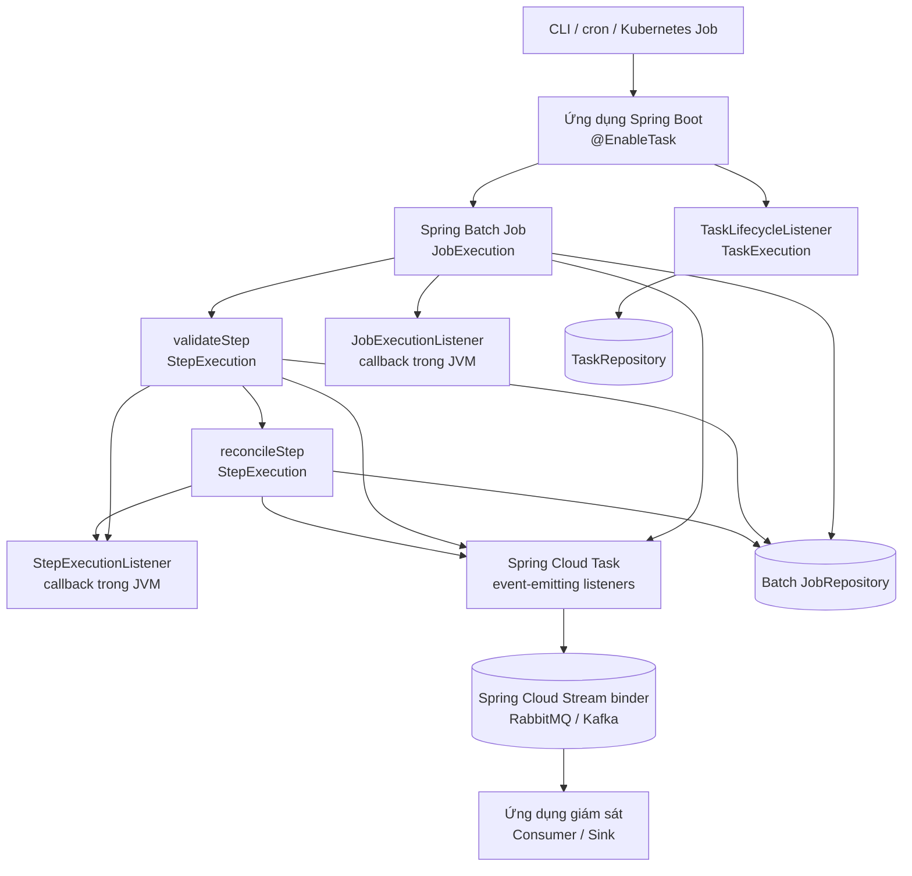

# Sự kiện Job và Step của Spring Batch

## Mục tiêu bài học

Trong chương **Sự kiện** của mô-đun **Spring Cloud Task**, bài này giải thích cách theo dõi **vòng đời Spring Batch Job và Step** bên trong một ứng dụng Spring Boot chạy hữu hạn. Một Task có thể chỉ chạy vài phút rồi thoát, nhưng người vận hành vẫn cần biết Job nào bắt đầu, Step nào thất bại, số bản ghi đã xử lý và sự kiện nào đã được gửi đến hệ thống giám sát.

Sau bài học, bạn có thể:

- Phân biệt sự kiện ở ba cấp: `TaskExecution` của Spring Cloud Task, `JobExecution` và `StepExecution` của Spring Batch.
- Viết và đăng ký `JobExecutionListener`, `StepExecutionListener` với các callback `beforeJob`, `afterJob`, `beforeStep` và `afterStep`.
- Sử dụng annotation `@BeforeJob`, `@AfterJob`, `@BeforeStep`, `@AfterStep` và biết khi nào cần thêm listener chunk/item/skip.
- Hiểu cơ chế **Spring Cloud Task phát Spring Batch events qua Spring Cloud Stream** tới `job-execution-events`, `step-execution-events` và các kênh chi tiết khác.
- Cấu hình binder, destination, bật/tắt từng nhóm sự kiện và thứ tự listener theo đúng nhánh phiên bản.
- Kiểm tra event cho Job thành công/thất bại; đối chiếu ID và trạng thái với `TaskRepository`, `JobRepository`, exit code của tiến trình.
- Thiết kế hệ thống event quan sát an toàn: không lộ tham số nhạy cảm, không xem event là cam kết exactly-once, không để hoạt động gửi thông báo làm hỏng Job chính.

## 1. Bài toán: một Task có nhiều cấp độ kết quả

Giả sử một tác vụ đối soát thanh toán chạy theo lịch lúc 02:00. Nó được đóng gói thành executable JAR, dùng Spring Cloud Task để theo dõi tiến trình và Spring Batch để chạy hai Step:

1. `validateStep` kiểm tra tham số ngày, tập tệp và metadata nguồn.
2. `reconcileStep` đọc giao dịch, đối soát dữ liệu rồi ghi báo cáo.

Khi cả hai Step chạy xong, tiến trình thoát. Người vận hành muốn nhận thông báo ngay khi **Job bắt đầu**, **mỗi Step kết thúc**, **Job thất bại**, đồng thời vẫn truy vấn được lịch sử khi tiến trình đã dừng.

Ba loại đối tượng khác nhau xuất hiện:

| Đối tượng | Đơn vị theo dõi | Thông tin điển hình |
| --- | --- | --- |
| `TaskExecution` | Một lần chạy **tiến trình Spring Boot Task** | Task ID, thời gian khởi động/kết thúc, mã thoát, lỗi của tiến trình |
| `JobExecution` | Một lần thử của **Spring Batch JobInstance** | Job execution ID, trạng thái `BatchStatus`, `ExitStatus`, tham số, thời gian |
| `StepExecution` | Một lần thực hiện **Step** trong JobExecution | Step execution ID, `readCount`, `writeCount`, commit/rollback, `ExitStatus` |

**Một `TaskExecution` có thể liên kết nhiều `JobExecution`; một `JobExecution` có thể có nhiều `StepExecution`.** Nếu Job thất bại rồi chạy lại trong JVM mới, Spring Cloud Task tạo TaskExecution mới, Batch tạo JobExecution mới nhưng có thể dùng lại **JobInstance** cũ khi các *identifying JobParameters* không đổi.

Sự kiện giúp biết trạng thái sớm và phản ứng kịp thời, nhưng **metadata trong repository** là nơi cần đối chiếu để xác nhận lịch sử thực thi và khôi phục Job.

## 2. Hai cơ chế cần phân biệt: callback tại chỗ và event qua broker

Spring Batch có listener gọi phương thức **bên trong chính JVM** đang xử lý dữ liệu. Spring Cloud Task còn hỗ trợ **tự cấu hình các listener phát thông điệp qua Spring Cloud Stream**, để ứng dụng khác tiếp nhận sự kiện của Job và Step.



| Khía cạnh | Spring Batch listener trong JVM | Spring Cloud Task + Stream event |
| --- | --- | --- |
| Cách hoạt động | Framework gọi trực tiếp callback của bean đã đăng ký | Listener phát thông điệp lên binding/broker |
| Phụ thuộc broker | **Không** | **Có**, phải có binder và broker phù hợp |
| Nơi xử lý | Cùng tiến trình chạy Job | Có thể ở ứng dụng khác, độc lập vòng đời Task |
| Khi nào dùng | Log, kiểm tra trạng thái, quyết định flow/exit status | Dashboard, cảnh báo, hệ thống quan sát, xử lý bất đồng bộ |
| Rủi ro cần quản lý | Callback lỗi hoặc chậm ảnh hưởng Job | Gửi/nhận trùng, trễ, mất kết nối, serialization |

**Listener không đồng nghĩa với `ApplicationEvent` của Spring Framework.** Các callback của Spring Batch là cơ chế riêng; kênh Spring Cloud Stream mang thông điệp qua binder khi cấu hình tương ứng, không tự xuất hiện chỉ vì có annotation `@EnableTask`.

## 3. `JobExecutionListener`: sự kiện bắt đầu và kết thúc Job

Interface ở **Spring Batch 5.2.x**:

```java
public interface JobExecutionListener {
    void beforeJob(JobExecution jobExecution);
    void afterJob(JobExecution jobExecution);
}
```

Đây là **chữ ký minh họa**, không phải tệp Java độc lập. Hai phương thức có default implementation ở những nhánh hiện đại. `beforeJob` chạy khi JobExecution đã được tạo, trước Step đầu tiên. `afterJob` được gọi **cả khi Job thành công và khi Job thất bại** trong luồng xử lý bình thường.

| Callback | Thời điểm | Công việc phù hợp |
| --- | --- | --- |
| `beforeJob(JobExecution)` | Trước khi thực thi Step đầu tiên | Ghi Job ID, tên, identifying parameters đã được lọc thông tin nhạy cảm |
| `afterJob(JobExecution)` | Sau khi Job xử lý xong, kể cả `FAILED` | Ghi `BatchStatus`, `ExitStatus`, thời gian và báo cáo tổng kết |

Ví dụ bean listener nội bộ:

```java
package com.example.taskevents;

import org.slf4j.Logger;
import org.slf4j.LoggerFactory;
import org.springframework.batch.core.BatchStatus;
import org.springframework.batch.core.JobExecution;
import org.springframework.batch.core.JobExecutionListener;
import org.springframework.stereotype.Component;

@Component
public class AuditJobListener implements JobExecutionListener {

    private static final Logger log =
            LoggerFactory.getLogger(AuditJobListener.class);

    @Override
    public void beforeJob(JobExecution execution) {
        log.info("JOB_START id={}, instanceId={}",
                execution.getId(),
                execution.getJobInstance().getInstanceId());
    }

    @Override
    public void afterJob(JobExecution execution) {
        BatchStatus status = execution.getStatus();
        String exitCode = execution.getExitStatus().getExitCode();
        log.info("JOB_END id={}, status={}, exitStatus={}",
                execution.getId(), status, exitCode);

        if (status == BatchStatus.FAILED) {
            log.warn("Job {} that bai; xem metadata va logs",
                    execution.getId());
        }
    }
}
```

**Không dùng sự xuất hiện của `afterJob` để kết luận thành công.** Callback này cũng nhận `FAILED`, `STOPPED` và các trạng thái kết thúc khác. Kiểm tra cả `BatchStatus` lẫn `ExitStatus`; mã `ExitStatus` là **chuỗi**, không phải mã thoát số nguyên của JVM.

### 3.1. Cách đăng ký

Đăng ký bean bằng `JobBuilder.listener(...)` trên **đúng Job**:

```java
@Bean
Job reconciliationJob(
        JobRepository jobRepository,
        Step validateStep,
        Step reconcileStep,
        AuditJobListener jobListener) {

    return new JobBuilder("reconciliationJob", jobRepository)
            .start(validateStep)
            .next(reconcileStep)
            .listener(jobListener)
            .build();
}
```

Đây là phương thức `@Bean` thuộc một lớp `@Configuration`, cần import `org.springframework.batch.core.Job`, `Step`, `org.springframework.batch.core.job.builder.JobBuilder` và `org.springframework.batch.core.repository.JobRepository`.

**Chỉ tạo `@Component` chưa chắc đã đăng ký listener với mọi Job.** Hãy đăng ký rõ trên Job bằng builder (hoặc cấu hình tương đương). Nếu có nhiều Job, chọn Job nào cần listener thay vì giả định các bean listener tự áp dụng toàn cục.

### 3.2. Annotation thay thế interface

Spring Batch cũng hỗ trợ các phương thức của một bean có annotation:

```java
@BeforeJob
public void beforeJob(JobExecution execution) {
    // Quan sat truoc khi Step dau tien chay.
}

@AfterJob
public void afterJob(JobExecution execution) {
    // Quan sat status, ke ca FAILED.
}
```

Hai annotation nằm trong `org.springframework.batch.core.annotation`. Đặt các phương thức vào một Spring bean rồi **đăng ký object đó bằng builder `listener(...)`**; không cần và không nên triển khai interface lẫn annotation cho cùng callback nếu sẽ tạo hành vi trùng.

## 4. `StepExecutionListener`: sự kiện trước/sau mỗi Step

Với **Spring Batch 5.2.x**:

```java
public interface StepExecutionListener extends StepListener {
    void beforeStep(StepExecution stepExecution);
    ExitStatus afterStep(StepExecution stepExecution);
}
```

| Callback | Thời điểm | Dữ liệu/công việc phù hợp |
| --- | --- | --- |
| `beforeStep(StepExecution)` | Trước khi logic Step bắt đầu | Ghi ID, tên Step, khởi tạo thông tin theo lượt Step |
| `afterStep(StepExecution)` | Sau logic Step, cả khi lỗi trong luồng xử lý bình thường | Ghi read/write/commit/rollback và trạng thái; có thể kết hợp `ExitStatus` |

**Điểm khác Job listener:** `afterStep` trả `ExitStatus` hoặc `null`. Spring Batch kết hợp kết quả trả về với trạng thái hiện có bằng `ExitStatus.and(...)`; trả `null` có nghĩa không sửa mã kết thúc hiện có.

Ví dụ listener quan sát **không thay trạng thái**:

```java
package com.example.taskevents;

import org.slf4j.Logger;
import org.slf4j.LoggerFactory;
import org.springframework.batch.core.ExitStatus;
import org.springframework.batch.core.StepExecution;
import org.springframework.batch.core.StepExecutionListener;
import org.springframework.stereotype.Component;

@Component
public class AuditStepListener implements StepExecutionListener {

    private static final Logger log =
            LoggerFactory.getLogger(AuditStepListener.class);

    @Override
    public void beforeStep(StepExecution execution) {
        log.info("STEP_START id={}, jobExecutionId={}, name={}",
                execution.getId(),
                execution.getJobExecutionId(),
                execution.getStepName());
    }

    @Override
    public ExitStatus afterStep(StepExecution execution) {
        log.info(
                "STEP_END id={}, status={}, read={}, write={}, "
                    + "commit={}, rollback={}",
                execution.getId(),
                execution.getStatus(),
                execution.getReadCount(),
                execution.getWriteCount(),
                execution.getCommitCount(),
                execution.getRollbackCount());
        return null; // Giữ nguyên ExitStatus do Step tạo ra.
    }
}
```

Đăng ký **trên từng Step** cần quan sát:

```java
@Bean
Step validateStep(
        JobRepository repository,
        PlatformTransactionManager transactionManager,
        AuditStepListener stepListener) {

    return new StepBuilder("validateStep", repository)
            .tasklet((contribution, context) -> {
                Object value = context.getStepContext()
                        .getJobParameters().get("businessDate");
                if (value == null) {
                    throw new IllegalArgumentException(
                            "Thieu businessDate");
                }
                LocalDate.parse(value.toString());
                return RepeatStatus.FINISHED;
            }, transactionManager)
            .listener(stepListener)
            .build();
}
```

Cần import `Step`, `StepBuilder`, `JobRepository`, `PlatformTransactionManager`, `LocalDate`, `RepeatStatus` trong lớp cấu hình. Nếu Step khác cũng cần listener, đăng ký thêm với chính Step đó. Một bean listener có thể dùng cho nhiều Step **nếu không giữ state mutable chung giữa các lượt/threads**.

### 4.1. Annotation và việc thay đổi trạng thái Step

Annotation tương ứng là `@BeforeStep` và `@AfterStep`, nằm trong `org.springframework.batch.core.annotation`. Nếu `@AfterStep` trả một `ExitStatus` khác `null`, trạng thái được **kết hợp** với exit status trước đó; nó có thể ảnh hưởng điều kiện chuyển bước của một flow.

Ví dụ nghiệp vụ: khi `readCount=0` thì Job cần xử lý nhánh “NO_DATA”. Có thể trả `new ExitStatus("NO_DATA")` ở một listener chuyên kiểm tra kết quả, rồi **định nghĩa transition rõ ràng** trong Job. Nhưng nếu mục tiêu chỉ ghi metrics/logs, **trả `null`**, tránh vô tình thay đổi đường chạy.

**Cảnh báo với lỗi trong `afterStep`:** tài liệu Batch 5.2 nêu exception bị ném tại callback này thường chỉ được log, không phải cách đáng tin cậy để đánh dấu Step thất bại. Nếu cần kiểm tra nghiệp vụ bắt buộc, hãy làm trong `Tasklet`, `ItemProcessor`/`ItemWriter` hoặc một Step riêng và phát lỗi có kiểm soát.

### 4.2. Thứ tự callback cấp Job và Step

Với một Job hai Step chạy tuần tự và thành công:

```text
beforeJob(J1)
  beforeStep(S1: validateStep)
  afterStep(S1)
  beforeStep(S2: reconcileStep)
  afterStep(S2)
afterJob(J1)
```

Nếu `validateStep` lỗi, `reconcileStep` có thể **không được khởi chạy**, nên sẽ không có `beforeStep`/`afterStep` của Step thứ hai. Nếu Job được restart sau lỗi, **JobExecution ID mới** tạo một chuỗi callback mới; các Step đã hoàn thành có thể được bỏ qua tùy cấu hình restart.

Đây là **thứ tự logic thông thường**, không phải cam kết các thông điệp trên hai broker destination khác nhau sẽ được tiêu thụ theo đúng thứ tự toàn cục.

## 5. Các sự kiện chi tiết bên trong Step

Khi Step xử lý dữ liệu theo chunk, chỉ biết “Step kết thúc” có thể chưa đủ để điều tra lỗi dữ liệu. Spring Batch còn các listener:

| Listener | Callback tiêu biểu | Dùng khi |
| --- | --- | --- |
| `ChunkListener` | `beforeChunk`, `afterChunk`, `afterChunkError` | Muốn biết giao dịch/chunk bắt đầu, commit hay lỗi |
| `ItemReadListener` | `beforeRead`, `afterRead`, `onReadError` | Theo dõi đọc dữ liệu nguồn |
| `ItemProcessListener` | `beforeProcess`, `afterProcess`, `onProcessError` | Theo dõi chuyển đổi/validate dữ liệu |
| `ItemWriteListener` | `beforeWrite`, `afterWrite`, `onWriteError` | Theo dõi ghi dữ liệu đích |
| `SkipListener` | `onSkipInRead`, `onSkipInProcess`, `onSkipInWrite` | Ghi nhận bản ghi bị bỏ qua theo chính sách skip |

**`onReadError` không đồng nghĩa item chắc chắn bị skip.** Một lỗi đọc có thể được retry và thành công; nếu cần thống kê dữ liệu cuối cùng bị loại, `SkipListener` phù hợp hơn.

Trong mô hình chunk, `afterWrite` được gọi **trước khi transaction commit**. Do đó không nên lấy sự kiện `afterWrite` làm bằng chứng tuyệt đối dữ liệu đã bền vững trong DB. `afterChunk` diễn ra sau chunk thành công, nhưng hệ thống gửi broker và DB cũng không mặc định nằm trong cùng một transaction.

### 5.1. Số lượng event và chi phí vận hành

Một Job đọc 1 triệu bản ghi có thể phát **rất nhiều** sự kiện `item-read`/`item-process`/`item-write`. Nếu broker hoặc dashboard chỉ cần biết Job nào thành công/thất bại, chỉ phát **Job/Step events** để giảm tải và hạn chế lộ payload.

Với việc theo dõi chi tiết, nên dùng metrics tổng hợp (read/write/skip counts), traces có sampling và log có correlation ID. Không đưa mọi thông tin giao dịch hoặc dữ liệu cá nhân vào các event vận hành.

## 6. Spring Cloud Task tự phát các sự kiện Batch qua Spring Cloud Stream

Đây là tính năng kết nối **Spring Cloud Task** với **Spring Cloud Stream**: khi một Spring Batch Job chạy trong Task, framework có thể gắn các *event-emitting listeners* vào Job/Step, sau đó gửi thông điệp qua **binding** của Spring Cloud Stream tới broker.

Theo tài liệu Spring Cloud Task 3.3 và 5.x, những kênh mặc định bao gồm:

| Listener được cấu hình | Kênh/binding mặc định |
| --- | --- |
| `JobExecutionListener` | `job-execution-events` |
| `StepExecutionListener` | `step-execution-events` |
| `ChunkListener` | `chunk-events` |
| `ItemReadListener` | `item-read-events` |
| `ItemProcessListener` | `item-process-events` |
| `ItemWriteListener` | `item-write-events` |
| `SkipListener` | `skip-events` |

Spring Cloud Task thực hiện điều này khi **đủ điều kiện auto-configuration**, không phải chỉ cần thêm tên channel vào YAML.

Các điều kiện cần kiểm tra:

1. Có Spring Cloud Task được bật để tạo `TaskLifecycleListener`, thường thông qua `@EnableTask`.
2. Có ít nhất một Spring Batch `Job` trong context và dependency tích hợp Batch, đặc biệt `spring-cloud-task-batch` nếu chưa được starter khác kéo vào.
3. Có `spring-cloud-stream` và **binder** (chẳng hạn Rabbit hoặc Kafka) tương thích với release train, được cấu hình kết nối tới broker.
4. `spring.cloud.task.batch.events.enabled` không bị đặt thành `false`.
5. Các event listener và binding tương ứng thực sự được tạo trong context, có destination được broker chấp nhận.

Javadoc của `BatchEventAutoConfiguration` mô tả các điều kiện `@ConditionalOnClass(Job)`, `@ConditionalOnBean(Job, TaskLifecycleListener)` và property `spring.cloud.task.batch.events.enabled` mặc định bật. Tuy vậy, **bật property không tự tạo broker**, và không bảo đảm event thành công nếu binder không kết nối được.

### 6.1. Dependencies cho phát event

Ví dụ Maven (giả sử đã dùng Spring Boot parent và Spring Cloud BOM tương thích):

```xml
<dependencies>
    <dependency>
        <groupId>org.springframework.boot</groupId>
        <artifactId>spring-boot-starter-batch</artifactId>
    </dependency>
    <dependency>
        <groupId>org.springframework.cloud</groupId>
        <artifactId>spring-cloud-starter-task</artifactId>
    </dependency>
    <dependency>
        <groupId>org.springframework.cloud</groupId>
        <artifactId>spring-cloud-task-batch</artifactId>
    </dependency>
    <dependency>
        <groupId>org.springframework.cloud</groupId>
        <artifactId>spring-cloud-stream-binder-rabbit</artifactId>
    </dependency>
    <dependency>
        <groupId>com.h2database</groupId>
        <artifactId>h2</artifactId>
        <scope>runtime</scope>
    </dependency>
</dependencies>
```

Đây là **đoạn dependencies**, không phải `pom.xml` hoàn chỉnh. Binder Rabbit dùng để minh họa; bạn có thể chọn Kafka binder hoặc binder khác phù hợp. Không tự ghép những version Spring Boot, Spring Batch, Spring Cloud Task và Stream không cùng release train.

### 6.2. Publisher: cấu hình phát Job/Step events

```yaml
spring:
  application:
    name: reconciliation-task
  main:
    web-application-type: none
  datasource:
    url: jdbc:h2:file:./data/batch-events
    driver-class-name: org.h2.Driver
    username: sa
    password: ""
  rabbitmq:
    host: localhost
    port: 5672
  batch:
    job:
      enabled: true
    jdbc:
      initialize-schema: always
  cloud:
    task:
      initialize-enabled: true
      closecontext-enabled: true
      batch:
        fail-on-job-failure: true
        events:
          enabled: true
          job-execution:
            enabled: true
          step-execution:
            enabled: true
          chunk:
            enabled: false
          item-read:
            enabled: false
          item-process:
            enabled: false
          item-write:
            enabled: false
          skip:
            enabled: false
    stream:
      bindings:
        job-execution-events:
          destination: ops-batch-job-events
        step-execution-events:
          destination: ops-batch-step-events
```

Kết quả mong muốn: các listener phát Job event ra destination `ops-batch-job-events` và Step event ra `ops-batch-step-events`. Những property dưới `spring.cloud.task.batch.events` điều khiển **listener được bật**; những property dưới `spring.cloud.stream.bindings` điều khiển **nơi thông điệp được gửi**. Hai việc này khác nhau.

Ví dụ khai báo `initialize-schema: always` và `initialize-enabled: true` để thử tạo schema trong lần chạy đầu trên H2. **Khi file H2 đã có các bảng metadata, không tiếp tục ép tạo lại bảng**: chuyển sang `spring.batch.jdbc.initialize-schema=never` và `spring.cloud.task.initialize-enabled=false` hoặc dùng migration có kiểm soát. Khi vận hành thật, dùng DB bền vững, migrations cho các bảng `BATCH_` và `TASK_`, phân quyền và backup. Cần có RabbitMQ chạy được tại địa chỉ cấu hình; YAML không tự khởi chạy broker.

**Về tên binding khi đổi kênh:** tài liệu Spring Cloud Task minh họa `spring.cloud.task.batch.events.step-execution-events-binding-name`, trong khi danh sách cấu hình được sinh từ một số phiên bản ghi `step-execution-event-binding-name` (số ít ở `event`). Khi cần thay **tên binding**, phải kiểm tra configuration metadata/Javadoc hoặc log của **đúng phiên bản JAR**. Ví dụ trên chỉ đổi **destination** của binding mặc định để tránh phụ thuộc khác biệt tên property.

### 6.3. Phân biệt Task events với Batch events

| Nhóm | Kênh mặc định | Property điều khiển |
| --- | --- | --- |
| **Task events** | `task-events` | `spring.cloud.task.events.enabled` |
| **Job/Step và các Batch events** | `job-execution-events`, `step-execution-events`... | `spring.cloud.task.batch.events.enabled` và các cờ riêng |

Tắt `spring.cloud.task.events.enabled=false` **không đồng nghĩa** tắt tất cả Job/Step events. Muốn tắt phát sự kiện Batch, dùng đúng property nhóm Batch.

### 6.4. Điều chỉnh loại sự kiện và thứ tự listener

Chỉ phát Job events, không phát Step events:

```yaml
spring:
  cloud:
    task:
      batch:
        events:
          enabled: true
          job-execution:
            enabled: true
          step-execution:
            enabled: false
```

Tắt toàn bộ Batch event-emitting listeners:

```yaml
spring:
  cloud:
    task:
      batch:
        events:
          enabled: false
```

Thay thứ tự listener phát thông điệp (nếu có yêu cầu rõ về thứ tự callback nội bộ):

```yaml
spring:
  cloud:
    task:
      batch:
        events:
          job-execution-order: 5
          step-execution-order: 5
```

Theo tài liệu, event listener mặc định thường có `Ordered.LOWEST_PRECEDENCE`; các property `job-execution-order` và `step-execution-order` cho phép thay đổi ưu tiên **listener trong JVM**. Giá trị nhỏ hơn được ưu tiên hơn theo `Ordered`. Nó **không bảo đảm** thông điệp ở hai destination khác nhau tới consumer theo thứ tự toàn cục, cũng không thay thế transaction giữa database và broker.

## 7. Ví dụ ứng dụng Job hai Step để tạo sự kiện

Tạo dự án minh họa với `@EnableTask` và **một** bean `Job` để Spring Boot tự khởi chạy khi context sẵn sàng. Ví dụ áp dụng cho **Spring Boot 3.x, Spring Batch 5.x, Spring Cloud Task 3.x** khi đã chọn release train tương thích. Nếu dùng Boot 4/Batch 6, hãy kiểm tra lại API/package theo phiên bản.

Lớp khởi động `src/main/java/com/example/taskevents/BatchEventsApplication.java`:

```java
package com.example.taskevents;

import org.springframework.boot.SpringApplication;
import org.springframework.boot.autoconfigure.SpringBootApplication;
import org.springframework.cloud.task.configuration.EnableTask;

@SpringBootApplication
@EnableTask
public class BatchEventsApplication {
    public static void main(String[] args) {
        SpringApplication.run(BatchEventsApplication.class, args);
    }
}
```

Lớp `src/main/java/com/example/taskevents/BatchEventsConfiguration.java`:

```java
package com.example.taskevents;

import java.time.LocalDate;

import org.springframework.batch.core.Job;
import org.springframework.batch.core.Step;
import org.springframework.batch.core.job.builder.JobBuilder;
import org.springframework.batch.core.repository.JobRepository;
import org.springframework.batch.core.step.builder.StepBuilder;
import org.springframework.batch.repeat.RepeatStatus;
import org.springframework.beans.factory.annotation.Qualifier;
import org.springframework.context.annotation.Bean;
import org.springframework.context.annotation.Configuration;
import org.springframework.core.env.Environment;
import org.springframework.transaction.PlatformTransactionManager;

@Configuration(proxyBeanMethods = false)
public class BatchEventsConfiguration {

    @Bean
    Job reconciliationJob(
            JobRepository jobRepository,
            @Qualifier("validateStep") Step validateStep,
            @Qualifier("reconcileStep") Step reconcileStep,
            AuditJobListener jobListener) {
        return new JobBuilder("reconciliationJob", jobRepository)
                .start(validateStep)
                .next(reconcileStep)
                .listener(jobListener)
                .build();
    }

    @Bean
    Step validateStep(
            JobRepository jobRepository,
            PlatformTransactionManager transactionManager,
            AuditStepListener stepListener) {
        return new StepBuilder("validateStep", jobRepository)
                .tasklet((contribution, context) -> {
                    Object dateValue = context.getStepContext()
                            .getJobParameters().get("businessDate");
                    if (dateValue == null) {
                        throw new IllegalArgumentException(
                                "Missing businessDate");
                    }
                    LocalDate.parse(dateValue.toString());
                    return RepeatStatus.FINISHED;
                }, transactionManager)
                .listener(stepListener)
                .build();
    }

    @Bean
    Step reconcileStep(
            JobRepository jobRepository,
            PlatformTransactionManager transactionManager,
            AuditStepListener stepListener,
            Environment environment) {
        return new StepBuilder("reconcileStep", jobRepository)
                .tasklet((contribution, context) -> {
                    if (environment.getProperty(
                            "demo.fail", Boolean.class, false)) {
                        throw new IllegalStateException(
                                "Simulated reconciliation failure");
                    }
                    // Thuc te: goi service doi soat co transaction/idempotency.
                    return RepeatStatus.FINISHED;
                }, transactionManager)
                .listener(stepListener)
                .build();
    }
}
```

Đây là **ví dụ Tasklet Step**, nên `readCount` và `writeCount` có thể vẫn là `0`. Muốn xem chỉ số đọc/ghi bản ghi, dùng chunk-oriented Step với `ItemReader`/`ItemWriter`. Hai lớp `AuditJobListener` và `AuditStepListener` lấy từ mục 3–4, cùng package để được component scan. `@Qualifier` chọn rõ từng Step khi trong context có nhiều bean kiểu `Step`.

**Không viết thêm runner tự gọi `JobLauncher`** trong ví dụ dùng Spring Boot Batch auto-launcher; nếu vừa để auto-launch vừa tự chạy Job, có nguy cơ chạy lại một Job ngoài dự định.

### 7.1. Chạy thành công

Build và chạy bằng Maven wrapper:

```bash
./mvnw package
java -jar target/batch-events-0.0.1-SNAPSHOT.jar businessDate=2026-11-23
```

Thay tên JAR theo artifact thật. Với Spring Boot Batch launcher mặc định, `businessDate=...` **không có tiền tố `--`** là một JobParameter; ngược lại `--demo.fail=true` là property của Spring Environment. Kết quả log nội bộ dự kiến có dạng:

```text
JOB_START id=1, instanceId=1
STEP_START id=1, jobExecutionId=1, name=validateStep
STEP_END id=1, status=COMPLETED, read=0, write=0, ...
STEP_START id=2, jobExecutionId=1, name=reconcileStep
STEP_END id=2, status=COMPLETED, read=0, write=0, ...
JOB_END id=1, status=COMPLETED, exitStatus=COMPLETED
```

Các ID và số liệu chỉ minh họa. Nếu Spring Cloud Stream binder được cấu hình đúng, framework có thể đồng thời phát thông điệp tương ứng lên hai destination. **Không giả định số lượng/định dạng chính xác của payload** mà chưa kiểm tra phiên bản, converter và binder thực tế.

### 7.2. Chạy thất bại có chủ đích

```bash
java -jar target/batch-events-0.0.1-SNAPSHOT.jar \
    --spring.batch.jdbc.initialize-schema=never \
    --spring.cloud.task.initialize-enabled=false \
    --demo.fail=true businessDate=2026-11-24
```

Trong kịch bản này, hai cờ `initialize-schema=never` và `initialize-enabled=false` sử dụng lại các bảng đã tạo từ lần chạy đầu; **chúng không tự tạo schema nếu chưa có**. `validateStep` hoàn thành, `reconcileStep` ném exception, `StepExecution` của Step đó báo lỗi và `JobExecution` thường trở thành `FAILED`. `afterJob` **vẫn chạy** trong luồng xử lý bình thường; đây là điểm cần kiểm tra để không đánh dấu mọi `afterJob` là thành công.

Khi có `spring.cloud.task.batch.fail-on-job-failure=true`, tích hợp Task/Batch có thể chuyển thất bại của Job thành kết quả Task khác `0` theo cơ chế phiên bản. Hãy **đo mã thoát JVM/container thực tế** và đối chiếu `TASK_EXECUTION`; không cho rằng Job FAILED luôn tự động làm `java -jar` trả lỗi.

### 7.3. Kiểm tra event được gửi thật

Với RabbitMQ binder:

1. Xác nhận publisher kết nối broker thành công và đã tạo binding tới `ops-batch-job-events`, `ops-batch-step-events`.
2. Xem messages ở queue/binding mà ứng dụng nhận sự kiện đăng ký, **sau khi** có consumer phù hợp.
3. Chạy `Job COMPLETED` và `Job FAILED`; ghi lại `JobExecutionId`/`StepExecutionId`, trạng thái, thời điểm và loại event quan sát được.
4. So sánh với log callback và metadata từ database.
5. Tắt `step-execution.enabled` rồi chạy JobInstance **mới**; xác nhận Job event còn nhưng Step event không xuất hiện trong kênh phát đó.

Khi kiểm thử nhiều lượt, dùng identifying JobParameters khác nhau cho mỗi JobInstance mới; nếu chạy lại một JobInstance đã `COMPLETED` với cùng tham số, Batch thường từ chối tạo JobExecution và bạn có thể tưởng nhầm publisher không hoạt động.

## 8. Consumer: nhận Job/Step events ở ứng dụng giám sát

Ứng dụng nhận sự kiện nên là **dịch vụ hoạt động liên tục**, tách khỏi tiến trình Task hữu hạn. Với Spring Cloud Stream functional style, một consumer minh họa có thể dùng:

```java
package com.example.batcheventsconsumer;

import java.util.function.Consumer;

import org.slf4j.Logger;
import org.slf4j.LoggerFactory;
import org.springframework.context.annotation.Bean;
import org.springframework.context.annotation.Configuration;
import org.springframework.messaging.Message;

@Configuration(proxyBeanMethods = false)
public class BatchEventConsumerConfiguration {

    private static final Logger log =
            LoggerFactory.getLogger(BatchEventConsumerConfiguration.class);

    @Bean
    Consumer<Message<?>> jobEventConsumer() {
        return message -> {
            log.info("Batch job event: contentType={}, payloadType={}",
                    message.getHeaders().get("contentType"),
                    message.getPayload().getClass().getName());
        };
    }
}
```

Ứng dụng consumer cần `spring-cloud-stream` và một binder tương thích với publisher. Cấu hình:

```yaml
spring:
  cloud:
    function:
      definition: jobEventConsumer
    stream:
      bindings:
        jobEventConsumer-in-0:
          destination: ops-batch-job-events
          group: batch-ops
```

Đây là **ứng dụng consumer riêng**; không đặt bean consumer vào ứng dụng Batch Task rồi mong tiến trình hữu hạn có thể tiếp tục nhận thông điệp sau khi thoát. Với `Consumer<Message<?>>`, kiểu payload thực tế phụ thuộc serialization/content-type của binder; ví dụ chỉ log metadata và lớp payload để không phụ thuộc schema hay vô tình in toàn bộ JobParameters.

Trong sản phẩm, nên chuyển payload thành **event DTO riêng có schema và version** như:

```json
{
  "eventType": "BATCH_JOB_COMPLETED",
  "jobExecutionId": 501,
  "jobName": "reconciliationJob",
  "status": "COMPLETED",
  "occurredAt": "2026-11-24T02:01:10Z",
  "schemaVersion": 1
}
```

Đây là **mẫu DTO do ứng dụng đề xuất**, không phải cam kết payload mặc định của Spring Cloud Task. Nếu cần cả `taskExecutionId`, lấy qua tích hợp `TaskBatchExecutionListener` và bảng `TASK_TASK_BATCH` hoặc thêm ID do ứng dụng kiểm soát trong sự kiện của mình.

### 8.1. Vấn đề thứ tự, độ trễ và sự kiện trùng

Thông điệp Job/Step có thể đến trễ, bị gửi/nhận lại do retry, hoặc được consume lệch thứ tự giữa các partition/queue. Dùng `jobExecutionId`, `stepExecutionId`, `eventType` và version để tạo **idempotency key**. Nếu consumer nhận `Step FAILED` rồi sau đó nhận `Job FAILED`, đó có thể là hai thông điệp hợp lệ thuộc cùng lượt chạy, không phải hai Job độc lập.

Nếu bắt buộc mọi thay đổi trạng thái phải có bản ghi event bền vững, nên cân nhắc transactional outbox hoặc cơ chế publish/replay độc lập từ repository. **Listener phát qua binder mặc định không tự bảo đảm một transaction nguyên tử giữa Batch JobRepository, TaskRepository và message broker.**

## 9. Đối chiếu event với TaskRepository và Batch JobRepository

Khi triển khai, **JobExecution** và **StepExecution** được lưu trong metadata của Spring Batch; **TaskExecution** được lưu trong Spring Cloud Task. Bảng liên kết `TASK_TASK_BATCH` được dùng khi tích hợp `TaskBatchExecutionListener` hoạt động.

| Cấp | Bảng hoặc API | Mục đích |
| --- | --- | --- |
| Task | `TASK_EXECUTION` / `TaskExplorer` | Mã thoát JVM/Task và thời điểm chạy |
| Liên kết Task-Batch | `TASK_TASK_BATCH` | Tra JobExecutionId thuộc lượt Task nào |
| Job | `BATCH_JOB_EXECUTION` / `JobExplorer` | Job status, exit status, thời gian, lỗi |
| Step | `BATCH_STEP_EXECUTION` / `JobExplorer` | Step status, read/write/skip/commit, lỗi |
| Broker | `job-execution-events`, `step-execution-events` (destinations được cấu hình) | Thông báo gần thời gian thực cho consumer |

Truy vấn các Job/Step thuộc một lượt Task (schema mặc định Spring Cloud Task và Spring Batch 5.x):

```sql
SELECT
    t.TASK_EXECUTION_ID,
    t.EXIT_CODE AS TASK_EXIT_CODE,
    j.JOB_EXEC_ID,
    j.STATUS AS JOB_STATUS,
    j.EXIT_CODE AS JOB_EXIT_STATUS,
    s.STEP_EXEC_ID,
    s.STEP_NAME,
    s.STATUS AS STEP_STATUS,
    s.READ_COUNT,
    s.WRITE_COUNT
FROM TASK_EXECUTION AS t
JOIN TASK_TASK_BATCH AS link
    ON link.TASK_EXECUTION_ID = t.TASK_EXECUTION_ID
JOIN BATCH_JOB_EXECUTION AS j
    ON j.JOB_EXEC_ID = link.JOB_EXECUTION_ID
LEFT JOIN BATCH_STEP_EXECUTION AS s
    ON s.JOB_EXEC_ID = j.JOB_EXEC_ID
WHERE t.TASK_EXECUTION_ID = 91
ORDER BY j.JOB_EXEC_ID, s.STEP_EXEC_ID;
```

`91` là ID minh họa. Một Job có nhiều Step nên truy vấn có thể trả **nhiều dòng cho cùng JobExecution**. Nếu không có `TASK_TASK_BATCH`, hãy kiểm tra `spring-cloud-task-batch` và `TaskBatchExecutionListener` trước khi suy diễn Job không được chạy.

**Khi event và repository khác nhau, ưu tiên điều tra**: event có thể đến từ một lần thử trước, đang chờ xử lý, chưa kịp gửi, hoặc bị retry. Dùng ID và timestamp để đối chiếu; không tự cập nhật metadata để “khớp event”.

## 10. Lỗi thường gặp và giới hạn

| Triệu chứng | Nguyên nhân khả dĩ | Cách xử lý |
| --- | --- | --- |
| Callback `beforeJob`/`afterJob` không chạy | Bean listener chưa được đăng ký vào Job | Thêm `.listener(jobListener)` đúng Job |
| Callback Step chỉ chạy ở một Step | Listener chỉ đăng ký vào Step đó | Đăng ký trên các Step cần quan sát |
| Có `afterJob` nhưng dashboard đánh dấu thành công dù Job `FAILED` | Consumer nhầm “end” với “success” | Kiểm tra `BatchStatus`/`ExitStatus` trước khi phân loại |
| Có log callback nhưng không có broker event | Thiếu Stream binder, broker không kết nối hoặc event-emitting auto-configuration không được bật | Kiểm tra dependency, `@EnableTask`, `Job` bean, binder, condition report |
| Event phát ra sai destination | Tên binding/destination cấu hình không trùng | Xác minh tên binding chính xác theo phiên bản |
| Không thấy Step event | `spring.cloud.task.batch.events.step-execution.enabled=false` hoặc Job không chạy Step đó | Kiểm tra property và flow của Job |
| Có Step event nhưng Job event chưa tới | Khác luồng/queue, retry hoặc consumer đang chậm | Kiểm tra ID, lag và trạng thái JobRepository |
| Nhiều event cho cùng một JobInstance | Job được restart, có JobExecution mới hoặc broker redelivery | Dedupe theo JobExecutionId + loại/pha event |
| Không thấy đủ `END` khi JVM bị kill | Listener/event chưa kịp chạy hoặc broker gửi lỗi | Đối chiếu scheduler/container, log và repository |
| Lỗi `afterStep` không làm Step thất bại | Spring Batch có thể chỉ log ngoại lệ callback | Đưa kiểm tra nghiệp vụ bắt buộc vào logic Step |
| Broker quá tải vì hàng triệu item events | Bật quá nhiều listener `item-*` | Chỉ bật Job/Step/Chunk cần thiết, tổng hợp metrics |
| Event chứa secret hoặc thông tin khách hàng | Gửi nguyên JobParameters/exception/payload | Tạo DTO an toàn, mask dữ liệu, phân quyền broker |
| Batch Job `FAILED` nhưng Task/JVM exit `0` | Chưa ánh xạ Batch failure sang kết quả tiến trình | Kiểm tra `spring.cloud.task.batch.fail-on-job-failure` và smoke test exit code |

### 10.1. Event không thay thế hệ thống theo dõi tiến trình

Nếu `ApplicationContext` không khởi tạo xong, Task có thể chưa kịp tạo `TaskExecution` và cũng không phát Batch event. Nếu JVM bị `SIGKILL` hoặc pod bị `OOMKilled`, những callback kết thúc không có đảm bảo sẽ chạy. Phải giám sát **exit code của tiến trình**, `Kubernetes Job/Pod status` và metadata trong database; event chỉ là một nguồn quan sát bổ sung.

### 10.2. Không để callback chặn giao dịch quá lâu

Không nên gọi API cảnh báo mạng chậm, không có timeout ngay trong `afterStep`/`afterJob` rồi mong Batch luôn kết thúc đúng hạn. Khi chức năng gửi thông báo chỉ phục vụ giám sát, chuyển sang Spring Cloud Stream với retry/timeout thích hợp hoặc qua outbox để tách khỏi đường xử lý chính. Nếu thông báo là **điều kiện nghiệp vụ bắt buộc**, phải thiết kế sự nhất quán dữ liệu thay vì bắt mọi exception rồi bỏ qua.

### 10.3. Đặc biệt chú ý thứ tự và phạm vi state

Một bean listener singleton có thể được dùng bởi nhiều Step/Job và trong Job song song. Không lưu `currentJobExecutionId` hay biến đếm theo từng lượt vào field mutable chung nếu không có chiến lược đồng thời rõ ràng. Lấy dữ liệu từ đối tượng callback hoặc `ExecutionContext` và chỉ định ID khi gửi sự kiện.

## 11. Checklist thực hành

1. **Chạy Job/Step listener tại chỗ:** thử cả `COMPLETED` và `FAILED`; kiểm tra callback chạy đúng pha, không nhầm `afterJob` với thành công.
2. **Đăng ký bean tường minh:** kiểm tra `.listener(...)` trong JobBuilder và StepBuilder.
3. **Bật Stream events:** xác nhận binder, broker và điều kiện auto-configuration; dùng destination riêng cho Job/Step.
4. **Giảm nhiễu:** ban đầu tắt chunk/item/skip events; chỉ bật thêm khi có nhu cầu phân tích.
5. **Thử consumer độc lập:** đọc cả Job/Step IDs, status, time; không dựa vào thứ tự message để xác định trạng thái cuối.
6. **Đối chiếu metadata:** xác nhận `BATCH_JOB_EXECUTION`/`BATCH_STEP_EXECUTION` và `TASK_TASK_BATCH` nếu tích hợp Batch-Task.
7. **Kiểm tra restart:** cùng JobInstance nhưng JobExecution mới tạo event mới; consumer phải dedupe đúng cấp.
8. **Thử broker ngắt kết nối:** đo tác động lên Task, chính sách retry/timeout và nguy cơ mất event.
9. **Thử dừng JVM cưỡng bức trong môi trường cô lập:** không kỳ vọng callback/event kết thúc luôn xuất hiện.
10. **Bảo mật và retention:** giới hạn quyền đọc event, version schema DTO và thiết kế thời gian lưu dữ liệu audit.

## 12. Câu hỏi tự đánh giá

**1. `afterJob` có được gọi khi Job `FAILED` không?**

> Có, trong luồng xử lý Job bình thường. Phải đọc `jobExecution.getStatus()` thay vì coi callback end đồng nghĩa thành công.

**2. Vì sao `afterStep` trả `null` trong listener chỉ ghi log?**

> Để không sửa `ExitStatus` đã được Step xác định. Trả một `ExitStatus` khác `null` có thể tác động điều kiện chuyển bước của Job.

**3. Chỉ khai báo `@Component` cho `AuditStepListener` đã đủ khiến mọi Step gọi callback chưa?**

> Chưa. Cần đăng ký listener trên các Step liên quan, ví dụ qua `StepBuilder.listener(...)`.

**4. Tên kênh mặc định để phát Job và Step events là gì?**

> `job-execution-events` và `step-execution-events` theo Spring Cloud Task Stream integration.

**5. `spring.cloud.task.events.enabled=false` có tắt mọi Spring Batch event không?**

> Không. Nhóm Batch events có property riêng `spring.cloud.task.batch.events.enabled` và cờ bật/tắt theo loại sự kiện.

**6. Một Task chạy hai Batch Job sẽ có bao nhiêu JobExecution events?**

> Có những event tương ứng các callback của từng JobExecution khi listener phát được sự kiện; không mặc định mỗi Task chỉ có một JobExecution. Cần đối chiếu ID và không khẳng định số message tuyệt đối khi chưa biết callback, retry và binder.

**7. Vì sao sau khi nhận `Step COMPLETED` chưa nên lập tức kết luận Task đã thành công?**

> Job có thể còn Step khác, fail ở pha sau, hoặc JVM bị dừng trước khi Task cập nhật `exitCode`. Kiểm tra Job status, TaskRepository và mã thoát tiến trình.

**8. Muốn phát hiện các bản ghi bị skip, nên nghe `ItemReadListener.onReadError` hay `SkipListener`?**

> `SkipListener` phản ánh việc skip theo chính sách. `onReadError` chỉ báo lỗi đọc; một lỗi có thể được retry và xử lý thành công.

## Ghi nhớ

- **`JobExecutionListener`** theo dõi trước/sau **Job**; **`StepExecutionListener`** theo dõi trước/sau **mỗi Step**.
- **`afterJob` vẫn chạy khi thất bại**; `afterStep` có thể kết hợp `ExitStatus`, nên trả `null` nếu chỉ quan sát.
- **Spring Cloud Task phát Batch events qua Spring Cloud Stream** khi có đúng dependency/auto-configuration/binder; kênh mặc định cho Job và Step là `job-execution-events` và `step-execution-events`.
- **Task, Job, Step có metadata và ID riêng**; khi điều tra sự kiện phải đối chiếu cả `TaskRepository` và `Batch JobRepository`.
- **Event phục vụ quan sát**, không tự bảo đảm đồng bộ nguyên tử với database, không thay thế idempotency, retry có kiểm soát và giám sát mã thoát JVM/container.

## Tài liệu tham khảo

1. [Spring Cloud Task 3.3 — Spring Cloud Stream Integration: Spring Batch Events, binding, disable, order](https://docs.spring.io/spring-cloud-task/reference/3.3/stream.html)
2. [Spring Cloud Task 5.0 — Spring Batch Events](https://docs.spring.io/spring-cloud-task/reference/5.0/stream.html)
3. [Spring Cloud Task — Batch: liên kết JobExecution với TaskExecution](https://docs.spring.io/spring-cloud-task/reference/batch.html)
4. [Javadoc Spring Cloud Task — BatchEventAutoConfiguration (điều kiện tự cấu hình)](https://docs.spring.io/spring-cloud-task/docs/current/apidocs/org/springframework/cloud/task/batch/listener/BatchEventAutoConfiguration.html)
5. [Spring Batch 5.2 — Configuring a Job và JobExecutionListener](https://docs.spring.io/spring-batch/reference/5.2/job/configuring.html)
6. [Spring Batch 5.2 — Intercepting Step Execution: Step, Chunk, Item, Skip listeners](https://docs.spring.io/spring-batch/reference/5.2/step/chunk-oriented-processing/intercepting-execution.html)
7. [Spring Batch 5.2 — Domain Language: JobExecution và StepExecution](https://docs.spring.io/spring-batch/reference/5.2/domain.html)
8. [Spring Cloud Stream — Binder Detection](https://docs.spring.io/spring-cloud-stream/reference/spring-cloud-stream/binder-detection.html)
