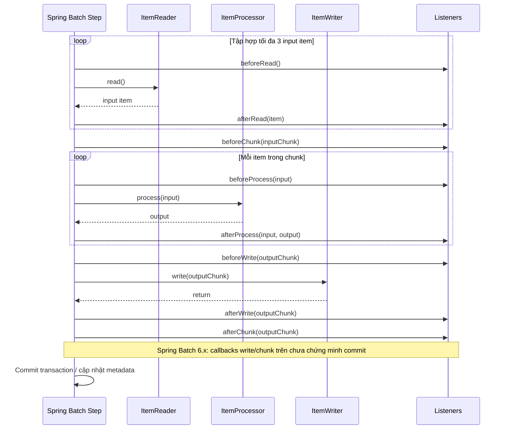
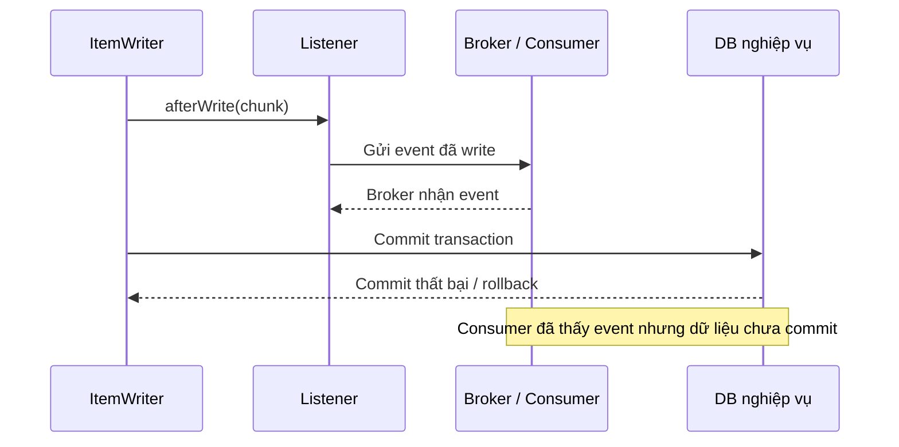

# Sự kiện chunk, đọc, xử lý, ghi và bỏ qua phần tử

## Mục tiêu và bối cảnh

Ứng dụng **Spring Cloud Task** chạy trong thời gian hữu hạn: khởi động, thực thi công việc, lưu thông tin một lần chạy vào `TaskRepository` và kết thúc. Khi tác vụ đó chứa **Spring Batch Job**, một `Step` kiểu *chunk-oriented* thường đọc từng item, biến đổi, ghi từng nhóm item và có thể retry hoặc skip bản ghi lỗi. Để quan sát từng giai đoạn, Spring Batch cung cấp **listener callbacks**; Spring Cloud Task còn có thể chuyển các callback thành **sự kiện Spring Cloud Stream** gửi tới hệ thống khác.

Bài thuộc chương **Sự kiện**, tập trung vào năm nhóm:

1. `ChunkListener` — sự kiện ở ranh giới xử lý chunk.
2. `ItemReadListener` — sự kiện đọc.
3. `ItemProcessListener` — sự kiện xử lý/biến đổi.
4. `ItemWriteListener` — sự kiện ghi.
5. `SkipListener` — sự kiện **thực sự bỏ qua** item.

Sau bài học, bạn có thể xác định callback nào chạy trong từng tình huống, cấu hình Step với listener, hiểu rõ retry/transaction ảnh hưởng đến thứ tự và số lần gọi, và bật/tắt các kênh `chunk-events`, `item-read-events`, `item-process-events`, `item-write-events` và `skip-events` của Spring Cloud Task.

**Phạm vi phiên bản:** Phần API Java minh họa **Spring Batch 6.1** trên một ứng dụng Spring Boot/Spring Cloud Task cùng release train tương thích. Có khác biệt đáng kể giữa Batch 5.x và 6.x ở chữ ký `ChunkListener` và thời điểm callback `afterChunk`. Nếu dự án vẫn dùng Batch 5.x, phải đối chiếu tài liệu riêng của phiên bản đó trước khi sao chép Java.

## 1. Hai tầng sự kiện: callback nội bộ và sự kiện gửi ra broker

| Lớp | Cơ chế | Người nhận | Có cần Kafka/RabbitMQ? | Mục đích |
| --- | --- | --- | --- | --- |
| **Spring Batch listener** | Các phương thức Java được Step gọi trực tiếp trong luồng thực thi | Mã ứng dụng đăng ký với `Step` | **Không** | Theo dõi chi tiết, đo thời gian, phân loại lỗi, tạo audit phù hợp |
| **Spring Cloud Task Batch Events** | Listener do tích hợp Task/Stream cấu hình, phát thông điệp lên Spring Cloud Stream channels | Consumer khác hoặc hệ giám sát | **Có binder** nếu muốn phát ra broker | Quan sát tác vụ từ bên ngoài tiến trình, xử lý thông tin bất đồng bộ |
| **Spring Cloud Task lifecycle events** | Phát `TaskExecution` ở đầu/cuối tác vụ lên `task-events` | Consumer theo dõi lifecycle Task | Có binder nếu phát ra broker | Theo dõi **toàn bộ lần chạy**, không phải từng item/chunk |
| **`TaskRepository` và `JobRepository`** | Lưu dữ liệu có cấu trúc trong DB | Dashboard, hệ vận hành, scheduler | Không | Nguồn tra cứu lịch sử, trạng thái, counters và quan hệ Task–Job |

Một callback trong Step không mặc nhiên là message đã được gửi tới broker. Ngược lại, **thêm Spring Cloud Stream binder** không thay thế quy tắc giao dịch của `ItemWriter` hoặc chính sách skip của `Step`. Hai tầng bổ sung cho nhau.

Ví dụ tác vụ import hóa đơn:

- `ItemProcessListener.onProcessError` báo rằng một hóa đơn không hợp lệ.
- Nếu Step có chính sách `skip` và còn trong hạn mức, `SkipListener.onSkipInProcess` cho biết item đó **được bỏ qua**.
- Nếu Step không cho skip hoặc đã vượt hạn mức, Step thất bại; `onProcessError` **vẫn có thể đã được gọi**.
- Khi tích hợp Spring Cloud Task Stream hoạt động, các callback tương ứng có thể được phát trên `item-process-events` và `skip-events` để hệ khác nghe.

Đây là lý do **sự kiện lỗi** và **sự kiện skip** phải được đếm/hiểu khác nhau.

## 2. Luồng callback qua một chunk

Giả sử reader trả chuỗi, processor chuyển thành hóa đơn, writer ghi vào PostgreSQL và `chunkSize=3`. Một lượt xử lý đơn giản **không có lỗi**:



Sơ đồ cố tình mô tả thứ tự **logic thường gặp** chứ không phải mọi chi tiết nội bộ. Ở Spring Batch 6.1, `beforeChunk(Chunk<I>)` chạy **sau khi input chunk đã được đọc, trước khi xử lý**; `afterChunk(Chunk<O>)` chạy **sau khi ghi, trước khi transaction commit/rollback**. Trong Spring Batch 5.x, API kiểu `ChunkContext` và `afterChunk(ChunkContext)` có thời điểm **sau transaction** — một khác biệt phải kiểm tra khi nâng cấp. Tham khảo [Spring Batch 6.1 – Intercepting Step Execution](https://docs.spring.io/spring-batch/reference/step/chunk-oriented-processing/intercepting-execution.html).

Ở cuối dữ liệu, `ItemReader.read()` trả `null` để báo hết nguồn. Đừng mặc định một callback `afterRead(null)` luôn được phát: API định nghĩa `afterRead` khi đọc được item thành công. Nếu `ItemProcessor.process()` trả `null` thì item **được lọc** (`filter`), không phải **skip do lỗi**; nó không được đưa tới writer.

## 3. Bản đồ năm nhóm listener

| Listener | Callback | Khi nào được báo | Điểm dễ nhầm |
| --- | --- | --- | --- |
| `ChunkListener<I,O>` | `beforeChunk(Chunk<I>)`, `afterChunk(Chunk<O>)`, `onChunkError(Exception, Chunk<O>)` | Trước xử lý input chunk, sau ghi output chunk, khi chunk gặp lỗi xử lý/ghi | `afterChunk` ở Batch 6.x **chưa có nghĩa commit thành công** |
| `ItemReadListener<T>` | `beforeRead()`, `afterRead(T)`, `onReadError(Exception)` | Trước/mỗi lần đọc, sau đọc thành công, đọc ném exception | `onReadError` không khẳng định item bị skip |
| `ItemProcessListener<I,O>` | `beforeProcess(I)`, `afterProcess(I,O)`, `onProcessError(I,Exception)` | Trước/sau xử lý item, processor ném lỗi | Output `null` nghĩa là **filter**, không phải skip |
| `ItemWriteListener<O>` | `beforeWrite(Chunk<? extends O>)`, `afterWrite(Chunk<? extends O>)`, `onWriteError(Exception, Chunk<? extends O>)` | Trước/sau writer ghi chunk, writer ném lỗi | Lỗi write trên **cả chunk**, chưa chắc biết item lỗi |
| `SkipListener<I,O>` | `onSkipInRead(Throwable)`, `onSkipInProcess(I,Throwable)`, `onSkipInWrite(O,Throwable)` | **Chỉ khi** quy tắc fault tolerance xác định item được bỏ qua | Có callback skip trong transaction có thể rollback |

Cả năm interface là phần mở rộng của `StepListener` trong Spring Batch. Có thể dùng interface trực tiếp hoặc các annotation tương ứng:

| Nhóm | Annotation |
| --- | --- |
| Chunk | `@BeforeChunk`, `@AfterChunk`, `@OnChunkError` (Batch 6.x) |
| Read | `@BeforeRead`, `@AfterRead`, `@OnReadError` |
| Process | `@BeforeProcess`, `@AfterProcess`, `@OnProcessError` |
| Write | `@BeforeWrite`, `@AfterWrite`, `@OnWriteError` |
| Skip | `@OnSkipInRead`, `@OnSkipInProcess`, `@OnSkipInWrite` |

Chọn **một kiểu đăng ký nhất quán**, tránh đăng ký cùng listener hai lần (ví dụ vừa gắn vào reader vừa `.listener(...)` thủ công) khiến một callback có thể bị gọi trùng. Một bean listener đơn thuần không tự chạy: nó phải được **gắn với Step/Job**, trừ trường hợp autoconfiguration của tích hợp Cloud Task làm việc này thay bạn.

## 4. `ChunkListener`: ranh giới transaction và số lần callback

Trong Spring Batch 6.1, `ChunkListener<I,O>` có chữ ký minh họa:

```java
public interface ChunkListener<I, O> extends StepListener {
    void beforeChunk(Chunk<I> chunk);
    void afterChunk(Chunk<O> chunk);
    void onChunkError(Exception exception, Chunk<O> chunk);
}
```

`Chunk<I>` chứa input đã đọc; `Chunk<O>` chứa output sau xử lý. `beforeChunk` và `afterChunk` chạy trong transaction theo mô tả API 6.1; `onChunkError` cũng xảy ra khi transaction tương ứng **sắp rollback**.

- `beforeChunk` ở 6.x được gọi **sau khi đã đọc một chunk**, trước khi bắt đầu processor. Do đó một **lỗi đọc trước khi có processed chunk** không nhất thiết gây `onChunkError`.
- `afterChunk` được gọi sau khi write hoàn tất, nhưng **chưa phải** callback “đã commit”. Nếu transaction cuối cùng thất bại, không được coi tác động phụ đã bền vững chỉ vì `afterChunk` xảy ra.
- `onChunkError` nhận exception và **processed chunk không rỗng**; theo API 6.1, lỗi read trước khi xử lý được báo qua `onReadError`, không qua `onChunkError`.
- Tài liệu Batch 6.1 cảnh báo các callback `ChunkListener` **không được gọi trong concurrent steps** theo cơ chế đó. Nếu bật thực thi đồng thời, không xây cơ chế kiểm đếm thiết yếu chỉ dựa trên listener này.

### Khi writer thất bại và Step thử lại từng item

Giả sử input chunk `[A, B, C]`; writer cố ghi cả chunk nhưng B và C lỗi có thể skip. Trên **Spring Batch 6.1**, cơ chế *chunk scanning* có thể chạy:

```text
beforeChunk([A, B, C])
onChunkError(error, [A, B, C])    # write toàn chunk thất bại, rollback

beforeChunk([A])
afterChunk([A])                   # A được ghi thành công

beforeChunk([B])
onChunkError(error, [B])          # B bị từ chối và skip

beforeChunk([C])
onChunkError(error, [C])          # C bị từ chối và skip
```

**Một chunk logic có thể phát sinh nhiều callback chunk.** Không dùng `beforeChunk` làm “đếm số chunk đã commit” khi fault tolerance bật. Các callback lỗi write còn có thể xảy ra **nhiều lần** trước khi item được skip hoặc retry thành công.

### Không dùng listener làm tác vụ phụ có thể ném lỗi

Theo tài liệu, ngoại lệ do listener tự ném không được coi là lỗi read/process/write để skip/retry; nó có thể khiến Step **thất bại ngay**. Không gọi API gửi email, thanh toán hoặc cập nhật database tùy tiện ngay trong callback nếu không có cơ chế cách ly lỗi. Nếu ghi log/audit, bắt lỗi an toàn và có chính sách riêng cho trường hợp không ghi được audit, tránh “lỗi quan sát làm hỏng xử lý nghiệp vụ”.

## 5. `ItemReadListener`: phân biệt đã đọc, đọc lỗi và bỏ qua

Các callback:

```java
void beforeRead();
void afterRead(T item);
void onReadError(Exception exception);
```

`beforeRead()` chạy trước mỗi lần reader được gọi. `afterRead(item)` nhận item đọc thành công; `onReadError` nhận lỗi ở `read()`. Một exception đọc có thể:

1. **Được retry:** `onReadError` có thể xảy ra nhiều lần, cuối cùng reader đọc thành công. Không có skip.
2. **Được skip:** nếu lỗi thuộc `SkipPolicy`, bộ đếm `readSkipCount` tăng và `onSkipInRead` được gọi.
3. **Làm Step thất bại:** lỗi không skippable hoặc vượt giới hạn skip; không báo skip thành công.

**Lưu ý đặc biệt:** `onSkipInRead(Throwable)` chỉ nhận exception vì tại thời điểm reader thất bại có thể **chưa có object item**. Với `FlatFileItemReader`, `FlatFileParseException` có thể chứa số dòng và thông tin parse để điều tra, nhưng không nên đưa nguyên raw input có PII lên log/broker.

Khi thiết kế reader retry, đảm bảo vị trí đọc không bị tiến lên sau một exception rồi khiến dữ liệu bị bỏ quên âm thầm. Spring Batch 6.1 lưu ý retry `ItemReader.read()` phụ thuộc cách reader giữ state. Lỗi parse cố định thường phù hợp skip (nếu nghiệp vụ cho phép), không phù hợp retry lặp lại cùng dữ liệu.

## 6. `ItemProcessListener`: filter khác skip

Các callback:

```java
void beforeProcess(I item);
void afterProcess(I item, O result);
void onProcessError(I item, Exception exception);
```

Phân biệt ba kết quả:

| `process(item)` trả gì? | Callback / kết quả | Bộ đếm cần xem |
| --- | --- | --- |
| Output hợp lệ | `afterProcess(item, output)`; output tiếp tục vào writer | `writeCount` sau khi ghi thành công |
| `null` (lọc theo quy tắc) | `afterProcess(item, null)`; item không vào writer | `filterCount` |
| Ném exception | `onProcessError(item, ex)`; sau đó retry, skip hoặc fail theo policy | `processSkipCount` **chỉ khi skip thực sự** |

Ví dụ: một hóa đơn có số tiền `0` được processor **cố ý loại khỏi báo cáo** bằng `return null`; đó là **filter**, không phải dữ liệu lỗi. Một hóa đơn số tiền âm ném `InvalidInvoiceException` và được Step cho skip; đó là **process skip**. Không dùng `SkipListener` để đo số item được lọc.

Nếu writer thất bại và có *chunk scanning*, processor có thể được gọi **lại** cho từng item. Vì thế `afterProcess` không nhất thiết chỉ xảy ra một lần trên toàn bộ Job cho một logical record. Processor nên có tính xác định và tránh side effect không thể hoàn tác; `processorNonTransactional()` chỉ thích hợp khi output đã tạo có thể được ghi lại an toàn.

## 7. `ItemWriteListener`: write thành công chưa phải commit

Trong Spring Batch 6.x, listener writer nhận **`Chunk`**, không phải `List` như một số ví dụ cũ:

```java
void beforeWrite(Chunk<? extends O> items);
void afterWrite(Chunk<? extends O> items);
void onWriteError(Exception exception, Chunk<? extends O> items);
```

`afterWrite` báo rằng `ItemWriter.write(chunk)` đã trở về bình thường; callback này xảy ra **trước khi commit transaction**. Nó **không** bảo đảm dữ liệu đã bền vững trong database hay sự kiện broker đã được consumer xử lý. Nếu transaction sau đó rollback, event đã log hoặc phát ra trong `afterWrite` có thể trở thành một quan sát “thành công giả”.

`onWriteError` nhận **cả chunk thử ghi**, không phải item gây lỗi đã được xác định. Trong fault-tolerant step, framework có thể rollback chunk rồi **thử lại từng item trong transaction riêng** để tìm item được skip. Khi đó `onWriteError` có thể được gọi một lần cho toàn chunk và thêm lần nữa cho item bị lỗi. Không tạo thông báo “hóa đơn X đã bị bỏ qua” từ `onWriteError`; dùng `onSkipInWrite`.

Với JDBC, đặt unique business key để retry không sinh dữ liệu trùng. Với Kafka/AMQP, transaction của database JobRepository không tự đảm bảo atomicity của publish message; muốn phát sự kiện nghiệp vụ đáng tin cậy, cân nhắc outbox/idempotency ở phía nhận.

## 8. `SkipListener`: quyết định bỏ qua item

`SkipListener<I,O>` có ba callback:

```java
void onSkipInRead(Throwable error);
void onSkipInProcess(I item, Throwable error);
void onSkipInWrite(O item, Throwable error);
```

Khác với các listener lỗi, `SkipListener` thể hiện việc **Step quyết định bỏ qua** theo chính sách fault tolerance. Nó không tự biến một exception thành “skippable” — phải cấu hình `.faultTolerant().skip(...).skipLimit(...)` hoặc `SkipPolicy` phù hợp.

- `onSkipInRead`: item không đọc được; chỉ có exception.
- `onSkipInProcess`: đã đọc item đầu vào nhưng processor không xử lý thành công và policy cho phép bỏ qua.
- `onSkipInWrite`: item đầu ra không ghi được; framework có thể scan chunk để cô lập item này.

### Giới hạn skip là tổng across read/process/write

Ví dụ giới hạn `3`: được phép bỏ qua tổng cộng tối đa 3 item thuộc lớp exception cho phép. Nếu đã skip 1 item lúc read, 1 lúc process và 1 lúc write, **lỗi skippable thứ tư** làm Step thất bại. Không có “3 lỗi cho từng pha”. Spring Batch 6.1 dùng `SkipPolicy`, ví dụ `LimitCheckingExceptionHierarchySkipPolicy`, hoặc cấu hình đơn giản `skip(InvalidInvoiceException.class)` + `skipLimit(3)`.

### Transaction của skip listener trong Batch 6.1

Tài liệu 6.1 có điểm tinh tế khác các hướng dẫn cũ:

| Callback | Vị trí transaction trong Batch 6.1 | Hệ quả |
| --- | --- | --- |
| `onSkipInRead` | Trong transaction chunk đang chạy, **có thể rollback** | Audit ghi cùng transaction có thể bị mất |
| `onSkipInProcess` | Trong transaction chunk đang chạy, **có thể rollback** | Audit/metric cần nhận biết reattempt |
| `onSkipInWrite` | Trong transaction scan **một item**, rồi transaction ấy **rollback** khi item bị skip | Audit transactional mặc định rất dễ bị rollback theo |
| `onChunkError` / `onWriteError` | Trong transaction bị lỗi / chuẩn bị rollback | Không coi callback này là “commit audit” |

Nếu cần ghi nhận record bị skip vào bảng audit riêng, hãy gọi **một service khác** với `@Transactional(propagation = Propagation.REQUIRES_NEW)` và một ID sự kiện có tính idempotent, hoặc dùng cơ chế event/outbox được thiết kế để chịu retry. Không chỉ đặt `@Transactional(REQUIRES_NEW)` lên một method cùng bean rồi tự gọi: Spring proxy transaction thông thường **không áp dụng cho self-invocation**.


## 9. Thực hành: Job một Step và đủ năm nhóm listener

Tạo một ứng dụng Spring Boot chứa `spring-boot-starter-batch`, `spring-cloud-starter-task`, `spring-cloud-task-batch` và JDBC driver H2 phù hợp. Các dependency phải do **Spring Boot BOM và Spring Cloud BOM tương thích** quản lý. Đây là một Job minh họa, dùng danh sách bản ghi trong bộ nhớ và writer in ra console để quan sát callback; **không dùng console writer này làm output nghiệp vụ production**.

### 9.1. File ứng dụng

`src/main/java/com/example/task/InvoiceEventsApplication.java`:

```java
package com.example.task;

import org.springframework.boot.SpringApplication;
import org.springframework.boot.autoconfigure.SpringBootApplication;

@SpringBootApplication
public class InvoiceEventsApplication {
    public static void main(String[] args) {
        SpringApplication.run(InvoiceEventsApplication.class, args);
    }
}
```

### 9.2. Định nghĩa một Job, một Step có skip

`src/main/java/com/example/task/InvoiceJobConfig.java`:

```java
package com.example.task;

import java.math.BigDecimal;
import java.util.List;

import org.springframework.batch.core.job.Job;
import org.springframework.batch.core.job.builder.JobBuilder;
import org.springframework.batch.core.repository.JobRepository;
import org.springframework.batch.core.step.Step;
import org.springframework.batch.core.step.builder.StepBuilder;
import org.springframework.batch.infrastructure.item.ItemProcessor;
import org.springframework.batch.infrastructure.item.ItemReader;
import org.springframework.batch.infrastructure.item.ItemWriter;
import org.springframework.batch.infrastructure.item.support.ListItemReader;
import org.springframework.context.annotation.Bean;
import org.springframework.context.annotation.Configuration;
import org.springframework.transaction.PlatformTransactionManager;

record Invoice(String id, BigDecimal amount) {}

class InvalidInvoiceException extends RuntimeException {
    InvalidInvoiceException(String reason) {
        super(reason);
    }
}

@Configuration
public class InvoiceJobConfig {

    @Bean
    ItemReader<String> invoiceReader() {
        // Input cố tình có 3 lỗi: B và D lỗi process, C lỗi write.
        return new ListItemReader<>(List.of(
                "A:10.00", "B:-1.00", "C:20.00",
                "D:not-a-number", "E:30.00"));
    }

    @Bean
    ItemProcessor<String, Invoice> invoiceProcessor() {
        return raw -> {
            String[] parts = raw.split(":", -1);
            if (parts.length != 2) {
                throw new InvalidInvoiceException("Sai cấu trúc");
            }

            BigDecimal amount;
            try {
                amount = new BigDecimal(parts[1]);
            } catch (NumberFormatException ex) {
                throw new InvalidInvoiceException("Số tiền không hợp lệ");
            }

            if (amount.signum() < 0) {
                throw new InvalidInvoiceException("Số tiền âm");
            }
            return new Invoice(parts[0], amount);
        };
    }

    @Bean
    ItemWriter<Invoice> invoiceWriter() {
        return items -> {
            // Mô phỏng lỗi ghi: kiểm tra cả chunk trước khi in.
            for (Invoice row : items) {
                if ("C".equals(row.id())) {
                    throw new InvalidInvoiceException("Không thể ghi C");
                }
            }
            for (Invoice row : items) {
                System.out.println("DEMO write " + row.id());
            }
        };
    }

    @Bean
    Step importStep(
            JobRepository jobRepository,
            PlatformTransactionManager transactionManager,
            ItemReader<String> invoiceReader,
            ItemProcessor<String, Invoice> invoiceProcessor,
            ItemWriter<Invoice> invoiceWriter,
            InvoiceEventAudit audit) {

        return new StepBuilder("importStep", jobRepository)
                .<String, Invoice>chunk(3)
                .transactionManager(transactionManager)
                .reader(invoiceReader)
                .processor(invoiceProcessor)
                .writer(invoiceWriter)
                .faultTolerant()
                .skip(InvalidInvoiceException.class)
                .skipLimit(3)
                .listener(audit)
                .build();
    }

    @Bean
    Job importJob(JobRepository jobRepository, Step importStep) {
        return new JobBuilder("importJob", jobRepository)
                .start(importStep)
                .build();
    }
}
```

Theo ví dụ, `B:-1.00` và `D:not-a-number` gây `onProcessError` và có thể `onSkipInProcess`. `C:20.00` qua processor nhưng làm writer ném lỗi, từ đó có thể sinh `onWriteError` rồi `onSkipInWrite` khi Step thực hiện chunk scanning. Với `skipLimit(3)` và đúng ba item lỗi thuộc loại skippable, Job có thể hoàn tất `COMPLETED` với **ba item bị bỏ qua**.

**Hai giới hạn có chủ ý:** `ListItemReader` không phải reader có checkpoint thích hợp cho restart production; `System.out.println` không hỗ trợ rollback giao dịch. Kết quả in có thể xuất hiện nhiều lần nếu writer được thử lại. Đừng suy “số dòng console = số item đã commit”.

### 9.3. Listener quan sát đọc, xử lý, ghi, chunk và skip

`src/main/java/com/example/task/InvoiceEventAudit.java`:

```java
package com.example.task;

import org.slf4j.Logger;
import org.slf4j.LoggerFactory;
import org.springframework.batch.core.listener.ChunkListener;
import org.springframework.batch.core.listener.ItemReadListener;
import org.springframework.batch.core.listener.ItemProcessListener;
import org.springframework.batch.core.listener.ItemWriteListener;
import org.springframework.batch.core.listener.SkipListener;
import org.springframework.batch.infrastructure.item.Chunk;
import org.springframework.stereotype.Component;

@Component
public class InvoiceEventAudit implements
        ChunkListener<String, Invoice>,
        ItemReadListener<String>,
        ItemProcessListener<String, Invoice>,
        ItemWriteListener<Invoice>,
        SkipListener<String, Invoice> {

    private static final Logger log =
            LoggerFactory.getLogger(InvoiceEventAudit.class);

    @Override
    public void beforeRead() {
        log.debug("read.before");
    }

    @Override
    public void afterRead(String item) {
        log.debug("read.after"); // Không log raw item nhạy cảm.
    }

    @Override
    public void onReadError(Exception ex) {
        log.warn("read.error type={}", ex.getClass().getSimpleName());
    }

    @Override
    public void beforeProcess(String item) {
        log.debug("process.before");
    }

    @Override
    public void afterProcess(String item, Invoice result) {
        log.debug("process.after filtered={}", result == null);
    }

    @Override
    public void onProcessError(String item, Exception ex) {
        log.warn("process.error type={}", ex.getClass().getSimpleName());
    }

    @Override
    public void beforeWrite(Chunk<? extends Invoice> items) {
        log.debug("write.before size={}", items.size());
    }

    @Override
    public void afterWrite(Chunk<? extends Invoice> items) {
        log.debug("write.after size={} (chưa xác nhận commit)",
                items.size());
    }

    @Override
    public void onWriteError(
            Exception ex, Chunk<? extends Invoice> items) {
        log.warn("write.error size={} type={}",
                items.size(), ex.getClass().getSimpleName());
    }

    @Override
    public void beforeChunk(Chunk<String> chunk) {
        log.debug("chunk.before inputSize={}", chunk.size());
    }

    @Override
    public void afterChunk(Chunk<Invoice> chunk) {
        log.debug("chunk.after outputSize={} (trước commit)",
                chunk.size());
    }

    @Override
    public void onChunkError(
            Exception ex, Chunk<Invoice> chunk) {
        log.warn("chunk.error outputSize={} type={}",
                chunk.size(), ex.getClass().getSimpleName());
    }

    @Override
    public void onSkipInRead(Throwable ex) {
        log.warn("skip.read type={}", ex.getClass().getSimpleName());
    }

    @Override
    public void onSkipInProcess(String item, Throwable ex) {
        log.warn("skip.process type={}", ex.getClass().getSimpleName());
    }

    @Override
    public void onSkipInWrite(Invoice item, Throwable ex) {
        log.warn("skip.write type={}", ex.getClass().getSimpleName());
    }
}
```

Tất cả interface trên là **Spring Batch 6.1**. Với Spring Batch 5.x, các package listener nằm ở `org.springframework.batch.core`, `Chunk` thuộc `org.springframework.batch.item`, và `ChunkListener` dùng `ChunkContext`; do vậy code này không dành để chép thẳng vào dự án 5.x.

Trong `StepBuilder`, `.listener(audit)` đăng ký bean triển khai nhiều listener interface. **Không cần** gắn `@BeforeRead`/`@OnSkipInWrite` nếu đã implement interface trực tiếp. Nếu dùng annotation trên POJO thay interface, đăng ký chính POJO qua `.listener(...)` và bảo đảm chữ ký callback đúng phiên bản.

Ở production nên thay logger đơn giản bằng **Micrometer observations/counters** có tag an toàn như `jobName`, `stepName`, `errorType`. Không đưa nguyên `invoiceId` hoặc thông tin khách hàng vào metric tag; cardinality rất cao và có thể lộ PII.

### 9.4. Cấu hình chạy thử

`src/main/resources/application.yml`:

```yaml
spring:
  application:
    name: invoice-events-task
  main:
    web-application-type: none
  datasource:
    url: jdbc:h2:mem:invoice_events;DB_CLOSE_DELAY=-1
    username: sa
    password: ""
  batch:
    job:
      enabled: true
      name: importJob
    jdbc:
      initialize-schema: always
  cloud:
    task:
      initialize-enabled: true
      batch:
        fail-on-job-failure: true

logging:
  level:
    com.example.task: DEBUG
```

Với JAR đã build và metadata repository khởi tạo thành công:

```bash
java -jar target/invoice-events-task.jar
```

Quan sát các nhóm `read.`, `process.`, `write.`, `chunk.` và `skip.`. **Đừng chốt số lần callback chính xác bằng cách đếm trên giấy:** thời điểm retry/chunk scan có thể khiến `beforeProcess`, `onWriteError` và `beforeChunk` được gọi nhiều hơn số item/chunk logic ban đầu.

Trong ví dụ, không có lỗi ở `ItemReader` nên `onReadError`/`onSkipInRead` không được kích hoạt. Để thử nhánh đọc, thay bằng một `FlatFileItemReader` đọc file có dòng sai định dạng và khai báo `FlatFileParseException` là skippable trong giới hạn, hoặc một reader test cố ý ném exception. **Chỉ làm vậy trong môi trường thử nghiệm**.

H2 in-memory dùng cho học tập và **không giữ lịch sử `TaskExecution`/`JobExecution` giữa các JVM**. Ở production, cấu hình database bền vững, migration schema chính xác và secret an toàn; không dựa vào `initialize-schema: always` hoặc mật khẩu rỗng.

## 10. Spring Cloud Task phát Batch events qua Spring Cloud Stream

Đây là lớp thứ hai của bài: sau khi biết listener diễn ra khi nào, ta có thể gửi thông tin đó ra một **message broker** để hệ giám sát/consumer bên ngoài tiến trình nhận được.

Theo [Spring Cloud Task 5.1 – Spring Cloud Stream Integration](https://docs.spring.io/spring-cloud-task/reference/stream.html), khi ứng dụng chạy một Spring Batch Job trong Task và có hạ tầng tích hợp phù hợp, các listener tương ứng được cấu hình để phát những channel:

| Batch listener | Channel mặc định | Ý nghĩa |
| --- | --- | --- |
| `JobExecutionListener` | `job-execution-events` | Bắt đầu/kết thúc Job |
| `StepExecutionListener` | `step-execution-events` | Bắt đầu/kết thúc Step |
| **`ChunkListener`** | **`chunk-events`** | Sự kiện chunk |
| **`ItemReadListener`** | **`item-read-events`** | Sự kiện đọc |
| **`ItemProcessListener`** | **`item-process-events`** | Sự kiện xử lý |
| **`ItemWriteListener`** | **`item-write-events`** | Sự kiện ghi |
| **`SkipListener`** | **`skip-events`** | Sự kiện bỏ qua item |
| `TaskLifecycleListener` (Task event) | `task-events` | `TaskExecution` lúc đầu/cuối tác vụ |

**Điểm dễ nhầm:** `task-events` phản ánh vòng đời Spring Cloud Task, còn `chunk-events` và `item-*-events` bắt nguồn từ các callback Spring Batch. Nếu tác vụ chỉ có một `ApplicationRunner`, **không có Batch Step**, thì không tự sinh sự kiện item/chunk.

### 10.1. Phụ thuộc cần thiết

Trong dự án có `spring-cloud-starter-task`, `spring-cloud-task-batch`, `spring-boot-starter-batch`, muốn phát message qua Kafka/RabbitMQ cần bổ sung **module tích hợp Task–Stream**, thư viện Stream và một **binder tương ứng**:

```xml
<dependencies>
    <dependency>
        <groupId>org.springframework.cloud</groupId>
        <artifactId>spring-cloud-task-stream</artifactId>
    </dependency>

    <!-- Ví dụ chọn Kafka làm binder; nếu dùng RabbitMQ thì đổi binder. -->
    <dependency>
        <groupId>org.springframework.cloud</groupId>
        <artifactId>spring-cloud-stream-binder-kafka</artifactId>
    </dependency>
</dependencies>
```

Phiên bản các module phải do **Spring Cloud BOM tương thích** quản lý. Đây là đoạn thêm vào `dependencies`, không phải toàn bộ `pom.xml`. Cần broker Kafka/RabbitMQ thực sự hoạt động và cấu hình địa chỉ, serializer/content type, quyền truy cập và retry publisher phù hợp. Nếu chỉ muốn callback chạy trong JVM để log metric, **không cần** bổ sung Stream/binder.

### 10.2. Bật/tắt theo nhóm và chuyển destination

Ví dụ giữ event ở mức Job/Step/Chunk/Skip, đồng thời tắt sự kiện mỗi item để tránh lưu lượng quá lớn:

```yaml
spring:
  cloud:
    task:
      batch:
        events:
          enabled: true
          chunk:
            enabled: true
          skip:
            enabled: true
          item-read:
            enabled: false
          item-process:
            enabled: false
          item-write:
            enabled: false
    stream:
      bindings:
        chunk-events:
          destination: invoice-batch-chunks
          content-type: application/json
        skip-events:
          destination: invoice-batch-skips
          content-type: application/json
```

Ở đây `spring.cloud.task.batch.events.*` điều khiển **listener phát Batch events** của Spring Cloud Task, còn `spring.cloud.stream.bindings.*.destination` điều khiển **đích broker**. Hai namespace là khác nhau.

Nếu muốn **tắt tất cả** event từ Batch:

```yaml
spring:
  cloud:
    task:
      batch:
        events:
          enabled: false
```

Nếu muốn tắt riêng **task lifecycle event** (`task-events`) mà giữ Batch events:

```yaml
spring:
  cloud:
    task:
      events:
        enabled: false
```

Tài liệu còn cung cấp các key:

```properties
spring.cloud.task.batch.events.job-execution.enabled=false
spring.cloud.task.batch.events.step-execution.enabled=false
spring.cloud.task.batch.events.chunk.enabled=false
spring.cloud.task.batch.events.item-read.enabled=false
spring.cloud.task.batch.events.item-process.enabled=false
spring.cloud.task.batch.events.item-write.enabled=false
spring.cloud.task.batch.events.skip.enabled=false

# Thứ tự ưu tiên callback cho các event listener tự cấu hình:
spring.cloud.task.batch.events.chunk-order=5
spring.cloud.task.batch.events.skip-order=5
```

Giá trị order mặc định là `Ordered.LOWEST_PRECEDENCE` theo tài liệu. Order này điều khiển **thứ tự gọi listener trong tiến trình**, **không** bảo đảm thứ tự message tuyệt đối khi được gửi qua nhiều partition/consumer của Kafka hoặc khi retry qua mạng.

Tài liệu cũng mô tả property đổi tên binding của listener, ví dụ `spring.cloud.task.batch.events.step-execution-events-binding-name`. Khi chỉ muốn đổi topic/destination, cách rõ nhất là giữ binding name đúng của framework và đặt `spring.cloud.stream.bindings.<binding>.destination`. Nếu tùy biến binding name, xác minh lại bằng log cấu hình vì tên nội bộ và tên destination là hai khái niệm riêng.

### 10.3. Consumer xử lý event thế nào?

Ví dụ hệ thống giám sát nhận các thông điệp ở `invoice-batch-skips`, trích metadata đã được làm sạch rồi lập báo cáo chất lượng dữ liệu. Không nên phụ thuộc vào một JSON schema tự đoán; kiểm tra payload thực tế của **phiên bản Task/Stream** đang chạy và có quy ước version event.

Một consumer tối thiểu nên:

1. Xác thực nguồn và quyền truy cập topic/channel.
2. Đọc và kiểm tra event type, job/step identity, correlation ID và thời gian.
3. Lọc dữ liệu nhạy cảm trước khi lưu hay xuất dashboard.
4. Chịu được redelivery và message trùng: sử dụng dedup key hoặc idempotent insert khi cần.
5. Đối chiếu với `JobRepository` khi cần kết luận trạng thái/skip count cuối, vì việc nhận event **không** chứng minh transaction dữ liệu đã commit.

**Không phát trực tiếp toàn bộ raw item** hoặc stack trace chứa dữ liệu cá nhân lên message broker. Với throughput cao, event trên mỗi item có thể đắt hơn chính bước xử lý; bật event có chọn lọc, sampling/aggregation, quota và retention.

## 11. Độ tin cậy: sự kiện không phải bằng chứng commit dữ liệu

Có thể có các trình tự sau:



Trong Spring Batch 6.x, cả `ItemWriteListener.afterWrite` và `ChunkListener.afterChunk` đều chạy **trước commit**. Với `SkipListener`, một số callback có thể nằm trong transaction rollback. Vì vậy:

- Sự kiện read/process/write là **telemetry về thao tác**, không tự là một bản ghi kế toán “đã thành công”.
- Sự kiện `onSkipInWrite` thể hiện quyết định skip, nhưng bất kỳ audit DB nào do listener gọi trong cùng transaction scan có thể bị rollback.
- Publisher có thể gửi trùng do retry và network timeout; consumer phải chịu duplicate.
- Broker message có thể được gửi trước khi metadata `StepExecution` và `TaskExecution` được cập nhật; quan sát các nguồn theo thời gian thực có thể thấy **trạng thái tạm thời khác nhau**.

Nếu nghiệp vụ yêu cầu event “invoice đã commit” có tính tin cậy cao, hãy ghi **outbox row trong cùng transaction với dữ liệu**, rồi có publisher riêng gửi sau commit. Event từ listener phù hợp cho quan sát tiến trình và cảnh báo, không tự thay cơ chế outbox/transactional messaging.

## 12. Chẩn đoán, chỉ số và quy tắc vận hành

`JobRepository` của Spring Batch lưu `JobExecution`, `StepExecution` và các counters; `TaskRepository` của Cloud Task lưu `TaskExecution`. Có thể kết nối Job và Task thông qua `TaskBatchExecutionListener` nếu thêm `spring-cloud-task-batch` và có Job bean trong context.

| Chỉ số/kết quả | Nguồn | Ý nghĩa |
| --- | --- | --- |
| `readCount` | `StepExecution` | Số input đã đọc theo semantics của Step |
| `filterCount` | `StepExecution` | Item processor trả `null`, không phải skip |
| `writeCount` | `StepExecution` | Số output item Step coi đã ghi; không nhất thiết bằng số DB rows mới khi upsert/no-op |
| `readSkipCount` / `processSkipCount` / `writeSkipCount` | `StepExecution` | Bản ghi **thực sự skip** ở từng pha |
| `commitCount` / `rollbackCount` | `StepExecution` | Số commit/rollback theo Step |
| `JobExecution.status` / `exitStatus` | Spring Batch | Kết quả Job |
| `TaskExecution.exitCode` | Spring Cloud Task | Mã kết thúc tiến trình Task, `null` trong khi chưa chốt |
| `chunk-events` / `skip-events` | Stream/broker | Quan sát quá trình; có thể trễ/trùng và không phải transaction commit record |

Ví dụ SQL khi dùng JDBC JobRepository với tên bảng mặc định:

```sql
SELECT
    STEP_EXECUTION_ID, STEP_NAME, STATUS,
    READ_COUNT, FILTER_COUNT, WRITE_COUNT,
    READ_SKIP_COUNT, PROCESS_SKIP_COUNT, WRITE_SKIP_COUNT,
    COMMIT_COUNT, ROLLBACK_COUNT
FROM BATCH_STEP_EXECUTION
ORDER BY STEP_EXECUTION_ID DESC
LIMIT 20;
```

Khi nghi có sự kiện bị mất hoặc nhân đôi, kiểm tra **counters cuối cùng** trong DB, log sender/broker/consumer, offset/ack và các ID điều phối. Không tính “số bản ghi thực sự bỏ qua” bằng số message `skip-events` nhận được trừ khi đã có dedup và quy tắc delivery được chứng minh.

### Bảng lỗi thường gặp

| Triệu chứng | Nguyên nhân khả dĩ | Cách xử lý |
| --- | --- | --- |
| Không có callback nào được gọi | Chưa gắn listener với Step; Task chỉ dùng `ApplicationRunner`, không có Batch Job | Đăng ký `.listener(...)` và kiểm tra Job/Step thực sự chạy |
| `onReadError` xuất hiện nhưng không có `onSkipInRead` | Lỗi được retry rồi thành công, hoặc không skippable | Xem `SkipPolicy` và `readSkipCount` |
| `afterProcess(..., null)` không tạo `onSkipInProcess` | Processor đã **filter**, không ném lỗi | Theo dõi `filterCount` |
| `onWriteError` được gọi nhiều lần hơn số item lỗi | Chunk scan/retry trên cả chunk và từng item | Dùng `onSkipInWrite` để biết quyết định skip |
| `afterWrite` có nhưng dữ liệu không có trong DB | Rollback/commit failure sau callback | Đối chiếu transaction, JobRepository, database |
| Ghi bảng audit trong `onSkipInWrite` nhưng không thấy dòng | Callback chạy trong transaction scan bị rollback | Dùng service transaction mới, outbox hoặc audit thiết kế riêng |
| Listener làm Step FAILED dù lỗi là skippable | Listener tự ném exception; lỗi listener không đi qua skip/retry policy | Bắt lỗi hợp lệ và tách công việc I/O bất đồng bộ |
| Không thấy `skip-events` trên Kafka | Thiếu `spring-cloud-task-stream`/binder, binding/topic sai, event listener bị tắt | Kiểm tra classpath, broker, cấu hình phát event |
| `chunk-events` có nhưng thiếu `item-read-events` | Event item-read đã tắt hoặc có lỗi sớm | Kiểm tra `spring.cloud.task.batch.events.item-read.enabled` |
| `TaskExecution.exitCode=0` trong khi Job FAILED | Chưa truyền failure Batch lên Task | Kiểm tra `spring.cloud.task.batch.fail-on-job-failure=true` và tích hợp |
| Bản ghi `TaskExecution.exitCode=NULL` quá lâu | Process còn chạy hoặc đã crash trước khi cập nhật repository | Kiểm tra container/launcher/log, không kết luận chỉ từ `NULL` |

## 13. Bài tập suy luận

**Tình huống A:** Processor trả `null` cho 8 bản ghi không thuộc phạm vi xử lý. Có bao nhiêu `onSkipInProcess` được kỳ vọng chỉ vì hành vi này?

**Đáp án:** 0. Đây là **filter**, theo dõi `filterCount` thay vì `processSkipCount`.

**Tình huống B:** Writer nhận một chunk ba item, thất bại vì item thứ hai. `onWriteError` được gọi. Có thể ngay lập tức phát thông báo “item thứ hai đã skip” không?

**Đáp án:** Chưa. `onWriteError` biết chunk đã lỗi, không tự biết item cuối cùng nào bị loại. Có thể framework retry thành công hoặc scan từng item. Chỉ dùng `onSkipInWrite` khi policy xác nhận skip.

**Tình huống C:** Một `afterChunk` của Spring Batch 6.1 gửi event “đã commit”, sau đó database rollback. Event đó có chính xác không?

**Đáp án:** Không. `afterChunk(Chunk<O>)` của 6.x chạy sau writer nhưng **trước commit**. Với event nghiệp vụ cần bền vững, dùng outbox gắn với commit dữ liệu.

**Tình huống D:** `SkipListener.onSkipInWrite` ghi vào cùng database bằng transaction mặc định nhưng không thấy audit. Vì sao?

**Đáp án:** Nó có thể chạy trong transaction scan bị rollback. Ghi audit cần cơ chế transaction mới tách biệt hoặc giải pháp phù hợp, kèm dedup/correlation để chịu retry.

**Tình huống E:** Scheduler khởi chạy một Spring Cloud Task chỉ có `ApplicationRunner`; đã thêm Kafka binder. Consumer có tự nhận `chunk-events` không?

**Đáp án:** Không, nếu không có Spring Batch Job/Step được thực thi thì không có callback chunk tương ứng. Tính năng `task-events` là một nguồn thông tin **khác**.

**Tình huống F:** Một Task có `skipLimit=3`; trước đó đã skip một read và hai process item. Writer lại gặp item lỗi skippable. Điều gì xảy ra?

**Đáp án:** Lần lỗi cần skip thứ tư vượt hạn mức tổng, Step thất bại thay vì tiếp tục skip.

## 14. Checklist triển khai an toàn

- [ ] Phân biệt listener Java nội bộ với thông điệp ra broker và với `TaskExecution` được lưu trong `TaskRepository`.
- [ ] Chọn đúng chữ ký `ChunkListener`/`ItemWriteListener` cho **Spring Batch 6.x hoặc 5.x** mà dự án đang chạy.
- [ ] Đăng ký listener với đúng Step/Job; tránh đăng ký cùng bean hai lần hoặc giả định `@Component` là đủ.
- [ ] Với lỗi đọc, xử lý, ghi: phân biệt `on*Error` với `onSkipIn*` và với `filterCount`.
- [ ] Cấu hình `SkipPolicy`, giới hạn skip **tổng** và retry chỉ cho lỗi có khả năng hồi phục.
- [ ] Khi writer lỗi: kiểm tra chunk scanning, rollback, processor được gọi lại, và idempotency của writer.
- [ ] Không dùng `afterWrite`/`afterChunk` 6.x làm sự kiện “DB commit thành công” nếu chưa có bằng chứng commit.
- [ ] Nếu cần audit skip, xét transaction rollback, `REQUIRES_NEW` ở service khác, dedup và tính nhạy cảm của payload.
- [ ] Nếu phát qua Stream, có `spring-cloud-task-stream` + binder, cấu hình channel/broker, tắt event từng item không cần thiết.
- [ ] Giới hạn kích thước payload, quyền topic, log/metrics tags và retention; không phát raw PII/token.
- [ ] Đối chiếu `StepExecution` counters, `JobExecution` và `TaskExecution`, không chỉ đếm message.
- [ ] Kiểm thử fault injection: parse lỗi, process lỗi, write rollback, skip vượt ngưỡng, restart, broker mất kết nối và task crash.

## 15. Tài liệu tham khảo chính thức

1. [Spring Cloud Task 5.1 – Spring Cloud Stream Integration](https://docs.spring.io/spring-cloud-task/reference/stream.html) — danh sách `chunk-events`/`item-*-events`/`skip-events`, cách tắt từng nhóm, binding và order.
2. [Spring Batch 6.1 – Intercepting Step Execution](https://docs.spring.io/spring-batch/reference/step/chunk-oriented-processing/intercepting-execution.html) — các listener, chữ ký callback, transaction của skip và chunk scanning.
3. [Spring Batch 6.1 – Chunk-oriented Processing](https://docs.spring.io/spring-batch/reference/step/chunk-oriented-processing.html) — vòng đời reader/processor/writer và commit interval.
4. [Spring Batch 6.1 – Configuring Skip Logic](https://docs.spring.io/spring-batch/reference/step/chunk-oriented-processing/configuring-skip.html) — skip limit, skip policy, writer error và scan từng item.
5. [Spring Batch 6.1 – Configuring Retry Logic](https://docs.spring.io/spring-batch/reference/step/chunk-oriented-processing/retry-logic.html) — retry cho lỗi transient, cảnh báo với reader và processor.
6. [Spring Batch 6.1 – `ChunkListener` API](https://docs.spring.io/spring-batch/reference/api/org/springframework/batch/core/listener/ChunkListener.html) và [`SkipListener` API](https://docs.spring.io/spring-batch/reference/api/org/springframework/batch/core/listener/SkipListener.html) — ranh giới chính xác của callback 6.x.
7. [Spring Cloud Task – Batch integration](https://docs.spring.io/spring-cloud-task/reference/batch.html) — `TaskBatchExecutionListener` liên kết JobExecution và TaskExecution.

**Nguyên tắc ghi nhớ:** `onReadError`, `onProcessError` và `onWriteError` nói rằng **một thao tác đã lỗi**; `SkipListener` nói rằng **policy đã quyết định bỏ qua item**; `ChunkListener` quan sát **nhóm item và transaction boundary**. Trong Spring Cloud Task, có thể phát những thông tin ấy ra Spring Cloud Stream, nhưng **event quan sát không tự đồng nghĩa dữ liệu đã commit hay đã được xử lý chính xác một lần**.
