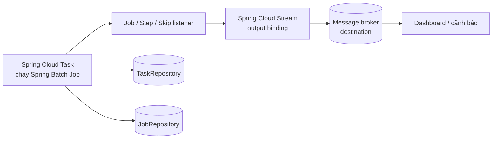

# Đổi đích nhận và bật tắt từng loại sự kiện Batch

Trong **Spring Cloud Task**, một ứng dụng chạy hữu hạn có thể thực thi **Spring Batch Job**, ghi kết quả và kết thúc. Spring Cloud Task lưu vòng đời tiến trình vào **`TaskRepository`**; Spring Batch lưu thông tin Job/Step vào **`JobRepository`**. Khi cần dashboard, giám sát vận hành hoặc cảnh báo từ xa, Spring Cloud Task có thể tích hợp **Spring Cloud Stream** để phát thêm **sự kiện Batch** ra message broker.

Không phải ứng dụng nào cũng cần mọi sự kiện. Ví dụ, tác vụ đối soát doanh thu đọc hàng triệu giao dịch nhưng dashboard chỉ cần biết Job nào bắt đầu, Step nào thất bại và item nào bị skip. Phát sự kiện trên từng item có thể tăng tải broker không cần thiết; ngoài ra, mỗi nhóm người nhận có thể cần destination riêng.

Trong chương **Sự kiện**, bài học này giải quyết hai việc:

1. **Đổi destination** nhận sự kiện của từng listener Batch qua Spring Cloud Stream binding.
2. **Bật/tắt từng loại sự kiện**, hoặc tắt toàn bộ cơ chế phát Batch events qua các property `spring.cloud.task.batch.events.*`.

Sau bài, bạn có thể phân biệt **listener, binding name và destination**, chọn các event có giá trị vận hành, viết cấu hình YAML đầy đủ, đối chiếu kết quả với metadata Task/Batch, và tránh hiểu nhầm việc tắt event là tắt xử lý nghiệp vụ.

## 1. Event Batch đi từ đâu đến đâu?

Khi Spring Cloud Task chạy cùng Spring Batch và Spring Cloud Stream, framework có thể tự cấu hình các **event-emitting listener** để quan sát callback của Job/Step. Listener đưa thông tin lên **output binding**; một **binder** (RabbitMQ, Kafka hoặc binder khác được hỗ trợ) chuyển message đến destination trên broker.



Các thành phần trong sơ đồ có trách nhiệm khác nhau:

| Thành phần | Vai trò | Không nên hiểu là |
| --- | --- | --- |
| `TaskRepository` | Lưu `TaskExecution`, mã thoát và thời gian chạy ứng dụng | Hàng đợi message Batch. |
| `JobRepository` | Lưu `JobExecution`, `StepExecution`, checkpoint để restart | Thay thế cho broker. |
| Event-emitting listener | Theo dõi callback Spring Batch và tạo message | Cơ chế điều phối/khởi chạy lại Job. |
| Spring Cloud Stream binding | Đầu ra logic của publisher | Tên topic hoặc exchange cố định. |
| Binder và destination | Gửi message đến hệ thống tin nhắn | Cam kết bản tin luôn đến đúng một lần. |

**Sự kiện là dữ liệu quan sát bổ sung.** Một event được phát không tự xác nhận dữ liệu nghiệp vụ đã commit; và một Job vẫn có thể chạy, cập nhật repository ngay cả khi cơ chế phát sự kiện đã bị tắt.

### Ba tên dễ nhầm

Ví dụ đối với Step:

- **Listener:** `StepExecutionListener`, được gọi trong vòng đời Step.
- **Binding name:** `step-execution-events`, là tên logic của kênh đầu ra.
- **Destination:** `ops.batch.steps.v1`, là nơi broker nhận tin sau khi cấu hình mapping.

Giữ binding name nhưng đổi destination là lựa chọn đơn giản nhất. Đổi binding name là một thao tác khác và cần cấu hình lại destination theo tên mới.

## 2. Bảy loại sự kiện Spring Batch

Spring Cloud Task hỗ trợ bảy nhóm listener sự kiện khi ứng dụng chạy Batch Job:

| Loại | Listener Spring Batch | Binding mặc định | Ý nghĩa và tải |
| --- | --- | --- | --- |
| **Job execution** | `JobExecutionListener` | `job-execution-events` | Vòng đời Job, tần suất thấp. |
| **Step execution** | `StepExecutionListener` | `step-execution-events` | Vòng đời Step, giúp biết bước nào lỗi. |
| **Chunk** | `ChunkListener` | `chunk-events` | Theo chu kỳ chunk, nhiều hơn Step. |
| **Item read** | `ItemReadListener` | `item-read-events` | Theo thao tác đọc item; có thể rất nhiều. |
| **Item process** | `ItemProcessListener` | `item-process-events` | Theo thao tác xử lý item; có thể rất nhiều. |
| **Item write** | `ItemWriteListener` | `item-write-events` | Theo callback ghi nhóm item/chunk, không nhất thiết từng item. |
| **Skip** | `SkipListener` | `skip-events` | Khi Batch có item bị bỏ qua theo chính sách skip. |

**Gợi ý cho production:** Bắt đầu bằng **Job + Step + Skip** nếu mục tiêu là biết quy trình bắt đầu/kết thúc và phát hiện dữ liệu bị loại. Chỉ bật Chunk, Item Read, Item Process, Item Write khi thực sự cần theo dõi chi tiết và có ngân sách lưu lượng phù hợp.

Chỉ bật `skip.enabled=true` **không tự tạo event skip**. Spring Batch phải thực sự gặp tình huống skip trong Job/Step, và listener phải được cấu hình thành công.

## 3. Điều kiện để publisher hoạt động

Đặt property trong `application.yml` **không tự tạo broker hoặc listener**. Cần đáp ứng:

1. Ứng dụng có Spring Cloud Task, Spring Batch và một **Batch Job thực sự được chạy**.
2. Cơ chế listener Batch events tương thích với phiên bản Spring Cloud Task đã chọn, và các điều kiện auto-configuration được đáp ứng.
3. Có **Spring Cloud Stream** và một **binder implementation** tương ứng broker trên classpath.
4. Broker khả dụng, tài khoản có quyền publish destination và cấu hình connection đúng.
5. Các công tắc event đang bật và tên binding/destination được ánh xạ đúng.

Ví dụ dependency Maven cho broker **RabbitMQ** (ghép vào `pom.xml` đã có Spring Boot parent, Spring Cloud BOM tương thích và plugin đóng gói):

```xml
<dependencies>
    <dependency>
        <groupId>org.springframework.cloud</groupId>
        <artifactId>spring-cloud-starter-task</artifactId>
    </dependency>
    <dependency>
        <groupId>org.springframework.boot</groupId>
        <artifactId>spring-boot-starter-batch</artifactId>
    </dependency>
    <dependency>
        <groupId>org.springframework.cloud</groupId>
        <artifactId>spring-cloud-stream-binder-rabbit</artifactId>
    </dependency>
    <dependency>
        <groupId>org.postgresql</groupId>
        <artifactId>postgresql</artifactId>
        <scope>runtime</scope>
    </dependency>
</dependencies>
```

Đoạn trên không phải POM hoàn chỉnh. Nếu dùng Kafka, thay binder RabbitMQ bằng binder Kafka và cấu hình kết nối tương ứng. Phải chọn **Spring Boot, Spring Cloud release train, Spring Batch và Stream binder tương thích**; cách đăng ký các binding nội bộ có thể khác giữa các thế hệ framework.

## 4. Đổi destination mà không đổi tên binding

Đây là cách ưu tiên nếu chỉ muốn chuyển nơi nhận. Ví dụ:

```yaml
spring:
  cloud:
    task:
      batch:
        events:
          enabled: true
    stream:
      bindings:
        job-execution-events:
          destination: ops.batch.jobs.v1
        step-execution-events:
          destination: ops.batch.steps.v1
        skip-events:
          destination: ops.batch.skips.v1
```

Các binding mặc định vẫn tên `job-execution-events`, `step-execution-events` và `skip-events`. Chỉ nơi publish của chúng thay đổi.

Viết bằng `.properties` tương đương:

```properties
spring.cloud.stream.bindings.job-execution-events.destination=ops.batch.jobs.v1
spring.cloud.stream.bindings.step-execution-events.destination=ops.batch.steps.v1
spring.cloud.stream.bindings.skip-events.destination=ops.batch.skips.v1
```

Định dạng chung:

```properties
spring.cloud.stream.bindings.<binding-name>.destination=<new-destination>
```

Trong đó `<binding-name>` là **tên binding mà listener đang sử dụng**, không phải tên class Java; `<new-destination>` là đích broker mong muốn. Ý nghĩa chính xác của destination phụ thuộc binder: với Kafka thường liên quan topic; với RabbitMQ còn chịu tác động của cấu hình exchange/routing/binding ở binder.

### Khi nào không nên gom mọi event vào một destination?

Nếu tất cả Job, Step và Item events cùng đổ về một topic/exchange, bên nhận phải có hợp đồng payload rõ ràng để phân loại, đồng thời chia sẻ cùng mức retention, ACL và áp lực tải. Với hệ thống giám sát lớn, **tách destination theo cấp độ dữ liệu** thường giúp:

- Dashboard Job không phải đọc những bản tin item-level.
- Cảnh báo skip có retention và người nhận riêng.
- Đặt ACL và chính sách bảo mật chặt hơn cho bản tin có thông tin chi tiết.
- Quản lý băng thông và chi phí theo từng nhóm.

## 5. Đổi tên binding trước khi chọn destination

Spring Cloud Task còn hỗ trợ property thay **binding name** của listener. Giả sử muốn listener Step publish qua binding logic `stepAuditOut`, rồi định tuyến binding đó tới `ops.batch.steps.v2`:

```yaml
spring:
  cloud:
    task:
      batch:
        events:
          step-execution-event-binding-name: stepAuditOut
    stream:
      bindings:
        stepAuditOut:
          destination: ops.batch.steps.v2
```

Hai thuộc tính có mục tiêu khác nhau:

- `spring.cloud.task.batch.events.step-execution-event-binding-name`: đổi **tên binding** mà listener Step sử dụng.
- `spring.cloud.stream.bindings.stepAuditOut.destination`: đổi **destination thực tế** của binding mới.

Nếu chỉ đổi binding name mà vẫn cấu hình destination dưới tên binding **cũ**, listener không nhất thiết dùng đích đã dự định. Do đó, khi đổi binding name, **phải map lại destination dưới tên mới** và kiểm tra binding runtime.

### Các property đổi tên binding

| Listener | Thuộc tính được Spring Cloud Task cấu hình |
| --- | --- |
| Job execution | `spring.cloud.task.batch.events.job-execution-event-binding-name` |
| Step execution | `spring.cloud.task.batch.events.step-execution-event-binding-name` |
| Chunk | `spring.cloud.task.batch.events.chunk-event-binding-name` |
| Item read | `spring.cloud.task.batch.events.item-read-event-binding-name` |
| Item process | `spring.cloud.task.batch.events.item-process-event-binding-name` |
| Item write | `spring.cloud.task.batch.events.item-write-event-binding-name` |
| Skip | `spring.cloud.task.batch.events.skip-event-binding-name` |

**Cảnh báo tên property:** Một số ví dụ trong tài liệu hướng dẫn Spring Cloud Task ghi `step-execution-events-binding-name` (dạng số nhiều `events`), trong khi bảng **configuration properties** và API `TaskEventProperties#setStepExecutionEventBindingName(...)` của dòng 3.x sử dụng **`step-execution-event-binding-name`** (số ít `event`). Khi đổi binding name, hãy đối chiếu **configuration metadata/API đúng phiên bản dự án**. Nếu chỉ cần đổi nơi nhận, dùng `spring.cloud.stream.bindings.step-execution-events.destination` sẽ dễ tránh nhầm hơn.

## 6. Tắt toàn bộ Batch events

Tắt listener phát sự kiện Batch do Spring Cloud Task tự cấu hình:

```properties
spring.cloud.task.batch.events.enabled=false
```

Tương đương:

```yaml
spring:
  cloud:
    task:
      batch:
        events:
          enabled: false
```

**Ảnh hưởng:** Cơ chế event Batch bị tắt; **Batch Job vẫn có thể chạy**, Step vẫn đọc/xử lý/ghi, `JobRepository` vẫn lưu metadata, `TaskRepository` vẫn có thể ghi `TaskExecution`. Listener tự viết hoặc pipeline phát message khác của ứng dụng không nhất thiết chịu tác động bởi property này.

### Task events và Batch events là hai công tắc khác nhau

| Property | Phạm vi |
| --- | --- |
| `spring.cloud.task.events.enabled=false` | Không phát event cấp **Spring Cloud Task** như `TaskExecution` qua `task-events`. |
| `spring.cloud.task.batch.events.enabled=false` | Không phát event cấp **Spring Batch** như Job, Step, Chunk qua cơ chế listener được tích hợp. |

Muốn **chỉ nhận Task events**, tắt Batch:

```yaml
spring:
  cloud:
    task:
      events:
        enabled: true
      batch:
        events:
          enabled: false
```

Muốn **chỉ nhận Batch events**, tắt Task:

```yaml
spring:
  cloud:
    task:
      events:
        enabled: false
      batch:
        events:
          enabled: true
```

**Không dùng `spring.batch.job.enabled=false` như công tắc tắt sự kiện Batch.** Property này kiểm soát cơ chế Spring Boot tự chạy Job lúc startup. Nếu ứng dụng tự gọi `JobLauncher`, Batch Job và các listener phát event vẫn có thể hoạt động.

## 7. Tắt riêng từng loại event

Spring Cloud Task hỗ trợ các property sau:

```properties
spring.cloud.task.batch.events.job-execution.enabled=false
spring.cloud.task.batch.events.step-execution.enabled=false
spring.cloud.task.batch.events.chunk.enabled=false
spring.cloud.task.batch.events.item-read.enabled=false
spring.cloud.task.batch.events.item-process.enabled=false
spring.cloud.task.batch.events.item-write.enabled=false
spring.cloud.task.batch.events.skip.enabled=false
```

Mỗi dòng trên là **ví dụ tắt đúng một loại**. Không cần sao chép toàn bộ rồi đặt `false` nếu mục tiêu vẫn cần event Job/Step. Để bật một loại, dùng `enabled=true` (và bật công tắc tổng), đồng thời cần listener/binder hoạt động. Giá trị mặc định từng loại ở các release được tài liệu hóa thường là `true`, nhưng phải kiểm tra phiên bản đang triển khai.

### Mẫu khuyến nghị cho giám sát gọn

Chỉ giữ **Job, Step, Skip**, tắt thông tin mức chunk/item:

```yaml
spring:
  cloud:
    task:
      batch:
        events:
          enabled: true
          job-execution:
            enabled: true
          step-execution:
            enabled: true
          skip:
            enabled: true
          chunk:
            enabled: false
          item-read:
            enabled: false
          item-process:
            enabled: false
          item-write:
            enabled: false
    stream:
      bindings:
        job-execution-events:
          destination: ops.batch.jobs.v1
        step-execution-events:
          destination: ops.batch.steps.v1
        skip-events:
          destination: ops.batch.skips.v1
```

Kết quả kỳ vọng:

- Job/Step có thể phát bản tin lifecycle khi được thực thi.
- Skip chỉ có bản tin khi Job thực sự phát sinh tình huống skip.
- Event Chunk, Item Read, Item Process, Item Write từ cơ chế listener Batch này không còn được phát.
- Việc **đọc, xử lý, ghi và skip của Spring Batch vẫn giữ nguyên**: chỉ phần **message event** bị tắt.

Việc có bản tin cụ thể còn phụ thuộc Job, cơ chế tự cấu hình listener, broker và binder trong phiên bản ứng dụng.

## 8. Ví dụ cấu hình thực hành

Ứng dụng `daily-reconciliation-task` chạy Job đối soát doanh thu, gửi các event cấp Job/Step/Skip đến RabbitMQ. Đoạn `application.yml` minh họa:

```yaml
spring:
  application:
    name: daily-reconciliation-task
  main:
    web-application-type: none
  datasource:
    url: jdbc:postgresql://localhost:5432/reconciliation
    username: task_app
    password: ${TASK_DB_PASSWORD}
  batch:
    job:
      enabled: false
    jdbc:
      initialize-schema: never
  cloud:
    task:
      name: dailyReconciliationTask
      initialize-enabled: false
      events:
        enabled: true
      batch:
        events:
          enabled: true
          job-execution:
            enabled: true
          step-execution:
            enabled: true
          skip:
            enabled: true
          chunk:
            enabled: false
          item-read:
            enabled: false
          item-process:
            enabled: false
          item-write:
            enabled: false
    stream:
      bindings:
        job-execution-events:
          destination: ops.batch.jobs.v1
        step-execution-events:
          destination: ops.batch.steps.v1
        skip-events:
          destination: ops.batch.skips.v1
  rabbitmq:
    host: localhost
    port: 5672
    username: ${RABBIT_USERNAME}
    password: ${RABBIT_PASSWORD}
```

Ví dụ giả định schema Spring Cloud Task/Spring Batch đã được tạo bằng migration tương thích (vì `initialize-schema: never` và `initialize-enabled: false`). Tài khoản broker/database dùng quyền tối thiểu; mật khẩu lấy từ biến môi trường hoặc secret manager. Không đưa secret vào dòng lệnh hoặc metadata event.

`spring.batch.job.enabled=false` trong ví dụ có nghĩa **ứng dụng chủ động chạy Job**, thay vì Boot tự chạy khi startup. Cấu hình bean `Job` và `ApplicationRunner` có thể như sau (đoạn đặt trong class cấu hình Spring Boot 3.x / Spring Batch 5.x với các import đúng):

```java
@Bean
Step reconcileStep(
        JobRepository repository,
        PlatformTransactionManager transactionManager) {
    return new StepBuilder("reconcileStep", repository)
        .tasklet((contribution, context) -> {
            System.out.println("Dang doi soat du lieu");
            // TODO: Goi service nghiep vu thuc te.
            return RepeatStatus.FINISHED;
        }, transactionManager)
        .build();
}

@Bean
Job reconciliationJob(
        JobRepository repository,
        @Qualifier("reconcileStep") Step step) {
    return new JobBuilder("reconciliationJob", repository)
        .start(step)
        .build();
}

@Bean
ApplicationRunner launchJob(
        JobLauncher launcher,
        @Qualifier("reconciliationJob") Job job) {
    return args -> {
        List<String> dates = args.getOptionValues("business-date");
        if (dates == null || dates.size() != 1) {
            throw new IllegalArgumentException(
                "Can --business-date=YYYY-MM-DD"
            );
        }
        LocalDate date = LocalDate.parse(dates.get(0));
        JobParameters parameters = new JobParametersBuilder()
            .addString("businessDate", date.toString(), true)
            .toJobParameters();

        JobExecution execution = launcher.run(job, parameters);
        if (execution.getStatus() != BatchStatus.COMPLETED) {
            throw new IllegalStateException(
                "Job khong hoan thanh: " + execution.getStatus()
            );
        }
    };
}
```

Ví dụ cần các import Spring Batch/Boot/Spring Framework tương ứng và một ứng dụng được bật Spring Cloud Task (chẳng hạn `@EnableTask`). Giả định `JobLauncher` chạy **đồng bộ**; nếu bất đồng bộ, phải đợi trạng thái kết thúc rồi mới kiểm tra `BatchStatus` hoặc đóng Task. Các bean này **chỉ tạo Job và thực hiện nghiệp vụ**. Event Batch được phát qua listener tích hợp khi đủ điều kiện, không cần tự viết lệnh gửi message trong tasklet.

Chạy từ JAR đã đóng gói:

```bash
./mvnw clean package
java -jar target/daily-reconciliation-task-0.0.1-SNAPSHOT.jar \
  --business-date=2026-11-24
```

Tên artifact trong lệnh là ví dụ. Nếu JobInstance cho cùng ngày đã `COMPLETED`, Spring Batch thường không chạy lại cùng bộ identifying JobParameters; hãy dùng ngày khác hoặc quy trình reprocess được thiết kế rõ ràng.

## 9. Consumer phải subscribe đúng destination

Khi producer đổi đích từ `job-execution-events` sang `ops.batch.jobs.v1`, consumer cũng phải trỏ vào đích mới.

Ví dụ một ứng dụng nhận tin kiểu **functional Spring Cloud Stream**, với bean consumer mang tên `jobStatusConsumer`:

```yaml
spring:
  cloud:
    function:
      definition: jobStatusConsumer
    stream:
      bindings:
        jobStatusConsumer-in-0:
          destination: ops.batch.jobs.v1
          group: monitoring-service
```

Đây là cấu hình **bên nhận**, không phải phần của task phát tin. Consumer còn phải cung cấp bean function thực tế, kiểu message/payload tương thích, broker binder, error handling và quyền subscription.

Tài liệu Spring Cloud Stream cũ có thể dùng `spring.cloud.stream.bindings.input.destination`. Với ứng dụng hiện đại sử dụng mô hình functional binding, tên như `jobStatusConsumer-in-0` là cấu trúc cần kiểm tra. **Không để producer đã chuyển đích nhưng consumer vẫn đăng ký destination cũ**, vì dashboard có thể im lặng dù Task và Batch chạy thành công.

## 10. Những gì bật/tắt event không thay đổi

| Cấu hình | Thay đổi điều gì? | Không tự thay đổi điều gì? |
| --- | --- | --- |
| `spring.cloud.stream.bindings.<name>.destination` | Nơi bản tin của binding được publish | Logic Job/Step, `TaskExecution`, transaction. |
| `spring.cloud.task.batch.events.*-event-binding-name` | Tên binding mà listener sử dụng | Destination nếu không có mapping mới. |
| `spring.cloud.task.batch.events.enabled=false` | Tắt listener phát event Batch tích hợp | Việc chạy Batch Job, JobRepository, restart. |
| `spring.cloud.task.events.enabled=false` | Tắt event cấp Task | Metadata Task và event Batch được cấu hình riêng. |
| `item-read.enabled=false` | Tắt gửi event item-read | `ItemReader` vẫn đọc dữ liệu. |
| `skip.enabled=false` | Tắt gửi event skip | Quy tắc skip của Step vẫn có thể thực hiện. |
| `spring.batch.job.enabled=false` | Tắt **Boot tự khởi chạy Job** | JobLauncher do ứng dụng gọi vẫn có thể chạy Job. |

### Listener order không phải thứ tự message trên broker

Spring Cloud Task còn có các property `spring.cloud.task.batch.events.job-execution-order`, `step-execution-order`, `chunk-order`, `item-read-order`, `item-process-order`, `item-write-order` và `skip-order`, dùng thay đổi **`Ordered` precedence** của listener.

Đó là thứ tự callback listener trong cùng ngữ cảnh, **không bảo đảm** mọi bản tin từ nhiều topic/partition/JVM sẽ đến consumer theo thứ tự toàn cục. Khi xử lý phụ thuộc trình tự, cần event ID, timestamp, JobExecution ID và chính sách ordering của broker tương ứng.

## 11. Khắc phục sự cố khi không nhận đúng event

| Triệu chứng | Nguyên nhân có thể | Cách kiểm tra |
| --- | --- | --- |
| Không nhận event nào | Thiếu binder, Job không chạy, broker lỗi hoặc `batch.events.enabled=false` | Kiểm tra dependency, cấu hình, JobExecution, log binder và broker. |
| Job event có nhưng Step event không có | Tắt riêng Step, sai binding name hoặc consumer dùng destination cũ | Kiểm tra `step-execution.enabled` và input/output mapping. |
| Đổi binding name nhưng destination không đổi | Map destination dưới **tên binding cũ** hoặc sai tên property số ít/số nhiều | Xem `TaskEventProperties`, configuration metadata và binding runtime. |
| Bật Skip nhưng không có bản tin | Job không có item bị skip | Kiểm tra skipCount và cấu hình skip của Step. |
| Số bản tin tăng rất cao | Chunk/item event đang bật | Tắt những listener không cần thiết, theo dõi lưu lượng broker. |
| Tắt Batch event nhưng Job vẫn chạy | Đó là kết quả đúng | Phân biệt event listener và Job/Step thực thi. |
| Consumer mất bản tin khi đổi destination | Producer và consumer khác cấu hình | Di chuyển subscription/bridge theo kế hoạch, tránh mất giám sát. |
| Bản tin trùng khi retry | Task chạy lại hoặc broker redelivery | Dùng event/correlation ID, xử lý consumer idempotent. |
| Metadata Task chưa kết thúc dù đã có event | Tiến trình còn chạy, lỗi cập nhật metadata hoặc bị kill | Đọc `TaskRepository`, log, trạng thái container/JVM. |

Đối chiếu metadata Batch:

```sql
SELECT
    JOB_EXECUTION_ID,
    JOB_INSTANCE_ID,
    STATUS,
    EXIT_CODE,
    START_TIME,
    END_TIME
FROM BATCH_JOB_EXECUTION
ORDER BY JOB_EXECUTION_ID DESC;
```

Và metadata Spring Cloud Task:

```sql
SELECT
    TASK_EXECUTION_ID,
    TASK_NAME,
    START_TIME,
    END_TIME,
    EXIT_CODE
FROM TASK_EXECUTION
ORDER BY TASK_EXECUTION_ID DESC;
```

Tên bảng/cột phải tương ứng schema của phiên bản framework đã cài. **Không xem “không có event” là chứng minh “Job chưa chạy”**. Nếu JobRepository có bản ghi Job đã hoàn thành nhưng broker không nhận được gì, tập trung điều tra listener auto-configuration, binding, binder, quyền publish và subscription.

## 12. An toàn, độ tin cậy và vận hành theo lịch

**Kiểm soát dữ liệu nhạy cảm.** Event từ listener có thể chứa thông tin Job/Step và ngữ cảnh xử lý. Không phát bí mật, token, payload cá nhân hoặc dữ liệu nguồn quá chi tiết khi không cần; áp dụng ACL, mã hóa khi truyền, retention và giới hạn nhóm nhận.

**Không coi event là nguồn trạng thái duy nhất.** Nếu JVM bị `SIGKILL` hoặc broker không khả dụng, event kết thúc có thể thiếu dù dữ liệu đã commit; ngược lại, một event có thể được gửi lại. Khi quyết định retry, phải kiểm tra `TaskExecution`, `JobExecution`, kết quả nghiệp vụ và tình trạng hạ tầng.

**Không mặc định exactly-once.** Tùy binder, broker và cấu hình ACK/retry, có thể có message gửi lặp hoặc thất lạc trong những trường hợp sự cố. Bên nhận nên idempotent theo correlation ID/event ID và có chính sách xử lý bản tin không đúng schema.

**Nếu cần thông báo tin cậy sau commit**, listener publish trực tiếp không tự tạo một transaction nguyên tử giữa database nghiệp vụ và broker. Có thể cân nhắc **transactional outbox**, dispatcher gửi lại và deduplication ở consumer, tùy mức bảo đảm của quy trình.

**Phân tách môi trường.** Dev, staging và production nên dùng destination/namespace riêng. Có thể cấu hình destination qua biến môi trường:

```yaml
spring:
  cloud:
    stream:
      bindings:
        job-execution-events:
          destination: ${BATCH_JOB_EVENT_DESTINATION:dev.batch.jobs.v1}
```

Khi triển khai, quản lý biến môi trường và permission để ứng dụng không phát nhầm vào destination production. Trong lần chuyển đích lớn, nên tính đến consumer cũ, schema, ACL và thời gian chuyển tiếp.

## 13. Bài thực hành

Thực hiện trên **database và broker thử nghiệm**:

1. Chuẩn bị một ứng dụng Spring Cloud Task có Batch Job và binder; xác nhận `JobRepository`/`TaskRepository` có metadata sau lần chạy.
2. Để binding mặc định, quan sát `job-execution-events` và `step-execution-events` khi Job chạy.
3. Đổi `spring.cloud.stream.bindings.job-execution-events.destination` thành `lab.batch.jobs.v2`, cập nhật consumer và xác nhận đã chuyển đích.
4. Đổi tên binding Step qua `step-execution-event-binding-name`, đồng thời map destination dưới tên mới. Thử cố ý chỉ đổi một phía để phân tích lỗi.
5. Bật `job-execution`, `step-execution`, `skip`; tắt `chunk`, `item-read`, `item-process`, `item-write`. So sánh số message trước và sau.
6. Tắt `spring.cloud.task.batch.events.enabled` rồi chạy một JobInstance hợp lệ. Tại sao các bảng Batch vẫn có dữ liệu?
7. Tắt riêng `skip.enabled`, cấu hình một Step có skip thật. Kiểm tra rằng hoạt động skip vẫn diễn ra dù không phát event.
8. Tắt Task events nhưng giữ Batch events, sau đó đảo ngược; mô tả sự khác biệt giữa hai cơ chế.
9. Cho consumer ngừng hoạt động rồi chạy Task; kiểm tra khả năng lưu và nhận lại bản tin theo binder/group thực tế.
10. Xây dựng kế hoạch production chỉ dùng Job/Step/Skip events, với destination và chính sách retention riêng.

**Câu hỏi ôn tập:**

- Listener, binding name và destination khác nhau ở đâu?
- Vì sao nên ưu tiên đổi destination của binding mặc định thay vì đổi cả binding name?
- Property nào tắt **tất cả** Batch events? Property nào chỉ tắt **Item Read**?
- Tại sao tắt `spring.batch.job.enabled` không tương đương tắt Batch events?
- Một Job có `skipCount = 0` có bắt buộc tạo bản tin skip không?
- Khi không thấy event kết thúc, nên xác minh những nguồn trạng thái nào trước khi retry?

**Ghi nhớ:** Để **đổi đích nhận**, dùng `spring.cloud.stream.bindings.<binding-name>.destination`; để **đổi tên binding**, dùng property `*-event-binding-name` đúng phiên bản; để **tắt sự kiện**, dùng `spring.cloud.task.batch.events.<listener>.enabled=false` hoặc tắt toàn bộ bằng `spring.cloud.task.batch.events.enabled=false`. Những property này quản lý **thông báo quan sát**, không thay thế metadata, giao dịch và khả năng restart của Spring Cloud Task hoặc Spring Batch.

**Tài liệu tham khảo chính thức:**

- [Spring Cloud Task — Spring Cloud Stream Integration](https://docs.spring.io/spring-cloud-task/reference/stream.html).
- [Spring Cloud — Configuration Properties](https://docs.spring.io/spring-cloud/docs/current/reference/html/configprops.html).
- [Spring Cloud Task 3.0.4 — TaskEventProperties API](https://docs.spring.io/spring-cloud-task/docs/current/apidocs/org/springframework/cloud/task/batch/listener/support/TaskEventProperties.html).
- [Spring Cloud Stream Reference](https://docs.spring.io/spring-cloud-stream/reference/).
