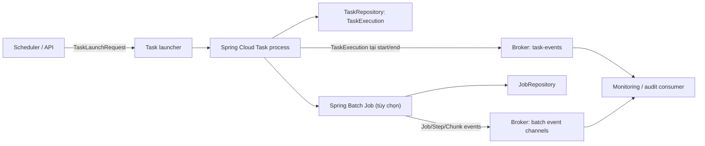

# Nội dung thông điệp, định danh thực thi và tương thích dữ liệu

## 1. Vì sao sự kiện Task cần một hợp đồng dữ liệu rõ ràng?

**Spring Cloud Task** dùng để xây dựng ứng dụng Spring Boot chạy trong thời gian hữu hạn: khởi động, thực hiện nghiệp vụ rồi kết thúc. Mỗi lần chạy được theo dõi bằng một `TaskExecution` trong **TaskRepository**. Khi kết hợp với **Spring Cloud Stream**, ứng dụng còn có thể phát sự kiện để hệ thống giám sát, cảnh báo hoặc điều phối biết tiến trình đã bắt đầu và kết thúc mà không cần liên tục truy vấn database.

Giả sử Task `invoice-import` chạy theo lịch để nhập hóa đơn:

- Scheduler khởi chạy Task lúc 01:00 và muốn theo dõi tiến độ.
- Dashboard nhận thông điệp “bắt đầu”, sau đó nhận thông điệp “kết thúc” có mã thoát.
- Task có thể gọi Spring Batch Job; hệ thống vận hành muốn liên kết `TaskExecution` với `JobExecution`.
- Broker có thể giao lại thông điệp, các sự kiện đến không đúng thứ tự hoặc consumer được nâng cấp trước producer.

Nếu chỉ đọc chuỗi JSON mà không hiểu **payload chứa gì**, **ID nào thuộc lớp nào**, **trường nào có thể null** và **định dạng nào được cam kết tương thích**, consumer rất dễ đánh dấu nhầm kết quả, gộp hai lần chạy khác nhau hoặc thất bại khi producer đổi phiên bản.

Bài học thuộc chương **Sự kiện** và tập trung vào ba chủ đề:

1. **Nội dung thông điệp**: sự kiện gốc `TaskExecution`, sự kiện Batch và thông điệp nghiệp vụ đã chuẩn hóa khác nhau như thế nào?
2. **Định danh thực thi**: `taskExecutionId`, `externalExecutionId`, `parentExecutionId`, `jobExecutionId` và `eventId` dùng ở đâu?
3. **Tương thích dữ liệu**: định nghĩa schema/version, xử lý null, thời gian, dữ liệu nhạy cảm, sự kiện trùng hoặc sai thứ tự và nâng cấp producer–consumer.

## 2. Phân biệt lệnh khởi chạy và sự kiện kết quả

Spring Cloud Task hỗ trợ tích hợp Spring Cloud Stream theo nhiều hướng. **Không được nhầm thông điệp yêu cầu khởi chạy với thông điệp mô tả lần chạy đã xảy ra.**

| Loại thông điệp | Mục đích | Nội dung đặc trưng |
| --- | --- | --- |
| `TaskLaunchRequest` | **Lệnh** yêu cầu hệ thống launcher tạo Task | `uri` của artifact, `applicationName`, `commandLineArguments`, `environmentProperties`, `deploymentProperties` |
| `TaskExecution` trên kênh `task-events` | **Sự kiện trạng thái** của lần chạy Task | ID, tên, thời gian bắt đầu/kết thúc, exit code, thông điệp và tham số |
| Sự kiện Spring Batch | Phản ánh Job/Step/Chunk hoặc item listener | Dữ liệu theo loại callback Batch, không cùng schema với `TaskExecution` |
| Event contract do ứng dụng định nghĩa | Giao diện ổn định cho các hệ thống khác | `eventId`, `schemaVersion`, `eventType`, các ID tương quan và kết quả đã chuẩn hóa |

`TaskLaunchRequest` có thể đi từ một processor tới task sink để ra lệnh khởi chạy. Nó không chứng minh Task đã chạy thành công. Ngược lại, `task-events` phản ánh một mốc của lifecycle; nhận được event bắt đầu không có nghĩa công việc sẽ hoàn thành.



Để một chuỗi lệnh và kết quả có thể truy vết, bên điều phối nên tạo **correlation ID** hoặc `externalExecutionId` có chủ đích; sau khi Task có `taskExecutionId`, lưu quan hệ giữa hai giá trị đó thay vì coi chúng là cùng một ID.

## 3. Sự kiện Task gốc: payload là TaskExecution

Theo tài liệu Spring Cloud Task, khi classpath chứa `spring-cloud-stream`, **một binder được hỗ trợ** và Task đã được định nghĩa, listener sự kiện có thể phát đối tượng `TaskExecution` lên channel có tên **`task-events`** tại **lúc bắt đầu và lúc kết thúc**. Tắt listener phát sự kiện gốc bằng:

```properties
spring.cloud.task.events.enabled=false
```

Sự kiện gốc dùng **kiểu Java `TaskExecution`**, không phải một hợp đồng JSON nghiệp vụ do nhóm phát triển tự định nghĩa. Đối tượng Java này có các getter:

| Thuộc tính Java | Kiểu | Ý nghĩa |
| --- | --- | --- |
| `getExecutionId()` | `long` | ID của một lần TaskExecution trong repository |
| `getTaskName()` | `String` | Tên Task |
| `getStartTime()` | `LocalDateTime` | Thời điểm bắt đầu |
| `getEndTime()` | `LocalDateTime` | Thời điểm kết thúc, có thể `null` |
| `getExitCode()` | `Integer` | Mã thoát, có thể `null` khi chưa có kết quả |
| `getExitMessage()` | `String` | Tóm tắt do ứng dụng gán, có thể `null` |
| `getErrorMessage()` | `String` | Thông tin lỗi kỹ thuật khi được lifecycle ghi nhận, có thể `null` |
| `getArguments()` | `List<String>` | Danh sách đối số khi chạy; có thể chứa dữ liệu nhạy cảm |
| `getExternalExecutionId()` | `String` | Định danh do nền tảng bên ngoài cung cấp, nếu có |
| `getParentExecutionId()` | `Long` | ID TaskExecution cha, nếu được cấu hình |

**Không phải mọi trường đều có giá trị ở mọi mốc.** Sự kiện bắt đầu thường chưa có `endTime` và `exitCode`. Sự kiện cuối có thể có mã thoát và thông điệp, nhưng khi tiến trình bị `SIGKILL` hoặc không khởi tạo xong, bạn có thể **không nhận được sự kiện cuối**.

### 3.1. Hai thông điệp cùng một TaskExecution

Hai ví dụ JSON dưới đây **chỉ minh họa ý nghĩa dữ liệu có thể xuất hiện khi serialize `TaskExecution`**. Chúng **không phải wire schema chính thức** của mọi phiên bản Jackson/binder; định dạng ngày, tên thuộc tính, type headers và cách biểu diễn null cần được kiểm tra trong môi trường thực tế.

**Khi bắt đầu**:

```json
{
  "executionId": 4812,
  "taskName": "invoice-import",
  "startTime": "2026-11-24T01:00:00",
  "endTime": null,
  "exitCode": null,
  "exitMessage": null,
  "errorMessage": null,
  "arguments": ["--task.business-date=2026-11-23"],
  "externalExecutionId": "scheduler-run-974",
  "parentExecutionId": null
}
```

**Khi kết thúc**:

```json
{
  "executionId": 4812,
  "taskName": "invoice-import",
  "startTime": "2026-11-24T01:00:00",
  "endTime": "2026-11-24T01:13:26",
  "exitCode": 0,
  "exitMessage": "IMPORTED; count=1200",
  "errorMessage": null,
  "arguments": ["--task.business-date=2026-11-23"],
  "externalExecutionId": "scheduler-run-974",
  "parentExecutionId": null
}
```

**Điểm quan trọng:** `TaskExecution` gốc **không bảo đảm có trường `eventType` hoặc `schemaVersion`** để consumer biết chính xác phase. Người nhận có thể đối chiếu `endTime`/`exitCode` và repository, nhưng **không nên thiết kế quy trình trọng yếu chỉ dựa vào suy đoán một trường null**. Nếu bạn cần nhận biết `STARTED`/`FINISHED` rõ ràng, hãy phát envelope phiên bản hóa của chính ứng dụng.

### 3.2. Dependency và binding khi dùng sự kiện gốc

Ví dụ Maven (đặt trong `dependencies` của dự án đã import Spring Boot và Spring Cloud BOM tương thích):

```xml
<dependencies>
    <dependency>
        <groupId>org.springframework.cloud</groupId>
        <artifactId>spring-cloud-starter-task</artifactId>
    </dependency>
    <dependency>
        <groupId>org.springframework.cloud</groupId>
        <artifactId>spring-cloud-stream</artifactId>
    </dependency>
    <dependency>
        <groupId>org.springframework.cloud</groupId>
        <artifactId>spring-cloud-stream-binder-kafka</artifactId>
    </dependency>
</dependencies>
```

`spring-cloud-stream-binder-kafka` là **một lựa chọn minh họa**. Có thể dùng binder khác được phiên bản dự án hỗ trợ; cần cấu hình và vận hành broker tương ứng. Chỉ thêm `spring-cloud-stream` mà không có binder thì không tự có một kênh sự kiện liên tiến trình hoạt động.

Ví dụ cấu hình binding truyền thống mà tài liệu Spring Cloud Task đặt tên là `task-events`:

```yaml
spring:
  cloud:
    task:
      events:
        enabled: true
    stream:
      bindings:
        task-events:
          destination: task-events
          content-type: application/json
```

Đây là ví dụ **cấu hình cho channel tên `task-events` của tích hợp Task**; nó không tự định nghĩa broker host, credentials, topic permissions hoặc consumer. Spring Cloud Stream ở các phiên bản mới còn có **functional binding names**, trong khi tích hợp sự kiện Task có thể dùng cách khai báo channel riêng. Vì vậy phải kiểm tra **binding thực tế lúc startup** của tổ hợp Spring Cloud Task/Stream/binder đang dùng, thay vì đổi cơ học tên channel thành `task-events-out-0`.

`content-type=application/json` giúp định hướng chuyển đổi payload nhưng **không tự cung cấp schema compatibility hay bảo đảm độ an toàn khi deserialize các lớp Java của framework**. Header `contentType`, cấu hình binding và mặc định có quy tắc ưu tiên; hãy kiểm tra việc encode/decode với consumer khác phiên bản.

## 4. Sự kiện Batch không dùng chung schema TaskExecution

Nếu một Spring Cloud Task chạy Spring Batch Job và tích hợp sự kiện Batch được bật, tài liệu mô tả các kênh sau:

| Listener Batch | Kênh sự kiện mặc định |
| --- | --- |
| `JobExecutionListener` | `job-execution-events` |
| `StepExecutionListener` | `step-execution-events` |
| `ChunkListener` | `chunk-events` |
| `ItemReadListener` | `item-read-events` |
| `ItemProcessListener` | `item-process-events` |
| `ItemWriteListener` | `item-write-events` |
| `SkipListener` | `skip-events` |

Payload của mỗi kênh phụ thuộc loại callback và implementation. **Không gửi tất cả vào một consumer giả định chúng là `TaskExecution`**, cũng không suy ra `jobExecutionId` bằng `taskExecutionId`.

Có thể tắt toàn bộ sự kiện Batch bằng:

```properties
spring.cloud.task.batch.events.enabled=false
```

Hoặc chỉ tắt sự kiện có tần suất cao, ví dụ:

```properties
spring.cloud.task.batch.events.item-read.enabled=false
spring.cloud.task.batch.events.item-process.enabled=false
spring.cloud.task.batch.events.item-write.enabled=false
spring.cloud.task.batch.events.chunk.enabled=false
```

Sự kiện item/chunk có thể tạo lưu lượng rất lớn và làm lộ chi tiết bản ghi; chỉ phát những loại thực sự cần, giới hạn payload và giám sát backlog. Khi cần tính tương thích liên ứng dụng, tốt nhất tổng hợp thành sự kiện miền nghiệp vụ **có contract ổn định** (ví dụ `BATCH_JOB_FINISHED` kèm số đọc/ghi và mã lỗi) thay vì công khai thẳng đối tượng Batch nội bộ.

## 5. Phân biệt các định danh thực thi

Đây là phần dễ gây lỗi nhất khi nhiều Task, Batch Job và hệ thống điều phối cùng làm việc:

| Định danh | Ai cấp / phạm vi | Cách dùng đúng |
| --- | --- | --- |
| `taskExecutionId` (`executionId` trong Java) | `TaskRepository`; duy nhất **trong một repository** | Tìm bản ghi của một lần chạy tiến trình |
| `taskName` | Cấu hình/resolver của Task | Nhận dạng **loại công việc**, không phân biệt từng lần chạy |
| `externalExecutionId` | Scheduler/deployer hoặc cấu hình bên ngoài | Liên kết `TaskExecution` với yêu cầu/Job/Pod của nền tảng |
| `parentExecutionId` | ID Task cha khi có quan hệ cha–con | Truy vết các Task có liên quan; không phải JobExecutionId |
| `jobExecutionId` | `JobRepository` của Spring Batch | Xác định một lần chạy Batch Job |
| `stepExecutionId` | `JobRepository` | Xác định một lần chạy Batch Step/partition |
| `eventId` | Producer **tự định nghĩa** khi có envelope | Nhận diện một **sự kiện logic** để deduplicate |
| `correlationId`/`traceId` | Request/trace/orchestrator; phụ thuộc hợp đồng | Nối nhiều lần chạy và thông điệp cùng quy trình |

**`taskExecutionId` không phải ID duy nhất trên toàn thế giới.** Hai database khác nhau đều có thể tạo `TASK_EXECUTION_ID=4812`. Khi hợp nhất event từ nhiều môi trường, dùng cặp **`(sourceSystem, environment, taskExecutionId)`** hoặc một khóa repository tường minh.

**`eventId` không phải `taskExecutionId`.** Một Task có thể phát STARTED và FINISHED, hoặc nhiều sự kiện nghiệp vụ khác nhau với cùng taskExecutionId nhưng **eventId khác**. Producer nên giữ nguyên eventId nếu **gửi lại cùng một sự kiện đã ghi nhận**; không tạo UUID mới trong mỗi lần broker redelivery, vì như vậy consumer khó khử trùng theo eventId.

### 5.1. Khi nào cần externalExecutionId?

Ví dụ một lịch chạy có ID `scheduler-run-974` khởi động Task 4812. Scheduler có thể retry tạo TaskExecution 4813 cho cùng business date. Bảng tương quan:

| Scheduler run | TaskExecution | Lần thử | Kết quả |
| --- | ---: | ---: | --- |
| `scheduler-run-974` | 4812 | 1 | Thất bại |
| `scheduler-run-974` | 4813 | 2 | Thành công |

Nếu mỗi retry là một lần TaskExecution mới, **không gộp 4812 và 4813 thành cùng một lần chạy**. Có thể dùng cùng correlation ID của quy trình, đồng thời lưu attempt ID hoặc taskExecutionId riêng để phân biệt. Cách nền tảng gán `externalExecutionId` cho retry cần được quy định rõ; không giả định framework tự tạo hoặc giữ nguyên nó.

### 5.2. Task và Batch liên kết thế nào?

Một Task có thể gọi nhiều Batch Job; một lần chạy Batch có ID được cấp **tại JobRepository**, không phải bởi TaskRepository. Với tích hợp Spring Cloud Task Batch phù hợp, bảng liên kết `TASK_TASK_BATCH` có thể liên hệ `TASK_EXECUTION_ID` và `JOB_EXECUTION_ID`. Nó chỉ tồn tại và chứa đủ quan hệ khi tích hợp tương ứng được cấu hình.

Ví dụ truy vấn chỉ đọc:

```sql
SELECT
    t.TASK_EXECUTION_ID,
    t.TASK_NAME,
    t.EXIT_CODE AS TASK_EXIT_CODE,
    b.JOB_EXECUTION_ID
FROM TASK_EXECUTION t
JOIN TASK_TASK_BATCH b
  ON b.TASK_EXECUTION_ID = t.TASK_EXECUTION_ID
WHERE t.TASK_EXECUTION_ID = :taskExecutionId;
```

Với remote partitioning, các worker có thể là Spring Cloud Task độc lập; mỗi worker có TaskExecution riêng và Batch StepExecution riêng. Đừng suy ra `parentExecutionId` luôn bằng JobExecutionId hay StepExecutionId. Cần lưu/sử dụng quan hệ đúng do launcher, Task/Batch integration và repository cung cấp.

## 6. Đề xuất contract sự kiện có phiên bản

Phát trực tiếp `TaskExecution` rất thuận tiện cho hệ sinh thái cùng phiên bản, nhưng nếu dữ liệu trở thành **API qua broker** giữa nhiều đội hoặc nhiều ngôn ngữ, nên dùng DTO/envelope có hợp đồng riêng. Ví dụ **schema v1 do ứng dụng tự thiết kế**:

```json
{
  "schemaVersion": 1,
  "eventId": "4d449a17-0212-4fdc-ad8a-7cfca39d7fb8",
  "eventType": "task.execution.finished",
  "occurredAt": "2026-11-24T01:13:26Z",
  "sourceSystem": "billing-platform",
  "environment": "production",
  "taskName": "invoice-import",
  "taskExecutionId": 4812,
  "externalExecutionId": "scheduler-run-974",
  "parentTaskExecutionId": null,
  "status": "SUCCEEDED",
  "exitCode": 0,
  "reasonCode": null
}
```

**Đây là contract ví dụ của ứng dụng, không phải JSON mặc định do Spring Cloud Task phát.**

| Field | Bắt buộc? | Giải thích |
| --- | --- | --- |
| `schemaVersion` | Có | Số nguyên version của hợp đồng dữ liệu |
| `eventId` | Có | ID ổn định cho một sự kiện logic; giúp idempotent consumption |
| `eventType` | Có | Loại sự kiện rõ ràng, ví dụ `task.execution.finished` |
| `occurredAt` | Có | Thời điểm phát sinh theo **UTC**, dạng ISO-8601 có `Z` hoặc offset |
| `sourceSystem`, `environment` | Có | Giúp phân biệt những repository có thể có cùng ID |
| `taskName` | Có | Tên công việc |
| `taskExecutionId` | Có ở **event FINISHED** theo contract ví dụ | Khóa của TaskExecution đã tồn tại |
| `externalExecutionId`, `parentTaskExecutionId` | Không | Liên kết bên ngoài/cha–con nếu có |
| `status` | Có | `SUCCEEDED`, `FAILED` hoặc `UNKNOWN` theo quy tắc ứng dụng |
| `exitCode` | Có thể `null` | Mã thoát số, không phải chuỗi của Spring Batch ExitStatus |
| `reasonCode` | Không | Mã lý do ngắn, không chứa stack trace |

Tách `eventType` khỏi `status` vì hai trường trả lời hai câu hỏi khác nhau: **đây là sự kiện gì** và **kết quả tại thời điểm đó là gì**. Một sự kiện `task.execution.finished` có thể mang `status=FAILED`.

**Với sự kiện STARTED:** có thể xây hợp đồng riêng `task.execution.started` và cho phép một số trường như `taskExecutionId` chưa được xác nhận nếu lifecycle/bản framework chưa cung cấp ID bền vững tại mốc publish. Trước khi bắt buộc ID ở STARTED, phải thử thực tế rằng ID đã được cấp trong phiên bản đang dùng. Nếu cần liên kết sớm, phát một `correlationId` đã được launcher cấp từ trước.

### 6.1. Chuẩn hóa thời gian

Getter `TaskExecution.getStartTime()` và `getEndTime()` có kiểu **`LocalDateTime`**, bản thân chúng **không mang múi giờ hoặc offset**. Vì vậy không nên tự động thêm chữ `Z` vào giá trị đó rồi khẳng định đó là UTC.

Đối với event do ứng dụng định nghĩa, dùng `Instant` hoặc `OffsetDateTime` để lưu `occurredAt` và quy định UTC. Nếu buộc chuyển thời gian từ repository sang UTC, cần biết nguồn dữ liệu đã lưu theo timezone nào và định nghĩa rõ phép chuyển; tránh để producer và consumer tự suy đoán timezone của database.

### 6.2. Không đưa nội dung nhạy cảm vào sự kiện

Payload `TaskExecution` gốc có thể chứa `arguments` và `errorMessage`. Các đối số CLI đôi khi bị sử dụng sai để truyền password/token; error message có thể chứa stack trace, đường dẫn nội bộ hoặc dữ liệu khách hàng.

Một contract công khai nên sử dụng **allowlist** trường như bảng trên. Không gửi:

- Mật khẩu, token, JDBC URL chứa credentials hoặc toàn bộ đối số dòng lệnh.
- Stack trace đầy đủ, dữ liệu hóa đơn và payload nghiệp vụ lớn.
- Đối tượng `ExecutionContext` của Batch hoặc thông điệp exception chưa được lọc.

Consumer cần phân quyền đọc topic, mã hóa đường truyền và lưu log theo chính sách. Việc đặt `content-type: application/json` **không phải một tính năng bảo mật**.

## 7. Ví dụ Java: phát event đã chuẩn hóa bằng StreamBridge

Ví dụ này dùng **Spring Boot + Spring Cloud Task + Spring Cloud Stream** phiên bản tương thích theo BOM. Ta **tắt native task-events** để tránh hai luồng sự kiện có contract khác nhau và chủ động phát **một sự kiện FINISHED** qua `StreamBridge`. Trường eventId và occurredAt được tạo ở code ứng dụng, không được suy ra từ TaskExecution.

### 7.1. DTO và TaskExecutionListener

```java
package com.example.invoice;

import java.time.Instant;
import java.util.UUID;

import org.slf4j.Logger;
import org.slf4j.LoggerFactory;
import org.springframework.cloud.stream.function.StreamBridge;
import org.springframework.cloud.task.listener.TaskExecutionListener;
import org.springframework.cloud.task.repository.TaskExecution;
import org.springframework.stereotype.Component;

@Component
public class TaskStatusEventListener implements TaskExecutionListener {

    private static final Logger log =
        LoggerFactory.getLogger(TaskStatusEventListener.class);

    private final StreamBridge bridge;

    public TaskStatusEventListener(StreamBridge bridge) {
        this.bridge = bridge;
    }

    @Override
    public void onTaskStartup(TaskExecution execution) {
        // Ví dụ chỉ publish FINISHED.
    }

    @Override
    public void onTaskFailed(
            TaskExecution execution, Throwable throwable) {
        // Không phát trực tiếp Throwable / stack trace lên broker.
        // onTaskEnd sẽ tạo sự kiện kết thúc.
    }

    @Override
    public void onTaskEnd(TaskExecution execution) {
        long taskId = execution.getExecutionId();
        if (taskId <= 0) {
            log.warn("Task chưa có executionId hợp lệ; không phát FINISHED");
            return;
        }

        Integer code = execution.getExitCode();
        String status;
        if (code == null) {
            status = "UNKNOWN";
        } else if (code == 0 && execution.getErrorMessage() == null) {
            status = "SUCCEEDED";
        } else {
            status = "FAILED";
        }

        TaskStatusEvent event = new TaskStatusEvent(
            1,
            UUID.randomUUID().toString(),
            "task.execution.finished",
            Instant.now(),
            "billing-platform",
            "production",
            execution.getTaskName(),
            taskId,
            execution.getExternalExecutionId(),
            execution.getParentExecutionId(),
            status,
            code,
            null
        );

        try {
            boolean accepted = bridge.send("taskStatus-out-0", event);
            if (!accepted) {
                log.warn("Broker không chấp nhận event cho Task {}", taskId);
            }
        } catch (RuntimeException publishError) {
            log.warn(
                "Không phát được event kết thúc của Task {}",
                taskId, publishError
            );
            // Best effort: không làm thay đổi kết quả nghiệp vụ
            // chỉ vì hệ thống quan sát sự kiện bị lỗi.
        }
    }

    public record TaskStatusEvent(
        int schemaVersion,
        String eventId,
        String eventType,
        Instant occurredAt,
        String sourceSystem,
        String environment,
        String taskName,
        Long taskExecutionId,
        String externalExecutionId,
        Long parentTaskExecutionId,
        String status,
        Integer exitCode,
        String reasonCode
    ) {}
}
```

**Các giới hạn có chủ đích của ví dụ:**

1. `status` là **quy ước ứng dụng**, không phải enum trạng thái chính thức của `TaskExecution`. Khi `exitCode` chưa sẵn sàng, ví dụ dùng `UNKNOWN`, tránh gán thành công tùy tiện.
2. Listener `onTaskEnd` chạy **trước bước cập nhật hoàn tất của TaskRepository** trong lifecycle được mô tả. Consumer có thể nhận event sớm hơn lúc SQL đã thấy `endTime` và `exitCode` cuối; cần retry khi tra cứu repository.
3. `StreamBridge.send(...)` cho biết việc gửi được chấp nhận ở một mức của framework, **không phải chứng nhận end-to-end rằng consumer đã xử lý và ghi database thành công**.
4. Vì catch lỗi và log best effort, event có thể mất khi broker lỗi hoặc JVM chết. Với audit bắt buộc, cần **transactional outbox** hay cơ chế bền vững khác, không chỉ listener gửi thẳng broker.
5. `UUID.randomUUID()` sinh eventId cho lần phát này; nếu thiết kế có **resend sau crash**, phải persist eventId ngay khi ghi event vào outbox và **tái sử dụng cùng eventId**, không tự tạo lại mỗi lần gửi.
6. `sourceSystem`/`environment` hardcode trong ví dụ cần được inject từ cấu hình đã kiểm soát khi đưa vào production.

### 7.2. Cấu hình output binding

```yaml
spring:
  cloud:
    task:
      events:
        enabled: false
    stream:
      bindings:
        taskStatus-out-0:
          destination: task-status-v1
          content-type: application/json
```

`taskStatus-out-0` là **tên binding do ứng dụng chọn cho `StreamBridge`**, khác với kênh native `task-events`. Producer và consumer cần kết nối đúng topic/exchange `task-status-v1`. Ví dụ này cần cấu hình binder Kafka/RabbitMQ, quyền truy cập broker, serializer và Jackson cho `Instant` phù hợp Spring Boot.

Đây là phương án **ứng dụng tự định nghĩa event**. Nếu muốn giữ kênh `task-events` gốc để tương thích consumer cũ, không tự tắt listener; thay vào đó dùng **topic riêng**, phân biệt native và public contract, và tránh ghi nhận trùng ở dashboard.

## 8. Consumer tương thích: phân tích schema trước khi áp dụng

Một consumer bên ngoài không nên deserialize mọi message thành `TaskExecution` của Spring Cloud Task vì nó có thể không dùng cùng Java version hoặc cùng phiên bản framework. Đối với sự kiện versioned, có thể đọc JSON dưới dạng `JsonNode` rồi validate schema:

```java
package com.example.monitor;

import java.util.function.Consumer;

import com.fasterxml.jackson.databind.JsonNode;
import org.springframework.context.annotation.Bean;
import org.springframework.context.annotation.Configuration;

@Configuration
public class TaskStatusConsumerConfig {

    @Bean
    Consumer<JsonNode> taskStatusConsumer() {
        return json -> {
            if (json.path("schemaVersion").asInt(-1) != 1) {
                throw new IllegalArgumentException(
                    "Chưa hỗ trợ phiên bản TaskStatusEvent"
                );
            }

            if (!"task.execution.finished".equals(
                    json.path("eventType").asText())) {
                throw new IllegalArgumentException(
                    "Sai eventType cho consumer này"
                );
            }

            JsonNode id = json.path("taskExecutionId");
            if (!id.isIntegralNumber() || id.asLong() <= 0) {
                throw new IllegalArgumentException(
                    "taskExecutionId không hợp lệ"
                );
            }

            // Ứng dụng thật: kiểm tra eventId/source/environment,
            // deduplicate và cập nhật trạng thái trong một transaction.
            // Không coi ví dụ validate này là consumer production hoàn chỉnh.
            System.out.printf("Task execution received: %d%n", id.asLong());
        };
    }
}
```

Binding cho function bean `taskStatusConsumer`:

```yaml
spring:
  cloud:
    function:
      definition: taskStatusConsumer
    stream:
      bindings:
        taskStatusConsumer-in-0:
          destination: task-status-v1
          group: task-status-monitor
          content-type: application/json
```

**Consumer group** và bảo đảm delivery thực tế phụ thuộc binder. Với Kafka, cấu hình topic, partitions, group ID, offset commit, retry và dead-letter topic phải được xác nhận. Nếu validation ném lỗi, cần cấu hình chính sách retry/DLQ phù hợp để sự kiện không hỗ trợ version không bị retry vô hạn.

Một consumer production cần kiểm tra thêm `sourceSystem`, `environment`, `eventId`, định dạng thời gian, `taskName`, quyền tenant và giới hạn độ dài chuỗi. Ví dụ trên cố ý chỉ minh họa bước schema validation.

## 9. Duplicate, out-of-order và eventual consistency

Không nên giả định broker bảo đảm **đúng một lần**, **đúng thứ tự toàn cục** hoặc cả hai thông điệp STARTED/FINISHED luôn xuất hiện.

| Tình huống | Hậu quả nếu consumer ngây thơ | Cách xử lý |
| --- | --- | --- |
| FINISHED đến hai lần | Gửi hai cảnh báo/ghi nhận hai kết quả | Dùng `eventId` ổn định, inbox và unique constraint |
| FINISHED đến trước STARTED | Dashboard ghi đè `FINISHED` thành `RUNNING` | Luật chuyển trạng thái không cho sự kiện cũ làm lùi state |
| STARTED có nhưng FINISHED mất | Dashboard hiển thị chạy mãi | Timeout và đối soát TaskRepository/scheduler |
| FINISHED xuất hiện trước khi repository commit | Lookup không thấy `endTime` cuối | Retry/backoff có giới hạn và cơ chế reconciliation |
| Task retry tạo TaskExecution mới | Hai execution cùng correlationId | Theo dõi `attempt` hoặc ID riêng, không gộp |
| Hai repository có cùng taskExecutionId | Xung đột bản ghi audit | Dùng `sourceSystem` + `environment` + `taskExecutionId` |
| Consumer gặp `schemaVersion` chưa hỗ trợ | Mất sự kiện hoặc retry vô hạn | Chuyển DLQ, theo dõi và nâng cấp reader |

### 9.1. Thiết kế inbox idempotent

Ví dụ ý tưởng schema PostgreSQL:

```sql
CREATE TABLE task_event_inbox (
    event_id UUID PRIMARY KEY,
    source_system VARCHAR(100) NOT NULL,
    environment VARCHAR(40) NOT NULL,
    task_execution_id BIGINT NOT NULL,
    event_type VARCHAR(80) NOT NULL,
    received_at TIMESTAMPTZ NOT NULL DEFAULT CURRENT_TIMESTAMP
);

-- Trong transaction xử lý sự kiện:
INSERT INTO task_event_inbox (
    event_id, source_system, environment,
    task_execution_id, event_type
)
VALUES (
    :eventId, :sourceSystem, :environment,
    :taskExecutionId, :eventType
)
ON CONFLICT (event_id) DO NOTHING;
```

Ứng dụng phải **kiểm tra số dòng insert**: nếu bằng 0 thì event đã được xử lý hoặc đã được ghi nhận, không được áp dụng lại tác động. Việc insert inbox và cập nhật trạng thái nội bộ nên nằm trong **cùng transaction** để tránh ghi inbox thành công nhưng xử lý nghiệp vụ thất bại.

Nếu producer không có outbox và khi gửi lại sinh **eventId mới**, dedup theo ID sẽ không phát hiện hai event cùng ý nghĩa. Khi đó cân nhắc khóa logic `(sourceSystem, environment, taskExecutionId, eventType)` cho những loại **chỉ có một sự kiện kết thúc**; không dùng khóa này cho các event có thể xuất hiện nhiều lần hợp lệ (ví dụ tiến độ từng chunk).

### 9.2. Thứ tự chỉ có ý nghĩa trong một phạm vi

Kafka duy trì thứ tự **trong một partition**, không phải giữa mọi partition/topic. Nếu muốn các event của cùng một TaskExecution có cơ hội giữ thứ tự, dùng **message key ổn định** như `sourceSystem:environment:taskExecutionId` (khi ID đã có) để routing vào cùng partition. Tuy nhiên:

- Không thể dựa vào key để tạo lại sự kiện bị mất khi tiến trình chết.
- STARTED có thể phát trước khi có TaskExecutionId có thể sử dụng; phải thống nhất correlation key từ trước hoặc chấp nhận xử lý out-of-order.
- Sự kiện từ các worker/Batch Job khác nhau không có thứ tự tổng quát.
- Consumer phải dựa vào **eventType và state transition**, không lấy “message nhận sau là mới hơn” làm quy tắc duy nhất.

Mô hình đơn giản cho dashboard: `UNKNOWN -> RUNNING -> FINISHED`; một sự kiện STARTED đến sau FINISHED **không được** làm trạng thái quay về RUNNING. Nếu có nhiều lần retry cùng công việc, giữ trạng thái riêng của **từng taskExecutionId** và một trạng thái tổng hợp ở cấp correlation ID.

## 10. Tương thích dữ liệu khi nâng cấp phiên bản

Native `TaskExecution` thuận tiện giữa những ứng dụng cùng ecosystem, nhưng **không phải API schema versioned độc lập với framework**. Khi chuyển từ Spring Cloud Task/Spring Cloud Stream/Jackson phiên bản cũ sang mới, có thể thay đổi cách serialize thời gian, type headers, field mặc định, format exception hoặc converter.

Với contract `task-status-v1` do ứng dụng định nghĩa, có thể đặt quy tắc:

| Thay đổi | Tương thích thường mong muốn | Cách thực hiện |
| --- | --- | --- |
| Thêm field mới không bắt buộc | Backward compatible nếu consumer bỏ qua field lạ | Default/null rõ ràng; consumer cũ không fail khi có field thừa |
| Bỏ field bắt buộc | **Breaking** | Schema v2 hoặc có giai đoạn chuyển tiếp |
| Đổi `taskExecutionId` từ number sang string | **Breaking** với consumer typed | Version mới và migration |
| Đổi tên `status` hoặc ý nghĩa `FAILED` | **Breaking** | Dùng eventType/version riêng, thông báo migration |
| Thêm giá trị status mới | Có thể breaking với consumer exhaustively matching | Hợp đồng cho phép giá trị `UNKNOWN` và chính sách unknown enum |
| Đổi timezone/format thời gian | Có thể breaking | Chuẩn hóa UTC ISO-8601, kiểm thử producer–consumer |
| Đưa stack trace vào payload | Thay đổi rủi ro bảo mật và kích thước | Không làm; giữ mã lý do và ID để truy vết an toàn |

### Quy trình nâng cấp giảm downtime

1. **Công bố contract**: trường bắt buộc/tùy chọn, kiểu dữ liệu, đơn vị thời gian, ý nghĩa trạng thái, privacy và mức bảo đảm delivery.
2. **Consumer được nâng cấp trước** để đọc được cả version cũ/mới hoặc chấp nhận trường tùy chọn.
3. **Producer phát dữ liệu mới** sau khi đã có test tương thích và theo dõi DLQ.
4. Nếu thay đổi breaking, dùng **topic/destination mới** như `task-status-v2` hoặc chứa version rõ ràng, không đổi âm thầm ý nghĩa của topic đang dùng.
5. **Replay thử dữ liệu cũ** và diễn tập duplicate/out-of-order; bảo đảm consumer đã chuẩn bị idempotency.
6. **Theo dõi rollout**: số message bị từ chối, lag, lỗi deserialize, broker availability, chênh lệch event và TaskRepository.
7. Chỉ bỏ version cũ khi tất cả consumer được kiểm kê và đã chuyển đổi.

Một số hệ thống dùng **Avro/Protobuf + Schema Registry** để kiểm soát compatibility; hệ thống nhỏ có thể dùng JSON Schema được version hóa. Điểm quan trọng là có **contract và bài kiểm tra tự động**, không chỉ đặt `content-type=application/json`.

## 11. Kiểm thử contract và xử lý sự cố

### Ma trận kiểm thử

| Ca kiểm thử | Kỳ vọng |
| --- | --- |
| Task chạy thành công | Có sự kiện FINISHED hợp lệ; kết quả `SUCCEEDED` và mã `0` nếu exit code đã sẵn sàng |
| Task thất bại | Event FINISHED không bị gắn `SUCCEEDED`; người vận hành tra được metadata lỗi |
| Task bị kill trước khi listener end | Có thể thiếu FINISHED; reconciler phát hiện quá timeout |
| Cùng event gửi lại hai lần | Chỉ ghi nhận một lần nhờ inbox |
| FINISHED rồi STARTED đến muộn | Không làm trạng thái lùi về RUNNING |
| Nhiều repository cùng ID Task | Không bị gộp vì có `sourceSystem`/`environment` |
| Payload thiếu `schemaVersion` | Từ chối rõ ràng/DLQ, không đoán cấu trúc |
| Payload v2 tới consumer chỉ biết v1 | Không crash vô hạn; cảnh báo và nâng cấp |
| `exitCode=null` | Giữ `UNKNOWN` hoặc quy tắc chờ, không tự xem là `0` |
| Producer phát native `TaskExecution` sang topic v1 | Bị chặn vì không đúng contract; không cố parse ngầm |
| Có password trong CLI `arguments` | Không truyền argument vào public contract, kiểm tra log và chính sách dữ liệu |

### Quy trình điều tra một sự kiện “thất lạc”

1. Tìm **ID của yêu cầu khởi chạy** trong scheduler và trạng thái tiến trình.
2. Tra `TaskRepository` theo `taskExecutionId` hoặc `externalExecutionId`; kiểm tra `startTime`, `endTime`, `exitCode`.
3. Xác minh binder đã khởi tạo, binding có đúng destination, quyền broker, content type và phiên bản serialization.
4. Kiểm tra broker partition/offset, lag, DLQ, retry và log producer; không giả định `StreamBridge.send=true` đồng nghĩa đã được xử lý.
5. Đối chiếu correlation ID, source, environment; kiểm tra consumer có bỏ qua vì duplicate hay chưa hỗ trợ schemaVersion.
6. Nếu thiếu FINISHED, dùng reconciliation có giới hạn và audit log; không phát lại tùy tiện một sự kiện giả `SUCCEEDED` nếu không có bằng chứng kết quả.

## 12. Bài tập và tự đánh giá

**Bài 1 — Phân biệt payload.** Tạo Task có `ApplicationRunner`, bật native `task-events` với một binder thử nghiệm. Quan sát thông điệp bắt đầu và kết thúc; ghi rõ field nào null ở mỗi mốc và format thời gian thực tế của phiên bản đang dùng.

**Bài 2 — Thiết kế event v1.** Từ `TaskExecution`, tạo một DTO JSON chỉ gồm các trường an toàn cần thiết. Thêm `schemaVersion`, `eventId`, `eventType`, `sourceSystem`, `environment` và `occurredAt` UTC. Giải thích vì sao không copy `arguments`/`errorMessage`.

**Bài 3 — Dedupe và reorder.** Gửi hai FINISHED có cùng eventId, sau đó gửi STARTED đến muộn. Viết logic inbox và state machine để chỉ nhận một kết quả kết thúc, không đưa Task quay về RUNNING.

**Bài 4 — Task và Batch.** Một Task gọi hai Batch Job. Dùng `TASK_TASK_BATCH` hoặc metadata tích hợp tương ứng để liên kết ba ID; giải thích tại sao không lấy `jobExecutionId` thay cho `taskExecutionId`.

**Bài 5 — Tương thích phiên bản.** Đề xuất thay đổi thêm `durationMillis` (optional) trong schema v1, rồi thay `taskExecutionId` từ number sang string trong v2. Thiết kế thứ tự nâng cấp consumer/producer và các contract test cần có.

### Câu hỏi tự kiểm tra

- `TaskLaunchRequest` có cùng mục đích với `task-events` không?
- Vì sao một TaskExecution thường có ít nhất hai thông điệp nhưng chỉ một `taskExecutionId`?
- `getEndTime()` trả `LocalDateTime` có đồng nghĩa thời gian đó đã ở UTC không?
- Tại sao `eventId` và `taskExecutionId` không thể dùng thay thế hoàn toàn cho nhau?
- Tại sao cần `sourceSystem` và `environment` khi gộp sự kiện từ nhiều TaskRepository?
- Vì sao event FINISHED có thể đến trước khi truy vấn database thấy kết quả cuối?
- Thay đổi JSON nào có thể phá vỡ consumer cũ dù vẫn dùng `application/json`?

**Tiêu chí hoàn thành:** Bạn xác định đúng nội dung native Task/Batch events, liên kết chính xác TaskExecution–JobExecution–scheduler, thiết kế được schema versioned và consumer idempotent, đồng thời nêu được giới hạn bảo đảm delivery, thứ tự và bảo mật khi sử dụng Spring Cloud Stream.

## Tài liệu tham khảo chính thức

- [Spring Cloud Task — Spring Cloud Stream Integration](https://docs.spring.io/spring-cloud-task/reference/stream.html): `TaskExecution` trên `task-events`, các kênh Batch, cách tắt sự kiện.
- [Spring Cloud Task — TaskExecution API](https://docs.spring.io/spring-cloud-task/docs/current/apidocs/org/springframework/cloud/task/repository/TaskExecution.html): các getter và kiểu dữ liệu của lần thực thi.
- [Spring Cloud Task — Task Repository Schema](https://docs.spring.io/spring-cloud-task/reference/appendix-task-repository-schema.html): ID Task, external/parent execution và metadata quan hệ.
- [Spring Cloud Task — Features](https://docs.spring.io/spring-cloud-task/reference/features.html): Task lifecycle và listener.
- [Spring Cloud Stream — Reference Documentation](https://docs.spring.io/spring-cloud-stream/reference/): binding, content type, consumer groups, StreamBridge, retry/DLQ.
- [Spring Batch — Reference Documentation](https://docs.spring.io/spring-batch/reference/): JobExecution, StepExecution, metadata và các listener Batch.
