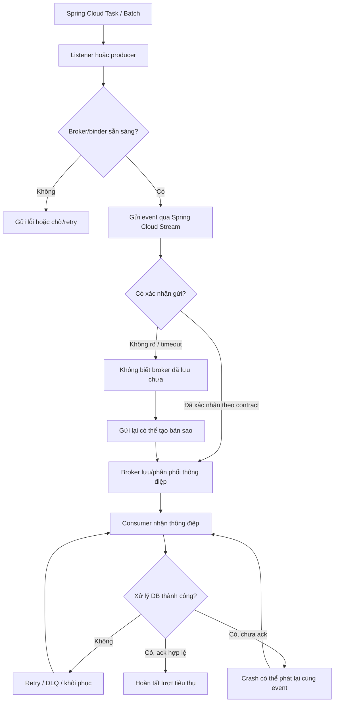
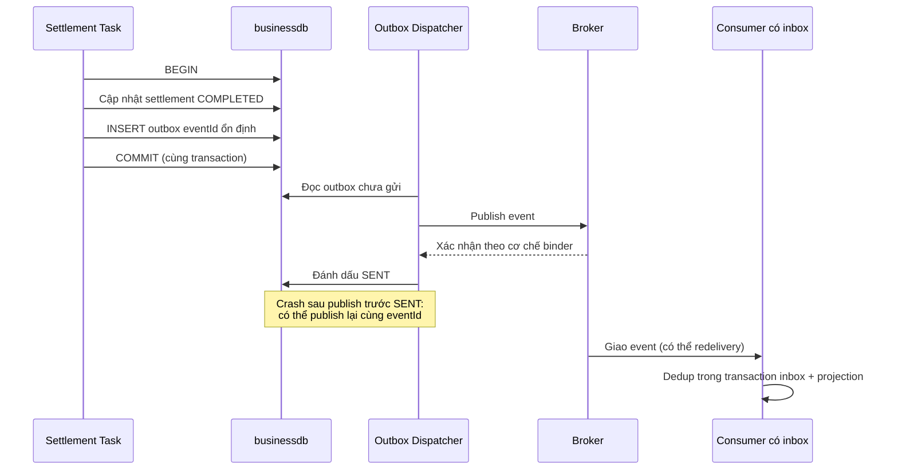

# Lỗi gửi, trùng thông điệp và giới hạn bảo đảm giao nhận

## Mục tiêu học tập

Sau bài học, bạn có thể:

- Phân biệt **sự kiện vòng đời Spring Cloud Task**, **sự kiện Spring Batch** và **sự kiện nghiệp vụ** do ứng dụng tự phát.
- Giải thích các cửa sổ lỗi khi gửi thông điệp qua Spring Cloud Stream/broker: không kết nối được, gửi bất đồng bộ thất bại, mất xác nhận, tiến trình bị dừng, broker hoặc consumer gặp lỗi.
- Hiểu đúng *at-most-once*, *at-least-once* và phạm vi của *exactly-once*: cơ chế nào có thể mất thông điệp, cơ chế nào phải chấp nhận phát lại.
- Thiết kế **event ID ổn định**, consumer idempotent, bảng inbox, transactional outbox, retry có giới hạn và dead-letter queue (DLQ).
- Đối chiếu thông điệp với `TaskRepository`, `JobRepository`, exit code tiến trình và dữ liệu nghiệp vụ để phát hiện thiếu/trùng thay vì mặc định có thông điệp nghĩa là công việc thành công.
- Lập kế hoạch kiểm thử lỗi gửi, crash, replay, chạy song song và khôi phục khi Task chạy theo lịch hoặc theo yêu cầu.

> **Ngữ cảnh:** Đây là bài thuộc chương **Sự kiện** của module **SPRING_CLOUD_TASK**. Spring Cloud Task dùng cho các ứng dụng Spring Boot có thời gian chạy hữu hạn, lưu metadata mỗi lần thực thi vào cơ sở dữ liệu qua `TaskRepository`, hỗ trợ gọi theo lịch hoặc theo yêu cầu và kết hợp Spring Batch. Khi các thông tin thực thi được phát ra ngoài bằng message broker, thiết kế phải xử lý được cả **mất thông điệp** và **thông điệp trùng**. Sự kiện hỗ trợ quan sát và phối hợp hệ thống, nhưng không thay thế nguồn dữ liệu thực thi đáng tin cậy.

## 1. Vì sao một Task hoàn tất vẫn có thể thiếu sự kiện?

Giả sử ứng dụng `daily-settlement-task` thực hiện:

1. Nhận `--business-date=2026-11-24`.
2. Cập nhật bảng kết quả đối soát.
3. Spring Cloud Task ghi nhận kết thúc vào `TASK_EXECUTION`.
4. Listener phát một thông điệp để dashboard vận hành hoặc hệ thống thông báo biết Task đã hoàn tất.
5. Tiến trình JVM thoát.

Nếu broker tạm thời không thể truy cập ở bước 4, có thể xảy ra tình huống:

- Database nghiệp vụ đã commit.
- `TaskRepository` đã ghi lần chạy thành công.
- Dashboard **không nhận được thông điệp** nên không cập nhật.
- Nếu mã gửi không biến lỗi thành kết quả thất bại, scheduler có thể vẫn thấy exit code `0`.

Ngược lại, publisher có thể gửi thành công nhưng **không nhận được xác nhận**. Một lần gửi lại có thể tạo hai thông điệp về cùng một sự kiện thực tế. Khi consumer cập nhật trạng thái hoặc gửi email lần nữa mà không chống trùng, hậu quả chuyển từ lỗi quan sát thành lỗi nghiệp vụ.

| Điều muốn đạt | Rủi ro thực tế | Biện pháp thiết kế |
| --- | --- | --- |
| Không mất thông báo hoàn tất | Producer crash trước khi broker lưu thông điệp. | Theo dõi xác nhận, đối soát repository; outbox cho sự kiện nghiệp vụ quan trọng. |
| Không xử lý trùng | Broker redelivery hoặc publisher gửi lại sau timeout. | Event ID ổn định, inbox/dedup và transaction phù hợp. |
| Thứ tự sự kiện đúng | START đến sau END do retry/partition/concurrency. | Sequence/version theo thực thể, projection kiểm tra trạng thái. |
| Không bỏ qua lỗi vĩnh viễn | Consumer retry nhiều lần vẫn thất bại. | DLQ/parking lot, cảnh báo và quy trình reprocess. |
| Lịch chạy không báo thành công sai | Exception gửi bị bắt rồi chỉ log. | Quy định rõ mức độ quan trọng của gửi, exit code, đối soát và remediation. |

**Không có cấu hình duy nhất nào tự bảo đảm hoàn tất từ nghiệp vụ, TaskRepository, broker tới mọi consumer trong một transaction.** Phải xác định bảo đảm mong muốn tại từng ranh giới.

## 2. Những loại sự kiện trong Spring Cloud Task

### 2.1. Task lifecycle events

Tài liệu Spring Cloud Task 5.1.0 mô tả khả năng phát đối tượng `TaskExecution` qua Spring Cloud Stream channel tên `task-events`. Với classpath/binder và ứng dụng phù hợp, listener có thể phát sự kiện **lúc bắt đầu và lúc kết thúc Task**.

Ví dụ một Task có `executionId=4201` có thể phát hai thông điệp:

```text
Task 4201 START: taskName=daily-settlement-task, startTime=...
Task 4201 END:   taskName=daily-settlement-task, endTime=..., exitCode=...
```

Hai dòng trên là cách mô tả **logic**, không phải payload JSON/hệ thống header được Spring Cloud Task bảo đảm theo đúng mẫu đó. Payload tích hợp gốc là `TaskExecution`; nó **không mặc định có eventId và eventType kiểu `START`/`END` do ứng dụng tự đặt**. Nếu cần một envelope có khóa sự kiện ổn định, hãy bổ sung tầng phát event tùy biến.

Tắt sự kiện Task khi không muốn phát qua Stream:

```properties
spring.cloud.task.events.enabled=false
```

Thuộc tính này tắt listener phát sự kiện Task, **không tắt `TaskRepository`** và không thay đổi bản chất ứng dụng Task hữu hạn.

### 2.2. Spring Batch events

Khi chạy Spring Batch Job trong Task và bật module tích hợp sự kiện phù hợp, Spring Cloud Task có thể dùng các listener để phát thông tin theo kênh:

| Listener của Spring Batch | Destination/channel được tài liệu mô tả |
| --- | --- |
| `JobExecutionListener` | `job-execution-events` |
| `StepExecutionListener` | `step-execution-events` |
| `ChunkListener` | `chunk-events` |
| `ItemReadListener` | `item-read-events` |
| `ItemProcessListener` | `item-process-events` |
| `ItemWriteListener` | `item-write-events` |
| `SkipListener` | `skip-events` |

Một Job có thể tạo nhiều Step, Chunk và nhiều callback đọc/ghi. **Số sự kiện Batch không bằng số TaskExecution**; không dùng `taskExecutionId` làm khóa duy nhất cho mọi loại callback Batch.

Tắt toàn bộ sự kiện Batch qua Stream khi release hỗ trợ:

```properties
spring.cloud.task.batch.events.enabled=false
```

Hoặc tắt riêng một nhóm:

```properties
spring.cloud.task.batch.events.chunk.enabled=false
spring.cloud.task.batch.events.item-read.enabled=false
spring.cloud.task.batch.events.item-write.enabled=false
```

Các thuộc tính này không đồng nghĩa tắt Spring Batch Job hoặc tắt `TaskBatchExecutionListener` liên kết `TASK_EXECUTION_ID` với `JOB_EXECUTION_ID`. **Liên kết metadata Task–Batch** và **phát thông điệp Stream** là hai trách nhiệm riêng.

### 2.3. Sự kiện nghiệp vụ tự phát

Ví dụ `SettlementCompleted` mang `businessDate`, `region` và tổng số bản ghi đã được ghi nhận. Đây **không phải payload mặc định của `task-events`**. Ứng dụng cần xây dựng producer riêng, có hợp đồng event, khóa idempotency, bảo mật và nếu cần độ tin cậy cao thì transactional outbox.

Phân biệt ba lớp:

| Loại event | Nguồn sự thật | Ý nghĩa |
| --- | --- | --- |
| `TaskExecution` lifecycle | `TaskRepository`/`TASK_EXECUTION` | Tiến trình Task nào bắt đầu hoặc kết thúc với kết quả gì. |
| `JobExecution`/`StepExecution`/chunk | `JobRepository`/`BATCH_*` | Batch Job/Step hoặc phần xử lý nào đã diễn ra. |
| `SettlementCompleted` do ứng dụng tự định nghĩa | Cơ sở dữ liệu nghiệp vụ và quy tắc xác nhận | Đợt đối soát nghiệp vụ nào đã hoàn tất theo contract nghiệp vụ. |

**Task thành công không tự chứng minh nghiệp vụ hoàn tất đúng**, nhất là khi runner nuốt exception, công việc bất đồng bộ chưa kết thúc hoặc Batch Job thất bại nhưng chưa lan truyền mã lỗi.

## 3. Sơ đồ các điểm có thể lỗi



Những gì được gọi là “xác nhận” tùy implementation: `StreamBridge.send(...)` trả `true` thường chỉ xác nhận message đã được hệ thống gửi nội bộ chấp nhận theo contract của channel, **không mặc nhiên chứng minh broker đã ghi bền vững**. Kafka producer ack, Rabbit publisher confirm, transaction và consumer acknowledgement có semantics riêng.

## 4. Lỗi gửi ở phía producer

### 4.1. Gửi bị từ chối ngay

Ví dụ broker đang down hoặc cấu hình binding sai; tùy binder/mode, ứng dụng có thể nhận exception hoặc kết quả gửi không thành công. Nếu code:

```java
try {
    streamBridge.send("auditEvents-out-0", event);
} catch (Exception ex) {
    log.error("Không gửi được event", ex);
    // Nếu đây là event bắt buộc, chỉ log rồi return là không đủ.
}
```

thì Task có thể hoàn tất bình thường mà người nhận không có thông báo. Lựa chọn đúng phụ thuộc **mức độ quan trọng của event**:

- Event chỉ để cập nhật dashboard *best-effort*: có thể ghi cảnh báo, nhưng phải có **đường đối soát lại `TaskRepository`**.
- Event điều khiển quy trình nghiệp vụ tiếp theo: phải thiết kế **phát bền vững và retry/recovery**, thường qua outbox; chỉ ném exception ở cuối Task mà không lưu ý định gửi chưa đủ để bảo đảm không mất event.
- Sự kiện có yêu cầu tuân thủ/kiểm toán: lưu dấu vết và quy trình xử lý lỗi có thể kiểm chứng, không chỉ một dòng log.

### 4.2. Bất đồng bộ và cửa sổ mất xác nhận

Ví dụ Kafka producer có thể gửi bất đồng bộ. `send(...)` ở tầng ứng dụng được chấp nhận nhưng broker có thể thất bại sau đó. Nếu Task kết thúc JVM ngay khi runner trả về, trạng thái gửi cuối cùng có thể chưa được quan sát; shutdown/flush và producer callbacks tùy binder phải được quản lý đúng.

Ngay cả khi có publisher confirmation, vẫn có cửa sổ:

1. Broker đã lưu sự kiện.
2. Network bị ngắt nên producer không nhận được xác nhận.
3. Producer retry theo cùng dữ liệu.
4. Consumer nhận hai bản sao hoặc một bản sao phát lại trong những điều kiện nhất định.

**Không thể kết luận “chưa nhận ack nghĩa là broker chưa lưu”.** Vì thế retry producer chỉ an toàn khi event có ID ổn định và consumer xử lý idempotent.

### 4.3. Lỗi giữa ghi DB và gửi event

Giả sử DB nghiệp vụ đã commit, sau đó mới gọi broker:

```text
businessdb COMMIT -> process crash -> broker chưa nhận message
```

Nếu đổi thứ tự gửi trước rồi commit:

```text
broker nhận message -> businessdb ROLLBACK -> consumer thấy event giả
```

Hai cách đều có cửa sổ bất nhất. Bọc thao tác JDBC bằng `@Transactional` **không mặc định làm gửi Kafka/Rabbit và commit database cùng một transaction nguyên tử**. Đây là động cơ của mẫu **transactional outbox** ở phần sau.

## 5. Bảo đảm giao nhận: hiểu đúng phạm vi

| Mức bảo đảm | Ý nghĩa lý tưởng | Đánh đổi | Cần lưu ý |
| --- | --- | --- | --- |
| *At-most-once* | Mỗi lần gửi có thể được xử lý tối đa một lần. | Có thể mất message. | Không phù hợp khi mọi sự kiện đều bắt buộc phải tới đích. |
| *At-least-once* | Sau retry/recovery đúng cách, thông điệp đã được nhận bền vững có thể được giao một hoặc nhiều lần. | Có thể trùng. | Cần consumer idempotent; thực tế vẫn phụ thuộc retention, cấu hình và tính khả dụng của hệ thống. |
| *Exactly-once* trong một phạm vi cụ thể | Một thao tác hoặc chuỗi thao tác nhất định được broker/transaction xử lý một lần theo contract. | Phức tạp hơn, có điều kiện tiên quyết. | Không tự mở rộng đến API ngoài, email hay DB độc lập. |
| *Effectively-once* ở tầng nghiệp vụ | Dù event được giao lặp, hiệu ứng nghiệp vụ được ghi nhận một lần. | Cần khóa nghiệp vụ, dedup và transaction. | Thường là mục tiêu thực tế hơn cho hệ thống phân tán. |

Các binder Kafka/Rabbit hỗ trợ nhiều chế độ nhưng **không thể tuyên bố toàn hệ thống at-least-once/exactly-once chỉ từ dependency `spring-cloud-stream`**. Cần đánh giá producer ack/transaction, broker durability/retention, retry, consumer offset/ack, DLQ và đường khôi phục.

Ví dụ Kafka transaction có thể bảo vệ một số kịch bản đọc–xử lý–ghi lại **trong Kafka** khi được cấu hình đúng; nó không tự tạo giao dịch nguyên tử với PostgreSQL hoặc REST API. Một consumer ghi tiền vào database rồi bị crash trước khi commit offset vẫn có thể nhận lại cùng message.

## 6. Trùng thông điệp đến từ đâu?

Một số tình huống thực tế:

1. **Producer retry:** không nhận được ack nên gửi lại event đã được broker lưu.
2. **Consumer crash:** commit database thành công nhưng chưa xác nhận message/offset.
3. **Rebalance:** broker/consumer group chuyển partition cho instance khác, record có thể được phát lại nếu offset chưa commit.
4. **DLQ replay:** vận hành đưa message từ DLQ về queue chính; consumer từng chạy một phần logic.
5. **Task retry:** scheduler chạy tiến trình Task mới, dẫn đến một event mới về **cùng ngày nghiệp vụ**; không phải lúc nào cũng là bản sao kỹ thuật.
6. **Listener khác nhau:** Task phát event lúc bắt đầu và kết thúc với **cùng `executionId`**; đó là **hai sự kiện hợp lệ**, không được xóa một cái chỉ vì ID giống nhau.
7. **Spring Batch restart:** JobExecution mới có thể xử lý lại Step/Chunk từng thực hiện dở; cần phân biệt event của lượt thử mới với message broker bị phát lại.

### Event ID đúng phải biểu diễn điều gì?

Thiết kế event envelope tùy biến:

```json
{
  "eventId": "settlement:2026-11-24:apac:completed:v1",
  "eventType": "SettlementCompleted",
  "eventVersion": 1,
  "businessKey": "2026-11-24:apac",
  "taskExecutionId": 4201,
  "occurredAt": "2026-11-24T02:15:00Z",
  "payload": {
    "businessDate": "2026-11-24",
    "region": "apac",
    "totalProcessed": 2000
  }
}
```

Đây là **event do ứng dụng định nghĩa**, không phải cấu trúc `TaskExecution` gốc do Spring Cloud Task tự phát. Trường `eventId` cần ổn định khi **gửi lại cùng sự kiện**. Nếu phát một sự kiện nghiệp vụ *mới hợp lệ*, dùng ID khác theo quy tắc version/transition phù hợp; không cố dùng một ID cho mọi trạng thái của cùng business key.

| Tình huống | Cách xác định khóa chống trùng |
| --- | --- |
| Gửi lại **cùng outbox row** sau timeout | Giữ nguyên `eventId` của row. |
| START và END của cùng `TaskExecution` | Ít nhất phải phân biệt `(repository, executionId, phase)` nếu nguồn không có event ID. |
| Cùng JobExecution có nhiều callback chunk | Không dùng mỗi `jobExecutionId` làm khóa; cần định danh callback/chunk theo contract riêng. |
| Retry Task tạo `executionId` mới cho cùng ngày | Là lượt thực thi khác; dedup nghiệp vụ phải dựa trên business key/trạng thái, không dựa riêng executionId. |
| Consumer group A và B đều cần áp dụng event | Dùng bảng inbox/khóa theo **consumer** để nhóm A không “ăn mất” event của nhóm B. |

**Không lấy `MessageId` phát sinh ngẫu nhiên của broker mỗi lần redelivery làm khóa duy nhất** nếu nguồn không bảo đảm ổn định; tương tự offset có ý nghĩa trong partition/topic nhưng không biểu diễn bất biến nghiệp vụ.

## 7. Ví dụ Spring Cloud Stream: cấu hình consumer với retry và DLQ

Ví dụ dưới đây sử dụng **functional programming model** của Spring Cloud Stream, nhận **sự kiện nghiệp vụ tùy biến** do ứng dụng phát, không mặc định nhận payload `task-events`.

Các dependency minh họa cho consumer Kafka:

```xml
<dependencies>
    <dependency>
        <groupId>org.springframework.cloud</groupId>
        <artifactId>spring-cloud-stream</artifactId>
    </dependency>
    <dependency>
        <groupId>org.springframework.cloud</groupId>
        <artifactId>spring-cloud-stream-binder-kafka</artifactId>
    </dependency>
    <dependency>
        <groupId>org.springframework.boot</groupId>
        <artifactId>spring-boot-starter-jdbc</artifactId>
    </dependency>
    <dependency>
        <groupId>org.postgresql</groupId>
        <artifactId>postgresql</artifactId>
        <scope>runtime</scope>
    </dependency>
</dependencies>
```

Dùng Spring Boot BOM và Spring Cloud BOM **tương thích**. Nếu dùng RabbitMQ, phải đổi binder và tùy chọn DLQ tương ứng, không sao chép `spring.cloud.stream.kafka.*` vào cấu hình Rabbit rồi mong có tác dụng.

`application.yml` ví dụ:

```yaml
spring:
  cloud:
    function:
      definition: handleSettlementEvents
    stream:
      bindings:
        handleSettlementEvents-in-0:
          destination: settlement-events
          group: settlement-projection
          content-type: application/json
          consumer:
            max-attempts: 3
      kafka:
        bindings:
          handleSettlementEvents-in-0:
            consumer:
              enable-dlq: true
```

Giải thích:

- `handleSettlementEvents-in-0` là tên binding theo tên hàm `Consumer` trong **functional model**. Đây không phải `task-events` built-in trừ khi bạn trỏ destination phù hợp và có consumer hiểu payload `TaskExecution`.
- `destination` là topic; `group` cho phép các instance trong cùng consumer group phối hợp xử lý. Không dùng group ngẫu nhiên nếu cần phục hồi offset một cách nhất quán.
- `max-attempts: 3` là số lần thử xử lý message theo cơ chế consumer imperative được Spring Cloud Stream hỗ trợ, tùy cấu hình binder.
- `enable-dlq: true` là tùy chọn **Kafka binder**, và Kafka DLQ yêu cầu consumer group đã xác định. Hãy kiểm tra việc tạo topic, quyền và đường reprocess trong môi trường thực.
- Một số cấu hình error handler tùy biến **loại trừ** cơ chế DLQ do framework quản lý. Không tự giả định vừa có custom error handler vừa có DLQ mặc định.

Ví dụ function tiếp nhận event:

```java
package com.example.consumer;

import java.util.function.Consumer;

import org.springframework.context.annotation.Bean;
import org.springframework.context.annotation.Configuration;

@Configuration(proxyBeanMethods = false)
public class SettlementConsumerConfiguration {

    @Bean
    Consumer<SettlementEvent> handleSettlementEvents(
            SettlementEventService service) {
        return service::apply;
    }
}
```

Mô hình payload nhỏ gọn cho bài học:

```java
package com.example.consumer;

// Event phát bởi ứng dụng nghiệp vụ, KHÔNG phải TaskExecution gốc.
public record SettlementEvent(
        String eventId,
        String eventType,
        String businessKey,
        String region,
        String status
) {}
```

Trong ứng dụng thực, định nghĩa schema hợp đồng có version, validate kích thước/kiểu/giá trị và quy định cách xử lý event không được hỗ trợ. Phải bảo vệ dữ liệu riêng tư trong payload, header, log và DLQ.

## 8. Consumer idempotent bằng bảng inbox và transaction JDBC

Nếu một event được giao hai lần, consumer không được tạo hai bản ghi kết quả hoặc thực hiện hai thay đổi nghiệp vụ trùng lặp. Một mẫu phổ biến là **inbox** lưu ID message đã xử lý và cập nhật projection **trong cùng một transaction database**.

### 8.1. Schema PostgreSQL minh họa

```sql
CREATE TABLE event_inbox (
    consumer_name VARCHAR(100) NOT NULL,
    event_id VARCHAR(200) NOT NULL,
    processed_at TIMESTAMPTZ NOT NULL DEFAULT CURRENT_TIMESTAMP,
    PRIMARY KEY (consumer_name, event_id)
);

CREATE TABLE settlement_projection (
    business_key VARCHAR(100) NOT NULL PRIMARY KEY,
    region VARCHAR(30) NOT NULL,
    status VARCHAR(30) NOT NULL,
    last_event_id VARCHAR(200) NOT NULL,
    updated_at TIMESTAMPTZ NOT NULL DEFAULT CURRENT_TIMESTAMP
);
```

Unique key trên `(consumer_name, event_id)` giúp hai consumer instance cạnh tranh cùng message không thể ghi hai inbox row. Nếu insert inbox và cập nhật projection cùng transaction, một lỗi ở projection làm rollback inbox; message redelivery có thể thử lại.

### 8.2. Service xử lý lặp an toàn

```java
package com.example.consumer;

import org.springframework.jdbc.core.JdbcTemplate;
import org.springframework.stereotype.Service;
import org.springframework.transaction.annotation.Transactional;

@Service
public class SettlementEventService {

    private final JdbcTemplate jdbc;

    public SettlementEventService(JdbcTemplate jdbc) {
        this.jdbc = jdbc;
    }

    @Transactional
    public void apply(SettlementEvent event) {
        if (event.eventId() == null || event.eventId().isBlank()
                || event.businessKey() == null
                || event.businessKey().isBlank()) {
            throw new IllegalArgumentException("Invalid event identity");
        }

        int inserted = jdbc.update("""
            INSERT INTO event_inbox(consumer_name, event_id)
            VALUES ('settlement-projection', ?)
            ON CONFLICT (consumer_name, event_id) DO NOTHING
            """, event.eventId());

        if (inserted == 0) {
            return; // Event đã được áp dụng thành công ở lần trước.
        }

        jdbc.update("""
            INSERT INTO settlement_projection(
                business_key, region, status, last_event_id)
            VALUES (?, ?, ?, ?)
            ON CONFLICT (business_key)
            DO UPDATE SET region = EXCLUDED.region,
                          status = EXCLUDED.status,
                          last_event_id = EXCLUDED.last_event_id,
                          updated_at = CURRENT_TIMESTAMP
            """,
            event.businessKey(), event.region(),
            event.status(), event.eventId());
    }
}
```

Đây là ví dụ cho **thao tác database cục bộ**. `@Transactional` cần được thực thi qua Spring proxy với JDBC transaction manager đúng datasource. Nếu thông tin event không hợp lệ hoặc câu cập nhật projection thất bại, exception phải lan truyền để hệ thống consumer thực hiện retry/DLQ đúng quy tắc.

**Giới hạn quan trọng của ví dụ:**

- Lưu `eventId` chỉ chống **giao lại cùng event**. Nó không tự ngăn một **event mới hơn bị event cũ ghi đè**. Muốn chống đảo thứ tự, thêm version/sequence đơn điệu theo `businessKey` và điều kiện cập nhật.
- `ON CONFLICT DO NOTHING` của PostgreSQL là cú pháp phụ thuộc database. Với MySQL/SQL Server cần biến thể phù hợp.
- `@Transactional` bao bọc **inbox + projection**, không tự bảo đảm broker ack trong cùng transaction.
- Nếu side effect là **gửi email, gọi ngân hàng, phát message khác**, inbox + JDBC transaction không thể rollback tác động đó. Cần outbox riêng, API idempotency key hoặc cơ chế bù trừ/đối soát.
- Không trả về bình thường sau khi gặp lỗi nghiệp vụ chưa xử lý chỉ để tránh redelivery; việc này có thể khiến broker xác nhận message và làm mất cơ hội phục hồi.

## 9. Transactional outbox cho sự kiện nghiệp vụ bắt buộc gửi

Với sự kiện `SettlementCompleted`, nếu kết quả nghiệp vụ đã commit thì hệ thống có thể yêu cầu cuối cùng phải phát được event. Mẫu **transactional outbox** lưu *ý định phát* vào **cùng database transaction** với cập nhật nghiệp vụ.



Bảng minh họa:

```sql
CREATE TABLE settlement_outbox (
    event_id VARCHAR(200) PRIMARY KEY,
    aggregate_key VARCHAR(100) NOT NULL,
    event_type VARCHAR(100) NOT NULL,
    payload JSONB NOT NULL,
    state VARCHAR(20) NOT NULL DEFAULT 'PENDING',
    created_at TIMESTAMPTZ NOT NULL DEFAULT CURRENT_TIMESTAMP,
    sent_at TIMESTAMPTZ NULL,
    attempt_count INTEGER NOT NULL DEFAULT 0
);
```

Trong cùng transaction cập nhật nghiệp vụ, insert event:

```sql
BEGIN;

UPDATE settlement_runs
SET status = 'COMPLETED'
WHERE business_date = DATE '2026-11-24'
  AND region = 'apac';

INSERT INTO settlement_outbox(
    event_id, aggregate_key, event_type, payload)
VALUES (
    'settlement:2026-11-24:apac:completed:v1',
    '2026-11-24:apac',
    'SettlementCompleted',
    '{"businessDate":"2026-11-24","region":"apac"}'::jsonb
)
ON CONFLICT (event_id) DO NOTHING;

COMMIT;
```

Câu SQL chỉ minh họa ý tưởng. Trong code thật cần đảm bảo `UPDATE` thực sự chuyển trạng thái nghiệp vụ hợp lệ, kiểm tra row count, tính event ID đúng contract, dùng parameterized SQL và tránh ghi outbox “COMPLETED” nếu nghiệp vụ chưa thành công. Hệ thống có thể cần version và unique key cho từng transition.

### Vì sao outbox vẫn có duplicate?

Có cửa sổ:

1. Dispatcher lấy event `E1` từ outbox.
2. Broker nhận `E1`.
3. Dispatcher crash **trước khi ghi `state='SENT'`**.
4. Khi chạy lại, dispatcher thấy `E1` chưa được đánh dấu và gửi lần nữa.

Outbox giúp **không quên ý định gửi đã commit**, nhưng **không tự loại trừ việc gửi lặp**. Phần consumer/inbox vẫn cần thiết.

### Dispatcher chạy ở đâu?

Có thể xây một Task hữu hạn khác, được scheduler gọi định kỳ, hoặc một service chạy liên tục. Khi nhiều instance cùng đọc outbox, cần cơ chế *claim/lease* có hiệu lực, ví dụ `SELECT ... FOR UPDATE SKIP LOCKED` trong transaction và trạng thái `IN_FLIGHT` có thời gian hết hạn. Không giữ transaction DB mở vô hạn trong lúc chờ broker; cần cơ chế thu hồi những event đã claim nhưng publisher crash.

Để thật sự đạt tính cuối cùng, phải có retry bền vững, giới hạn attempt/backoff, trạng thái cần can thiệp khi lỗi vĩnh viễn, giám sát backlog và retention. Xóa hàng outbox quá sớm sẽ đánh mất khả năng phát lại.

**Giới hạn phạm vi:** Outbox mô tả ở đây bảo vệ **sự kiện nghiệp vụ do ứng dụng định nghĩa**. Nó **không tự biến listener phát `task-events`/`job-execution-events` của Spring Cloud Task thành publisher transactional**. Muốn bảo đảm bền vững cho thông báo trạng thái Task, thiết kế một kênh event/dispatcher riêng hoặc cơ chế đối soát từ repository sau mỗi lần chạy.

## 10. Liên hệ giữa TaskRepository và broker: vì sao cần đối soát?

`TaskRepository` thường lưu `TASK_EXECUTION`, `TASK_EXECUTION_PARAMS` và các trường về start/end/exit code. Khi Task crash trước khi cập nhật kết quả, một số bản ghi có thể không có `END_TIME`. Khi event bị mất, broker có thể không chứa thông điệp tương ứng dù metadata đã ghi hoàn tất.

Điều này tạo ra bốn trường hợp:

| TaskRepository | Broker/dashboard | Diễn giải |
| --- | --- | --- |
| Có Task thành công | Có thông báo kết thúc | Hai nguồn phù hợp sơ bộ; vẫn cần xác minh nghiệp vụ. |
| Có Task thành công | Không có thông báo kết thúc | Có thể lỗi gửi, consumer lag, retention, binding sai hoặc event bị DLQ. |
| Task thiếu `END_TIME` | Có event bắt đầu | Có thể Task đang chạy hoặc chết đột ngột; cần đối chiếu process/Pod. |
| Task báo thất bại | Có thông báo hoàn tất | Cần đọc payload và ý nghĩa “kết thúc”: **kết thúc không đồng nghĩa thành công**. |

Ví dụ truy vấn nguồn sự thật của Task:

```sql
SELECT
    TASK_EXECUTION_ID,
    TASK_NAME,
    START_TIME,
    END_TIME,
    EXIT_CODE,
    EXIT_MESSAGE,
    ERROR_MESSAGE
FROM TASK_EXECUTION
WHERE TASK_NAME = 'daily-settlement-task'
ORDER BY START_TIME DESC, TASK_EXECUTION_ID DESC;
```

Một dịch vụ giám sát có thể giữ bảng `task_event_receipts` do **ứng dụng giám sát tự tạo** và định kỳ đối chiếu với `TASK_EXECUTION`. Đây không phải bảng chuẩn của Spring Cloud Task.

```sql
-- Minh họa một bảng tùy biến của dịch vụ giám sát.
CREATE TABLE task_event_receipts (
    repository_name VARCHAR(100) NOT NULL,
    task_execution_id BIGINT NOT NULL,
    phase VARCHAR(20) NOT NULL,
    received_at TIMESTAMPTZ NOT NULL DEFAULT CURRENT_TIMESTAMP,
    PRIMARY KEY (repository_name, task_execution_id, phase)
);
```

Nếu hai bảng cùng database hoặc có thể truy vấn qua cơ chế tích hợp phù hợp, đối chiếu Task đã kết thúc nhưng thiếu receipt END:

```sql
SELECT t.TASK_EXECUTION_ID, t.TASK_NAME, t.END_TIME
FROM TASK_EXECUTION t
LEFT JOIN task_event_receipts r
  ON r.task_execution_id = t.TASK_EXECUTION_ID
 AND r.repository_name = 'production-taskdb'
 AND r.phase = 'END'
WHERE t.END_TIME IS NOT NULL
  AND r.task_execution_id IS NULL;
```

Đây là **truy vấn đối soát ứng dụng tùy biến**, không phải giải pháp có sẵn khi chỉ cài `spring-cloud-starter-task`. Nếu hai database khác nhau, cần ETL, API `TaskExplorer`, replication được cho phép hoặc công cụ đối soát có truy cập cả hai. Thêm khoảng chờ hợp lý để tránh báo mất message khi consumer chỉ đang trễ.

**Đừng tái tạo giả một event `TaskExecution` khi không biết trạng thái cuối cùng**. Nếu có yêu cầu phục hồi, chỉ phát thông điệp tổng hợp sau khi xác minh nguồn sự thật, gắn dấu `reconciled`/`synthetic` và event ID nhất quán.

## 11. Retry, DLQ và xử lý lỗi consumer

Spring Cloud Stream cung cấp cơ chế retry/error handling, nhưng hành vi **phụ thuộc binder và programming model**. Với một `Consumer<T>` imperative, framework có thể retry khi function ném exception. Reactive functions có mô hình lỗi khác, không nên sao chép trực tiếp các thuộc tính retry handler imperative vào reactive pipeline.

### Phân loại lỗi

| Lỗi | Có nên retry tự động? | Cách vận hành |
| --- | --- | --- |
| Broker/ngữ cảnh tạm thời mất kết nối | Thường có, giới hạn và backoff. | Theo dõi producer failures, đừng retry vô hạn trong Task hữu hạn. |
| Consumer database tạm thời unavailable | Thường có. | Ném exception; binder retry rồi DLQ/requeue theo chính sách. |
| JSON/schema không tương thích | Thường không nếu payload sai cố định. | DLQ/parking lot, kiểm tra contract rồi reprocess có kiểm soát. |
| Business key không tồn tại | Tùy quy tắc eventual consistency. | Retry giới hạn hoặc báo thiếu dữ liệu vĩnh viễn. |
| API ngoài timeout không rõ đã thực thi chưa | Không retry mù. | Tra trạng thái và dùng idempotency key phía nhận. |
| Dead-letter event có dữ liệu nhạy cảm | Không chỉ giải quyết bằng retry. | Kiểm soát truy cập, retention và masking. |

### Cảnh báo về DLQ

**DLQ không phải chế độ mặc định bảo đảm mọi message lỗi đều được lưu.** Trong một số cấu hình mặc định, sau khi retry hết, message có thể chỉ được log rồi không tiếp tục xử lý; phải kiểm tra error handler và binder.

Với Kafka binder, DLQ cần bật riêng (như `enable-dlq=true`) và có consumer group; với Rabbit binder, tên thuộc tính/cấu trúc queue khác. Tài liệu còn chỉ rõ custom error handler có thể loại trừ DLQ framework mặc định. Không tuyên bố “đã đặt max-attempts=3 nên chắc chắn có DLQ”.

Vận hành DLQ cần có:

1. Cảnh báo tăng số lượng message chờ.
2. Thống kê loại lỗi theo cause, destination, consumer group và schema version.
3. Quy trình sửa dữ liệu/cấu hình rồi **replay giữ nguyên event ID**.
4. Giới hạn số lần replay để tránh vòng lặp poison message.
5. Kiểm tra idempotency vì message có thể đã thực hiện một phần side effect trước khi vào DLQ.
6. Phân quyền/retention cho thông điệp có dữ liệu nhạy cảm.

## 12. Thứ tự thông điệp không phải thứ tự nghiệp vụ tuyệt đối

Dù một Task phát START rồi END theo trình tự nội bộ, consumer có thể quan sát:

```text
END(4201) -> START(4201)
```

do partition khác nhau, mạng, retry hoặc nhiều consumer. Với Spring Batch, số lượng `StepExecution`/chunk còn lớn hơn và thường diễn ra đồng thời. Vì vậy:

- Không dùng “đã nhận START” làm điều kiện duy nhất cho phép nhận END.
- Không dùng thời điểm *consumer nhận* để thay thế thời điểm phát sinh nghiệp vụ.
- Khi xây dashboard, `END` có thể là trạng thái tiến triển hơn `START`; **không cho START đến muộn ghi đè COMPLETED/FAILED**.
- Nếu cần thứ tự theo một aggregate, định tuyến message bằng khóa ổn định vào cùng partition/topic khi broker hỗ trợ, đồng thời giữ version kiểm tra trong database.
- Đừng dựa vào `executionId` để suy ra thứ tự kết thúc giữa các Task chạy song song.

Ví dụ chính sách projection:

| Trạng thái hiện tại | Event đến | Hành động |
| --- | --- | --- |
| Chưa biết Task | START | Ghi STARTED. |
| STARTED | END thành công | Ghi COMPLETED. |
| STARTED | END có exit code khác `0` | Ghi FAILED. |
| COMPLETED | START bị trễ | Bỏ qua hoặc ghi audit; không hạ trạng thái. |
| FAILED | END phát lại cùng phiên bản | Dedup; không tạo cảnh báo lặp. |
| Có trạng thái cuối | Event mới có version hợp lệ cao hơn | Chỉ thay đổi theo state machine đã được định nghĩa. |

Đây là **quy tắc dashboard do ứng dụng đặt ra**, không phải state machine mặc định của Spring Cloud Task. Với Task bị kill thiếu END, cần một trạng thái `UNKNOWN/TIMED_OUT` sau khi đối soát scheduler, chứ không tự kết luận SUCCESS.

## 13. Quan hệ với mã thoát và Spring Batch Job

Mã thoát trả về hệ điều hành không phải xác nhận giao event. Ba lớp quan sát có thể khác nhau:

- `TaskExecution.exitCode` lưu ở `TaskRepository`.
- `JobExecution.status`/`ExitStatus` lưu ở `JobRepository`.
- Exit status của JVM/container mà Kubernetes Job, CronJob hoặc shell nhận.

Một Batch Job `FAILED` vẫn có thể khiến tiến trình trả `0` nếu runner nuốt exception hoặc không kiểm tra `JobExecution`. Sự kiện `job-execution-events` đã được gửi cũng **không chứng minh Job thành công**, vì event có thể nói về một Job FAILED.

Ví dụ runner tự gọi JobLauncher nên kiểm tra kết quả:

```java
JobExecution execution = jobLauncher.run(job, parameters);

if (execution.getStatus() != BatchStatus.COMPLETED) {
    throw new IllegalStateException(
        "Batch Job did not complete: " + execution.getStatus()
    );
}
```

Với JobLauncher bất đồng bộ, phải **chờ Job kết thúc** trước khi kiểm tra trạng thái cuối. Nếu có `spring-cloud-task-batch` và cấu hình phù hợp, một số release hỗ trợ `spring.cloud.task.batch.fail-on-job-failure=true`. Nhưng vẫn phải test đường lỗi và mã thoát thật, không suy ra từ việc event đã publish.

Đối với ứng dụng Task hữu hạn, `main` có thể lấy mã thoát theo cơ chế Spring Boot rồi trả ra hệ điều hành:

```java
ConfigurableApplicationContext context =
    SpringApplication.run(DailySettlementApplication.class, args);

int code = SpringApplication.exit(context);
System.exit(code);
```

Nếu `SpringApplication.run(...)` ném exception, các dòng phía dưới không chạy theo đường bình thường. **Không gọi `System.exit(0)` bất chấp lỗi gửi event bắt buộc**, cũng không coi broker unavailable nghĩa là transaction nghiệp vụ tự động rollback.

## 14. Các trường hợp kiểm thử bắt buộc

Một bài kiểm thử đáng tin cậy phải tái hiện được các **thời điểm crash** chứ không chỉ gửi một event rồi assert consumer đã đọc.

| Kịch bản | Kết quả cần xác minh |
| --- | --- |
| Broker down trước lúc producer gửi | Không có thông báo sai thành công; publisher ghi lỗi và có chính sách khôi phục. |
| Broker nhận event nhưng producer mất ack | Retry dùng **cùng event ID**; consumer áp dụng một hiệu ứng. |
| Task crash sau DB commit nhưng trước khi gửi | Outbox (nếu dùng) còn sự kiện PENDING; dispatcher có thể phát sau. |
| Dispatcher crash sau publish trước khi mark SENT | Event có thể lặp; inbox/dedup ngăn tác động trùng. |
| Consumer commit DB rồi crash trước ack | Broker phát lại; transaction inbox nhận ra event cũ. |
| Consumer lỗi schema/permanent validation | Theo cấu hình, message được đưa DLQ/parking lot hoặc cảnh báo; không biến mất im lặng. |
| Consumer ghi external API rồi crash | Inbox đơn thuần chưa đủ; đối soát/khóa idempotency phía API. |
| START đến muộn sau END | Dashboard không ghi đè trạng thái cuối. |
| Spring Batch chunk/Step retry | Không dùng mỗi JobExecution ID làm khóa dedup mọi event. |
| Task bị kill và `END_TIME` trống | Kết hợp log, Pod và repository để xác định UNKNOWN/FAILED; không chờ END vô hạn. |
| Scheduler chạy lại cùng ngày nghiệp vụ | Sinh TaskExecution mới nhưng tránh xử lý trùng side effect bằng business key. |

**Nên dùng test broker thực** (ví dụ Kafka/RabbitMQ trong môi trường test phù hợp), PostgreSQL có schema rõ ràng và khả năng chèn lỗi/khởi động lại consumer. Mock `StreamBridge.send(...)` chỉ đủ kiểm tra code nhánh thành công/thất bại ngay, không chứng minh các bảo đảm truyền tin sau khi process chết.

### Lệnh quan sát minh họa

Với Docker/Kubernetes, theo dõi exit code/termination và log của Task, producer, consumer. Trên shell:

```bash
java -jar daily-settlement-task.jar --business-date=2026-11-24
echo $?
```

Trong Kafka, quan sát consumer lag, DLQ và kết quả inbox/projection; trong Rabbit, xem queue depth, DLQ và trạng thái publisher confirm. Không đưa secret vào CLI arguments vì `TASK_EXECUTION_PARAMS` có thể lưu các đối số.

## 15. Mẫu checklist khi đưa vào production

**Producer**

- Event có `eventId` ổn định, `eventType` và `eventVersion`; event payload tối thiểu, không chứa secret.
- Xác định rõ sự kiện nào *best-effort* và sự kiện nào bắt buộc không bỏ sót.
- Theo dõi lỗi gửi đồng bộ **và bất đồng bộ** theo binder; không nhầm boolean gửi vào channel với broker durability.
- Dùng outbox hoặc cơ chế tương đương khi phải gắn ý định phát với commit nghiệp vụ.
- Có dispatcher/reconciliation và quy tắc xử lý event đã claim nhưng chưa nhận ack.

**Consumer**

- Dùng consumer group ổn định; quy ước event ID và khóa dedup theo **từng consumer**.
- Đưa inbox và side effect JDBC vào cùng transaction khi có thể.
- Khi lỗi, không bắt rồi return bình thường nếu message cần retry/DLQ.
- Có backoff, timeout, retry budget, DLQ và quy trình replay giữ nguyên eventId.
- Bảo vệ khỏi event đảo thứ tự, replay sau retention và side effect ngoài database.

**Task và vận hành**

- Tra `TaskRepository`/`JobRepository` như các nguồn metadata thay vì chỉ dựa vào số lượng event.
- Log `executionId`, `jobExecutionId`, event ID và correlation ID với phạm vi duy nhất rõ ràng.
- Giám sát outbox backlog, DLQ, consumer lag, số lần retry, job failure và Task không có `END_TIME`.
- Scheduler chạy lại cần idempotency nghiệp vụ; `executionId` mới không được hiểu là dữ liệu mới cần xử lý từ đầu.
- Đối chiếu lịch sử Task, kết quả nghiệp vụ và receipt của consumer khi không có event hoặc khi hệ thống báo thành công mâu thuẫn.

## 16. Bài tập thực hành

**Bài tập 1 — Tìm cửa sổ lỗi:** Vẽ timeline gồm commit nghiệp vụ, gửi `SettlementCompleted`, broker ack, cập nhật trạng thái gửi và consumer commit. Đánh dấu những vị trí crash có thể gây mất event hoặc tạo duplicate.

**Bài tập 2 — Dedup START/END:** Với hai event của cùng `TaskExecution.executionId=4201`, thiết kế khóa inbox sao cho START/END hợp lệ đều được xử lý nhưng bản sao của từng event không gây side effect lặp. Kiểm tra ca END đến trước START.

**Bài tập 3 — Inbox transaction:** Dùng schema `event_inbox` và `settlement_projection`. Gửi cùng `eventId` ba lần, kiểm tra chỉ một lần cập nhật projection. Tạo exception sau insert inbox trước update projection và chứng minh transaction rollback cả hai thao tác.

**Bài tập 4 — Outbox:** Trong cùng transaction cập nhật `settlement_runs` và thêm outbox row, khởi chạy dispatcher có thể bị kill sau publish trước khi mark SENT. Chạy lại, xác minh message có thể trùng nhưng idempotent consumer giữ trạng thái đúng.

**Bài tập 5 — Retry và DLQ:** Dùng Kafka binder với consumer group cố định; cấu hình retry và DLQ trên môi trường test. Gửi một event có schema sai, quan sát số lần xử lý, DLQ, log nguyên nhân, rồi sửa và replay giữ nguyên event ID.

**Bài tập 6 — Task/Batch reconciliation:** Chạy Task chứa Spring Batch Job thành công, một Job FAILED và một Task bị kill đột ngột. So sánh `TASK_EXECUTION`, `BATCH_JOB_EXECUTION`, các event đã nhận, exit code process và trạng thái nghiệp vụ; giải thích vì sao không thể lấy riêng topic làm nguồn sự thật cuối cùng.

## Ghi nhớ

- Spring Cloud Task có thể phát `TaskExecution` qua `task-events` ở đầu/cuối vòng đời; Spring Batch có các event cho Job, Step, Chunk và các callback khác khi integration được bật.
- **Gửi message không đồng nghĩa đã lưu bền vững**, và mất ack không chứng minh message chưa được broker nhận.
- *At-least-once* có thể giao trùng; *exactly-once* của một broker/transaction không tự bao trùm PostgreSQL, API hoặc email.
- Dùng **event ID ổn định, consumer idempotent/inbox**, kiểm soát thứ tự và retry/DLQ có thể quan sát.
- **Transactional outbox** giúp không mất ý định phát cùng commit nghiệp vụ, nhưng vẫn có cửa sổ publish trùng; nó không tự sửa cơ chế phát event vòng đời tích hợp sẵn.
- `TaskRepository`, `JobRepository`, broker, log và mã thoát tiến trình cần được **đối chiếu**, nhất là khi Task crash, listener lỗi hoặc scheduler retry.

## Tài liệu tham khảo

- [Spring Cloud Task 5.1 — Spring Cloud Stream Integration](https://docs.spring.io/spring-cloud-task/reference/stream.html)
- [Spring Cloud Task — Features và TaskRepository](https://docs.spring.io/spring-cloud-task/reference/features.html)
- [Spring Cloud Task — Batch Integration](https://docs.spring.io/spring-cloud-task/reference/batch.html)
- [Spring Cloud Stream — Error Handling](https://docs.spring.io/spring-cloud-stream/reference/spring-cloud-stream/overview-error-handling.html)
- [Spring Cloud Stream — Kafka Binder Error Channels](https://docs.spring.io/spring-cloud-stream/reference/kafka/kafka-binder/error-channels.html)
- [Spring Cloud Stream — Kafka Binder Dead Letter Topics](https://docs.spring.io/spring-cloud-stream/reference/kafka/kafka-binder/dlq.html)
- [Spring Cloud Stream — Functional Model](https://docs.spring.io/spring-cloud-stream/reference/spring-cloud-stream/producing-and-consuming-messages.html)
- [Spring Batch — Metadata Schema](https://docs.spring.io/spring-batch/reference/schema-appendix.html)
