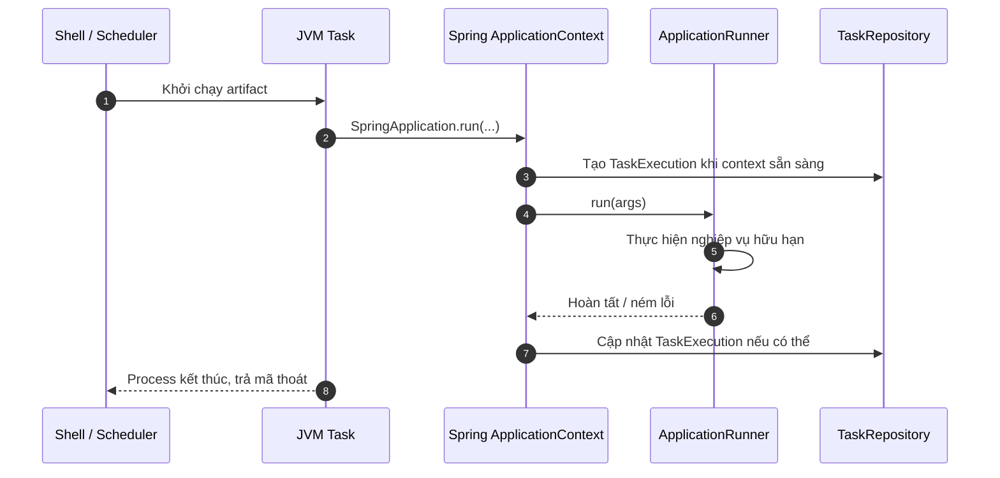
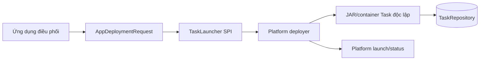

# Phân biệt chạy nghiệp vụ trong JVM với khởi tạo một tiến trình Task

## 1. Cùng gọi là “task” nhưng không cùng ranh giới thực thi

Trong một ứng dụng Java, “task” có thể chỉ một phương thức, một `Runnable` trong thread pool, một Spring Batch `Job` hoặc một ứng dụng **Spring Cloud Task** có thời gian chạy hữu hạn. Những đối tượng này có trách nhiệm rất khác nhau.

Ví dụ cần tổng hợp doanh thu cho `businessDate=2026-11-23`. Nhóm phát triển có thể:

- **Chạy trong JVM đã tồn tại:** một controller, scheduler hoặc `ApplicationRunner` gọi `reportService.generate(date)`. Công việc sử dụng chung heap, tài nguyên, `ApplicationContext` và vòng đời của ứng dụng hiện tại.
- **Khởi tạo một tiến trình Task mới:** scheduler, shell, `ProcessBuilder` hoặc Spring Cloud Deployer khởi chạy một artifact Spring Boot riêng. Ứng dụng Task tạo context của nó, chạy logic nghiệp vụ, ghi metadata vào `TaskRepository` rồi kết thúc.

Cả hai phương án có thể tạo cùng báo cáo. Nhưng chúng khác nhau về **cô lập, chi phí startup, mã thoát, retry, khả năng mở rộng và cách theo dõi lần chạy**. Đây là trọng tâm bài **Phân biệt chạy nghiệp vụ trong JVM với khởi tạo một tiến trình Task**, thuộc chương **Khởi chạy** của module `SPRING_CLOUD_TASK`.

Mục tiêu sau bài học:

1. Phân biệt một lời gọi phương thức, công việc bất đồng bộ và một lần thực thi Spring Cloud Task.
2. Hiểu khi nào có `TaskExecution` mới, khi nào chỉ là thao tác nghiệp vụ trong lần chạy hiện tại.
3. Tạo ứng dụng `ApplicationRunner` chạy công việc hữu hạn và khởi chạy bằng `java -jar`.
4. Tạo child process từ Java bằng `ProcessBuilder` và xử lý timeout, mã thoát.
5. Nhận biết vai trò `TaskLauncher`, `TaskLaunchRequest`, scheduler và nền tảng container.
6. Thiết kế truy vết, idempotency, retry và tích hợp Spring Batch an toàn.

## 2. Vòng đời mà Spring Cloud Task theo dõi

Spring Cloud Task theo dõi **một lần thực thi của ứng dụng Spring Boot được cấu hình làm task**, thông qua `TaskExecution` lưu tại `TaskRepository`. Trong đường chạy thông thường:

1. Tiến trình bắt đầu và Spring Boot khởi tạo `ApplicationContext`.
2. Khi context khởi tạo thành công, `TaskLifecycleListener` sử dụng cơ chế lifecycle của Spring để ghi metadata bắt đầu vào repository, **trước khi** các runner chạy.
3. Spring Boot gọi các `ApplicationRunner`/`CommandLineRunner`.
4. Khi các runner đồng bộ hoàn tất hoặc có lỗi chưa được xử lý, framework cố cập nhật thời gian kết thúc, mã thoát và thông tin lỗi.
5. Tiến trình được đóng theo cấu hình ứng dụng; mã thoát JVM được hệ điều hành hoặc bộ điều phối quan sát.



`TaskExecution` thường ghi các trường `executionId`, `taskName`, `startTime`, `endTime`, `exitCode`, `exitMessage`, `errorMessage` và arguments. Metadata **không tự lưu toàn bộ dữ liệu đầu ra nghiệp vụ**; báo cáo, giao dịch hay tệp kết quả phải được kiểm chứng tại nơi lưu riêng.

**Điểm quan trọng:** một lần gọi `reportService.generate(date)` **không khiến Spring Cloud Task tự sinh thêm một `TaskExecution`**. Hạ tầng ghi nhận lifecycle của ứng dụng/context Task, không phải mỗi phương thức nghiệp vụ.

## 3. Bốn phạm vi thực thi và `TaskExecution`

| Phạm vi | Ví dụ | JVM mới? | Context mới? | Tự sinh `TaskExecution` mới? |
| --- | --- | --- | --- | --- |
| Gọi hàm/service | `service.generate(date)` | Không | Không | **Không** |
| Luồng/`ExecutorService`/`@Async` | `executor.submit(...)` | Không | Thường không | **Không** |
| Bootstrap một context khác ngay trong JVM | `SpringApplication.run(OtherApp.class)` | Không | Có thể có | **Có thể**, nếu bật Task và hạ tầng ghi được |
| Launch artifact Task ở process/container riêng | `java -jar task.jar`, Kubernetes Job, Cloud `TaskLauncher` | Thông thường có | Có | **Thường có**, sau khi bootstrap thành công |

Không nên rút gọn quy tắc thành “`TaskExecution` luôn tương ứng đúng một JVM”. Trong Java có thể khởi tạo thêm context Task ở cùng JVM, nhưng đó **không phải tiến trình được cô lập**; nhiều context chia sẻ static state, heap, process exit code và rủi ro đóng tài nguyên. Trong triển khai thực tế, **mỗi lần launch độc lập** thường là một JVM/container riêng cho một lần chạy task.

### 3.1. Một phương thức trong JVM

```java
@Service
public class RevenueReportService {

    public void generate(LocalDate date) {
        // Truy vấn dữ liệu, tính toán và lưu báo cáo.
        System.out.println("Đang tạo báo cáo cho " + date);
    }
}
```

Controller, scheduler hoặc runner có thể gọi phương thức nhiều lần mà **không tạo context mới**. Nếu caller là ứng dụng sống lâu (web service), Spring Cloud Task không tự ghi lịch sử riêng cho mỗi request.

### 3.2. Một công việc trên thread khác

```java
@Async
public CompletableFuture<Void> generateAsync(LocalDate date) {
    reportService.generate(date);
    return CompletableFuture.completedFuture(null);
}
```

`@Async` cần được bật/cấu hình đúng và được gọi qua proxy Spring thích hợp. Dù chạy trên thread khác, công việc vẫn chia sẻ JVM. **Không có process riêng và không có `TaskExecution` mới**.

Nếu runner gọi công việc async rồi **trả về ngay**, `ApplicationReadyEvent` có thể xuất hiện trước khi việc nền hoàn thành. Khi đó `TaskRepository` có thể đánh dấu Task hoàn tất **quá sớm**. Với công việc hữu hạn, runner nên đợi kết quả và truyền lỗi ra ngoài.

### 3.3. Một lần chạy ứng dụng Task

```bash
java -jar revenue-report-task.jar --businessDate=2026-11-23
```

Lệnh này thường khởi tạo một tiến trình JVM mới, trong đó ứng dụng Boot tự bootstrap context, chạy runner, cập nhật repository và kết thúc. Chạy lại cùng lệnh là **một lần thực thi ứng dụng mới** (nếu context khởi tạo và ghi repository được).

**Tạo process không đồng nghĩa hoàn tất nghiệp vụ**: có thể lỗi khi tải artifact, tạo context, truy cập database, chạy runner hoặc ghi kết quả.

## 4. Bảng so sánh: cùng JVM hay process Task mới?

| Tiêu chí | Xử lý trong JVM đang chạy | Launch tiến trình Spring Cloud Task |
| --- | --- | --- |
| Thời gian bắt đầu | Thường rất nhanh vì context sẵn có | Tốn chi phí tạo process/container và bootstrap Spring |
| Heap, thread pool | Dùng chung với ứng dụng chủ | Thường riêng; tài nguyên có thể giới hạn theo process/Pod |
| Kết nối database | Có thể dùng chung pool hiện tại | Context mới có pool riêng, tăng tổng số connection |
| Exception | Có thể lan lên caller đồng bộ | Phải quan sát log, trạng thái tiến trình, metadata |
| Mã thoát | Không có exit code riêng cho từng method | Có mã thoát process/Job/Pod |
| Truy vết | Tự thiết kế operation ID/trace/metric | Có `TaskExecution` nếu Task bootstrap và repository hoạt động |
| Nâng cấp phiên bản | Thường gắn với phiên bản ứng dụng chủ | Có thể chọn artifact/image độc lập |
| Retry | Gọi lại method / queue nội bộ | Orchestrator có thể tạo process Task mới |
| Phân tán nhiều máy | Phải có RPC/queue khác | `TaskLauncher`/platform có thể launch trên hạ tầng khác |
| Transaction | Có thể chung transaction nếu thiết kế đúng | Không có transaction xuyên JVM một cách mặc định |
| Điều phối song song | `Executor`/thread pool | Quota, số Pod/Job và giới hạn runtime |
| Timeout/hủy | Cần cancellation hợp tác | Có thể quản lý process/Job; vẫn cần cleanup/idempotency |

Nên chọn **phương pháp đơn giản nhất đáp ứng yêu cầu**. Một thao tác xử lý ngắn trong HTTP request có thể chỉ cần service method. Một báo cáo chạy theo lịch ban đêm, cần audit từng lượt, cô lập tài nguyên và chạy lại độc lập có thể phù hợp với Spring Cloud Task.

## 5. Ví dụ A: hai lần xử lý nghiệp vụ, một lượt thực thi Task

Đây là một ứng dụng Spring Cloud Task có **một** runner nhưng gọi cùng phương thức hai lần:

```java
import java.time.LocalDate;

import org.springframework.boot.ApplicationRunner;
import org.springframework.boot.SpringApplication;
import org.springframework.boot.autoconfigure.SpringBootApplication;
import org.springframework.cloud.task.configuration.EnableTask;
import org.springframework.context.annotation.Bean;

@SpringBootApplication
@EnableTask
public class InJvmReportApplication {

    public static void main(String[] args) {
        SpringApplication.run(InJvmReportApplication.class, args);
    }

    @Bean
    ApplicationRunner reportRunner() {
        return arguments -> {
            generate(LocalDate.parse("2026-11-23"));
            generate(LocalDate.parse("2026-11-24"));
        };
    }

    private void generate(LocalDate date) {
        System.out.println("Tạo báo cáo: " + date);
    }
}
```

Khi chạy ứng dụng **một lần**:

```bash
java -jar in-jvm-report.jar
```

nếu `TaskRepository` hoạt động, thường có **một `TaskExecution`** bao trùm cả hai lời gọi `generate(...)`. Đó là kết quả đúng, không phải Spring Cloud Task bỏ sót một “job”. Muốn có hai lần thực thi Task độc lập, cần thiết kế cách khởi chạy **hai lượt Task** hoặc tự bổ sung mô hình quan sát chi tiết các công việc con.

Chạy **lệnh `java -jar` thêm một lần nữa** sẽ tạo một lượt ứng dụng mới và `TaskExecution` mới nếu ghi được vào repository.

## 6. Ví dụ B: tạo một ứng dụng Task thực thụ

Một Task hữu hạn nên nhận đầu vào rõ ràng, thực thi logic đồng bộ cần thiết, báo lỗi nếu thất bại và kết thúc để bộ điều phối biết trạng thái.

### 6.1. Code `ApplicationRunner`

```java
import java.time.LocalDate;
import java.util.List;

import org.springframework.boot.ApplicationRunner;
import org.springframework.boot.SpringApplication;
import org.springframework.boot.autoconfigure.SpringBootApplication;
import org.springframework.cloud.task.configuration.EnableTask;
import org.springframework.context.annotation.Bean;

@SpringBootApplication
@EnableTask
public class RevenueReportTaskApplication {

    public static void main(String[] args) {
        SpringApplication.run(RevenueReportTaskApplication.class, args);
    }

    @Bean
    ApplicationRunner revenueReport() {
        return arguments -> {
            List<String> dates = arguments.getOptionValues("businessDate");
            if (dates == null || dates.size() != 1) {
                throw new IllegalArgumentException(
                    "Phải truyền --businessDate=yyyy-MM-dd");
            }

            LocalDate date = LocalDate.parse(dates.get(0));
            System.out.println("Bắt đầu báo cáo: " + date);

            // TODO: gọi service tạo báo cáo; đợi kết quả hoàn tất.
            // Nếu xử lý thất bại, ném lỗi phù hợp để ghi nhận kết quả.

            System.out.println("Hoàn tất báo cáo: " + date);
        };
    }
}
```

Lớp này không gọi `System.exit(...)` **ngay trong runner**. Thoát cưỡng bức giữa xử lý có thể làm mất cập nhật cuối của Task repository. Cần để các callback kết thúc chạy theo thiết kế.

### 6.2. Cấu hình `application.yml`

```yaml
spring:
  application:
    name: revenue-report-worker
  main:
    web-application-type: none
  cloud:
    task:
      name: daily-revenue-report
  datasource:
    url: ${TASK_DB_URL}
    username: ${TASK_DB_USER}
    password: ${TASK_DB_PASSWORD}
```

Ứng dụng cần dependency `spring-cloud-starter-task`, JDBC driver và schema Spring Cloud Task tương ứng trong database. Dùng kho bền vững nếu cần tra cứu lịch sử nhiều lần chạy sau khi JVM dừng; database in-memory theo từng tiến trình không phù hợp cho giám sát dài hạn.

### 6.3. Khởi chạy hai lần

```bash
java -jar revenue-report-task.jar --businessDate=2026-11-23
java -jar revenue-report-task.jar --businessDate=2026-11-24
```

Khi cả hai lượt bootstrap thành công, bạn sẽ có hai `TaskExecution` khác `executionId` nhưng cùng tên `daily-revenue-report`. Ngày xử lý là **tham số nghiệp vụ**, không nên nhúng vào tên tác vụ để tạo vô số nhóm lịch sử.

Nếu context lỗi trước khi Task listener khởi tạo, có thể **không ghi được bản ghi**. Nếu tiến trình bị `kill -9`, metadata có thể thiếu `endTime`; cần đối chiếu platform/log.

## 7. Tạo tiến trình con bằng `ProcessBuilder`

Một ứng dụng điều phối Java có thể launch JAR riêng qua `ProcessBuilder`. Ví dụ sau cho thấy cách **chờ kết quả** và **giới hạn thời gian**, không chỉ khởi chạy rồi mặc định thành công.

```java
import java.io.IOException;
import java.nio.file.Path;
import java.util.concurrent.TimeUnit;

public final class TaskProcessLauncher {

    private TaskProcessLauncher() {}

    public static int launchAndWait(Path jar, String businessDate)
            throws IOException, InterruptedException {

        ProcessBuilder builder = new ProcessBuilder(
            "java", "-jar", jar.toAbsolutePath().toString(),
            "--businessDate=" + businessDate
        );
        builder.inheritIO(); // Ví dụ học tập: dùng chung console.

        Process process = builder.start(); // Process đã tạo, chưa hoàn tất.
        try {
            boolean finished = process.waitFor(120, TimeUnit.SECONDS);

            if (!finished) {
                process.destroy();
                if (!process.waitFor(5, TimeUnit.SECONDS)) {
                    process.destroyForcibly();
                    process.waitFor();
                }
                throw new IllegalStateException("Task vượt quá 120 giây");
            }

            return process.exitValue();
        } catch (InterruptedException interrupted) {
            process.destroy();
            Thread.currentThread().interrupt();
            throw interrupted;
        }
    }
}
```

Ví dụ gọi từ chương trình điều phối:

```java
int exitCode = TaskProcessLauncher.launchAndWait(
    Path.of("revenue-report-task.jar"),
    "2026-11-23"
);

if (exitCode != 0) {
    throw new IllegalStateException(
        "Process Task thất bại, exit code=" + exitCode);
}
```

**Đọc đúng các ranh giới:**

- `ProcessBuilder.start()` yêu cầu tạo process; **không chứng minh công việc đã hoàn tất**.
- `waitFor(timeout, unit)` chờ process kết thúc có giới hạn; `exitValue()` trả mã của **tiến trình hệ điều hành**.
- Mã này **không phải** `TaskExecution.executionId` được database cấp. Muốn truy vết qua Task repository phải dùng thông tin tương quan phù hợp.
- `destroy()` hoặc `destroyForcibly()` có thể chặn đường shutdown bình thường. Không suy ra metadata luôn được hoàn tất khi timeout.
- `inheritIO()` giúp quan sát lúc học; sản xuất nên thu thập stdout/stderr độc lập, xử lý log và cảnh báo.
- Đừng để request HTTP chờ một child process quá lâu; dùng queue/job manager/bộ điều phối nếu công việc dài.
- Dùng danh sách đối số, không ghép chuỗi shell từ đầu vào người dùng; validate `businessDate`.
- Tránh đưa mật khẩu/token vào command-line, vì chúng có thể xuất hiện trong process list, log hoặc `TASK_EXECUTION_PARAMS`.

**Trên Kubernetes**, `ProcessBuilder` bên trong một Pod đang sống thường chỉ tạo child process **trong chính container/Pod đó**. Nó **không** tự tạo Kubernetes Job độc lập với quota, retry policy hay lịch sử Pod riêng. Để tạo Job mới, cần dùng nền tảng điều phối hoặc deployer thích hợp.

## 8. Khởi chạy bằng `TaskLauncher` của Spring Cloud Deployer

Spring Cloud Deployer cung cấp SPI `org.springframework.cloud.deployer.spi.task.TaskLauncher`. Đây là cơ chế yêu cầu **nền tảng chạy artifact ứng dụng Task**, chẳng hạn trên local runtime, Kubernetes hoặc một platform khác.



Một lời gọi ở mức SPI là `TaskLauncher.launch(AppDeploymentRequest)`. Yêu cầu triển khai mô tả **tên ứng dụng**, artifact `Resource`, thuộc tính deployer và đối số dòng lệnh. Triển khai cụ thể sẽ xác định cách khởi chạy (local process, Pod/Job hoặc tài nguyên tương ứng).

Ví dụ **pseudocode**, không phải class biên dịch độc lập, vì constructor/chi tiết cấu hình khác nhau giữa các dòng Spring Cloud Deployer:

```java
// PSEUDOCODE
Resource artifact = resolveArtifact("revenue-report-task.jar");
AppDefinition definition = appDefinition("daily-revenue-report");
AppDeploymentRequest request = deploymentRequest(
    definition,
    artifact,
    deploymentProperties,
    List.of("--businessDate=2026-11-23")
);

String platformExecutionId = taskLauncher.launch(request);

// Chưa được kết luận là report đã hoàn thành.
// Theo dõi trạng thái platform và TaskExecution trong DB.
```

**Lời gọi `launch` không gọi `ApplicationRunner` của worker ngay trong call stack của launcher**. Nó yêu cầu platform khởi tạo ứng dụng worker. Nhiều implementation hoàn tất việc yêu cầu tạo tài nguyên **trước khi nghiệp vụ thực sự chạy xong**.

### 8.1. Ba ID khác nhau

| ID | Ai cấp? | Mục đích |
| --- | --- | --- |
| Platform execution ID | `TaskLauncher` / deployer / platform | Theo dõi, lấy trạng thái hoặc hủy lượt triển khai theo khả năng platform |
| `TaskExecution.executionId` | Spring Cloud Task `TaskRepository` | Tra cứu lifecycle, kết quả ứng dụng và lịch sử |
| Idempotency key nghiệp vụ | Hệ thống nghiệp vụ | Chống tác dụng phụ lặp khi retry/relaunch cùng yêu cầu |

**ID do `TaskLauncher.launch(...)` trả về không phải mặc nhiên là `TaskExecution.executionId`.** Platform có thể đã chấp nhận yêu cầu nhưng worker lỗi khi pull image hoặc bootstrap Java, nên kho Task chưa ghi bản thực thi nào.

Nếu launcher cũng là ứng dụng Spring Cloud Task, **launcher có thể có `TaskExecution` của chính nó**, ngoài các bản ghi của Task con. Nếu launcher là web service sống lâu không bật Spring Cloud Task, nó không tự có TaskExecution chỉ vì đã gọi `TaskLauncher`.

### 8.2. `TaskLaunchRequest` và `@EnableTaskLauncher`

Spring Cloud Task còn hỗ trợ mô hình **khởi chạy Task từ Spring Cloud Stream** qua `TaskLaunchRequest`. Đối tượng này thường chứa:

| Trường | Giá trị |
| --- | --- |
| `uri` | Artifact cần chạy |
| `applicationName` | Tên của ứng dụng được launch |
| `commandLineArguments` | Đối số truyền cho ứng dụng con |
| `environmentProperties` | Các biến môi trường của Task |
| `deploymentProperties` | Cấu hình mà platform deployer dùng |

Ở các dòng phiên bản hỗ trợ, `@EnableTaskLauncher` giúp tạo một **launcher sink** tiếp nhận những message này, rồi sử dụng `TaskLauncher` để khởi chạy.

**Không nhầm các khái niệm:** `TaskLaunchRequest` là yêu cầu launch qua Stream; `AppDeploymentRequest` là yêu cầu ở SPI Deployer; `TaskExecution` là metadata ghi nhận một lần ứng dụng đã chạy. API cho Stream có thể thay đổi giữa các dòng phiên bản, nên phải xem tài liệu đúng BOM và binder thực tế.

## 9. Chạy theo lịch: gọi method hay launch process mới?

Hai giải pháp đều có thể thực hiện công việc lúc 02:00, nhưng chúng nằm ở hai ranh giới khác nhau.

### 9.1. Spring `@Scheduled` gọi phương thức trong JVM

```java
@Scheduled(cron = "0 0 2 * * *", zone = "Asia/Ho_Chi_Minh")
public void dailyRevenueReport() {
    LocalDate target = LocalDate
        .now(ZoneId.of("Asia/Ho_Chi_Minh"))
        .minusDays(1);
    reportService.generate(target);
}
```

Ứng dụng cần bật `@EnableScheduling` và **phải tiếp tục sống** để scheduler gọi phương thức. Mỗi lần tick **không tự tạo Spring Cloud Task**. Nếu chạy nhiều instance scheduler, mỗi instance có thể cùng thực thi trừ khi có khóa/điều phối riêng.

### 9.2. Cron/Kubernetes CronJob tạo lượt Task riêng

Trên máy chủ, một cron có thể chạy artifact:

```cron
0 2 * * * /usr/bin/java -jar /opt/tasks/revenue-report-task.jar --businessDate=2026-11-23
```

Dòng trên chỉ **minh họa cách gọi**, không phải cron production: ngày nghiệp vụ đang được cố định và cần tính động theo kỳ xử lý. Mỗi lần cron thực sự chạy lệnh sẽ có **lượt process mới**. Kubernetes `CronJob` tạo `Job` theo lịch, quản lý Pod, restart và các giới hạn nền tảng theo cấu hình.

Trong production, cần đặt concurrency policy, timeout, quota, `backoffLimit`/retry, log và retention của platform. Spring Cloud Task **không tự lên lịch hoặc tự tạo Pod** chỉ vì có dependency của nó.

### 9.3. Khi nào chọn cách nào?

| Yêu cầu | Nên cân nhắc |
| --- | --- |
| Phép tính nhỏ cần trả kết quả cho request đồng bộ | Gọi service trực tiếp, có timeout và transaction |
| Xử lý nền ngắn trong một dịch vụ luôn sống | `Executor`/`@Async` có quản lý trạng thái |
| Báo cáo ban đêm cần audit lịch sử từng lần | Spring Cloud Task và scheduler/deployer launch theo lịch |
| Cần scale worker lên nhiều Pod | Cloud deployer, Kubernetes Job hoặc Spring Batch remote partitioning |
| Muốn fail/retry toàn bộ tiến trình, cô lập memory | Process Task mới và orchestration policy |
| Muốn gọi nghiệp vụ hai lần trong một request | Gọi hai lần, không bắt buộc tạo hai process |

## 10. Tham số và ranh giới dữ liệu giữa các process

Trong JVM, caller truyền thẳng đối tượng `LocalDate` hoặc service reference. Giữa hai process, **không thể chia sẻ con trỏ tới bean hoặc object trên heap** như cách gọi phương thức thông thường.

Các lựa chọn truyền thông tin:

1. **Đối số dòng lệnh**, ví dụ `--businessDate=2026-11-23`, `--requestId=...`.
2. **Biến môi trường và secret manager** cho URL JDBC, thông tin xác thực, cấu hình runtime.
3. **Database/object storage/API** cho dữ liệu lớn và kết quả đã tạo.
4. **Message/correlation ID** để tra log, liên kết workflow và callback.

Không truyền payload lớn hoặc bí mật qua đối số khi có thể dùng một tham chiếu đến dữ liệu được bảo vệ. `TaskExecution` thường ghi arguments, còn hệ điều hành hoặc nền tảng có thể lưu command line trong metadata/log.

Mỗi Task mới tự tạo connection pool, transaction manager, classloader và Spring context của nó. Dù Task và launcher cùng truy cập một database nghiệp vụ, chúng **không chia sẻ transaction trong bộ nhớ**.

## 11. Theo dõi kết quả ở bốn lớp

| Tín hiệu | Nguồn | Điều mà nó xác nhận |
| --- | --- | --- |
| Lời gọi phương thức trả về | Java method / future | Một thao tác trong JVM đã trả kết quả; chi tiết theo contract |
| `ProcessBuilder.start()` / `TaskLauncher.launch()` trả về | OS / deployer | Đã yêu cầu hoặc bắt đầu launch; **chưa chắc hoàn tất nghiệp vụ** |
| Process exit code / Pod / Job status | OS hoặc platform | Lượt process đã kết thúc theo kết quả platform ghi nhận |
| `TaskExecution.exitCode`, `endTime` | Spring Cloud Task repository | Hạ tầng Task đã lưu metadata vòng đời nếu ghi được |

Ví dụ tra cứu các lần chạy `daily-revenue-report` trong schema JDBC Spring Cloud Task thông dụng:

```sql
SELECT TASK_EXECUTION_ID,
       TASK_NAME,
       START_TIME,
       END_TIME,
       EXIT_CODE,
       EXIT_MESSAGE,
       ERROR_MESSAGE
FROM TASK_EXECUTION
WHERE TASK_NAME = 'daily-revenue-report'
ORDER BY TASK_EXECUTION_ID DESC;
```

Tên bảng/cột cần đối chiếu schema và phiên bản thực tế; `TaskExplorer` là API hỗ trợ tra cứu lịch sử trong Java.

Không nên suy luận:

- **Không có `TaskExecution`** nghĩa là platform chưa hề thử launch: worker có thể lỗi **trước** lúc repository tạo bản ghi.
- **`endTime` rỗng** nghĩa là process còn chạy: nó có thể bị kill trước khi ghi kết thúc.
- **`exitCode=0`** nghĩa là dữ liệu báo cáo đúng: phải đối soát đầu ra nghiệp vụ.
- **Platform exit code** chắc chắn luôn bằng `TaskExecution.exitCode`: hai giá trị có thể được xác định ở thời điểm khác nhau hoặc trong điều kiện lỗi.

## 12. Lỗi, timeout và xử lý hủy

### 12.1. Lỗi trong cùng JVM

Một lỗi từ `reportService.generate(...)` có thể lan lên caller đồng bộ; transaction và rollback phụ thuộc cấu hình. Với `@Async`, lỗi nằm trong future hoặc callback và **không tự xuất hiện** trong thread đã gọi.

Nếu runner bắt exception rồi chỉ log, Spring Cloud Task **có thể ghi hoàn tất thành công**. Khi lỗi làm công việc không đạt yêu cầu, cần truyền kết quả thất bại theo cơ chế framework thay vì nuốt lỗi.

### 12.2. Lỗi ở child process/platform

Các mốc lỗi khác nhau phải được quan sát riêng:

| Mốc | Ví dụ | Metadata có thể tồn tại? |
| --- | --- | --- |
| Trước khi tạo worker | Không tìm thấy JAR/image, hết quota | Có thể **chưa có `TaskExecution`** |
| Bootstrap worker | Thiếu bean/secret, sai JDBC URL | Có thể chưa có bản ghi nếu context chưa khởi tạo |
| Đang chạy runner | Gọi API thất bại hoặc dữ liệu sai | Thường có `TaskExecution` thất bại nếu repository hoạt động |
| Shutdown cưỡng bức | `kill -9`, Pod bị hủy, node mất điện | Bản ghi có thể thiếu `endTime`/`exitCode` |
| Nghiệp vụ hoàn tất nhưng metadata lỗi | Database repository không truy cập được | Có thể còn dữ liệu nghiệp vụ dù bản ghi Task chưa hoàn tất |

Timeout hoặc cancel chỉ cắt ngắn việc xử lý trên platform; nó **không bảo đảm API bên ngoài đã rollback**. Nếu hệ thống gửi thanh toán rồi mất phản hồi, cần tra trạng thái phía đích trước khi gửi lại.

### 12.3. Chạy song song và giới hạn tài nguyên

Một tác vụ riêng có thể tăng khả năng cô lập, nhưng nhiều Pod cùng khởi chạy có thể tạo hàng trăm kết nối đến một database. Cần giới hạn số process, pool size, request/limit tài nguyên và số attempt retry. Cấu hình `spring.cloud.task.single-instance-enabled` nếu dùng phải được kiểm tra phiên bản và điều kiện repository; nó không thay thế khóa nghiệp vụ hoặc concurrency policy của platform.

## 13. Chạy lại an toàn và idempotency

Giả sử scheduler launch báo cáo cho cùng ngày hai lần sau timeout:

| Lượt | `taskName` | `executionId` | Đầu vào |
| --- | --- | --- | --- |
| Lần đầu | `daily-revenue-report` | `901` | `businessDate=2026-11-23` |
| Retry | `daily-revenue-report` | `902` | `businessDate=2026-11-23` |

Đây là **hai `TaskExecution`** nhưng vẫn cùng **một công việc nghiệp vụ**. Vì vậy đừng dùng `executionId`, ID Pod hay timestamp làm khóa chống trùng. Có thể chọn `(reportType, businessDate)` hoặc `(merchantId, businessDate, operation)` làm khóa ổn định, kết hợp unique constraint/upsert, kiểm tra trạng thái đích và retry có giới hạn.

Retry gọi API **bên trong một Task** tạo nhiều attempts nhưng thường chỉ một `TaskExecution`. Retry bằng **khởi chạy lại toàn Task** tạo `TaskExecution` mới. Cả hai cần idempotency nếu thao tác có tác dụng phụ.

Đối với giao dịch ngoài database, cùng metadata repository không tự mang lại bảo đảm `exactly-once`; có thể yêu cầu đã thành công ở phía đối tác dù ứng dụng chưa ghi được trạng thái nội bộ.

## 14. Phối hợp với Spring Batch: `JobLauncher` khác `TaskLauncher`

| API/khái niệm | Khởi chạy cái gì? | Metadata chính |
| --- | --- | --- |
| `JobLauncher.run(job, params)` của Spring Batch | Một Batch job được điều phối trong runtime Batch hiện tại | `JobExecution` và `StepExecution` |
| `TaskLauncher.launch(request)` của Cloud Deployer | Artifact ứng dụng Task trên platform | Platform ID; ứng dụng con ghi `TaskExecution` |
| `SpringApplication.run(...)` | Bootstrap context Boot trong JVM gọi | Task metadata nếu context bật hạ tầng Task |
| `ApplicationRunner.run(...)` | Logic lúc Boot startup | Không tự thêm `TaskExecution` cho mỗi lời gọi |
| `@Scheduled` / `@Async` | Phương thức hoặc thread trong ứng dụng | Không tự tạo Spring Cloud Task |

Một ứng dụng Task có thể **gọi `JobLauncher` chạy nhiều Batch job** trong cùng JVM. Khi đó có thể có **một `TaskExecution`** cho ứng dụng và nhiều `JobExecution`/`StepExecution` cho các job.

Trong **remote partitioning**, `DeployerPartitionHandler` có thể dùng `TaskLauncher` tạo worker process. Worker xử lý các `StepExecution` phân vùng của Batch. Manager và worker cần truy cập metadata repository theo mô hình tích hợp, nhưng **một worker không đồng nghĩa một `JobExecution` riêng**.

Nếu Batch job được chạy bất đồng bộ và runner trả về trước khi job thực sự xong, Task metadata có thể kết thúc sớm. Hãy thiết kế việc chờ trạng thái cuối và ánh xạ lỗi `BatchStatus.FAILED` theo cấu hình tích hợp phù hợp.

## 15. Checklist khi chọn ranh giới khởi chạy

- [ ] Công việc cần trả kết quả trong request hay cần chạy độc lập theo lịch?
- [ ] Đã phân biệt method/thread/`@Async` với một process và context Task mới?
- [ ] Nếu là Task, đã bật Spring Cloud Task và chuẩn bị `TaskRepository` bền vững?
- [ ] `spring.cloud.task.name` ổn định; đầu vào từng lần nằm ở arguments riêng?
- [ ] Dữ liệu lớn và secrets không bị nhúng vào command line?
- [ ] Launcher có ghi/đọc platform ID và correlation ID khi cần?
- [ ] Có phân biệt **launch thành công** với **nghiệp vụ hoàn thành**?
- [ ] Có timeout, concurrency limit, quota và retry có giới hạn?
- [ ] Có chiến lược idempotency khi process chết hoặc chạy lại?
- [ ] Nếu dùng `ProcessBuilder`, đã xử lý stdout/stderr, waitFor, interrupt và timeout?
- [ ] Nếu dùng Cloud `TaskLauncher`, đã kiểm tra API phiên bản và platform đang dùng?
- [ ] Nếu kết hợp Spring Batch, đã phân biệt `JobRepository` và `TaskRepository`?

## 16. Bài tập và câu hỏi tự kiểm tra

**Câu 1.** Một `ApplicationRunner` gọi `reportService.generate(D1)` rồi `generate(D2)`. Nếu ứng dụng chỉ được khởi chạy một lần, thường có bao nhiêu `TaskExecution`?

**Câu 2.** Controller gọi `@Async` và trả HTTP `202 Accepted`. Có phải đã hoàn thành báo cáo và có thêm `TaskExecution` mới không?

**Câu 3.** `TaskLauncher.launch(request)` trả về một chuỗi ID. Có thể dùng chuỗi đó làm `TaskExecution.executionId` và khẳng định nghiệp vụ đã xong không?

**Câu 4.** Tại sao `ProcessBuilder` tạo child process trong Kubernetes Pod không tương đương với tạo một Kubernetes Job mới?

**Câu 5.** Nếu scheduler khởi chạy lại cùng Task với cùng `businessDate`, nên dùng khóa nào để chống ghi trùng?

**Câu 6.** Một Task chạy hai Batch job; liệu nhất thiết phải có hai `TaskExecution`? Có thể có bao nhiêu `JobExecution`?

**Gợi ý trả lời:** (1) thường một; (2) không, đó là công việc trong cùng JVM; (3) không, cần theo dõi platform và repository; (4) child vẫn thuộc cùng Pod/container và tài nguyên của nó; (5) khóa nghiệp vụ ổn định như loại báo cáo + ngày xử lý; (6) có thể một `TaskExecution` và hai `JobExecution` nếu hai job được chạy.

## 17. Tổng kết

**Gọi nghiệp vụ trong JVM** là thực thi code trong một ứng dụng đã tồn tại; lời gọi phương thức, `ExecutorService` hay `@Async` không tự tạo lần thực thi Spring Cloud Task mới. **Khởi chạy một tiến trình Task** là yêu cầu hệ điều hành hoặc bộ điều phối chạy một ứng dụng Spring Boot hữu hạn riêng, với vòng đời, tài nguyên, mã thoát và thường một `TaskExecution` mới khi context bootstrap và ghi repository thành công.

`TaskLauncher` của Cloud Deployer quản lý việc **launch artifact trên platform**; `ApplicationRunner` xử lý logic bên trong ứng dụng; `JobLauncher` của Spring Batch khởi chạy **Batch job**, không phải JVM mới. Tách bạch ba cơ chế này giúp chọn đúng cách xử lý, thiết kế idempotency, retry, giám sát và vận hành an toàn.

**Tài liệu tham khảo chính thức:**

- [Spring Cloud Task — Features, lifecycle và TaskExecution](https://docs.spring.io/spring-cloud-task/reference/features.html)
- [Spring Cloud Task — Stream Integration và TaskLaunchRequest](https://docs.spring.io/spring-cloud-task/docs/current/reference/html/stream.html)
- [Spring Cloud Task — TaskLaunchRequest API](https://docs.spring.io/spring-cloud-task/docs/current/apidocs/org/springframework/cloud/task/launcher/TaskLaunchRequest.html)
- [Spring Boot — ApplicationRunner và CommandLineRunner](https://docs.spring.io/spring-boot/reference/features/spring-application.html)
- [Spring Cloud Task — Remote Partitioning, Spring Cloud Deployer](https://docs.spring.io/spring-cloud-task/docs/current/reference/html/)
- [Spring Batch — Configuring and Running a Job](https://docs.spring.io/spring-batch/reference/job/running.html)
