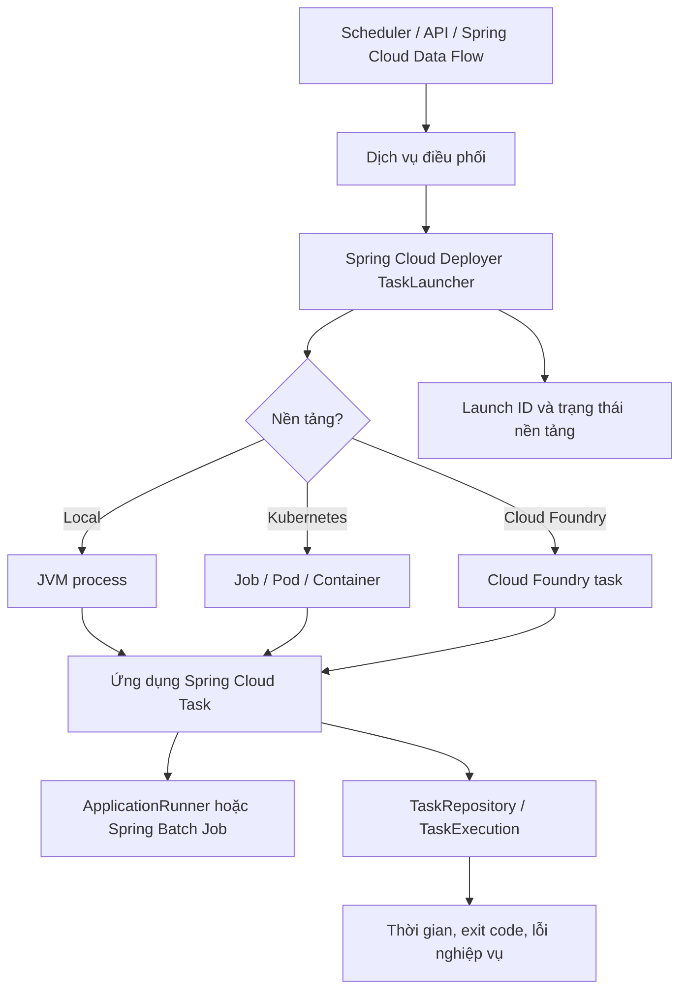
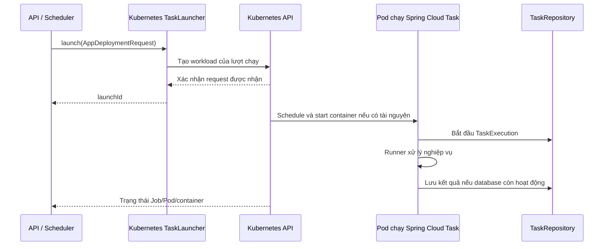
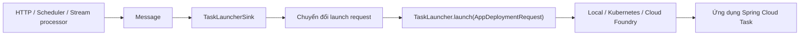
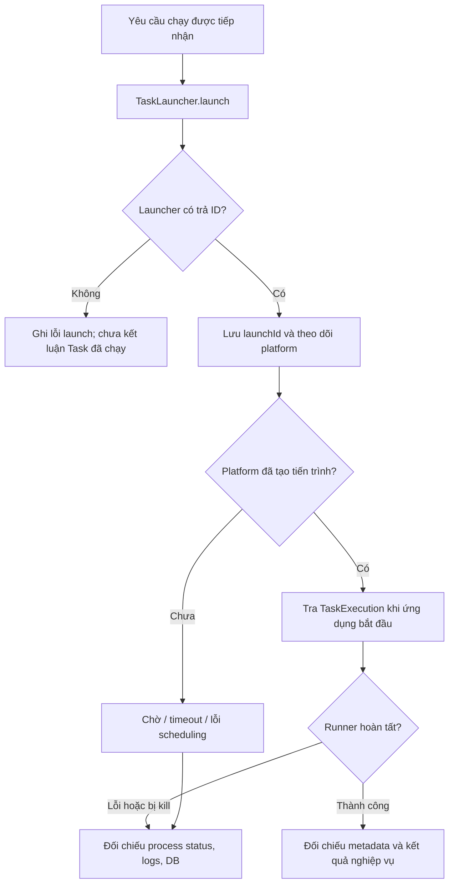
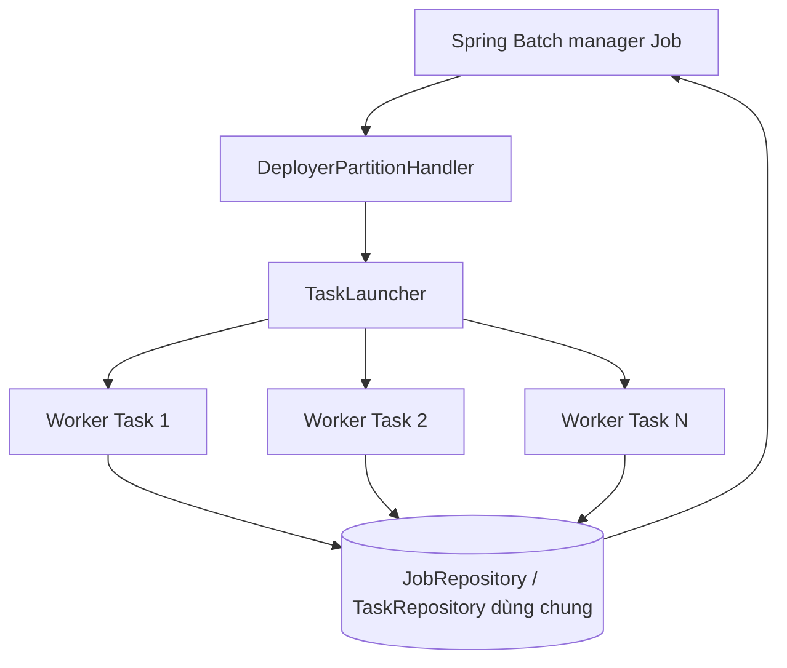

# TaskLauncher của Spring Cloud Deployer và nền tảng triển khai

## Mục tiêu bài học

**SPRING_CLOUD_TASK (Spring Cloud Task)** dùng để xây dựng ứng dụng Spring Boot chạy **hữu hạn**: mỗi lần khởi động tiếp nhận tham số, thực hiện công việc rồi kết thúc. Framework ghi nhận lượt thực thi bằng `TaskExecution` trong `TaskRepository`, giúp theo dõi kết quả, xử lý lỗi, chạy theo lịch hoặc theo yêu cầu và kết hợp với Spring Batch.

Nhưng `TaskRepository` **không phải thành phần tạo tiến trình** trên máy tính hay tạo Job trên Kubernetes. Trong chương **Khởi chạy**, `TaskLauncher` của **Spring Cloud Deployer** cung cấp giao diện chung để yêu cầu một nền tảng triển khai chạy ứng dụng Task.

Sau bài học, bạn có thể:

- Phân biệt trách nhiệm **khởi chạy tiến trình** của `TaskLauncher` với việc **ghi nhận kết quả nghiệp vụ** của Spring Cloud Task.
- Sử dụng các khái niệm `AppDefinition`, `Resource`, `AppDeploymentRequest` và kết quả `launch()` của Deployer.
- Nhận diện `TaskLaunchRequest` của Spring Cloud Task/Stream là một đối tượng **khác** với `AppDeploymentRequest` của Deployer.
- So sánh việc launch trên local, Kubernetes và Cloud Foundry; hiểu cấu hình phụ thuộc triển khai.
- Tách **launch ID**, **TaskExecution ID**, tên Task, ID Job/Pod và Batch `JobExecution`.
- Thiết kế theo dõi trạng thái, hủy, retry, giới hạn đồng thời, bảo mật tham số và giám sát sự cố.
- Biết khi nào dùng Spring Cloud Data Flow, Task Launcher Sink hoặc `DeployerPartitionHandler` trong tích hợp Spring Batch.

## 1. Ai chịu trách nhiệm khởi chạy một Task?

Ví dụ `daily-report-task` cần chạy mỗi đêm để lập báo cáo đơn hàng ngày `2026-11-23`. Một lời yêu cầu “hãy chạy báo cáo” phải đi qua **hai vòng đời khác nhau**:

1. **Vòng đời hạ tầng:** tìm artifact, chuẩn bị runtime, khởi tạo tiến trình/Job/Pod, giám sát và thu hồi tài nguyên.
2. **Vòng đời ứng dụng:** khởi tạo Spring Boot, tạo `ApplicationContext`, ghi `TaskExecution`, chạy `ApplicationRunner` hoặc Spring Batch Job và lưu kết quả cuối.



| Thành phần | Chịu trách nhiệm chính | Không tự làm |
| --- | --- | --- |
| `TaskLauncher` của Deployer | Gửi yêu cầu tạo lượt chạy lên nền tảng và trả định danh launch; tra trạng thái nền tảng. | Không bảo đảm công việc nghiệp vụ thành công; không thay `TaskRepository`. |
| Platform launcher | Tạo tiến trình/container/task theo khả năng của local, Kubernetes, Cloud Foundry. | Không tự hiểu logic nghiệp vụ hoặc Spring Batch checkpoint. |
| `ApplicationRunner`/`CommandLineRunner` | Xử lý công việc trong một JVM Spring Boot. | Không triển khai Job lên cluster hoặc tạo lịch chạy. |
| `TaskRepository` | Ghi metadata từng `TaskExecution` vào database được cấu hình. | Không spawn Pod, restart container hoặc cấp tài nguyên CPU. |
| Spring Batch `JobRepository` | Ghi `JobInstance`, `JobExecution`, `StepExecution`. | Không thay thế Task launcher hoặc metadata Task. |
| Scheduler/điều phối | Quyết định khi nào chạy, retry, timeout và chính sách trùng yêu cầu. | Không có bảo đảm idempotency nghiệp vụ nếu ứng dụng không thiết kế. |

Điểm quan trọng: **“launch đã được chấp nhận” không đồng nghĩa “Task đã bắt đầu”, càng không đồng nghĩa “báo cáo đã xong”.** Tạo Job thành công vẫn có thể bị lỗi image, quota, database hoặc nghiệp vụ trong quá trình chạy.

## 2. TaskLauncher là giao diện của Spring Cloud Deployer

`TaskLauncher` thuộc package:

```java
org.springframework.cloud.deployer.spi.task.TaskLauncher
```

Nó là một **SPI (Service Provider Interface)**: mã điều phối dùng chung một kiểu Java, còn triển khai nền tảng quyết định cách tạo tiến trình.

Các thao tác chính thường được sử dụng:

| Thao tác | Vai trò | Điều cần nhớ |
| --- | --- | --- |
| `launch(AppDeploymentRequest)` | Yêu cầu nền tảng khởi chạy và trả một `String` launch ID. | Việc trả ID không phải tín hiệu thành công của nghiệp vụ. |
| `status(String launchId)` | Hỏi `TaskStatus` của lượt khởi chạy theo nền tảng. | Cần gọi lại/poll hoặc dùng event nền tảng để theo dõi. |
| `cancel(String launchId)` | Yêu cầu hủy lượt chạy nếu nền tảng hỗ trợ. | Hủy có thể không tức thì; phải xác nhận trạng thái thật. |
| Các API quản lý khác (nếu có) | Đọc log/dọn tài nguyên hoặc thông tin môi trường tùy phiên bản. | Chỉ dùng API được triển khai và kiểm chứng trong release đang dùng. |

**Không nhầm `TaskLauncher` với `AppDeployer`:** `AppDeployer` chủ yếu quản lý những ứng dụng sống lâu (stream apps), qua `deploy()`/`undeploy()`. `TaskLauncher` dành cho **một lượt công việc có điểm kết thúc**, ví dụ Job trên cluster.

Ngoài ra, lớp tên `TaskLauncherHandler` trong tích hợp partitioning của Spring Cloud Task **không phải** chính interface `TaskLauncher`; nó là thành phần điều phối worker, **sử dụng** một `TaskLauncher` được cung cấp.

## 3. Ba đối tượng của một lệnh launch

API Deployer sử dụng `AppDeploymentRequest` cùng các thành phần:

| Đối tượng | Ví dụ | Mục đích |
| --- | --- | --- |
| `AppDefinition` | Tên `daily-report-task` và map application properties. | Mô tả ứng dụng cần chạy và cấu hình ứng dụng. |
| `Resource` | `FileSystemResource` chỉ đến JAR, hoặc resource artifact/container phù hợp nền tảng. | Cho launcher biết **artifact nào** được triển khai. |
| `AppDeploymentRequest` | App definition + resource + deployment properties + command-line args. | Gói yêu cầu cho `TaskLauncher.launch(…)`. |

### Application properties, deployment properties và arguments

Ba nhóm thông số có mục đích khác nhau:

| Nhóm | Ví dụ | Ai diễn giải? |
| --- | --- | --- |
| Application properties | `spring.cloud.task.name=daily-report-task`, `spring.profiles.active=prod`. | Ứng dụng Spring Boot; cách launcher chuyển qua môi trường/CLI tùy nền tảng. |
| Deployment properties | Yêu cầu bộ nhớ, CPU, image, service account, namespace. | Triển khai `TaskLauncher` của nền tảng; **tên key và đơn vị tùy release**. |
| Command-line arguments | `--businessDate=2026-11-23`, `--requestId=req-105`. | Application runner hoặc framework bên trong Task. |

Ví dụ khái niệm:

```text
AppDefinition:
  name = daily-report-task
  properties = {spring.cloud.task.name: daily-report-task}

Resource:
  /opt/tasks/daily-report-task.jar

Deployment properties:
  {cpu/memory/namespace/... tùy platform}

Command-line args:
  [--businessDate=2026-11-23, --requestId=req-105]
```

**Không coi map deployment properties là tùy chọn Spring Boot thông thường.** Một tham số như `businessDate` không tạo Pod lớn hơn, còn setting CPU trong deployer không tự thay đổi cách `ReportService` xử lý báo cáo. Có thể các triển khai launcher chuyển application properties thành env vars hoặc CLI arguments khác nhau; cần kiểm tra ở môi trường đích.

## 4. Ví dụ Java: tạo một launch request cho môi trường local

Ví dụ sau thuộc **ứng dụng điều phối**, không phải chính JAR `daily-report-task`. Nó dùng `TaskLauncher` được cấu hình theo triển khai local và một JAR đã có trên ổ đĩa **của máy chạy launcher**.

```java
package com.example.dispatcher;

import java.util.List;
import java.util.Map;

import org.springframework.cloud.deployer.spi.core.AppDefinition;
import org.springframework.cloud.deployer.spi.core.AppDeploymentRequest;
import org.springframework.cloud.deployer.spi.task.TaskLauncher;
import org.springframework.core.io.FileSystemResource;
import org.springframework.core.io.Resource;
import org.springframework.stereotype.Service;

@Service
public class ReportLaunchService {

    private final TaskLauncher launcher;

    public ReportLaunchService(TaskLauncher launcher) {
        this.launcher = launcher;
    }

    public String startReport(String businessDate, String requestId) {
        // Ví dụ đã xác thực đầu vào trước khi gọi method này.
        AppDefinition app = new AppDefinition(
                "daily-report-task",
                Map.of("spring.cloud.task.name", "daily-report-task"));

        Resource artifact =
                new FileSystemResource("/opt/tasks/daily-report-task.jar");

        AppDeploymentRequest request = new AppDeploymentRequest(
                app,
                artifact,
                Map.of(), // Deployment properties: do platform quyết định.
                List.of(
                        "--businessDate=" + businessDate,
                        "--requestId=" + requestId));

        return launcher.launch(request);
    }
}
```

**Giả định để ví dụ hoạt động:**

1. Ứng dụng điều phối có bean `TaskLauncher` từ bộ Spring Cloud Deployer **local** tương thích. Chỉ thêm interface SPI chưa tự có implementation bean.
2. `/opt/tasks/daily-report-task.jar` tồn tại, là Spring Boot executable JAR hợp lệ và được launcher đọc được.
3. JAR Task có runner giải quyết hai tham số `businessDate` và `requestId`, rồi kết thúc hữu hạn.
4. Trên local, cấu hình Java/runtime, database và quyền hệ điều hành đã đáp ứng.

Mã ví dụ **không** cấp xác thực, không kiểm tra idempotency trước launch và không ghi map correlation; các công việc đó cần có trong dịch vụ điều phối sản xuất. Nếu không muốn ghép chuỗi từ đầu vào người dùng, hãy validate/chuẩn hóa ngày bằng `LocalDate.parse(…)` và ràng buộc `requestId` với yêu cầu được phép.

`AppDeploymentRequest` trong ví dụ dùng constructor `(AppDefinition, Resource, Map<String, String>, List<String>)` được sử dụng trong API Deployer thuộc các dòng đã được tài liệu hóa. Hãy đối chiếu chữ ký với artifact `spring-cloud-deployer-spi` đang có trong project trước khi áp dụng.

### Đọc trạng thái sau launch

```java
package com.example.dispatcher;

import org.springframework.cloud.deployer.spi.task.TaskLauncher;
import org.springframework.cloud.deployer.spi.task.TaskStatus;
import org.springframework.stereotype.Service;

@Service
public class ReportLaunchStatusService {

    private final TaskLauncher launcher;

    public ReportLaunchStatusService(TaskLauncher launcher) {
        this.launcher = launcher;
    }

    public String readPlatformState(String launchId) {
        TaskStatus status = launcher.status(launchId);
        return status.getState().name();
    }
}
```

Phương thức trên trả về **trạng thái do nền tảng launcher nhận biết**, không thay thế bảng `TaskExecution`. Đừng suy mã thoát và kết quả báo cáo chỉ từ `launchId` hoặc từ trạng thái `RUNNING`. Với local launcher, một số trạng thái phụ thuộc vào việc tiến trình còn được launcher quản lý trong bộ nhớ; sau khi dịch vụ điều phối restart, khả năng truy vấn trạng thái cũ có thể hạn chế.

## 5. Ứng dụng Task được launcher gọi sẽ làm gì?

JAR chạy công việc vẫn là ứng dụng Spring Cloud Task bình thường. Ví dụ:

```java
package com.example.report;

import java.time.LocalDate;
import java.util.List;

import org.springframework.boot.ApplicationRunner;
import org.springframework.boot.SpringApplication;
import org.springframework.boot.autoconfigure.SpringBootApplication;
import org.springframework.cloud.task.configuration.EnableTask;
import org.springframework.context.annotation.Bean;

@SpringBootApplication
@EnableTask
public class DailyReportTaskApplication {

    public static void main(String[] args) {
        SpringApplication.run(DailyReportTaskApplication.class, args);
    }

    @Bean
    ApplicationRunner reportRunner() {
        return arguments -> {
            List<String> days = arguments.getOptionValues("businessDate");
            if (days == null || days.size() != 1) {
                throw new IllegalArgumentException(
                        "Cần --businessDate=yyyy-MM-dd");
            }

            LocalDate businessDate = LocalDate.parse(days.get(0));
            // Thay bằng ReportService.generate(businessDate).
            System.out.println("Đã xử lý " + businessDate);
        };
    }
}
```

Khi JVM khởi chạy, Spring Cloud Task tạo hoặc cập nhật `TaskExecution` trong `TaskRepository` nếu database/schema khả dụng; runner thực hiện nghiệp vụ, sau đó framework ghi nhận kết quả. Nếu tiến trình bị kill hoặc lỗi xảy ra trước khi metadata được tạo, không thể dựa **chỉ** vào `TASK_EXECUTION` để biết launcher đã làm gì.

Ví dụ `System.out.println` **không** chứng minh báo cáo thành công. Trong ứng dụng thật, service cần kiểm tra đầu ra, có idempotency và cho lỗi nghiêm trọng lan truyền để trạng thái Task phản ánh đúng.

## 6. Các ID không được nhầm lẫn

Một yêu cầu launch có thể tạo ra nhiều định danh:

| ID | Ai cấp/quản lý? | Dùng để làm gì? |
| --- | --- | --- |
| `requestId` (ví dụ `req-105`) | Dịch vụ điều phối/nghiệp vụ. | Chống gửi yêu cầu trùng, liên kết một yêu cầu tới các lần thử. |
| `launchId` (chuỗi trả về từ `TaskLauncher.launch`) | Triển khai Deployer/platform. | Truy vấn/hủy lần triển khai, tra log/trạng thái nền tảng. |
| Job/Pod ID hoặc task ID nền tảng | Kubernetes/Cloud Foundry/OS. | Tra tài nguyên thật, sự kiện và exit code container. |
| `TaskExecution.executionId` (ví dụ `8421`) | Spring Cloud Task `TaskRepository`. | Tra metadata bắt đầu/kết thúc/lỗi của một lần chạy ứng dụng. |
| `JobExecution.id` của Spring Batch | Spring Batch `JobRepository`. | Tra một lần thực thi Batch Job bên trong Task. |

Không có hợp đồng rằng `launchId == TaskExecution.executionId`, kể cả khi cả hai có vẻ là số. `launchId` có thể là chuỗi đặc thù nền tảng, còn `executionId` thường là số nguyên dài do repository cấp.

Một thiết kế điều phối dễ chẩn đoán lưu ánh xạ:

```text
requestId=req-105
  -> launchId=<ID của TaskLauncher>
  -> platformJobId=<ID của Kubernetes Job hoặc platform task>
  -> taskExecutionId=8421
  -> businessDate=2026-11-23
```

Trong Spring Cloud Data Flow, điều phối có thể **tạo trước `TaskExecution`** và truyền `--spring.cloud.task.executionid=<ID>` để tiến trình cập nhật bản ghi có sẵn. Tuy nhiên, việc dùng thuộc tính này là một **quy trình riêng**, không phải chức năng mặc định của mọi lời gọi `TaskLauncher.launch(AppDeploymentRequest)`.

Nếu ứng dụng tự viết launcher, **không tự đặt ID Task bằng số ngẫu nhiên**. Muốn gắn trước ID, phải tạo bản ghi thật bằng `TaskRepository` trong cùng kho metadata, commit trước khi tiến trình đọc rồi truyền ID đã tạo.

## 7. So sánh ba nền tảng triển khai

Spring Cloud Deployer có hoặc từng có các implementation cho nhiều nền tảng. Khả năng được hỗ trợ còn phụ thuộc **dòng phiên bản và artifact cụ thể**.

| Nền tảng | Cách chạy Task điển hình | Điểm cần kiểm tra | Giới hạn cần nhớ |
| --- | --- | --- | --- |
| **Local** | `LocalTaskLauncher` tạo một tiến trình JVM trên máy launcher. | Đường dẫn JAR, Java runtime, quyền file và môi trường của launcher. | Phù hợp dev/test; lưu trạng thái process thường gắn với vòng đời của chính launcher. |
| **Kubernetes** | `KubernetesTaskLauncher` yêu cầu cluster tạo workload/Pod cho một lần chạy. | Image/artifact, namespace, service account, RBAC, resource limits, image pull, Job/Pod lifecycle. | Tạo Job không bảo đảm Pod chạy; phải xem scheduling, container exit code và cleanup. |
| **Cloud Foundry** | `CloudFoundryTaskLauncher` dùng API nền tảng để chạy task phù hợp. | Organization/space, quyền API, ứng dụng đã được push/đăng ký, quotas, bindings và logs. | Trạng thái và giới hạn số lượt chạy do nền tảng quản lý; hỗ trợ phụ thuộc phiên bản. |

### Local: thuận tiện để phát triển

Local launcher thường được chọn khi cần thử logic khởi chạy bằng một service điều phối nhỏ. Vì Task chạy như tiến trình trên máy launcher, đường dẫn `FileSystemResource` trong ví dụ `/opt/tasks/daily-report-task.jar` chỉ có ý nghĩa nếu **máy launcher** truy cập được file đó.

Những điều cần tránh:

- Chạy launcher trên một máy rồi giả định JAR ở ổ cứng laptop của lập trình viên vẫn tồn tại trên máy server.
- Dùng `localhost` làm database URL khi tiến trình chạy ở namespace/container khác.
- Dùng launcher local như giải pháp chịu lỗi cluster mà không có cơ chế giám sát tiến trình và phục hồi.

### Kubernetes: phải hiểu ranh giới điều phối

Với Kubernetes, launcher thường cần image/container artifact và quyền tạo tài nguyên trong namespace đã chọn. Phần cấu hình phụ thuộc version của Spring Cloud Deployer Kubernetes; không sao chép property `spring.cloud.deployer.*` từ một hướng dẫn cũ mà chưa đối chiếu release.



Launcher tạo được tài nguyên **không đồng nghĩa Pod đã chạy**: Pod có thể `Pending` vì không có node phù hợp, `ImagePullBackOff`, thiếu secret hoặc thiếu quyền. Ngược lại, một Task có thể đã tạo đầu ra nhưng bị kill trước khi cập nhật metadata cuối; lần chạy lại cần kiểm tra idempotency.

### Cloud Foundry: theo dõi task ở cấp nền tảng

Cloud Foundry cung cấp mô hình task do nền tảng quản lý, vì vậy launcher có thể sử dụng API CF để khởi chạy và hỏi trạng thái. Cần kiểm tra ứng dụng/artifact đã sẵn sàng, bindings và quyền truy cập org/space. Cơ chế push ứng dụng, tạo task và hủy có thể khác giữa các release.

Đối với dự án mới, chọn platform theo yêu cầu thực tế và **kiểm chứng maintenance/support của module Deployer**; không coi mọi ví dụ Cloud Foundry hoặc Yarn trong tài liệu cũ là kiến trúc mặc định còn được hỗ trợ như nhau.

## 8. TaskLaunchRequest khác AppDeploymentRequest

Trong tích hợp **Spring Cloud Task + Spring Cloud Stream**, có lớp:

```java
org.springframework.cloud.task.launcher.TaskLaunchRequest
```

Lớp này là **payload yêu cầu khởi chạy** gửi từ một publisher/processor tới `TaskLauncherSink`. Nó **không** phải tham số trực tiếp của `TaskLauncher.launch(…)` trong SPI Deployer.



### Năm trường của TaskLaunchRequest

| Trường | Ví dụ | Ý nghĩa |
| --- | --- | --- |
| `uri` | URI artifact JAR có thể được launcher resolve. | Artifact cần chạy. |
| `applicationName` | `daily-report-task`. | Tên gán cho tác vụ ở bên launcher; nếu bỏ trống, thư viện có thể sinh tên mặc định. |
| `commandLineArguments` | `["--businessDate=2026-11-23"]`. | CLI arguments truyền vào Task. |
| `environmentProperties` | `{"SPRING_PROFILES_ACTIVE":"prod"}`. | Biến môi trường dùng trong tiến trình Task. |
| `deploymentProperties` | CPU, bộ nhớ, thiết lập nền tảng. | Cấu hình cấp cho Deployer. |

Ví dụ tạo đối tượng yêu cầu (một phần của **ứng dụng publisher**, không phải constructor `AppDeploymentRequest`):

```java
import java.util.List;
import java.util.Map;
import org.springframework.cloud.task.launcher.TaskLaunchRequest;

TaskLaunchRequest messagePayload = new TaskLaunchRequest(
        "maven://com.example:daily-report-task:jar:1.0.0",
        List.of("--businessDate=2026-11-23"),
        Map.of("SPRING_PROFILES_ACTIVE", "prod"),
        Map.of(),
        "daily-report-task");
```

Ví dụ `maven://…` là URI minh họa theo kiểu artifact resolver của hệ sinh thái, không bảo đảm mọi launcher/platform tải được từ repository đó. Khi dùng Maven resource ngoài local cache, phải cấu hình repository và credentials thích hợp. Với Kubernetes, nên xác nhận cơ chế chạy **image/container** được launcher hỗ trợ.

### TaskLauncherSink và @EnableTaskLauncher

Tài liệu Spring Cloud Task mô tả một sink ứng dụng nhận message có payload `TaskLaunchRequest`, chuyển thành request của Deployer và gọi `TaskLauncher`. API có annotation:

```java
@SpringBootApplication
@EnableTaskLauncher
public class TaskSinkApplication {
    public static void main(String[] args) {
        SpringApplication.run(TaskSinkApplication.class, args);
    }
}
```

Ví dụ chỉ nêu cơ chế: cần thêm **imports**, dependency module Task launcher/Stream, binder và bean `TaskLauncher` của nền tảng. `@EnableTaskLauncher` **không tự tạo implementation Deployer**, nên ứng dụng có thể báo lỗi thiếu bean nếu chưa cấu hình launcher.

**Cảnh báo phiên bản:** Nhiều đoạn ví dụ `TaskLauncherSink` của Spring Cloud Task sử dụng mô hình Spring Cloud Stream cũ (như `@EnableBinding`). Spring Cloud Stream hiện đại dùng functional bindings; trước khi dùng lại ví dụ, đối chiếu **API, phiên bản Stream, binder và module launcher** thực tế. Không đổi tên binding hoặc sao chép một sample cũ rồi giả định nó tương thích với mọi release mới.

## 9. Spring Cloud Data Flow đứng ở đâu?

**Spring Cloud Data Flow (SCDF)** là lớp điều phối cấp cao thường sử dụng Spring Cloud Deployer phía sau. Khi dùng SCDF, người vận hành không nhất thiết phải tự viết Java gọi `TaskLauncher`.

Luồng khái niệm:

```text
Đăng ký ứng dụng Task artifact
    -> tạo Task definition
    -> task launch <definition>
    -> SCDF chọn TaskLauncher của platform
    -> tạo process/Job/Pod
    -> Spring Cloud Task cập nhật TaskExecution
    -> xem execution, log và Job status
```

Ví dụ CLI của SCDF (cú pháp xác minh theo version đang chạy):

```text
dataflow:> task launch daily-report --arguments "--businessDate=2026-11-23"
dataflow:> task execution list
```

`--arguments` dùng để chuyển thông số cho ứng dụng Task. `--properties` trong một số dòng SCDF dùng prefix `app.<task-definition>.*` và `deployer.<task-definition>.*` để tách application properties và deployment properties. **Không nhầm** hai nhóm này với arguments cho runner hoặc với property của chính server SCDF.

SCDF còn có thể áp dụng **giới hạn số Task chạy đồng thời** theo platform account, song cách đếm lượt chạy khác nhau giữa local, Kubernetes và Cloud Foundry. Đây là lớp điều phối/công suất, không phải `single-instance-enabled` của Spring Cloud Task và không thay ràng buộc idempotency nghiệp vụ.

## 10. Xác nhận launch, thực thi và hoàn tất đúng cách

Một hệ thống an toàn nên ghi ít nhất ba nhóm trạng thái:

1. **Trạng thái yêu cầu điều phối:** nhận yêu cầu, xếp hàng, đang gọi launcher, đã nhận launch ID, bị từ chối.
2. **Trạng thái nền tảng:** resource tạo được hay không, process/Pod đã chạy, hoàn tất, thất bại, timeout hoặc bị hủy.
3. **Trạng thái Spring Cloud Task:** `TaskExecution` có ID gì, `START_TIME`, `END_TIME`, `EXIT_CODE` và thông báo lỗi ra sao.



Truy vấn metadata Task khi dùng schema chuẩn:

```sql
SELECT TASK_EXECUTION_ID,
       TASK_NAME,
       START_TIME,
       END_TIME,
       EXIT_CODE,
       EXIT_MESSAGE
FROM TASK_EXECUTION
WHERE TASK_NAME = 'daily-report-task'
ORDER BY TASK_EXECUTION_ID DESC;
```

Nếu có nhiều lần chạy đồng thời, chỉ lọc theo `TASK_NAME` chưa đủ để xác định dòng nào ứng với `launchId` cụ thể. Nên lưu ánh xạ correlation ID ở hệ điều phối, dùng `spring.cloud.task.external-execution-id` khi phù hợp và đối chiếu log/metadata. Việc đặt `spring.cloud.task.executionid` chỉ đúng khi **TaskExecution đã được tạo trước** bằng repository như đã giải thích.

### Khi launch trả ID nhưng không thấy TaskExecution

Những nguyên nhân có thể gồm:

- Pod chưa được schedule hoặc image chưa tải được.
- JVM chưa chạy tới giai đoạn bắt đầu Spring Cloud Task.
- Cấu hình `DataSource`/schema Task hỏng.
- Task kết nối **sai database/profile** so với nơi hệ điều phối tra cứu.
- Ứng dụng không có Spring Cloud Task hoặc không có `@EnableTask`/cấu hình tương ứng.
- Task bị kill sớm hoặc kết nối metadata không khả dụng.

Vì thế, không tự “đóng” Task là thành công chỉ vì launcher trả một ID. Luôn kết hợp **trạng thái nền tảng, log khởi động và DB metadata**.

## 11. Lỗi, timeout, hủy và retry

| Tình huống | Điều có thể xảy ra | Xử lý phù hợp |
| --- | --- | --- |
| URI/JAR/image sai | Deployer từ chối hoặc Job/Pod lỗi tải artifact. | Kiểm tra artifact, registry/repository, quyền và version; không retry mù. |
| Không đủ quota/CPU/RAM | Launch có thể bị từ chối hoặc Pod Pending. | Giới hạn concurrency, cấu hình tài nguyên theo platform, timeout có kiểm soát. |
| Lỗi `TaskRepository` khi JVM bắt đầu | Process thất bại trước runner, có thể chưa có metadata. | Kiểm tra DB URL, schema, quyền; đọc log startup. |
| Runner ném exception | Task đã chạy nhưng kết quả thất bại. | Cho lỗi lan truyền; đối chiếu `EXIT_CODE` và trạng thái container. |
| Nền tảng gửi phản hồi timeout sau launch | Có thể đã tạo Job dù bên gọi chưa biết launch ID. | Tra cứu resource/correlation trước khi gửi yêu cầu lần hai. |
| Người dùng gọi hủy | Platform có thể dừng tiến trình trước khi Task ghi `END_TIME`. | Xác nhận trạng thái qua launcher/platform và reconcile metadata. |
| Scheduler tự retry Job thất bại | Có thể tạo một lượt xử lý mới cho cùng ngày. | Thiết kế idempotency ở nghiệp vụ và chính sách retry/backoff. |
| Dịch vụ điều phối restart | Mất thông tin process local nếu chỉ lưu RAM. | Lưu correlation bền vững; ở production cân nhắc platform có API trạng thái/Job. |

**Hủy một launch không bảo đảm rollback toàn bộ nghiệp vụ.** Nếu Task đã ghi file hoặc gửi sự kiện, hành động đó có thể đã hoàn tất trước khi tiến trình bị dừng. Nên xử lý giao dịch, outbox, khóa nghiệp vụ và bước khôi phục riêng.

### Retry phải dựa trên kết quả nào?

Không retry chỉ vì HTTP request tới launcher timeout hoặc vì `TaskExecution.END_TIME` đang rỗng. Cả hai có thể xảy ra khi một tiến trình thực tế vẫn đang chạy.

Một quy trình:

1. Dùng `requestId` cố định để nhận diện yêu cầu.
2. Lưu request và trạng thái gọi launcher vào kho bền vững.
3. Nếu không rõ lệnh đầu đã tạo Job chưa, tra cứu platform bằng label/name/correlation key trước.
4. Chỉ tạo một **lượt chạy mới** khi đã xác định kết quả trước, quy tắc hủy/timeout và điều kiện idempotency.
5. Khi retry, theo dõi một `launchId` mới và thường một `TaskExecution` mới; giữ lại lịch sử của lượt cũ.

Nếu muốn **xếp hàng** thay vì từ chối khi Task đã chạy, xây cơ chế queue ở tầng điều phối; `TaskLauncher` tự nó không phải hàng đợi có bảo đảm.

## 12. Bảo mật và cấu hình theo môi trường

Khi đưa Task lên nền tảng, **môi trường của dịch vụ điều phối** và **môi trường của Task** là hai nơi khác nhau. Biến môi trường có trên container launcher chưa chắc tự xuất hiện ở container Task, trừ khi deployment request/platform hỗ trợ chuyển nó.

Quy tắc khuyến nghị:

- Không truyền password/credential qua `--db.password=…` trong command-line args: Spring Cloud Task có thể lưu arguments vào `TASK_EXECUTION_PARAMS` và nền tảng có thể hiển thị CLI.
- Dùng Kubernetes Secret, Cloud Foundry service binding hoặc secret manager tương ứng; cấp quyền tối thiểu cho service account của Task.
- Chỉ cho phép launcher dùng các artifact/image được phê duyệt; không nhận `Resource URI` tùy ý từ user chưa xác thực.
- Tách database/schema theo `local`, `test`, `prod`; schema metadata phải được migration trước và Task có quyền cần thiết.
- Cấu hình hạn mức CPU/bộ nhớ, TTL/timeout và retry phù hợp với thời gian xử lý dự kiến.
- Kiểm tra network policy để Task kết nối đúng database, broker và dịch vụ nghiệp vụ.
- Giữ log chứa `requestId`, `launchId` và `executionId` nhưng không in giá trị secret.

Ví dụ cấu hình chung của **ứng dụng Task** (không phải cấu hình launcher):

```yaml
# application-prod.yml
spring:
  application:
    name: daily-report-task
  main:
    web-application-type: none
  datasource:
    url: ${TASK_DB_URL}
    username: ${TASK_DB_USER}
    password: ${TASK_DB_PASSWORD}
  cloud:
    task:
      name: daily-report-task
      initialize-enabled: false
```

Các biến môi trường `TASK_DB_*` chỉ là quy ước của dự án. Để kết quả Task được lưu lâu dài, database phải bền vững và schema `TaskRepository` phải được tạo bằng DDL đúng phiên bản.

## 13. Phối hợp với Spring Batch và remote partitioning

Spring Cloud Task có thể bao bọc một Spring Batch Job. Một Job đó có thể gồm nhiều Step, và `JobRepository` lưu metadata độc lập với `TaskRepository`.

Ở mô hình **remote partitioning**, Spring Cloud Task cung cấp `DeployerPartitionHandler` và `DeployerStepExecutionHandler`:

1. Manager Batch chia công việc thành các `StepExecution` partition.
2. `DeployerPartitionHandler` sử dụng `TaskLauncher` để launch worker JVM/container cho các partition.
3. Worker dùng `DeployerStepExecutionHandler` cùng `JobExplorer`/`JobRepository` để tìm `StepExecution` được giao và thực thi.
4. Manager đối chiếu trạng thái các partition và Job kết thúc.



Một cấu hình điển hình có:

- `Resource` biểu diễn worker JAR/image phù hợp nền tảng.
- `TaskLauncher` cùng platform credentials.
- `JobExplorer` và `TaskRepository`; worker và manager cần nhìn thấy đúng các kho metadata được yêu cầu.
- `maxWorkers` để giới hạn số worker đồng thời, `pollInterval` và `timeout` có kiểm soát.
- `CommandLineArgsProvider`/`EnvironmentVariablesProvider` để chuyển thông tin partition an toàn.

**Không nhầm `maxWorkers` với số instance Task tối đa của cả cluster.** Nó giới hạn worker trong handler/Job cụ thể; scheduler và platform có thể vẫn chạy Task khác.

Nếu dùng `ThreadPoolTaskExecutor` để launch các partition bất đồng bộ, cần bảo đảm worker thread/TaskExecutor được dừng sau khi hoàn thành; một JVM có thread không-daemon chưa dừng sẽ không tự thoát dù Task business logic đã xong. Các property liên quan `closecontextEnabled` phải được kiểm chứng với version Spring Cloud Task đang dùng.

## 14. Kiểm thử theo từng nền tảng

| Bài thử | Thao tác | Dấu hiệu đạt |
| --- | --- | --- |
| Launch local thành công | Dùng JAR đúng và `TaskLauncher.launch()`. | Có launch ID; runner chạy; `TaskExecution` hoàn tất. |
| Launch trả ID nhưng JVM lỗi | Cố ý truyền profile DB sai trong môi trường test. | Nhận biết launch được tạo nhưng Task thất bại; có log startup. |
| Artifact không tìm thấy | Dùng URI/path sai trong test cô lập. | Lỗi rõ từ launcher/platform; không khẳng định Task đã chạy. |
| Tham số nghiệp vụ sai | Truyền ngày sai định dạng. | Runner ném lỗi, Task/process có tín hiệu thất bại. |
| Hai yêu cầu gần nhau | Gửi cùng `requestId` hai lần. | Hệ điều phối không tạo hai công việc trùng không mong muốn. |
| Timeout launcher | Mô phỏng phản hồi bị mất sau khi đã tạo Job. | Có bước tra cứu/đối chiếu trước khi gửi lại lệnh. |
| Kubernetes Pending | Cố ý đặt resource request vượt node khả dụng trong cluster test. | Phân biệt Pod Pending với Job nghiệp vụ lỗi. |
| Hủy khi đang chạy | Gửi `cancel(launchId)` nếu implementation hỗ trợ. | Platform dừng resource; metadata và kết quả được đối chiếu. |
| Scheduler retry | Cho Task thất bại rồi thử lại. | Một lần retry có định danh riêng, kết quả nghiệp vụ không bị nhân đôi. |
| Spring Batch Job lỗi | Chạy Job có Step fail. | Đối chiếu `JobExecution` với `TaskExecution` và exit code Task. |
| Remote partition worker chết | Tắt một worker trong test. | Manager phát hiện `StepExecution` không hoàn tất, xử lý theo timeout/restart. |

## 15. Bài thực hành tổng hợp

**Bối cảnh:** một API cho phép yêu cầu xuất báo cáo theo ngày. Dịch vụ điều phối chạy trên Kubernetes, sử dụng `KubernetesTaskLauncher`; report Task lưu metadata JDBC và đôi khi chạy Spring Batch.

1. Tạo `daily-report-task` có runner nhận `--businessDate=yyyy-MM-dd`, thực hiện một công việc hữu hạn và ghi metadata vào database test.
2. Với môi trường local, tạo một dịch vụ điều phối có bean `TaskLauncher` thích hợp. Dùng `AppDefinition`, `Resource` và `AppDeploymentRequest` để chạy artifact Task.
3. Lưu `requestId` và `launchId` ngay sau khi gọi launch; xác nhận `launchId` không phải `TaskExecution.executionId`.
4. Theo dõi `TaskStatus` đến khi tiến trình hoàn tất hoặc có lỗi; đọc thêm `TaskExecution` theo ID/correlation.
5. Chuyển sang triển khai Kubernetes bằng image/Resource được implementation hỗ trợ. Xác minh RBAC, namespace, image pull, database URL và logs.
6. Cố ý làm hỏng cấu hình database hoặc image tag trong môi trường test. Ghi nhận thời điểm lỗi tương ứng ở **launcher**, **platform** và **Task**.
7. Gửi hai yêu cầu cùng ngày; dùng idempotency key để không tạo báo cáo trùng, ngay cả khi một lượt chạy đã kết thúc.
8. Thử hủy, timeout và giả lập mất phản hồi launch. Thiết kế một quy trình reconciliation không gửi lại Job mù.
9. Tùy chọn: dùng Spring Batch Job và `DeployerPartitionHandler` để tạo hai worker. Xác minh worker nhìn thấy cùng JobRepository và TaskRepository cần thiết.
10. Đối chiếu kết quả đầu ra nghiệp vụ, trạng thái platform và metadata Task/Batch trước khi tuyên bố hoàn thành.

**Tiêu chí hoàn thành:** giải thích được mỗi tầng trách nhiệm, khởi chạy được Task theo platform, phân biệt các ID, phát hiện trường hợp launch thành công nhưng Task chưa chạy, và thiết kế retry/hủy có kiểm soát cùng dữ liệu nghiệp vụ an toàn.

## 16. Tài liệu tham khảo

- [Spring Cloud Task — Launching a Task from Spring Cloud Stream](https://docs.spring.io/spring-cloud-task/reference/stream.html): `TaskLaunchRequest` và `@EnableTaskLauncher`.
- [TaskLaunchRequest Javadoc](https://docs.spring.io/spring-cloud-task/docs/current/apidocs/org/springframework/cloud/task/launcher/TaskLaunchRequest.html): năm trường đầu vào và constructor.
- [EnableTaskLauncher Javadoc](https://docs.spring.io/spring-cloud-task/docs/current/apidocs/org/springframework/cloud/task/launcher/annotation/EnableTaskLauncher.html): cơ chế kích hoạt Task launcher sink.
- [Spring Cloud Task — Remote Partitioning](https://docs.spring.io/spring-cloud-task/reference/batch.html): `DeployerPartitionHandler`, worker launcher và metadata của các partition.
- [DeployerPartitionHandler Javadoc](https://docs.spring.io/spring-cloud-task/docs/current/apidocs/org/springframework/cloud/task/batch/partition/DeployerPartitionHandler.html): các phương thức `setMaxWorkers`, `setPollInterval`, `setTimeout`.
- [Spring Cloud Data Flow — Reference Guide](https://docs.spring.io/spring-cloud-dataflow/docs/2.10.x/reference/htmlsingle/): task launch, platform TaskLauncher, arguments/deployment properties và giới hạn concurrency.
- [Spring Cloud Deployer — SPI source](https://github.com/spring-attic/spring-cloud-deployer): nguồn API `TaskLauncher`, `AppDeploymentRequest` và các implementation nền tảng trong những release tương ứng.

Các ví dụ nhấn mạnh **hợp đồng và luồng điều phối**, không khẳng định một bộ version duy nhất phù hợp mọi nền tảng. Khi triển khai, phải kiểm tra BOM tương thích Spring Boot/Spring Cloud, artifact Deployer/launcher cụ thể, container/image support và tài liệu của đúng release.

## Ghi nhớ

- `TaskLauncher` của Spring Cloud Deployer **khởi tạo lượt chạy trên nền tảng**, còn Spring Cloud Task **ghi nhận và xử lý vòng đời ứng dụng** trong `TaskRepository`.
- `TaskLauncher.launch(AppDeploymentRequest)` trả **launch ID**, không phải `TaskExecution ID` và càng không phải một lời bảo đảm nghiệp vụ thành công.
- `AppDefinition`, `Resource`, deployment properties và command-line arguments có vai trò khác nhau; không đặt bí mật trong CLI arguments.
- `TaskLaunchRequest` của Spring Cloud Task/Stream là **message payload** để sink gọi launcher; nó không phải tham số trực tiếp của SPI Deployer.
- Local, Kubernetes và Cloud Foundry triển khai khác nhau; cần chọn implementation, resource, quyền và cấu hình phù hợp **phiên bản nền tảng**.
- Muốn giám sát đáng tin cậy, phải nối **request ID → launch ID → platform ID → TaskExecution ID**, đối chiếu trạng thái và lỗi ở từng tầng.
- `TaskLauncher` không thay thế scheduler, idempotency, queue hoặc Spring Batch JobRepository. Retry an toàn cần đánh giá kết quả lượt trước trước khi tạo lượt mới.
