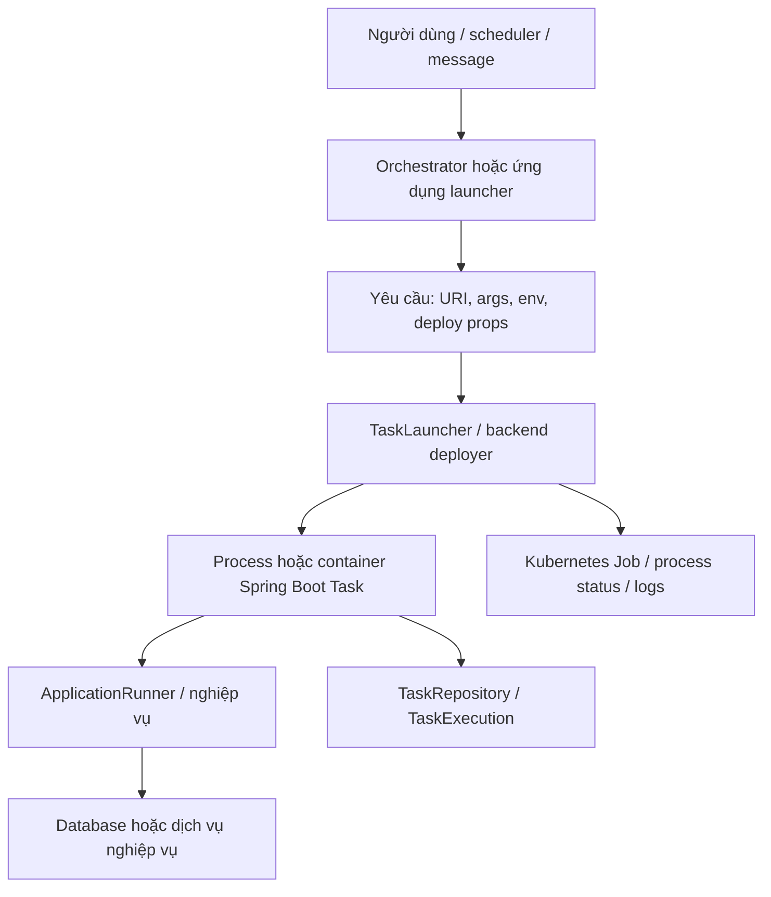
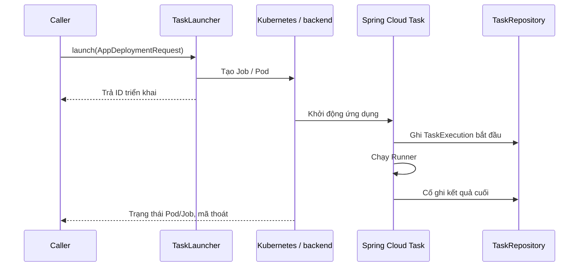
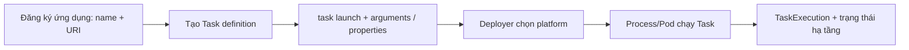
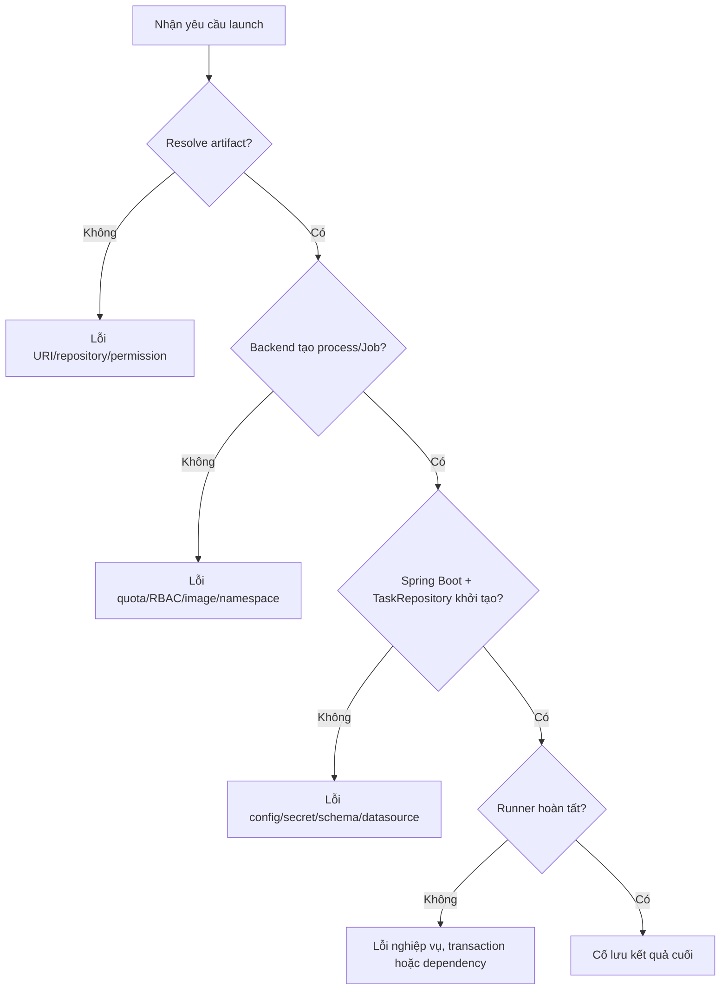

# Truyền URI ứng dụng, tham số, cấu hình môi trường và triển khai

## 1. Vấn đề: muốn khởi chạy một Task cần cung cấp những gì?

**Spring Cloud Task** giúp tạo ứng dụng Spring Boot có thời gian chạy hữu hạn: khởi động, xử lý công việc, ghi nhận trạng thái và kết quả thực thi qua `TaskRepository` rồi kết thúc. Trong thực tế, cùng một ứng dụng có thể được khởi chạy bằng lệnh `java -jar`, Kubernetes Job, Spring Cloud Deployer, Spring Cloud Data Flow hoặc một luồng sự kiện. Mỗi lần chạy cần xác định **chạy artifact nào**, **xử lý dữ liệu gì**, **được cấp môi trường nào** và **triển khai với tài nguyên ra sao**.

Ví dụ tác vụ nhập đơn hàng cần chạy ngày `2026-11-24` ở môi trường production:

```text
Artifact:   orders-import phiên bản 1.4.2
Task name:  orders-import
Arguments:  --business-date=2026-11-24 --source=marketplace
Environment:
  APP_REGION=ap-southeast-1
  TASK_DB_URL=jdbc:postgresql://db.internal:5432/taskdb
Deployment:
  chạy trên Kubernetes, giới hạn CPU/RAM, namespace, service account
```

Những nhóm đầu vào này **không có cùng ý nghĩa**. `--business-date` là tham số nghiệp vụ; `TASK_DB_URL` là cấu hình kết nối; CPU/RAM hay namespace là cấu hình của bộ triển khai; còn URI chỉ đến JAR hoặc image chứa code. Khi trộn các nhóm, ứng dụng dễ nhận sai đầu vào, thiếu quyền truy cập, rò rỉ bí mật hoặc chạy nhầm phiên bản.

Sau bài này, bạn sẽ biết:

- Phân biệt **URI ứng dụng**, tên ứng dụng, tên Spring Cloud Task và định danh lần chạy.
- Truyền command-line arguments, application properties, environment variables và deployment properties đúng vai trò.
- Hiểu cách `TaskLaunchRequest` và `TaskLauncher`/`AppDeploymentRequest` thể hiện các nhóm thông tin.
- Đọc ví dụ khởi chạy qua Spring Cloud Data Flow, trực tiếp trên Kubernetes và lập trình bằng Java.
- Kiểm tra artifact, quyền, biến môi trường, trạng thái triển khai và `TaskExecution`.
- Thiết kế quy trình khởi chạy theo yêu cầu hoặc theo lịch, an toàn khi retry và nâng cấp.

## 2. Kiến trúc: ai khởi chạy, ai thực thi, ai ghi lịch sử?



Có ba trách nhiệm tách biệt:

| Thành phần | Trách nhiệm chính | Không nên giả định |
| --- | --- | --- |
| **Launcher/orchestrator** | Chọn artifact, truyền tham số, thiết lập tài nguyên, tạo process/Pod/Job | Lệnh launch được chấp nhận không chứng minh nghiệp vụ hoàn tất |
| **Spring Boot + Spring Cloud Task** | Nhận cấu hình, chạy Runner, lưu `TaskExecution` và xử lý vòng đời hữu hạn | Không tự quyết định lịch chạy hoặc retry toàn hệ thống |
| **Kho dữ liệu và hệ điều phối** | Ghi dữ liệu thực tế, lưu lịch sử, thông tin Pod/Job/process và cho phép điều tra | Một metadata `COMPLETED` không tự chứng minh mọi hiệu ứng bên ngoài đã hoàn tất đúng |

Spring Cloud Task là **thư viện theo dõi vòng đời ứng dụng**. Spring Cloud Deployer/`TaskLauncher` là **giao diện triển khai**. Spring Cloud Data Flow bổ sung đăng ký ứng dụng, tạo định nghĩa Task, API/shell, scheduling và quan sát thực thi. Bạn có thể dùng Spring Cloud Task mà **không cần** Data Flow: ví dụ chạy JAR trực tiếp bằng cron hoặc Kubernetes Job.

## 3. Phân biệt năm nhóm thông tin của một yêu cầu launch

### 3.1. Bảng tổng quan

| Nhóm | Dạng minh họa | Ai thường sử dụng? | Mục tiêu |
| --- | --- | --- | --- |
| **Artifact URI** | `maven://com.example:orders-import:1.4.2` | Resolver/deployer | Tìm đúng JAR/image để chạy |
| **Application name** | `orders-import` | Deployer/orchestrator | Đặt tên triển khai, truy vết |
| **Command-line arguments** | `--business-date=2026-11-24` | `ApplicationArguments` / Spring Boot | Chọn dữ liệu, chế độ và tham số một lần chạy |
| **Environment properties** | `APP_REGION=ap-southeast-1` | Process/JVM/Spring `Environment` | Cấu hình môi trường thực thi |
| **Deployment properties** | Memory, CPU, namespace, service account | `TaskLauncher` / Kubernetes/Cloud Foundry | Quy định tài nguyên và chính sách triển khai |

Trong Spring Cloud Task, `TaskLaunchRequest` có năm trường tương ứng: `uri`, `applicationName`, `commandLineArguments`, `environmentProperties` và `deploymentProperties`. Cần hiểu đây là **cấu trúc yêu cầu launch**, không phải DTO để Spring Boot nghiệp vụ tự động bind toàn bộ.

### 3.2. Tên ứng dụng khác tên Task và ID thực thi

| Tên/ID | Ví dụ | Ý nghĩa |
| --- | --- | --- |
| `applicationName` trong yêu cầu launch | `orders-import` | Nhãn ứng dụng cho bộ triển khai/launcher |
| `spring.cloud.task.name` | `orders-import` | Tên logic Spring Cloud Task ghi trong metadata |
| `TaskExecution.executionId` | `4821` | Khóa của **một lần** chạy, do repository cấp |
| Kubernetes Job name | `orders-import-20261124-a1` | Tên resource của một lần deploy trên cluster |
| `businessDate` | `2026-11-24` | Khóa dữ liệu nghiệp vụ, có thể dùng cho idempotency |

Các giá trị có thể trùng nhau theo cách đặt tên của bạn, nhưng **không nên giả định launcher tự đồng bộ tất cả**. Khi cần lịch sử dễ truy vấn, hãy chọn tên Task logic ổn định và ghi rõ correlation ID/định danh nghiệp vụ. Nếu không truyền `applicationName`, một số dòng tài liệu launcher mô tả việc tự tạo tên với tiền tố `Task-`, nhưng định dạng/chi tiết có thể khác giữa phiên bản; **đừng dựa vào tên tự phát sinh** để xác định khóa xử lý nghiệp vụ.

## 4. URI ứng dụng: chỉ đúng phiên bản artifact

### 4.1. URI là gì?

URI cho biết **vị trí hoặc định danh nguồn artifact** mà bộ triển khai phải tìm. Trong hệ sinh thái Spring Cloud, các cách biểu diễn được tài liệu dùng gồm:

| Loại | Ví dụ | Điều kiện |
| --- | --- | --- |
| Maven artifact | `maven://com.example:orders-import:1.4.2` | Resolver truy cập được Maven repository và đúng version |
| Maven có extension/classifier | `maven://com.example:orders-import:jar:exec:1.4.2` | Artifact thực sự tồn tại với classifier tương ứng |
| File URI | `file:///opt/apps/orders-import-1.4.2.jar` | File phải tồn tại ở nơi resolver/deployer **thực sự nhìn thấy** |
| HTTPS JAR | `https://artifacts.example.com/orders-import-1.4.2.jar` | Backend/resolver hỗ trợ HTTP(S), có quyền tải và checksum phù hợp |
| Container image | `registry.example.com/platform/orders-import:1.4.2` trong `image` của Kubernetes | Image pull được, kiến trúc CPU/JDK/entrypoint phù hợp |

Với Maven, tài liệu Spring Cloud Data Flow mô tả dạng URI:

```text
maven://<groupId>:<artifactId>[:<extension>[:<classifier>]]:<version>
```

Các phần trong dấu ngoặc vuông là **tùy chọn của cú pháp**, không phải ký tự bắt buộc của URI. Không chèn dấu cách và không dùng phiên bản ngầm định cho production. Một số backend/resolver còn hỗ trợ URI riêng cho Docker hoặc OCI image; **scheme và cú pháp phải đối chiếu với triển khai cụ thể**, không mặc định mọi `TaskLauncher` hỗ trợ mọi dạng URI.

### 4.2. Maven URI không đồng nghĩa đường dẫn file cục bộ

Nếu URI là `maven://...`, bộ resolver sẽ dùng Maven repositories, credentials và cache để lấy đúng artifact. Nếu URI là `file:///...`, file phải tồn tại trong **filesystem của thành phần có trách nhiệm resolve**. Đường dẫn trên laptop của người dùng thường không tồn tại trong container Data Flow server hoặc Pod Kubernetes.

Đây là lỗi thường gặp:

```text
Launcher đang chạy trong container Linux:
  file:///C:/Users/me/orders-import.jar  -> không tồn tại trong container

Ứng dụng được build tại máy phát triển:
  /home/dev/target/orders-import.jar     -> không tự xuất hiện trên node cluster
```

Giải pháp là publish artifact vào repository hoặc image registry mà môi trường triển khai có quyền truy cập, hoặc mount artifact vào đúng vị trí của resolver.

### 4.3. Cố định phiên bản và kiểm tra tính toàn vẹn

Trong production, tránh dùng nhãn động kiểu `latest` làm dấu vết duy nhất; khi retry cùng Task, ảnh hưởng của build khác nhau có thể khiến kết quả và schema không tương thích. Với image, nên ghim **digest**; với JAR, nên lưu version/checksum và trạng thái promotion giữa môi trường.

```text
App:       orders-import
Version:   1.4.2
Image:     registry.example.com/platform/orders-import@sha256:<digest>
Job run:   orders-import-20261124-a1
Input:     businessDate=2026-11-24
```

`<digest>` ở đây là **placeholder** cần thay bằng SHA-256 thực tế. URI/artifact version là **phiên bản chương trình**; `businessDate` và ID lần chạy là **định danh nghiệp vụ/vận hành**. Hai phạm vi đó khác nhau.

## 5. Command-line arguments: tham số cho đúng một lần chạy

### 5.1. Truyền dưới dạng danh sách đối số

Ví dụ:

```bash
java -jar orders-import-1.4.2.jar --business-date=2026-11-24 --source=marketplace --dry-run
```

Spring Boot `ApplicationRunner` nhận `ApplicationArguments` để phân loại:

- `--business-date=2026-11-24`: option có một giá trị.
- `--source=marketplace`: option có một giá trị.
- `--dry-run`: option không có giá trị (flag).
- Những token không bắt đầu theo cú pháp `--name`: non-option arguments.

Khi dựng request bằng Java hoặc Kubernetes `args`, nên truyền **mỗi token CLI là một phần tử riêng**, ví dụ:

```java
List<String> cliArgs = List.of(
        "--business-date=2026-11-24",
        "--source=marketplace",
        "--dry-run"
);
```

Không truyền cả chuỗi `"--business-date=... --source=..."` như **một** phần tử `List<String>` rồi hy vọng Spring tự tách theo dấu cách. Trong Spring Cloud Data Flow Shell, `--arguments` lại là tham số của **shell**, được Data Flow phân tích thành các token theo cú pháp shell của nó. Phải phân biệt lớp shell với mảng argv cuối đến JVM.

### 5.2. Kiểm tra đầu vào bằng ApplicationRunner

Ví dụ một Task nhận đúng một ngày ISO và một nguồn dữ liệu:

```java
import java.time.LocalDate;
import java.time.format.DateTimeParseException;
import java.util.List;
import org.springframework.boot.ApplicationArguments;
import org.springframework.boot.ApplicationRunner;
import org.springframework.context.annotation.Bean;
import org.springframework.context.annotation.Configuration;

@Configuration
class ImportRunnerConfiguration {
    @Bean
    ApplicationRunner importRunner(ImportService service) {
        return args -> {
            String source = oneRequired(args, "source");
            String dateText = oneRequired(args, "business-date");
            LocalDate date;
            try {
                date = LocalDate.parse(dateText);
            } catch (DateTimeParseException ex) {
                throw new IllegalArgumentException(
                        "--business-date phải theo yyyy-MM-dd", ex);
            }
            boolean dryRun = args.containsOption("dry-run");
            List<String> flagValues = args.getOptionValues("dry-run");
            if (dryRun && flagValues != null && !flagValues.isEmpty()) {
                throw new IllegalArgumentException(
                        "--dry-run không nhận giá trị");
            }
            service.importOrders(source, date, dryRun);
        };
    }

    private static String oneRequired(
            ApplicationArguments args, String optionName) {
        List<String> values = args.getOptionValues(optionName);
        if (values == null || values.size() != 1
                || values.get(0).isBlank()) {
            throw new IllegalArgumentException(
                    "Cần đúng một --" + optionName + "=<giá trị>");
        }
        return values.get(0);
    }
}
```

`ImportService` là bean nghiệp vụ cần được xây dựng riêng. Đoạn ví dụ buộc đầu vào hợp lệ **trước khi gọi service**. Nếu không truyền `--source` hoặc truyền `--source=A --source=B` trong khi hợp đồng yêu cầu một giá trị, Runner ném lỗi. Cách này tránh lấy nhầm phần tử đầu khi có option lặp.

### 5.3. Tham số CLI không phải nơi chứa secret

Không truyền `--password=...`, bearer token hoặc API key bằng argv. Đối số dòng lệnh có thể xuất hiện trong `ps`, log, payload launch, TaskRepository hoặc thông tin Kubernetes Pod. Với Spring Cloud Data Flow, một số kiểu entry point có thể chuyển application properties thành CLI args; cần kiểm tra cấu hình entry point khi có dữ liệu nhạy cảm.

Đối với giá trị như tên nguồn, ngày nghiệp vụ, mode xử lý không nhạy cảm, CLI là lựa chọn rõ ràng. Với bí mật, ưu tiên secret manager hoặc Kubernetes Secret được mount dưới dạng file/biến môi trường phù hợp và hạn chế quyền đọc.

## 6. Environment variables: cấu hình tiến trình

### 6.1. Vai trò của environmentProperties

Trong `TaskLaunchRequest`, `environmentProperties` là một `Map<String,String>` chứa các biến môi trường cần đặt cho **tiến trình được khởi chạy**. Ví dụ:

```text
APP_REGION=ap-southeast-1
SPRING_PROFILES_ACTIVE=prod
TASK_DB_URL=jdbc:postgresql://db.internal:5432/taskdb
TASK_DB_USER=task_runtime
```

Trong Spring Boot, có thể dùng placeholder:

```yaml
spring:
  application:
    name: orders-import
  main:
    web-application-type: none
  datasource:
    url: ${TASK_DB_URL}
    username: ${TASK_DB_USER}
    password: ${TASK_DB_PASSWORD}
  cloud:
    task:
      initialize-enabled: false
      closecontextEnabled: true
orders:
  region: ${APP_REGION:ap-southeast-1}
```

Đây là `application.yml` **bên trong ứng dụng Task**, không phải cấu hình của launcher. `initialize-enabled=false` giả định bảng `TASK_*` được tạo trước bằng migration đúng phiên bản. `TASK_DB_PASSWORD` cần được cung cấp từ nguồn bảo mật; ví dụ không đưa giá trị thật vào tài liệu.

### 6.2. Application properties khác environment properties

Spring Boot có hệ thống `Environment` hợp nhất nhiều nguồn cấu hình: `application.yml`, biến môi trường, Java system properties và command-line properties. Trong khi đó, `ApplicationArguments` chỉ phản ánh các đối số chương trình nhận được.

| Giá trị | Người viết thường đặt tại đâu? | Nhận trong ứng dụng |
| --- | --- | --- |
| `--business-date=2026-11-24` | CLI args | `ApplicationArguments` hoặc property nguồn command line |
| `SPRING_PROFILES_ACTIVE=prod` | Env | Spring `Environment` |
| `TASK_DB_URL=jdbc:...` | Env/secret manager | Placeholder hoặc `@ConfigurationProperties` |
| `-Duser.timezone=UTC` | JVM option, trước `-jar` | Java system property / `Environment` |
| `spring.datasource.hikari.maximum-pool-size` | YAML, env hoặc CLI | Spring Boot configuration binding |

Đừng giả định môi trường nhận đúng một loại biểu diễn. Ví dụ `--spring.profiles.active=prod` là **đối số ứng dụng** trong khi `SPRING_PROFILES_ACTIVE=prod` là **biến môi trường**; hai nguồn có thể cùng ảnh hưởng `Environment`, với precedence theo Spring Boot. Khi nhiều nguồn cùng đặt một property, phải kiểm tra thứ tự ưu tiên của phiên bản Boot đang dùng để tránh chạy nhầm profile.

### 6.3. Truyền bí mật qua tham chiếu, không qua request message

`TaskLaunchRequest` có thể được gửi qua Spring Cloud Stream và broker trung gian. Nếu nhét secret plaintext vào `environmentProperties` của message, dữ liệu nhạy cảm có thể lọt vào queue, log, tracing hoặc lưu trữ message.

Giải pháp đáng tin hơn: launcher chỉ chọn **tên Kubernetes Secret**, service account hoặc tài nguyên bảo mật đã được provisioning. Trong manifest Pod, biến môi trường có thể tham chiếu khóa:

```yaml
env:
  - name: TASK_DB_PASSWORD
    valueFrom:
      secretKeyRef:
        name: orders-task-db
        key: password
```

Lưu ý: biến môi trường vẫn có thể bị lộ qua quyền truy cập Pod/process, heap dump hoặc log nếu code in ra. Cần quyền RBAC tối thiểu, không in bí mật và dùng cơ chế luân chuyển secret phù hợp.

## 7. Deployment properties: cấu hình nền tảng chạy

### 7.1. Những thuộc tính thường thuộc deployer

`deploymentProperties` hướng tới hạ tầng tạo tiến trình/container, ví dụ:

| Cấu hình triển khai | Ví dụ | Vì sao không phải tham số nghiệp vụ? |
| --- | --- | --- |
| CPU request/limit | 500m / 1 CPU | Điều khiển scheduling và tài nguyên container |
| Memory request/limit | 512Mi / 1Gi | Đặt ngân sách bộ nhớ, tránh OOM |
| Kubernetes namespace | `batch-jobs` | Vị trí quản lý Job/Pod trong cluster |
| Service account | `orders-task-runner` | Quyền truy cập tài nguyên cluster |
| Node selector / tolerations | Nhóm node batch | Quyết định nơi Pod được lập lịch |
| Image pull secret | `private-registry-pull` | Quyền lấy image |
| Network/volume | PVC mount, DNS, proxy | Kết nối và lưu trữ của container |
| Timeout/lifecycle | Job deadline, retry/backoff | Điều khiển process và sự cố hạ tầng |

**Tên key của `deploymentProperties` khác nhau theo `TaskLauncher` backend**. Không có một property `cpu=1` phổ quát được mọi launcher hiểu. Với Spring Cloud Data Flow, nhóm `deployer.<application>.<platform>.<property>` được chuyển thành cấu hình deployer; với việc gọi `TaskLauncher` trực tiếp, map cần dùng key mà backend SPI yêu cầu. Tra tài liệu của Local/Kubernetes/Cloud Foundry deployer tương ứng.

### 7.2. So sánh application properties và deployment properties

```text
app.orders-import.orders.max-errors=10
    -> cấu hình mà ứng dụng orders-import đọc

deployer.orders-import.kubernetes.requests.memory=512Mi
    -> yêu cầu bộ deployer cấp tài nguyên cho container
```

Ví dụ trên dùng quy ước property của Spring Cloud Data Flow theo tên **application** trong định nghĩa Task; property bộ nhớ cần được kiểm tra với phiên bản Kubernetes deployer đang dùng. Một property bắt đầu bằng `deployer.` **không nên** được ứng dụng nghiệp vụ tự diễn giải thành tham số xử lý dữ liệu.

### 7.3. Tham số JVM nằm ở đâu?

`-Xmx512m` và `-Dfile.encoding=UTF-8` là **JVM options**, không phải option `ApplicationArguments`. Nếu chạy JAR trực tiếp:

```bash
java -Xmx512m -Duser.timezone=UTC -jar orders-import.jar --source=marketplace
```

Trong container, có thể dùng `JAVA_TOOL_OPTIONS` hoặc cấu hình entrypoint được kiểm soát để truyền tùy chọn JVM. Memory limit container và heap JVM phải **phù hợp**; không mặc định `-Xmx` bằng toàn bộ container memory vì JVM còn dùng metaspace, direct buffers và các vùng nhớ khác.

## 8. TaskLaunchRequest: một payload chứa đủ năm nhóm thông tin

### 8.1. Chữ ký constructor

Tài liệu API Spring Cloud Task 3.0.4 mô tả:

```java
TaskLaunchRequest(
    String uri,
    List<String> commandlineArguments,
    Map<String, String> environmentProperties,
    Map<String, String> deploymentProperties,
    String applicationName
)
```

Đây là **DTO của Spring Cloud Task launcher module**, dùng trong cơ chế nhận message launch qua Spring Cloud Stream. Nó không tương đương `AppDeploymentRequest` của Spring Cloud Deployer: `TaskLaunchRequest` là **đầu vào cấp message**, còn `AppDeploymentRequest` là yêu cầu đã được chuẩn bị để backend launcher triển khai.

### 8.2. Ví dụ Java tạo request

```java
import java.util.List;
import java.util.Map;
import org.springframework.cloud.task.launcher.TaskLaunchRequest;

public class LaunchRequestExample {
    public TaskLaunchRequest create() {
        String uri =
                "maven://com.example:orders-import:1.4.2";

        List<String> arguments = List.of(
                "--business-date=2026-11-24",
                "--source=marketplace");

        Map<String, String> env = Map.of(
                "APP_REGION", "ap-southeast-1",
                "SPRING_PROFILES_ACTIVE", "prod");

        Map<String, String> deploy = Map.of(
                // Key này là ví dụ minh họa cho một backend cụ thể:
                "spring.cloud.deployer.kubernetes.requests.memory",
                "512Mi");

        return new TaskLaunchRequest(
                uri, arguments, env, deploy, "orders-import");
    }
}
```

Ví dụ **chỉ tạo object**, chưa gọi launcher và chưa chạy task. Map deploy dùng key dạng minh họa; backend thực tế có thể yêu cầu cách biểu diễn khác. Đừng nhầm việc object được khởi tạo thành công với việc URI có thể resolve, cluster cho phép deploy hoặc dữ liệu đã được xử lý.

### 8.3. @EnableTaskLauncher và giới hạn phiên bản

Tài liệu Spring Cloud Task 3.3 vẫn minh họa `@EnableTaskLauncher` để tạo một Spring Cloud Stream sink tiếp nhận message có payload `TaskLaunchRequest`:

```java
import org.springframework.boot.SpringApplication;
import org.springframework.boot.autoconfigure.SpringBootApplication;
import org.springframework.cloud.task.launcher.annotation.EnableTaskLauncher;

@SpringBootApplication
@EnableTaskLauncher
public class TaskLauncherSinkApplication {
    public static void main(String[] args) {
        SpringApplication.run(TaskLauncherSinkApplication.class, args);
    }
}
```

**Cảnh báo quan trọng về vòng đời API:** Tài liệu Spring Cloud Task 3.3 đánh dấu **Spring Cloud Stream integration để launch Task là end-of-life và sẽ bị loại bỏ trong release tương lai**. Ví dụ này có ích để hiểu payload và hệ thống đang dùng API cũ; không nên chọn làm điểm tích hợp mới mà chưa xác minh hướng hỗ trợ của phiên bản mục tiêu. Các triển khai mới có thể gọi `TaskLauncher` phù hợp backend hoặc sử dụng API của một hệ điều phối như Spring Cloud Data Flow.

Ngoài annotation, một sink hoạt động cần dependency Spring Cloud Stream/binder, `TaskLauncher` backend, cấu hình broker, quyền truy cập artifact và database. Chỉ thêm annotation không tự tạo được cơ chế khởi chạy đầy đủ trên Kubernetes.

## 9. Dùng TaskLauncher và AppDeploymentRequest trực tiếp

### 9.1. Hợp đồng của TaskLauncher

Spring Cloud Deployer định nghĩa `TaskLauncher` cho ứng dụng **chạy một lần rồi kết thúc**. Trong API phổ biến, launcher nhận `AppDeploymentRequest`, triển khai tài nguyên và trả về **execution/deployment identifier** của backend:

```text
AppDefinition
  -> tên ứng dụng và application properties
Resource
  -> file/JAR/image mà backend có thể resolve
Deployment properties
  -> tài nguyên và chính sách backend
Command-line arguments
  -> tham số truyền cho task

AppDeploymentRequest -> TaskLauncher.launch(...)
```

Định danh trả về là kết quả **bắt đầu triển khai**, không bảo đảm `TaskExecution` đã được ghi hoặc Runner đã hoàn tất. Backend có thể tạo Pod bất đồng bộ; sau đó phải quan sát trạng thái resource và metadata ứng dụng.

### 9.2. Mẫu Java theo API Deployer phổ biến

```java
import java.util.List;
import java.util.Map;
import org.springframework.cloud.deployer.spi.core.AppDefinition;
import org.springframework.cloud.deployer.spi.core.AppDeploymentRequest;
import org.springframework.cloud.deployer.spi.task.TaskLauncher;
import org.springframework.core.io.Resource;

public class OrdersTaskDeployer {
    private final TaskLauncher taskLauncher;
    private final Resource taskArtifact;

    public OrdersTaskDeployer(
            TaskLauncher taskLauncher, Resource taskArtifact) {
        this.taskLauncher = taskLauncher;
        this.taskArtifact = taskArtifact;
    }

    public String launchDailyImport(String day) {
        AppDefinition definition = new AppDefinition(
                "orders-import",
                Map.of("spring.profiles.active", "prod"));

        AppDeploymentRequest request = new AppDeploymentRequest(
                definition,
                taskArtifact,
                Map.of(),
                List.of("--business-date=" + day,
                        "--source=marketplace"));

        return taskLauncher.launch(request);
    }
}
```

Đây là **mẫu cốt lõi có điều kiện theo API phiên bản**. Phải cung cấp `TaskLauncher` backend hoạt động và `Resource` đã được resolver hỗ trợ tạo ra; đoạn code không tự cấu hình Kubernetes, Maven repository hay secret. Constructor/method cụ thể cần đối chiếu dependency Spring Cloud Deployer của dự án.

Trước khi truyền `day` vào CLI, xác thực ISO date và quyền yêu cầu khởi chạy. Nếu `taskArtifact` là Maven Resource, resolver cần credentials/repository tương ứng; nếu là container image, backend cần biết cách pull image.

### 9.3. Tại sao không gọi launch là thành công nghiệp vụ?



Nhận được `launchId` chỉ có nghĩa backend **đã chấp nhận yêu cầu theo hợp đồng của nó**. Nếu image pull thất bại hoặc ứng dụng lỗi khi mở `DataSource`, `TaskExecution` có thể chưa tồn tại. Bên gọi phải ghi correlation ID và quan sát kết quả bằng `TaskRepository` **cùng** trạng thái backend.

## 10. Spring Cloud Data Flow: đăng ký, tạo định nghĩa và khởi chạy

Spring Cloud Data Flow (SCDF) hỗ trợ quản lý Task qua UI, REST và Shell. Quy trình khái niệm:



### 10.1. Đăng ký artifact

Trong **Spring Cloud Data Flow Shell** (không phải shell của hệ điều hành), ví dụ:

```text
dataflow:> app register --name orders-import --type task --uri maven://com.example:orders-import:1.4.2
```

SCDF sẽ lưu tên đăng ký và URI, nhưng **không biên dịch JAR**. Artifact phải được publish tới Maven repository mà SCDF/deployer có thể truy cập. Một lựa chọn khác là `file:///...` hoặc `https://...` nếu platform/resolver hỗ trợ.

### 10.2. Tạo Task definition

```text
dataflow:> task create orders-daily --definition "orders-import"
```

Đây là định nghĩa logic `orders-daily` dùng ứng dụng `orders-import` đã đăng ký. Có thể đưa application properties hợp lệ vào definition theo DSL tương ứng; không dùng definition để ghi cứng thông tin nhạy cảm.

### 10.3. Launch với tham số nghiệp vụ

```text
dataflow:> task launch orders-daily --arguments "--business-date=2026-11-24 --source=marketplace"
```

Theo hướng dẫn SCDF, `--arguments` nhận chuỗi các command-line arguments phân tách bằng dấu cách ở cấp Data Flow Shell. Nếu giá trị có khoảng trắng/ký tự escape, cần kiểm tra quoting theo phiên bản Shell và xác minh argv mà Spring Boot nhận được.

Có thể truyền properties riêng:

```text
dataflow:> task launch orders-daily --properties "app.orders-import.orders.max-errors=10,deployer.orders-import.kubernetes.requests.memory=512Mi"
```

Tên `orders-import` sau tiền tố `app.`/`deployer.` là **tên ứng dụng trong task definition**, không nhất thiết là tên Task definition `orders-daily`. Cấu trúc key triển khai có thể khác tùy platform và SCDF release; dùng `task info`/`app info` và tài liệu deployer version tương ứng để xác nhận.

### 10.4. Thuộc tính cấu hình và độ ưu tiên

Trong SCDF, application properties và deployment properties được xử lý bởi server/deployer; cách chuyển xuống container phụ thuộc platform và entry-point style. Chẳng hạn Data Flow cho Kubernetes mô tả ba kiểu:

| `entryPointStyle` | Cách chuyển application properties | Cần chú ý |
| --- | --- | --- |
| `exec` | Có thể chuyển thành CLI args | Giá trị có thể xuất hiện trong mô tả Pod/process |
| `shell` | Chuyển thành environment variables | Phụ thuộc shell entrypoint và cách quote |
| `boot` | Dùng `SPRING_APPLICATION_JSON` cho properties, CLI args cho đối số Task | Cần tránh xung đột với biến đã có |

Với các thông tin nhạy cảm, tài liệu SCDF khuyến nghị kiểm tra `shell`/`boot` và sử dụng Kubernetes Secrets thích hợp. **Đổi entryPointStyle không thay thế secret management**: quyền đọc Pod/Job và cách SCDF truyền credentials vẫn phải được kiểm soát.

## 11. Kubernetes Job: ví dụ triển khai không qua Data Flow

Không bắt buộc phải có SCDF hay `TaskLaunchRequest`. Một Spring Boot JAR có thể được đóng gói thành OCI image và Kubernetes Job có thể truyền `args`, `env` và cấu hình resource trực tiếp.

### 11.1. Manifest minh họa

```yaml
apiVersion: batch/v1
kind: Job
metadata:
  name: orders-import-20261124
  namespace: batch-jobs
  labels:
    app: orders-import
spec:
  backoffLimit: 0
  activeDeadlineSeconds: 1800
  template:
    metadata:
      labels:
        app: orders-import
    spec:
      restartPolicy: Never
      serviceAccountName: orders-task-runner
      containers:
        - name: orders-import
          image: registry.example.com/platform/orders-import:1.4.2
          imagePullPolicy: IfNotPresent
          args:
            - "--business-date=2026-11-24"
            - "--source=marketplace"
          env:
            - name: SPRING_PROFILES_ACTIVE
              value: prod
            - name: APP_REGION
              value: ap-southeast-1
            - name: TASK_DB_URL
              valueFrom:
                secretKeyRef:
                  name: orders-task-db
                  key: jdbc-url
            - name: TASK_DB_USER
              valueFrom:
                secretKeyRef:
                  name: orders-task-db
                  key: username
            - name: TASK_DB_PASSWORD
              valueFrom:
                secretKeyRef:
                  name: orders-task-db
                  key: password
          resources:
            requests:
              cpu: "250m"
              memory: "512Mi"
            limits:
              cpu: "1"
              memory: "1Gi"
```

Ví dụ giả định:

- Namespace `batch-jobs`, ServiceAccount `orders-task-runner` và Secret `orders-task-db` đã được tạo bằng quy trình quản trị.
- Image chứa entrypoint chạy đúng Spring Boot JAR và **chuyển tiếp `args` của Kubernetes tới Java**; nếu Dockerfile không thiết lập như vậy, cần cấu hình `command`/`args` phù hợp.
- Ứng dụng nhận được network access đến PostgreSQL và đã được migrate schema `TASK_*`.
- Giá trị image/tag, deadline và CPU/RAM chỉ là mẫu; production nên ghim digest và dùng giới hạn đo được.

`backoffLimit: 0` được chọn để bài thực hành không tự tạo lần thử thứ hai sau lỗi. Với production, retry cần có policy rõ ràng và nghiệp vụ idempotent. `activeDeadlineSeconds` giới hạn vòng đời Job ở tầng Kubernetes; nó không phải timeout SQL và không bảo đảm framework luôn kịp ghi `TaskExecution` khi hết hạn.

### 11.2. Đối chiếu ba nhóm cấu hình trong manifest

| Thành phần manifest | Tương ứng trong yêu cầu launch | Đối tượng sử dụng |
| --- | --- | --- |
| `image` | Artifact URI/image | Kubernetes/container runtime |
| `args` | `commandLineArguments` | Java process / `ApplicationArguments` |
| `env` | `environmentProperties` | Process/Spring `Environment` |
| `resources`, `serviceAccountName`, `namespace` | `deploymentProperties` | Kubernetes scheduler/RBAC |
| `metadata.name` | Launch/Job resource name | Kubernetes, log và vận hành |

Ở manifest Kubernetes không có object `TaskLaunchRequest`; đây là **phép ánh xạ khái niệm** giữa cùng một mục tiêu triển khai bằng hai API khác nhau.

### 11.3. Quan sát tiến trình đã được tạo

Một lần tạo Job thành công không có nghĩa Pod đã `Running`. Có thể gặp `Pending` do thiếu tài nguyên, `ImagePullBackOff` do registry, hoặc `CrashLoopBackOff`/`Error` khi ứng dụng lỗi tùy loại workload.

Các lệnh vận hành đọc trạng thái, ví dụ:

```bash
kubectl -n batch-jobs get job orders-import-20261124
kubectl -n batch-jobs get pods -l job-name=orders-import-20261124
kubectl -n batch-jobs describe job orders-import-20261124
kubectl -n batch-jobs logs job/orders-import-20261124
```

Các lệnh giả định kubeconfig có quyền truy cập cluster và Job tồn tại. Label Pod do controller thiết lập có thể khác giữa các thế hệ Kubernetes; nếu lệnh lấy Pod theo label không trả kết quả, xem selector từ Job/Pod thực tế. Không dùng log thành công duy nhất làm bằng chứng Task đã cập nhật metadata hoàn tất.

## 12. Quy trình khởi chạy theo lịch hoặc yêu cầu

### 12.1. Khởi chạy theo yêu cầu

Một service nội bộ có thể tiếp nhận API yêu cầu nhập dữ liệu theo ngày. Hợp đồng API nên nhận **đầu vào nghiệp vụ có giới hạn**, không cho phép caller tự truyền URI bất kỳ, namespace bất kỳ hoặc danh sách deployment properties không kiểm soát.

```text
POST /imports
businessDate = 2026-11-24
source       = marketplace

API:
  1. Xác thực người gọi và input
  2. Kiểm tra idempotency/các lần chạy trùng
  3. Chọn URI artifact từ allowlist version đã phát hành
  4. Chọn profile/namespace/service account cho môi trường
  5. Tạo yêu cầu TaskLauncher hoặc Kubernetes Job
  6. Trả launch/request ID, tiếp tục theo dõi bất đồng bộ
```

Không cho client truyền trực tiếp `file:///...`, URL không giới hạn hoặc image tùy ý vào `TaskLauncher` có quyền cao; điều đó có thể biến API chạy Task thành điểm thực thi artifact không được phê duyệt.

### 12.2. Khởi chạy theo lịch

Ví dụ Kubernetes CronJob:

```yaml
apiVersion: batch/v1
kind: CronJob
metadata:
  name: orders-import-daily
  namespace: batch-jobs
spec:
  schedule: "0 2 * * *"
  timeZone: "Asia/Ho_Chi_Minh"
  concurrencyPolicy: Forbid
  jobTemplate:
    spec:
      backoffLimit: 0
      template:
        spec:
          restartPolicy: Never
          containers:
            - name: orders-import
              image: registry.example.com/platform/orders-import:1.4.2
              args:
                - "--source=marketplace"
```

Ví dụ mô tả **cấu trúc lịch**, chưa phải manifest production đầy đủ; cần bổ sung Secret, ServiceAccount, resources, deadline và `businessDate`. Với lịch ngày nghiệp vụ, **không thể dùng một ngày tĩnh** cho mọi lần chạy. Phải định nghĩa cách tính `businessDate` theo timezone, kỳ dữ liệu và trường hợp chạy bù.

`concurrencyPolicy: Forbid` ngăn các Job **thuộc cùng CronJob đó** chồng lên nhau theo chính sách controller; nó không ngăn Job thủ công hoặc từ CronJob khác. Nếu chỉ được phép một Task cùng tên, cân nhắc cơ chế khóa hoặc idempotency ở ứng dụng; scheduler-level concurrency không thay thế bảo vệ dữ liệu.

Kubernetes CronJob `timeZone` được hỗ trợ ở các phiên bản Kubernetes hiện đại; nếu cluster cũ chưa hỗ trợ, cần cấu hình lịch theo timezone của controller hoặc nâng cấp, không giả định field luôn hợp lệ.

## 13. Retry, lỗi launch và tính đúng đắn nghiệp vụ

### 13.1. Bốn giai đoạn lỗi khác nhau



| Giai đoạn | Lỗi ví dụ | Có thể có `TaskExecution`? | Hướng xử lý |
| --- | --- | --- | --- |
| Resolve artifact | URI sai, JAR không tồn tại, Maven repo 403 | Thường chưa | Kiểm tra URI, repository và quyền |
| Launch/deployment | Kubernetes RBAC denied, quota, image pull | Có thể chưa | Kiểm tra backend events/Pod status |
| Startup ứng dụng | Sai `DataSource`, schema `TASK_*` chưa tạo | Có thể chưa | Kiểm tra config, migration, secret |
| Runtime nghiệp vụ | Đầu vào sai, DB SQL lỗi, API timeout | Thường có nếu repository hoạt động | Đối chiếu transaction, TaskExecution và mã thoát |
| Ghi kết quả cuối | DB đứt kết nối, JVM bị kill | Có thể thiếu `END_TIME` | Đối soát dữ liệu đã commit và trạng thái process |

Không retry toàn bộ chỉ vì `TaskLauncher.launch(...)` ném exception: có trường hợp yêu cầu tạo Job đã được backend nhận nhưng client mất kết nối trước khi nhận ID. Nếu gửi lại ngay mà không có **idempotency key/định danh launch**, có thể tạo hai process.

### 13.2. Retry có khóa nghiệp vụ

Giả sử Task xử lý đơn hàng ngày `2026-11-24` và đã commit 80% dữ liệu trước khi process mất điện. Chạy lại với cùng argv vẫn có thể tạo **TaskExecution mới** và đọc lại cùng dữ liệu.

Thiết kế đúng cần có:

- **Khóa nghiệp vụ** rõ ràng, ví dụ `(source, businessDate, orderId)`.
- Unique constraint/checkpoint hoặc cập nhật theo trạng thái để ngăn ghi trùng.
- Ranh giới transaction theo đơn vị công việc và outbox/idempotency key khi gọi hệ thống ngoài.
- Chính sách không cho hai process cùng một khóa nghiệp vụ chạy song song khi chưa an toàn.
- Quy định timeout, số lần retry, backoff và điều kiện dừng khi lỗi dữ liệu không thể tự phục hồi.

`TaskRepository` giúp truy vết các lần chạy nhưng không tự bảo đảm “exactly once” cho thay đổi nghiệp vụ. `applicationName`/`TaskExecutionId` cũng không nên bị dùng thay thế khóa idempotency nghiệp vụ nếu cùng đợt dữ liệu có thể chạy lại.

## 14. Kiểm tra TaskRepository sau khi launch

### 14.1. Kết quả được ghi ở đâu?

Trong schema JDBC phổ biến, Spring Cloud Task lưu các thuộc tính của `TaskExecution`: tên Task, thời điểm bắt đầu/kết thúc, mã thoát, thông tin lỗi và các tham số tùy cấu hình.

Ví dụ PostgreSQL:

```sql
SELECT TASK_EXECUTION_ID,
       TASK_NAME,
       START_TIME,
       END_TIME,
       EXIT_CODE,
       ERROR_MESSAGE
FROM TASK_EXECUTION
WHERE TASK_NAME = 'orders-import'
ORDER BY TASK_EXECUTION_ID DESC
LIMIT 20;
```

Nếu `TaskExecution` chưa tồn tại, hãy kiểm tra **artifact resolve**, backend deploy và startup trước. Đừng coi việc không có dòng DB đồng nghĩa caller chưa yêu cầu chạy.

### 14.2. Truy vấn các lần chạy chưa có thời điểm kết thúc

```sql
SELECT TASK_EXECUTION_ID,
       TASK_NAME,
       START_TIME,
       EXIT_CODE
FROM TASK_EXECUTION
WHERE END_TIME IS NULL
ORDER BY START_TIME;
```

Các dòng `END_TIME IS NULL` có thể đang chạy bình thường, bị kill, lỗi kết nối repository hoặc thiếu callback cuối. Phải đối chiếu trạng thái Pod/process và dữ liệu nghiệp vụ trước khi quyết định retry hoặc dọn dẹp.

### 14.3. Bốn ID nên giữ để truy vết

| Định danh | Nơi phát sinh | Dùng khi điều tra |
| --- | --- | --- |
| Request ID / idempotency key | API/scheduler | Liên kết lệnh gọi của người dùng |
| Launch ID | `TaskLauncher` hoặc backend | Tìm deployment/Job được tạo |
| TaskExecution ID | `TaskRepository` | Tìm metadata Spring Cloud Task |
| Job/Pod ID | Kubernetes/deployer | Tìm sự kiện, logs, exit code và trạng thái tài nguyên |

Không đảm bảo mỗi launcher tự trả đủ cả bốn ID; cần chủ động lưu mapping trong hệ thống điều phối. Tránh ghi secret và toàn bộ arguments nhạy cảm vào bảng correlation.

## 15. Khi Task gọi Spring Batch

Khi ứng dụng được launch đồng thời chứa Spring Batch, còn có `JobInstance`, `JobExecution` và `StepExecution` của Batch. Một Task có thể chạy một hoặc nhiều Batch Job tùy kiến trúc, nhưng **`TaskExecution` và `JobExecution` có vòng đời riêng**.

| Thành phần | Dữ liệu quản lý | Tác động đến launch |
| --- | --- | --- |
| `TaskRepository` | Tiến trình Task bắt đầu/kết thúc | Mỗi lần chạy process có thể tạo metadata mới |
| `JobRepository` | JobInstance, JobExecution, Step checkpoint | Quyết định restart/đã completed theo JobParameters |
| Bộ launcher | URI, argv, env, deploy properties | Có thể tạo process mới dù cùng tham số |

Một điểm quan trọng khi retry:

```text
Lần 1: TaskExecution #500 -> JobExecution #800 (FAILED)
Lần 2: TaskExecution #501 -> JobExecution #801
        nếu là restart cùng JobInstance, Spring Batch dùng checkpoint

Nếu identifying JobParameters đổi:
        có thể tạo JobInstance mới và chạy lại từ đầu
```

Không tự động thêm timestamp mới vào **identifying JobParameters** khi mục tiêu là restart một Batch Job lỗi. Đồng thời, với cấu hình tích hợp phù hợp, cần bảo đảm Job thất bại được ánh xạ thành kết quả lỗi Task/process (ví dụ tính năng `fail-on-job-failure` nếu phiên bản hỗ trợ), tránh scheduler nhận tín hiệu thành công sai.

## 16. Bảo mật và kiểm soát quyền launch

Một launcher có khả năng tạo process/image trên cluster là thành phần **có quyền cao**. Phải hạn chế quyền của caller và kho artifact mà launcher có thể truy cập.

### 16.1. Nguyên tắc cần áp dụng

1. **Allowlist artifact:** chỉ chạy URI/repository/image digest đã được phê duyệt; không cho client tùy ý gửi URL artifact không kiểm soát.
2. **Xác thực input:** chỉ nhận những option nghiệp vụ được định nghĩa, giới hạn ngày, nguồn, batch size và quy mô dữ liệu.
3. **Tách secret:** không đưa password/token vào argv, payload `TaskLaunchRequest` hoặc launch logs.
4. **RBAC tối thiểu:** service account của Job chỉ có quyền đúng tài nguyên cần thiết; launcher không cần dùng cluster-admin.
5. **Resource limit:** giới hạn CPU/RAM, parallel jobs, deadline, retry và quota để tránh cạn tài nguyên.
6. **Ghim phiên bản:** lưu image digest/JAR checksum, schema version và runtime configuration để phục vụ tái hiện sự cố.
7. **Audit:** lưu ai yêu cầu launch, vào lúc nào, artifact và khóa nghiệp vụ nào, kết quả sau cùng ra sao.
8. **Kiểm soát egress:** cho phép process kết nối những DB/API thực sự cần thiết.

### 16.2. Giữ cấu hình triển khai khỏi logic nghiệp vụ

Không cho `ApplicationRunner` tự nhận một chuỗi như `--kubernetes-namespace=production` từ người dùng rồi tự tạo Pod với quyền tùy ý. Nếu ứng dụng cần lựa chọn môi trường, hãy ánh xạ một giá trị **được phép** (ví dụ `environment=staging`) sang một cấu hình deployer đã định nghĩa trước và áp dụng kiểm tra quyền phù hợp.

## 17. Lỗi thường gặp và cách chẩn đoán

| Biểu hiện | Nguyên nhân có thể | Hướng kiểm tra |
| --- | --- | --- |
| `Artifact not found` hoặc Maven resolve error | URI sai, version chưa publish, credentials repo thiếu | Kiểm tra URI, BOM/repository, quyền và checksum |
| File URI chạy local nhưng lỗi trong container | File chỉ tồn tại trên máy người phát triển | Kiểm tra filesystem nơi resolver thật sự chạy |
| ImagePullBackOff | Sai image/tag, registry secret hoặc network | Xem `kubectl describe pod` và registry credentials |
| Job Pending lâu | Thiếu quota/CPU/RAM, node selector hoặc PVC | Xem Pod events, resource requests/limits |
| Task khởi động nhưng không có `TaskExecution` | Sai datasource, thiếu `TASK_*` hoặc lỗi context sớm | Xem log startup và migration |
| CLI `--source orders` không có giá trị trong option | Parser Boot hiểu `--source` là flag, `orders` là non-option | Dùng `--source=orders` |
| Một item chứa cả chuỗi hai option | Truyền một String duy nhất trong `List<String>` | Dùng từng token một phần tử |
| Chạy nhầm Spring profile | Xung đột YAML/env/CLI hoặc entrypoint không chuyển đúng | Kiểm tra effective config và precedence |
| App có secret trong log | Đưa secret vào argv/application props hoặc print env | Chuyển sang Secrets, bỏ log và hạn chế quyền |
| Launch trả ID nhưng không thấy data | Deployment bất đồng bộ, Pod lỗi, Runner chưa chạy | Xem trạng thái Job/Pod, TaskRepository, log |
| Retry làm xử lý trùng | Thiếu khóa nghiệp vụ/idempotency | Dùng unique key, trạng thái điều kiện, checkpoint |
| Task đã kết thúc nhưng `END_TIME` rỗng | Bị kill hoặc mất kết nối repository lúc ghi cuối | Đối chiếu OS exit, Pod, DB và nghiệp vụ |
| App version cũ chạy lại ngoài ý muốn | Registry tag động hoặc SCDF default version | Ghim artifact version/digest và kiểm tra version lúc launch |

## 18. Kiểm thử luồng launch một cách có hệ thống

### 18.1. Ma trận kiểm thử

| Thử nghiệm | Cách tạo tình huống | Kết quả cần quan sát |
| --- | --- | --- |
| Artifact đúng | Dùng version/image tồn tại | Backend tạo process, Task chạy và kết thúc |
| URI sai | Đổi version thành không tồn tại | Lỗi resolve trước khi chạy nghiệp vụ |
| Thiếu option bắt buộc | Không truyền `--business-date` | Runner báo lỗi và không ghi dữ liệu |
| Option không đúng cách | Truyền `--source orders` | Parser từ chối theo hợp đồng |
| Sai env | Không cung cấp `TASK_DB_URL` | Lỗi cấu hình rõ ràng khi khởi tạo |
| Sai Secret/RBAC | Secret thiếu hoặc service account thiếu quyền | Pod không khởi động/không đủ quyền |
| Quota cạn | Requests vượt quota thử nghiệm | Job Pending hoặc bị từ chối; log có nguyên nhân |
| Timeout | Task chạy lâu hơn deadline trên môi trường test | Đối chiếu exit code, TaskExecution và data |
| Restart/retry | Chạy lại cùng khóa nghiệp vụ | Không tạo hiệu ứng trùng |
| Phiên bản artifact | Đổi image digest trong staging | Truy vết chính xác build đã chạy |
| Spring Batch thất bại | Làm lỗi một Step | Batch fail được phản ánh tới Task theo policy |
| Hai launch cùng lúc | Gửi hai request cùng khóa nghiệp vụ | Có khóa hoặc idempotency ngăn trùng |

Những kiểm thử làm lỗi hạ tầng hoặc kill process chỉ chạy trên **môi trường test tách biệt**, với dữ liệu không ảnh hưởng production.

### 18.2. Kiểm chứng trong ứng dụng

Một điểm kiểm chứng quan trọng là **Spring Boot nhận những giá trị nào**:

```java
@Bean
ApplicationRunner argumentAudit() {
    return args -> {
        System.out.println("Option names: " + args.getOptionNames());
        System.out.println("Non-option count: "
                + args.getNonOptionArgs().size());
        // Chỉ log tên option; không in toàn bộ value/argv nếu có secret.
    };
}
```

Đây là bean minh họa, không bắt buộc giữ trong production. Nếu đã có Runner nghiệp vụ, có thể đặt log kiểm chứng có kiểm soát tại cùng Runner. Không tạo nhiều Runner cùng ghi dữ liệu khiến khó xác định đường chạy.

## 19. Bài tập vận dụng

**Bài tập 1 — Phân nhóm tham số.** Cho URI `maven://com.example:orders-import:1.4.2`, `--source=marketplace`, `APP_REGION=ap-southeast-1`, CPU limit `1` và tên `orders-import`. Hãy điền chúng vào năm nhóm của `TaskLaunchRequest` và giải thích ai đọc giá trị nào.

**Bài tập 2 — Tạo TaskLaunchRequest.** Viết Java khởi tạo request cho ngày `2026-11-24`, nguồn `marketplace`, profile `staging` và một deployment property không nhạy cảm. Không đưa mật khẩu vào payload.

**Bài tập 3 — URI và resolver.** Một JAR có trên laptop nhưng launcher chạy trong Kubernetes không tìm thấy `file:///Users/dev/task.jar`. Giải thích nguyên nhân và đề xuất cách publish bằng Maven repository hoặc OCI image.

**Bài tập 4 — ApplicationArguments.** Trong request, người dùng truyền `--business-date=2026-11-24`, `--source` và `marketplace`. Phân loại option/non-option và sửa cú pháp. Bổ sung kiểm tra khi `--source` xuất hiện hai lần.

**Bài tập 5 — Data Flow.** Đăng ký ứng dụng `orders-import`, tạo Task definition `orders-daily` rồi launch với `--arguments`. Phân biệt `app.orders-import.*` với `deployer.orders-import.*`.

**Bài tập 6 — Kubernetes Job.** Tạo manifest Job có image cố định, hai CLI args, `TASK_DB_PASSWORD` từ Secret, `resources.requests` và `activeDeadlineSeconds`. Chỉ ra mỗi phần tương ứng nhóm nào của yêu cầu launch.

**Bài tập 7 — Quan sát.** Launcher trả về launch ID nhưng không có dòng `TASK_EXECUTION`. Hãy liệt kê các bước chẩn đoán theo thứ tự: artifact, backend, Pod/process, startup, datasource/schema và Runner.

**Bài tập 8 — Retry và idempotency.** Hai request cùng `businessDate` đến gần như đồng thời. Thiết kế khóa nghiệp vụ, chính sách launch trùng và cách bảo vệ dữ liệu nếu lần đầu đã commit trước khi chết.

**Bài tập 9 — Spring Batch.** Task có Job thất bại sau chunk thứ ba. Hãy phân biệt `TaskExecution` mới khi launch lại với `JobInstance` được restart và giải thích vì sao không tự thêm identifying JobParameters ngẫu nhiên.

**Bài tập 10 — Bảo mật.** Một API cho phép người dùng chọn URI image và `deploymentProperties` tùy ý. Xác định những rủi ro và thiết kế danh sách artifact, quyền/namespace và secret reference được phép.

## 20. Những nguyên tắc cần nhớ

1. **URI xác định artifact; arguments xác định công việc; environment xác định cấu hình process; deployment properties xác định hạ tầng triển khai.**
2. **Tên ứng dụng, tên Task, launch ID, TaskExecution ID và khóa nghiệp vụ khác nhau** dù có thể được đặt tương tự.
3. **`TaskLaunchRequest` mô tả thông tin launch cấp message**, còn `TaskLauncher` nhận yêu cầu triển khai phù hợp với backend; thành công của launch chưa phải thành công nghiệp vụ.
4. **Spring Cloud Data Flow là một cách quản lý launch, không phải điều kiện bắt buộc của Spring Cloud Task.** Kubernetes Job hoặc cron cũng chạy được ứng dụng hữu hạn.
5. **Mỗi phần tử args phải đúng cú pháp Spring Boot**, ví dụ `--name=value`; không trộn JVM args, env và CLI business options.
6. **Secret phải được cung cấp qua cơ chế bảo mật**, không đưa vào command-line arguments hoặc message launch.
7. **Deployment properties phụ thuộc launcher/backend và phiên bản**; không suy đoán một map chạy được trên mọi nền tảng.
8. **Retry đòi hỏi idempotency và đối soát kết quả**, đặc biệt khi launcher mất kết nối nhưng backend đã nhận yêu cầu hoặc Task đã commit dữ liệu.
9. **Theo dõi cả TaskRepository lẫn trạng thái backend/process** để biết lần chạy thật sự ra sao.
10. **Kiểm tra vòng đời API:** tích hợp `@EnableTaskLauncher` qua Spring Cloud Stream đã được tài liệu 3.3 đánh dấu end-of-life.

## Tài liệu tham khảo

- [Spring Cloud Task — Spring Cloud Stream Integration](https://docs.spring.io/spring-cloud-task/reference/3.3/stream.html): năm trường của `TaskLaunchRequest`, ví dụ `@EnableTaskLauncher` và ghi chú end-of-life.
- [Spring Cloud Task API — TaskLaunchRequest (3.0.4)](https://docs.spring.io/spring-cloud-task/docs/current/apidocs/org/springframework/cloud/task/launcher/TaskLaunchRequest.html): constructor, getter và ý nghĩa các trường.
- [Spring Cloud Data Flow — Reference Guide](https://docs.spring.io/spring-cloud-dataflow/docs/current/reference/htmlsingle/): đăng ký Task URI, tạo definition, `task launch`, `--arguments`/`--properties`, entry-point styles và triển khai Kubernetes.
- [Spring Cloud Task — Features](https://docs.spring.io/spring-cloud-task/reference/features.html): `TaskExecution`, `TaskRepository` và vòng đời ứng dụng.
- [Spring Boot — ApplicationRunner](https://docs.spring.io/spring-boot/reference/features/spring-application.html): phân tích đối số, Runner và kết thúc ứng dụng.
- [Spring Boot — Externalized Configuration](https://docs.spring.io/spring-boot/reference/features/external-config.html): biến môi trường, placeholder và ưu tiên cấu hình.
- [Kubernetes — Jobs](https://kubernetes.io/docs/concepts/workloads/controllers/job/): `args`, restart, backoff, deadline và trạng thái Job.
- [Kubernetes — Secrets](https://kubernetes.io/docs/concepts/configuration/secret/): tham chiếu secret qua `secretKeyRef`.
- [Kubernetes — CronJobs](https://kubernetes.io/docs/concepts/workloads/controllers/cron-jobs/): lập lịch và `concurrencyPolicy`.
- [Spring Batch — Reference](https://docs.spring.io/spring-batch/reference/): `JobInstance`, `JobExecution` và restart.
