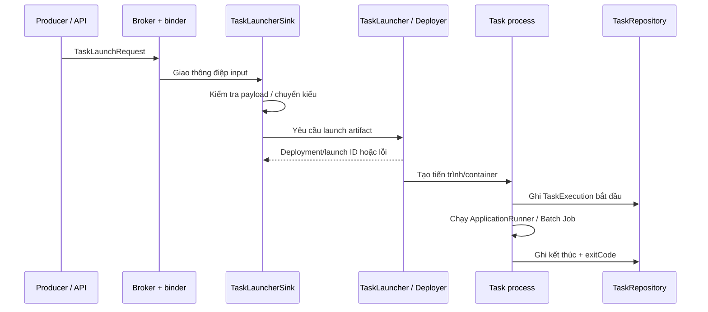
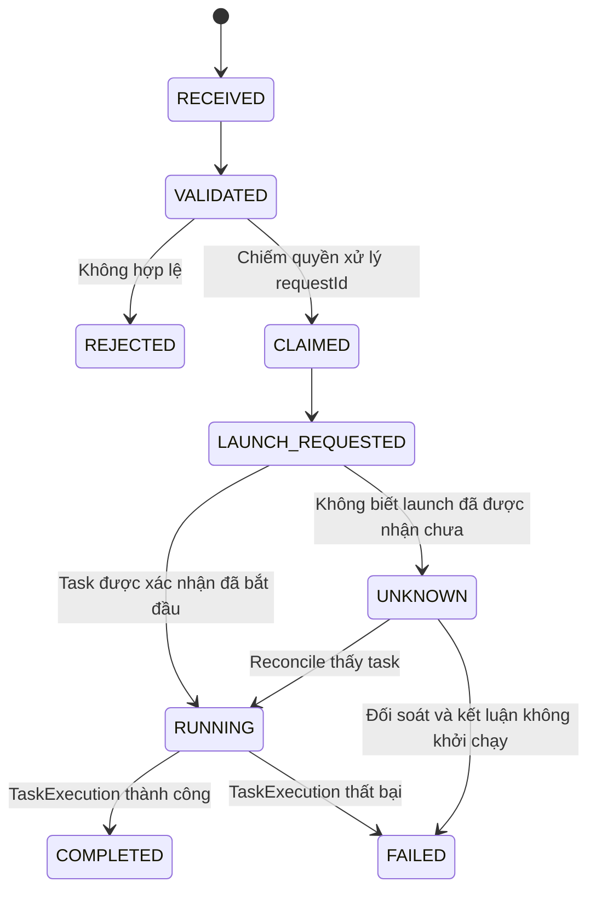
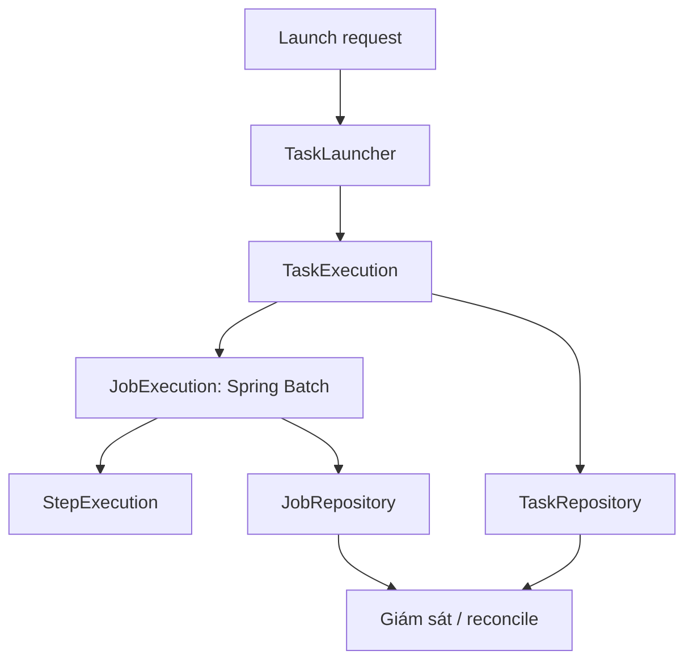

# TaskLauncherSink và khởi chạy theo thông điệp trong nhánh hỗ trợ

## 1. Từ thông điệp đến một lần chạy Spring Cloud Task

Trong nhiều hệ thống, một **Spring Cloud Task** không cần chạy liên tục. Ứng dụng được khởi động khi có nhu cầu, xử lý hữu hạn rồi thoát: nhập dữ liệu, tính phí, gửi báo cáo hoặc chạy một **Spring Batch Job**. Sau mỗi lần chạy, `TaskRepository` giữ `TaskExecution` (tên task, thời gian, tham số, mã thoát và lỗi) để tra cứu.

Nhưng ai quyết định **khi nào khởi chạy**? Ngoài cron, Kubernetes Job, API hoặc người vận hành, một hệ thống có thể gửi **thông điệp yêu cầu khởi chạy** qua Kafka/RabbitMQ. Ở những nhánh Spring Cloud Task từng hỗ trợ, thành phần **`TaskLauncherSink`** nhận đối tượng **`TaskLaunchRequest`** từ Spring Cloud Stream và nhờ **`TaskLauncher`** của Spring Cloud Deployer tạo tiến trình thực thi.

Bài này tập trung vào chủ đề **“TaskLauncherSink và khởi chạy theo thông điệp trong nhánh hỗ trợ”**. Điểm cốt lõi là hiểu rõ **phạm vi phiên bản**: không nên sao chép ví dụ `@EnableTaskLauncher` từ tài liệu cũ vào một dự án Spring Boot/Spring Cloud Stream mới mà chưa đối chiếu API.

Sau bài học, bạn có thể:

1. Giải thích vai trò của `TaskLauncherSink`, `TaskLaunchRequest`, binder và `TaskLauncher`.
2. Tạo một request đúng cấu trúc và hiểu tham số triển khai so với tham số nghiệp vụ.
3. Mô tả một task sink dùng `@EnableTaskLauncher` **trong nhánh thư viện tương thích**.
4. Cấu hình input binding và chọn binder Kafka/RabbitMQ.
5. Phân biệt **nhận yêu cầu**, **deployer chấp nhận khởi chạy** và **task chạy xong thành công**.
6. Dùng mẫu **functional Consumer** trong các dự án mới thay vì phụ thuộc vào mô hình Stream annotation đã bị loại bỏ.
7. Thiết kế an toàn trước thông điệp trùng, URI không tin cậy, lỗi broker, hết tài nguyên, retry và kết quả Spring Batch.

## 2. Trước tiên phải kiểm tra nhánh hỗ trợ

### 2.1. Trạng thái phiên bản quan trọng

Tài liệu tham khảo **Spring Cloud Task 3.2** vẫn mô tả `@EnableTaskLauncher` và `TaskLauncherSink`. Tài liệu **Spring Cloud Task 3.3** giữ phần mô tả này nhưng **đánh dấu tính năng khởi chạy từ Stream là end-of-life**, dự kiến loại bỏ ở bản sau. Trong tài liệu **Spring Cloud Task 5.0**, phần *Launching a Task from a Spring Cloud Stream* đã không còn.

Một điểm tương thích khác: **Spring Cloud Stream 4.0 đã bỏ mô hình `@EnableBinding` / `@StreamListener` / `Sink` cũ** để ưu tiên Spring Cloud Function (`Supplier`, `Function`, `Consumer`). Các Javadoc `TaskLauncherSink` đời cũ sử dụng `@EnableBinding(Sink.class)`, vì vậy tồn tại một rủi ro tương thích rất thực tế khi chỉ đổi version trong Maven.

| Hệ sinh thái | Cách tiếp cận | Cảnh báo |
| --- | --- | --- |
| Spring Cloud Task **2.x** + Spring Cloud Stream **3.x** phù hợp | Có thể dùng mô hình legacy `TaskLauncherSink` / `@EnableTaskLauncher` theo đúng dependency tương ứng. | Cần khóa bộ phiên bản và kiểm thử tích hợp; đây là nhánh công nghệ cũ, không phải mặc định cho dự án mới. |
| Spring Cloud Task **3.2/3.3** + Stream **4.x** | Tài liệu Task 3.x có thể vẫn mô tả legacy launcher. | Không suy ra `@EnableBinding` còn tồn tại: kiểm tra binary/API thực tế. Task 3.3 đã ghi tính năng này **end-of-life**. |
| Spring Cloud Task **5.x** và các hệ thống mới | Chọn launcher/orchestrator được hỗ trợ hoặc ứng dụng Stream dùng `Consumer` riêng để gọi API/`TaskLauncher`. | Không kỳ vọng `@EnableTaskLauncher`/`TaskLauncherSink` còn là API được hỗ trợ. |

**Nguyên tắc:** Hãy xác minh chính xác **cặp phiên bản Spring Boot–Spring Cloud–Stream–Task–Deployer** trước khi build. Các ví dụ minh họa legacy trong bài **không phải cam kết** hoạt động với Spring Boot 3.4, Spring Cloud 2024.x hoặc Spring Cloud Task 5.x.

### 2.2. Cách chọn hướng triển khai

- **Duy trì một hệ thống cũ đã vận hành:** Có thể tìm hiểu `TaskLauncherSink` để bảo trì, nhưng phải quản lý rủi ro nâng cấp, bảo mật và hỗ trợ phiên bản.
- **Bắt đầu dự án mới:** Dùng một `Consumer` theo mô hình Spring Cloud Stream/Function hiện hành; consumer gọi dịch vụ triển khai đáng tin cậy (SCDF API, Kubernetes Job API hoặc một `TaskLauncher` tương thích).
- **Không cần message broker:** Ưu tiên cron, Kubernetes CronJob hoặc API khởi chạy task. Spring Cloud Task chỉ quản lý vòng đời; nó không tự lập lịch.

## 3. Kiến trúc khởi chạy từ thông điệp



| Thành phần | Chịu trách nhiệm |
| --- | --- |
| Producer | Gửi yêu cầu đã được xác thực và hợp lệ; có thể phát từ lịch, event nghiệp vụ, API. |
| Broker | Định tuyến/lưu giữ thông điệp theo Kafka topic hoặc RabbitMQ exchange/queue. |
| Spring Cloud Stream binder | Kết nối input binding của sink với broker. |
| `TaskLauncherSink` | Nhận `TaskLaunchRequest` và chuyển đến `TaskLauncher`; bản thân nó **không xử lý nghiệp vụ** của task con. |
| `TaskLauncher` | API triển khai/khởi chạy một artifact trên nền tảng: local, Kubernetes, Cloud Foundry... tùy implementation. |
| Ứng dụng Task | Chạy công việc hữu hạn với `@EnableTask` hoặc cấu hình tương đương, lưu `TaskExecution`. |
| `TaskRepository`/`TaskExplorer` | Ghi và truy vấn vòng đời task sau khi tiến trình con đã chạy. |

**Sink là ứng dụng sống lâu** để tiêu thụ yêu cầu. **Task con là ứng dụng sống ngắn** được tạo khi có yêu cầu. Không được gắn `@EnableTaskLauncher` lên chính ứng dụng nghiệp vụ rồi mong nó vừa làm sink nhận vô hạn thông điệp, vừa kết thúc hữu hạn theo mô hình Task.

### 3.1. Ba mức thành công khác nhau

1. **Message được broker tiếp nhận:** Producer gửi thành công tới topic/queue.
2. **Yêu cầu được launcher chấp nhận:** Sink gọi `TaskLauncher.launch(...)` và nhận một định danh hoặc không ném lỗi tại điểm gọi.
3. **Task thực thi thành công:** Tiến trình con tạo `TaskExecution`, chạy nghiệp vụ và ghi `EXIT_CODE=0` theo hợp đồng kết thúc của ứng dụng.

Một phản hồi thành công tại **mức 2** không bảo đảm **mức 3**: container có thể không khởi động, task có thể thiếu datasource hoặc Spring Batch Job có thể thất bại sau đó. Hệ thống điều phối phải quan sát trạng thái cuối qua platform và repository.

## 4. Hợp đồng `TaskLaunchRequest`

Lớp `org.springframework.cloud.task.launcher.TaskLaunchRequest` trong API hỗ trợ lịch sử mang những trường:

| Trường | Kiểu | Ý nghĩa |
| --- | --- | --- |
| `uri` | `String` | URI của artifact task cần chạy, ví dụ một Spring Boot executable JAR trong Maven repository. |
| `applicationName` | `String` | Tên ứng dụng dùng khi launch; nếu không cấp, các nhánh lịch sử có thể tự sinh tên dạng `Task-<UUID>`. |
| `commandLineArguments` | `List<String>` | Tham số truyền xuống tiến trình task, ví dụ `--period=2026-11`. |
| `environmentProperties` | `Map<String,String>` | Môi trường cung cấp cho tiến trình con, được deployer cụ thể xử lý. |
| `deploymentProperties` | `Map<String,String>` | Thiết lập ở cấp hạ tầng triển khai như resource limits, namespace hoặc cấu hình của deployer. |

Ví dụ nội dung JSON của yêu cầu (để **minh họa contract**, không bảo đảm binder tự chuyển thành đối tượng Java nếu thiếu converter/cấu hình đúng):

```json
{
  "uri": "maven://com.example:orders-import-task:1.0.0",
  "applicationName": "orders-import",
  "commandLineArguments": [
    "--period=2026-11",
    "--spring.profiles.active=batch"
  ],
  "environmentProperties": {
    "TASK_REGION": "ap-southeast-1"
  },
  "deploymentProperties": {}
}
```

**Các nhóm thông số không thay thế nhau:** `commandLineArguments` được ứng dụng Spring Boot đọc; `environmentProperties` là biến môi trường của process/container; `deploymentProperties` được **deployer** diễn giải và có thể khác giữa local/Kubernetes/Cloud Foundry. Không mặc định một khóa của Kubernetes sẽ hoạt động ở LocalTaskLauncher.

### 4.1. Tạo request bằng Java

Nếu một ứng dụng producer đã dùng đúng thư viện Spring Cloud Task có lớp `TaskLaunchRequest`, có thể tạo đối tượng:

```java
import java.util.List;
import java.util.Map;

import org.springframework.cloud.task.launcher.TaskLaunchRequest;

TaskLaunchRequest request = new TaskLaunchRequest(
        "maven://com.example:orders-import-task:1.0.0",
        List.of("--period=2026-11"),
        Map.of("TASK_REGION", "ap-southeast-1"),
        Map.of(),
        "orders-import");
```

Thứ tự tham số constructor là **URI, command-line arguments, environment properties, deployment properties, application name**. Cách serialize phụ thuộc message converter và binder. Nếu ứng dụng nguồn dùng Spring Cloud Stream functional model, có thể đóng gói request vào `Message<?>` rồi gửi qua `StreamBridge`; khi đó vẫn cần thống nhất cách encode/decode payload ở hai đầu.

### 4.2. Vì sao không cho phép URI tùy ý?

Một message không đáng tin cậy chứa `uri` có thể yêu cầu nền tảng **tải và chạy mã thực thi**. Đây là quyền rất nhạy cảm. Hệ thống production cần **allowlist artifact**, phiên bản được ký/kiểm soát, quyền publish theo nhóm, và không cho client truyền deployment properties tự do.

Không nhận các trường như `uri` hoặc lệnh shell tùy ý từ người dùng cuối rồi trực tiếp truyền xuống launcher. Nên biến message nghiệp vụ thành một **lệnh có schema hạn chế**, ví dụ `{"taskType":"orders-import","period":"2026-11"}`, sau đó ánh xạ `taskType` vào artifact URI cố định trong cấu hình server.

## 5. Legacy `TaskLauncherSink`: hiểu `@EnableTaskLauncher`

Trong nhánh hỗ trợ API lịch sử, annotation:

```java
import org.springframework.cloud.task.launcher.annotation.EnableTaskLauncher;
```

được dùng trên ứng dụng sink:

```java
package com.example.launchsink;

import org.springframework.boot.SpringApplication;
import org.springframework.boot.autoconfigure.SpringBootApplication;
import org.springframework.cloud.task.launcher.annotation.EnableTaskLauncher;

@SpringBootApplication
@EnableTaskLauncher
public class TaskSinkApplication {

    public static void main(String[] args) {
        SpringApplication.run(TaskSinkApplication.class, args);
    }
}
```

`@EnableTaskLauncher` import cấu hình `TaskLauncherSink` vào context. Javadoc của các bản legacy thể hiện `TaskLauncherSink` sử dụng mô hình annotation-based của Spring Cloud Stream và phương thức:

```java
// Trích chữ ký để giải thích, không phải bean cần khai báo lại:
@ServiceActivator(inputChannel = "input")
public void taskLauncherSink(TaskLaunchRequest request) throws Exception
```

Framework tiếp nhận `TaskLaunchRequest` từ kênh input và gọi `TaskLauncher` tương ứng. Nếu payload không phải kiểu được chấp nhận, sink có thể ném ngoại lệ và binder áp dụng quy tắc retry/error flow của nó.

**Cần `TaskLauncher` bean:** Annotation không tự biến sink thành một nền tảng có khả năng tạo JVM/container. Phải cung cấp implementation/configuration của Spring Cloud Deployer tương ứng với nơi thực thi task. Ví dụ địa phương dùng Local deployer cho môi trường phát triển; production thường cần tích hợp nền tảng triển khai được quản lý.

### 5.1. Một bộ dependency theo nhánh lịch sử

Để minh họa bộ thư viện **cùng thế hệ**, ví dụ ứng dụng bảo trì có thể dùng Spring Boot **2.7.18** với Spring Cloud release train **2021.0.9**, và chọn Spring Cloud Task/Stream/Deployer từ BOM phù hợp:

```xml
<parent>
    <groupId>org.springframework.boot</groupId>
    <artifactId>spring-boot-starter-parent</artifactId>
    <version>2.7.18</version>
    <relativePath/>
</parent>

<properties>
    <java.version>17</java.version>
</properties>

<dependencyManagement>
    <dependencies>
        <dependency>
            <groupId>org.springframework.cloud</groupId>
            <artifactId>spring-cloud-dependencies</artifactId>
            <version>2021.0.9</version>
            <type>pom</type>
            <scope>import</scope>
        </dependency>
    </dependencies>
</dependencyManagement>

<dependencies>
    <dependency>
        <groupId>org.springframework.cloud</groupId>
        <artifactId>spring-cloud-starter-task</artifactId>
    </dependency>
    <dependency>
        <groupId>org.springframework.cloud</groupId>
        <artifactId>spring-cloud-stream</artifactId>
    </dependency>
    <dependency>
        <groupId>org.springframework.cloud</groupId>
        <artifactId>spring-cloud-stream-binder-kafka</artifactId>
    </dependency>
    <!-- Thêm implementation TaskLauncher của nền tảng đã chọn,
         cùng version tương thích. Không coi chỉ có binder là đủ. -->
</dependencies>
```

Đây là **trích cấu hình dependency**, không phải `pom.xml` hoàn chỉnh hay một cam kết rằng mọi tổ hợp patch-level cũ đều an toàn. Bộ phiên bản đã cũ có thể không còn được upstream bảo trì. Trước khi sử dụng thực tế, phải kiểm tra classpath chứa `TaskLauncherSink`, `@EnableTaskLauncher`, `@EnableBinding`, `TaskLauncher` và chạy thử tích hợp với broker/deployer. Không dùng riêng `spring-cloud-task 2.x` với Spring Boot 3.x hoặc Stream 4.x.

### 5.2. Cấu hình binding input cho legacy sink

Ví dụ với Kafka:

```yaml
spring:
  application:
    name: task-launch-sink
  cloud:
    stream:
      bindings:
        input:
          destination: ops.task-launch-requests
          group: task-launchers
          content-type: application/json
          binder: kafka
      kafka:
        binder:
          brokers: localhost:9092
```

Tên `input` thuộc **mô hình legacy Sink channel**; nó khác tên binding kiểu functional như `launchRequests-in-0`. `destination` chỉ ra Kafka topic để đọc yêu cầu. Có thể viết gọn bằng properties là `spring.cloud.stream.bindings.input.destination=ops.task-launch-requests`. `group` cho phép nhiều bản sao sink thuộc cùng một nhóm chia phần message, theo quy tắc của binder.

**Payload conversion:** JSON trên broker phải chuyển được thành `TaskLaunchRequest` ở thời điểm `ServiceActivator` được gọi. Tùy thế hệ Stream, cần message type/content-type/converter phù hợp. Không suy ra mọi JSON với tên trường tương tự tự động trở thành Java `TaskLaunchRequest`. Khi thử nghiệm, xem cả log converter và lỗi deserialize, không chỉ trạng thái Kafka consumer.

### 5.3. Task con phải là ứng dụng riêng

Ví dụ ứng dụng `orders-import-task` được đóng gói thành **executable Spring Boot JAR** và cấu hình Spring Cloud Task:

```java
package com.example.orders;

import org.springframework.boot.ApplicationArguments;
import org.springframework.boot.ApplicationRunner;
import org.springframework.boot.SpringApplication;
import org.springframework.boot.autoconfigure.SpringBootApplication;
import org.springframework.cloud.task.configuration.EnableTask;
import org.springframework.stereotype.Component;

@SpringBootApplication
@EnableTask
public class OrdersImportTask {
    public static void main(String[] args) {
        SpringApplication.run(OrdersImportTask.class, args);
    }
}

@Component
class OrdersRunner implements ApplicationRunner {
    @Override
    public void run(ApplicationArguments args) {
        String period = args.containsOption("period")
                ? args.getOptionValues("period").get(0)
                : "unspecified";
        System.out.println("Importing orders for " + period);
        // Gọi service nghiệp vụ, xử lý lỗi và kết thúc hữu hạn ở đây.
    }
}
```

Task cần `DataSource`/`TaskRepository` hợp lệ nếu muốn lưu metadata; trên production nên chuẩn bị schema bằng migration. Nếu tích hợp Spring Batch, phải có schema `JobRepository` và cơ chế chuyển trạng thái thất bại của Job lên mã thoát Task.

**Không nhầm hai ứng dụng:** Sink **luôn bật để nhận message**; JAR chứa runner phía trên **chỉ chạy khi được launcher tạo ra**. Cài `@EnableTaskLauncher` vào JAR nghiệp vụ không thay thế việc tạo và triển khai sink.

## 6. Kịch bản end-to-end ở nhánh được hỗ trợ

Giả sử môi trường đã có:

- Kafka topic `ops.task-launch-requests`.
- Task sink tương thích nhận JSON/`TaskLaunchRequest` và một bean `TaskLauncher` hoạt động.
- Artifact `orders-import-task` ở Maven repository hoặc vị trí deployer được phép đọc.
- Database metadata Spring Cloud Task được tạo và sink/deployer có quyền cần thiết.

### 6.1. Gửi yêu cầu minh họa

Tạo một file JSON ở bên ngoài ứng dụng (mã phía dưới chỉ là **nội dung message minh họa**, không phải lệnh shell):

```json
{
  "uri": "maven://com.example:orders-import-task:1.0.0",
  "applicationName": "orders-import",
  "commandLineArguments": ["--period=2026-11"],
  "environmentProperties": {},
  "deploymentProperties": {}
}
```

Nếu test bằng Kafka CLI và cấu hình converter của sink cho phép JSON:

```bash
kafka-console-producer.sh \
  --bootstrap-server localhost:9092 \
  --topic ops.task-launch-requests
```

Sau đó dán **JSON trên cùng một dòng** vào stdin. Lưu ý Kafka CLI gửi byte/string theo cách riêng; message header `content-type` hoặc type information có thể không được cung cấp như producer Spring Cloud Stream. Với legacy sink yêu cầu đối tượng `TaskLaunchRequest`, **không cam kết** gửi JSON từ CLI là đủ; cách kiểm thử chuẩn là dùng producer/processor tương thích hoặc tích hợp test binder với converter được xác nhận.

### 6.2. Kết quả cần kiểm chứng

1. Sink nhận message trên đúng input binding và convert thành `TaskLaunchRequest`.
2. Sink/`TaskLauncher` xác định artifact, chuẩn bị môi trường và bắt đầu tiến trình/container.
3. Task con in log `Importing orders for 2026-11`.
4. `TaskRepository` tạo `TaskExecution` và cập nhật kết thúc.
5. Hệ thống điều phối đối chiếu trạng thái thực thi cuối thay vì chỉ nhìn nhận “message đã tiêu thụ”.

Nếu launcher trả về deployment ID, lưu quan hệ giữa **message ID → deployment ID → TaskExecution ID** ở một hệ thống audit. Không giả định deployment ID của container bằng `TASK_EXECUTION_ID` trong database.

### 6.3. Truy vấn metadata sau khi task chạy

Trong database được ứng dụng Task con dùng:

```sql
SELECT TASK_EXECUTION_ID,
       TASK_NAME,
       START_TIME,
       END_TIME,
       EXIT_CODE,
       ERROR_MESSAGE
FROM TASK_EXECUTION
ORDER BY TASK_EXECUTION_ID DESC;
```

Nếu không có bản ghi, kiểm tra xem task con đã được tạo hay chưa và có khởi động đủ để ghi vào TaskRepository hay không. Nếu chỉ thấy `START_TIME` mà thiếu `END_TIME`, chưa thể khẳng định task còn chạy: có thể bị kill hoặc mất kết nối database trước khi cập nhật trạng thái cuối.

## 7. Tích hợp Spring Cloud Data Flow: lưu ý hai kiểu task launcher

Tài liệu Spring Cloud Task lịch sử có ví dụ đăng ký một **sink app** và **processor app** trong Spring Cloud Data Flow:

```text
app register --name taskSink --type sink --uri maven://io.spring.cloud:tasksink:<version>
app register --name taskProcessor --type processor --uri maven://io.spring.cloud:taskprocessor:<version>

stream create foo --definition "http --server.port=9000 | taskProcessor | taskSink" --deploy
```

Đây là **cú pháp minh họa từ tài liệu nhánh lịch sử**, không phải công thức bảo đảm chạy trên mọi bản Spring Cloud Data Flow mới. Artifact/version cụ thể phải có thật và được nền tảng hỗ trợ.

Cũng có một ứng dụng tên **TaskLauncher Data Flow Sink** trong họ Spring Cloud Stream App Starters. Sink đó nhận **`LaunchRequest`** dành cho một *task definition* đã đăng ký trên **SCDF server** và sử dụng REST API để yêu cầu launch; payload ví dụ có `name`, `deploymentProps` và `args`. Nó **khác contract** `TaskLaunchRequest` có `uri` của `TaskLauncherSink`:

| Loại sink | Message | Cách thực hiện |
| --- | --- | --- |
| `TaskLauncherSink` của Spring Cloud Task lịch sử | `TaskLaunchRequest` chứa `uri` của artifact | Gọi `TaskLauncher`/deployer trực tiếp. |
| TaskLauncher Data Flow Sink | `LaunchRequest` chứa tên task definition đã đăng ký trên SCDF | Gọi SCDF Task API để launch definition. |
| Consumer hiện đại tự triển khai | Contract do ứng dụng thiết kế, ví dụ `taskType`, `period` | Gọi SCDF REST, Kubernetes Job API hoặc một adapter `TaskLauncher`. |

**Không chuyển JSON giữa hai sink mà bỏ qua bước ánh xạ schema.** Một message `{"name":"orders-import"}` dành cho Data Flow Sink không phải `TaskLaunchRequest` của legacy TaskLauncherSink.

## 8. Phương án hiện đại: `Consumer` + launcher được kiểm soát

Với **Spring Cloud Stream 4.x/5.x**, mô hình nhận message chuẩn là một bean `java.util.function.Consumer`. Bạn có thể dùng một consumer riêng và gọi `TaskLauncher` qua SPI, hoặc tích hợp API điều phối hiện hành; không cần `@EnableTaskLauncher`/`@EnableBinding`.

### 8.1. Thiết kế contract giới hạn

Thay vì cho producer truyền URI tùy ý, dùng message nghiệp vụ:

```json
{
  "requestId": "req-2026-11-001",
  "taskType": "orders-import",
  "period": "2026-11"
}
```

`requestId` dùng để chống trùng. `taskType` chọn từ allowlist, còn URI/deployment policy được phía server quyết định. Payload không chứa secret hoặc lệnh shell.

### 8.2. Một consumer nhận request

```java
package com.example.launchsink;

import java.util.function.Consumer;
import org.springframework.context.annotation.Bean;
import org.springframework.context.annotation.Configuration;

record LaunchCommand(String requestId, String taskType, String period) {}

interface ApprovedTaskLaunchService {
    void submit(LaunchCommand command);
}

@Configuration
public class LaunchConsumerConfiguration {

    @Bean
    public Consumer<LaunchCommand> launchRequests(
            ApprovedTaskLaunchService launchService) {
        return launchService::submit;
    }
}
```

Phần `ApprovedTaskLaunchService` là **interface của ứng dụng**, cần một implementation do bạn viết tích hợp với nền tảng thực tế. Snippet minh họa điểm nối giữa Stream Consumer và lớp launcher; **không phải một dự án hoàn chỉnh** chỉ cần dán mã là có thể chạy task.

Binding Kafka theo mô hình functional:

```yaml
spring:
  cloud:
    function:
      definition: launchRequests
    stream:
      bindings:
        launchRequests-in-0:
          destination: ops.task-launch-requests
          group: approved-task-launchers
          content-type: application/json
      kafka:
        binder:
          brokers: localhost:9092
```

`launchRequests-in-0` là tên binding input sinh từ `Consumer`; nó **không phải** binding `input` của legacy Sink và cũng không phải `task-events` dùng để phát `TaskExecution`.

### 8.3. Dịch request thành lời gọi `TaskLauncher`

Nếu ứng dụng cung cấp bean `org.springframework.cloud.deployer.spi.task.TaskLauncher` tương thích với nền tảng, adapter có thể tạo `AppDeploymentRequest`. Ví dụ sau dùng **artifact cố định**, bỏ qua mọi URI từ message:

```java
package com.example.launchsink;

import java.time.YearMonth;
import java.util.List;
import java.util.Map;
import java.util.Set;

import org.springframework.cloud.deployer.spi.core.AppDefinition;
import org.springframework.cloud.deployer.spi.core.AppDeploymentRequest;
import org.springframework.cloud.deployer.spi.task.TaskLauncher;
import org.springframework.core.io.Resource;
import org.springframework.core.io.ResourceLoader;
import org.springframework.stereotype.Service;

@Service
class ApprovedTaskLaunchServiceImpl implements ApprovedTaskLaunchService {

    private static final Set<String> ALLOWED =
            Set.of("orders-import");

    private final TaskLauncher taskLauncher;
    private final ResourceLoader resourceLoader;

    ApprovedTaskLaunchServiceImpl(
            TaskLauncher taskLauncher, ResourceLoader resourceLoader) {
        this.taskLauncher = taskLauncher;
        this.resourceLoader = resourceLoader;
    }

    @Override
    public void submit(LaunchCommand command) {
        if (command == null || command.requestId() == null
                || command.requestId().isBlank()
                || !ALLOWED.contains(command.taskType())) {
            throw new IllegalArgumentException("Invalid task request");
        }

        // YearMonth bắt lỗi định dạng, không đưa input nguyên xi
        // vào script/shell command.
        YearMonth period = YearMonth.parse(command.period());

        // URI do server kiểm soát; cần một artifact tồn tại thật.
        Resource resource = resourceLoader.getResource(
                "file:/opt/approved-tasks/orders-import.jar");

        AppDefinition definition = new AppDefinition(
                "orders-import", Map.of());

        AppDeploymentRequest deployment = new AppDeploymentRequest(
                definition,
                resource,
                Map.of(),
                List.of("--period=" + period));

        String deploymentId = taskLauncher.launch(deployment);

        // Lưu requestId -> deploymentId vào kho audit/idempotency
        // trước khi xác nhận xử lý message; ví dụ bỏ phần lưu DB.
        System.out.println("Accepted " + command.requestId()
                + " deployment=" + deploymentId);
    }
}
```

**Điều kiện để đoạn trên hoạt động:**

- Project phải có các dependency của **Spring Cloud Deployer SPI** và một implementation `TaskLauncher` **thực sự được cấu hình**.
- `ResourceLoader` phải đọc được artifact và implementation launcher phải hỗ trợ định dạng resource (local file/JAR/Maven/Docker...) đã chọn.
- `/opt/approved-tasks/orders-import.jar` chỉ là đường dẫn ví dụ; không truyền thẳng URI từ message vào `ResourceLoader` trong production.
- Mã chỉ minh họa **phát lệnh launch**. Nó **chưa** triển khai transaction chống trùng, outbox hoặc xác nhận trạng thái hoàn tất. Muốn đạt tiêu chuẩn production phải bổ sung các chức năng ở các phần sau.
- API hoặc constructor chính xác cần đối chiếu **phiên bản Spring Cloud Deployer** đang chạy; không trộn các release không tương thích.

Điểm đáng giá của cách này là **ứng dụng chủ động kiểm soát validation, artifact và quyền triển khai**, đồng thời dùng mô hình Spring Cloud Stream được hỗ trợ ở các thế hệ mới.

## 9. Kafka, RabbitMQ và xử lý trùng yêu cầu

### 9.1. Binder không quyết định tính duy nhất nghiệp vụ

| Tiêu chí | Kafka | RabbitMQ |
| --- | --- | --- |
| Destination | Topic | Exchange/queue theo cách Rabbit binder cấu hình |
| Consumer group | Các instance trong cùng group chia partition; group khác có thể đọc cùng topic | Các consumer cùng queue chia message; group khác thường có queue riêng |
| Retry/redelivery | Phụ thuộc offset/commit và chính sách consumer | Phụ thuộc ack/nack, retry, DLQ và chính sách queue |
| Mất kết nối | Consumer có thể nhận lại message sau khi khôi phục | Có thể nhận lại message khi chưa được ack hoặc được requeue |
| Ý nghĩa với launcher | Một request có thể được xử lý lại | Một request cũng có thể được xử lý lại |

Với bất cứ binder nào, **message delivery không bảo đảm đúng một lần tạo process**. Một lỗi có thể xảy ra sau khi `TaskLauncher.launch()` đã chấp nhận lệnh nhưng **trước khi consumer đánh dấu message đã xử lý**; broker sẽ phát lại, dẫn đến hai task chạy.

### 9.2. Mẫu state machine cho request



Khóa `requestId` bằng **unique constraint** trong database của launcher hoặc một kho idempotency dùng chung. Khi nhận bản tin trùng, tra cứu yêu cầu cũ và kết quả launch, không tự động gọi launcher lần nữa.

Một hệ thống phức tạp cần phân biệt:

- **Dedupe message:** Không chạy lặp cùng một lệnh khởi tạo.
- **Single-instance task:** Ngăn hai lần chạy **cùng tên** tại cùng thời điểm; nếu dùng tính năng single-instance của Spring Cloud Task thì phải cấu hình khóa JDBC phù hợp.
- **Idempotency nghiệp vụ:** Một tác vụ bị retry sau crash vẫn không tính tiền/ghi dữ liệu hai lần.

Ba biện pháp **bổ sung cho nhau**, không thay thế nhau.

### 9.3. Khi nào ack/nack?

Không nên ack ngay khi vừa đọc JSON nếu chưa kiểm tra điều kiện. Tuy nhiên, cũng không nên giữ một message chưa ack **trong toàn bộ nhiều giờ** chờ Task chạy xong: điều đó có thể giữ tài nguyên consumer, gây redelivery ngoài dự kiến và làm tắc luồng.

Mô hình phổ biến:

1. Validate message và quyền yêu cầu.
2. Ghi trạng thái lệnh/idempotency vào database.
3. Launch hoặc đưa lệnh đã xác thực vào một queue nội bộ có đảm bảo.
4. Lưu kết quả chấp nhận hoặc lỗi triển khai.
5. Ack thông điệp theo chính sách transaction/retry đã chọn.
6. Theo dõi **TaskExecution** độc lập đến trạng thái cuối, phát status event cho upstream.

Không có giao dịch nguyên tử mặc định giữa Kafka/RabbitMQ, TaskLauncher, nền tảng container và TaskRepository. Với yêu cầu có SLA nghiêm ngặt, cần cơ chế reconcile/outbox và thử lại có kiểm soát.

## 10. Kết quả Task, trạng thái Spring Batch và mối liên hệ với scheduler

**TaskLauncher** chỉ phụ trách khởi chạy. **Spring Cloud Task** ghi `TaskExecution`; nếu task con chạy **Spring Batch**, `JobRepository` lưu `JobExecution` và `StepExecution`.



Một Job thất bại **không luôn** khiến mã thoát của Task khác `0` nếu ứng dụng không lan truyền kết quả phù hợp. Khi kết hợp `spring-cloud-task-batch`, hãy kiểm tra tùy chọn `spring.cloud.task.batch.fail-on-job-failure` và việc chờ Job bất đồng bộ hoàn tất trước khi vòng đời Task kết thúc.

Sự kiện `TaskExecution` từ Spring Cloud Stream trên binding `task-events` là **thông báo vòng đời**, khác thông điệp **`TaskLaunchRequest`** trên input của launcher. Không dùng cùng một destination mà không phân biệt loại payload và quyền truy cập.

## 11. Bảo mật: coi lệnh launch là thao tác đặc quyền

Một sink có thể khởi chạy JAR/container là điểm nhạy cảm của hệ thống. Hãy áp dụng:

- **Phân quyền nguồn message:** Kafka ACL hoặc RabbitMQ vhost/exchange/queue permission; chỉ producer đã được cấp quyền mới gửi lệnh.
- **Artifact allowlist:** URI cố định theo loại task, phiên bản được duyệt, checksum/signature và kho artifact tin cậy.
- **Không cho truyền tùy ý deploymentProperties:** Bởi các trường này có thể ảnh hưởng CPU, RAM, service account, namespace, volume mount hoặc network access.
- **Không cho truyền shell command tùy ý:** TaskLauncher dùng artifact có kiểm soát, không biến message thành lệnh thực thi OS.
- **Giới hạn tài nguyên:** Max concurrent launches, rate limit, queue depth, retry budget, quota của namespace/nền tảng.
- **Bảo vệ secret:** Không đặt token/mật khẩu trong `commandLineArguments`, log hoặc payload vì `TaskRepository` có thể lưu tham số và các broker có retention.
- **Audit:** Lưu `requestId`, principal gửi, taskType, artifact version, deploymentId, TaskExecutionId và trạng thái cuối; không ghi credential.
- **Bảo vệ kết quả:** Giới hạn quyền truy cập `TASK_EXECUTION`, log và thông điệp status; không xem ID là bằng chứng cấp quyền.

Nếu broker nhận message từ hệ thống công khai, thêm lớp API/authentication/validation phía trước. Một consumer nhận trực tiếp JSON chưa xác thực rồi triển khai artifact là thiết kế nguy hiểm.

## 12. Lỗi thường gặp và cách chẩn đoán

| Biểu hiện | Nguyên nhân có thể | Cách xử lý |
| --- | --- | --- |
| Không tìm thấy `@EnableBinding` hoặc `Sink` | Dùng Spring Cloud Stream 4/5 cho mã legacy | Chuyển sang `Consumer` functional hoặc dùng stack lịch sử đã xác minh; không ép dependency cũ vào Boot mới. |
| Không có bean `TaskLauncher` | Chưa cấu hình implementation Spring Cloud Deployer | Đăng ký launcher cho nền tảng thực tế; kiểm tra version và quyền. |
| JSON vào topic nhưng sink báo sai kiểu payload | Chuyển đổi JSON → `TaskLaunchRequest` thất bại | Kiểm tra content-type, converter/type metadata và contract request. |
| Có request nhưng không launch | Sai binding `input`/destination/group hoặc broker kết nối lỗi | Kiểm tra Kafka/Rabbit binder, ACL, log consumer và routing. |
| Deployer không lấy được artifact | URI sai, artifact chưa publish, quyền repo thiếu | Kiểm tra resource resolver, Maven repository/proxy, credentials của deployer. |
| Launcher trả ID nhưng không có `TaskExecution` | Tiến trình con chưa start hoặc lỗi khởi động sớm | Xem trạng thái deployment, container/process logs, datasource và schema Task. |
| Task có `EXIT_CODE` khác 0 | Lỗi nghiệp vụ hoặc cấu hình của ứng dụng con | Truy vấn `TaskRepository`, log runner và JobRepository nếu có Batch. |
| Một message khiến task chạy hai lần | Redelivery hoặc cạnh tranh consumer/idempotency | Unique `requestId`, audit launch result, reconcile trước retry. |
| Lần retry bị chặn dù tiến trình cũ chết | Khóa single-instance còn TTL hoặc scheduler chưa thấy trạng thái cuối | Đối chiếu process, TaskRepository, bảng khóa và lease/TTL. |
| Sink chạy trên máy nhưng không tạo được task ở Kubernetes | Deployer không tương thích hoặc thiếu namespace/service account | Đúng implementation launcher, cấu hình và RBAC nền tảng. |
| Dùng JSON của Data Flow Sink nhưng legacy TaskLauncherSink không hiểu | Nhầm `LaunchRequest` với `TaskLaunchRequest` | Dùng đúng contract hoặc viết converter/adapter rõ ràng. |
| Job Batch đã lỗi nhưng task launcher báo accepted | Accepted không phải final business success | Giám sát JobExecution/TaskExecution riêng đến trạng thái cuối. |

Để chẩn đoán nhanh, kiểm tra lần lượt: **message hợp lệ → binder input → consumer/sink converter → launcher/deployer → artifact/process → TaskRepository → kết quả nghiệp vụ**. Không bắt đầu bằng việc xóa metadata khi mới chỉ thấy “task không chạy”.

## 13. Checklist trước khi đưa vào môi trường thật

| Hạng mục | Câu hỏi cần trả lời |
| --- | --- |
| Phiên bản | Code đang dùng nhánh có hỗ trợ `TaskLauncherSink` hay đã chuyển sang functional consumer? |
| Broker | Có destination, group, ACL và DLQ/retention phù hợp? |
| Hợp đồng message | Đã phân biệt `TaskLaunchRequest`, `LaunchRequest` của SCDF và `TaskExecution` event? |
| TaskLauncher | Nền tảng nào sẽ chạy task? Implementation, resource quota và permission đã được kiểm tra? |
| Artifact | URI có thuộc allowlist, artifact đã publish và được kiểm chứng? |
| Chống trùng | Có `requestId` ổn định, unique constraint và cách xử lý retry không? |
| Theo dõi trạng thái | Có ánh xạ request → deployment → TaskExecution/JobExecution? |
| Lỗi hạ tầng | Có timeout, retry hạn chế, reconciliation và cảnh báo? |
| Dữ liệu | Task có idempotency khi bị restart, không xử lý trùng? |
| Bảo mật | Không có secret trong message, tham số dòng lệnh hay metadata? |

## 14. Bài tập thực hành

### Bài tập 1: Giải thích TaskLauncherSink

Vẽ sơ đồ từ Kafka topic đến `TaskLauncherSink`, `TaskLauncher`, JVM/Container và `TaskRepository`. Chỉ rõ thành phần nào **nhận message**, thành phần nào **thực thi task**, và nơi nào **lưu trạng thái cuối**.

### Bài tập 2: So sánh hai request

Cho JSON:

```json
{"uri":"maven://com.example:orders-import-task:1.0.0","applicationName":"orders-import","commandLineArguments":["--period=2026-11"],"environmentProperties":{},"deploymentProperties":{}}
```

và:

```json
{"name":"orders-import","deploymentProps":{},"args":["--period=2026-11"]}
```

Cho biết message nào thuộc `TaskLaunchRequest` của legacy TaskLauncherSink, message nào gần với `LaunchRequest` của Data Flow Sink, và vì sao không được đổi chỗ hai payload mà không chuyển schema.

### Bài tập 3: Chuyển từ legacy sang functional

Giả sử dự án nâng Spring Cloud Stream 3.x lên 4.x và gặp lỗi không còn `@EnableBinding`. Hãy thay ý tưởng sink cũ bằng một `Consumer<LaunchCommand>`, ánh xạ `taskType` qua allowlist, gọi launcher đã cấu hình và lưu `requestId` chống trùng.

### Bài tập 4: Kiểm thử sự cố

Giả lập broker phát lại đúng một message do consumer bị ngắt kết nối sau khi launcher nhận lệnh. Mô tả cách idempotency store nhận diện request cũ, tránh launch lần hai và đối chiếu trạng thái tiến trình con với `TaskExecution`.

### Câu hỏi tự kiểm tra

1. `TaskLauncherSink` khác một `ApplicationRunner` trong task con như thế nào?
2. Năm trường của `TaskLaunchRequest` có mục đích gì?
3. Vì sao `@EnableTaskLauncher` trong tài liệu 3.2/3.3 không đồng nghĩa API đó còn tương thích với mọi bản Spring Cloud Stream mới?
4. Thông điệp nằm trong Kafka topic có chứng minh đã tạo được `TaskExecution` không?
5. `TaskLauncher.launch(...)` trả định danh có chứng minh task đã thành công không?
6. Một trường `uri` do người gửi tự chọn đặt ra rủi ro bảo mật nào?
7. Vì sao cùng một message có thể dẫn tới hai lần chạy, và `requestId` giúp gì?
8. Khi nào cần dùng Data Flow Task API thay vì tự cung cấp TaskLauncher?
9. `TaskExecution` event khác `TaskLaunchRequest` ở hướng truyền dữ liệu như thế nào?
10. Khi task chạy Spring Batch, cần quan sát cả `JobExecution` lẫn `TaskExecution` vì sao?

**Ghi nhớ:** Trong các **nhánh được hỗ trợ**, `TaskLauncherSink` nhận `TaskLaunchRequest` qua Spring Cloud Stream và ủy quyền việc chạy task cho `TaskLauncher`. Tính năng legacy này đã được Spring Cloud Task 3.3 đánh dấu **end-of-life** và không còn được tài liệu Task 5.x trình bày; không xem `@EnableTaskLauncher` là giải pháp mặc định cho dự án mới. Với hệ thống hiện đại, dùng **Consumer chức năng + launcher/orchestrator có kiểm soát**, xác thực và chống trùng lệnh, sau đó đối chiếu kết quả cuối qua **TaskRepository**.

## Tài liệu tham khảo

- [Spring Cloud Task 3.2 — Spring Cloud Stream Integration](https://docs.spring.io/spring-cloud-task/reference/3.2/stream.html): `TaskLauncherSink`, `TaskLaunchRequest` và `@EnableTaskLauncher`.
- [Spring Cloud Task 3.3 — Spring Cloud Stream Integration](https://docs.spring.io/spring-cloud-task/reference/3.3/stream.html): ghi chú tính năng launch từ Stream đã end-of-life.
- [Spring Cloud Task 5.0 — Spring Cloud Stream Integration](https://docs.spring.io/spring-cloud-task/reference/5.0/stream.html): tài liệu các sự kiện Task/Batch, không còn mục legacy launch.
- [TaskLaunchRequest API](https://docs.spring.io/spring-cloud-task/docs/current/apidocs/org/springframework/cloud/task/launcher/TaskLaunchRequest.html): constructor và ý nghĩa năm trường dữ liệu.
- [TaskLauncherSink API ở nhánh legacy](https://docs.spring.io/spring-cloud-task/docs/2.3.4/apidocs/org/springframework/cloud/task/launcher/TaskLauncherSink.html): `@EnableBinding` và `@ServiceActivator(inputChannel="input")`.
- [Spring Cloud Stream — Functional Binding Names](https://docs.spring.io/spring-cloud-stream/reference/spring-cloud-stream/functional-binding-names.html): cách `Consumer` tạo tên binding input.
- [Spring Cloud Data Flow — Launching a Task](https://docs.spring.io/spring-cloud-dataflow/docs/2.10.x/reference/htmlsingle/): API và shell khởi chạy task đã đăng ký trên nền tảng.
