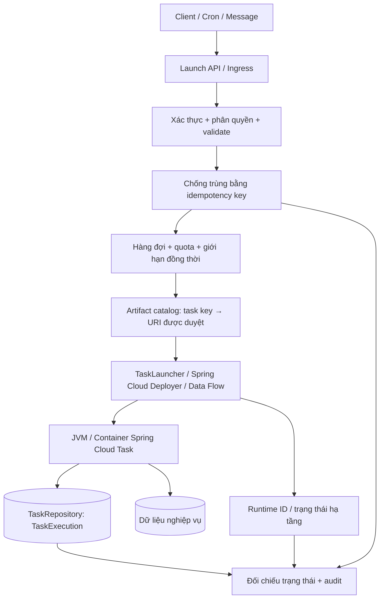
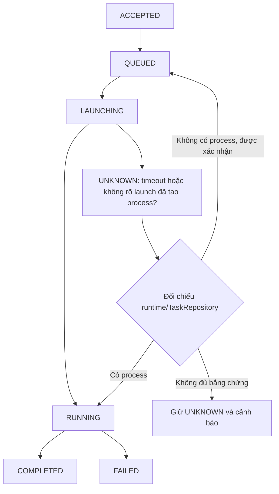
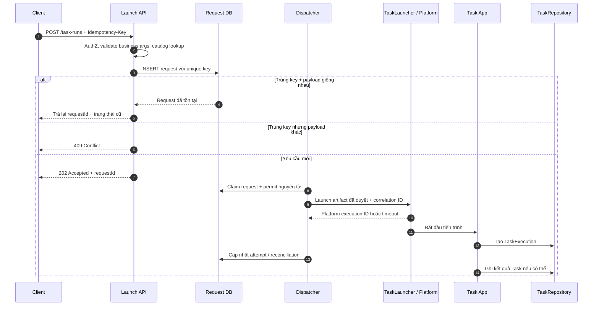

# Kiểm soát URI ứng dụng, yêu cầu trùng và giới hạn khởi chạy

## 1. Vì sao một hệ thống khởi chạy Task cần lớp kiểm soát?

Trong chương **Khởi chạy**, chúng ta xem xét việc đưa **Spring Cloud Task** từ ứng dụng Spring Boot chạy hữu hạn lên một hệ thống có lịch, API hoặc message để yêu cầu chạy theo thời điểm bất kỳ. Mục tiêu không chỉ là “khởi chạy được JAR”: một dịch vụ điều phối tốt phải biết **chương trình nào được phép chạy**, **yêu cầu nào là bản sao của yêu cầu đã nhận**, và **hạ tầng có đủ tài nguyên cho lần chạy mới hay không**.

Ví dụ một API nhận yêu cầu đối soát đơn hàng ngày `2026-11-24`. Vì timeout mạng, client gửi cùng request ba lần; đồng thời có 200 client khác gửi yêu cầu vào đầu giờ. Nếu mọi yêu cầu đều được chuyển thẳng tới bộ khởi chạy:

- Một người dùng có thể chỉ định một URI tới artifact chưa kiểm chứng, dẫn tới chạy code không mong muốn.
- Ba request giống hệt nhau có thể tạo ba tiến trình và ghi trùng dữ liệu.
- Hàng trăm tiến trình đồng thời có thể làm đầy CPU, quota Pod hoặc connection pool của database.
- Scheduler nhận phản hồi lỗi khi chưa biết tiến trình đã khởi chạy hay chưa, từ đó retry gây thêm bản sao.

Spring Cloud Task lưu **lịch sử mỗi lần thực thi** vào `TaskRepository`; nó **không tự cung cấp đầy đủ** kiểm soát artifact, idempotency theo yêu cầu HTTP, hàng đợi và quota toàn hệ thống. Những trách nhiệm ấy nằm ở dịch vụ nhận yêu cầu, launcher, scheduler, Spring Cloud Data Flow hoặc nền tảng triển khai tùy kiến trúc.

### Mục tiêu học tập

Sau bài học, bạn có thể:

1. Giải thích vai trò của URI artifact, `TaskLaunchRequest` và `TaskLauncher` trong đường khởi chạy.
2. Thiết kế allowlist/registry ứng dụng để ngăn người gọi chọn URI, tham số hoặc thuộc tính triển khai không được phép.
3. Phân biệt **request trùng**, **task đang chạy trùng tên** và **hai lần chạy nghiệp vụ khác nhau**.
4. Sử dụng idempotency key và cơ sở dữ liệu để chống trùng dưới tải đồng thời.
5. Phân biệt `spring.cloud.task.single-instance-enabled` với giới hạn đồng thời trên Spring Cloud Data Flow, Kubernetes và hệ thống điều phối tự viết.
6. Xử lý timeout không rõ kết quả, retry, giới hạn tài nguyên và đối chiếu `TaskExecution` sau khi chạy.

> **Nguyên tắc:** “Đã nhận yêu cầu”, “đã cấp lệnh khởi chạy”, “đã có tiến trình”, “đã có `TaskExecution`” và “nghiệp vụ hoàn tất” là **năm trạng thái khác nhau**. Thiết kế an toàn phải phân biệt chúng thay vì gộp thành một biến `success`.

## 2. Đường đi từ yêu cầu đến tiến trình Spring Cloud Task

Một hệ thống phổ biến có các thành phần:



Trong mô hình **Spring Cloud Task + Spring Cloud Stream**, tài liệu Spring Cloud Task định nghĩa `TaskLaunchRequest` mang thông tin cần để một **task launcher sink** yêu cầu chạy ứng dụng. Trong mô hình **Spring Cloud Data Flow**, việc đăng ký và launch task có thể đi qua API/shell/UI của Data Flow; Data Flow sử dụng `TaskLauncher` của nền tảng triển khai để thực hiện. Một hệ thống tự xây có thể gọi `TaskLauncher` trực tiếp, nhưng vẫn phải quản lý các ràng buộc bảo mật và vận hành.

| Thành phần | Trách nhiệm chính | Không nên mặc định |
| --- | --- | --- |
| API / message ingress | Xác thực, xác nhận yêu cầu hợp lệ | Mọi payload nhận được đều đáng tin |
| Catalog/registry | Ánh xạ tên tác vụ nghiệp vụ tới artifact đã duyệt | Client được tùy ý chọn JAR/image |
| Idempotency store | Nhận diện cùng một yêu cầu qua retry | `TaskRepository` tự loại mọi request HTTP trùng |
| Queue / admission controller | Giới hạn số yêu cầu vào hệ thống | Chỉ cần một `Semaphore` trong một JVM |
| `TaskLauncher` / deployer | Yêu cầu hạ tầng tạo tiến trình | Phản hồi launch đồng nghĩa nghiệp vụ đã hoàn tất |
| `TaskRepository` | Ghi thời điểm và kết quả của **TaskExecution** | Mọi request thất bại sớm đều có bản ghi Task |
| Runtime/scheduler | Biết Pod, container hoặc tiến trình còn sống không | `END_TIME IS NULL` chắc chắn nghĩa là đang chạy |

## 3. `TaskLaunchRequest` có thể mang những gì?

Trong cơ chế khởi chạy từ Spring Cloud Stream, `TaskLaunchRequest` (package `org.springframework.cloud.task.launcher` ở các phiên bản hiện hành được tài liệu hóa) có những trường sau:

| Trường | Ý nghĩa | Kiểm soát bắt buộc |
| --- | --- | --- |
| `uri` | URI trỏ tới artifact Task sẽ thực thi | **Allowlist** nguồn, artifact, phiên bản/digest |
| `applicationName` | Tên ứng dụng được gắn với lần launch | Chỉ nhận tên hợp lệ trong catalog |
| `commandLineArguments` | Các đối số truyền tới ứng dụng | Chỉ cho phép business args thuộc schema |
| `environmentProperties` | Các biến môi trường cấp cho tiến trình | Chỉ lấy từ danh sách cấu hình được duyệt |
| `deploymentProperties` | Thuộc tính hạ tầng, tùy `TaskLauncher` và deployer | Giới hạn CPU, memory, namespace, account, service identity |

Ví dụ URI minh họa:

```text
maven://com.example.tasks:order-sync:jar:1.4.2
docker://registry.example.com/tasks/order-sync:1.4.2
```

**URI không phải địa chỉ website tùy ý do người dùng nhập.** Các scheme được hỗ trợ phụ thuộc resolver, implementation của `Resource`/`TaskLauncher` và nền tảng. Trên môi trường Kubernetes thường triển khai image; ở một môi trường khác, task có thể được phân phối từ Maven repository. Không suy từ ví dụ rằng mọi deployer nhận được mọi scheme.

Tương tự, `applicationName` trong yêu cầu launcher là tên dùng trong ngữ cảnh launch/deployer; không nên coi nó mặc nhiên bằng `TASK_EXECUTION.TASK_NAME` nếu ứng dụng đã cấu hình `spring.cloud.task.name` khác. Định danh cần được thống nhất có chủ đích.

### Vì sao để client tự điền tất cả năm trường là nguy hiểm?

Một payload có thể chứa URI của artifact độc hại, thêm argument thay đổi datasource, truyền profile đặc quyền hoặc yêu cầu chạy ở namespace nhiều quyền. Một launcher có quyền tạo Pod hoặc truy cập repository sẽ trở thành **đường thực thi code gián tiếp** nếu chỉ kiểm tra rằng JSON có đủ trường.

Đặc biệt, cho phép tự do truyền `deploymentProperties` có thể tạo đường vượt qua giới hạn CPU/memory, chọn service account nhiều quyền, mount volume nhạy cảm hoặc truy cập mạng nội bộ. Vì vậy phải kiểm tra ở **ranh giới tin cậy trước khi gọi launcher hoặc đưa message tới sink**.

## 4. Kiểm soát URI bằng catalog và artifact bất biến

### 4.1. Chọn `taskKey` thay vì nhận URI tự do

Một hợp đồng API an toàn hơn:

```json
{
  "taskKey": "order-reconciliation",
  "businessDate": "2026-11-24",
  "inputVersion": "snapshot-v1",
  "requestId": "req-20261124-001"
}
```

API **không** nhận `uri`, `applicationName`, `deploymentProperties` hoặc biến môi trường tùy ý từ client. Server ánh xạ `taskKey=order-reconciliation` sang một catalog nội bộ:

| taskKey | Artifact URI đã duyệt | Ứng dụng được phép | Profile/quota |
| --- | --- | --- | --- |
| `order-reconciliation` | `maven://com.example.tasks:order-sync:jar:1.4.2` | `order-sync` | Worker xử lý batch, 2 CPU / 2 GiB |
| `daily-summary` | `maven://com.example.tasks:daily-summary:jar:2.1.0` | `daily-summary` | Worker nhẹ, 1 CPU / 1 GiB |

Số liệu resource trong bảng là ví dụ chính sách, không phải mặc định của Spring Cloud Task. Các URI thật cần trỏ tới artifact tồn tại trong repository được tin cậy.

### 4.2. Không chỉ allowlist hostname

Để kiểm soát code được thực thi, nên có các lớp bảo vệ:

1. **Scheme allowlist:** chỉ dùng scheme thực sự cần, ví dụ Maven artifact thuộc repository do tổ chức kiểm soát hoặc image thuộc registry đã duyệt.
2. **Artifact allowlist:** cho phép chính xác `group/artifact` hoặc image repository, không dùng wildcard mở rộng ngoài ý muốn.
3. **Version bất biến:** không dùng `latest`/`SNAPSHOT` cho production quan trọng nếu nội dung có thể bị thay đổi; ưu tiên digest hoặc checksum đã kiểm chứng.
4. **Nguồn tải được tin cậy:** chặn chuyển hướng sang host khác, đường dẫn bất thường, `file://`, URL trỏ nội mạng/metadata endpoint nếu không cần; đây cũng là vấn đề SSRF.
5. **Provenance/signature:** dùng chữ ký image, artifact signing hoặc digest để kiểm tra nguồn gốc.
6. **Quyền deployer tối thiểu:** chỉ đọc repository và tạo các workload ở namespace/account được phép.
7. **Audit và khả năng rollback:** lưu artifact identity/digest của mỗi attempt để biết thực tế đã chạy mã nào.

Chỉ so sánh URI dưới dạng chuỗi tiền tố như `startsWith("https://trusted")` không đủ an toàn vì có thể nhầm host/URL, redirect hoặc cách biểu diễn URI. Dùng parser/allowlist cấu trúc, chuẩn hóa cẩn thận, và tốt nhất là **không để người dùng cung cấp URI ở đầu vào công khai**.

### 4.3. Ví dụ xây yêu cầu launch từ catalog cố định

Đoạn Java dưới đây minh họa cách tạo `TaskLaunchRequest` từ dữ liệu **do server kiểm soát**, không truyền nguyên payload client vào launcher. Code dùng API constructor được tài liệu hóa trong Spring Cloud Task; cần Java 17+ và dependency tương thích:

```java
import java.time.LocalDate;
import java.util.List;
import java.util.Map;

import org.springframework.cloud.task.launcher.TaskLaunchRequest;

public final class ApprovedTaskLaunchFactory {

    private record ApprovedTask(String uri, String applicationName) {}

    private static final Map<String, ApprovedTask> CATALOG = Map.of(
        "order-reconciliation",
        new ApprovedTask(
            "maven://com.example.tasks:order-sync:jar:1.4.2",
            "order-sync")
    );

    public TaskLaunchRequest prepare(
            String taskKey,
            String businessDate,
            String requestId) {
        ApprovedTask approved = CATALOG.get(taskKey);
        if (approved == null) {
            throw new IllegalArgumentException("Task không được phép");
        }

        // Parse và chuẩn hóa, không truyền nguyên chuỗi client vào args.
        String date = LocalDate.parse(businessDate).toString();
        if (requestId == null ||
                !requestId.matches("[A-Za-z0-9_-]{8,80}")) {
            throw new IllegalArgumentException("requestId không hợp lệ");
        }

        List<String> arguments = List.of(
            "--business-date=" + date,
            "--request-id=" + requestId
        );

        // Tất cả biến/thuộc tính deploy đều do server định nghĩa.
        Map<String, String> environment = Map.of(
            "SPRING_PROFILES_ACTIVE", "batch"
        );
        Map<String, String> deployment = Map.of();

        return new TaskLaunchRequest(
            approved.uri(),
            arguments,
            environment,
            deployment,
            approved.applicationName()
        );
    }
}
```

Đây là **factory để tạo payload**, chưa phải bộ khởi chạy chạy được: chưa có auth, request store, broker, `TaskLauncher`, database, secrets hay giới hạn concurrency. `Map.of()` cho deployment properties có nghĩa là **không cho client tự quyết định tài nguyên triển khai**; cấu hình quota được áp tại nền tảng/deployer ở bước riêng.

Đặt tên task và artifact trong catalog theo policy được kiểm soát bằng thay đổi cấu hình có review; không lấy thẳng URI, secret hoặc deployment flags từ thông điệp chưa tin cậy.

## 5. Giới hạn tham số, biến môi trường và quyền hạ tầng

Ngay cả khi artifact URI đã được khóa, một đối số có thể thay đổi hành vi của code hoặc cấu hình Spring Boot.

Ví dụ nếu API cho phép gửi tùy ý:

```text
--spring.datasource.url=jdbc:postgresql://another-host/other_db
--spring.profiles.active=admin
--spring.cloud.task.name=another-task
```

thì người gọi có thể làm task kết nối nhầm database, bật profile không phù hợp hoặc gây nhiễu giới hạn chỉ một instance theo tên. **Chỉ cho phép các business arguments được định nghĩa trong hợp đồng**, như `--business-date`, `--input-version`, và chuyển chúng thành kiểu dữ liệu rõ ràng ở API.

| Loại giá trị | Cách xử lý đề xuất |
| --- | --- |
| Ngày, tenant, giới hạn xử lý nghiệp vụ | Validate kiểu, phạm vi và quyền tenant; map sang argument cụ thể |
| `spring.datasource.*`, profile, service identity | Chỉ cấp từ server hoặc secret/config đáng tin |
| `deploymentProperties` như CPU/memory/namespace | Chỉ lấy từ catalog và policy; giới hạn cứng ở platform |
| `environmentProperties` | Tránh secret lộ trong payload, log hoặc message; dùng secret reference khi được hỗ trợ |
| `applicationName` và `spring.cloud.task.name` | Quy hoạch tên ổn định, không cho client tùy ý mạo danh |
| `externalExecutionId` / request ID | Dùng để truy vết, không dùng thay cho khóa nghiệp vụ hoặc khóa chống trùng |

Đồng thời phải xác thực **ai được chạy loại task nào**, trên môi trường nào, tối đa bao nhiêu yêu cầu; không chỉ xác thực người gọi là thành viên của hệ thống. Áp dụng network policy, RBAC, quota và egress control lên workload đã chạy.

## 6. Ba khái niệm “trùng” thường bị nhầm

| Khái niệm | Ví dụ | Cơ chế xử lý phù hợp |
| --- | --- | --- |
| **Cùng request được gửi lại** | Client timeout, gửi lại `requestId=req-001` với cùng payload | **Idempotency key** ở ingress; trả lại kết quả nhận yêu cầu trước |
| **Hai Task cùng tên đang chạy** | Hai tiến trình `daily-sync` chạy song song | `single-instance-enabled` hoặc lock theo tên; giới hạn concurrency |
| **Hai yêu cầu nghiệp vụ chồng dữ liệu** | Request A và B khác ID nhưng đều đối soát cùng `tenant+businessDate` | Khóa nghiệp vụ, unique constraint, idempotent writer hoặc policy coalesce |

**TaskRepository thường tạo một `TaskExecution` mới cho mỗi tiến trình được khởi chạy**, kể cả khi `taskName` và tham số giống nhau. Do đó nó không phải một hệ thống tự động phát hiện request HTTP trùng hoặc đảm bảo exactly-once side effects.

Một request được lặp lại có thể đến từ nhiều nguồn: browser tự retry, reverse proxy retry, message broker redelivery, scheduler retry sau timeout hoặc người dùng bấm nút hai lần. Thiết kế cần hoạt động cả khi **hai bản sao đến đồng thời** trên hai instance API khác nhau.

### Khóa idempotency nên chứa gì?

Một khóa lý tưởng ổn định cho **cùng yêu cầu logic**, ví dụ:

```text
tenantId + operation + callerProvidedIdempotencyKey
```

Trong đó:

- `tenantId` và `operation` được lấy từ danh tính đã xác thực/catalog, không tin chuỗi client mạo danh tenant.
- `callerProvidedIdempotencyKey` là một giá trị cố định khi client thử gửi lại cùng yêu cầu.
- Lưu thêm **fingerprint của payload chuẩn hóa** để phát hiện việc dùng lại cùng khóa cho dữ liệu **khác nhau**.
- Định nghĩa thời gian retention, phạm vi của khóa và chính sách yêu cầu chạy lại chủ động.

`TaskExecutionId` **không** phù hợp làm idempotency key của request đầu vào: nó chỉ có sau khi một Task được tạo và thường thay đổi giữa các attempt. `externalExecutionId` của nền tảng cũng có thể thay đổi theo Pod hoặc container retry.

## 7. Chống request trùng bằng database và trạng thái bền vững

### 7.1. Một bảng yêu cầu và bảng các lần thử

Ví dụ **DDL PostgreSQL minh họa** cho một dịch vụ khởi chạy tự xây:

```sql
CREATE TABLE TASK_LAUNCH_REQUEST (
    REQUEST_ID UUID PRIMARY KEY,
    TENANT_ID VARCHAR(80) NOT NULL,
    OPERATION VARCHAR(80) NOT NULL,
    IDEMPOTENCY_KEY VARCHAR(160) NOT NULL,
    PAYLOAD_SHA256 CHAR(64) NOT NULL,
    TASK_KEY VARCHAR(100) NOT NULL,
    ARTIFACT_URI VARCHAR(500) NOT NULL,
    STATE VARCHAR(32) NOT NULL
        CHECK (STATE IN (
            'ACCEPTED', 'QUEUED', 'LAUNCHING',
            'RUNNING', 'COMPLETED', 'FAILED', 'UNKNOWN'
        )),
    REQUESTED_AT TIMESTAMPTZ NOT NULL DEFAULT now(),
    UPDATED_AT TIMESTAMPTZ NOT NULL DEFAULT now(),
    CONSTRAINT uq_task_launch_request
        UNIQUE (TENANT_ID, OPERATION, IDEMPOTENCY_KEY)
);

CREATE TABLE TASK_LAUNCH_ATTEMPT (
    REQUEST_ID UUID NOT NULL
        REFERENCES TASK_LAUNCH_REQUEST(REQUEST_ID),
    ATTEMPT_NO INTEGER NOT NULL CHECK (ATTEMPT_NO > 0),
    PLATFORM_EXECUTION_ID VARCHAR(200),
    TASK_EXECUTION_ID BIGINT,
    STATE VARCHAR(32) NOT NULL,
    CREATED_AT TIMESTAMPTZ NOT NULL DEFAULT now(),
    PRIMARY KEY (REQUEST_ID, ATTEMPT_NO)
);
```

Đây là **schema do ứng dụng tự quản lý**, không thuộc DDL chuẩn của Spring Cloud Task. Cột `TASK_EXECUTION_ID` lưu liên kết truy vết nếu thu được ID; không tự thêm khóa ngoại sang `TASK_EXECUTION` nếu hai bảng ở hai database khác nhau. Cần bổ sung policy trạng thái, index, retention và quyền tùy hệ thống thực tế.

Một request có thể có **nhiều attempt** do sự cố hạ tầng, nhưng mỗi attempt nên có ID riêng và được liên kết với một runtime ID/TaskExecution cụ thể khi có thông tin.

### 7.2. Atomic insert thay cho kiểm tra trước rồi insert

Một lỗi race kinh điển:

```text
API instance A: SELECT không thấy request
API instance B: SELECT không thấy request
A và B: cùng quyết định launch
```

Giải pháp: database thực thi **unique constraint** làm điểm phân xử. Ví dụ:

```sql
INSERT INTO TASK_LAUNCH_REQUEST (
    REQUEST_ID, TENANT_ID, OPERATION,
    IDEMPOTENCY_KEY, PAYLOAD_SHA256,
    TASK_KEY, ARTIFACT_URI, STATE
) VALUES (
    :requestId, :tenantId, :operation,
    :idempotencyKey, :payloadSha256,
    :taskKey, :artifactUri, 'ACCEPTED'
)
ON CONFLICT (TENANT_ID, OPERATION, IDEMPOTENCY_KEY)
DO NOTHING;
```

Các `:parameter` là **named parameters** cho thư viện JDBC tương ứng, không phải cú pháp literal mà mọi SQL client hỗ trợ. Sau insert, ứng dụng đọc bản ghi đã tồn tại và so sánh `PAYLOAD_SHA256`:

- Cùng khóa + cùng fingerprint → **không tạo request mới**, trả lại `REQUEST_ID`/trạng thái trước.
- Cùng khóa + khác fingerprint → báo **conflict**, không âm thầm sử dụng lại kết quả cũ.
- Khóa mới → tạo một yêu cầu, xếp hàng chờ cấp quota.

Fingerprint phải được tính từ **payload đã chuẩn hóa** với quy tắc bất biến (loại trừ các header ngẫu nhiên, thứ tự thuộc tính không có nghĩa, chuẩn hóa ngày giờ). `SHA-256` là ví dụ thuật toán fingerprint, không biến idempotency key thành token bảo mật.

### 7.3. Vì sao không gọi `TaskLauncher.launch` trong một transaction DB dài?

Lời gọi launcher thường tạo một **side effect bên ngoài database** như yêu cầu Kubernetes tạo Job/Pod. Database transaction không thể tự rollback một Pod đã được tạo. Nếu giữ transaction trong lúc gọi network, còn tăng nguy cơ lock timeout, deadlock hoặc giữ kết nối quá lâu.

Mẫu tốt hơn là:

1. **Transaction ngắn:** lưu request, state `ACCEPTED/QUEUED` và outbox event hoặc lease xử lý.
2. **Worker điều phối:** nhận request từ queue/outbox, cấp permit/concurrency slot, chuyển trạng thái `LAUNCHING` theo phép cập nhật có điều kiện.
3. **Gọi nền tảng:** truyền correlation ID và yêu cầu launch an toàn, ghi lại platform execution ID khi có.
4. **Reconcile:** kiểm tra runtime và `TaskRepository` để chuyển `RUNNING`, `COMPLETED`, `FAILED` hoặc `UNKNOWN`.

Đường đi phải chịu được crash giữa bước 3 và bước 4; không giả định rằng trả HTTP 500 hay timeout nghĩa là chưa tạo được Pod.

## 8. Trạng thái yêu cầu, bất định và chính sách retry



`UNKNOWN` là một trạng thái **quan trọng**, không phải lỗi thiết kế. Nó giúp không tạo ngay attempt mới khi gọi deployer timeout nhưng platform đã tạo tiến trình. Để có thể đối chiếu, hãy truyền `requestId`, `attemptNo` hoặc một correlation label được nền tảng hỗ trợ vào metadata runtime/ứng dụng, không chỉ lưu trong log cục bộ của API.

Với hệ thống hỗ trợ **server-side idempotency token** tại API triển khai, nên tận dụng nó và dùng cùng token cho retry của một thao tác launch. Nếu nền tảng không có tính năng đó, dịch vụ điều phối cần tìm workload theo label/ID trước khi gửi lệnh tạo mới.

### Một yêu cầu khác “chạy lại có chủ đích”

Giả sử tác vụ đối soát ngày `2026-11-24` đã thành công nhưng hôm sau người vận hành muốn chạy bù theo phiên bản dữ liệu mới. Đây **không phải bản sao** của cùng request. Hãy tạo request ID/idempotency key mới, ghi `reason` và `inputVersion` rõ ràng, kiểm tra quyền thao tác. Không dùng lại khóa cũ để buộc hệ thống tạo thêm attempt không giải thích được.

Nếu Batch Job đã `COMPLETED`, muốn chạy lại cùng identifying `JobParameters` có thể bị Spring Batch từ chối; không tự thêm timestamp định danh chỉ để vượt qua cơ chế restart mà chưa hiểu yêu cầu nghiệp vụ.

## 9. `single-instance-enabled`: hạn chế cùng tên Task chạy đồng thời

Spring Cloud Task hỗ trợ:

```properties
spring.cloud.task.name=order-sync
spring.cloud.task.single-instance-enabled=true
```

Khi tính năng được bật và có **hạ tầng lock/repository** cần thiết, framework cố gắng ngăn **hai lượt chạy cùng tên Task đang hoạt động đồng thời**. Theo tài liệu Spring Cloud Task, default của `single-instance-enabled` là `false`; một lượt chạy đến sau khi tên đó đang chạy có thể thất bại với exit code `1`.

Dependency được tài liệu hóa để dùng tính năng này gồm:

```xml
<dependency>
    <groupId>org.springframework.integration</groupId>
    <artifactId>spring-integration-core</artifactId>
</dependency>
<dependency>
    <groupId>org.springframework.integration</groupId>
    <artifactId>spring-integration-jdbc</artifactId>
</dependency>
```

Đây là **phần dependency**, cần BOM Spring Boot/Spring Cloud/Spring Integration tương thích và database cho cơ chế lock. Có thể cấu hình thêm các thuộc tính `spring.cloud.task.single-instance-lock-check-interval` và `spring.cloud.task.single-instance-lock-ttl` ở những phiên bản hỗ trợ; cần đặt theo thời lượng task và chính sách xử lý tiến trình treo, tránh TTL quá ngắn dẫn tới hai lượt chạy chồng nhau.

**Giới hạn của single-instance:**

- Nó kiểm soát **cùng tên Task đang chạy**, không phát hiện hai HTTP request giống nhau trước khi khởi chạy.
- Nó có thể chặn hai yêu cầu **khác dữ liệu** nhưng dùng cùng tên task, ngay cả khi nghiệp vụ cho phép song song.
- Nó không giới hạn số lượng **tất cả tên task khác nhau** chạy trên nền tảng.
- Nó không thay thế unique constraint/idempotency ở tầng dữ liệu; task đang chạy có thể bị kill hoặc đã ghi một phần trước khi lock được giải phóng.
- Nếu các instance sử dụng database/lock store khác nhau hoặc tên task không thống nhất, không nên kỳ vọng tính năng phân xử toàn hệ thống.

**Chính sách sử dụng:** bật single-instance nếu toàn bộ các lần chạy cùng tên **không được phép** chồng nhau. Nếu chỉ cần khóa theo `tenant + businessDate`, hãy thiết kế khóa nghiệp vụ theo đúng scope đó thay vì ép mọi tenant chạy tuần tự.

## 10. Giới hạn tổng số task đồng thời: admission và capacity

Single-instance chỉ kiểm soát cùng tên. Để tránh quá tải, phải giới hạn **tổng số workload đang chạy** theo platform và từng nhóm tài nguyên.

### 10.1. Spring Cloud Data Flow

Trong **Spring Cloud Data Flow (SCDF)**, tài liệu có cơ chế giới hạn số task concurrent trên mỗi tài khoản/nền tảng. Đường cấu hình trong các phiên bản Data Flow tương ứng:

```properties
# Ví dụ cho tài khoản Kubernetes "default"; kiểm tra syntax đúng bản SCDF.
spring.cloud.dataflow.task.platform.kubernetes.accounts.default.maximumConcurrentTasks=10
```

Tài liệu SCDF mô tả một **giới hạn mặc định 20** trong những phiên bản được tài liệu hóa; không coi 20 là mặc định cố định cho mọi release. Khi số lần chạy đạt giới hạn, **yêu cầu launch mới có thể bị từ chối** ở API/shell/UI theo cơ chế SCDF. Một số phiên bản/deployer có đường property hơi khác, nên cần đọc **reference của đúng bản SCDF và platform** đang chạy.

Giới hạn platform không có nghĩa bộ gọi sẽ tự retry an toàn. Nếu API nhận request đã lưu bền vững, nó nên **queue/backoff theo chính sách** và theo dõi đến khi được cấp slot; không gửi cùng request liên tục hoặc tự tăng quota.

### 10.2. Kubernetes CronJob và Job

Với một CronJob, Kubernetes có cấu hình:

```yaml
apiVersion: batch/v1
kind: CronJob
metadata:
  name: order-reconciliation-nightly
spec:
  schedule: "0 2 * * *"
  concurrencyPolicy: Forbid
  jobTemplate:
    spec:
      template:
        spec:
          restartPolicy: Never
          containers:
            - name: task
              image: registry.example.com/tasks/order-sync:1.4.2
```

`concurrencyPolicy: Forbid` giúp tránh các Job **do chính CronJob đó tạo ra** chạy chồng nhau. Nó **không** tự hạn chế một API hoặc CronJob khác tạo Job có cùng nghiệp vụ. Manifest chỉ minh họa cơ chế concurrency; cần cấu hình secret, quota, backoffLimit, TTL/lịch sử Job, quyền và các argument ứng dụng phù hợp trước khi dùng production.

### 10.3. Giới hạn ở launcher tự xây

Nếu tự viết dịch vụ khởi chạy, cần quyết định ít nhất bốn lớp:

| Lớp | Ví dụ chính sách | Mục đích |
| --- | --- | --- |
| Ingress | 50 yêu cầu/phút/tenant | Chống spam, giữ API ổn định |
| Hàng đợi | 1.000 request chờ; quá giới hạn trả lỗi rõ ràng | Không giữ vô hạn công việc trong bộ nhớ |
| Per-task/per-tenant | Tối đa 1 đối soát cho cùng tenant/ngày | Tránh tranh chấp dữ liệu nghiệp vụ |
| Platform toàn cục | Tối đa 10 worker hoặc tổng CPU/memory nhất định | Không làm cạn quota node, pool DB hoặc dịch vụ ngoài |

**Đừng làm:** `if (countRunning() < 10) launch()` trên hai API instance mà không có đồng bộ, vì cả hai có thể cùng thấy 9 và cùng launch, vượt giới hạn. Dùng cơ chế **cấp permit/lease mang tính nguyên tử** ở nơi chia sẻ (ví dụ database, queue hoặc SCDF/platform admission), kèm heartbeat/expiry và phục hồi khi worker điều phối crash. Một `Semaphore` cục bộ chỉ có tác dụng trong một JVM.

## 11. Thời gian hữu hạn, giới hạn chạy và áp lực lên database

“Ứng dụng Task có thời gian chạy hữu hạn” là mục tiêu vòng đời, không phải bảo đảm không thể treo. Cần đặt:

- **Timeout nghiệp vụ:** giới hạn thời gian gọi API, transaction và khối xử lý.
- **Timeout cấp launcher/platform:** task nào vượt deadline phải được ghi nhận và xử lý theo policy, không chỉ kill mà quên trạng thái.
- **CPU/memory quotas:** giới hạn từng container và tổng tài nguyên hạ tầng.
- **Connection pool budget:** số worker đồng thời nhân với pool mỗi worker không vượt khả năng DB và các service chung.
- **Concurrency của Spring Batch:** giới hạn thread/chunk/partition và số Job có thể chạy.
- **Backoff và retry budget:** tránh retry hàng loạt lúc dịch vụ đích đang quá tải.

Ví dụ 20 task, mỗi task mở tối đa 10 kết nối JDBC có thể cần tới khoảng **200 kết nối** chưa tính các dịch vụ khác. Đây là phép tính công suất minh họa, không khẳng định mọi pool đều dùng đủ `maxPoolSize`. Hệ thống nên đo số kết nối thực tế, CPU, memory, độ dài queue, thời gian chờ slot và thời gian xử lý.

### Requeue hay reject?

Nếu platform đã đạt quota, có hai chính sách:

1. **Reject:** trả lỗi quá tải hoặc `429 Too Many Requests`/`503 Service Unavailable` với cơ chế retry có `Retry-After` phù hợp. Không tạo tiến trình.
2. **Queue:** trả `202 Accepted` và một request ID, rồi xử lý khi có permit. Client dùng request ID để tra cứu trạng thái; nếu gửi lại cùng idempotency key, nhận cùng request ID.

Không nên trả `200 Completed` ngay sau khi **đã enqueue** một yêu cầu. API cần phân biệt `accepted`, `launched` và `completed`.

## 12. Quy trình xử lý request đầu-cuối

Ví dụ một API nhận yêu cầu theo luồng dưới đây:



Sơ đồ thể hiện **hợp đồng nghiệp vụ**, không hứa rằng mọi thao tác DB và gọi platform là một transaction. Cần kiểm thử timeout ở mọi ranh giới, đặc biệt `launch returned unknown`. Khi gặp timeout, dispatcher không nên tạo attempt khác ngay trước khi đối chiếu xem workload đã được tạo hay chưa.

### Trạng thái nào để trả cho caller?

| HTTP/API tình huống | Phản hồi gợi ý | Ý nghĩa |
| --- | --- | --- |
| Yêu cầu mới đã được lưu/queue | `202 Accepted` + request ID | Đã chấp nhận xử lý bất đồng bộ, **chưa hoàn tất** |
| Gửi lại cùng idempotency key và payload | Trả lại cùng request ID/trạng thái | Không tạo attempt mới |
| Dùng lại key cho payload khác | `409 Conflict` | Không im lặng thay đổi yêu cầu cũ |
| Không được phép chạy task | `403 Forbidden` hoặc response phù hợp auth policy | Không reveal URI/catalog không cần thiết |
| Business arguments không hợp lệ | `400 Bad Request` | Không gửi tới launcher |
| Queue/quota hết chỗ | `429` hoặc `503` tùy chính sách, có retry guidance | Không âm thầm tạo workload vượt giới hạn |
| Launcher timeout nhưng chưa rõ kết quả | Trạng thái `UNKNOWN` hoặc `LAUNCHING` cần reconcile | Không khẳng định “chưa launch” |

Các response là **gợi ý thiết kế API**, không phải status code được Spring Cloud Task tự phát ra.

## 13. Theo dõi runtime ID và `TaskExecution`

Sau khi launch thành công, một lần chạy có thể có nhiều định danh:

| ID | Nguồn | Khi nào có? |
| --- | --- | --- |
| `requestId` | Launch API | Lúc chấp nhận yêu cầu |
| `attemptNo` | Dispatcher | Mỗi lần quyết định tạo workload |
| `platformExecutionId` / Pod UID | `TaskLauncher` hoặc nền tảng | Sau khi platform tạo hoặc xác nhận workload |
| `TASK_EXECUTION_ID` | Spring Cloud Task trong ứng dụng | Khi app bắt đầu và ghi metadata Task vào `TaskRepository` |
| `JobExecutionId` | Spring Batch nếu có | Khi Batch Job được tạo/chạy trong ứng dụng |

Spring Cloud Task có thuộc tính `spring.cloud.task.external-execution-id` để gắn ID ngoài vào metadata; cách truyền thích hợp phụ thuộc thời điểm platform cấp ID. Không đồng nhất ID ngoài với ID nội bộ, và đừng chỉ dùng `taskName` để xác định một attempt cụ thể.

Ví dụ tra cứu `TaskRepository` theo external execution ID:

```sql
SELECT TASK_EXECUTION_ID,
       TASK_NAME,
       EXTERNAL_EXECUTION_ID,
       START_TIME,
       END_TIME,
       EXIT_CODE
FROM TASK_EXECUTION
WHERE EXTERNAL_EXECUTION_ID = :externalId
ORDER BY TASK_EXECUTION_ID DESC;
```

`:externalId` là named parameter minh họa cho thư viện JDBC có bind parameter. Nếu không thấy bản ghi, có thể ứng dụng **chưa tới pha tạo TaskExecution**, đang kết nối sai DB, hoặc metadata ghi lỗi; không nên kết luận nền tảng chưa tạo process.

Trường `END_TIME IS NULL` có thể biểu thị task đang chạy **hoặc** đã crash/kill trước khi ghi kết thúc. Vì vậy giám sát phải kết hợp `TaskRepository`, platform runtime, request store và kết quả nghiệp vụ.

## 14. Rủi ro và cách chẩn đoán khi triển khai

| Triệu chứng | Nguyên nhân có thể | Cách xử lý |
| --- | --- | --- |
| Client chọn được URI lạ | API chuyển thẳng payload thành `TaskLaunchRequest` | Chỉ nhận `taskKey`, tra catalog server-side và khóa artifact |
| Yêu cầu gửi lại tạo nhiều TaskExecution | Không có idempotency key hoặc kiểm tra trùng không nguyên tử | Unique constraint + fingerprint + tra cứu request đã có |
| Hai task cùng tên chạy song song | `single-instance-enabled=false` hoặc lock/repository khác nhau | Kiểm tra config, name và lock store; thêm khóa nghiệp vụ phù hợp |
| Bật single-instance nhưng request vẫn được nhận hai lần | Property chỉ chặn **thực thi cùng tên**, không chặn **request** | Chống trùng ở ingress; không coi launch fail là dedup thành công |
| Tới quota nhưng hệ thống tiếp tục tạo workload | Chỉ đếm running bằng SELECT, race giữa nhiều dispatcher | Admission nguyên tử; SCDF/platform quota; reconcile |
| Launcher timeout và API retry tạo Pod thứ hai | Không có state `UNKNOWN` hoặc correlation ID | Truy vấn runtime theo request/attempt trước khi launch lại |
| Task báo kết quả thành công nhưng nghiệp vụ ghi thiếu | Code nuốt lỗi hoặc xử lý bất đồng bộ chưa xong | Audit nghiệp vụ và ánh xạ exit code đúng |
| `END_TIME IS NULL` rất lâu | Task còn sống hoặc bị kill, DB metadata lỗi | Kiểm tra Pod/process và kết nối repository; không sửa dữ liệu mù |
| Task bị từ chối dù hạ tầng còn CPU | Chính sách per-name/per-tenant hoặc SCDF quota đã đạt | Phân biệt từng lớp giới hạn, log lý do reject |
| Lượng yêu cầu chờ tăng mãi | Không có queue bound hoặc tốc độ nhận lớn hơn tốc độ phục vụ | Rate limit, backpressure, reject và capacity planning |

### Kiểm soát log và dữ liệu nhạy cảm

Không ghi nguyên `TaskLaunchRequest` ra log nếu chứa environment properties hoặc argument nhạy cảm. Ưu tiên log:

```text
requestId, attemptNo, taskKey, artifactDigest,
tenantScope, platformExecutionId, taskExecutionId,
launchDecision, reasonCode, timestamp
```

Không ghi password, token, secret reference chứa credential hoặc payload khách hàng. Với log multi-tenant, kiểm tra quyền truy cập theo tenant và chính sách retention.

## 15. Bài thực hành kiểm tra tính an toàn

### Bài A — Kiểm soát URI

Xây một catalog có đúng hai `taskKey`. Gửi yêu cầu với taskKey hợp lệ, rồi thử gửi thêm trường `uri` trỏ sang một host lạ. Hệ thống phải **bỏ qua hoặc từ chối** trường lạ, không được chuyển URI client vào launcher. Thử thay `deploymentProperties` bằng yêu cầu dùng service account đặc quyền và xác minh request bị chặn.

### Bài B — Hai request đồng thời

Gửi đồng thời hai yêu cầu với cùng `tenantId + operation + idempotencyKey` và cùng payload. Kiểm tra bảng `TASK_LAUNCH_REQUEST` chỉ có **một** hàng và response cùng request ID. Lặp lại cùng khóa nhưng khác `businessDate`; hệ thống phải trả conflict, không tạo workload mới.

### Bài C — Timeout không rõ kết quả

Giả lập API platform nhận lệnh launch, tạo workload nhưng response bị mất. Dispatcher thấy timeout. Kiểm tra rằng trạng thái được đưa vào `UNKNOWN`, sau đó **đối chiếu runtime** để tìm workload cũ thay vì tạo ngay lần chạy thứ hai.

### Bài D — Single-instance không phải idempotency

Chạy hai tiến trình cùng `spring.cloud.task.name` với `single-instance-enabled=true`, bảo đảm cấu hình JDBC lock tương thích. Quan sát tiến trình thứ hai bị từ chối khi tiến trình đầu đang chạy. Sau đó gửi lại cùng request sau khi tiến trình đầu đã kết thúc: giải thích vì sao property **không chặn được** việc thực thi lại một yêu cầu cũ theo thời gian.

### Bài E — Kiểm soát tổng số worker

Giả lập quota `maxConcurrent=2` và có năm request hợp lệ. Quan sát chỉ hai workload chạy đồng thời; những request còn lại phải queue hoặc bị reject **theo policy rõ ràng**. Cho một worker crash; xác minh permit được thu hồi/reconcile thay vì treo mãi hoặc cấp trùng.

### Bài F — Truy vết đầu-cuối

Chọn một request có nhiều attempt. Lần lượt đối chiếu `requestId` → `platformExecutionId` → `TASK_EXECUTION_ID` → `EXIT_CODE` → kết quả nghiệp vụ. Giải thích vì sao TaskRepository không thể thay thế request store hoặc tín hiệu của runtime.

### Câu hỏi tự kiểm tra

1. `TaskLaunchRequest` có những trường gì và vì sao không nên nhận nguyên object này từ một HTTP client không tin cậy?
2. Khóa một Maven URI theo `groupId/artifactId` có đủ bảo đảm artifact không đổi nội dung không? Cần thêm gì?
3. Vì sao `TaskExecutionId` không phù hợp làm idempotency key của yêu cầu đầu vào?
4. Có thể có hai yêu cầu nghiệp vụ khác nhau cùng `taskName` nhưng không được phép chạy song song không? Khi đó chọn cơ chế khóa nào?
5. Vì sao `SELECT COUNT(*)` trước khi launch không đủ để thực thi quota khi có nhiều dispatcher?
6. `single-instance-enabled` khác giới hạn tổng task của SCDF ở điểm nào?
7. Kubernetes `concurrencyPolicy: Forbid` có chặn một yêu cầu launch được gửi từ API khác không?
8. Nếu launcher timeout, điều kiện nào cần xác minh trước khi retry?
9. Một API trả `202 Accepted` có nghĩa tiến trình đã hoàn tất chưa?
10. `END_TIME IS NULL` trong TaskRepository đủ để kết luận Task đang chạy hay không?

## 16. Tài liệu tham khảo

- [Spring Cloud Task — Launching a Task from a Spring Cloud Stream](https://docs.spring.io/spring-cloud-task/reference/stream.html).
- [Spring Cloud Task — TaskLaunchRequest API](https://docs.spring.io/spring-cloud-task/docs/current/apidocs/org/springframework/cloud/task/launcher/TaskLaunchRequest.html).
- [Spring Cloud Task — Restricting Spring Cloud Task Instances](https://docs.spring.io/spring-cloud-task/reference/features.html).
- [Spring Cloud Data Flow — Task Launching and Maximum Concurrent Tasks](https://docs.spring.io/spring-cloud-dataflow/docs/current/reference/htmlsingle/).
- [Kubernetes — CronJob](https://kubernetes.io/docs/concepts/workloads/controllers/cron-jobs/).

**Ghi nhớ:** Khởi chạy Task an toàn là một **chuỗi quyết định có kiểm soát**: xác thực người gọi, chỉ chọn artifact URI đã duyệt, validate argument/thuộc tính triển khai, chống request trùng bằng idempotency key và database, giới hạn tổng số workload, rồi đối chiếu runtime với `TaskRepository`. `single-instance-enabled` ngăn chồng lấn cùng tên trong phạm vi cấu hình của nó nhưng **không thay thế** idempotency, quota hay chính sách retry. Khi yêu cầu khởi chạy có kết quả chưa rõ, ưu tiên **reconciliation** thay vì lập tức tạo thêm tiến trình có thể ghi trùng dữ liệu.
