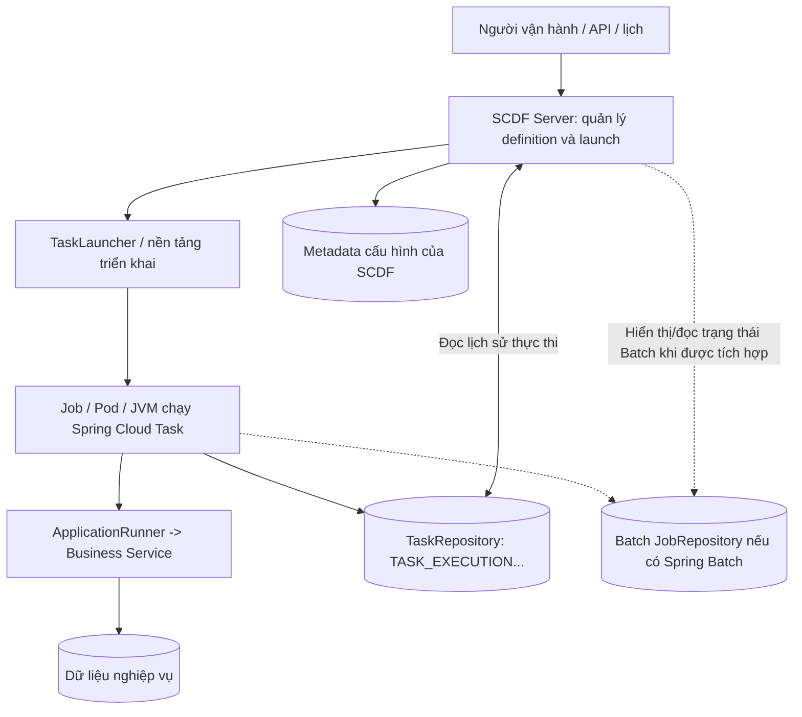
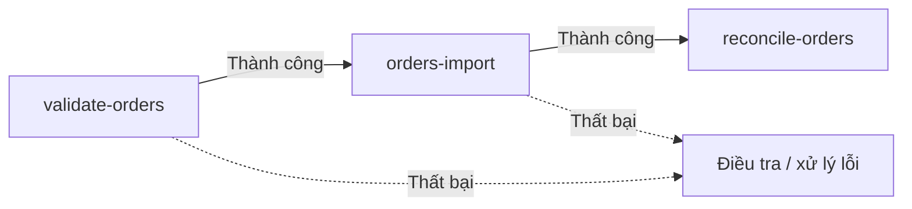

# Vai trò tùy chọn của Spring Cloud Data Flow

## 1. Spring Cloud Task có cần Spring Cloud Data Flow để chạy không?

**Không.** Spring Cloud Task là framework dành cho ứng dụng Spring Boot có **thời gian chạy hữu hạn**: khởi động, nhận tham số, gọi dịch vụ nghiệp vụ, ghi thông tin thực thi qua `TaskRepository`, rồi kết thúc. Một ứng dụng như vậy có thể được chạy trực tiếp bằng `java -jar`, từ cron, Kubernetes Job/CronJob, một pipeline CI/CD hoặc hệ điều phối khác mà **không cài Spring Cloud Data Flow**.

**Spring Cloud Data Flow (SCDF)** là một **lớp quản lý và điều phối tùy chọn** đặt bên ngoài ứng dụng task. Khi sử dụng SCDF, bạn có giao diện/API để đăng ký artifact, tạo task definition, khởi chạy theo yêu cầu, lên lịch trên những nền tảng được hỗ trợ, xem lịch sử thực thi và tổ chức các task thành luồng nhiều bước. Bản thân quy tắc nghiệp vụ vẫn nằm trong ứng dụng Spring Cloud Task.

Ví dụ: một công việc `orders-import` đọc dữ liệu từ đối tác mỗi đêm.

| Trách nhiệm | Không dùng SCDF | Có dùng SCDF |
| --- | --- | --- |
| Viết logic nhập đơn hàng | Spring Boot + Spring Cloud Task | **Vẫn là** Spring Boot + Spring Cloud Task |
| Đọc `--import.date`, `--request-id` | `ApplicationRunner`/service | **Vẫn do ứng dụng** đọc và xử lý |
| Ghi metadata `TaskExecution` | `TaskRepository` của Spring Cloud Task | **Vẫn do task** ghi vào kho metadata phù hợp |
| Khởi chạy thủ công | `java -jar`, Kubernetes Job hoặc API nội bộ | SCDF Shell/UI/REST gọi nền tảng triển khai |
| Lên lịch | cron, Kubernetes CronJob hoặc scheduler khác | SCDF quản lý lịch qua scheduler của nền tảng được hỗ trợ |
| Xem nhiều lần thực thi | SQL, log, dashboard tự xây | SCDF cung cấp danh sách/chi tiết thực thi khi đọc được metadata |
| Điều phối nhiều task | Script/workflow engine tự chọn | Có thể dùng **Composed Task** và Composed Task Runner |

**Mục tiêu của bài** là biết SCDF giúp ích ở đâu, cách nối nó với một task đã viết sẵn và những trường hợp dùng SCDF sẽ chỉ làm hệ thống phức tạp hơn mà chưa mang lại giá trị.

## 2. Phân biệt vai trò framework, runtime và control plane

SCDF không thay Spring Boot, Spring Cloud Task, Spring Batch hay hệ điều hành/container runtime. Các thành phần có phạm vi trách nhiệm khác nhau:



Sơ đồ trên là kiến trúc khái niệm; vị trí triển khai server, metadata, `TaskLauncher` và quyền truy cập phụ thuộc nền tảng. Điều quan trọng là **SCDF yêu cầu runtime để tạo tiến trình**, còn **task phải thực sự chạy và có repository** để dữ liệu lịch sử xuất hiện.

### Từng thành phần làm gì?

| Thành phần | Trách nhiệm | Không tự bảo đảm |
| --- | --- | --- |
| **Spring Cloud Task** | Lifecycle ứng dụng hữu hạn; tạo/cập nhật `TaskExecution` | Lịch chạy, đặt pod, bảo đảm nghiệp vụ exactly-once |
| **`TaskRepository`** | Lưu `TASK_NAME`, thời điểm, exit code, lỗi và tham số theo schema/version | Chứng minh dữ liệu nghiệp vụ đã đủ và đúng |
| **SCDF Server** | API/UI quản lý task app, definition, launch, lịch và metadata điều phối | Trực tiếp thay thế mã nghiệp vụ của task |
| **`TaskLauncher`** | Ánh xạ yêu cầu launch thành tiến trình trên local/Kubernetes/Cloud Foundry hoặc nền tảng hỗ trợ | Bảo đảm task sẽ thành công sau khi được launch |
| **Scheduler nền tảng** | Quyết định thời điểm tạo tiến trình theo lịch | Idempotency, rollback dữ liệu đã commit |
| **Spring Batch** | Xử lý job/step, chunk, checkpoint, restart khi được tích hợp | Tạo `TaskExecution` mới cho mỗi lời gọi service độc lập |

Vì thế, **Data Flow là lớp điều khiển (control plane)**; **Spring Cloud Task là ứng dụng thực thi (workload)**. Trong tài liệu, từ *task* đôi khi chỉ **task definition** do SCDF quản lý, đôi khi chỉ **một instance thực thi** của Spring Cloud Task. Cần phân biệt rõ để không nhầm một định nghĩa với một lần chạy.

## 3. Ba cách kiến trúc: trực tiếp, có scheduler, có SCDF

### Phương án A — Chạy trực tiếp, không SCDF

```text
Người dùng / CI/CD
    -> java -jar orders-import-task.jar --import.date=2026-11-24
    -> Spring Cloud Task + business service
    -> dữ liệu đích + TaskRepository
```

Phương án này phù hợp cho học tập, một vài tác vụ đơn giản, công việc nội bộ nhỏ hoặc khi đã có hệ điều phối đáp ứng yêu cầu. Có thể lấy mã thoát từ tiến trình và truy vấn `TASK_EXECUTION` để điều tra. Bạn phải tự tổ chức phân phối artifact, phân quyền, log, cảnh báo và lịch nếu cần.

### Phương án B — Scheduler/hệ điều phối bên ngoài, không SCDF

```text
cron / Kubernetes CronJob / workflow engine
    -> tạo Job hoặc tiến trình mới theo lịch
    -> Spring Cloud Task
    -> TaskRepository + dữ liệu nghiệp vụ
```

Đây cũng là một thiết kế **đầy đủ và hợp lệ**. Với Kubernetes, CronJob có thể tạo Job/Pod cho mỗi lần chạy; scheduler cung cấp các thuộc tính concurrency, retry và deadline. Spring Cloud Task vẫn có thể ghi metadata nếu các tiến trình sử dụng database bền vững và schema tương thích. Bạn không cần cài SCDF chỉ để dùng cron.

### Phương án C — Dùng Spring Cloud Data Flow

```text
SCDF UI / Shell / REST / schedule
    -> task definition + launch request
    -> TaskLauncher / scheduler của nền tảng
    -> Spring Cloud Task trong Pod/JVM
    -> metadata TaskRepository để SCDF hiển thị lịch sử
```

Phương án C có lợi khi một nhóm vận hành phải quản lý nhiều task, nhiều phiên bản ứng dụng, nhiều tài khoản nền tảng, các lần launch theo yêu cầu và lịch sử tập trung. Đổi lại, bạn có thêm **SCDF Server**, cấu hình database, triển khai artifact, xác thực/phân quyền và công việc nâng cấp/bảo trì.

| Tiêu chí quyết định | Nghiêng về **không dùng SCDF** | Nghiêng về **dùng SCDF** |
| --- | --- | --- |
| Quy mô | Một vài task, ít người vận hành | Nhiều task, nhiều người cùng quản lý |
| Triển khai | Đã có cron/Kubernetes/CI/CD đủ chức năng | Muốn quản lý vòng đời task tập trung bằng UI/API |
| Lịch chạy | Lịch đơn giản, cố định trong hạ tầng hiện có | Muốn quản lý và theo dõi nhiều schedule từ cùng một nơi |
| Workflow | Một công việc độc lập hoặc workflow engine đã có | Muốn composed task gồm nhiều task definition |
| Quan sát | Log/SQL/metrics hiện có đáp ứng | Cần màn hình lịch sử task/Batch tập trung |
| Chi phí vận hành | Muốn ít thành phần và phụ thuộc hơn | Chấp nhận vận hành thêm server và kho metadata |

**Không nên chọn SCDF chỉ vì tên của sản phẩm có chữ “Data Flow”.** Nếu nhu cầu chỉ là chạy một chương trình mỗi đêm, một scheduler và một ứng dụng Spring Cloud Task đã có thể đủ. Nếu workload là dịch vụ HTTP chạy liên tục, Spring Cloud Task hữu hạn cũng không phải giải pháp tương ứng.

## 4. Các khái niệm khi làm việc với SCDF

SCDF thêm một số lớp định danh, nhưng không loại bỏ `TaskExecution` và định danh nghiệp vụ.

| Khái niệm | Ví dụ | Thực chất là gì? |
| --- | --- | --- |
| **Task app registration** | `orders-import` | Tên ứng dụng và URI artifact đã đăng ký với SCDF, kiểu ứng dụng `task` |
| **Task definition** | `orders-daily` | Định nghĩa có tên, trỏ tới task app và thuộc tính cấu hình |
| **Task execution** | Execution ID `125` | Một lần khởi chạy theo definition, có metadata khi thực thi |
| **Task name** | `orders-import-task` hoặc tên do môi trường gán | Tên trong `TaskExecution`; kiểm tra giá trị thực tế thay vì đoán theo definition |
| **Schedule** | `orders-at-2am` | Quy tắc tạo các lần chạy tương lai cho một definition |
| **Batch Job instance** | `importOrdersJob` + identifying parameters | Danh tính Job theo Spring Batch; khác Task execution |
| **Business request key** | `partner-a-2026-11-24` | Khóa một yêu cầu nghiệp vụ, nên ổn định qua retry |

Một definition có thể được launch nhiều lần. Một lần launch có thể thất bại, có `TaskExecution` riêng và được thử lại. **Không dùng SCDF task definition name hoặc TaskExecution ID làm khóa idempotency** cho bản ghi đơn hàng; dùng một `requestId` hoặc khóa nghiệp vụ có quy tắc rõ ràng.

SCDF cũng có metadata quản lý definitions, registrations, platforms và schedules. Metadata của SCDF khác với **bảng `TASK_*` do Spring Cloud Task ghi** và **bảng `BATCH_*` do Spring Batch ghi**. Trong cấu hình được hỗ trợ, SCDF cần đọc được metadata thực thi, vì vậy SCDF Server và task application phải kết nối **cùng kho dữ liệu metadata phù hợp**, không chỉ cùng có một bảng tên `TASK_EXECUTION` ở hai database độc lập.

## 5. Ví dụ ứng dụng Spring Cloud Task chạy độc lập trước

Trước khi đưa ứng dụng vào SCDF, hãy chứng minh nó chạy tốt **không cần SCDF**. Ví dụ sau nhận ngày nhập đơn hàng và `requestId`; runner kiểm tra tham số rồi gọi dịch vụ nghiệp vụ.

### 5.1. Dependency và cấu hình

Trong dự án Maven Spring Boot có BOM Spring Cloud **tương thích với phiên bản Spring Boot**, các dependency cần thiết có thể gồm:

```xml
<dependencies>
    <dependency>
        <groupId>org.springframework.cloud</groupId>
        <artifactId>spring-cloud-starter-task</artifactId>
    </dependency>
    <dependency>
        <groupId>org.springframework.boot</groupId>
        <artifactId>spring-boot-starter-jdbc</artifactId>
    </dependency>
    <dependency>
        <groupId>org.postgresql</groupId>
        <artifactId>postgresql</artifactId>
        <scope>runtime</scope>
    </dependency>
</dependencies>
```

SCDF **không phải dependency bắt buộc trong ứng dụng task**. Khi deploy qua SCDF, thông thường bạn đóng gói chính ứng dụng Spring Cloud Task thành executable JAR hoặc image để `TaskLauncher` khởi động, thay vì nhúng SCDF Server vào process nghiệp vụ.

`src/main/resources/application.yml`:

```yaml
spring:
  application:
    name: orders-import-app
  main:
    web-application-type: none
  datasource:
    url: ${TASK_DB_URL}
    username: ${TASK_DB_USER}
    password: ${TASK_DB_PASSWORD}
  cloud:
    task:
      name: orders-import-task
      initialize-enabled: false
```

`web-application-type: none` giúp tiến trình hữu hạn không mở web server. `initialize-enabled: false` **giả định bảng metadata Spring Cloud Task đã được tạo bằng migration đúng phiên bản** trong database PostgreSQL; nếu chưa có schema, task có thể lỗi ngay ở giai đoạn khởi động. Cấu hình này là lựa chọn cho môi trường có quản lý schema riêng, không phải hướng dẫn kết nối một database trống.

### 5.2. Runner chỉ tiếp nhận yêu cầu

`OrdersTaskApplication.java`:

```java
package com.example.orders;

import java.time.LocalDate;
import java.util.List;

import org.springframework.boot.ApplicationArguments;
import org.springframework.boot.ApplicationRunner;
import org.springframework.boot.SpringApplication;
import org.springframework.boot.autoconfigure.SpringBootApplication;
import org.springframework.cloud.task.configuration.EnableTask;
import org.springframework.context.annotation.Bean;

@EnableTask
@SpringBootApplication
public class OrdersTaskApplication {

    public static void main(String[] args) {
        SpringApplication.run(OrdersTaskApplication.class, args);
    }

    @Bean
    ApplicationRunner runOnce(OrderImportService service) {
        return args -> {
            LocalDate date = LocalDate.parse(required(args, "import.date"));
            String requestId = required(args, "import.request-id");
            long count = service.importFor(date, requestId);
            System.out.printf("request=%s date=%s imported=%d%n",
                    requestId, date, count);
        };
    }

    private static String required(ApplicationArguments args, String key) {
        List<String> values = args.getOptionValues(key);
        if (values == null || values.size() != 1 ||
                values.get(0) == null || values.get(0).isBlank()) {
            throw new IllegalArgumentException("Thiếu hoặc sai --" + key);
        }
        return values.get(0);
    }
}
```

`OrderImportService.java`:

```java
package com.example.orders;

import java.time.LocalDate;
import org.springframework.stereotype.Service;

@Service
public class OrderImportService {

    public long importFor(LocalDate date, String requestId) {
        // Mã học tập: thay bằng xử lý dữ liệu, transaction, kiểm tra nguồn
        // và khóa idempotency theo requestId trong ứng dụng thực tế.
        System.out.printf("IMPORT_START request=%s date=%s%n", requestId, date);
        return 0L;
    }
}
```

Service này **cố ý là stub**: nó không nhập đơn hàng thật. Điều quan trọng cho chủ đề Data Flow là **cùng một runner/service hoạt động cả khi chạy trực tiếp và khi SCDF khởi chạy**, không phải sửa business logic để sử dụng SCDF. Để triển khai production, bổ sung truy cập dữ liệu, khóa nghiệp vụ, giao dịch và idempotency ở service.

Sau khi build thành executable JAR, chạy trực tiếp với môi trường kết nối PostgreSQL đã chuẩn bị:

```bash
java -jar target/orders-import-task.jar \
  --import.date=2026-11-24 \
  --import.request-id=partner-a-2026-11-24
```

`target/orders-import-task.jar` chỉ là tên artifact minh họa. Lần chạy thành công sẽ ghi metadata `TaskExecution` vào kho đã cấu hình. Khi một yêu cầu đầu vào không hợp lệ, runner ném ngoại lệ thay vì nuốt lỗi và in “thành công”; scheduler/SCDF cần nhìn thấy tín hiệu lỗi để xử lý.

## 6. Đưa chính ứng dụng đó vào Spring Cloud Data Flow

Để dùng SCDF, trước tiên cần có **SCDF Server đang hoạt động**, tài khoản có quyền đăng ký/chạy task, một **task platform** được server cấu hình, artifact có thể truy cập trên nền tảng đó và cơ sở dữ liệu metadata mà cả SCDF lẫn ứng dụng task đọc/ghi được. Không phải chỉ cài dependency Spring Cloud Task là các lệnh SCDF sẽ tự hoạt động.

### 6.1. Đăng ký artifact (app registration)

Ví dụ trong **Spring Cloud Data Flow Shell** (không phải Bash/PowerShell thông thường). Giả sử đã build/publish image `registry.example.com/team/orders-import-task:1.0.0` và nền tảng là Kubernetes:

```text
dataflow:> app register --name orders-import --type task --uri docker://registry.example.com/team/orders-import-task:1.0.0
```

URI trong ví dụ là **placeholder**; cần thay bằng image thực tế mà cluster có quyền kéo. Khi chạy trên local task platform, có thể dùng một URI Maven phù hợp, chẳng hạn `maven://com.example:orders-import-task:1.0.0` **nếu artifact đó thực sự đã được publish và runtime tìm được nó**.

Thao tác *register* chỉ khai báo artifact và loại ứng dụng `task`; nó **chưa tạo tiến trình và chưa xử lý dữ liệu**. Tùy cấu hình SCDF, còn có thể cung cấp metadata thuộc tính ứng dụng để hiển thị và hỗ trợ nhập tham số trên UI.

### 6.2. Tạo task definition

```text
dataflow:> task create orders-daily --definition "orders-import"
dataflow:> task list
```

`orders-daily` là **tên task definition trong SCDF**, tham chiếu ứng dụng đã đăng ký với tên `orders-import`. Một definition có thể được chạy nhiều lần mà không cần tạo lại definition cho mỗi ngày. Không nhầm `orders-daily` với khóa nghiệp vụ `partner-a-2026-11-24` hay với ID của một lần thực thi.

### 6.3. Launch theo yêu cầu và truyền tham số

```text
dataflow:> task launch orders-daily --arguments "--import.date=2026-11-24 --import.request-id=partner-a-2026-11-24"
dataflow:> task execution list
```

SCDF chuyển yêu cầu launch cho `TaskLauncher` tương ứng của nền tảng. Việc **nhận được phản hồi launch không đồng nghĩa task hoàn tất thành công**: cần xem execution status, exit code và log sau khi worker/JVM dừng. SCDF UI cũng có phần *Task Executions* để xem lịch sử khi server đọc được metadata của ứng dụng.

`--arguments` truyền **đối số cho ứng dụng task**; chúng vẫn được parse bởi `ApplicationRunner` như chạy trực tiếp. `--properties` trên lệnh `task launch` có mục đích khác: cấp **application/deployment properties** cho `TaskLauncher`, chẳng hạn cấu hình môi trường hoặc tài nguyên trên nền tảng cụ thể. Cú pháp prefix `app.<task-definition>.*`, `deployer.<...>.*` và các trường hợp nâng cao cần đối chiếu tài liệu SCDF/TaskLauncher đúng phiên bản đang dùng.

### 6.4. Kiểm tra metadata ở database

Khi task đã hoàn tất, với schema Spring Cloud Task mặc định có thể kiểm tra:

```sql
SELECT TASK_EXECUTION_ID, TASK_NAME,
       START_TIME, END_TIME, EXIT_CODE,
       EXIT_MESSAGE, ERROR_MESSAGE
FROM TASK_EXECUTION
ORDER BY TASK_EXECUTION_ID DESC;
```

Mỗi lần chạy thường tạo một `TASK_EXECUTION_ID` riêng; `TASK_NAME` phản ánh tên cuối cùng mà cấu hình và `TaskNameResolver` đã chọn. SCDF có thể cấp thêm cấu hình/định danh launch, do đó **hãy đọc dữ liệu thực tế**, không đoán tất cả tên trong SCDF đều bằng `spring.application.name`.

Nếu SCDF hiển thị không có lịch sử trong khi task đã chạy, nguyên nhân thường là server và task **không cùng kho TaskRepository**, thiếu schema/quyền, kết nối sai profile hoặc task lỗi trước khi metadata được ghi. Cần kiểm tra log cả SCDF Server và process task, JDBC URL/schema, table prefix và version tương thích.

## 7. SCDF điều phối lịch chạy, nhưng không biến task thành ứng dụng chạy mãi

SCDF có thể đăng ký lịch tạo task execution trên những nền tảng được hỗ trợ. Ví dụ với task definition `orders-daily`, trên **Kubernetes** ta muốn tạo lịch chạy lúc 02:00 mỗi ngày:

```text
dataflow:> task schedule create --name orders-at-2am --definitionName orders-daily --expression "0 2 * * *"
dataflow:> task schedule list
```

Đây là cú pháp cron **5 trường kiểu Kubernetes**, không phải Quartz expression của Cloud Foundry; múi giờ phụ thuộc cấu hình scheduler/cluster. Để kích hoạt chức năng schedule ở cấu hình SCDF thích hợp, các tính năng task và schedule phải được bật; tài liệu SCDF mô tả các property:

```yaml
spring:
  cloud:
    dataflow:
      features:
        tasks-enabled: true
        schedules-enabled: true
```

Đoạn YAML trên là cấu hình **SCDF Server**, **không phải** `application.yml` bắt buộc của ứng dụng Spring Cloud Task. Trên Kubernetes, SCDF tạo **CronJob** để nền tảng tự thực hiện các lần chạy sau đó. Không mặc định một SCDF Server phải liên tục giữ thread thức đến đúng giờ để trực tiếp chạy `ApplicationRunner`.

**Những điểm phải kiểm tra trước khi dùng schedule:**

- Scheduler trên platform đang sử dụng có được hỗ trợ và đã bật hay chưa. Tài liệu SCDF mô tả scheduling cho Kubernetes và Cloud Foundry; local platform không có tính năng schedule tương đương được cung cấp sẵn.
- Chính sách chạy chồng, deadline, retry/backoff và múi giờ của scheduler. Lịch mới có thể xuất hiện khi lần chạy cũ chưa xong; cần `concurrencyPolicy`, khóa task theo tên hoặc idempotency nghiệp vụ phù hợp.
- Artifact/phiên bản sẽ thực sự được CronJob chạy. Trong cơ chế schedule của SCDF, việc đổi version/properties của task definition **không tự cập nhật một schedule đã tạo**; cần quy trình cập nhật hoặc tạo lại lịch theo tính năng/version nền tảng.
- Tham số nghiệp vụ thay đổi theo ngày. Không hard-code `--import.date=2026-11-24` cho lịch chạy vô hạn. Hãy thiết kế nguồn ngày xử lý theo múi giờ nghiệp vụ, cửa sổ dữ liệu hoặc phương thức cấp tham số được hỗ trợ; giữ `requestId` ổn định để retry cùng ngày an toàn.

Xóa một schedule ngăn **những lần kích hoạt trong tương lai**; không có nghĩa mọi tiến trình đã chạy theo lịch đều bị dừng. Muốn dừng một task đang chạy phải dùng thao tác điều khiển execution/pod tương ứng và cân nhắc dữ liệu đã commit.

## 8. Composed Task: khi cần nhiều công việc hữu hạn nối tiếp

Một lợi ích khác của SCDF là **Composed Task**: định nghĩa luồng có hướng gồm các task độc lập, ví dụ:

```text
validate-orders && orders-import && reconcile-orders
```

Dấu `&&` biểu thị công việc phía sau chỉ được khởi chạy sau khi công việc trước hoàn tất thành công theo cơ chế của composed task. SCDF sử dụng **Composed Task Runner** để điều phối graph và gọi lại API của Data Flow Server nhằm khởi chạy những task con. Đây là **lớp orchestration**, không phải một phương thức Java tự động được nhúng vào mọi `ApplicationRunner`.



Mỗi node cần task app/definition tương ứng đã được đăng ký, và môi trường phải có **Composed Task Runner artifact**, cấu hình truy cập SCDF Server, quyền và hạ tầng deployer phù hợp. SCDF theo dõi điều phối các node; mỗi ứng dụng vẫn tự xử lý dữ liệu và báo trạng thái. Không dùng composed task để che giấu lỗi trong runner: nếu `ApplicationRunner` nuốt exception rồi thoát mã 0, graph có thể chuyển sang bước tiếp theo khi nghiệp vụ thực tế chưa đạt.

Nếu chỉ có một task độc lập mỗi đêm, composed task không đem lại lợi ích bắt buộc. Nếu tổ chức đã có workflow engine phù hợp, có thể dùng engine đó để điều phối các ứng dụng Spring Cloud Task mà **không cần SCDF**.

## 9. Spring Batch và SCDF: ba cấp thực thi khác nhau

Một ứng dụng Spring Cloud Task có thể gọi một **Spring Batch Job**. Khi được SCDF khởi chạy, cần phân biệt:

1. **SCDF task definition và launch request**: mô tả artifact, cấu hình và yêu cầu đặt tiến trình lên nền tảng.
2. **Spring Cloud Task `TaskExecution`**: theo dõi vòng đời JVM/container chạy ứng dụng task.
3. **Spring Batch `JobExecution`/`StepExecution`**: theo dõi tiến độ, commit, lỗi, checkpoint và restart ở cấp Batch Job/Step.

| Câu hỏi | Nơi xem phù hợp |
| --- | --- |
| Task được triển khai ở platform nào? | SCDF launch/deployment và log nền tảng |
| Một lần chạy task đã kết thúc với exit code nào? | `TASK_EXECUTION`, SCDF Task Executions UI |
| Batch Job nào đã FAILED, Step nào rollback? | `BATCH_JOB_EXECUTION`, `BATCH_STEP_EXECUTION`, JobRepository |
| Hàng nào thực sự ghi vào DB, file nào đã xuất? | Dữ liệu nghiệp vụ, manifest và bằng chứng từ bên nhận |
| Có nên retry một Job instance đã thất bại? | JobRepository, identifying `JobParameters`, checkpoint và chính sách idempotency |

SCDF có thể hiển thị thông tin Batch khi được tích hợp và truy cập đúng metadata, nhưng **không được suy luận `TaskExecution ID = JobExecution ID`**. Cũng không nên nghĩ SCDF cấp *exactly once*; nếu một task đã commit dữ liệu rồi mất kết nối, launch lại vẫn có thể ghi trùng nếu ứng dụng thiếu ràng buộc nghiệp vụ.

## 10. Bảo mật và vận hành khi thêm SCDF

Khi chọn SCDF, công việc không chỉ là chạy được lệnh `task launch`. Một kiến trúc production cần tối thiểu những kiểm soát sau:

### 10.1. Artifact, version và quyền thực thi

- **Pin version** của artifact/image: tránh tag thay đổi âm thầm và ghi lại phiên bản nào đã chạy theo mỗi execution. Thiết lập quy trình rollout/rollback.
- **Phân quyền SCDF**: ai được đăng ký artifact, thay task definition, launch, tạo schedule, xem log và xóa lịch. SCDF Server API cần được bảo vệ bằng xác thực/phân quyền phù hợp.
- **Kiểm soát runtime**: namespace, service account, network policy, quota, CPU/RAM, số lần launch đồng thời, thời gian giữ log/pod và quyền truy cập storage theo nền tảng.
- **Không để secret trong lệnh launch**: CLI arguments và metadata/log có thể làm lộ token hoặc password. Ưu tiên secret store/Kubernetes Secret hoặc cơ chế cấp biến môi trường an toàn của runtime; kiểm tra cách entrypoint truyền app properties.

### 10.2. Dùng đúng kho metadata

SCDF cần kết nối đến kho metadata task đúng với ứng dụng. Trên nhiều nền tảng, SCDF Server và task application phải truy cập **cùng database metadata** để UI hiển thị các `TaskExecution`; một database `jdbc:h2:mem:...` trong mỗi Pod/JVM không thể đóng vai trò kho chung. DDL `TASK_*` và `BATCH_*` cần đúng phiên bản framework, quản lý migration và quyền JDBC phù hợp.

Không sửa trực tiếp hàng `TASK_EXECUTION` để làm “đẹp” kết quả. Lỗi thực thi và kết quả nghiệp vụ cần được giữ thành thông tin kiểm toán, còn việc xác nhận yêu cầu đã hoàn tất có thể được ghi trong bảng đối soát riêng theo `requestId`.

### 10.3. Phân biệt giới hạn đồng thời ở các tầng

| Cơ chế | Giới hạn gì? | Không giải quyết vấn đề nào? |
| --- | --- | --- |
| SCDF giới hạn task launches theo platform/account | Tổng số task đang chạy trên một cấu hình nền tảng theo chính sách SCDF | Không bảo đảm một loại nghiệp vụ chỉ có một instance |
| `spring.cloud.task.single-instance-enabled=true` | Ngăn nhiều instance **cùng tên task** trong phạm vi kho khóa chung khi cấu hình đủ | Không giới hạn các task tên khác nhau cùng ghi một bảng |
| Kubernetes CronJob `concurrencyPolicy` | Chạy chồng các Job do **chính CronJob đó** quản lý | Không quản lý một launch thủ công từ nơi khác |
| Unique constraint và idempotency ở nghiệp vụ | Chặn/làm an toàn thao tác lặp trên cùng dữ liệu logic | Không tự làm lịch chạy hoặc hạn chế tất cả worker |

Các cơ chế này có thể phối hợp. Chẳng hạn, một schedule gây ra hai lần khởi chạy liên tiếp khi task cũ còn chạy: scheduler có thể từ chối launch trùng, còn service phải vẫn an toàn nếu cùng một `requestId` được phát lại sau crash.

### 10.4. Quan sát và xử lý lỗi

Theo dõi **trạng thái launch, trạng thái tiến trình, `TaskExecution`, JobExecution nếu có và dữ liệu nghiệp vụ**. Một response thành công từ API “launch” không có nghĩa dữ liệu đã xử lý; `EXIT_CODE=0` cũng chưa chứng minh mọi giao dịch ở hệ thống bên ngoài đã được xác nhận.

Nếu task gặp timeout hoặc bị dừng đột ngột, kiểm tra log nền tảng và metadata có `END_TIME` rỗng; xác minh tiến trình cũ đã dừng trước khi retry. Cần phân biệt lỗi triển khai image/quyền/mạng với lỗi đọc file, dữ liệu không hợp lệ và lỗi kết nối CSDL; mỗi loại cần chính sách retry và cảnh báo khác nhau.

## 11. Những hiểu lầm và lỗi phổ biến

| Hiện tượng | Nguyên nhân có thể | Hướng xử lý |
| --- | --- | --- |
| “Chưa cài SCDF nên Spring Cloud Task không chạy được” | Nhầm framework với hệ điều phối | Chạy trực tiếp `java -jar`; kiểm tra DataSource và schema Task |
| Register task app xong nhưng không có execution | Registration chưa phải launch | Tạo definition và gọi `task launch` |
| `task launch` báo đã nhận nhưng không thấy kết quả | Task chưa hoàn tất, deployer lỗi hoặc không cùng metadata DB | Đọc log runtime, SCDF Server và `TASK_EXECUTION` |
| SCDF UI trống dù task chạy thành công ngoài SCDF | Server/task không chia sẻ metadata store hoặc khác schema/prefix | Kiểm tra JDBC URL, schema, quyền và version |
| Schedule chạy ngày hôm sau vẫn dùng image/config cũ | Schedule không tự nhận thay đổi definition | Áp dụng quy trình update/recreate schedule phù hợp platform |
| Cron expression báo không hợp lệ | Nhầm Kubernetes 5 trường với Quartz/Cloud Foundry | Dùng cú pháp dành cho scheduler đang chạy |
| Task bị chạy trùng sau retry | Không có idempotency key hoặc chính sách concurrency | Dùng `requestId` ổn định, unique constraint, lock khi cần |
| Mọi batch retry đều tạo Job instance mới | Gắn `run.id` ngẫu nhiên hoặc thay identifying params | Giữ tham số nhận diện của Job instance cần restart |
| Composed task chuyển bước dù dữ liệu chưa đủ | Task trước nuốt lỗi, báo thành công giả | Bắt lỗi đúng, trả exit code phù hợp, đối soát đầu ra |
| SCDF Server không tạo được Pod | Thiếu `TaskLauncher`, quyền, image pull secret hoặc quota | Kiểm tra deployment platform và sự kiện pod/log |
| Secrets xuất hiện trong log hoặc process args | Truyền password qua `--arguments`/properties không an toàn | Chuyển sang secret management, rà soát cách runtime map properties |

## 12. Bài thực hành và câu hỏi tự kiểm tra

1. Chạy một Spring Cloud Task bằng `java -jar` mà **không dùng SCDF**. Giải thích ứng dụng vẫn ghi `TaskExecution` trong điều kiện nào, và vì sao không cần SCDF Server.
2. Liệt kê các bước để dùng SCDF cho cùng artifact: **register app → create definition → launch → theo dõi execution**. Phân biệt ba tên `orders-import`, `orders-daily`, `orders-import-task`.
3. Với một SCDF task definition, chạy hai lần có cùng `--import.request-id`. Vì sao có thể có hai `TaskExecution` nhưng chỉ nên có một kết quả nghiệp vụ?
4. Trên Kubernetes, tạo lịch chạy vào 02:00 mỗi ngày. Kiểm tra múi giờ và chính sách concurrency. Vì sao không được hard-code ngày xử lý cố định cho lịch chạy nhiều năm?
5. Giả sử SCDF hiển thị không có execution nhưng Pod đã hoàn tất. Nêu thứ tự kiểm tra: database, schema, quyền truy cập, log SCDF, log Pod và `TaskRepository`.
6. So sánh ba cách giải quyết cùng một bài toán “chạy task mỗi đêm”: cron trên VM, Kubernetes CronJob trực tiếp và SCDF schedule. Khi nào SCDF tạo thêm giá trị thực tế?
7. Vẽ một composed task `validate && import && reconcile`. Phải xảy ra điều gì khi `validate` thất bại? Vì sao tác vụ import không nên nuốt exception?
8. Nếu task chạy Spring Batch, xác định bảng metadata nào trả lời câu hỏi về Job/Step, bảng nào trả lời câu hỏi về tiến trình task và dữ liệu nào xác nhận đơn hàng thực sự đã nhập.
9. Thiết kế checklist bảo mật/triển khai cho một task do SCDF launch: version artifact, image registry, credentials, DB migration, quyền, concurrency, timeout, log và idempotency.

**Tổng kết:** Spring Cloud Data Flow là **một lựa chọn điều phối**, không phải điều kiện để ứng dụng Spring Cloud Task hoạt động. Hãy bắt đầu từ một task hữu hạn có đầu vào rõ ràng, `TaskRepository` được cấu hình đúng và nghiệp vụ chạy lại an toàn. Chỉ bổ sung SCDF khi đăng ký, triển khai, lập lịch, giám sát tập trung hoặc composed task thực sự giúp đơn giản hóa hệ thống vận hành.

## 13. Tài liệu tham khảo

- [Spring Cloud Task Reference Guide](https://docs.spring.io/spring-cloud-task/reference/): mô hình task hữu hạn, `TaskExecution` và `TaskRepository`.
- [Spring Cloud Data Flow — Architecture](https://dataflow.spring.io/docs/concepts/architecture/): vai trò của short-lived application và Data Flow.
- [Spring Cloud Data Flow — Deploying a Spring Cloud Task](https://dataflow.spring.io/docs/batch-developer-guides/batch/data-flow-simple-task/): registration, definition, launch và theo dõi execution.
- [Spring Cloud Data Flow — Scheduling](https://dataflow.spring.io/docs/feature-guides/batch/scheduling/): task scheduling theo nền tảng và quản lý lịch.
- [Spring Cloud Data Flow — Composed Tasks](https://dataflow.spring.io/docs/feature-guides/batch/composed-task/): composed task và Composed Task Runner.
- [Spring Cloud Data Flow Reference Guide](https://docs.spring.io/spring-cloud-dataflow/docs/current/reference/htmlsingle/): Shell/REST, task definitions, arguments/properties và giới hạn task launch.

Các lệnh SCDF trong bài là ví dụ để học và cần SCDF Server/TaskLauncher đúng phiên bản, artifact thực sự có thể triển khai và database metadata đã chuẩn bị. Với các phiên bản khác nhau, hãy kiểm tra cú pháp Shell, API, mô hình scheduling và các điều kiện tương thích trước khi áp dụng trên production.
